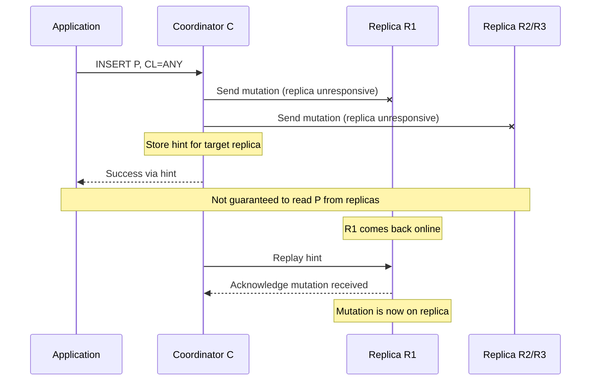

# ANY for Write Operations and Its Relationship with Hinted Handoff

In Apache Cassandra, the **`ANY`** consistency level is a special option for **writes**: the coordinator can return success when **one target replica confirms the mutation**, or, when target replicas cannot currently accept the write, when **the coordinator stores a hint** to forward the mutation to a replica later. This allows some writes to be accepted even when **no target replica is responding**. However, success at `ANY` **does not mean the data is already on a replica and immediately readable**.

This lesson belongs to the **Read/Write Consistency** chapter of the `DATABASE_ENGINE_WIDE_COLUMN_CASSANDRA` module. The module aims to build an understanding of Cassandra's distributed architecture and wide-column model—especially partition keys, query-driven table design, read/write CLs, CQL practice, replication, compaction, repair, error handling, and Java integration. The focus here is **how `ANY` relates to hinted handoff, what guarantees it actually provides, and the scenarios where applications should avoid `ANY`**.

> **Remember right away:** `ANY` is a consistency level for **normal writes**; Cassandra **does not accept `ANY` for `SELECT`**. A hint is a record waiting to deliver a mutation, **not** a replica storing data according to the replication factor.

## 1. Learning Objectives

After this lesson, you will be able to:

1. Explain the exact success condition of an `ANY` write.
2. Distinguish a **replica ACK** from **success via hint**.
3. Describe the mutation path through the coordinator, local hint storage, and the **hinted handoff** process when a replica comes back online.
4. Compare `ANY` with `ONE`, `LOCAL_ONE`, and `QUORUM` regarding availability, read-after-write capability, and data-loss risk.
5. Correctly interpret hint configuration settings, status, and monitoring metrics.
6. Configure `ANY` in `cqlsh` and the Java Driver; design applications to handle timeouts, retries, and not-yet-readable operations.

## 2. Why Distinguish Replication from Consistency Level?

### Replicas and Coordinator

In Cassandra, the **partition key** determines which partition a row belongs to. The **replication strategy** and **replication factor (RF)** determine which nodes are the target replicas for that partition. A client sends CQL commands to a node acting as the **coordinator**, and the coordinator coordinates the mutation across the relevant replicas.

Suppose a keyspace has **RF = 3** in a single datacenter:

```text
                  Cassandra cluster

Application --> Coordinator C
                 |      |      |
                 v      v      v
                R1     R2     R3

                   RF = 3
        Three replicas for one partition
```

Choosing `ANY` **does not reduce RF from 3 to 1 or 0**. Cassandra still wants to deliver the mutation to **all three target replicas**. What changes is **the condition for the coordinator to report success to the client**.

| Concept | Meaning | What must NOT be inferred? |
| --- | --- | --- |
| RF = 3 | The partition is configured to have three target replicas. | Does not mean all three replicas are currently up. |
| `CL=ONE` | Requires at least **one target replica** to confirm the write. | Storing a hint alone is not enough to satisfy `ONE`. |
| `CL=ANY` | One replica confirms **or** the coordinator stores an eligible hint. | No guarantee which replica received the data. |
| Hinted handoff | Forwards a mutation held as a hint to a replica when it becomes reachable. | Not a new replica and does not replace repair. |

### `ANY` Is the "Lowest Response Threshold" in a Special Way

Unlike `ONE`, `TWO`, and `QUORUM`—which demand responses from replicas—`ANY` has an **alternative success path**: storing a hint on the coordinator. Therefore, `ANY` should not be modeled simply as "`W=1` from a replica," especially when all replicas are unavailable.

Two responses returned to the client can both be labeled **write succeeded**, yet carry very different meanings:

- **Case A:** A target replica received and ACKed the mutation. The data resides on at least one target replica at response time.
- **Case B:** No target replica ACKed, yet the coordinator stored a hint. The data may **exist only as a hint on the coordinator**, not yet readable from the partition's target replicas.

If the coordinator also fails before the hint is delivered and no other copy holds the mutation, that mutation can be lost. An `ANY`-style success **does not offer the same data protection as a quorum-ACKed write**.

## 3. How Does Hinted Handoff Work?

A **hint** is information about a mutation that a target replica missed. Cassandra stores hints locally on the coordinating node, recording the intended replica, payload, and necessary metadata. When the replica returns or can accept writes, the **hinted handoff** service replays the hint to the target replica.

Suppose nodes `R1`, `R2`, and `R3` are replicas for partition `P`, and node `C` is a coordinator **not among the three target replicas**. All three replicas are temporarily unable to accept the mutation:



In this diagram:

1. The application writes a mutation with `CL=ANY`.
2. The coordinator locates target replicas based on the partition key and replication strategy.
3. No target replica receives/ACKs in the assumed scenario.
4. If the coordinator **successfully stores a suitable hint**, it can return success to the client.
5. When a target replica returns, the handoff service delivers the hint and the replica applies the mutation.
6. Other replicas still missing the data must be updated via recovery mechanisms; repair still has its own role.

**Critical condition:** There must still be a coordinator healthy enough to receive the request and store the hint; if the entire cluster cannot accept connections, or the coordinator cannot store the hint due to errors/resource limits, `ANY` **can still fail**. Hence the claim "`ANY` always succeeds during any outage" is false.

### Hinted Handoff Is Not Exclusive to `ANY`

Consider **RF = 3** with `CL=QUORUM`. If `R1` and `R2` ACK the write while `R3` is down:

- The write has already **achieved `QUORUM`** after two ACKs; `R3`'s hint is **not** a quorum ACK.
- The coordinator can retain a hint for `R3` so that replica receives the mutation when it returns.
- If the write used `ANY` in that situation, the request could also succeed from `R1`'s ACK; a hint is **not necessarily** used as the return condition.

Hinted handoff is a mechanism supporting recovery for **replicas that missed writes**, whereas `ANY` is a **consistency level** that permits hint storage to satisfy the success condition when no target replica responds. The two concepts are related, not identical.

## 4. How Do `ANY` and `ONE` Differ?

Typical case: single datacenter RF = 3, coordinator still up:

| Target Replica State | Write `ANY` | Write `ONE` | Write `QUORUM` |
| --- | --- | --- | --- |
| All 3 replicas respond | Can succeed | Can succeed | Can succeed (needs 2 ACKs). |
| Only 1 replica responds | Can succeed via 1 ACK | Can succeed via 1 ACK | Not enough for 2 ACKs. |
| **0 replicas respond**, coordinator stores hint | **Can succeed via hint** | **Fails `ONE`** | **Fails `QUORUM`**. |
| **0 replicas respond**, coordinator also fails to store hint | **Fails `ANY`** | Fails `ONE` | Fails `QUORUM`. |

Assume all responses arrive before deadlines and no other errors occur. The table reflects **ability to satisfy CL**, not a guarantee that every request completes.

### `ANY` Is Not the Same as `LOCAL_ONE`

`LOCAL_ONE` requires **a replica in the coordinator's datacenter** to confirm the write. `ANY` does not require that: it can succeed via a **locally stored hint**, even if no target replica responds. Do not mistake `LOCAL_ONE` for "local `ANY`"; the two levels differ in **what constitutes a valid response**.

### `ANY` Is Not Enough to Prove Data Has Been Replicated

RF = 3 remains three desired copies, yet right after a hint-based `ANY` write, **all three target replicas may still lack the mutation**. The system needs handoff or an appropriate synchronization mechanism for the mutation to reach replicas. A hint sitting on the coordinator **is not** a fourth replica and does not raise data durability protection.

## 5. Reading After an `ANY` Write: The Biggest Risk

`ANY` only supports **writes**. A `SELECT` statement with `CONSISTENCY ANY` is invalid in Cassandra. However, a more common hazard is: an `ANY` write succeeds, and the application then switches to a **`ONE` or `QUORUM` read** assuming the data is definitely readable.

### Timeline: Succeeded, Yet Not Readable

```text
t0: R1, R2, R3 fail to receive the mutation.
t1: Coordinator stores hint H for partition P.
t2: INSERT at ANY returns success.
t3: Application runs SELECT P at ONE.
    If no target replica is available -> not enough replicas to read.
t4: R1 recovers, but hint H has not been replayed yet.
    SELECT at ONE may not see P or may see an older value.
t5: Hint H is replayed and R1 applies the mutation.
    SELECT can see P when reading from the updated replica.
```

Cassandra's read path fetches data from **the partition's replicas**, and does not treat an un-replayed hint as a readable copy. Confirming an `ANY` write **provides no read-your-writes guarantee** for the subsequent read request.

### Why Can't We Use `R + W > N` Like with `QUORUM`?

The quorum intersection rule:

\[
R + W > N
\]

applies when `R` and `W` count **actual replicas** in the same replica set. When `ANY` succeeds solely via a hint on the coordinator, **no target replica necessarily ACKed the write**. Thus you cannot plug in `W = 1` and deduce that an `ANY` write plus an `ALL` read guarantees an overlapping replica with the write ACK set.

Even after all target replicas recover, a read executed **before the hint is replayed** still has no guarantee of seeing that mutation. If a workload requires reading immediately after writing, `ANY` is usually the wrong choice.

## 6. Are Hints Guaranteed to Be Delivered?

**No. Hinted handoff is best effort**, not a guarantee that every missed mutation will eventually appear on every replica.

Reasons a hint may fail to be replayed:

- **Coordinator loses data or fails permanently:** Undelivered hints on the coordinator can be lost along with that disk/node.
- **Target replica stays down too long:** Cassandra bounds the window during which it **continues generating hints** for a down replica. After that window, new mutations may not be stored as hints for that replica.
- **Resource/hint storage limits:** Disk space, delivery throughput, and configuration limits affect hint storage/replay capacity.
- **Node replacement or topology changes:** Hints targeting an old endpoint may not replay as the application expects; proper operational procedures and repairs are needed.
- **Handoff disabled or paused:** You cannot assume hints are always generated/delivered under every configuration.

For example, current Cassandra documentation lists a default hint generation window typically of **3 hours** via `max_hint_window`; older docs/versions may name it `max_hint_window_in_ms`. This is a limit on **how long a down node continues having new hints created for it**, **not** a promise that a hint self-destructs after exactly three hours or that all hints are delivered within three hours.

### Hinted Handoff and Repair Are Different

| Hinted handoff | Anti-entropy repair |
| --- | --- |
| Records mutations the coordinator knows a replica missed. | Compares data across replicas to detect and fix divergences. |
| Primarily serves short periods when a replica temporarily missed writes. | Resolves divergences persisting after long outages, lost hints, or node changes. |
| Replays based on retained hints. | Does not require retaining original hints for every mutation. |
| **Best effort**; does not replace a repair schedule. | Essential operational tool for keeping data consistent across replicas. |

**Compaction** is the mechanism for managing SSTables and tombstones, not a replacement for repair. In environments with deletes and tombstones, skipping repair can also create risks around deleted data resurrecting if a replica misses tombstones for too long; this is why a repair policy aligned with `gc_grace_seconds` and workload traits is essential.

## 7. Operational Monitoring and Configuration of Hints

The settings below reside in Cassandra's configuration (`cassandra.yaml`) and may differ in name or value by **version**:

| Setting | Effect |
| --- | --- |
| `hinted_handoff_enabled` | Enables/disables hinted handoff. |
| `hinted_handoff_disabled_datacenters` | DCs excluded from hint generation/delivery. |
| `max_hint_window` | Time window during which new hints are still generated for a down replica; some older versions call it `max_hint_window_in_ms`. |
| `hints_directory` | Location on the node where hint files are stored. |
| `hinted_handoff_throttle` | Bandwidth limit for hint delivery. |
| `max_hints_delivery_threads` | Number of parallel hint delivery threads. |
| `max_hints_size_per_host` | Hint storage cap per endpoint, if supported by version and config. |

In modern Cassandra versions, you can start observing with **read-only status commands**:

```bash
# Run on a node with nodetool installed:
nodetool statushandoff
nodetool getmaxhintwindow
```

Some versions or distributions vary in syntax/capabilities. In addition, you can monitor **JMX metrics** related to `HintsService` and `HintedHandOffManager`, such as hints created, hints failed to store, and delivery progress. Do not look only at write success responses: monitor **hint backlog**, replay errors, and replica health.

**Operational warning:** Increasing `max_hint_window` or lowering throttling does not unconditionally make the system "more consistent"; these changes can increase disk usage and the volume of data transferred when a node returns. Size them according to actual write throughput, disk capacity, and expected recovery times.

## 8. CQL Practice: Writing `ANY`, Reading with a Valid CL

Suppose a test cluster has **at least four nodes in datacenter `dc1`**; a partition belongs to three replicas since the keyspace has RF = 3, while another node can act as a coordinator outside the partition's replica set. **Do not use a production cluster to intentionally stop multiple replicas.**

Create a keyspace and table modeled for the query "view the latest events for an account":

```sql
-- Replace dc1 with the actual datacenter name of your test cluster.
CREATE KEYSPACE IF NOT EXISTS any_lab
WITH replication = {
  'class': 'NetworkTopologyStrategy',
  'dc1': 3
};

CREATE TABLE IF NOT EXISTS any_lab.event_by_account (
  account_id uuid,
  occurred_at timestamp,
  event_id uuid,
  event_type text,
  payload text,
  PRIMARY KEY ((account_id), occurred_at, event_id)
) WITH CLUSTERING ORDER BY (occurred_at DESC, event_id ASC);
```

`account_id` is the **partition key**, and `occurred_at` and `event_id` are **clustering columns**. This design supports querying the latest events for an account without scanning the whole table.

In `cqlsh`:

```sql
-- Write: one replica ACKs or the coordinator stores a hint.
CONSISTENCY ANY;

INSERT INTO any_lab.event_by_account (
  account_id, occurred_at, event_id, event_type, payload
) VALUES (
  11111111-1111-4111-8111-111111111111,
  '2026-11-21 08:00:00+0000',
  22222222-2222-4222-8222-222222222222,
  'SENSOR_READING',
  '{"temperature":27}'
);

-- ANY is invalid for SELECT: switch CL before reading.
CONSISTENCY ONE;

SELECT occurred_at, event_id, event_type, payload
FROM any_lab.event_by_account
WHERE account_id = 11111111-1111-4111-8111-111111111111
LIMIT 10;
```

**Do not infer from a successful `INSERT` that `SELECT` will definitely see the event.** When `ANY` uses the hint path, a read may lack enough replicas, return stale data, or miss the new row until the hint is replayed.

`CONSISTENCY` is an **interactive `cqlsh` command**, not a clause appended to `INSERT`/`SELECT`. If you want to test behavior when replicas are down, build a test topology and verify exactly which replicas hold the partition before simulating failures; do not guess from node order or names.

## 9. Writing `ANY` per Statement in Java Driver 4.x

A Java application can set `ANY` on a write statement while the read path uses another level. The snippet below uses a `CqlSession` already configured with contact points, local datacenter, and appropriate authentication:

```java
import com.datastax.oss.driver.api.core.CqlSession;
import com.datastax.oss.driver.api.core.DefaultConsistencyLevel;
import com.datastax.oss.driver.api.core.cql.BoundStatement;
import com.datastax.oss.driver.api.core.cql.PreparedStatement;
import com.datastax.oss.driver.api.core.cql.ResultSet;

import java.time.Instant;
import java.util.UUID;

public final class EventRepository {
    private final CqlSession session;
    private final PreparedStatement insertEvent;
    private final PreparedStatement readEvents;

    public EventRepository(CqlSession session) {
        this.session = session;
        this.insertEvent = session.prepare(
            "INSERT INTO any_lab.event_by_account " +
            "(account_id, occurred_at, event_id, event_type, payload) " +
            "VALUES (?, ?, ?, ?, ?)");
        this.readEvents = session.prepare(
            "SELECT occurred_at, event_id, event_type " +
            "FROM any_lab.event_by_account " +
            "WHERE account_id = ? LIMIT 10");
    }

    public void recordEvent(
            UUID accountId, Instant occurredAt, UUID eventId,
            String eventType, String payload) {
        BoundStatement write = insertEvent.bind(
                accountId, occurredAt, eventId, eventType, payload)
            .setConsistencyLevel(DefaultConsistencyLevel.ANY);

        session.execute(write);
        // Success may reflect only that the coordinator stored a hint.
        // Does not automatically mean the event is immediately readable.
    }

    public ResultSet recentEvents(UUID accountId) {
        BoundStatement read = readEvents.bind(accountId)
            .setConsistencyLevel(DefaultConsistencyLevel.LOCAL_QUORUM);
        return session.execute(read);
    }
}
```

**Retry design note:** The example takes `eventId` and `occurredAt` from the caller so the application can reuse the **same primary key** when resending an event. Generating a new ID on each retry can create **multiple rows** for the same event. If the client receives a timeout, never assume the mutation was definitely not written; apply a bounded retry policy that accounts for idempotency.

The read path in the example uses `LOCAL_QUORUM` to illustrate a valid read CL. **It does not immediately fix** the case where an `ANY` write only exists as a hint. In applications that need confirmation a record is on replicas for subsequent reads, consider writing at `LOCAL_QUORUM` or another suitable level instead of `ANY`.

### Should You Use `ANY` with Counters or LWT?

- **Counters:** Cassandra does not support counter writes at `CL=ANY` in standard OSS releases; counters follow a special update path and cannot be treated as ordinary idempotent mutations. Choose a CL supported for counters and verify against your deployment version.
- **LWT / conditional writes:** `INSERT ... IF NOT EXISTS` and `UPDATE ... IF` use Paxos and have separate serial consistency (`SERIAL`/`LOCAL_SERIAL`) semantics. Never treat a normal `ANY` write's success as proof that an atomic conditional comparison succeeded.
- **Batches:** Do not assume grouping multiple mutations in a batch and setting `ANY` creates an atomic transaction or guarantees reading back all rows. Batches and CL solve different problems.

## 10. When Should and Shouldn't You Choose `ANY`?

| Need | Assessment of `ANY` | Reason |
| --- | --- | --- |
| Ingesting low-criticality telemetry, prioritizing write acceptance even during replica downtime | **Can be considered** | Allows storing hints in certain outages where `ONE` would fail. |
| Writing then immediately querying the record for the next business step | **Usually unsuitable** | Hint-based success does not guarantee readability. |
| Financial transactions, critical order states, requiring replication before confirmation | **Unsuitable** | A single hint on a coordinator carries data-loss risk. |
| Counting views, incrementing counters | **Do not use `ANY`** | Counter writes do not support this CL in standard Cassandra OSS. |
| Expecting replicas to stay permanently consistent without repair | **Unsuitable** | Hinted handoff is only best effort. |

**Real-world example:** An IoT device sends a temperature reading. If losing a few samples during a severe failure does not affect safety or business logic, the application **may** accept `ANY` to prioritize availability. However, if the requirement is "every sample must be durably persisted even if the coordinator dies right after the ACK," a hint-based success **is not enough**; the system should consider multi-ACK writes, durable queues, or ingestion strategies with proper retries/reconciliation.

Do not pick `ANY` just because the name sounds like "accept everything." Ask explicitly: **If the response succeeds yet replicas do not have the data yet, can the application tolerate that?**

## 11. Thought Exercises

### Exercise 1 — Zero Replicas

A partition with RF = 3 has all three target replicas unresponsive, while another coordinator remains up and can store hints. Can `ANY`, `ONE`, and `QUORUM` writes satisfy their CLs?

**Answer:** `ANY` **can** succeed if a hint is stored successfully. `ONE` and `QUORUM` **cannot**, because no target replica acknowledges. There is no guarantee the newly written row can be read right now.

### Exercise 2 — Wrote `ANY`, Read Not Found

A client writes at `ANY` and receives a success response. Immediately afterward, it reads at `ONE` and receives an old value. Is this a contradiction?

**Answer:** No. The mutation may only be in a hint or the queried replica may not have updated yet. `ANY` does not guarantee read-your-writes.

### Exercise 3 — Hints When Using `QUORUM`

With RF = 3, `R1` and `R2` ACK the mutation, and `R3` is down. Does a `QUORUM` write need a hint to count as one of the two ACKs?

**Answer:** No. Two ACKs already came from replicas. Hints may be stored to help `R3` catch up later, but a hint **is not** a quorum ACK.

### Exercise 4 — Still Stale the Next Day

A replica goes down longer than the hint creation window and then returns. Can we assume hinted handoff automatically resolves all missed data?

**Answer:** No. Hints may no longer exist for missed mutations; you need to check and run **anti-entropy repair** per operational procedures.

### Exercise 5 — Coordinator Lifecycle

An `ANY` write succeeds solely via a hint on coordinator `C`; before handoff occurs, `C`'s disk fails unrecoverably. What is the main risk?

**Answer:** If no replica received the mutation and no copy of the hint remains, the mutation can be **permanently lost**. That is why `ANY` must never be treated as equivalent to a replicated write.

### Exercise 6 — Choosing CL by Business Logic

A Java service creates an invoice, and right after a successful write it must immediately read it back to confirm and emit a shipping event. Should it choose `ANY` just to reduce timeout rates?

**Answer:** Usually no. `ANY` can return success when the data is only in a hint and not yet readable. You should determine read/write CLs with appropriate guarantees, design idempotent retries, and handle business rules using the necessary protocols/transactions.

## 12. Summary

`ANY` is a **write** CL with a special success condition: **an ACK from at least one target replica, or storing a hint to deliver the mutation later**. It increases write acceptance when replicas are temporarily unavailable, while creating a gap between **"write accepted"** and **"data present on replicas for reading."**

Hinted handoff helps replicas catch up after brief outages, yet it is a **best effort** mechanism dependent on the coordinator, disks, hint generation window, topology, and operational configuration. It must be combined with repair, hint monitoring, controlled retries, and data modeling with stable primary keys. When a Java application needs immediate read-after-write or high durability, `ANY` generally fails to meet those expectations.

### References

- [Apache Cassandra — Dynamo and tunable consistency](https://cassandra.apache.org/doc/stable/cassandra/architecture/dynamo.html): definition of `ANY` and how CL controls responses.
- [Apache Cassandra — Hints and hinted handoff](https://cassandra.apache.org/doc/stable/cassandra/managing/operating/hints.html): hint storage/replay mechanics, best-effort limits, configuration, and operations.
- [Apache Cassandra — cassandra.yaml configuration](https://cassandra.apache.org/doc/stable/cassandra/managing/configuration/cass_yaml_file.html): handoff configuration options by version.
