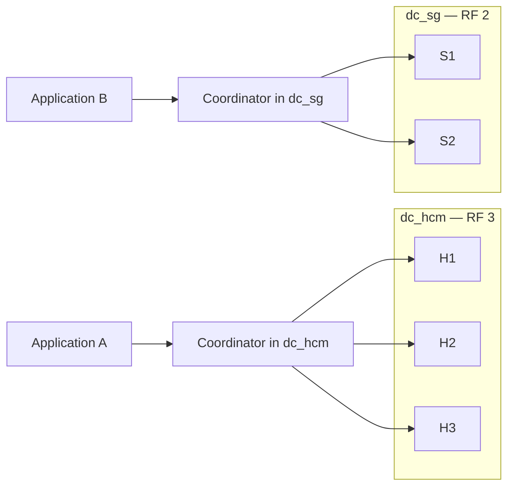

# Calculating Quorum Response Counts from RF and Datacenter Scope

In Apache Cassandra, **quorum** is the response threshold representing a **majority of replicas** within a defined scope. To calculate the exact number of responses the coordinator must wait for, you must first know the **replication factor (RF)** and the **replica scope** of the chosen consistency level (CL). With multiple datacenters (DCs), simply remembering "quorum is more than half" is not enough: **more than half of which DC, or of all replicas of the partition?**

This lesson belongs to the **Read/Write Consistency** chapter in the `DATABASE_ENGINE_WIDE_COLUMN_CASSANDRA` module, where we explore distributed architecture, the wide-column model, partition keys, query-driven table design, CQL practice, replication, compaction, repair, error handling, and connecting to Cassandra from Java applications. The focus of this lesson is **calculating exact numerical response thresholds**, explaining datacenter conditions, and using the results to choose a CL.

## 1. Learning Objectives

After this lesson, you will be able to:

1. Explain RF, replicas, coordinator, and local DC in quorum calculations.
2. Calculate `QUORUM` from the partition's **total RF** and `LOCAL_QUORUM` from the **RF of the coordinator's DC**.
3. Calculate `EACH_QUORUM` on writes using **each DC's individual quorum**, and distinguish distribution-constrained thresholds from raw ACK totals.
4. Analyze whether a request can succeed when replicas or an entire DC become unresponsive.
5. Apply the intersection condition between the write ACK set and read response set within the correct scope.
6. Apply the calculations to `cqlsh` and Java Driver practice, and handle `Unavailable` and `Timeout` errors.

## 2. Framing the Problem: Count the Partition's Replicas, Not Every Node

Cassandra uses the **partition key** to identify the partition holding data and the replicas responsible for storing it. When using `NetworkTopologyStrategy`, each DC in the keyspace configuration has its own **RF**.

For example, a keyspace with:

```text
dc_hcm: RF = 3    Replicas H1, H2, H3
dc_sg:  RF = 2    Replicas S1, S2

One partition has 3 + 2 = 5 target replicas.
```

Two common misconceptions:

- **RF = 3** in `dc_hcm` means each partition has three designated replicas **in that DC**. It does **not** mean the entire cluster only has three nodes, nor does it prove all three replicas are currently available.
- **CL** specifies **how many valid responses a request must receive from replicas within the CL's scope** before the coordinator can report success. Cassandra may send requests to more replicas than the minimum ACK count.

The **coordinator** is the node that receives the CQL request from the client and orchestrates the read/write. For `LOCAL_QUORUM`, "local" means **the coordinator's datacenter**, not the user's physical location and not automatically the DC where application code runs. The driver must be configured/routed to pick a coordinator in the intended DC.

In this lesson, calculations assume the keyspace uses **normal full replication**, topology is stable, and transient replication or ongoing topology changes are not involved. For special configurations, verify behavior against your actual Cassandra version.

## 3. Quorum Formula: Always Take the Floor, Then Add 1

For a set of **N replicas**, the strict majority threshold is:

\[
Q(N) = \left\lfloor \frac{N}{2} \right\rfloor + 1
\]

The notation `⌊x⌋` denotes **rounding down (floor)**. For example, `⌊5/2⌋ = 2`, so `Q(5) = 3`.

| Replica Count `N` | Calculation | Quorum `Q(N)` | Max unresponsive replicas while still meeting quorum |
| ---: | --- | ---: | ---: |
| 1 | `⌊1/2⌋ + 1` | **1** | 0 |
| 2 | `⌊2/2⌋ + 1` | **2** | 0 |
| 3 | `⌊3/2⌋ + 1` | **2** | 1 |
| 4 | `⌊4/2⌋ + 1` | **3** | 1 |
| 5 | `⌊5/2⌋ + 1` | **3** | 2 |
| 6 | `⌊6/2⌋ + 1` | **4** | 2 |
| 7 | `⌊7/2⌋ + 1` | **4** | 3 |

**Why not just round `N/2` up?** With `N=4`, rounding `4/2` up still yields 2, yet **two** replicas are not a **majority** of four; quorum must be **3**. The formula `floor(N/2)+1` always picks the true majority.

### Quick Mental Calculation Algorithm

1. Read the RF of **each datacenter** from the replication strategy.
2. Identify the CL to compute: `QUORUM`, `LOCAL_QUORUM`, or `EACH_QUORUM`.
3. Select the replica set being **counted**: cluster-wide, coordinator's DC, or each DC individually.
4. Apply `Q(N)` to the exact replica count of that set.
5. Verify the **ACK distribution**, **read/write operation type**, and replica health.

## 4. `QUORUM`: Calculated from the Partition's Total RF

If a keyspace spans `k` DCs with RFs `RF₁, RF₂, …, RFₖ`, the total replicas for a partition are:

\[
N_{\mathrm{total}} = \sum_{i=1}^{k} RF_i
\]

Then:

\[
Q_{\mathrm{global}} =
\left\lfloor \frac{\sum_{i=1}^{k} RF_i}{2} \right\rfloor + 1
\]

**`QUORUM`** uses this threshold for normal **reads or writes**. ACKs can come from different DCs; **each DC is not required to achieve quorum on its own**.

### Example A — Single DC, RF = 3

`N_total = 3`, so `QUORUM = ⌊3/2⌋ + 1 = 2` ACKs. If only two replicas respond before the deadline, the request **can** still succeed.

### Example B — Two DCs, RF = 3 + 3

`N_total = 6` and `QUORUM = ⌊6/2⌋ + 1 = 4`.

| ACKs in DC 1 | ACKs in DC 2 | Total ACKs | Satisfies `QUORUM`? |
| ---: | ---: | ---: | --- |
| 3 | 1 | 4 | **Yes** |
| 2 | 2 | 4 | **Yes** |
| 1 | 3 | 4 | **Yes** |
| 3 | 0 | 3 | **No** |
| 2 | 1 | 3 | **No** |

In a `3 + 3` setup, neither DC has **4** replicas to satisfy `QUORUM` alone; a `QUORUM` request must receive at least one response from the other DC.

### Example C — Two Unbalanced DCs, RF = 5 + 1

`N_total = 6` and `QUORUM = 4` as in Example B. However, the larger DC has **5 replicas**, so it can supply **4 ACKs solely within the larger DC**, needing no ACK from the smaller DC.

Conclusion: **`QUORUM` does not necessarily mean waiting on the WAN in every multi-DC topology**. Whether a remote DC ACK is needed depends on the **total RF** and **how many replicas can respond from each DC**.

## 5. `LOCAL_QUORUM`: Calculated Only from the Coordinator DC's RF

Suppose the coordinator is in `dc_hcm` and this DC has `RF_hcm = 3`:

\[
Q_{\mathrm{local,hcm}} =
\left\lfloor \frac{3}{2} \right\rfloor + 1 = 2
\]

A `LOCAL_QUORUM` operation requires **two valid responses from replicas in `dc_hcm`**. Replicas in other DCs, no matter how fast they respond, **do not count** toward the local threshold.

If the coordinator switches to `dc_sg` with `RF_sg = 2`:

\[
Q_{\mathrm{local,sg}} =
\left\lfloor \frac{2}{2} \right\rfloor + 1 = 2
\]

Within the same `RF = 3 + 2` keyspace, `LOCAL_QUORUM` takes the **RF of whichever DC is currently local**; that can yield a different threshold when DCs have different RFs.

### Why Must You Know Where the Coordinator Lives?



- Application A routes through a `dc_hcm` coordinator: `LOCAL_QUORUM` needs **2 of 3** `dc_hcm` replicas.
- Application B routes through a `dc_sg` coordinator: `LOCAL_QUORUM` needs **2 of 2** `dc_sg` replicas.
- If `dc_sg` has only **one replica** left, B's `LOCAL_QUORUM` operation fails to meet its threshold, even if all three replicas in `dc_hcm` are healthy.

`LOCAL_QUORUM` supports **normal reads and writes**. Because the ACK set belongs only to the local DC, this level generally avoids **waiting on remote DCs to satisfy CL** on the response path. That does not mean Cassandra stops sending mutations to remote DCs or that remote DCs will instantaneously hold the latest data.

## 6. `EACH_QUORUM`: Independent Quorum in Every DC on Writes

For `EACH_QUORUM`, calculate quorum for **each DC holding replicas**, then check that **every DC** meets its threshold:

\[
Q_i = \left\lfloor \frac{RF_i}{2} \right\rfloor + 1
\]

If `k` DCs hold replicas, the minimum arithmetic sum of ACKs is:

\[
W_{\mathrm{each,min}} = \sum_{i=1}^{k} Q_i
\]

**Simply summing them up is not enough**: each DC must contribute **at least `Q_i`** ACKs. Cassandra OSS supports `EACH_QUORUM` for **normal writes**, and **does not support normal `SELECT` reads** at this CL.

### Example D — RF = 3 + 3

`Q(dc1)=2` and `Q(dc2)=2`, therefore:

```text
EACH_QUORUM on write with RF 3 + 3:

dc1: [ACK] [ACK] [   ]  -> reaches 2/3
dc2: [ACK] [ACK] [   ]  -> reaches 2/3

Minimum total: 4 ACKs, required distribution at least 2 + 2.
```

Receiving `3 + 1` ACKs totals **4** yet **fails `EACH_QUORUM`** because DC 2 is short by one ACK. Conversely, `3 + 1` can satisfy cluster-wide `QUORUM` since `Q_global = 4`.

### Example E — RF = 3 + 2

`Q(dc1)=2`, `Q(dc2)=2`. An `EACH_QUORUM` write requires **2 ACKs in DC 1 and 2 ACKs in DC 2**, totaling at least **4**.

With the same topology, cluster-wide `QUORUM` has:

\[
Q_{\mathrm{global}} = \left\lfloor \frac{3+2}{2} \right\rfloor + 1 = 3
\]

Thus `QUORUM` can succeed with `3 + 0` or `2 + 1` ACKs, whereas `EACH_QUORUM` fails unless **2 ACKs arrive in each DC**.

### Example F — Three DCs, RF = 3 + 3 + 3

- Total RF = `9`, so `QUORUM = ⌊9/2⌋ + 1 = 5`.
- `LOCAL_QUORUM` in any DC requires **2 ACKs in that DC**.
- An `EACH_QUORUM` write requires **2 in DC 1 + 2 in DC 2 + 2 in DC 3 = minimum 6 ACKs**, distributed per DC.

If there are 3 ACKs in DC 1, 3 ACKs in DC 2, and **0** in DC 3, cluster-wide `QUORUM` can meet 5, but `EACH_QUORUM` **cannot succeed**.

## 7. Summary Table: Choose the Scope Before Calculating

The examples below assume the coordinator is in DC 1; "`a+b`" denotes the RFs in DC 1 and DC 2.

| RF Topology | Total RF | Cluster-wide `QUORUM` | `LOCAL_QUORUM` in DC 1 | `LOCAL_QUORUM` in DC 2 | `EACH_QUORUM` on write |
| --- | ---: | ---: | ---: | ---: | --- |
| DC 1 only: `3` | 3 | **2** | **2** | — | **2 in DC 1** |
| `3 + 3` | 6 | **4** | **2** | **2** | **2 + 2** |
| `3 + 2` | 5 | **3** | **2** | **2** | **2 + 2** |
| `5 + 1` | 6 | **4** | **3** | **1** | **3 + 1** |
| `5 + 3` | 8 | **5** | **3** | **2** | **3 + 2** |
| `4 + 4` | 8 | **5** | **3** | **3** | **3 + 3** |

In this table, cluster-wide `QUORUM` and `EACH_QUORUM` sometimes require the **same total ACK count** (e.g., `3+3` and `5+3`). However, the **ACK distribution requirement still differs**: `EACH_QUORUM` demands quorum **per DC**, while `QUORUM` checks only the **total**.

**Note:** For `EACH_QUORUM`, writing `3 + 2` in the last column indicates the **minimum ACK distribution**, not mere addition; it cannot be substituted with any five arbitrary ACKs.

## 8. Evaluating Availability When Replicas or DCs Fail

RF and quorum describe the **necessary condition on response counts**, while actual failures also depend on network, coordinator, disk, request deadlines, and load. Saying "enough nodes" only means the CL **can potentially** succeed if the remaining replicas actually reply in time.

### Case 1: RF = 3 + 3, Coordinator in DC 1

| Failure | `LOCAL_QUORUM` read/write in DC 1 | Cluster-wide `QUORUM` read/write | `EACH_QUORUM` write |
| --- | --- | --- | --- |
| 2 healthy replicas left in each DC | **Possible** — DC 1 has 2 | **Possible** — total 4 | **Possible** — 2+2 |
| DC 1 has 3, DC 2 has 1 | **Possible** — DC 1 has 3 | **Possible** — total 4 | **No** — DC 2 needs 2 |
| DC 1 has 2, DC 2 has 1 | **Possible** — DC 1 has 2 | **No** — total 3 | **No** — DC 2 needs 2 |
| DC 1 has 1, DC 2 has 3 | **No** — DC 1 lacks quorum | **Possible** — total 4 | **No** — DC 1 lacks quorum |
| DC 2 completely unresponsive | **Possible** if DC 1 has at least 2 | **No** — DC 1 max 3 < 4 | **No** — DC 2 lacks quorum |

The case `DC 1 has 1, DC 2 has 3` shows that **cluster-wide `QUORUM` can succeed while `LOCAL_QUORUM` in DC 1 fails**. You cannot judge one level as strictly "higher" by name alone; they operate on **different scopes**.

### Case 2: RF = 5 + 1, Coordinator in the Large DC

Suppose the DC with RF 1 is completely isolated, while the DC with RF 5 still has all five replicas healthy:

- Cluster-wide `QUORUM` needs `Q(6)=4`; **achievable** with four ACKs in the large DC.
- `LOCAL_QUORUM` in the large DC needs `Q(5)=3`; **achievable**.
- `EACH_QUORUM` needs `Q(5)=3` **and** `Q(1)=1`; **unachievable** because the small DC provides no ACK.

This shows why you must **calculate exact numbers from real RFs** before assuming a WAN outage will necessarily break every global consistency level.

### From ACK Counts to Client Errors

If Cassandra determines upfront that insufficient replicas are available to satisfy the CL, the client may receive an `UnavailableException`. If the request is sent but fails to collect enough responses or finish processing before the deadline, it may receive a `ReadTimeoutException` or `WriteTimeoutException`; replicas can also report `ReadFailureException`/`WriteFailureException`.

**A write timeout does not mean the mutation was definitely not written.** Some replicas may have applied the mutation even though the coordinator failed to collect enough ACKs. Java applications must consider idempotent retries and retry limits, especially with updates that have side effects, counters, or timestamp requirements.

## 9. Read/Write Set Intersection: Compute Within the Right Scope

When a successful write has **W target replicas ACK** and a read requires **R replicas to respond within the same set of N replicas**, the condition:

\[
R + W > N
\]

forces the write-ACK replica set and the read-response replica set to **overlap in at least one replica**.

### Same-DC Case, RF = 3

Writing `LOCAL_QUORUM` in `dc1`: `W = 2`; reading `LOCAL_QUORUM` in the **same `dc1`**: `R = 2`. Then:

\[
R + W = 2 + 2 = 4 > 3
\]

The two sets intersect. Given a confirmed write, no concurrent writes, and no anomalous timestamp/data-reconciliation conditions, this provides the basis to expect reading the newly written record.

### Write in DC 1, Read in DC 2 Case

A successful `LOCAL_QUORUM` write in `dc1` followed immediately by a `LOCAL_QUORUM` read in `dc2` **has no intersection guarantee**. Write ACKs and read responses come from **two disjoint replica sets**; the mutation may not have reached DC 2 yet.

You must not take `W=2` in DC 1, `R=2` in DC 2, add them up, and compare against `N=3` of one DC. That is applying the inequality to the **wrong scope**.

### `EACH_QUORUM` Write, `LOCAL_QUORUM` Read Case

With RF `3 + 3`, a successful `EACH_QUORUM` write requires at least `2 ACKs in each DC`. A `LOCAL_QUORUM` read in **either of the two DCs** requires two replicas in that DC. Within each DC, `2+2>3`, so the two sets **overlap in the DC being read**.

This explains the benefit of `EACH_QUORUM` when business logic requires **writes confirmed in every DC**, allowing subsequent quorum reads within each DC.

**Limitation:** Intersection is a property of replica sets, not a promise of linearizability for all Cassandra operations. Concurrent writes, timestamps, and last-write-wins behavior can still influence outcomes; quorum does not replace lightweight transactions (LWT) for atomic conditional updates.

## 10. Practice with Keyspace and `cqlsh`

Suppose a test system has two datacenters actually named `dc1` and `dc2`, each having at least enough nodes to satisfy the configured RF:

```sql
CREATE KEYSPACE IF NOT EXISTS quorum_lab
WITH replication = {
  'class': 'NetworkTopologyStrategy',
  'dc1': 3,
  'dc2': 2
};

CREATE TABLE IF NOT EXISTS quorum_lab.order_by_id (
  order_id uuid PRIMARY KEY,
  order_status text,
  updated_at timestamp
);
```

The table design above serves queries for **orders by `order_id`**, which is also the partition key. Each partition's replica scope is determined by the keyspace RF; **CL does not change the partition key or replica count**.

Pre-calculate for this topology:

```text
RF(dc1) = 3, RF(dc2) = 2, total RF = 5

QUORUM            = floor(5/2) + 1 = 3 arbitrary ACKs
LOCAL_QUORUM dc1  = floor(3/2) + 1 = 2 ACKs in dc1
LOCAL_QUORUM dc2  = floor(2/2) + 1 = 2 ACKs in dc2
EACH_QUORUM       = 2 ACKs dc1 AND 2 ACKs dc2 (writes only)
```

In a `cqlsh` session connected to a coordinator node in `dc1`:

```sql
-- Local write: requires dc1 quorum = 2 ACKs.
CONSISTENCY LOCAL_QUORUM;

INSERT INTO quorum_lab.order_by_id (order_id, order_status, updated_at)
VALUES (
  11111111-1111-4111-8111-111111111111,
  'CREATED',
  '2026-11-21 01:00:00+0000'
);

-- Cluster-wide quorum read: requires 3 responses.
CONSISTENCY QUORUM;

SELECT order_id, order_status, updated_at
FROM quorum_lab.order_by_id
WHERE order_id = 11111111-1111-4111-8111-111111111111;

-- Write: requires 2 ACKs in dc1 AND 2 ACKs in dc2.
CONSISTENCY EACH_QUORUM;

UPDATE quorum_lab.order_by_id
SET order_status = 'PAID',
    updated_at = '2026-11-21 01:05:00+0000'
WHERE order_id = 11111111-1111-4111-8111-111111111111;

-- EACH_QUORUM is not used for SELECT in Cassandra OSS.
CONSISTENCY LOCAL_QUORUM;

SELECT order_status, updated_at
FROM quorum_lab.order_by_id
WHERE order_id = 11111111-1111-4111-8111-111111111111;
```

`CONSISTENCY` is a **`cqlsh` session control command**. It changes the CL for **subsequent** queries, not syntax attached to individual CQL statements. If you connect `cqlsh` to a coordinator in `dc2`, `LOCAL_QUORUM` will be computed using `dc2`'s RF (in this example, **2/2**).

### Verification Suggestions in a Test Environment

1. Use a configuration with an appropriate topology/RF and verify which DC the coordinator node resides in.
2. Pre-calculate ACK thresholds for each CL before running queries.
3. Observe latency and errors when **one replica** stops responding, then re-check thresholds.
4. Test `QUORUM` and `LOCAL_QUORUM` when one DC is isolated in a **lab**; never perform connection-breaking tests on a production cluster.
5. Record: each DC's RF, coordinator location, read/write CLs, responding replicas, and client outcome.

Having enough replicas for the threshold does not guarantee a request always succeeds: coordinator, network, disk, or timeout issues can still cause errors.

## 11. Setting CL per Statement in Java Driver 4.x

The example below uses a `CqlSession` configured with local datacenter, contact points, and authentication appropriate to the environment:

```java
import com.datastax.oss.driver.api.core.CqlSession;
import com.datastax.oss.driver.api.core.DefaultConsistencyLevel;
import com.datastax.oss.driver.api.core.cql.BoundStatement;
import com.datastax.oss.driver.api.core.cql.PreparedStatement;
import com.datastax.oss.driver.api.core.cql.Row;

import java.time.Instant;
import java.util.UUID;

public final class OrderRepository {
    private final CqlSession session;
    private final PreparedStatement insert;
    private final PreparedStatement select;

    public OrderRepository(CqlSession session) {
        this.session = session;
        this.insert = session.prepare(
            "INSERT INTO quorum_lab.order_by_id " +
            "(order_id, order_status, updated_at) VALUES (?, ?, ?)");
        this.select = session.prepare(
            "SELECT order_status FROM quorum_lab.order_by_id WHERE order_id = ?");
    }

    public void create(UUID orderId) {
        BoundStatement write = insert.bind(orderId, "CREATED", Instant.now())
            .setConsistencyLevel(DefaultConsistencyLevel.EACH_QUORUM);
        session.execute(write);
        // With RF 3+2: requires 2 ACKs in dc1 and 2 ACKs in dc2.
    }

    public String findStatus(UUID orderId) {
        BoundStatement read = select.bind(orderId)
            .setConsistencyLevel(DefaultConsistencyLevel.LOCAL_QUORUM);
        Row row = session.execute(read).one();
        return row == null ? null : row.getString("order_status");
    }
}
```

If the session uses a coordinator in `dc1`, the `LOCAL_QUORUM` read needs 2 ACKs in `dc1`; if the session coordinates in `dc2`, the threshold is 2 ACKs in `dc2`. Importantly, **the `LOCAL_QUORUM` read in the example depends only on the local DC**, whereas the `EACH_QUORUM` write depends on both DCs.

Implementation notes:

- Specify the **local datacenter** in the driver config; this setting governs coordinator selection and therefore the meaning of `LOCAL_QUORUM`.
- Reuse `PreparedStatement`s as in the example; choose CLs per **business requirement** or execution profile rather than blindly setting one CL for every endpoint.
- `DefaultConsistencyLevel.EACH_QUORUM` is a write option; **do not attach it to normal `SELECT` queries** because Cassandra OSS does not support it.
- Configure timeouts, tracing/metrics, and retry policies mindful of idempotency. A `WriteTimeoutException` does not prove the write was not applied.
- For `INSERT ... IF NOT EXISTS` or `UPDATE ... IF`, evaluate **LWT/serial consistency** rather than assuming normal quorum ACKs guarantee atomic condition checks.

## 12. Exercises with Solutions

### Exercise 1 — Single Datacenter

A keyspace has only `dc1` with RF = 5. How many responses do `QUORUM` and `LOCAL_QUORUM` need? At most how many replicas can fail to respond?

**Answer:** Both require `⌊5/2⌋ + 1 = 3` ACKs (coordinator in `dc1`). At most `5-3=2` replicas can be missing while still meeting the threshold.

### Exercise 2 — Two Balanced DCs

`dc1` RF = 3, `dc2` RF = 3. Compute `QUORUM`, `LOCAL_QUORUM` for `dc1`, and `EACH_QUORUM` on writes.

**Answer:** `QUORUM = ⌊6/2⌋ + 1 = 4` cluster-wide ACKs. `LOCAL_QUORUM(dc1) = 2` in `dc1`. `EACH_QUORUM` requires **2 in dc1 and 2 in dc2**.

### Exercise 3 — Same Total, Different Distribution

RF = `3 + 3`. A write receives 3 ACKs in `dc1` and 1 ACK in `dc2`. Does it satisfy `QUORUM`? What about `EACH_QUORUM`?

**Answer:** Satisfies `QUORUM` since total is 4/6; fails `EACH_QUORUM` because `dc2` only has 1 ACK, below its threshold of 2.

### Exercise 4 — Unbalanced RFs

RF in `dc1` is 3, and in `dc2` is 2. Coordinator is in `dc2`. Compute `LOCAL_QUORUM`, `QUORUM`, and `EACH_QUORUM`.

**Answer:** `LOCAL_QUORUM(dc2)=⌊2/2⌋+1=2` in `dc2`; `QUORUM=⌊5/2⌋+1=3` cluster-wide; `EACH_QUORUM` on write requires **2 in dc1 + 2 in dc2**.

### Exercise 5 — Losing an Entire Remote DC

A keyspace has RF = `5 + 1`. The coordinator is in the RF 5 DC; the other DC is completely unresponsive, while all five local replicas are up. Can `QUORUM`, `LOCAL_QUORUM`, and `EACH_QUORUM` writes succeed?

**Answer:** `QUORUM` can reach 4/6 from the large DC. `LOCAL_QUORUM` can reach 3/5 in the large DC. `EACH_QUORUM` cannot succeed because the small DC requires 1 ACK and has 0.

### Exercise 6 — Reading in Another DC

`dc1` RF = 3, `dc2` RF = 3. A `LOCAL_QUORUM` write in `dc1` succeeds, followed immediately by a `LOCAL_QUORUM` read in `dc2`. Is it guaranteed to see the new data?

**Answer:** No. The two quorums belong to **two different replica sets**, with no guaranteed intersection. The mutation may not have reached `dc2`'s replicas yet.

### Exercise 7 — Quorum When RF Changes

An application defaults to `TWO`, previously with RF = 3 in a single DC. After increasing RF to 5, is `TWO` still equal to quorum?

**Answer:** No. `TWO` still requires 2 ACKs, whereas `QUORUM` for RF 5 is **3**. Consistency assumptions must be reviewed whenever replication topology changes.

### Exercise 8 — Reading with EACH_QUORUM

A Java application sets `EACH_QUORUM` on a `SELECT` query against Cassandra OSS. The query is rejected. Is it because there aren't enough nodes?

**Answer:** Not necessarily. `EACH_QUORUM` is not a valid CL for **normal reads** in Cassandra OSS. To read local quorum use `LOCAL_QUORUM`; to read cluster-wide quorum use `QUORUM`.

## 13. Principles to Remember

1. **Quorum of N replicas:** `floor(N/2) + 1`.
2. **`QUORUM`:** takes the partition's **total RF** across DCs and computes one shared threshold; supports reads and writes.
3. **`LOCAL_QUORUM`:** takes the **RF of the coordinator's DC**, counting responses only within that DC; supports reads and writes.
4. **`EACH_QUORUM`:** computes quorum **individually per DC** and requires every group to pass; used for **normal writes** in Cassandra OSS.
5. **ACK distribution matters:** A total sufficient for `QUORUM` is not necessarily sufficient for `EACH_QUORUM`.
6. **Availability depends on topology:** Do not assume `QUORUM` always waits on all DCs or that `LOCAL_QUORUM` always succeeds just because a remote DC is healthy.
7. **Read-after-write must check the same replica set:** Only apply `R + W > N` when `R` and `W` are counted within **the same scope**, and understand the limits of concurrent writes.

Ask the right questions before every configuration change: **What is each DC's RF, where is the coordinator, is this a read or a write, and over what scope does the CL require ACKs?** Once you answer these four questions, calculating quorum response counts becomes straightforward arithmetic that can be verified with CQL, the Java Driver, and real failure scenarios.

### References

- [Apache Cassandra — Dynamo: Tunable Consistency](https://cassandra.apache.org/doc/stable/cassandra/architecture/dynamo.html) — principles of choosing CL and calculating quorum.
- [Apache Cassandra — NetworkTopologyStrategy](https://cassandra.apache.org/doc/stable/cassandra/architecture/dynamo.html#replication) — relationship between replication and datacenters.
- [Apache Cassandra — cqlsh](https://cassandra.apache.org/doc/stable/cassandra/managing/tools/cqlsh.html) — using the `CONSISTENCY` command in practice.
