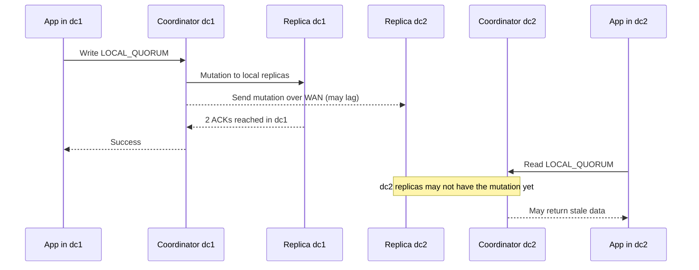

# Read/Write Quorum Intersection Condition and Accompanying Assumptions

In Apache Cassandra, a common choice of consistency levels is writing at `QUORUM` and reading at `QUORUM`. The reason lies in a simple mathematical property: **two subsets that each form a majority of the same replica set must share at least one common element**. Stated generally, with `N` replicas, `W` write acknowledgments, and `R` read responses, the condition

\[
R + W > N
\]

forces the set of replicas that acknowledged the write and the set of replicas that responded to the read to **overlap in at least one replica**. However, to use this result properly in Cassandra, you must clarify **which replicas are counted**, **whether the write actually succeeded**, **when the read occurs**, and **how Cassandra selects data versions**. Intersection is a useful premise for reasoning about data freshness; by itself, it is **not a promise of linearizability for all operations**.

This lesson belongs to the **Read/Write Consistency** chapter of the `DATABASE_ENGINE_WIDE_COLUMN_CASSANDRA` module. In the curriculum covering distributed architecture, the wide-column model, partition keys, query-driven table design, CQL, replication, compaction, repair, error handling, and Java integration, this is essential knowledge for selecting read/write consistency level pairs on solid grounds.

## 1. Learning Objectives

After this lesson, you will be able to:

1. Prove why `R + W > N` guarantees an overlap between read and write response sets.
2. Calculate `R`, `W`, and `N` from replication factor (RF) and consistency level (CL).
3. Verify the intersection condition in a **single datacenter**, **multiple datacenters**, and with `QUORUM`, `LOCAL_QUORUM`, and `EACH_QUORUM`.
4. Explain why a **quorum read in another DC** can observe stale data after a local quorum write.
5. Distinguish **the intersection condition**, **ability to read the latest version**, **read-your-writes**, and **linearizability**.
6. Apply the results to CQL, the Java Driver, error handling, and topology change scenarios.

## 2. Defining N, W, and R Accurately

**A partition** is Cassandra's fundamental unit of data distribution. The partition key selects the partition; the replication strategy and RF determine which nodes hold replicas for that partition. When a client sends a request, one node acts as the **coordinator**, orchestrating the work across the replicas.

Suppose partition `P` has three target replicas:

```text
                           Coordinator
                         /      |      \
                       R1       R2      R3

                   Replica set S = {R1, R2, R3}
                           N = |S| = 3
```

For a successful write, let `A` be the set of replicas that actually **ACKed the mutation**. For a read, let `B` be the set of replicas that provided **valid responses** used by the coordinator to satisfy the read CL.

- `N`: size of **the same target replica set `S`** under consideration, typically equal to RF in a single DC or the sum of RFs across DCs for the partition.
- `W`: the replica ACK threshold the write must receive; after the **write returns success**, at least `W` eligible replicas have acknowledged.
- `R`: the response threshold the read must receive; after the **read returns success**, at least `R` eligible replicas have responded.

**Note:** `W` and `R` are thresholds, not exact counts of network requests. Cassandra may contact more replicas than the threshold due to coordination, digests, speculative retry, or recovery. When analyzing the intersection condition, we only need to consider **the smallest subsets that satisfy the CL**: if those must overlap, any larger response set will also overlap.

### Replica ACKs vs. Coordinator and Hints

A coordinator might **not be a replica** for the partition. It is not automatically added to `N` or `W` just for receiving the request. Similarly, **hinted handoff** does not create extra replicas. In particular, with `CL=ANY`, a write can return success because the coordinator stored a **hint** when no target replica ACKed; you must not assign `W=1` replica in that case and apply the intersection formula.

## 3. Proving the Intersection Condition

Assume:

- `S` is a fixed set of `N` replicas.
- `A` is the set of `W` replicas that ACKed the write, `A ⊆ S`.
- `B` is the set of `R` replicas that responded to the read, `B ⊆ S`.

By the inclusion-exclusion principle for two sets:

\[
|A \cup B| = |A| + |B| - |A \cap B|
\]

Since `A ∪ B ⊆ S`, we have `|A ∪ B| ≤ N`. Therefore:

\[
|A \cap B| \ge R + W - N
\]

Hence, **if `R + W > N`, then `|A ∩ B| ≥ 1`**. This is a **sufficient** condition to guarantee at least one common replica, regardless of which replicas the coordinator selects within the same set `S`.

If `R + W ≤ N`, we **cannot guarantee** overlap from counts alone. The two sets may be disjoint; that **does not prove** the read will definitely be stale. In practice, it might still read the new version if it happens to pick an updated replica or if replication has already propagated.

### Visual Intuition with RF = 3

```text
Replica:              R1      R2      R3

Write W=2:           [ACK]   [ACK]     .
Read  R=2:             .     [READ]  [READ]
                               ^
             Overlap at R2: 2 + 2 = 4 > 3

Write W=1:           [ACK]      .       .
Read  R=2:             .     [READ]  [READ]

             May be disjoint: 1 + 2 = 3 <= 3
```

### A General Example with RF = 5

If a write requires `W=3` and a read requires `R=3`:

\[
R + W - N = 3 + 3 - 5 = 1
\]

The two sets must have **at least one replica in common**. If a write requires `W=4` and a read requires `R=3`, they must share **at least two replicas**, because `4+3−5=2`. The intersection does not necessarily contain that exact number of replicas; the value above is the **lower bound**.

## 4. Applying the Formula to Consistency Levels in a Single DC

With a single datacenter having `RF=N`:

| Normal CL | Replica Threshold |
| --- | ---: |
| `ONE` | 1 |
| `TWO` | 2 |
| `THREE` | 3 |
| `QUORUM` | `⌊N/2⌋+1` |
| `ALL` | `N` |

**`QUORUM`** requires a majority:

\[
Q(N)=\left\lfloor\frac{N}{2}\right\rfloor+1
\]

Because `Q(N) > N/2`, we always have:

\[
Q(N)+Q(N)>N
\]

This is why a **`QUORUM` write + `QUORUM` read** pair always overlaps when both apply to **the same replica set**.

| RF `N` | Quorum `Q` | `Q+Q` | Overlaps? | Unresponsive replicas tolerated while still meeting each quorum |
| ---: | ---: | ---: | --- | ---: |
| 1 | 1 | 2 > 1 | Yes | 0 |
| 2 | 2 | 4 > 2 | Yes | 0 |
| 3 | 2 | 4 > 3 | Yes | 1 |
| 4 | 3 | 6 > 4 | Yes | 1 |
| 5 | 3 | 6 > 5 | Yes | 2 |
| 6 | 4 | 8 > 6 | Yes | 2 |

**Overlap** and **availability** are two separate goals. With RF=2, quorum=2 still overlaps, yet cannot tolerate even one unresponsive replica. With RF=5, quorum=3 overlaps while tolerating up to two unresponsive replicas, provided the remaining replicas are up and respond in time.

### Both Read and Write Do Not Have to Be QUORUM

With RF=3:

| Write CL | W | Read CL | R | `R+W` | Guaranteed Overlap? |
| --- | ---: | --- | ---: | ---: | --- |
| `ONE` | 1 | `ONE` | 1 | 2 | No |
| `ONE` | 1 | `QUORUM` | 2 | 3 | No |
| `QUORUM` | 2 | `ONE` | 1 | 3 | No |
| `QUORUM` | 2 | `QUORUM` | 2 | 4 | **Yes** |
| `ALL` | 3 | `ONE` | 1 | 4 | **Yes** |
| `ONE` | 1 | `ALL` | 3 | 4 | **Yes** |
| `TWO` | 2 | `THREE` | 3 | 5 | **Yes** |

For example, `W=ALL, R=ONE` overlaps in theory, yet `ALL` writes fail easily if one replica is slow. `W=ONE, R=ALL` also overlaps, yet reads suffer lower availability. Setting `QUORUM` in both directions is one balanced option **among valid choices**, not a mandatory rule for every workload.

### Recalculate Thresholds When Increasing RF

`W=TWO, R=TWO` with RF=3 satisfies `2+2>3`. If RF increases to 5 while keeping `TWO` in both directions, `2+2=4≤5`, so **overlap is no longer guaranteed**. Fixed-count consistency levels do not adapt with RF, whereas `QUORUM` automatically scales its threshold with RF.

## 5. Multiple Datacenters: Use the Right Replica Set

With `NetworkTopologyStrategy`, RF is usually declared per datacenter. Suppose:

```text
dc1: RF = 3       A1 A2 A3
dc2: RF = 3       B1 B2 B3

S_global = {A1, A2, A3, B1, B2, B3}
N_global = 6
S_dc1    = {A1, A2, A3}, N_dc1 = 3
S_dc2    = {B1, B2, B3}, N_dc2 = 3
```

**`QUORUM`** and **`LOCAL_QUORUM`** operate over different replica sets:

- Cluster-wide `QUORUM` requires `⌊6/2⌋+1 = 4` responses from **any four eligible replicas** across all six replicas.
- `LOCAL_QUORUM` with a coordinator in `dc1` requires `⌊3/2⌋+1 = 2` responses **only from `dc1`**.
- `LOCAL_QUORUM` with a coordinator in `dc2` requires **two responses only from `dc2`**.
- `EACH_QUORUM` for **normal writes** requires **2 ACKs in `dc1` and 2 ACKs in `dc2`**; Apache Cassandra OSS **does not support `EACH_QUORUM` for normal reads**.

### Scenario A — Cluster-Wide QUORUM in Both Directions

A `QUORUM` write is ACKed by **four** arbitrary replicas out of six. A `QUORUM` read receives responses from **four** arbitrary replicas out of the same six:

\[
W+R=4+4=8>6
\]

There are at least `8−6=2` common replicas. This reasoning does not require the coordinators of the two requests to be in the same DC, **provided they operate on the same partition replica set and use the global CL properly**.

### Scenario B — LOCAL_QUORUM in the Same DC

A `LOCAL_QUORUM` write in `dc1` requires two ACKs in `S_dc1`. A `LOCAL_QUORUM` read in `dc1` requires two responses in **the same `S_dc1`**:

\[
W_{dc1}+R_{dc1}=2+2=4>3=N_{dc1}
\]

The two local sets must intersect. Replicas in `dc2` do not need to be included in this inequality.

### Scenario C — LOCAL_QUORUM Write in dc1, Read in dc2

The write receives two ACKs in `dc1`; the read receives two responses in `dc2`. Because:

```text
Write ACK set:     {A1, A2}  in dc1
Read response set: {B1, B2}  in dc2

Intersection:      ∅
```

The two sets **do not overlap** even though each satisfies its own DC's quorum. The mutation may not have propagated to `dc2` yet. Thus, a `LOCAL_QUORUM` read in `dc2` immediately after a successful write in `dc1` **can observe stale data**.

A common reasoning mistake is taking `W=2` in `dc1`, `R=2` in `dc2`, and checking `W+R=4>3` against one DC's RF. That calculation is **wrong because `W` and `R` belong to two different replica sets**.

### Scenario D — Combining Global QUORUM with LOCAL_QUORUM

A `QUORUM` write requires `W=4` out of `N=6`; a `LOCAL_QUORUM` read in `dc1` requires `R=2` solely from `dc1`'s three replicas. We have `4+2=6`, which is **not greater than 6**, so overlap is **not guaranteed**.

Counterexample:

```text
Write QUORUM:      {A1, B1, B2, B3}  -> 4 ACKs
Read LOCAL_QUORUM: {A2, A3}          -> 2 responses

The two sets are disjoint even though both write and read met their CLs.
```

Similarly, writing `LOCAL_QUORUM` in `dc1` (W=2) and reading global `QUORUM` (R=4) **is not guaranteed to overlap** based solely on those two level names.

### Scenario E — EACH_QUORUM Write, LOCAL_QUORUM Read

An `EACH_QUORUM` write with RF=`3+3` succeeds when **at least two replicas in each DC** have ACKed. A `LOCAL_QUORUM` read in **either DC** needs two responses in that DC.

In the DC where the read occurs:

\[
W_{dc}=2,\quad R_{dc}=2,\quad N_{dc}=3,\quad 2+2>3
\]

Therefore, overlap is guaranteed **within the read DC**. This is the benefit of `EACH_QUORUM` writes when business rules require quorum ACKs in every region before returning success. The trade-off is that writes must wait on multiple DCs and are vulnerable to inter-DC link failures.

### Cross-DC Read/Write Path Diagram



The diagram illustrates the **possibility** of a stale read; it does not claim every cross-DC read is stale. Cassandra still works to deliver mutations to all replicas and typically synchronizes quickly when the network is healthy.

## 6. Assumptions That Must Hold Before Drawing Conclusions About Fresh Data

The condition `R + W > N` is a **set-theory theorem**; using it to evaluate Cassandra read outcomes requires several additional assumptions.

### Assumption 1 — Same Partition, Same Replica Set

Both operations must refer to **the same data/partition**, using the same identification of participating replicas. Do not use one table's RF for another keyspace, or `dc1`'s RF to prove properties about reads in `dc2`.

While a cluster is undergoing **bootstrap, decommission, node replacement, RF changes, or token movement**, the replica set can change. A proof on a fixed set `S` does not automatically apply across two points in time where the replica set or topology has changed. Check version-specific operational docs and confirm topology stability before reasoning simply.

### Assumption 2 — The Write Was Confirmed by Enough Replicas

`W` must represent **target-replica ACKs required by the write CL**, after the coordinator returned **success**. If the client received `WriteTimeout` or `Unavailable`, you cannot assume `W` ACKs were achieved, even though some replicas may have applied the mutation.

**In particular:** An `ANY` write can succeed merely because the coordinator stored a hint, with zero target replicas ACKing. In that case, you cannot plug in an assumed `W=1` to prove overlap with a read.

### Assumption 3 — The Read Executes After the Write Completes

To reason about **reading the write just confirmed**, the read request must begin **after** that write was acknowledged. If a read and write overlap in time, the read may observe either the pre-write or post-write state, even if the two replica sets overlap.

Consider the event timeline:

```text
Non-overlapping:
  write sent ---- write ACK ---- read starts ---- read finishes
                  ^
         Uses W of completed write

Overlapping:
  write sent --------------------- write ACK
              read sent ------ read finishes
  Cannot conclude the read must observe the new mutation.
```

### Assumption 4 — No Concurrent Writes Alter the Outcome

Cassandra typically reconciles values by **timestamp (last-write-wins)**, not by "last ACK." If two clients write the same cell with competing timestamps, the value with the higher timestamp can win, even if that write started earlier in wall-clock time. Clock skew between clients/nodes or client-supplied timestamps can change expected results.

Example:

```text
Write A (wall clock 10:00:00): value="new", timestamp=100
Write B (wall clock 09:59:59): value="old", timestamp=200

If B retains the winning timestamp, a quorum read may see "old".
Overlap cannot override Cassandra's timestamp reconciliation rule.
```

Hence, under suitable assumptions, overlap ensures **at least one replica carrying the acknowledged write** participates in the read, but does not prove that value is the **final value in wall-clock time** under all concurrency scenarios.

### Assumption 5 — The Reconciliation Read Path Responds Correctly and Completes

Cassandra can read **full data** from one replica, receive **digests** from others, and compare them. When a mismatch is detected, the coordinator may fetch additional full data and reconcile to return the appropriate result. Thus, **"reading from R replicas" does not necessarily mean R full-row data fetches**.

A replica in the intersection **is not necessarily the replica whose raw content the client directly sees**; the result is processed by the coordinator according to read semantics. If the read path times out or fails to complete reconciliation, the client cannot rely on a failed read to claim it observed the new value.

### Assumption 6 — Do Not Equate Intersection with Transactions/Linearizability

Quorum is a **tunable consistency** mechanism for normal requests; it does not automatically establish a global total order across multiple concurrent writers, nor does it provide atomic transactions across multiple partitions.

- **Read-your-writes:** Within the same partition and replica set, after a completed write with no concurrent writes/timestamp anomalies, an overlapping CL pair supports expecting to read the value just written. `ONE`/`ONE` alone has no such guarantee.
- **Monotonic reads:** Whether successive reads can observe values "moving backward" also depends on CL, reconciliation, configuration, and the Cassandra version's read-repair behavior.
- **Linearizability:** Requires stronger semantics than two overlapping replica sets; do not infer from `R + W > N` that all normal read/write operations are linearizable.
- **Conditional writes:** `INSERT ... IF NOT EXISTS` and `UPDATE ... IF` use **lightweight transactions (LWT)/Paxos**. `SERIAL`/`LOCAL_SERIAL` are separate serial consistency levels, not the `R+W` sum of normal writes.

### Assumption 7 — Do Not Confuse CL with Durability or Repair

Quorum confirms the participation of a subset of replicas in an operation; it does not prove **all copies** are permanently synchronized. Replicas missing data may catch up via subsequent writes, hinted handoff, or anti-entropy repair. **Compaction** optimizes/cleans SSTables and processes tombstones per rules, and **does not replace repair**.

Especially with deletes and tombstones, a replica missing a deletion for an extended period combined with repair/`gc_grace_seconds` issues can cause deleted data to resurrect. Set-intersection math does not govern the full data lifecycle.

## 7. Is Overlap Guaranteed? The Unbalanced RF Problem

A real configuration might use:

```text
dc1: RF = 3
dc2: RF = 2
Total RF N = 5
```

Calculate thresholds:

| Level | Required Threshold |
| --- | --- |
| Cluster-wide `QUORUM` | `⌊5/2⌋+1 = 3` out of five total replicas |
| `LOCAL_QUORUM` in dc1 | `⌊3/2⌋+1 = 2` in dc1 |
| `LOCAL_QUORUM` in dc2 | `⌊2/2⌋+1 = 2` in dc2 |
| `EACH_QUORUM` write | `2 in dc1 and 2 in dc2` |

Some example pairs:

| Write CL | Read CL | Overlap Conclusion |
| --- | --- | --- |
| Cluster-wide `QUORUM` (3/5) | Cluster-wide `QUORUM` (3/5) | **Yes:** `3+3>5`. |
| `LOCAL_QUORUM` in dc1 (2/3) | `LOCAL_QUORUM` also in dc1 (2/3) | **Yes:** `2+2>3` within dc1. |
| `LOCAL_QUORUM` in dc1 (2/3) | `LOCAL_QUORUM` in dc2 (2/2) | **Not guaranteed:** two sets in different DCs. |
| `EACH_QUORUM` write (2+2) | `LOCAL_QUORUM` in dc2 (2/2) | **Yes:** within dc2, both replicas ACKed the write. |
| Cluster-wide `QUORUM` (3/5) | `LOCAL_QUORUM` in dc1 (2/3) | **Not guaranteed:** write could hit 1 in dc1 + 2 in dc2, while read hits the other 2 in dc1. |

**Safe method for mixed CLs:** Draw the replica set and all valid ACK distributions that satisfy each CL; check whether **every** valid write/read distribution pair shares a replica. Only add `R+W>N` once you are certain they count **the same set** and those thresholds accurately describe the responding sets.

## 8. CQL Practice: Query-Driven Design and Choosing CL

Assume a test environment with one actual datacenter named `dc1` and at least three eligible nodes. Create an RF=3 keyspace and a table queried by `order_id`:

```sql
CREATE KEYSPACE IF NOT EXISTS consistency_lab
WITH replication = {
  'class': 'NetworkTopologyStrategy',
  'dc1': 3
};

CREATE TABLE IF NOT EXISTS consistency_lab.order_by_id (
  order_id uuid PRIMARY KEY,
  order_status text,
  updated_at timestamp
);
```

`order_id` is the partition key, so a read by `order_id` targets **the exact same partition** updated by the write. `RF=3` creates a set of three target replicas, while each request's CL is chosen at execution time:

```sql
-- Write requires 2/3 replica ACKs.
CONSISTENCY QUORUM;

INSERT INTO consistency_lab.order_by_id
    (order_id, order_status, updated_at)
VALUES (
    11111111-1111-4111-8111-111111111111,
    'CREATED',
    '2026-11-21 02:00:00+0000'
);

-- Read requires 2/3 responses; 2+2>3 so quorums overlap.
CONSISTENCY QUORUM;

SELECT order_status, updated_at
FROM consistency_lab.order_by_id
WHERE order_id = 11111111-1111-4111-8111-111111111111;

-- For comparison: a ONE read has no overlap guarantee with a QUORUM write.
CONSISTENCY ONE;

SELECT order_status, updated_at
FROM consistency_lab.order_by_id
WHERE order_id = 11111111-1111-4111-8111-111111111111;
```

In `cqlsh`, `CONSISTENCY` is a command that **changes the shell session's CL** for subsequent statements, not part of standard `SELECT` or `INSERT` syntax. In a healthy cluster, both `ONE` and `QUORUM` often read the new value because replication is fast; **a single test without observing a stale read does not prove an overlap guarantee**.

If you want to test scenarios where a replica is slow or down, use only a **lab with a well-defined topology**. Know where the partition is placed, since stopping an arbitrary node does not necessarily affect that partition. Never use production data for outage experiments.

## 9. Practice with Java Driver 4.x

This example uses a `CqlSession` already configured with contact points, local DC, and appropriate authentication. Two `PreparedStatement`s are prepared once for reuse:

```java
import com.datastax.oss.driver.api.core.CqlSession;
import com.datastax.oss.driver.api.core.DefaultConsistencyLevel;
import com.datastax.oss.driver.api.core.cql.BoundStatement;
import com.datastax.oss.driver.api.core.cql.PreparedStatement;
import com.datastax.oss.driver.api.core.cql.Row;

import java.time.Instant;
import java.util.UUID;

public final class OrderRepository {
    private final CqlSession session;
    private final PreparedStatement writeQuery;
    private final PreparedStatement readQuery;

    public OrderRepository(CqlSession session) {
        this.session = session;
        this.writeQuery = session.prepare(
            "UPDATE consistency_lab.order_by_id " +
            "SET order_status = ?, updated_at = ? WHERE order_id = ?");
        this.readQuery = session.prepare(
            "SELECT order_status FROM consistency_lab.order_by_id " +
            "WHERE order_id = ?");
    }

    public void changeStatus(UUID orderId, String status) {
        BoundStatement write = writeQuery
            .bind(status, Instant.now(), orderId)
            .setConsistencyLevel(DefaultConsistencyLevel.LOCAL_QUORUM);

        session.execute(write); // With local RF=3: wait for at least 2 local ACKs.
    }

    public String readStatus(UUID orderId) {
        BoundStatement read = readQuery
            .bind(orderId)
            .setConsistencyLevel(DefaultConsistencyLevel.LOCAL_QUORUM);

        Row row = session.execute(read).one();
        return row == null ? null : row.getString("order_status");
    }
}
```

If the write returns success and a subsequent read goes through a coordinator **in the same DC** with local RF=3, the two local quorum sets overlap per `2+2>3`. Assuming no concurrent writes and well-behaved timestamps, this gives the application a sound basis to expect reading back the status just written.

**Do not** treat this example as an "order transaction" protocol safe against concurrent updaters. If business logic requires a conditional state transition—for instance, transitioning `CREATED` to `PAID` at most once—consider `UPDATE ... IF order_status = 'CREATED'` (LWT) and check the `[applied]` result.

### Timeouts and Retries

If `session.execute(write)` throws `WriteTimeoutException`, you do not know for certain how many replicas actually applied the mutation—some replicas may have written it, yet the coordinator **did not confirm success at the chosen CL**. You must not assume `W=2` simply because the command was dispatched.

When retrying, use an **idempotent** design where appropriate, keep partition keys stable, and pay attention to timestamps, counters, and side effects outside Cassandra. Java Driver retry settings should reflect request semantics; unbounded retries can overload the cluster.

## 10. Self-Check Exercises

### Exercise 1 — Proving Overlap

A partition has `N=7` replicas; a write receives `W=4` ACKs, and a read gets `R=4` responses. At least how many replicas are in common?

**Answer:** `R+W−N=4+4−7=1`, so **at least one replica in common**.

### Exercise 2 — Does Failing the Condition Guarantee a Stale Read?

RF=3, write `ONE` and read `QUORUM`. `R+W=1+2=3`. Is the read guaranteed to return stale data?

**Answer:** **No.** The overlap condition is not guaranteed, yet the data may have already propagated to a queried replica. We only know the write-ACK and read-response sets **might** be disjoint.

### Exercise 3 — Increasing RF While Keeping Fixed CL

RF increases from 3 to 5. The application continues writing and reading at `TWO`. Does this CL pair still guarantee overlap?

**Answer:** No. `2+2=4≤5`; with RF=5, consider `QUORUM` (3 ACKs each way) or another pair summing to more than 5.

### Exercise 4 — Cluster-Wide QUORUM

Two DCs have RF=3+3. Both writes and reads use `QUORUM`. What is each operation's threshold, and at least how many replicas overlap?

**Answer:** Total RF=6; quorum needs `4` responses each way. The intersection has at least `4+4−6=2` replicas.

### Exercise 5 — Local Across Two Different DCs

Write `LOCAL_QUORUM` in `dc1` (RF=3), then read `LOCAL_QUORUM` in `dc2` (RF=3). Can you apply `2+2>3` to guarantee a fresh read?

**Answer:** No. The write set is solely in `dc1` and the read set is solely in `dc2`; they are disjoint in replica location. Data may not have propagated to `dc2` yet.

### Exercise 6 — Combining EACH_QUORUM with LOCAL_QUORUM

RF=3+3. An `EACH_QUORUM` write succeeds, followed by a `LOCAL_QUORUM` read in `dc2`. Do they overlap?

**Answer:** Yes. The write already has at least two ACKs in `dc2`, and the read requires two responses within `dc2` itself; `2+2>3`.

### Exercise 7 — Writing ANY and Reading ALL

RF=3. An `ANY` write returns success **solely via a hint**, followed by an `ALL` read. Can we say `W=1, R=3` and guarantee seeing the new mutation?

**Answer:** No. A hint is not a target-replica ACK. `ANY` can succeed even when `W=0` replicas received the mutation; an `ALL` read before the hint is replayed may still miss the new data.

### Exercise 8 — Timeout and Concurrent Writes

A `QUORUM` write hits `WriteTimeout`. Another client writes the same cell with a higher timestamp; afterward a `QUORUM` read returns the second client's version. Does this violate the intersection formula?

**Answer:** No. The first write **was not confirmed to have reached W**, and there was a **concurrent write** reconciled by timestamp. The set formula makes no promise to return the first mutation's value in this situation.

### Exercise 9 — Mixing QUORUM and LOCAL_QUORUM

RF=3+3. A `QUORUM` write gets ACKs from `A1,B1,B2,B3`, then a `LOCAL_QUORUM` read in `dc1` reads from `A2,A3`. Did both operations satisfy their own CLs? Do they overlap?

**Answer:** Both met their individual CLs (`4/6` and `2/3`), yet the replica sets **do not overlap**. Thus you cannot rely on the word "quorum" alone to conclude you will always read the latest write.

## 11. Checklist Before Choosing a CL Pair

When evaluating a Cassandra read/write path, answer in order:

1. **Which partition?** Do both operations share the same partition key, keyspace, and replication strategy?
2. **Where are the replicas?** What is each DC's RF, and is the topology stable?
3. **Which DC is the coordinator in?** `LOCAL_QUORUM` must be evaluated in the coordinator's DC.
4. **What are W and R?** Do the thresholds for `QUORUM`, `LOCAL_QUORUM`, or `EACH_QUORUM` apply properly to the operation type?
5. **Do the two sets share the same scope?** Only apply `R+W>N` directly when using the same `S`; for mixed CLs, analyze possible ACK distributions.
6. **Did the write succeed?** Timeout/Unavailable is not a confirmation that `W` was achieved.
7. **Are there concurrent writes or unusual timestamps?** Overlap does not eliminate last-write-wins conflicts.
8. **What does the application need?** Read-your-writes, tolerating stale reads, conditional updates, or transactional guarantees are distinct requirements.

## 12. Conclusion

**`R+W>N` is a set-theoretic sufficient condition**: when `R` and `W` are counted over **the same `N` replicas**, a confirmed write and a successful read must share at least one common replica. With RF=3, a `QUORUM`/`QUORUM` pair requires `2+2>3`; with RF=5, it requires `3+3>5`.

To reason accurately about Cassandra, you must also verify **DC scope, temporal ordering between writes and reads, concurrent writes, timestamps, reconciliation, request success status, and topology**. `LOCAL_QUORUM` across two different DCs may not overlap; `ANY` succeeding via a hint does not produce a replica ACK; and `QUORUM` does not replace LWT or repair processes. Understanding these assumptions helps Java applications select CL pairs that fit real requirements rather than relying on consistency level names alone.

### Further Reading

- [Apache Cassandra — Dynamo: Tunable Consistency](https://cassandra.apache.org/doc/stable/cassandra/architecture/dynamo.html): replicas, read/write consistency, and quorum.
- [Apache Cassandra — Data Replication](https://cassandra.apache.org/doc/stable/cassandra/architecture/dynamo.html#replication): RF and datacenter scope.
- [Apache Cassandra — Lightweight Transactions](https://cassandra.apache.org/doc/stable/cassandra/developing/cql/dml.html): conditional writes and why LWT differs from normal writes.
