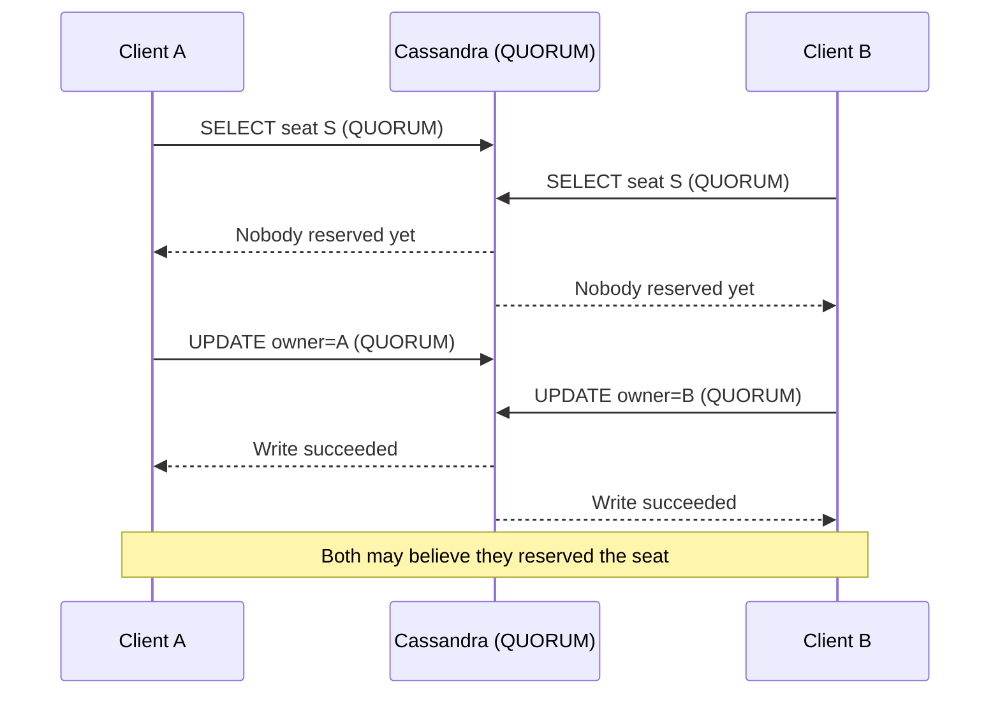

# Distinguishing Quorum Intersection from Linearizable Guarantees for All Concurrent Updates

In Apache Cassandra, learners often encounter the formula **`R + W > N`**: read responses `R` plus write acknowledgments `W` exceeds the replica count `N`. This formula proves that **the set of replicas that acknowledged the write and the set of replicas responding to the read share at least one common element**, provided both operations target **the same replica set**. However, **quorum intersection does not automatically turn all concurrent updates into linearizable operations**.

This distinction matters when designing business flows such as unique reservations, order state transitions, inventory deductions, or versioned updates. Reading and writing at `QUORUM` can be very effective for consistency under the right conditions, yet Cassandra still has to deal with **timestamps, competing writes, retries, and conflict-reconciliation rules**. Conditional update requirements call for a different mechanism, typically **lightweight transactions (LWT)** using Paxos.

This lesson belongs to the **Read/Write Consistency** chapter in the `DATABASE_ENGINE_WIDE_COLUMN_CASSANDRA` module. The module covers Cassandra's distributed architecture and wide-column model, partition keys, query-driven table design, CQL, replication, compaction, repair, error handling, and Java application integration. Here we focus on **the difference between quorum's set-theoretic property and execution-order guarantees when multiple clients update concurrently**.

## 1. Learning Objectives

After this lesson, you will be able to:

1. Explain and briefly prove the intersection condition `R + W > N`.
2. Distinguish **quorum intersection**, **reading a recently confirmed write**, **linearizability**, and **conditional atomic updates**.
3. Identify the assumptions required when reasoning about fresh data in Cassandra.
4. Describe the timestamp/last-write-wins counterexample where a `QUORUM` write succeeds yet fails to achieve "last write in wall-clock time" semantics.
5. Explain why a "`SELECT` to check, then `INSERT`/`UPDATE`" flow can suffer a race condition even when both queries use quorum.
6. Use `IF NOT EXISTS`, `UPDATE ... IF ...`, and serial consistency with LWT when contention control on a partition is needed.
7. Design safe timeout/retry handling from the Java Driver and distinguish single-DC from multi-DC scope.

## 2. Three Commonly Conflated Concepts

Suppose Cassandra has a partition replicated across three nodes `R1`, `R2`, and `R3`. The application writes with `QUORUM` and reads with `QUORUM`. Each operation requires two responses from the three replicas.

| Concept | Question to Answer | What It Actually Guarantees |
| --- | --- | --- |
| **Quorum intersection** | Do the write-acknowledging nodes and read-responding nodes share a common node? | Within the same set `N` and if `R + W > N`, **at least one common replica is guaranteed**. |
| **Reading the confirmed write** | Will a `SELECT` after an `UPDATE` see the newly written value? | Must account for write success, same replica set, operation ordering, reconciliation, and absence of conflicting/timestamp overrides. |
| **Linearizability** | Can every operation be explained as taking effect atomically in a single global order **respecting real-time order of non-overlapping operations**? | A stronger guarantee than intersection; not implied by `R + W > N` alone. |

**Intuitive analogy:** Two libraries both keep copies of a ledger. If the group that "recorded a write" and the group "consulted during a read" are both majorities, there is surely **at least one library present in both groups**. Yet that **does not decide** whether customer A's or customer B's entry wins when both update the same cell; you still need a **version-selection rule**.

## 3. Proving Quorum Intersection

Let:

- `S`: the replica set of the same partition, with `N = |S|` elements;
- `A`: the set of replicas that ACKed **a successful write**, with `|A| ≥ W`;
- `B`: the set of replicas that supplied responses for **a successful read**, with `|B| ≥ R`.

By set inclusion-exclusion:

\[
|A \cap B| = |A| + |B| - |A \cup B|
\]

Since `A ∪ B ⊆ S`, we get:

\[
|A \cap B| \ge R + W - N
\]

Therefore, if **`R + W > N`**, the two sets must have **at least one element in common**.

### Illustration with RF = 3

```text
Replica:                  R1        R2        R3

Write W = 2:            [ACK]     [ACK]        .
Read  R = 2:              .      [READ]     [READ]
                                    ^
                             Overlap at R2

W + R = 2 + 2 = 4 > 3
```

With `RF = 3`, quorum is `floor(3/2)+1 = 2`. Choosing `QUORUM` for both writes and reads causes the write-ACK set and read-response set to overlap. With `RF = 5`, quorum is `3`, and `3+3>5` still guarantees overlap.

**Yet this is a theorem about replica locations, not a theorem about data value ordering.** A shared replica does not prove it holds the "latest" value in wall-clock time if another mutation carries a higher timestamp or concurrent writes exist.

### When `R + W > N` Is Not Met

If `R + W ≤ N`, the two sets **may** be disjoint; this does not mean reads will definitely return stale data. For instance, writing `ONE` and reading `QUORUM` at RF=3 gives `1+2=3`: Cassandra might still have propagated the mutation to the queried replica in time. We simply lose the **count-based overlap guarantee**.

## 4. What Does Linearizability Actually Require?

A history of operations is **linearizable** if they can be arranged into a valid sequential execution matching the data object's specification such that:

1. Every operation can be assigned a **linearization point** between its invocation and its response.
2. If operation `A` **completed before** operation `B` **started**, the sequential order must place `A` **before `B`**.
3. For **time-overlapping** operations, the system may pick a valid ordering, but that ordering must stay consistent with the results observed by clients.

Consider a register storing a single string, initially `"initial"`:

```text
Real time ---->

Client A:  write("A") ---- ACK
Client B:                        write("B") ---- ACK
Client C:                                               read() --> ?

If both writes succeeded, no other writes occurred,
and write("B") started after write("A") completed:
  A linearizable register must have read() observe "B".
```

**Note:** Linearizability is not simply "every replica returns the same data at the same time." It is a requirement on **the observable behavior of operations**, respecting the real-time order of invocations and responses.

### Side-by-Side Comparison

| Property | Quorum Intersection | Linearizability |
| --- | --- | --- |
| Subject of reasoning | Two sets of responding **replicas**. | An **operation history** and client-observed ordering. |
| Needs start/end times of operations? | No, the set proof is static. | **Yes**, to preserve before/after order of non-overlapping operations. |
| Automatically dictates the winner under concurrent writes? | No. | Every outcome must fit a valid sequential order of the object. |
| Is `R + W > N` enough to conclude it? | Yes, within the same replica set. | **No.** |
| Transactional scope | One partition's replica set. | Depends on the object and protocol providing the guarantee; not inherently multi-partition. |

## 5. A Concrete Counterexample: Timestamps Reversing Real-Time Write Order

Cassandra uses **timestamps** to reconcile competing values for the same cell, typically following a **timestamp-based last-write-wins** rule rather than purely client `ACK` completion time.

Consider a partition with RF=3; both reads and writes use `QUORUM`. Two clients execute two sequential, **non-overlapping** statements:

```text
Real time ------------------------------------------------->

Client A: UPDATE value='A', timestamp=200 -------- ACK
Client B:                                      UPDATE value='B',
                                               timestamp=100 ---- ACK
Client C:                                                       SELECT QUORUM
                                                                    -> 'A'

A completed before B started; both A and B were ACKed at QUORUM.
Yet A's value has a higher timestamp than B, so A wins reconciliation.
```

**Explanation:**

1. Write `A` has timestamp 200 and is acknowledged by at least two replicas.
2. Afterward, write `B` has timestamp 100 and is also acknowledged by at least two replicas.
3. When Cassandra reconciles both mutations for the same cell, `A`'s mutation has the higher timestamp and takes precedence.
4. A subsequent `QUORUM` read can return `A`. The intersection condition held for both writes, yet the outcome **cannot represent a real-time last-write register** if we expect the successful write `B` to overwrite `A`.

**Lesson:** `QUORUM` confirms that a mutation reached enough replicas; it does not override the rule governing **valid update ordering**. In practice, this issue can arise from:

- Clients specifying different `USING TIMESTAMP` values;
- clock skew across nodes or writing services;
- two clients sending updates nearly simultaneously;
- retries reusing old timestamps or an application replaying an older mutation.

When timestamps tie, Cassandra also applies its own tie-breaker; never assume "whichever request arrived later wins."

### Testing the Counterexample in CQL

In a **single-DC lab environment** named `dc1` with three replicas, create a keyspace and table:

```sql
CREATE KEYSPACE IF NOT EXISTS consistency_demo
WITH replication = {
  'class': 'NetworkTopologyStrategy',
  'dc1': 3
};

CREATE TABLE IF NOT EXISTS consistency_demo.profile_by_id (
  profile_id uuid PRIMARY KEY,
  display_name text
);
```

Set CL to `QUORUM` and intentionally write the **larger timestamp first**, then the **smaller timestamp second**:

```sql
CONSISTENCY QUORUM;

INSERT INTO consistency_demo.profile_by_id
  (profile_id, display_name)
VALUES (
  11111111-1111-4111-8111-111111111111,
  'A'
) USING TIMESTAMP 2000000;

UPDATE consistency_demo.profile_by_id
USING TIMESTAMP 1000000
SET display_name = 'B'
WHERE profile_id = 11111111-1111-4111-8111-111111111111;

SELECT display_name
FROM consistency_demo.profile_by_id
WHERE profile_id = 11111111-1111-4111-8111-111111111111;
```

In a lab with no competing data and completed operations, the value selected by timestamp is **`A`**, even though `UPDATE ... 'B'` was sent later. `USING TIMESTAMP` takes **microseconds**; the two small numbers in the example are chosen merely for easy observation, not as a timestamp pattern to use in production.

**Do not run manual timestamp demos on real business data.** They can clash with driver/server-generated timestamps, causing later updates to behave unexpectedly.

## 6. Read-First, Check, Then Write Still Has a Race Condition

Suppose a business flow allows **reserving a unique seat**. Two customers both call `SELECT` to check if the seat is empty, then write the reserver:



Each `SELECT` and each `UPDATE` can satisfy quorum. However, the **"check condition then write"** sequence is not **a single atomic operation**. Another client can alter the data **between the two statements**.

Setting `CL=ALL` on the `UPDATE` **does not solve** this race condition either: `ALL` only waits for every replica of an ordinary mutation; it does not perform an atomic compare-and-write on a condition.

### "Write Succeeded" Does Not Mean "I Won the Race"

With ordinary competing updates on a cell, both A and B can receive a success ACK. The final value is determined by timestamp reconciliation. Client A **cannot** infer "A exclusively secured the seat" solely from a successful `UPDATE` at `QUORUM`.

When an operation carries the business meaning "at most one actor succeeds," what must be protected is **the entire condition and mutation as a single atomic operation**.

## 7. Lightweight Transactions (LWT): Putting the Condition into the Write

Cassandra provides **lightweight transactions** via conditional CQL operations such as:

- `INSERT ... IF NOT EXISTS`: create only when the row does not already exist;
- `UPDATE ... IF column = value`: modify only when the current state/version matches the condition;
- `DELETE ... IF ...`: delete only when the condition is met.

LWT uses **Paxos** to reach consensus on conditional updates; conceptually, it establishes a decision point among competing operations on **the same partition**. This is stronger than merely asking multiple replicas to ACK an ordinary mutation.

### Example: Creating a Unique Reservation

Design one row to correspond to **one seat in one showtime**. The partition key `seat_key` combines the showtime ID and seat code normalized by the application:

```sql
CREATE TABLE IF NOT EXISTS consistency_demo.seat_reservation_by_key (
  seat_key text PRIMARY KEY,
  reserved_by uuid,
  reserved_at timestamp
);

-- Two clients contend on the exact same seat_key.
INSERT INTO consistency_demo.seat_reservation_by_key (
  seat_key, reserved_by, reserved_at
) VALUES (
  'show-42:A07',
  11111111-1111-4111-8111-111111111111,
  '2026-11-21 08:00:00+0000'
) IF NOT EXISTS;
```

A statement with `IF NOT EXISTS` returns **`[applied]`**: `true` if the condition succeeded and the row was applied; `false` if the row already existed and the operation was not executed.

If two customers send this exact command nearly simultaneously to the same partition, the LWT protocol will not allow **both to receive `[applied]=true`** for creating the same row, when requests are processed under the same consensus scope. Clients only confirm the reservation after **receiving and checking `[applied]`**, not merely because the request did not throw an exception.

**Scope caveat:** LWT applies to the relevant **partition**, not turning multiple separate partitions into a general ACID transaction. To reserve seats A07 and B08 as a single atomic business operation, you must design a dedicated model/protocol; do not assume two `IF NOT EXISTS` statements form a shared transaction.

### Example: Version-Based Conditional Update

Design a row tracking state with a version number:

```sql
CREATE TABLE IF NOT EXISTS consistency_demo.order_status_by_id (
  order_id uuid PRIMARY KEY,
  state text,
  version int
);

-- Suppose the row exists with state='CREATED', version=1.
UPDATE consistency_demo.order_status_by_id
SET state = 'PAID', version = 2
WHERE order_id = 22222222-2222-4222-8222-222222222222
IF version = 1;
```

Two clients both attempting to transition from `version=1` contend at the condition; once one client updates the version, the other must re-evaluate rather than silently overwriting. This is **optimistic concurrency control**, which raw `QUORUM` does not provide across a separate `SELECT` + `UPDATE`.

## 8. SERIAL, LOCAL_SERIAL, and Normal CL

LWT involves two distinct concepts:

1. **Normal consistency level** (`QUORUM`, `LOCAL_QUORUM`, …) for the corresponding confirmation/execution path.
2. **Serial consistency level** (`SERIAL` or `LOCAL_SERIAL`) for LWT's Paxos consensus phase.

| Level | Role | Scope to Understand |
| --- | --- | --- |
| `QUORUM` | Normal read/write response threshold. | Majority of the partition's total replicas. |
| `LOCAL_QUORUM` | Local response threshold. | Majority of replicas in the coordinator's DC. |
| `SERIAL` | Serial consistency level for Paxos/LWT. | Serial scope across all relevant replicas, suitable when contention spans DCs. |
| `LOCAL_SERIAL` | Local serial level for Paxos/LWT. | Local DC scope; do not assume global linear ordering across all DCs. |

**Do not use `SERIAL`/`LOCAL_SERIAL` to replace `QUORUM` for an ordinary `UPDATE`.** Serial CL is meaningful for the LWT protocol or corresponding supported serial read paths.

In a multi-DC cluster, picking `LOCAL_SERIAL` to reduce latency has consequences for **guarantee scope**. If an application has clients in two regions contending for an exclusive resource, you must evaluate global serial consistency, coordinator routing, and the behavior of your Cassandra version; independent `LOCAL_SERIAL` per DC is not the default choice to prove cluster-wide exclusivity.

**LWT is not free:** Paxos requires more round trips than ordinary writes, impacting latency and throughput. Use it for business conditions that truly require protection, rather than turning every write into an LWT.

## 9. Java Driver 4.x: Confirm Reservation Only When `[applied]` Is True

Example repository using a `CqlSession` already configured with contact points, local datacenter, authentication, and appropriate timeouts. `PreparedStatement` is prepared once:

```java
import com.datastax.oss.driver.api.core.CqlSession;
import com.datastax.oss.driver.api.core.DefaultConsistencyLevel;
import com.datastax.oss.driver.api.core.cql.BoundStatement;
import com.datastax.oss.driver.api.core.cql.PreparedStatement;
import com.datastax.oss.driver.api.core.cql.Row;

import java.time.Instant;
import java.util.UUID;

public final class SeatReservationRepository {
    private final CqlSession session;
    private final PreparedStatement reserveStatement;

    public SeatReservationRepository(CqlSession session) {
        this.session = session;
        this.reserveStatement = session.prepare(
            "INSERT INTO consistency_demo.seat_reservation_by_key " +
            "(seat_key, reserved_by, reserved_at) " +
            "VALUES (?, ?, ?) IF NOT EXISTS");
    }

    public boolean reserve(
            String seatKey, UUID customerId, Instant reservedAt) {
        BoundStatement request = reserveStatement
            .bind(seatKey, customerId, reservedAt)
            .setConsistencyLevel(DefaultConsistencyLevel.QUORUM)
            .setSerialConsistencyLevel(DefaultConsistencyLevel.SERIAL);

        Row result = session.execute(request).one();
        if (result == null) {
            throw new IllegalStateException("LWT returned no result row");
        }

        // true: created; false: IF NOT EXISTS condition not met.
        return result.getBoolean("[applied]");
    }
}
```

Service-layer handling must distinguish **three outcomes**:

| Driver Outcome | What the Application Should Infer |
| --- | --- |
| `[applied] = true` | Condition was accepted; the LWT operation was applied successfully. |
| `[applied] = false` | Condition no longer held; e.g., another client already reserved the seat. |
| Timeout or indeterminate error | **Uncertain** whether the operation was applied; must verify/reconcile rather than assuming `false`. |

If an LWT call times out **after actually being applied**, retrying the same `IF NOT EXISTS` may return `[applied]=false` because the row already exists from the first attempt. The application needs to inspect the row's owner, store a **request ID/operation ID** or stable business key to distinguish **"already applied earlier by this exact request"** from **"claimed by someone else."**

### Normal Quorum Writes Still Have Their Place

Not every column needs LWT. For example, storing an independent event keyed by an application-assigned `event_id` can use a normal `LOCAL_QUORUM` write; on retry, keeping the primary key unchanged avoids creating duplicate rows. Reserve LWT for **contended conditions** with business impact, and keep independent mutations on the normal write path to reduce cost.

## 10. Multiple Datacenters: Overlap Must Lie Within the Same Replica Set

Suppose `NetworkTopologyStrategy` has:

```text
dc1: RF = 3  -> A1, A2, A3
dc2: RF = 3  -> B1, B2, B3
Total RF = 6
```

| Operation Pair | Thresholds | Guaranteed Overlap? |
| --- | --- | --- |
| Write `QUORUM`, read `QUORUM` | `W=4, R=4, N=6` | **Yes**, at least 2 common replicas. |
| Write `LOCAL_QUORUM` dc1, read `LOCAL_QUORUM` dc1 | `W=2, R=2, N_dc1=3` | **Yes**, within dc1. |
| Write `LOCAL_QUORUM` dc1, read `LOCAL_QUORUM` dc2 | Two groups in different DCs | **No** guaranteed overlap. |
| Write `EACH_QUORUM` (2 per DC), read `LOCAL_QUORUM` dc2 | Within dc2: `2+2>3` | **Yes**, within dc2, for normal writes. |

This remains **replica overlap**, not proof that competing mutations execute in a globally linearizable order. For instance, choosing cluster-wide `QUORUM` for every `UPDATE` still does not fix two services both reading "nobody holds the seat" and then both writing a new owner.

**Beware fixed assumptions about `N`:** Node bootstrap/decommission, changing RF, or token movement can alter the replica set; never use a calculation from an old topology to prove guarantees for an operation under a new topology without accounting for the transition mechanism.

## 11. Timeouts, Repair, and Business Correctness

A `QUORUM` write request may be applied by some replicas while the coordinator fails to receive enough responses before the deadline. In that case:

- `UnavailableException`: the coordinator determines not enough replicas are available to satisfy the CL.
- `WriteTimeoutException`: the request was not confirmed as succeeding at the CL within the allowed time; **a portion of the mutation may have been applied**.
- `ReadTimeoutException` or `ReadFailureException`: the read path did not finish due to timeout/replica errors; there is no successful read result to apply intersection reasoning to.

For conditional writes, **Paxos can also leave the client uncertain of the outcome** on timeout. Unconditional retries, generating fresh IDs, or re-sending commands whose conditions no longer match can trigger wrong business side effects. Design should include **stable keys**, **idempotency/request IDs**, state verification reads, and bounded retry policies.

Mechanisms like **hinted handoff**, **read repair** (exact behavior depends on version), and **anti-entropy repair** help replicas converge data. **Compaction** manages SSTables/tombstones. None of these **create atomic compare-and-set** or automatically make a concurrent write history linearizable.

## 12. Approach Selection Matrix

| Business Requirement | Commonly Considered Mechanism | Rationale |
| --- | --- | --- |
| Read back a completed write in the same DC, no concurrent updates | Write and read `LOCAL_QUORUM` | The two local quorum sets overlap given the same replica set and suitable RF. |
| Read/write across DCs with global CL pairs | `QUORUM`/`QUORUM` | Ensures overlap within the same total replica set, at higher inter-DC cost. |
| Two clients race to create a unique resource | `INSERT ... IF NOT EXISTS` (LWT) | Creation condition is decided atomically within partition scope. |
| Transition state only if version has not changed | `UPDATE ... IF version = ?` (LWT) | Optimistic version-based concurrency control. |
| Write independent event data with an idempotent key | Normal write at appropriate CL | No need to pay Paxos overhead for a non-existent condition. |
| Atomic transactions across multiple partitions | Redesign partition/business flow or use a suitable transactional system | Single-partition quorum/LWT does not automatically provide multi-partition transactions. |

## 13. Verification Exercises

### Exercise 1 — Is Intersection Enough for Linearizability?

RF=3; both writes and reads use `QUORUM`. Can we assert that every update to the same cell obeys real-time order?

**Answer:** No. `2+2>3` forces the replica sets to overlap; Cassandra also reconciles values by timestamp and handles concurrent writes. The intersection condition does not prove linearizability of all updates.

### Exercise 2 — A Write with a Smaller Timestamp

Write `A` completes at `QUORUM` with timestamp 200; afterward write `B` completes at `QUORUM` with timestamp 100. A `QUORUM` read sees `A`. Is the intersection formula violated?

**Answer:** No. The two quorums still overlap; returning `A` comes from the timestamp reconciliation rule. If we expected a real-time linearizable register, this outcome shows quorum alone is not enough.

### Exercise 3 — Unique Reservation

Two clients both see an empty seat via `SELECT QUORUM`, then both issue `UPDATE QUORUM` to record the reserver. Why can both still receive success?

**Answer:** Two separate `SELECT` and `UPDATE` statements do not form an atomic compare-and-write. Choose `INSERT ... IF NOT EXISTS` (LWT) with the same partition key for a resource requiring exclusivity.

### Exercise 4 — Local Read in Another DC

RF=3+3. Write `LOCAL_QUORUM` in dc1, read `LOCAL_QUORUM` in dc2. Is overlap guaranteed?

**Answer:** No. The two quorums count two different replica sets. The read in dc2 may observe stale data before the mutation propagates across.

### Exercise 5 — Conditional Write Times Out

`INSERT ... IF NOT EXISTS` times out. Retrying it returns `[applied]=false`. Can we conclude someone else created the row?

**Answer:** Not yet. The earlier command might have been applied before its response was lost. You must read/reconcile the owner and request ID or idempotency mechanism before classifying the result.

### Exercise 6 — Scope of LWT

Two `INSERT ... IF NOT EXISTS` statements on **two different partitions** both succeed. Does that prove the two operations form a single atomic multi-partition transaction?

**Answer:** No. Each condition is processed on its respective partition; you must design explicitly if business rules require both to succeed or fail together.

### Exercise 7 — Does Writing `ALL` Replace LWT?

RF=3, a client chooses `ALL` for `UPDATE owner=...`, having previously checked `owner IS NULL` with `SELECT`. Does `ALL` eliminate the race between two clients?

**Answer:** No. `ALL` increases the ACK threshold, yet does not turn two commands into an atomic check-and-update. LWT or a protocol protecting the business condition is required.

### Exercise 8 — Why Must It Be the Same Replica Set?

A `QUORUM` write occurs at RF=3, then the cluster increases RF to 5 before a `QUORUM` read. Can we immediately use `2+3>3` to prove overlap?

**Answer:** No. The replica set and RF have changed; you must examine replica placement and transition procedures of the new topology. The basic formula assumes a shared set `N`.

## 14. Key Points to Remember

1. **`R + W > N` is a replica-set intersection theorem**, not proof that all update operations are linearizable.
2. To reason about reading a specific write, verify **same partition/replica set, confirmed write success, read-after-write ordering, timestamps, and concurrent writes**.
3. Cassandra uses **timestamp/last-write-wins** to reconcile multiple normal updates. Two `QUORUM` writes can still pick a version that does not match real-time completion order.
4. A `SELECT` then `UPDATE` pair at `QUORUM` is not an atomic compare-and-set. When you need conditional checking atomic with the mutation, look at **LWT/Paxos** with `IF NOT EXISTS` or `IF ...`.
5. **LWT guarantees apply only within the appropriate partition and serial consistency scope**, and do not automatically provide multi-partition transactions or cross-DC exclusivity if an unsuitable serial scope is chosen.
6. **Timeouts** carry an uncertain outcome: never assume a write or LWT definitely failed; use idempotent retries and state reconciliation.

Grasping this distinction lets you build Cassandra systems that use quorum effectively for normal reads and writes while choosing the right mechanism for truly contended business operations. **Asking "how many replicas ACKed?" is not enough when the requirement is "only one client may change state."**

### Further Reading

- [Apache Cassandra — Dynamo and tunable consistency](https://cassandra.apache.org/doc/stable/cassandra/architecture/dynamo.html): replication, quorum, and read/write paths.
- [Apache Cassandra — Data manipulation and conditional statements](https://cassandra.apache.org/doc/stable/cassandra/developing/cql/dml.html): conditional `INSERT`/`UPDATE`, LWT, and CQL rules.
- [Apache Cassandra — CQL SELECT](https://cassandra.apache.org/doc/stable/cassandra/developing/cql/dml.html#select): queries and data-scope limits.
