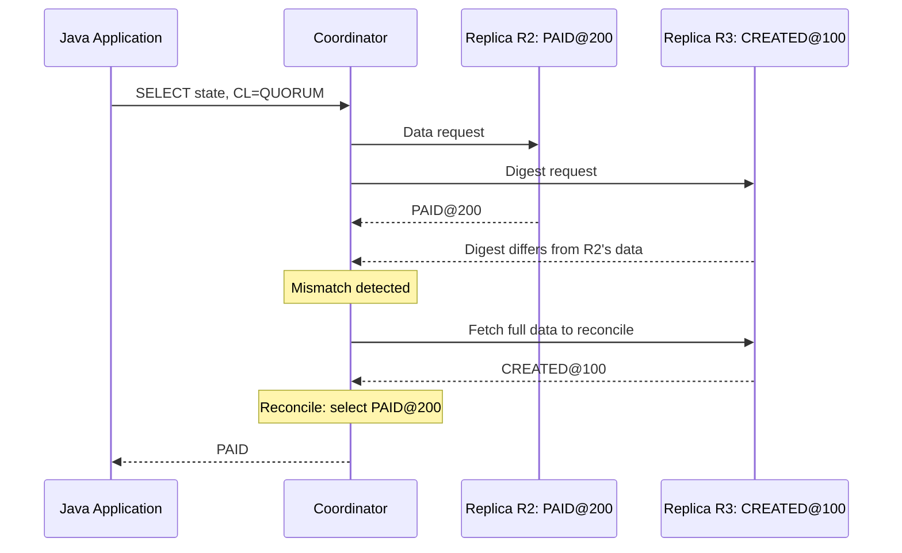

# Freshness of Read Results and Handling Multiple Data Versions

In Apache Cassandra, **a successful read does not always mean reading the most recent write in wall-clock time**. A partition has multiple replicas, and those replicas may receive mutations at different times. Moreover, Cassandra typically uses **cell-level timestamps** to reconcile competing data versions rather than the order in which requests reached the coordinator. Therefore, to evaluate the freshness of a `SELECT` result, you must examine **consistency level (CL)**, **replica state**, **timestamps**, **deletions/TTL**, and **concurrent writes**.

This lesson belongs to the **Read/Write Consistency** chapter of the `DATABASE_ENGINE_WIDE_COLUMN_CASSANDRA` module. In the learning path covering distributed architecture, the wide-column model, partition keys, query-driven table design, CQL, replication, compaction, repair, error handling, and connecting from Java applications, this topic explains how Cassandra **selects which data to return when copies do not yet match**, as well as the limits of raising consistency levels.

## 1. Learning Objectives

After this lesson, you will be able to:

1. Distinguish **real-time freshness**, **timestamp-winning version**, and **cross-replica consistency**.
2. Describe Cassandra's read path: the coordinator fetches data, receives digests, detects mismatches, reconciles versions, and may perform read repair.
3. Explain why `ONE` can return stale data and under what conditions a `QUORUM` or `LOCAL_QUORUM` read/write pair helps observe confirmed mutations.
4. Explain **last-write-wins** by timestamp, multi-cell conflicts, tombstones, and TTL.
5. Distinguish **read repair** from **anti-entropy repair**, hinted handoff, and compaction.
6. Use CQL (`WRITETIME`, `TTL`, `USING TIMESTAMP`) and the Java Driver to inspect versions, select CLs, and handle retries.
7. Assess which business requirements need LWT or an application protocol stronger than ordinary quorum reads/writes.

## 2. "Latest Data" Can Mean Three Different Things

Suppose a table stores order statuses:

```text
order_id = O-123
state = "CREATED" -> "PAID" -> "SHIPPED"
```

An application asking to "read the latest status" might be asking for one of three distinct things:

| Concept | Question | What to Keep in Mind |
| --- | --- | --- |
| **Latest in wall-clock time** | Which update request completed last, and must its value be seen in a valid temporal order? | Relates to **linearizability**, not automatically implied by quorum alone. |
| **Winning version in Cassandra** | Which cell carries the deciding timestamp under reconciliation rules? | Timestamps may be client-specified or generated by client/driver/server per configuration; **a higher timestamp does not necessarily mean a later-completing request**. |
| **Has the replica caught up?** | Has the queried replica received all relevant mutations? | Depends on propagation, CL, network errors, hinted handoff, and repair. |

When a replica returns `"CREATED"` after `"PAID"` was written, it might be **reading from an un-updated replica**. However, if a `"CREATED"` mutation carries a **higher** timestamp than `"PAID"`, Cassandra can legitimately select `"CREATED"` under last-write-wins, **even if every replica has received both mutations**. Those two phenomena have different causes and different fixes.

> **Principle:** Cassandra does not compare "which request the client sent later" to pick the final value. For normal writes, data reconciliation relies on metadata such as **cell-level timestamps** and deletion/TTL rules.

## 3. Replicas and the Coordinator Read Path

The partition key determines the partition; the replication strategy and replication factor (RF) determine the target replicas for that partition. With a single datacenter and RF = 3, we have:

```text
                     Coordinator C
                       /   |   \
                      v    v    v
                     R1   R2   R3

          For the same partition P, three replicas may
          temporarily hold different states.
```

Suppose:

| Replica | Current `state` Value | Cell Timestamp |
| --- | --- | ---: |
| `R1` | `PAID` | 200 |
| `R2` | `PAID` | 200 |
| `R3` | `CREATED` | 100 |

The timestamp numbers are purely illustrative of ordering. `R3` may not have received the new mutation yet due to slow networking or temporary node downtime.

### 3.1. Reading at `ONE`

With `CL=ONE`, the coordinator requires one valid replica response. If the query is served by `R3` before `R3` catches up, the application may receive **`CREATED`**. This read result can be **stale** relative to the `PAID` write already acknowledged by other replicas.

`ONE` typically reduces the number of responses waited for, but **does not require** the coordinator to cross-check other replicas for a newer version. Cassandra may contact additional replicas in certain situations, yet applications must not rely on that as a guarantee of `ONE`.

### 3.2. Reading at `QUORUM`

With RF = 3, `QUORUM = floor(3/2) + 1 = 2`. Suppose the coordinator receives responses from `R2` and `R3` and detects a discrepancy in `state`. It must **reconcile the data** instead of returning an arbitrary version; in the example, `PAID@200` beats `CREATED@100`.



The diagram depicts a common simplified flow. **Not every `SELECT QUORUM` sends exactly one data request and one digest request**; read strategies, speculative retries, slow replicas, replica counts, Cassandra versions, and optimizations can alter the actual message exchange.

### 3.3. Data Response, Digests, and Reconciliation

On the read path, the coordinator can:

1. Select replicas matching the CL and datacenter placement.
2. Receive **full data** from some replicas and **digests** (checksums) from other replicas.
3. Compare digests against the received data to detect whether any discrepancy exists.
4. If there is a mismatch, fetch any additional full data needed, **reconcile** versions according to Cassandra's rules, and return the result once the request completes.
5. Depending on version and table configuration, perform **read repair** on replicas found during the read to be missing the chosen version.

**Digests** are used to detect differences, **not as raw values returned straight to the application**. A read CL requiring two responses does not mean the coordinator always downloads the entire row twice.

If reconciliation or replicas fail to respond before the deadline, the query may receive `ReadTimeout` or `ReadFailure`. A **failed** read cannot be used as evidence of having successfully observed a version.

## 4. `QUORUM` Read After `QUORUM` Write: When Is Expecting Fresh Data Reasonable?

Let `N` be the replica count of **the same partition within the same scope**, `W` be the write ACK threshold, and `R` be the read response threshold. If:

\[
R + W > N
\]

then the write-ACK replica set and read-response replica set must overlap in at least one replica.

Example with RF = 3:

```text
Successful QUORUM write: {R1, R2}  -> W = 2
QUORUM read:             {R2, R3}  -> R = 2

                     R2 belongs to both sets
                     R + W = 4 > 3
```

When the `PAID@200` mutation is written successfully at quorum, a quorum read **starts afterward**, and there are no concurrent writes or timestamp anomalies, the overlapping replica lets the coordinator see the confirmed version and reconcile against older copies.

| RF in One DC | Quorum | Quorum Write + Quorum Read | Guaranteed Overlap? |
| ---: | ---: | ---: | --- |
| 3 | 2 | `2 + 2 > 3` | **Yes** |
| 4 | 3 | `3 + 3 > 4` | **Yes** |
| 5 | 3 | `3 + 3 > 5` | **Yes** |

However, the statement "`QUORUM` always returns the latest data" is too broad. To reason accurately, all of the following **assumptions** must hold:

- The prior write **was confirmed successful** at the appropriate CL; never assume `WriteTimeout` succeeded.
- The read **starts after** the write completes; if the two requests overlap in time, results can depend on execution order.
- Both requests target **the same partition and the same target replica set**, under a stable replication topology.
- No other mutation with competing timestamps causes another value to become the winning version.
- The read path actually gathered enough responses and completed reconciliation.

The intersection condition is **a proof about replica sets**, and does not automatically provide multi-partition transactions or linearizability for all concurrent updates.

### 4.1. `ONE` and `QUORUM` Cannot Be Equated

With RF = 3:

| Write CL | W | Read CL | R | `R + W` | Guaranteed Overlap? |
| --- | ---: | --- | ---: | ---: | --- |
| `ONE` | 1 | `ONE` | 1 | 2 | No |
| `ONE` | 1 | `QUORUM` | 2 | 3 | No |
| `QUORUM` | 2 | `ONE` | 1 | 3 | No |
| `QUORUM` | 2 | `QUORUM` | 2 | 4 | **Yes** |
| `ALL` | 3 | `ONE` | 1 | 4 | **Yes** |

A `QUORUM` read can still **return stale data** after a `ONE` write if the read-responding replica set excludes the replica that confirmed the write and the remaining copies have not caught up.

### 4.2. An `ANY` Write Succeeding via Hint Does Not Apply `W=1`

With `ANY`, the coordinator can return success solely by **storing a hint** with **zero target replicas ACKing**. You cannot treat a hint as "one replica wrote" in the inequality above. Reading from replicas before the hint is replayed **may not see the mutation**, even though the application received a successful write response.

## 5. Datacenter Scope Determines Which Replica Sets Are Compared

Suppose `NetworkTopologyStrategy` configures two datacenters:

```text
dc1: RF = 3  -> A1, A2, A3
dc2: RF = 3  -> B1, B2, B3

Total RF of partition = 6
```

| Write/Read Pair | ACK Scope | Calculation Result |
| --- | --- | --- |
| Cluster-wide `QUORUM`/`QUORUM` | `W=4, R=4, N=6` | `4 + 4 > 6`, **overlaps** within the same replica set. |
| `LOCAL_QUORUM` write and read **both in dc1** | `W=2, R=2, N_dc1=3` | `2 + 2 > 3`, **overlaps within dc1**. |
| `LOCAL_QUORUM` write **dc1**, read **dc2** | Write only needs dc1 ACKs, read only needs dc2 responses | **No guaranteed overlap**. |
| `EACH_QUORUM` write, `LOCAL_QUORUM` read in dc2 | Write already has 2 ACKs in dc2, read needs 2 in dc2 | **Overlaps within dc2** under appropriate assumptions. |

**Concrete scenario:** Application A writes `PAID` in `dc1` with `LOCAL_QUORUM` and receives two ACKs from `A1, A2`. Meanwhile, the inter-DC link is slow so `dc2` has not received the mutation yet. Application B reads in `dc2` with `LOCAL_QUORUM` from `B1, B2` and can see `CREATED`. Each operation **satisfied its own CL**, yet the two response sets belong to **two different DCs**.

Do not use `2 + 2 > 3` to prove "local quorums in two DCs always overlap." The formula applies directly only when `R` and `W` count the same set `N`.

## 6. How Does Cassandra Reconcile Multiple Versions at the Cell Level?

Cassandra does not store just a single file holding "the current row." Mutations can enter the **memtable**, get flushed into **SSTables**, and older SSTables continue holding older versions/tombstones until compaction and corresponding cleanup rules process them.

Logically, a Cassandra row can consist of **cells** with different timestamps. During reads, Cassandra reconciles versions of the same cell using metadata to produce the logical result seen by the application.

### 6.1. Last-Write-Wins Is by Timestamp, Not ACK Order

Suppose two mutations target the same `state` column:

```text
Mutation A: state = 'PAID',     timestamp = 200
Mutation B: state = 'CREATED',  timestamp = 100

By timestamp: PAID@200 beats CREATED@100.
```

Even if B is sent or ACKed **after** A in wall-clock time, Cassandra still selects A because of its higher timestamp. Timestamps can be supplied by the application via CQL `USING TIMESTAMP` or generated by client/server along the write path. When nodes or clients have clock skew, **the timestamp-winning value is not necessarily the latest in real time**.

If two mutations have identical timestamps, Cassandra applies secondary tie-breaking rules; never rely on request arrival order as a winner-selection mechanism. For systems with update contention, design an appropriate state flow, potentially using **LWT/Paxos** rather than assuming quorum arbitrates ordering.

### 6.2. Columns Within the Same Row Can Have Different Timestamps

Example:

| Cell | Logical Value | Timestamp |
| --- | --- | ---: |
| `state` | `PAID` | 200 |
| `updated_by` | `service-A` | 150 |
| `comment` | `Confirmed` | 175 |

If three clients update columns independently, a `SELECT` result can combine cell versions from **different mutations**. Do not assume an ordinary row is an indivisible "snapshot" where every column shares a single version. When multiple fields must stay consistent as part of a state transition, design the write pattern, table model, and concurrency control accordingly.

**Wide-column does not mean historical MVCC querying.** Remaining versions in SSTables serve storage management and reconciliation; Cassandra does not provide a built-in "`SELECT AS OF timestamp`" syntax to arbitrarily query historical versions like a temporal database.

### 6.3. Clocks and Timestamps Need Control

Because reconciliation relies on timestamps, practical risks include:

- Clock skew between timestamp-generating nodes/clients.
- Retrying a mutation with a new timestamp, inadvertently altering win order.
- Manually supplying an abnormally high timestamp, preventing subsequent normal writes from overwriting it until their timestamps catch up.
- Updating two semantically coupled fields with different timestamps.

When you want business-level version checks, an **application version number** and `UPDATE ... IF version = ?` are usually far clearer than using timestamps as a DIY compare-and-set mechanism.

## 7. Tombstones and TTL Are Also Part of Reconciliation

### 7.1. Delete Does Not Simply "Erase Every Copy Instantly"

A `DELETE` in Cassandra creates a **tombstone** to represent deleted data and prevent lagging replicas from resurrecting old versions. Tombstones also carry timestamps and participate in reconciliation.

```text
Replica R1: state = 'CREATED' @100
Replica R2: tombstone for state @200
Replica R3: state = 'CREATED' @100

If the read path compares tombstone @200 against old cell @100,
logically state has been deleted and 'CREATED' is not returned.
```

If a tombstone is purged too early while a replica still retains un-repaired old data, that old data can **reappear** (*zombie data*). Therefore, **anti-entropy repair** procedures, handling long-down nodes, and `gc_grace_seconds` settings must be considered together.

### 7.2. Expired TTL Is Not a Stale Read Bug

A cell written with a **TTL (time to live)** expires automatically. Once TTL expires, the cell no longer appears in logical query results, even though the underlying data/tombstone may remain on disk for a while.

For example, `state='TEMPORARY'` with a 60-second TTL:

```text
t0:     Write state='TEMPORARY', TTL=60
t0+30s: Read may observe 'TEMPORARY' (if consistency conditions hold)
t0+70s: Cell TTL has expired -> no longer returned as a live value
```

When a `SELECT` returns `null` or omits a cell, distinguish **never written**, **deleted**, **TTL expired**, and **read from a lagging replica**. Each requires a different investigation path.

## 8. Read Repair, Hinted Handoff, Repair, and Compaction

These mechanisms all relate to distributed data yet serve distinct purposes:

| Mechanism | When Does It Trigger? | Role in Read Freshness |
| --- | --- | --- |
| **Read reconciliation** | Coordinator receives read responses with differing versions. | Chooses logical data via timestamps/tombstones to return the read result. |
| **Read repair** | Read path detects inconsistent replicas, depending on version and table config. | Can update involved replicas to reduce discrepancies discovered during reads. |
| **Hinted handoff** | Replica temporarily misses a mutation while coordinator retains a hint. | Replays mutations once replica is reachable; **best effort**, does not replace repair. |
| **Anti-entropy repair** | Proactive or scheduled operation to compare replicas. | Fixes remaining divergences without needing a read request or original hints. |
| **Compaction** | Background task merging/cleaning SSTables, handling old versions and tombstones per rules. | Manages storage and performance; not a mechanism guaranteeing all replicas are in sync. |

### Version-Dependent Read Repair Behavior

In Cassandra 4.x, tables can configure `read_repair` with values such as `BLOCKING` or `NONE`. With `BLOCKING`, read paths detecting discrepancies wait for the required read repair before returning the result; this supports **monotonic quorum reads** within its scope, though it can impact latency and observed atomicity of multi-row writes within a partition when reading only a slice.

With `NONE`, behavior and trade-offs differ. Older Cassandra versions had different read repair mechanics; **never assume from a CL name that every `QUORUM` read cleanly repairs all replicas**. Read repair typically covers only the queried/divergent data range and does not replace a cluster-wide repair strategy.

**Example:** A `SELECT` querying a single row by clustering key does not inspect and repair every other row in the same partition. If an application needs whole partitions/tables to converge, it needs a dedicated repair schedule suited to the wide-column model and write volume.

## 9. CQL Practice: Observing Timestamps and Reconciliation Outcomes

This example assumes a **lab cluster** with an actual datacenter named `dc1` and at least three nodes for RF=3. Substitute your environment's DC name and authentication settings.

```sql
CREATE KEYSPACE IF NOT EXISTS freshness_lab
WITH replication = {
  'class': 'NetworkTopologyStrategy',
  'dc1': 3
};

CREATE TABLE IF NOT EXISTS freshness_lab.order_state_by_id (
  order_id uuid PRIMARY KEY,
  state text,
  updated_by text
);
```

In this table, `order_id` is the partition key and `SELECT ... WHERE order_id = ?` queries that exact partition. RF=3 is set on the **keyspace**; CL is selected **per request**.

### 9.1. Writing Illustrative Timestamps and Reading `WRITETIME`

In `cqlsh`, `CONSISTENCY` sets the consistency level for **subsequent statements in the shell session**:

```sql
CONSISTENCY QUORUM;

INSERT INTO freshness_lab.order_state_by_id
  (order_id, state, updated_by)
VALUES (
  11111111-1111-4111-8111-111111111111,
  'PAID',
  'service-A'
) USING TIMESTAMP 2000000;

-- Mutation sent later, but carrying a smaller timestamp.
UPDATE freshness_lab.order_state_by_id
USING TIMESTAMP 1000000
SET state = 'CREATED'
WHERE order_id = 11111111-1111-4111-8111-111111111111;

SELECT state, WRITETIME(state), updated_by, WRITETIME(updated_by)
FROM freshness_lab.order_state_by_id
WHERE order_id = 11111111-1111-4111-8111-111111111111;
```

In an isolated example with no other writes to the same key, the logical value of `state` remains **`PAID`** because timestamp `2000000` is greater than `1000000`. The `WRITETIME(state)` function returns the write timestamp of the winning cell in **microseconds**; it is **not** a full history of all previous mutations. The `updated_by` column was written in the first mutation and carries its own cell timestamp.

**Only use arbitrary values with `USING TIMESTAMP` in a lab.** In production, overly high, overly low, or inconsistent timestamps can unexpectedly prevent newer data from beating older versions.

### 9.2. Observing TTL

```sql
CONSISTENCY QUORUM;

UPDATE freshness_lab.order_state_by_id
USING TTL 120
SET updated_by = 'temporary-worker'
WHERE order_id = 22222222-2222-4222-8222-222222222222;

SELECT updated_by, TTL(updated_by), WRITETIME(updated_by)
FROM freshness_lab.order_state_by_id
WHERE order_id = 22222222-2222-4222-8222-222222222222;
```

`TTL(updated_by)` shows the remaining TTL seconds for a live cell. Once TTL expires, the cell no longer appears as a live value. Replica inconsistency can affect observation prior to convergence, yet **TTL expiration** is also a completely valid reason for a value to disappear.

### 9.3. Observing and Identifying Stale Read Risk

```sql
-- Test a lower CL in the lab.
CONSISTENCY ONE;

SELECT state
FROM freshness_lab.order_state_by_id
WHERE order_id = 11111111-1111-4111-8111-111111111111;

-- Compare against a quorum read.
CONSISTENCY QUORUM;

SELECT state
FROM freshness_lab.order_state_by_id
WHERE order_id = 11111111-1111-4111-8111-111111111111;
```

Both `SELECT`s in a healthy cluster **will very likely return the same value**. This does not prove `ONE` offers the same freshness guarantees as `QUORUM`; observing a divergence requires an environment with a slow/lagging replica and knowing exactly which replicas own the partition. Never intentionally induce outages on a production cluster.

## 10. Java Driver 4.x: Choosing CL and Recognizing Uncertain Outcomes

In Java applications, CL can be set on each statement. The example below uses a `CqlSession` configured with local datacenter, contact points, and authentication. Each `PreparedStatement` is prepared **once**:

```java
import com.datastax.oss.driver.api.core.CqlSession;
import com.datastax.oss.driver.api.core.DefaultConsistencyLevel;
import com.datastax.oss.driver.api.core.cql.BoundStatement;
import com.datastax.oss.driver.api.core.cql.PreparedStatement;
import com.datastax.oss.driver.api.core.cql.Row;

import java.util.UUID;

public final class OrderStateRepository {
    private final CqlSession session;
    private final PreparedStatement updateState;
    private final PreparedStatement readState;

    public OrderStateRepository(CqlSession session) {
        this.session = session;
        this.updateState = session.prepare(
            "UPDATE freshness_lab.order_state_by_id " +
            "SET state = ? WHERE order_id = ?");
        this.readState = session.prepare(
            "SELECT state FROM freshness_lab.order_state_by_id " +
            "WHERE order_id = ?");
    }

    public void changeState(UUID orderId, String newState) {
        BoundStatement write = updateState.bind(newState, orderId)
            .setConsistencyLevel(DefaultConsistencyLevel.LOCAL_QUORUM);

        session.execute(write); // Confirmed only once the request's CL is met.
    }

    public String readState(UUID orderId) {
        BoundStatement read = readState.bind(orderId)
            .setConsistencyLevel(DefaultConsistencyLevel.LOCAL_QUORUM);

        Row row = session.execute(read).one();
        return row == null ? null : row.getString("state");
    }
}
```

In a DC with RF=3, `LOCAL_QUORUM` writes and reads each require two local responses. If the write succeeds, the read starts afterward, there are no concurrent writes, and both use the same replica set, the two quorums overlap. This is the basis for **expecting to read the newly written mutation**, not a contention lock for multiple clients updating the same state.

### 10.1. Timeout Does Not Prove Nothing Was Written

An `UPDATE` at `LOCAL_QUORUM` may be applied by one replica while the client receives a `WriteTimeoutException` because two ACKs did not arrive in time. At that moment, the client **cannot know for sure** how many replicas accepted the mutation. Retrying blindly with a new timestamp, altering write ordering, or triggering extra business side effects can produce surprising outcomes.

Handling should include:

- Keeping **partition key and operation ID** stable for post-error reconciliation.
- Designing mutations to be **idempotent** where appropriate; avoid unconditionally incrementing counters, generating new keys, or emitting external events on every retry.
- Bounding retries and monitoring timeouts/latency, as aggressive retries add pressure to the cluster.
- When conditional updates or lost-update protection under concurrency are needed, use a versioning model and appropriate **LWT**.

### 10.2. Read-Check-Write Is Not an Atomic Step

For example, two services both read `state='CREATED'`, then both write a new state:

```text
Service A: SELECT QUORUM -> CREATED
Service B: SELECT QUORUM -> CREATED
Service A: UPDATE QUORUM -> PAID
Service B: UPDATE QUORUM -> CANCELLED
```

Both mutations can still be acknowledged, after which Cassandra reconciles by timestamp. If business rules allow **at most one transition out of CREATED**, you must use a conditional update like:

```sql
UPDATE freshness_lab.order_state_by_id
SET state = 'PAID'
WHERE order_id = 11111111-1111-4111-8111-111111111111
IF state = 'CREATED';
```

The `IF` statement is a **lightweight transaction (LWT)** using consensus and returning `[applied]`. The application must inspect that flag and distinguish `true`, `false`, and **indeterminate timeouts**. LWT has higher network/latency cost than normal writes; you must also choose the appropriate `SERIAL` or `LOCAL_SERIAL` scope, especially under cross-DC write contention.

## 11. Investigating "I Just Wrote Data, Why Is My Read Still Stale?"

An investigation checklist can follow these questions:

| Question | What to Inspect | Interpretation Hint |
| --- | --- | --- |
| Was the write confirmed? | Success response vs. `WriteTimeout` / `Unavailable`? | Timeout does not let you assume enough replica ACKs succeeded. |
| What were the write and read CLs? | `ONE`, `LOCAL_ONE`, `QUORUM`, `LOCAL_QUORUM`? | Compute `R+W` and check replica scope. |
| Where is the coordinator? | Driver local DC, routing, contact points. | Two local quorums in different DCs are not guaranteed to overlap. |
| Are partition key and RF correct? | Keyspace, query, topology. | Queries across two partitions cannot share a quorum argument. |
| Were there concurrent mutations? | Business logs, `WRITETIME`, client timestamps. | An "old" value may be winning by timestamp. |
| Was there a TTL or delete? | `TTL`, tombstones, expiration time. | Missing cells may be due to TTL/tombstones, not stale replicas. |
| How synchronized are the replicas? | Down nodes, hint backlog, repair, read-path errors. | Slow replicas may hold older versions. |
| Did the read path complete? | `ReadTimeout`, `ReadFailure`, latency. | Without a successful read, there is no valid observation. |

**Correct interpretation:** If a `ONE` read is stale after a `ONE` write, look at lack of overlap and slow replication. If a `QUORUM` read appears "stale" even after a `QUORUM` write, before blaming Cassandra check **timestamps, overlapping writes, topology, DC scope, operation timing, and timeouts**.

## 12. Common Misconceptions

1. **"A quorum read always returns the newest version in wall-clock time."** False. Quorum provides intersection; timestamps and concurrent writes still determine the logical version.
2. **"If there is one shared replica, the client gets raw data directly from that replica."** False. The coordinator may use data/digests, detect mismatches, and reconcile.
3. **"Read repair automatically fixes every replica and every partition after one SELECT."** False. Repair scope depends on queried data, version, and configuration; proper anti-entropy repair is still needed.
4. **"Having multiple SSTables means you can SELECT any historical state."** False. Physical versions support reconciliation/compaction, not a default historical MVCC API.
5. **"DELETE wipes data instantaneously on all nodes."** False. Tombstones must propagate, participate in reconciliation, and be purged under specific rules.
6. **"Supplying a large custom timestamp guarantees your update wins."** Dangerous. Clock skew, retries, and out-of-range timestamps can break business ordering.
7. **"If SELECT returns null, nobody ever wrote to it."** False. It may have been deleted, expired by TTL, not yet replicated, or never confirmed.
8. **"Quorum write + quorum read automatically handles conditional updates."** False. Business conditions like `IF NOT EXISTS` require a compare-and-set/LWT protocol.

## 13. Exercises and Answers

### Exercise 1 — Reading an Out-of-Date Replica

RF=3. `R1` and `R2` have `state=PAID@200`; `R3` has `state=CREATED@100`. What can a `ONE` read choosing `R3` return?

**Answer:** It can return `CREATED`. `ONE` does not require comparing with other replicas before succeeding.

### Exercise 2 — Quorum Read with Differing Data

Still with RF=3, a `QUORUM` read receives responses from `R2` and `R3`. If the read path detects a mismatch and finishes reconciliation, which version of `state` wins?

**Answer:** `PAID@200`, because timestamp 200 is greater than 100; the coordinator can fetch full data as needed to reconcile.

### Exercise 3 — QUORUM Write, ONE Read

RF=3; a `QUORUM` write succeeds on `R1,R2`, and a `ONE` read hits `R3` before it receives the mutation. Is overlap guaranteed?

**Answer:** No. `W=2`, `R=1`, `N=3`, so `R+W=3≤3`. The read can be stale.

### Exercise 4 — Later Write with Lower Timestamp

Client A writes `PAID` with timestamp 300, completing at `QUORUM`. Then Client B writes `CREATED` with timestamp 100, also completing at `QUORUM`. A quorum read returns `PAID`. Does this violate the intersection formula?

**Answer:** No. The two response sets still overlap; timestamp-based last-write-wins selects `PAID@300`. This illustrates why intersection does not guarantee real-time write ordering.

### Exercise 5 — Cross-DC Read

`dc1` RF=3, `dc2` RF=3. A `LOCAL_QUORUM` write in `dc1` succeeds, followed immediately by a `LOCAL_QUORUM` read in `dc2`. Is seeing the new mutation guaranteed?

**Answer:** No. The write ACK set is in `dc1` and the read set is in `dc2`, with no forced overlap. WAN replication may not have completed yet.

### Exercise 6 — Deletes and Old Data

Replica A holds a tombstone for `state` at timestamp 500; Replica B holds `state=PAID` at timestamp 300. When a read reconciles enough data, will `PAID` reappear?

**Answer:** Logically, the timestamp 500 tombstone beats the older timestamp 300 version, so `PAID` is not returned as a live cell. The system still needs proper repair and tombstone management to avoid resurrecting deleted data if a replica misses a delete for too long.

### Exercise 7 — Reading an Expired TTL Cell

`updated_by` was written with TTL=60 seconds. After 90 seconds, `SELECT` does not see this column. Can we conclude the write was lost due to a replication bug?

**Answer:** No. The cell may have **expired its TTL** exactly as designed. Always distinguish expiration from replication failures.

### Exercise 8 — Does Read Repair Replace Anti-Entropy Repair?

An application frequently reads `order_id=A` at quorum. Can we eliminate all repair schedules because reads will fix all divergent data?

**Answer:** No. Read repair only detects/reconciles the read range and depends on version/configuration. Infrequently or never-queried partitions still require an anti-entropy repair strategy.

### Exercise 9 — Two Services Transition State Simultaneously

Two services both read `CREATED` and then write `PAID` and `CANCELLED` at `QUORUM`. How do we ensure only one state transition is accepted?

**Answer:** Use a conditional update on the same partition such as `UPDATE ... IF state='CREATED'` (LWT), check `[applied]`, and treat timeouts as indeterminate; ordinary quorum does not make read-check-write atomic.

## 14. Summary

The freshness of a Cassandra read is the combined result of **the queried replica scope**, **read/write CLs**, **operation ordering**, **per-cell metadata**, and **reconciliation rules**. `ONE` can be fast yet read an un-updated replica; `QUORUM`/`QUORUM` over the same replica set establishes overlap, helping reads observe confirmed mutations when the right assumptions hold.

With multi-version data, **timestamp/last-write-wins**, tombstones, and TTL determine the logical value, while read repair, hinted handoff, anti-entropy repair, and compaction address different aspects of convergence and storage. Quorum does not automatically create atomic transactions for competing updates. When business logic must protect state transition conditions, evaluate **LWT** and application locking/versioning rather than merely raising CL.

### References

- [Apache Cassandra — Dynamo / Tunable Consistency](https://cassandra.apache.org/doc/stable/cassandra/architecture/dynamo.html): read path, digests, replicas, and consistency levels.
- [Apache Cassandra — Storage Engine](https://cassandra.apache.org/doc/stable/cassandra/architecture/storage-engine.html): memtables, SSTables, compaction, and on-disk data.
- [Apache Cassandra — CQL Data Manipulation](https://cassandra.apache.org/doc/stable/cassandra/developing/cql/dml.html): `USING TIMESTAMP`, `TTL`, `WRITETIME`, and conditional operations.
- [Apache Cassandra — Repair](https://cassandra.apache.org/doc/stable/cassandra/managing/operating/repair.html): role of anti-entropy repair.
