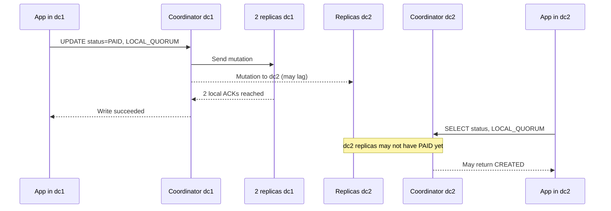

# Read-After-Write, Read/Write Levels, and Involved Replica Sets

In Apache Cassandra, a write request can be acknowledged as successful before **every replica** of the partition receives the mutation. Consequently, applications frequently ask: **"After an `INSERT` or `UPDATE` succeeds, will a `SELECT` executed right afterward read the value I just wrote?"** This is the **read-after-write** problem—or, when considering operations from the same client, **read-your-writes**.

The answer depends on **the write and read consistency level (CL) pair**, **the replica set each operation uses**, whether the write was **actually confirmed**, and factors such as timestamps and concurrent writes. Picking `QUORUM` on only one side may not be enough. Especially in multi-datacenter clusters, two operations both configured with `LOCAL_QUORUM` yet routed through **two different DCs** can still fail to overlap.

This lesson belongs to the **Read/Write Consistency** chapter of the `DATABASE_ENGINE_WIDE_COLUMN_CASSANDRA` module. In the learning path covering distributed architecture, the wide-column model, partition keys, query-driven table design, CQL, replication, compaction, repair, error handling, and Java integration, this lesson focuses on designing a **write-then-read path** with accurately stated consistency expectations.

> **Core takeaway:** To reason about read-after-write using quorum, you must identify **which replicas ACKed the write** and **whether the read is forced to consult at least one replica in that set**. Only add `R` and `W` together when they count **the same set of `N` replicas**.

## 1. Learning Objectives

After this lesson, you will be able to:

1. Explain read-after-write, read-your-writes, and how they differ from linearizability.
2. Compute `N`, `W`, and `R` from RF and the CLs `ONE`, `QUORUM`, `ALL`, `LOCAL_ONE`, `LOCAL_QUORUM`, and `EACH_QUORUM`.
3. Prove when `R + W > N` forces the write and read replica sets to intersect.
4. Analyze CL pairs within the same DC, across two DCs, and under unequal RFs.
5. Recognize edge cases: `ANY` succeeding via hints, write timeouts, overlapping writes, timestamps, and topology changes.
6. Practice a write-then-read flow in `cqlsh` and Java Driver 4.x.
7. Choose the right approach when business logic requires immediate read-back, concurrent update protection, or accepts eventual consistency.

## 2. What Does Read-After-Write Mean?

Suppose an order's initial status is `CREATED`. The application executes:

```text
t0  UPDATE order.status = 'PAID'
t1  Cassandra returns write success
t2  SELECT order.status      (t2 > t1)
t3  Application receives read value
```

At `t3`, the application expects `PAID`, not `CREATED`. This is an expectation of **reading after a confirmed write**. When the same client performs both operations, we typically call that **read-your-writes**.

To express this expectation as a conditional guarantee, we must clarify:

- Both operations target **the same partition/row/cell** and the same underlying replica system.
- The read request **begins after** the client receives a **successful write response**.
- No valid competing update later causes another value to win under timestamp rules.
- The read succeeds at the chosen CL without timing out or failing reconciliation.

**Read-after-write is not equivalent to multi-row transactions or linearizability across all concurrent operations.** Proving that a read has a guaranteed chance to encounter a newly written mutation is different from proving that every client observes a single real-time global order for updates.

### When Cassandra Succeeds a Write at a Low CL

A partition has three replicas `A`, `B`, `C`. A `ONE` write can return success after an ACK from `A` alone, while `B` and `C` have not yet received the mutation:

```text
                           RF = 3

Application -- write PAID --> Coordinator
                                |----> Replica A: PAID    (ACK)
                                |----> Replica B: CREATED (not updated yet)
                                |----> Replica C: CREATED (not updated yet)

Write ONE reports success thanks to A.
Read ONE, if served by C, can return CREATED.
```

This is a classic example of **eventual consistency**: replicas converge over time, yet a read immediately after a low-CL write is not guaranteed to observe the newly confirmed value.

## 3. Replica Sets and the Intersection Condition `R + W > N`

Let `S` be the target replica set for **one partition**, with `N = |S|` elements. After **a successful write**, let `A` be the set of replicas that ACKed the mutation. During a **successful read**, let `B` be the set of replicas whose valid responses were used by the coordinator.

If:

- `|A| ≥ W`: the write met the `W` replica ACK threshold;
- `|B| ≥ R`: the read met the `R` response threshold;
- `A, B ⊆ S`: **the exact same replica set `S`**;

then:

\[
|A \cap B| \ge |A| + |B| - |S| \ge R + W - N
\]

Therefore:

\[
\boxed{R + W > N \quad\Longrightarrow\quad |A \cap B| \ge 1}
\]

This condition proves there is **at least one common replica**. If `R + W ≤ N`, we only know the two sets **may** be disjoint, not that the data will definitely be stale.

### RF = 3 Example

```text
Replica:              A           B           C

Write QUORUM (W=2):  [ACK]       [ACK]          .
Read  QUORUM (R=2):    .        [READ]       [READ]
                                   ^
                            Overlap at B

W + R = 2 + 2 = 4 > 3
```

Replica `B` ACKed the write and participates in the read path. Provided operation ordering, timestamp, and reconciliation conditions hold, the quorum read can select the newly written version over older ones.

**Cassandra does not necessarily fetch full row data from all `R` replicas.** The coordinator may request full data from one replica and **digests** from others, compare them, and fetch more full data if a discrepancy appears. For the intersection argument, valid responses on the read path still represent the replica state, though minimum ACK counts should not be confused with actual internal request counts.

## 4. Calculating Write/Read CL Pairs in a Single Datacenter

With RF = `N` in one datacenter:

| CL | Replica Threshold |
| --- | ---: |
| `ONE` | 1 |
| `TWO` | 2 |
| `THREE` | 3 |
| `QUORUM` | `⌊N/2⌋ + 1` |
| `ALL` | `N` |

`QUORUM` is a strict majority of replicas. With RF = 3, `QUORUM=2`; with RF = 5, `QUORUM=3`.

### Read/Write Pairs with RF = 3

| Write CL | `W` | Read CL | `R` | `R + W` | Guaranteed Overlap? |
| --- | ---: | --- | ---: | ---: | --- |
| `ONE` | 1 | `ONE` | 1 | 2 | **No** |
| `ONE` | 1 | `QUORUM` | 2 | 3 | **No** |
| `QUORUM` | 2 | `ONE` | 1 | 3 | **No** |
| `QUORUM` | 2 | `QUORUM` | 2 | 4 | **Yes** |
| `ALL` | 3 | `ONE` | 1 | 4 | **Yes** |
| `ONE` | 1 | `ALL` | 3 | 4 | **Yes** |
| `TWO` | 2 | `THREE` | 3 | 5 | **Yes** |

**Two key observations:**

1. To guarantee overlap, both sides do **not** have to use `QUORUM`: `ALL` write then `ONE` read, or `ONE` write then `ALL` read, also satisfy the inequality. However, `ALL` is highly sensitive to slow or failed replicas and is rarely a balanced choice.
2. A `QUORUM` write followed by a `ONE` read **has no** overlap guarantee because `2+1=3`. Even though a majority of replicas confirmed the write, a single-replica read may still hit the copy that has not received the mutation yet.

### RF = 5 Changes the Math

With RF = 5:

- `QUORUM` write and `QUORUM` read: `W=3, R=3`, so `3+3>5`, overlap holds.
- `THREE` write and `THREE` read also gives `3+3>5`.
- `TWO` write and `TWO` read only gives `2+2=4≤5`, **no overlap guarantee**.

If RF changes while the application still uses **fixed** levels like `TWO` or `THREE`, you must recalculate thresholds. `QUORUM` adapts to RF, whereas `TWO` always demands only two responses.

## 5. Datacenter Scope: Local Quorum Is Not Global Quorum

With `NetworkTopologyStrategy`, each datacenter has its own RF. Consider this topology:

```text
                  One partition P

dc1, RF=3                      dc2, RF=3
 A1    A2    A3                B1    B2    B3

S_global = {A1,A2,A3,B1,B2,B3}  -> N_global = 6
S_dc1    = {A1,A2,A3}           -> N_dc1 = 3
S_dc2    = {B1,B2,B3}           -> N_dc2 = 3
```

Different consistency levels have **different acknowledgment scopes**:

- **`QUORUM`:** requires `⌊6/2⌋+1=4` responses across **all six replicas**.
- **`LOCAL_QUORUM`:** requires `2` responses **within the coordinator's datacenter**.
- **`LOCAL_ONE`:** requires one response from a replica **within the coordinator's datacenter**.
- **`EACH_QUORUM`:** for **normal writes**, requires `2` ACKs **in every DC**, i.e., at least `2+2` in this example. Cassandra OSS **does not support `EACH_QUORUM` for normal `SELECT`s**.

"Local" does not depend directly on where the user is physically sitting; it depends on **the coordinator's DC**. Java applications must configure the local datacenter and routing properly, and `cqlsh` must connect to a node in the intended DC.

### 5.1. `LOCAL_QUORUM` Write and Read in the Same DC

An application using a coordinator in `dc1` writes at `LOCAL_QUORUM`, receiving two ACKs from `A1,A2`. Afterward, it reads at `LOCAL_QUORUM` via a coordinator **also in `dc1`**, receiving responses from `A2,A3`:

```text
Write: {A1, A2}  -> W=2 in dc1
Read:  {A2, A3}  -> R=2 in dc1
              ^
        A2 is the common replica

2 + 2 > N_dc1=3
```

The overlap conclusion is valid because both operations use **the same replica set `S_dc1`**. No remote DC acknowledgment is needed to satisfy either CL. Still, mutation delivery to the remote DC continues asynchronously via replication.

### 5.2. `LOCAL_QUORUM` Write in dc1, `LOCAL_QUORUM` Read in dc2



The write path only requires ACKs from `dc1`; the read path only requires responses from `dc2`. The two sets can be **completely disjoint**. Never compute `2+2>3` using one DC's RF and claim they overlap, because `W` and `R` come from **two different DCs**.

This is why a service can write successfully in Region A while a service in Region B immediately afterward still observes the old version, **even though both use `LOCAL_QUORUM`**.

### 5.3. Cluster-Wide `QUORUM` Write and Read

With RF = `3+3`, both `QUORUM` requests require four responses across the same six replicas:

\[
R+W=4+4=8>6
\]

The write and read sets share **at least two common replicas**. In return, requests may have to wait over inter-DC links: a single DC holds at most three replicas and cannot supply four responses alone.

### 5.4. Combining `QUORUM` and `LOCAL_QUORUM`

There is a common trap: writing at cluster-wide `QUORUM` while reading at `LOCAL_QUORUM` in `dc1`.

```text
Write QUORUM:           {A1, B1, B2, B3} -> 4/6 ACKs
Read  LOCAL_QUORUM dc1: {A2, A3}         -> 2/3 responses

Intersection = empty, even though each operation met its own CL.
```

`W=4, R=2, N_global=6` yields `R+W=6`, which is **not greater than six**. Having the word "quorum" on both sides **does not automatically guarantee** read-after-write.

Conversely, writing `LOCAL_QUORUM` in `dc1` and then reading cluster-wide `QUORUM` also permits disjoint valid response sets. You must examine all possible ACK distributions, not just CL names.

### 5.5. `EACH_QUORUM` Write and `LOCAL_QUORUM` Read

An `EACH_QUORUM` write with RF=`3+3` succeeds after receiving at least **two ACKs from `dc1` and two ACKs from `dc2`**. A `LOCAL_QUORUM` read in either DC requires **two responses within that DC**. Since:

\[
2 + 2 > 3
\]

the two sets **overlap within the DC performing the read**. Assuming non-conflicting data and a completed write, this is an option when business logic requires **writes confirmed in every DC** before clients read at local quorum.

The trade-off is that `EACH_QUORUM` ties the write path to the availability of **every DC**, tends to increase WAN latency, and can fail if any DC loses quorum.

### Summary of Common Pairs with RF = 3 + 3

| Write CL and Location | Read CL and Location | Guaranteed Overlap? |
| --- | --- | --- |
| Cluster-wide `QUORUM` | Cluster-wide `QUORUM` | **Yes:** `4+4>6`. |
| `LOCAL_QUORUM` in dc1 | `LOCAL_QUORUM` in dc1 | **Yes:** `2+2>3` within dc1. |
| `LOCAL_QUORUM` in dc1 | `LOCAL_QUORUM` in dc2 | **No:** two sets in different DCs. |
| Cluster-wide `QUORUM` | `LOCAL_QUORUM` in dc1 | **Not guaranteed:** can be disjoint. |
| `LOCAL_QUORUM` in dc1 | Cluster-wide `QUORUM` | **Not guaranteed:** can be disjoint. |
| `EACH_QUORUM` write across both DCs | `LOCAL_QUORUM` read in dc1 or dc2 | **Yes:** write quorum exists in each DC. |

## 6. Different RFs Between DCs: Checking Skewed Distributions

Suppose `dc1` has RF=3 and `dc2` has RF=2:

```text
dc1: {A1,A2,A3} -> LOCAL_QUORUM = 2
dc2: {B1,B2}    -> LOCAL_QUORUM = 2
Cluster-wide: N = 5 -> QUORUM = 3
EACH_QUORUM write = 2 in dc1 and 2 in dc2
```

| Operation Pair | Scope-Based Overlap? | Reason |
| --- | --- | --- |
| Cluster-wide `QUORUM` write/read | **Yes** | `3+3>5`. |
| `LOCAL_QUORUM` write/read both in dc1 | **Yes** | `2+2>3`. |
| `LOCAL_QUORUM` write/read both in dc2 | **Yes** | `2+2>2`; however, each operation needs **both** dc2 replicas. |
| `LOCAL_QUORUM` write dc1, `LOCAL_QUORUM` read dc2 | **No** | Two sets in different DCs. |
| `EACH_QUORUM` write, `LOCAL_QUORUM` read dc2 | **Yes** | Write already required both ACKs in dc2. |

Skewed-RF topologies show that computing quorum totals while ignoring **scope** or **per-DC required distributions** leads to wrong conclusions.

## 7. Required Assumptions to Expect Reading Your Write

The intersection condition is one reasoning step, not enough to claim every `SELECT` always returns "the latest value in real time."

### 7.1. The Write Must Report Success at the Chosen CL

`W` can only be treated as an achieved ACK threshold after **the write succeeds**. If the client receives `WriteTimeout`, `WriteFailure`, or `Unavailable`, the outcome does not prove `W` replicas acknowledged. Some replicas may have applied the mutation, yet the application **cannot be sure** of the write state from that error.

### 7.2. The Read Begins After the Write Completes

Read-after-write considers the sequence:

```text
Write sent ------- write ACK ------ read starts ------ read finishes
```

If read and write **overlap**, the result can correspond to either the pre-mutation or post-mutation state depending on processing order and reconciliation. Never use `R+W>N` to claim that concurrent in-flight reads must see an unfinished mutation.

### 7.3. Both Operations Target the Same Data and Same Replica Set

Same partition key, keyspace, and replication strategy are necessary to identify the relevant replica set. If an application writes `order_id=A` and reads `order_id=B`, set intersection has no bearing across two distinct partitions.

During **bootstrap, decommission, RF changes, token moves, or node replacement**, replica placement can change. An argument using a fixed set `S` does not automatically hold across topology changes; check transition state and your Cassandra version's mechanics.

### 7.4. No Competing Writes or Timestamps Alter the Winning Version

Cassandra normally reconciles cells via **timestamp-based last-write-wins**. A higher timestamp can win even if that mutation was sent **earlier** in wall-clock time.

```text
Client A: UPDATE status='PAID',     timestamp=200 --- ACK
Client B:                                             UPDATE status='CREATED',
                                                      timestamp=100 --- ACK
Client C:                                                                SELECT
                                                                         -> PAID
```

If B is sent after A yet carries a lower timestamp, the result can still be `PAID`. Both writes succeeded at their CLs without guaranteeing "the later-completing request always wins" like a linearizable register. Competing writes, clock skew, manually supplied timestamps, and retries with new timestamps can all produce results differing from predictions based solely on response order.

Therefore, **"read my write"** must assume no other valid mutation causes another version to win, or the application enforces its own concurrency protocol.

### 7.5. The Read Path Must Complete Reconciliation

The coordinator may fetch full data from one replica, digests from others, detect discrepancies, and perform **reconciliation** by timestamps/tombstones. If the request times out during that process, the client **has no successful read result** to reason from.

Read repair may update replicas found missing data, depending on version/configuration, but **does not replace anti-entropy repair** on rarely read partitions.

## 8. Edge Cases That Easily Break Reasoning

### 8.1. `ANY` Write Succeeding Solely via Hint

`ANY` is a CL for **writes**, not valid for `SELECT`. In some scenarios, the coordinator can report `ANY` write success solely because it **stored a hint** for the mutation, even though **no target replica ACKed**.

```text
ANY write succeeds:
  Replica A: has not received mutation
  Replica B: has not received mutation
  Replica C: has not received mutation
  Coordinator: stored hint

Read from A/B/C before hint delivery:
  May not see the newly written mutation yet.
```

Because a hint **is not a replica ACK**, you cannot plug in `W=1` and claim `R=ALL=3` is guaranteed to read the value. Hinted handoff is a **best effort** mechanism for delivering missed mutations; it does not guarantee the mutation resides on a replica at the time of `ANY`'s ACK.

### 8.2. Write Timeouts and Retries

Suppose a `QUORUM` write at RF=3 has `A` ACK, `B` receive the mutation with a late ACK, and `C` unresponsive. The coordinator may return **`WriteTimeout`**, even though some replicas already applied the write.

The application should not conclude:

- "Timeout means it definitely wasn't written."
- "Resending a different mutation is always safe."
- "After a timeout, a quorum read definitely determines whether the prior operation applied as business logic expected."

You must design **idempotency** for retries, reuse the same partition key/business ID, and handle **indeterminate** state. With counter increments or external event emissions outside Cassandra, blind retries can cause duplicate side effects.

### 8.3. Read Repair, Hinted Handoff, and Repair Do Not Create Arbitrary Guarantees

- **Read reconciliation** chooses the logical version among read responses.
- **Read repair** may fix divergent replicas discovered by the read path, depending on version and policy.
- **Hinted handoff** helps temporarily disconnected replicas catch up on missed mutations.
- **Anti-entropy repair** compares replicas to fix long-lived divergences.
- **Compaction** merges/cleans SSTables, tombstones, and older versions per storage rules.

They help data converge and keep the system healthy, yet **do not replace** choosing the right CL, identifying replica sets, or handling concurrent writes.

### 8.4. Application Queries Must Use the Right Partition Key

CL does not fix table-modeling flaws. If the requirement is "read an order's status right after updating it," maintain a table queried directly by `order_id` (partition key), rather than relying on scans or another materialized/denormalized table that has not been updated in the same flow.

If the application **dual-writes** data to two different tables, reading/writing each table at `QUORUM` does not turn the two mutations into an atomic transaction. Reading back from table B right after table A succeeded **is not** covered by the same quorum intersection proof.

## 9. CQL Practice in a Single Datacenter

Suppose you have a test cluster with an actual DC named `dc1` and at least three nodes for RF=3. Create a keyspace and a table queried by `order_id`:

```sql
CREATE KEYSPACE IF NOT EXISTS raw_lab
WITH replication = {
  'class': 'NetworkTopologyStrategy',
  'dc1': 3
};

CREATE TABLE IF NOT EXISTS raw_lab.order_status_by_id (
  order_id uuid PRIMARY KEY,
  status text,
  updated_at timestamp
);
```

Set write/read CLs sequentially in `cqlsh`:

```sql
-- W=2 ACKs within RF=3.
CONSISTENCY QUORUM;

INSERT INTO raw_lab.order_status_by_id
    (order_id, status, updated_at)
VALUES (
    11111111-1111-4111-8111-111111111111,
    'CREATED',
    '2026-11-21 09:00:00+0000'
);

UPDATE raw_lab.order_status_by_id
SET status = 'PAID',
    updated_at = '2026-11-21 09:05:00+0000'
WHERE order_id = 11111111-1111-4111-8111-111111111111;

-- R=2. The two quorum sets overlap per 2+2>3.
CONSISTENCY QUORUM;

SELECT status, updated_at
FROM raw_lab.order_status_by_id
WHERE order_id = 11111111-1111-4111-8111-111111111111;

-- A ONE read may not overlap with the write-ACK replica set.
CONSISTENCY ONE;

SELECT status, updated_at
FROM raw_lab.order_status_by_id
WHERE order_id = 11111111-1111-4111-8111-111111111111;
```

`CONSISTENCY` is an **interactive `cqlsh` command**, changing the consistency level for statements run **subsequently in the same shell session**; it is not a clause of `UPDATE` or `SELECT`.

**Observation:** If both `SELECT` queries see `PAID`, that is normal in a healthy cluster. It **does not prove** `ONE` has guaranteed overlap; demonstrating stale reads requires a test environment with a genuinely lagging replica and knowing which replicas own the partition. Never induce outages on a production cluster merely to demonstrate a scenario.

### Testing with Two Datacenters

If your lab environment truly has two DCs, you can declare:

```sql
CREATE KEYSPACE IF NOT EXISTS raw_multi_dc_lab
WITH replication = {
  'class': 'NetworkTopologyStrategy',
  'dc1': 3,
  'dc2': 3
};

CREATE TABLE IF NOT EXISTS raw_multi_dc_lab.order_by_id (
  order_id uuid PRIMARY KEY,
  status text
);
```

Open **two separate `cqlsh` sessions**, one connected to a coordinator node in `dc1` and one in `dc2`. In each session, set `CONSISTENCY LOCAL_QUORUM;`. Then:

1. The `dc1` session writes an `order_id` and waits for `LOCAL_QUORUM` success.
2. The `dc2` session immediately reads the same `order_id` at `LOCAL_QUORUM`.
3. If data has already propagated to `dc2`, the read may see the new value. If not, the read may see the old version or no row yet.
4. Switch write CL to `EACH_QUORUM` in a separate test—valid for **writes** only—to observe latency cost and dependence on both DCs.

Observing stale results merely by running two commands quickly cannot be guaranteed; replication may catch up very rapidly.

## 10. Java Driver 4.x: Write Then Read with the Same CL Scope

In the Java Driver, setting CL per statement makes business requirements explicit. The example below takes a `CqlSession` already configured with local datacenter `dc1`, contact points, and proper security. Each `PreparedStatement` is prepared once and reused.

```java
import com.datastax.oss.driver.api.core.CqlSession;
import com.datastax.oss.driver.api.core.DefaultConsistencyLevel;
import com.datastax.oss.driver.api.core.cql.BoundStatement;
import com.datastax.oss.driver.api.core.cql.PreparedStatement;
import com.datastax.oss.driver.api.core.cql.Row;

import java.time.Instant;
import java.util.UUID;

public final class OrderStatusRepository {
    private final CqlSession session;
    private final PreparedStatement updateStatement;
    private final PreparedStatement selectStatement;

    public OrderStatusRepository(CqlSession session) {
        this.session = session;
        this.updateStatement = session.prepare(
            "UPDATE raw_lab.order_status_by_id " +
            "SET status = ?, updated_at = ? WHERE order_id = ?");
        this.selectStatement = session.prepare(
            "SELECT status FROM raw_lab.order_status_by_id " +
            "WHERE order_id = ?");
    }

    public void updateStatus(UUID orderId, String status) {
        BoundStatement write = updateStatement.bind(
                status, Instant.now(), orderId)
            .setConsistencyLevel(DefaultConsistencyLevel.LOCAL_QUORUM);

        session.execute(write);
        // Proceed to the read step only if the write returns success.
    }

    public String findStatus(UUID orderId) {
        BoundStatement read = selectStatement.bind(orderId)
            .setConsistencyLevel(DefaultConsistencyLevel.LOCAL_QUORUM);

        Row row = session.execute(read).one();
        return row == null ? null : row.getString("status");
    }

    public String updateThenRead(UUID orderId, String status) {
        updateStatus(orderId, status);
        return findStatus(orderId);
    }
}
```

With RF=3 in `dc1`, succeeding at `LOCAL_QUORUM` requires two local responses each way. If both requests execute via a **coordinator in the same DC**, target the same replica set, and have no concurrent writes or timestamp anomalies, this pair creates overlap to support the expectation of reading back the newly written value.

**Note:** Calling consecutive methods on the same `CqlSession` object **does not automatically create session consistency** if one operation uses a different CL, a request fails, or the session/driver routes across different DCs. Guarantees come from **the CL pair, replica sets, and data conditions**, not merely sharing a connection object.

### Choosing CL per Business Flow

A service can differentiate:

- **Read paths insensitive to immediate freshness:** consider `LOCAL_ONE` to reduce response wait costs.
- **Write-then-read paths in the same DC:** consider `LOCAL_QUORUM` in both directions when overlap is required.
- **Paths writing in DC1 and reading immediately in DC2:** consider `EACH_QUORUM` write paired with `LOCAL_QUORUM` read (if requirements match and lower availability/higher latency are acceptable), or an appropriate routing/sync protocol.
- **Conditional contended update paths:** consider **lightweight transactions (LWT)**, not merely raising CL.

These examples are reasoning models, not an optimal configuration for every application. Measure latency, failure rates, and business trade-offs on a real cluster.

## 11. When Read-After-Write Is Not Enough: Contention and LWT

Two services can simultaneously run:

```text
Service A: SELECT status -> CREATED
Service B: SELECT status -> CREATED
Service A: UPDATE status=PAID       (QUORUM, succeeds)
Service B: UPDATE status=CANCELLED  (QUORUM, succeeds)
```

Quorums can overlap and **both UPDATEs can still be confirmed**. Cassandra reconciles the outcome by timestamp; the application cannot use `QUORUM` as a lock preventing two services from both believing they performed a valid state transition.

If business logic requires "transition an order from `CREATED` to `PAID` only if it is still `CREATED`," an atomic conditional operation is required:

```sql
UPDATE raw_lab.order_status_by_id
SET status = 'PAID'
WHERE order_id = 11111111-1111-4111-8111-111111111111
IF status = 'CREATED';
```

This is an **LWT using Paxos**; the result includes an `[applied]` field indicating whether the condition held. LWT has separate `SERIAL` and `LOCAL_SERIAL` concepts for the consensus phase. It is stronger than two separate `SELECT` then `UPDATE` calls at `QUORUM`, yet incurs higher network cost and requires a guarantee scope matched to the topology.

If a client receives a timeout after an LWT, **never assume `[applied]=false`**: the decision may have already taken place while the response was lost. Use a stable business key/operation ID and a way to reconcile state.

## 12. Decision Table and Common Misconceptions

| Requirement | Commonly Considered Choice | What Must Be Checked |
| --- | --- | --- |
| Need to read back right after write in the **same DC** | Write `LOCAL_QUORUM`, read `LOCAL_QUORUM` | Same coordinator DC, same partition, completed write, no conflicts. |
| Read/write with cluster-wide quorum | `QUORUM`/`QUORUM` | Total RF and cross-DC waiting cost. |
| Write in DC1, read immediately in DC2 | Write `EACH_QUORUM`, read `LOCAL_QUORUM`, or another sync design | `EACH_QUORUM` supports normal writes only; cross-region latency and availability. |
| Can tolerate brief display staleness | `LOCAL_ONE`/`ONE` depending on scope | Application handles not-yet-updated state. |
| Only one client may create/update if condition holds | LWT with `IF NOT EXISTS` or `IF ...` | Serial phase, partition scope, retry/idempotency. |
| Write timed out, need to check if applied | Controlled read/reconciliation | Timeout is an indeterminate outcome, not equivalent to "not written." |

Statements that are **false**:

1. "If you write `QUORUM`, a `ONE` read is guaranteed to see it right away." **False:** at RF=3, `2+1=3` does not force overlap.
2. "Using `LOCAL_QUORUM` on both sides is enough, regardless of DC." **False:** two quorums in different DCs can be disjoint.
3. "`ANY` succeeding means a replica holds the mutation." **False:** only a hint may exist.
4. "Overlap guarantees seeing the request that completed last in real time." **False:** timestamps and concurrent writes can alter the winning value.
5. "A single quorum `SELECT` repairs the entire cluster's data." **False:** reconciliation/read repair only handles supported scopes and conditions; dedicated anti-entropy repair is still needed.
6. "Sharing a `CqlSession` guarantees read-your-writes." **False:** you must check CLs, coordinator scope, ordering, and request status.

## 13. Exercises and Solutions

### Exercise 1 — CL Pair in RF=3

RF=3, write `QUORUM` and read `QUORUM`. Compute `W` and `R`; are the ACK and response sets guaranteed to overlap?

**Answer:** `W=2`, `R=2`, `N=3`; `2+2=4>3`. There is **at least one common replica**.

### Exercise 2 — Write QUORUM, Read ONE

RF=3. A `QUORUM` write succeeds on `A,B`, and a `ONE` read queries `C` before it updates. Does this violate the quorum rule?

**Answer:** No. `W=2`, `R=1`, `W+R=3≤3`; the two sets can be disjoint, so a stale read is an expected possibility.

### Exercise 3 — Changing RF

At RF=3, an application uses `TWO` for both reads and writes. After RF increases to 5, does this CL pair still guarantee overlap?

**Answer:** No. With RF=5, `W+R=2+2=4≤5`. You can switch to `QUORUM`/`QUORUM` (3 ACKs each way) if business requirements and cost allow.

### Exercise 4 — Two Different DCs

RF=3+3; write `LOCAL_QUORUM` in dc1 and read `LOCAL_QUORUM` in dc2. Both operations succeed. Is the read guaranteed to see the new value?

**Answer:** No. Write ACKs and read responses can lie entirely in **two replica sets in different DCs**, with no forced overlap.

### Exercise 5 — Cluster-Wide QUORUM

RF=3+3; write `QUORUM` and read `QUORUM`. What is the minimum response count, and at least how many replicas do the two sets share?

**Answer:** Each direction requires `floor(6/2)+1=4` responses; the intersection has **at least `4+4−6=2` replicas**.

### Exercise 6 — Write EACH_QUORUM, Read LOCAL_QUORUM

RF=3+3. An `EACH_QUORUM` write succeeds, followed by a `LOCAL_QUORUM` read in dc2. Do they overlap?

**Answer:** Yes. The write was ACKed by at least two dc2 replicas; the read queries at least two out of those exact three dc2 replicas. `2+2>3`.

### Exercise 7 — Hint-Based ANY Write

RF=3, an `ANY` write returns success, yet the coordinator only stored a hint with zero target replica ACKs. Is an immediate `ALL` read guaranteed to see the mutation?

**Answer:** No. A hint is not a replica ACK; before the hint is delivered, even recovered healthy replicas may not hold the mutation. Do not plug in `W=1` for this case.

### Exercise 8 — Timeout

A `QUORUM` write hits `WriteTimeout`, yet one replica received the mutation. Should the application assume the data was definitely not written and generate a new ID to retry?

**Answer:** No. The write outcome is uncertain; part or all of the mutation may have applied. Retries should be **idempotent**, preserve business keys, and include reconciliation rather than blindly generating duplicate data.

### Exercise 9 — Timestamps and Read-Your-Writes

A client writes `PAID` at `QUORUM`, yet a competing `CREATED` mutation has a higher timestamp and becomes the winning version. A `QUORUM` read returns `CREATED`. Is the intersection formula wrong?

**Answer:** No. The replica sets still overlapped, yet there was a **competing mutation** reconciled by Cassandra via timestamp. Quorum-based read-after-write assumes no other valid overriding update wins.

### Exercise 10 — Conditional State Transition

Two services both read `status=CREATED` and then both `UPDATE` at `QUORUM` to different statuses. Why does a two-step `SELECT`/`UPDATE` fail the requirement "only one service may transition the state"?

**Answer:** The two steps are non-atomic, so both services can observe the condition as true before either writes. Use **LWT** with `UPDATE ... IF status='CREATED'`, inspect `[applied]`, and handle timeouts.

## 14. Read-After-Write Design Checklist

Before promising the business "reads immediately see completed writes," check:

1. **What data is being read back?** Is it the exact same partition, keyspace, and table just written?
2. **What is the RF?** Per-datacenter RF, total partition RF, and topology stability?
3. **What are the write and read CLs?** Can `W` and `R` be calculated precisely?
4. **Do the two replica sets share the same scope?** Global/global, local/local **in the same DC**, or mixed requiring ACK distribution analysis?
5. **Was the write confirmed?** Timeout is neither definite success nor definite failure.
6. **Did the read start after the write?** Time-overlapping requests cannot use simple sequential reasoning.
7. **Are there competing writes, clock skew, or custom timestamps?** The winning version may not be the last real-time request.
8. **Are there node failures, WAN lag, hints, or un-repaired replicas?** Account for availability and latency conditions.
9. **Does the business need an atomic condition?** If yes, evaluate LWT rather than just raising CL.
10. **Was it tested on the right topology?** A healthy lab always reading fresh data does not prove failure scenarios meet expectations.

## 15. Conclusion

**Read-after-write in Cassandra is a problem of consistency level pairs and replica locations.** Across the same set of `N` replicas, for a write succeeding at threshold `W` and a read succeeding at threshold `R`, the condition `R+W>N` ensures the two response sets intersect. In a single DC with RF=3, `QUORUM`/`QUORUM` writes and reads (`2+2>3`) satisfy this condition; a `QUORUM` write followed by a `ONE` read does not.

Across multiple datacenters, choosing `LOCAL_QUORUM` for both operations **is not enough** if coordinators reside in **two different DCs**. Beyond intersection, you must factor in read/write timing, timeouts, hinted handoff, timestamps, and competing mutations. When you must protect a **business condition against concurrent updates**, use LWT or an appropriate protocol instead of treating read-after-write as a transaction.

### References

- [Apache Cassandra — Dynamo / Tunable Consistency](https://cassandra.apache.org/doc/stable/cassandra/architecture/dynamo.html): replication, consistency level math, and read/write paths.
- [Apache Cassandra — CQL Data Manipulation](https://cassandra.apache.org/doc/stable/cassandra/developing/cql/dml.html): `INSERT`, `UPDATE`, `SELECT`, and conditional writes.
- [Apache Cassandra — cqlsh](https://cassandra.apache.org/doc/stable/cassandra/managing/tools/cqlsh.html): the `CONSISTENCY` command in practice.
- [Apache Cassandra — Hints](https://cassandra.apache.org/doc/stable/cassandra/managing/operating/hints.html): hinted handoff, replicas missing mutations, and operational limits.
