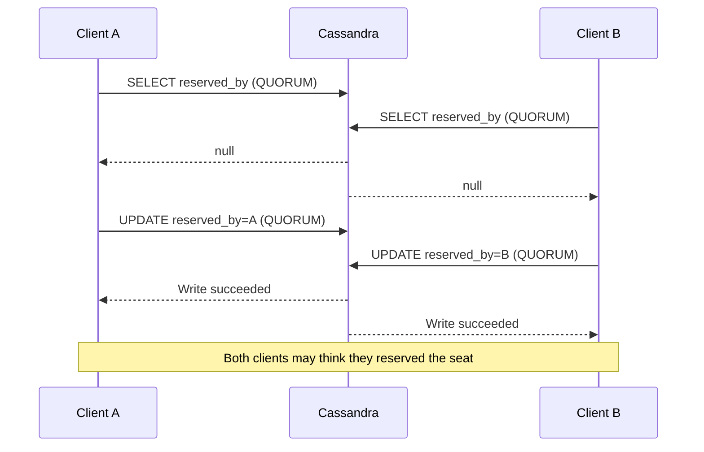
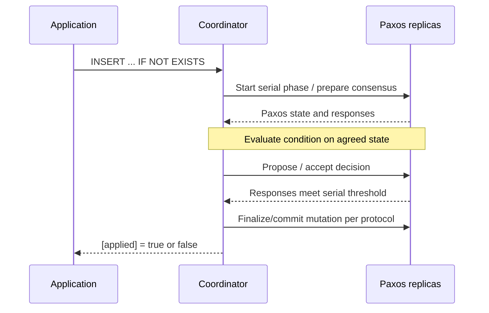

# SERIAL/LOCAL_SERIAL and Distinguishing Them from Normal Consistency Levels

When learning about **read/write consistency** in Apache Cassandra, we commonly encounter `ONE`, `QUORUM`, `LOCAL_QUORUM`, or `ALL`. These levels primarily determine **how many replicas must respond for a normal read or write operation**. Yet if two clients concurrently try to create a unique record or transition a state only when a condition holds, raising the ACK count **does not turn the operation into an atomic compare-and-set**.

Cassandra provides **lightweight transactions (LWT)** based on Paxos to execute conditional statements like `INSERT ... IF NOT EXISTS` or `UPDATE ... IF ...`. When using LWT, there are two additional **serial consistency** levels: `SERIAL` and `LOCAL_SERIAL`. They control **the consensus scope for the serial/Paxos phase**, distinct from normal CLs that govern data read/write path responses.

This lesson belongs to the **Read/Write Consistency** chapter of the `DATABASE_ENGINE_WIDE_COLUMN_CASSANDRA` module. While studying Cassandra's distributed architecture and wide-column model, partition keys, query-driven table design, replication, CQL, compaction, repair, error handling, and Java integration, the goal here is knowing **when LWT is needed**, **whether to choose SERIAL or LOCAL_SERIAL**, and **how to combine them with normal consistency levels without conflating their guarantees**.

> **Key idea:** `QUORUM`/`LOCAL_QUORUM` are response levels for normal read/write requests; `SERIAL`/`LOCAL_SERIAL` are consensus levels for **LWT** (and apply to supported serial reads). They are **not two names for the same threshold**.

## 1. Learning Objectives

After this lesson, you will be able to:

1. Explain why read/write quorum alone does not prevent two clients from concurrently updating a record.
2. Describe Paxos/LWT principles and the meaning of `[applied]` in `IF` statements.
3. Distinguish **normal consistency level** from **serial consistency level**.
4. State the difference in **datacenter scope** between `SERIAL` and `LOCAL_SERIAL`.
5. Choose an appropriate serial CL + normal CL pair for conditional operations, especially in multi-DC clusters.
6. Practice with CQL and Java Driver 4.x, handling `[applied]=false`, timeouts, and indeterminate retries.
7. Identify LWT's per-partition limits, performance costs, and common design mistakes.

## 2. The Problem: Why Is a QUORUM Write Still Not a Check-and-Write?

Suppose a row represents a seat in a movie showtime:

```text
seat_key = "show-42:A07"
reserved_by = null
```

Two clients both want to reserve the seat. If the application separates the check step from the write step:



With RF=3, a `QUORUM` write needs two ACKs. **Both `UPDATE`s can still get two ACKs**; Cassandra will reconcile the final value by timestamp. Quorum ACKs do not grant exclusivity to the first writer.

Even if you replace `QUORUM` with `ALL`, the two `SELECT` and `UPDATE` statements are still **not a single atomic operation**. The gap between checking the condition and writing is a **race condition**.

What the application truly needs is a single request: **"Create the reservation only if the seat is not yet taken; tell me whether I won or not."**

## 3. What Is LWT? How Does Paxos Resolve Contention?

A **lightweight transaction (LWT)** is Cassandra's mechanism using **Paxos** to execute a **conditional** mutation. It allows multiple coordinators contending on the same partition to reach a consistent decision on whether to apply the condition.

Statements that typically trigger LWT:

- `INSERT ... IF NOT EXISTS` — create the row only if it does not already exist.
- `UPDATE ... IF column = value` — update only when the current condition is true.
- `DELETE ... IF ...` — conditional delete, per version-supported syntax.
- Certain conditional `BATCH` statements with appropriate constraints; **do not** infer multi-partition ACID transactions.

### Simplified Lifecycle

Paxos operates through multiple round-trips between the coordinator and participating replicas, conceptually involving **prepare/promise**, **propose and accept**, and **commit/broadcast decision** steps. Optimization details and exact message counts vary by Cassandra version and contention level.



This is a **conceptual diagram**, not the exact network trace for every Cassandra version. The key point is that conditional updates on **the same partition and consensus scope** are arbitrated by Paxos, rather than two clients independently running a `SELECT` followed by a normal write.

### Meaning of LWT Results

| Client Result Received | Business Meaning to Infer |
| --- | --- |
| `[applied] = true` | The condition was accepted and the conditional mutation was applied per the request outcome. |
| `[applied] = false` | The condition did not hold when evaluated by the protocol; the client must not consider itself the winner. |
| Timeout / indeterminate error | **Uncertain** whether the decision was applied; not equivalent to `[applied]=false`. |

Specifically, an `INSERT ... IF NOT EXISTS` request may have **already succeeded** while its response was lost. If the client retries, the second attempt may see the row already exists and receive `[applied]=false`. You need a way to identify prior requests or inspect the owner rather than jumping to the conclusion that another client won.

## 4. Two Consistency Axes: Normal CL and Serial CL

An LWT operation involves **two independent concepts**:

1. **Normal consistency level** — the threshold/scope for normal read-write processing/commit and data responses, e.g., `QUORUM` or `LOCAL_QUORUM`.
2. **Serial consistency level** — the threshold/scope that **the Paxos consensus phase** must satisfy, using `SERIAL` or `LOCAL_SERIAL`.

| Property | Normal CL | Serial CL |
| --- | --- | --- |
| Examples | `ONE`, `QUORUM`, `LOCAL_ONE`, `LOCAL_QUORUM`, `ALL` | `SERIAL`, `LOCAL_SERIAL` |
| Core Question | How many replicas must respond for the CL operation path? | Across which replica scope must Paxos reach consensus? |
| Used for normal reads/writes? | **Yes.** | Does not replace normal CL for normal writes; can be used in supported **serial reads**. |
| Role in LWT | Selects the normal consistency level for the conditional request. | Selects the consensus scope for the `IF` condition. |
| Enough to protect `IF NOT EXISTS` on its own? | **No.** | Only protects conditions when **actually running an LWT**. |

An illustrative configuration in the Java Driver:

```java
BoundStatement statement = prepared.bind(seatKey, customerId, now)
    .setConsistencyLevel(DefaultConsistencyLevel.LOCAL_QUORUM)
    .setSerialConsistencyLevel(DefaultConsistencyLevel.SERIAL);
```

Read this statement as: **the conditional mutation** uses normal CL `LOCAL_QUORUM` and the serial phase uses `SERIAL`. It must **not** be read as "two quorums added into a stronger quorum" or "`SERIAL` replaces `LOCAL_QUORUM`."

### What If There Is No `IF`?

```sql
UPDATE keyspace.table_name
SET value = 'B'
WHERE id = 11111111-1111-4111-8111-111111111111;
```

This is a **normal write**, not an LWT. Simply configuring `SERIAL` on a driver parameter does **not** automatically turn that `UPDATE` into a compare-and-set. You must express the condition in CQL, such as `IF value = 'A'`, and check `[applied]`.

## 5. `SERIAL`: Consensus Scope Across All Involved Replicas

`SERIAL` requires LWT's serial phase to use a **quorum across the partition's global replica scope**, not restricted to a specific DC. With `NetworkTopologyStrategy` spanning multiple DCs, this may require cross-DC communication.

Suppose:

```text
Keyspace:
  dc1: RF = 3  -> R1, R2, R3
  dc2: RF = 3  -> R4, R5, R6

Total replicas of partition: 6
Global quorum: floor(6/2) + 1 = 4
```

In terms of scope calculation, `SERIAL` requires a **Paxos quorum of six replicas**, i.e., a global majority threshold of **4** in this example. It does not require an independent quorum **in each DC**: that is a different concept from `EACH_QUORUM`.

**Good fit:** multiple clients in different regions attempting to create **one unique resource on the same partition**. When a shared decision is needed for cross-region conditional updates, serial scope, routing, and CL choices must align with the topology.

**Trade-off:** `SERIAL` can increase latency because Paxos completes multiple round-trips; in a balanced `3+3` topology, a global quorum of 4 responses cannot come from one DC alone. Cross-DC link outages can render `SERIAL` LWTs unavailable.

## 6. `LOCAL_SERIAL`: Consensus Scope Within the Coordinator's DC

`LOCAL_SERIAL` restricts the Paxos consensus phase to **the coordinator's local datacenter**. Quorum for the serial phase is computed from that DC's RF.

With `dc1` RF=3 and coordinator in `dc1`:

\[
Q_{\text{local,dc1}} = \left\lfloor\frac{3}{2}\right\rfloor + 1 = 2
\]

Two `dc1` replicas suffice for local Paxos quorum, without waiting on `dc2` just to satisfy `LOCAL_SERIAL`.

| Criterion | `SERIAL` | `LOCAL_SERIAL` |
| --- | --- | --- |
| Consensus scope | Quorum across global replica set. | Quorum within coordinator's local DC. |
| RF = `3+3` | Majority of **6**, i.e., 4 responses for global quorum threshold. | Majority of **3** in coordinator's DC, i.e., 2 local responses. |
| Sensitivity to WAN | May wait on inter-DC communication. | No remote quorum needed for the serial phase alone. |
| Best fit when | A shared consensus scope is required for cross-DC contention. | LWTs are organized/routed to one DC and the local scope limit is acceptable. |
| Risk of misunderstanding | Not a multi-partition transaction. | **No automatic single global serial decision across all DCs** if clients in different DCs contend concurrently. |

### Warning: Same Resource, Two Local DCs

Suppose the same `seat_key` is conditionally reserved almost simultaneously by clients in `dc1` and `dc2`, each using `LOCAL_SERIAL` with a coordinator in its own DC. The two local Paxos quorums **might not overlap**:

```text
dc1: {A1, A2, A3}  -> local quorum {A1, A2}
dc2: {B1, B2, B3}  -> local quorum {B1, B2}

{A1, A2} ∩ {B1, B2} = ∅
```

Because there is no **guaranteed** overlap between the two groups, **never infer from `LOCAL_SERIAL` that clients across all DCs are arbitrated by a single global serial order**. If business rules require cross-DC exclusivity, evaluate `SERIAL` and a consistent application-wide LWT strategy rather than choosing `LOCAL_SERIAL` solely for lower latency.

Conversely, when all contending requests are routed **to the same DC** and share the same Paxos scope, `LOCAL_SERIAL` can be a suitable choice to reduce WAN dependence; the key condition lies in the **business contention scope**.

## 7. Practical CL Pairs in Single- and Multi-DC Clusters

### 7.1. Single DC, RF=3

In a single datacenter, `SERIAL` and `LOCAL_SERIAL` both examine the same three replicas of the partition in terms of **scope**; the serial quorum is 2. Even though the numeric threshold matches here, **the level name still matters** if the topology later expands to another DC.

Suppose an LWT uses normal CL `QUORUM`: the normal-CL path also requires a 2/3 quorum. Do not treat this as "a simple write with two ACKs"; **Paxos incurs additional message exchanges**, and its cost can differ significantly from a normal write.

### 7.2. Two DCs, RF=3+3

| Serial CL | Normal CL | Interpretation |
| --- | --- | --- |
| `SERIAL` | `QUORUM` | Serial consensus uses global quorum; normal CL also uses global quorum. |
| `SERIAL` | `LOCAL_QUORUM` | Global serial phase; local normal CL in coordinator's DC. The two thresholds have **different scopes**. |
| `LOCAL_SERIAL` | `LOCAL_QUORUM` | Both serial phase and normal threshold are local; usually lowers WAN wait, but watch out for cross-DC contention. |
| `LOCAL_SERIAL` | `QUORUM` | Local serial phase, global normal CL; **global normal quorum does not automatically promote the Paxos phase to global SERIAL**. |

**Key point:** You cannot look only at the normal CL and deduce **the condition's consensus level**. For example, normal `QUORUM` paired with serial `LOCAL_SERIAL` **does not mean** global Paxos ran.

### 7.3. Asymmetric RF

Suppose `dc1: RF=3` and `dc2: RF=2`:

| Scope | Quorum Threshold by Replica Count |
| --- | --- |
| Cluster-wide `SERIAL` | `floor((3+2)/2)+1 = 3` |
| `LOCAL_SERIAL` with dc1 coordinator | `floor(3/2)+1 = 2` |
| `LOCAL_SERIAL` with dc2 coordinator | `floor(2/2)+1 = 2` |

This example demonstrates that the **coordinator's local DC** is a business-meaningful part of the consistency configuration, not merely a performance tweak. You cannot change one DC's RF and keep all quorum and availability assumptions intact without recalculating.

## 8. CQL Practice: IF NOT EXISTS and IF with SERIAL/LOCAL_SERIAL

Example **lab** environment with an actual datacenter named `dc1` and at least three eligible nodes for RF=3. Change the DC name to match your real topology before running:

```sql
CREATE KEYSPACE IF NOT EXISTS serial_lab
WITH replication = {
  'class': 'NetworkTopologyStrategy',
  'dc1': 3
};

CREATE TABLE IF NOT EXISTS serial_lab.seat_reservation_by_key (
  seat_key text PRIMARY KEY,
  reserved_by uuid,
  reserved_at timestamp
);

CREATE TABLE IF NOT EXISTS serial_lab.order_state_by_id (
  order_id uuid PRIMARY KEY,
  state text,
  version int
);
```

These tables are modeled for **single-partition queries**. `seat_key` and `order_id` are partition keys; contending LWT requests targeting **the exact same key** reach the same replica set and consensus object.

### 8.1. Conditional INSERT

In `cqlsh`, normal CL is controlled by the interactive `CONSISTENCY` command. Depending on the `cqlsh` version, `SERIAL CONSISTENCY` lets you set the serial CL for subsequent LWT statements:

```sql
-- cqlsh command; not part of INSERT syntax.
CONSISTENCY QUORUM;
SERIAL CONSISTENCY SERIAL;

INSERT INTO serial_lab.seat_reservation_by_key (
  seat_key, reserved_by, reserved_at
) VALUES (
  'show-42:A07',
  11111111-1111-4111-8111-111111111111,
  '2026-11-21 09:00:00+0000'
) IF NOT EXISTS;
```

Illustrative output upon new creation:

```text
 [applied]
-----------
      True
```

If another client tries to insert **the same `seat_key`** with a different reserver, the statement may return:

```text
 [applied] | seat_key    | reserved_by
-----------+-------------+--------------------------------------
     False | show-42:A07 | 11111111-1111-4111-8111-111111111111
```

Which informational columns appear when the condition fails depends on the statement/version; **the mandatory field the application must inspect is `[applied]`**, rather than assuming the result table matches the illustrative columns.

### 8.2. Version-Based UPDATE

```sql
-- Assume the row currently has state='CREATED', version=1.
CONSISTENCY QUORUM;
SERIAL CONSISTENCY SERIAL;

UPDATE serial_lab.order_state_by_id
SET state = 'PAID',
    version = 2
WHERE order_id = 22222222-2222-4222-8222-222222222222
IF version = 1;
```

When applied, the request returns `[applied]=true`. If another client already changed `version` from 1 to 2 beforehand, the request returns `false`. This is **optimistic concurrency control**, which ordinary `SELECT` followed by `UPDATE` at `QUORUM` does not provide.

**Warning:** If the row does not exist yet, `IF version = 1` will not match; seed the initial row or use an appropriate `IF NOT EXISTS` flow. Never use arbitrary `USING TIMESTAMP` values as a way to simulate LWT commit order: application timestamps and Paxos solve different problems.

### 8.3. Controlled Testing with LOCAL_SERIAL

In a **single-DC lab**, you can switch `cqlsh`'s serial consistency:

```sql
CONSISTENCY LOCAL_QUORUM;
SERIAL CONSISTENCY LOCAL_SERIAL;

INSERT INTO serial_lab.seat_reservation_by_key (
  seat_key, reserved_by, reserved_at
) VALUES (
  'show-42:A08',
  33333333-3333-4333-8333-333333333333,
  '2026-11-21 09:05:00+0000'
) IF NOT EXISTS;
```

With RF=3 in a single DC, both `SERIAL` and `LOCAL_SERIAL` target a quorum of the same three replicas in scope. When running multi-DC labs, **do not assume** `LOCAL_SERIAL` carries the same global guarantee simply because single-DC behavior looks like `SERIAL`.

If your distribution's `cqlsh` lacks the serial consistency command shown above, check `HELP` in that version and use the Java Driver to set the attribute on the statement; **never** append the `SERIAL` keyword onto the end of an `INSERT` or `UPDATE` as a CQL clause.

## 9. Java Driver 4.x: Setting Both CLs on an LWT Statement

The Java Driver lets you set normal CL and serial CL **independently** on a `BoundStatement`. The snippet below assumes an existing `CqlSession` with properly configured local datacenter, contact points, and security:

```java
import com.datastax.oss.driver.api.core.CqlSession;
import com.datastax.oss.driver.api.core.DefaultConsistencyLevel;
import com.datastax.oss.driver.api.core.cql.BoundStatement;
import com.datastax.oss.driver.api.core.cql.PreparedStatement;
import com.datastax.oss.driver.api.core.cql.ResultSet;

import java.time.Instant;
import java.util.UUID;

public final class SeatReservationRepository {
    private final CqlSession session;
    private final PreparedStatement insertIfAbsent;

    public SeatReservationRepository(CqlSession session) {
        this.session = session;
        this.insertIfAbsent = session.prepare(
            "INSERT INTO serial_lab.seat_reservation_by_key " +
            "(seat_key, reserved_by, reserved_at) " +
            "VALUES (?, ?, ?) IF NOT EXISTS");
    }

    public boolean reserveGlobally(
            String seatKey, UUID customerId, Instant reservedAt) {
        BoundStatement request = insertIfAbsent.bind(
                seatKey, customerId, reservedAt)
            .setConsistencyLevel(DefaultConsistencyLevel.QUORUM)
            .setSerialConsistencyLevel(DefaultConsistencyLevel.SERIAL);

        ResultSet result = session.execute(request);
        return result.wasApplied();
    }

    public boolean reserveWithinLocalScope(
            String seatKey, UUID customerId, Instant reservedAt) {
        BoundStatement request = insertIfAbsent.bind(
                seatKey, customerId, reservedAt)
            .setConsistencyLevel(DefaultConsistencyLevel.LOCAL_QUORUM)
            .setSerialConsistencyLevel(DefaultConsistencyLevel.LOCAL_SERIAL);

        ResultSet result = session.execute(request);
        return result.wasApplied();
    }
}
```

Here:

- `setConsistencyLevel(...)` sets the **normal CL**.
- `setSerialConsistencyLevel(...)` sets the **serial CL**.
- `result.wasApplied()` checks the condition outcome; **do not** treat `execute()` returning without throwing an exception as proof that `IF` succeeded.

This illustrates two **different business scopes**, not two methods to alternate arbitrarily for **the same resource**. For data requiring cross-region exclusivity, enforce one consistent rule across all clients; mixing serial scopes can invalidate consensus assumptions.

### Using Execution Profiles

When many LWT queries share a policy, you can set normal/serial consistency in a Java Driver **execution profile** and still override per statement when needed. However, an execution profile does not replace verifying **whether a query is actually conditional** and what its contention scope is.

### Do Not Confuse Serial CL with Coordinator Selection

`LOCAL_SERIAL` is evaluated relative to **the coordinator's DC**, not an environment name or user region. Driver local-DC configuration and request routing are vital parts of the design. If an application intentionally writes from multiple DCs, re-analyze the correctness of using `LOCAL_SERIAL` in each location.

## 10. What Is Reading at SERIAL/LOCAL_SERIAL?

Beyond LWT writes, Cassandra supports a **serial read** path. Conceptually, reading with `SERIAL` or `LOCAL_SERIAL` checks any in-progress uncommitted Paxos transaction and participates in resolving it so the read observes a state consistent with LWTs in **the corresponding serial scope**.

This **differs** from an ordinary `SELECT` at `QUORUM`:

- A `SELECT` at `QUORUM`/`LOCAL_QUORUM` primarily relies on replica responses, data/digests, and normal reconciliation.
- A serial read also handles **in-flight pending LWTs**, so it may require extra exchanges and incur higher cost.
- Serial reads **do not** turn ordinary non-`IF` mutations into Paxos-agreed transactions.

**Do not blindly apply serial reads to every query** just to be "stronger than quorum." Use them when business requirements must observe LWT state and your Cassandra/driver version supports that read path; carefully verify local vs. global scope, latency characteristics, and real configuration.

## 11. Timeouts, Retries, and Indeterminate Outcomes

An LWT requires multiple round-trips, so timeouts or coordinator disconnects can happen at various points. Distinguish:

| Situation | Safe Conclusion |
| --- | --- |
| `[applied]=true` | The condition succeeded according to the LWT result. |
| `[applied]=false` | The condition was not met; the conditional mutation was not applied as requested. |
| Timeout in Paxos phase or commit response | **Uncertain** whether the condition was applied. |
| Insufficient replicas for serial quorum | Cannot confirm the LWT decision within the chosen scope. |
| Insufficient replicas for normal CL | Request cannot be confirmed at the requested normal CL; inspect the specific error. |

On failure paths, you may encounter **Unavailable**, **WriteTimeout**, **WriteFailure**, or CAS-specific errors/timeouts depending on driver and version. Specific exception names do not change the principle: **never treat a timeout as `[applied]=false`**.

### Safe Retry Pattern for Seat Reservation

Suppose `reserveGlobally("show-42:A07", customerA, t)` times out:

1. **Keep** `seat_key`, `customerId`, and a stable request/operation ID unchanged.
2. Read the current state via an appropriate consistency path—potentially a serial read when you need to observe pending LWT state.
3. If the row already belongs to that exact prior request, handle it per your application's **idempotency** rules; do not blindly reserve a different seat.
4. If the row belongs to someone else, handle it as a business conflict.
5. If state remains indeterminate, retry with bounded attempts and log the event for reconciliation rather than retrying infinitely while the cluster is degraded.

If you only store `reserved_by` without an operation ID, two requests from the same customer may be hard to tell apart. For critical workflows, design columns/keys to identify the reservation attempt rather than relying solely on whether a request returned `true`.

### Race Conditions Do Not Vanish When Mixing Normal Writes and LWT

If one service uses a normal `UPDATE` to change `reserved_by` while another uses `INSERT ... IF NOT EXISTS`, you cannot guarantee all changes to the resource are protected under the same Paxos order. To preserve a business invariant, **every write path affecting that invariant** must follow the proper protocol; avoid normal-write "shortcuts" that can overwrite LWT outcomes.

## 12. LWT Is Not a Multi-Partition Transaction and Does Not Replace Cluster Operations

LWT provides conditional update guarantees within the **partition scope** specified by CQL. It **does not automatically provide**:

- Atomic ACID transactions across two distinct partitions.
- Foreign-key or unique constraints across arbitrary partitions.
- A linearizable history for all ordinary non-Paxos reads/writes.
- Instantaneous synchronization of every replica in every DC under any policy.
- Error-free reads/writes during network partitions, replica outages, or coordinator timeouts.

For example, reserving **two different seats** via two `INSERT ... IF NOT EXISTS` statements is not an atomic "both succeed or both fail" operation by default. If an order must reserve two seats across **two different partitions** atomically, the application needs an appropriate data model, compensating state flow, or a suitable transactional system.

Mechanisms like **hinted handoff, anti-entropy repair, read reconciliation**, and **compaction** still play their own roles in maintaining and operating Cassandra. They do not replace Paxos for arbitrating contention, and Paxos does not replace scheduled repair for replicas that missed mutations.

## 13. Choosing the Approach by Business Requirement

| Need | Commonly Considered Mechanism | What to Watch Out For |
| --- | --- | --- |
| Writing independent events with stable primary keys | Normal write at `LOCAL_QUORUM` or suitable CL | No need for Paxos when there is no contended condition. |
| Read-after-write in the same DC, no concurrent updates | `LOCAL_QUORUM` write/read | Quorum intersection within the same replica set, but no `IF` protection. |
| Only one client may create a key | `INSERT ... IF NOT EXISTS` + suitable serial CL | Check `[applied]` and handle indeterminate timeouts. |
| Version-based state transition | `UPDATE ... IF version = ?` | Combine application version with LWT instead of separate `SELECT` then write. |
| Cross-DC contention on creating the same resource | Consider `SERIAL` and proper global routing/scope | Independent `LOCAL_SERIAL` per DC does not guarantee cross-DC consensus. |
| Single-DC contention, prioritizing minimal WAN traffic | Consider `LOCAL_SERIAL` + normal `LOCAL_QUORUM` | Must ensure contending clients share the same local scope. |
| Atomic transactions spanning multiple partitions | Redesign model/business protocol or use a different transactional tech | Single-partition LWT does not solve multi-partition atomicity. |

## 14. Exercises and Answers

### Exercise 1 — Does QUORUM Replace LWT?

RF=3. Two clients both run `SELECT QUORUM`, see an empty seat, and both run `UPDATE QUORUM` to reserve it. Can both clients receive success ACKs?

**Answer:** Yes. Two separate `SELECT` and `UPDATE` statements do not form an atomic check-and-write. Use `INSERT ... IF NOT EXISTS` or `UPDATE ... IF ...` for the "at most one reserver" invariant.

### Exercise 2 — Two Consistency Levels on One LWT

In the Java Driver, a statement has `setConsistencyLevel(LOCAL_QUORUM)` and `setSerialConsistencyLevel(SERIAL)`. Which part governs Paxos?

**Answer:** `SERIAL` governs the **serial/Paxos phase**; `LOCAL_QUORUM` governs the **normal CL**. Do not treat `LOCAL_QUORUM` as the Paxos scope in this case.

### Exercise 3 — Single DC, RF=3

A cluster has only `dc1` with RF=3. Calculate the replica quorum for `SERIAL` and `LOCAL_SERIAL`.

**Answer:** Both scope over the same three replicas in a single-DC configuration; quorum is `floor(3/2)+1=2`. When expanding to multiple DCs, their scope meanings diverge.

### Exercise 4 — Two DCs, RF=3+3

How many replicas are needed for global serial quorum? What is the local quorum in `dc1`?

**Answer:** Global `SERIAL` considers 6 replicas, quorum=4. `LOCAL_SERIAL` in `dc1` considers 3 replicas, quorum=2.

### Exercise 5 — Contention Between Two DCs

Two clients reserve the same `seat_key`, one in `dc1` and one in `dc2`, each choosing its own DC's `LOCAL_SERIAL`. Can we rely solely on `LOCAL_SERIAL` to prove only one client wins cluster-wide?

**Answer:** No. The two local Paxos quorums might not intersect. To protect a cross-region invariant, choose an appropriate serial scope—typically `SERIAL`—and ensure all access paths follow the same protocol.

### Exercise 6 — Meaning of `[applied]`

An `INSERT ... IF NOT EXISTS` returns `[applied]=false`, yet the driver throws no exception. Should the API return HTTP 201 Created?

**Answer:** No. The condition was not met; the application must handle the conflict/already-exists outcome per business rules rather than assuming success simply because no exception was thrown.

### Exercise 7 — Timeout Then Retry

A seat-reservation LWT times out. Retrying with the same key returns `[applied]=false`. Is it certain that another client won?

**Answer:** No. The initial request may have been applied while its response was lost. Read/reconcile `reserved_by` and the operation ID to recognize your prior request.

### Exercise 8 — Normal QUORUM + LOCAL_SERIAL

In a `3+3` cluster, a client uses normal `QUORUM` yet serial `LOCAL_SERIAL`. Does that turn the Paxos phase into a cluster-wide quorum?

**Answer:** No. Normal CL and serial CL are controlled independently; the Paxos phase still follows the `LOCAL_SERIAL` scope.

### Exercise 9 — Multiple Partitions

An application must reserve two seats with two different `seat_key` values together. Do two successful `INSERT ... IF NOT EXISTS` statements prove atomicity across the pair of seats?

**Answer:** No. Each condition is resolved on its respective partition; "both or neither" requires dedicated workflow/transaction design.

### Exercise 10 — Serial Reads

A team wants to use `SERIAL` on every `SELECT` instead of `QUORUM` to "always get the latest data" without using LWTs. Is this recommendation sound?

**Answer:** No. Serial reads relate to the state of uncommitted Paxos/LWT transactions and carry their own overhead; they do not turn ordinary writes into a linearizable history or replace proper CL design.

## 15. Checklist Before Choosing SERIAL/LOCAL_SERIAL

Before deploying LWT in a Java service, verify:

1. **Which invariant must be protected?** Single seat reservation, versioned state transition, or another rule?
2. **Which partition key represents the resource?** Contending clients must target the right shared partition.
3. **Do all write paths use the same protocol?** Normal writes bypassing LWT can break the invariant.
4. **Do clients contend across datacenters?** If so, do not blindly rely on per-DC `LOCAL_SERIAL`.
5. **Was the normal CL chosen separately?** `setConsistencyLevel` and `setSerialConsistencyLevel` solve two different things.
6. **Is `[applied]` checked?** Do not check only whether the request threw an exception.
7. **How are timeouts handled?** Keep keys and operation IDs stable; distinguish indeterminate outcomes from `false`.
8. **Was Paxos cost measured?** Latency, contention, retries, and throughput can differ markedly from normal writes.
9. **Is topology/RF stable?** Compute quorums for the exact scope and coordinator DC.
10. **Are multi-partition transactions assumed?** If so, additional design/protocols are needed.

## 16. Conclusion

`SERIAL` and `LOCAL_SERIAL` are Cassandra's two **serial consistency** levels for the Paxos consensus phase in **lightweight transactions**. `SERIAL` takes a quorum over all involved replicas; `LOCAL_SERIAL` takes a quorum solely within the coordinator's datacenter. They differ from normal CLs such as `QUORUM` or `LOCAL_QUORUM`, which govern the normal read/write response path and form a separate configuration axis in LWT.

**Quorum intersection does not mean atomic check-and-write.** When two clients can concurrently update a resource, express the condition directly in `IF NOT EXISTS` or `IF ...`, select a serial scope matching where clients contend, inspect `[applied]`, and treat timeouts as **indeterminate outcomes**. When no contended invariant exists, ordinary writes at an appropriate CL are simpler and more cost-effective.

### References

- [Apache Cassandra — Dynamo / Tunable Consistency](https://cassandra.apache.org/doc/stable/cassandra/architecture/dynamo.html): quorum, replicas, and tunable consistency principles.
- [Apache Cassandra — CQL Data Manipulation](https://cassandra.apache.org/doc/stable/cassandra/developing/cql/dml.html): `INSERT`, `UPDATE` with `IF`, and conditional operations.
- [Apache Cassandra — CQL](https://cassandra.apache.org/doc/stable/cassandra/developing/cql/index.html): CQL syntax and LWT context.
- [Apache Cassandra — cqlsh](https://cassandra.apache.org/doc/stable/cassandra/managing/tools/cqlsh.html): interactive `CONSISTENCY` commands and version-specific serial consistency options.
