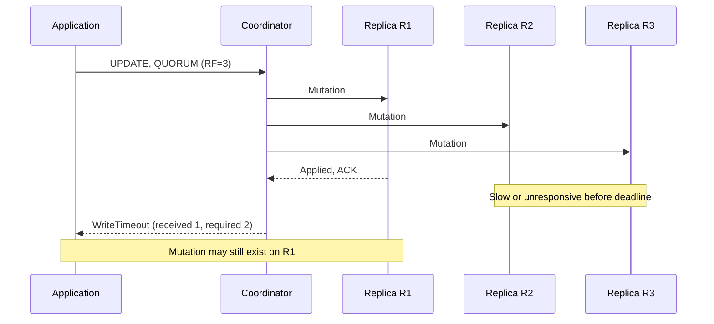

# Timeouts and Unknown Outcomes of Write Operations

A Java application issues an `UPDATE` to Apache Cassandra and receives a **`WriteTimeoutException`**. Can it conclude the record was not updated and send a brand-new write command? **No.** A timeout only signals that a request **was not confirmed complete under the awaited condition before the deadline**, not that every replica rejected the mutation. One or more replicas may have already applied the write; the coordinator might even have received enough ACKs while the client missed the final response due to networking or a driver-side timeout.

This lesson belongs to the **Read/Write Consistency** chapter of the `DATABASE_ENGINE_WIDE_COLUMN_CASSANDRA` module. The module explores Cassandra's distributed architecture and wide-column model, partition keys, query-driven table design, CQL, replication, compaction, repair, error handling, and connecting from Java applications. The focus here is **distinguishing timeout errors from the actual write outcome**, and then designing **retries, idempotency, and reconciliation** aligned with consistency levels.

> **Core rule:** **Not receiving a success ACK ≠ knowing for sure nothing was written.** With `WriteTimeout`, `WriteFailure`, client-side timeouts, or dropped connections, the final state of the mutation from the application's perspective can be **indeterminate** (*unknown outcome*). Keep business identifiers stable, avoid blind retries of non-idempotent operations, and establish a verification process.

## 1. Learning Objectives

After this lesson, you will be able to:

1. Describe the stages of a write request: client, coordinator, replicas, ACKs, and client response.
2. Distinguish `UnavailableException`, `WriteTimeoutException`, `WriteFailureException`, and driver-side timeouts/connection errors.
3. Explain why a mutation may be partially or fully applied even when the client sees an error.
4. Understand the impact of `ONE`, `QUORUM`, `LOCAL_QUORUM`, `ALL`, `ANY`, and `EACH_QUORUM` on required ACKs and failure modes.
5. Classify operations that are **safe to retry** versus those requiring idempotency keys or reconciliation.
6. Practice CQL and Java Driver 4.x with consistency levels, stable timestamps, timeouts, and bounded retry policies.
7. Handle LWTs, batches, counters, and multi-table writes without over-inferring from responses.

## 2. Where Does a Write Operation Travel?

In Cassandra, the partition key and replication strategy identify the **target replicas** holding a partition. A client connects to a node acting as **coordinator**; that node dispatches the mutation to the appropriate replicas. The consistency level (CL) specifies **how many valid replica responses, and within what scope**, must be received before reporting write success.

Suppose a keyspace has **RF = 3** in one datacenter, partition `P` resides on `R1`, `R2`, `R3`, and writes use `QUORUM`:

```text
Java Application       Coordinator C             Replicas of P
      |                      |                         R1 R2 R3
      |---- UPDATE P ------->|------------------------> |  |  |
      |                      |<---- ACK R1 ------------|  |  |
      |                      |<-------- ACK R2 -----------|  |
      |                      |    R3 may not have ACKed yet   |
      |<--- success ---------|                         |

With RF=3, QUORUM = floor(3/2)+1 = 2 ACKs.
```

On a replica, a normal write mutation goes through Cassandra's storage path, typically involving the **commit log** and **memtable**, before data undergoes flushing/compaction on its own lifecycle. A CL response condition is not an assertion that **every replica has flushed SSTables** or that all copies are identical.

### Two Separate Concerns

| Question | Who Decides/Proves It? |
| --- | --- |
| Did a replica apply the mutation? | Actual state of the replica; the client usually does not observe individual replicas directly. |
| Did the coordinator gather enough ACKs for the CL? | Coordinator based on replica responses and the CL threshold. |
| Did the client receive a success response? | Transport path and deadlines between client, driver, and coordinator. |
| Will other clients immediately read the mutation? | Read/write CLs, replica scope, timestamps, reconciliation, and concurrent writes. |
| Will the mutation survive subsequent failures? | Number of copies that received it, storage/commit log config, node health, repair, and workload traits. |

An operation may have been **applied by replicas** yet **not confirmed by the coordinator to CL**; or it may have met CL yet **the ACK back to the client was lost**. Either path produces an **unknown outcome** at the application layer.

## 3. Three Misleading Timelines

### Case A — One Replica Wrote, Quorum Not Reached



Outcome: **the write request was not confirmed successful at `QUORUM`**, yet **not every replica failed to write**. If the application generates a new record with a different ID to retry, it can create duplicate business data.

### Case B — Replica Wrote, Yet ACK Arrived Too Late

```text
t0: Coordinator sends mutation to R1, R2, R3.
t1: R1 applies mutation and ACKs.
t2: R2 applies mutation; R2's ACK is delayed.
t3: Wait deadline expires at coordinator -> WriteTimeout.
t4: R2's ACK or R3's data may arrive after deadline.
```

At `t3`, the coordinator could not commit `QUORUM` on time, even though `R2` may have written. Hence, **the ACK count observed at timeout does not necessarily equal the number of replicas that applied the mutation**.

### Case C — Server Succeeded, Client Missed the Response

```text
t0: Client sends UPDATE.
t1: Coordinator receives 2/3 replica ACKs.
t2: Coordinator sends success result.
t3: Client/coordinator network breaks; result is lost.
t4: Driver deadline expires, or connection reports error.

Server state: may have already satisfied CL.
Client state: never received success confirmation.
```

This is the clearest illustration of the gap between **server-side execution** and **client-observed outcome**. A distributed system cannot deduce a mutation's state solely from the absence of a client response.

## 4. Error Classification: Unavailable, WriteTimeout, WriteFailure, and Driver Timeout

| Error or Signal | Typical Cause | Safe Meaning for the Application |
| --- | --- | --- |
| `UnavailableException` | Coordinator judges too few replicas *considered alive* to satisfy CL. | Request **was not confirmed to CL**. Does not prove prior data or other requests were not written. |
| `WriteTimeoutException` | Coordinator failed to gather enough responses or finish write path before server timeout. | **Uncertain** how many replicas applied the mutation. |
| `WriteFailureException` | Replicas reported processing errors, preventing CL from being satisfied. | **Other replicas may have applied the mutation**; treat as indeterminate state. |
| `DriverTimeoutException` | Java Driver's result wait deadline expired. | Driver does not know final outcome; **server may still be processing or finished**. |
| Connection error / unreachable coordinator | Request or response interrupted mid-flight. | May not have reached server, reached server, or been applied; needs reconciliation. |
| Validation / invalid CQL error | Syntax, schema, permission errors, etc. | Different from timeouts. Fix root cause; never retry infinitely. |

### 4.1. `Unavailable` Is a CL Availability Check

If an RF=3 partition has only one replica considered UP by the coordinator, a `QUORUM` write needs two ACKs and lacks enough available replicas. The coordinator can return `UnavailableException` **without initiating a write that could satisfy CL**.

This differs from a timeout on a request already sent to replicas. Still, never use "Unavailable definitely wrote nothing" as a blanket business rule: the system may have **earlier timed-out requests, writes from other clients, or unconverged state**, and the client only knows the current request was not confirmed successful.

### 4.2. `WriteTimeout` Is Missing Timely Confirmation

`WriteTimeoutException` is an error response from Cassandra/coordinator when the condition is not met within the allowed wait window. The exception may include:

- the CL in use;
- received response count vs. required threshold;
- the *write type* such as simple, batch, counter, or CAS depending on protocol/version.

**Do not read the `received` field as the count of replicas that definitely did not apply it.** It reports what the coordinator **received**, not an exact map of where data resides after the error.

### 4.3. `WriteFailure` Is an Execution Error, Not Mere Slowness

A replica may return an error due to I/O, resource exhaustion, or internal processing faults. The coordinator sees that the remaining healthy replicas cannot meet CL and returns `WriteFailureException`. Even so, non-failing replicas **may have already written**. Retry policies must address the actual cause rather than merely raising timeouts.

### 4.4. `DriverTimeout` Happens at Another Layer

The driver enforces its own overall request timeout and host-selection/retry mechanisms. A `DriverTimeoutException` is not a message stating the coordinator **aborted the entire mutation**. A client giving up waiting does not automatically cancel work executing on replicas.

When investigating, always distinguish **server-side timeouts** from **client-side timeouts**, especially if the driver deadline is lower than the time the coordinator needs to complete a high-CL request.

## 5. How Does Consistency Level Change Timeout Thresholds?

With **one DC, RF=3**, normal read/write thresholds are:

| CL | Write ACK Threshold | If Only 1 Replica Responds | If 2 Replicas Respond | Trade-off |
| --- | ---: | --- | --- | --- |
| `ONE` | 1 | Can succeed | Can succeed | Minimal waiting, but confirmed by fewer replicas. |
| `TWO` | 2 | Insufficient | Can succeed | Requires two ACKs. |
| `THREE` | 3 | Insufficient | Insufficient | Demands all three ACKs. |
| `QUORUM` | 2 | Insufficient | Can succeed | Majority of replicas. |
| `ALL` | 3 | Insufficient | Insufficient | Very sensitive to one slow/failing replica. |
| `ANY` | One replica ACK **or** hint stored | Can succeed | Can succeed | Can succeed **solely via hint**, no immediate read guarantee. |

If **0 target replicas respond**, `ANY` **can** still succeed when a coordinator remains up and stores a valid hint; `ONE` and `QUORUM` cannot succeed via a hint alone. `ANY` is **invalid for normal `SELECT`s**.

**Having enough replicas in the table is a necessary condition for possible success, not a deadline guarantee.** Two UP replicas both slowed by network/disk load can still produce a `WriteTimeout` at `QUORUM`.

### Lowering CL Does Not "Cure" an Unknown Write State

Suppose a `QUORUM` write times out after one replica ACKs. If the application automatically retries at `ONE` and succeeds:

- The retry proves only that `ONE` was met, not that the prior attempt failed.
- The business contract silently changed from "majority confirmed" to "single copy confirmed."
- If the retry uses a different payload/ID/timestamp, it can produce a different effect from the original mutation.

**Do not silently downgrade CL** when an API promises a specific level of data protection. Any such change must be an explicit, designed decision.

## 6. Multiple Datacenters: Timeouts Also Depend on ACK Scope

Suppose `NetworkTopologyStrategy` with:

```text
dc1: RF=3 -> A1, A2, A3
dc2: RF=3 -> B1, B2, B3
Coordinator in dc1
```

| Write CL | Threshold to Wait For | Total Loss of Contact with dc2, dc1 Healthy |
| --- | --- | --- |
| `LOCAL_ONE` | 1 ACK in dc1 | Can succeed. |
| `LOCAL_QUORUM` | 2 ACKs in dc1 | Can succeed. |
| `QUORUM` | 4 ACKs across 6 total replicas | Unachievable if dc1 yields at most 3 ACKs. |
| `EACH_QUORUM` | 2 ACKs dc1 **and** 2 ACKs dc2 | Unachievable since dc2 does not respond. |
| `ALL` | All 6 ACKs | Unachievable. |

**Note on error detection timing:** If the coordinator already marked remote replicas DOWN before sending, the error may be `Unavailable`. If they are still considered UP yet ACKs over WAN are too slow, it may be `WriteTimeout`. A network partition can surface as **multiple error types** depending on liveness state and deadlines.

### QUORUM Differs from EACH_QUORUM

RF=`3+3` yields `QUORUM=4` **arbitrary** ACKs, whereas an `EACH_QUORUM` write requires **at least 2 from each DC**. Receiving `3 ACKs dc1 + 1 ACK dc2`:

- `QUORUM` can already reach its total threshold of 4.
- `EACH_QUORUM` still **lacks one ACK in dc2** and can time out.

Therefore, when logs say "received four responses," never assume every CL was satisfied.

### Unbalanced RF

With `dc1: RF=5` and `dc2: RF=1`, total RF=6 so `QUORUM=4` can be met **solely from dc1** if dc1 has enough replicas. An `EACH_QUORUM` write still needs **one ACK from dc2**. Saying "multi-DC QUORUM always needs at least one WAN ACK" is false when RFs are skewed.

## 7. Write Times Out, Then Read Back: Is It Enough to Know the Outcome?

A common handling pattern is: **if a write times out, `SELECT` to check the current value**. This can be a useful **reconciliation** step, provided you understand its limits.

### Single-Cell Example

Initial state:

```text
shipment_id = S
status = CREATED
```

A client sends `UPDATE status='IN_TRANSIT'` with CL `QUORUM` and receives `WriteTimeout`. A subsequent `QUORUM` read:

| Observed Value | What Can Be Inferred | What Must NOT Be Claimed |
| --- | --- | --- |
| `IN_TRANSIT` | Desired mutation may have been applied/observed via read path. | Not necessarily all replicas converged; another client may have written the same value. |
| `CREATED` | Read observed old state or another winning version. | **Does not prove zero replicas applied the mutation.** |
| No row | May never have been created, deleted, TTL expired, or read another state. | Does not prove the timed-out request never reached the server. |
| `ReadTimeout` | Reconciliation step did not complete. | Cannot infer write state. |

Why isn't reading the old value enough to conclude "not written"? Only **one replica** may have received the mutation without reaching write quorum, and the quorum read's replica set **might exclude that replica**. The intersection condition `R+W>N` applies only when **the write already achieved W**; you cannot assume `W=2` for a timed-out `QUORUM` write.

### Competing Writes and Timestamps

Cassandra typically reconciles multiple versions of the same cell via **timestamp (last-write-wins)**. A mutation written later in wall-clock time yet carrying a **lower** timestamp than an older mutation may not win. A post-timeout read seeing `CREATED` could also be caused by a competing mutation with a higher timestamp, not necessarily because the timed-out write never reached any replica.

If business logic must confirm **which exact operation** succeeded, comparing `status` alone is often insufficient. Design an explicit **operation ID**, **event ID**, or **version** for reconciliation, rather than assuming matching values prove they came from the same request.

### Do Not Use Read State as a Transaction Log

A `SELECT` right after a timeout shows the logical state **at read time**, according to the CL and queried replicas. It does not automatically provide a history of "which mutations were applied and then overwritten." If you need **auditing**, **business-level exactly-once**, or event delivery, design dedicated event/idempotency tracking instead of expecting Cassandra to reconstruct history from the latest value.

## 8. Idempotency: The Foundation of Safe Retries

An operation is **idempotent** when executing it multiple times has the same logical effect as executing it once, within clearly stated assumptions. This is a property **of the operation's semantics**, not a flag the driver can attach to make an arbitrary command safe.

| Operation | Safe for Simple Retry? | Why? |
| --- | --- | --- |
| `UPDATE ... SET status='PAID'` for same primary key, same timestamp and payload | **Usually yes**, if no other side effects exist. | Repeating the same mutation does not change the desired value. |
| `INSERT` with a stable primary key/event ID and stable content | **Usually yes**, check timestamp/TTL. | Does not create a new row on every send. |
| `INSERT` generating a new UUID/event ID on each retry | **No** for event deduplication. | Can create multiple rows for the same business event. |
| `UPDATE counter SET count = count + 1` | **No**. | Each execution may increment again. |
| Appending elements to a list via concatenation/list update | **Not by default**. | Depending on mutation type, can create duplicate elements. |
| Write combined with sending an email/external payment | **Not by default**. | Cassandra does not suppress external side effects. |
| Repeating `INSERT ... IF NOT EXISTS` (LWT) | **Needs reconciliation**. | First attempt may have succeeded; retry returns `[applied]=false`. |

### 8.1. Stable Keys

Applications should assign an **operationId** or **eventId** **before the first send** and reuse it across retries. With a wide-column model, for example, an event is identified by `(shipment_id, event_id)`; **create keyspace `timeout_lab` in Section 9 before running** this DDL example:

```sql
CREATE TABLE IF NOT EXISTS timeout_lab.event_by_shipment (
  shipment_id uuid,
  event_id uuid,
  occurred_at timestamp,
  event_type text,
  PRIMARY KEY ((shipment_id), event_id)
);
```

If retries keep `shipment_id` and `event_id` unchanged, the application avoids creating a new row merely due to a lost ACK. Querying events by `shipment_id` matches the partition key; if time ordering is needed, consider clustering `(occurred_at, event_id)` and keep **the entire key tuple** stable.

### 8.2. Stable Timestamps

When re-sending the same value with a **new timestamp**, Cassandra may treat it as a newer version. This can interfere with updates from other clients.

Example:

```text
t0: Client A writes status='IN_TRANSIT' @ timestamp 100 -> timeout.
t1: Client B writes status='DELIVERED'  @ timestamp 200 -> succeeds.
t2: Client A retries status='IN_TRANSIT' @ timestamp 300.

If A retries with a new timestamp 300, IN_TRANSIT can beat
DELIVERED even though A is logically just retrying an old request.
```

Hence, for mutations needing stable retries, consider **preserving the same CQL timestamp (microseconds) and same payload** across attempts, while clearly defining timestamp-generation rules for distinct requests. **Never use an abnormally high timestamp** to "force a win"—it can block valid subsequent updates.

**TTL warning:** Repeating a command with a TTL can alter expiration timing and cell metadata; do not assume `INSERT/UPDATE` with TTL is completely idempotent solely because primary key and value match. Counters, collection mutations, and LWTs also require dedicated rules.

### 8.3. Marking Idempotency for the Java Driver

The Java Driver supports marking a statement as **idempotent** so retry/speculative execution policies know whether resending is safe **under the application's guarantee**.

```java
BoundStatement write = prepared.bind(
        timestampMicros, status, eventTime, shipmentId)
    .setConsistencyLevel(DefaultConsistencyLevel.LOCAL_QUORUM)
    .setIdempotent(true);
```

`setIdempotent(true)` does **not** assign a transaction ID, deduplicate, adjust timestamps, or guarantee once-only server execution. Enable it only when the mutation is genuinely safe to re-execute. Retries/speculative execution also depend on driver configuration; avoid policies that trigger a **retry storm** while the cluster is overloaded.

## 9. CQL Practice: Reproducing the Problem in a Lab

Assume a **test cluster** actually containing a DC named `dc1` and at least three eligible nodes for RF=3. Use synthetic data only; never cut networks intentionally in production.

```sql
CREATE KEYSPACE IF NOT EXISTS timeout_lab
WITH replication = {
  'class': 'NetworkTopologyStrategy',
  'dc1': 3
};

CREATE TABLE IF NOT EXISTS timeout_lab.shipment_by_id (
  shipment_id uuid PRIMARY KEY,
  status text,
  updated_at timestamp
);

CREATE TABLE IF NOT EXISTS timeout_lab.event_by_shipment (
  shipment_id uuid,
  event_id uuid,
  occurred_at timestamp,
  event_type text,
  PRIMARY KEY ((shipment_id), event_id)
);
```

### 9.1. Writing at QUORUM Then Reading to Reconcile

```sql
CONSISTENCY QUORUM;

INSERT INTO timeout_lab.shipment_by_id (
  shipment_id, status, updated_at
) VALUES (
  11111111-1111-4111-8111-111111111111,
  'CREATED',
  '2026-11-21 10:00:00+0000'
);

-- Write a new status with a fixed lab timestamp.
UPDATE timeout_lab.shipment_by_id
USING TIMESTAMP 1795260000000000
SET status = 'IN_TRANSIT',
    updated_at = '2026-11-21 10:05:00+0000'
WHERE shipment_id = 11111111-1111-4111-8111-111111111111;

-- Read the same partition at QUORUM to inspect current logical state.
SELECT status, updated_at, WRITETIME(status)
FROM timeout_lab.shipment_by_id
WHERE shipment_id = 11111111-1111-4111-8111-111111111111;
```

`CONSISTENCY` is a **`cqlsh` command** setting CL for subsequent statements. `USING TIMESTAMP` is **CQL syntax**, with values in **microseconds**. The example timestamp is purely illustrative and **should not be copied into real data**.

`WRITETIME(status)` reveals the timestamp of the winning logical cell; it is **not** proof that every replica wrote, nor does it provide a history of all retry attempts.

### 9.2. Changing CL to Observe Thresholds

```sql
CONSISTENCY ONE;

SELECT status
FROM timeout_lab.shipment_by_id
WHERE shipment_id = 11111111-1111-4111-8111-111111111111;

CONSISTENCY ALL;

SELECT status
FROM timeout_lab.shipment_by_id
WHERE shipment_id = 11111111-1111-4111-8111-111111111111;
```

In a healthy cluster, these commands generally return the same result. That does **not** prove they will all succeed when a replica is slow: at RF=3, `ONE` needs 1 response, `QUORUM` needs 2, and `ALL` needs all 3.

### 9.3. Controlled Error Observation Scenario

Only in an **authorized lab**, after identifying the partition's replicas:

1. Record RF, coordinator DC, CL, and configured timeouts.
2. Run a baseline with all three replicas healthy.
3. Simulate **one slow or unresponsive replica** using an appropriate admin tool for the test environment.
4. Observe that `QUORUM` can still reach 2/3, whereas `ALL` fails if one replica does not respond.
5. Distinguish `Unavailable` (replica marked DOWN) from `WriteTimeout` (replica still marked UP yet responding slowly).
6. Restore the lab, inspect logs, hints, and repairs; reconcile data for the same key.

Do not try to "induce timeouts" by cranking cluster-wide timeouts down to tiny values in production. The lesson is **how to interpret and handle errors**, not forcing errors at any cost.

## 10. Java Driver 4.x: Write Results Must Include an UNKNOWN State

A sound design never forces every result into just "written" or "not written." The example below uses three outcome categories: **`ACKNOWLEDGED`**, **`UNAVAILABLE`**, and **`UNKNOWN`**.

The code uses a `CqlSession` configured with local datacenter, contact points, and proper authentication; the `UPDATE` statement is prepared once:

```java
import com.datastax.oss.driver.api.core.CqlSession;
import com.datastax.oss.driver.api.core.DefaultConsistencyLevel;
import com.datastax.oss.driver.api.core.DriverTimeoutException;
import com.datastax.oss.driver.api.core.cql.BoundStatement;
import com.datastax.oss.driver.api.core.cql.PreparedStatement;
import com.datastax.oss.driver.api.core.servererrors.UnavailableException;
import com.datastax.oss.driver.api.core.servererrors.WriteFailureException;
import com.datastax.oss.driver.api.core.servererrors.WriteTimeoutException;

import java.time.Instant;
import java.util.UUID;

public final class ShipmentWriter {
    public enum WriteOutcome {
        ACKNOWLEDGED,    // Server confirmed sufficient CL.
        UNAVAILABLE,     // Not enough available replicas per coordinator.
        UNKNOWN          // May have been written; client could not confirm.
    }

    private final CqlSession session;
    private final PreparedStatement update;

    public ShipmentWriter(CqlSession session) {
        this.session = session;
        this.update = session.prepare(
            "UPDATE timeout_lab.shipment_by_id USING TIMESTAMP ? " +
            "SET status = ?, updated_at = ? WHERE shipment_id = ?");
    }

    public WriteOutcome updateStatus(
            UUID shipmentId, String newStatus,
            Instant eventTime, long timestampMicros) {
        // timestampMicros and full payload must stay stable across retries.
        BoundStatement statement = update.bind(
                timestampMicros, newStatus, eventTime, shipmentId)
            .setConsistencyLevel(DefaultConsistencyLevel.LOCAL_QUORUM)
            .setIdempotent(true); // Only valid if mutation semantics permit.

        try {
            session.execute(statement);
            return WriteOutcome.ACKNOWLEDGED;
        } catch (UnavailableException e) {
            // Insufficient replicas per coordinator's assessment for this attempt.
            // Do not assert system-wide state is "not written."
            return WriteOutcome.UNAVAILABLE;
        } catch (WriteTimeoutException
                 | WriteFailureException
                 | DriverTimeoutException e) {
            // Some replicas may have applied the mutation, or response was lost.
            // Business layer must reconcile or route to a controlled retry workflow.
            return WriteOutcome.UNKNOWN;
        }
    }
}
```

The example intentionally does not catch **every exception type**. Invalid CQL errors, host-specific failures, or other application errors must be logged and classified separately rather than silently converted to `UNKNOWN` and retried.

**Limit of `ACKNOWLEDGED`:** it means the server confirmed **enough ACKs for the chosen CL**, **not** that every replica is synchronized or that the mutation has a global transaction. With `LOCAL_QUORUM`, ACKs are bounded only by quorum in the coordinator's DC.

### 10.1. Separating Write Mechanics from Business Logic

The service layer can apply handling like:

| `WriteOutcome` | Business Behavior |
| --- | --- |
| `ACKNOWLEDGED` | Record CL-compliant success; trigger next step only as API contract permits. |
| `UNAVAILABLE` | Return an error or schedule retry after infrastructure recovery; do not downgrade CL. |
| `UNKNOWN` | Return verifying/reconciling status, without claiming it was definitely written or not; controlled retry if idempotent. |

For HTTP APIs, one pattern is assigning an **operation ID** to the request and letting clients poll processing status; exact HTTP status codes depend on API contracts and queueing/reconciliation designs rather than one universal code for every system.

### 10.2. Timestamps Must Be Assigned Deliberately

In the Java example, `timestampMicros` is passed in as part of the **repeatable mutation identity**. If you call `Instant.now()` and derive a fresh timestamp on each attempt, a retry can accidentally overwrite a newer state.

In systems with multiple writers, you also need clock synchronization, business ordering rules, or contention control. **Fixed timestamps only mitigate unintended retry effects**; they do not replace compare-and-set for conditional updates.

## 11. LWT: Timeout When `[applied]` Is Unknown

When you need to protect conditions like "create shipment if not exists" or "transition status only from `CREATED` to `PAID`," Cassandra supports **lightweight transactions (LWT)** via `IF NOT EXISTS` or `IF ...`.

```sql
CREATE TABLE IF NOT EXISTS timeout_lab.reservation_by_key (
  reservation_key text PRIMARY KEY,
  owner_id uuid,
  operation_id uuid
);

INSERT INTO timeout_lab.reservation_by_key (
  reservation_key, owner_id, operation_id
) VALUES (
  'seat:show-42:A07',
  11111111-1111-4111-8111-111111111111,
  22222222-2222-4222-8222-222222222222
) IF NOT EXISTS;
```

When an LWT completes, the result carries `[applied]=true` or `[applied]=false`. However, if it **times out before the client receives the result**, any of the following can occur:

1. The condition was never finalized; the mutation was not applied.
2. Paxos accepted or committed the mutation, yet the client lost the response.
3. A retry of `IF NOT EXISTS` returns `[applied]=false` **because the initial attempt already created the row**.

Therefore:

- **`[applied]=false` after a retry does not prove someone else won**.
- Read back `owner_id` and `operation_id` to check whether the row belongs to **the exact previously sent request**.
- Keep `reservation_key` and `operation_id` identical across attempts; maintain a reconciliation flow while the request remains indeterminate.

`SERIAL` and `LOCAL_SERIAL` govern the **Paxos consensus scope**, while normal CLs like `QUORUM`/`LOCAL_QUORUM` form a separate axis. When two DCs contend on a resource, never assume two separate `LOCAL_SERIAL` scopes create a global serial order.

**Do not mix normal writes and LWT writes** on the same business invariant: an `UPDATE` without `IF` can overwrite the state an LWT flow is trying to protect.

## 12. Batches, Counters, TTL, and Risky Retry Cases

### Counters: Avoid Blind Retries

A counter increment is generally **not idempotent**:

```sql
-- Illustration; counter tables must be defined with the counter column type.
UPDATE timeout_lab.counter_by_key
SET count = count + 1
WHERE key_id = 11111111-1111-4111-8111-111111111111;
```

If the server incremented once yet the client lost the ACK, resending the increment can increment **a second time**. Reusing the same primary key cannot turn addition into an idempotent operation.

For "count each event at most once" requirements, consider designing an **event ID log table**, deduplication processes, or aggregation from uniquely identified events. Evaluate the mechanism against concurrency and accuracy requirements.

### Batches: Not Equivalent to Rollback on Error

Cassandra has **logged batches** and **unlogged batches**, yet they are **not** general SQL transactions with multi-partition rollback or snapshot isolation. Logged batches use a batchlog mechanism to help ensure mutations in the batch eventually reach replicas; they do not guarantee all clients observe all rows changing simultaneously.

When a batch times out:

- Some mutations may have already reached replicas.
- The batchlog may continue driving recovery via its built-in mechanism.
- Retries must consider each mutation individually, especially with counters, list mutations, side effects, or newly generated keys.
- Never conclude everything rolled back solely from an error response.

### TTL: Repeated Writes Are Not Always Equivalent

An `UPDATE ... USING TTL 60` creates an expiring value under Cassandra's TTL semantics. Retrying seconds later with updated metadata can shift the expiration point. Never assume "same primary key and same value" is always enough to retry **every** TTL mutation.

### Writing Across Multiple Tables or Systems

For example, an application writes to Cassandra and then emits an event to a message broker. If the Cassandra write times out, the application may not know which steps succeeded. Retrying the entire flow can emit duplicate events or create two records.

These flows require **operation IDs**, **deduplication**, an **outbox/dispatcher**, or a workflow with compensating state and reconciliation. Cassandra cannot coordinate atomic transactions with external systems simply by raising CL.

## 13. Hinted Handoff, Repair, and Data After Failed Requests

### Replicas Missing Mutations

Cassandra still attempts to synchronize replicas that missed writes. **Hinted handoff** helps store and replay mutations to a replica when it recovers, within configured limits and storage capacity. It is a **best effort** mechanism and does not guarantee every missed mutation is delivered.

**Anti-entropy repair** compares replicas to resolve long-lived divergences, even when hints no longer exist. **Read reconciliation/read repair** can heal discrepancies discovered along the read path depending on version/configuration. **Compaction** merges SSTables and processes tombstones, and **does not replace repair**.

A timed-out write can leave replicas in differing states that these mechanisms resolve over time. That does not turn the initial timeout response into a success ACK; the application must still manage the request's **unknown** state.

### Why Not Just Wait and Read Once?

After waiting briefly, many replicas may catch up, yet:

- Hints may not have replayed yet or may no longer exist.
- A replica may stay down longer than the hint generation window.
- Competing timestamps or tombstones may cause the read value to differ from what you want to verify.
- A single low-CL read may hit an un-updated replica.

Reconciliation must define **the business object**, **read CL**, **time boundaries**, and **success rules**. For unique creation requests, checking an operation ID is far more reliable than comparing a single status column.

## 14. Runbook When WriteTimeout Spikes Unexpectedly

Do not react first by **increasing timeouts** or **lowering CL**. First collect:

| Diagnostic Group | Key Questions |
| --- | --- |
| **Request context** | Which query, keyspace, partition key, CL, and request/operation ID? |
| **Replicas/placement** | Each DC's RF, which replicas own the partition, which nodes are UP/DOWN? |
| **Coordinator** | Which DC did the request enter? Did coordinators change or overload? |
| **Response threshold** | How many ACKs does the CL need? How many arrived on time? |
| **Network** | Are intra-DC/inter-DC RTT and packet loss rising? Is there a network partition? |
| **Replica resources** | Are CPU, GC, disk, pending tasks, queues, compaction, flushing, or commitlog abnormal? |
| **Timeouts** | Driver request timeout or server write timeout? Did configs change? |
| **Retries** | Are the driver or services amplifying retries, creating hot partitions or load spikes? |
| **Data convergence** | Hint backlogs, incomplete repairs, recently recovered replicas? |

### Basic Observation Tools

In environments with Cassandra operator access, start with read-only inspection commands:

```bash
nodetool status
nodetool describecluster
```

Other tools and metrics vary by version, especially read/write latencies, client request timeouts, dropped messages, hinted handoff, and pending compactions. **`nodetool status` alone does not prove whether a specific mutation committed or not**; it only reports node/topology health from the cluster's perspective.

### Appropriate Handling Sequence

1. **Preserve business trace:** keep operation ID, partition key, payload, timestamp, and original error.
2. **Classify root cause:** `Unavailable`, `WriteTimeout`, `WriteFailure`, driver timeout, or connection loss.
3. **Check RF/CL/DC:** avoid confusing ACKs in one DC with `LOCAL_QUORUM` thresholds in another.
4. **Evaluate retries:** is the operation idempotent, or does it involve counters/TTL/LWT/side effects?
5. **Reconcile systematically:** read the same key at an appropriate CL, inspect operation ID/version and competing writes.
6. **Fix infrastructure causes:** down replicas, disk, queues, network, hot partitions, hint/repair backlogs.
7. **Re-measure after remediation:** timeout rate, p95/p99 latency, backlogs, and convergence; do not rely on a single lucky request succeeding.

With a **hot partition** or a table badly modeled for its queries, adding nodes does not spread the load of **that single partition** across all nodes. Partition key selection and wide-column modeling are integral to meeting CL under heavy load.

## 15. Exercises and Solutions

### Exercise 1 — Does Timeout Mean Not Written?

RF=3, a `QUORUM` write needs two ACKs. The coordinator receives one ACK and then times out. Can we conclude the mutation is not on any replica?

**Answer:** No. The ACKing replica already processed the mutation; other replicas may have also applied it while their ACKs arrived late or were lost. The client only knows the request **was not confirmed to quorum**.

### Exercise 2 — Driver-Layer Error

The server receives both `QUORUM` ACKs and prepares to return success, yet the network to the client drops. The client gets `DriverTimeoutException`. What is certain?

**Answer:** It is certain the client **did not receive confirmation** within its deadline; never conclude the server failed to write. In this scenario, the server had already achieved quorum.

### Exercise 3 — Unavailable vs. WriteTimeout

RF=3. Request A sees only one replica considered UP. Request B sees two replicas UP, yet one ACK is too slow. At `QUORUM`, what error can each request encounter?

**Answer:** A can hit `UnavailableException`; B can hit `WriteTimeoutException`. Liveness and timely ACK delivery are two distinct issues.

### Exercise 4 — Changing CL During Retry

A `QUORUM` write times out, so the app automatically retries at `ONE` and reports "quorum write succeeded" to the API caller. What is wrong?

**Answer:** `ONE` does not prove `QUORUM`; silently downgrading CL breaks the API's consistency contract.

### Exercise 5 — Cross-DC

RF=3+3, coordinator in dc1. All of dc2 is lost while dc1 has all three replicas healthy. Can `LOCAL_QUORUM`, `QUORUM`, and `EACH_QUORUM` writes succeed?

**Answer:** `LOCAL_QUORUM` can reach 2/3 in dc1. `QUORUM` needs 4/6 while dc1 has at most 3. `EACH_QUORUM` needs 2 ACKs in dc2 and therefore fails.

### Exercise 6 — Reading Back Old Value

An RF=3 `QUORUM` write times out after one ACK at R1. A `QUORUM` read from R2 and R3 returns the old value. Can we say R1 did not write?

**Answer:** No. Because the write was not confirmed to W, the two-replica read set **might exclude R1**. Reading stale data does not rule out that R1 applied the mutation.

### Exercise 7 — Counter Retry

A command incrementing a counter by one times out. The client retries the same command and the counter ends up increasing by two. Could this be valid behavior?

**Answer:** Yes. Increments are non-idempotent: the first attempt may have applied before its ACK was lost, and the second incremented again. You need deduplication by event/operation ID if business rules require counting each event once.

### Exercise 8 — Retrying with a New Timestamp

Client A sends `status=IN_TRANSIT@100` and times out; B successfully writes `DELIVERED@200`; A retries `IN_TRANSIT@300`. What is the risk?

**Answer:** Retrying with a higher timestamp lets `IN_TRANSIT` beat `DELIVERED`, inverting business order. Keep mutation/timestamp stable where appropriate and use concurrency control if state transitions are conditional.

### Exercise 9 — LWT Timeout

`INSERT ... IF NOT EXISTS` times out; retrying returns `[applied]=false`. Can we be sure another client created the row first?

**Answer:** No. The first attempt may have created the row while its response was lost. Reconcile `operation_id` and row owner.

### Exercise 10 — Batch Timeout

A logged batch writing two partitions returns a timeout. Can we assume both rolled back?

**Answer:** No. A logged batch is not a SQL transaction with multi-partition rollback; some mutations may have applied and the batchlog may still process. Inspect each mutation's semantics and reconcile.

### Exercise 11 — Emitting External Side Effects

An app writes to Cassandra, hits a timeout, and retries the entire workflow including sending an email. What risk arises?

**Answer:** The Cassandra write may have applied on the first attempt, and the email may be sent multiple times. Use operation IDs, deduplication, or an outbox/workflow controlling side effects.

### Exercise 12 — ANY via Hint Alone

No target replica ACKs, yet the coordinator stores a hint and returns success at `ANY`. Is an immediate `ONE` read guaranteed to see the new mutation?

**Answer:** No. A hint is not a target replica storing readable data; the mutation may not have been replayed yet.

## 16. Checklist for Designing a Timeout-Resilient Java System

Before shipping a Cassandra write API to production:

1. **Uniquely identify a business mutation** with stable keys and, when needed, an operation ID.
2. **Know RF/CL/DC:** know how many ACKs are required, where, and what is promised on success.
3. **Model an UNKNOWN state:** do not force timeouts into "written" or "not written."
4. **Classify exceptions** by server/driver rather than routing all errors into one generic retry policy.
5. **Define idempotency semantically:** especially for counters, collections, TTLs, LWTs, and side effects.
6. **Keep payload/timestamp stable** for safe retries when data rules permit.
7. **Never automatically downgrade CL** on network/replica errors unless the business contract allows it.
8. **Provide a reconciliation path** using the same partition and operation ID/version instead of guessing from an arbitrary `SELECT`.
9. **Bound retries/backoff** and monitor retry storms, overloaded coordinators, and hot partitions.
10. **Operate repair/hints/metrics** and test network partitions in a lab, never on real data.

## 17. Conclusion

**A timeout is an absence of confirmation, not proof that a mutation did not happen.** In Cassandra, write outcomes depend on replica placement, CL, coordinator, network, and response timing. `Unavailable` primarily signals **insufficient replicas considered alive**; `WriteTimeout` signals **not achieving enough timely responses**; driver timeouts can occur even after the server completed the work. In all such cases, a mutation may reside on some replicas or have been confirmed internally without reaching the client.

The safe approach is designing applications from the start for **unknown outcomes**: use stable primary keys and operation IDs, check idempotency before retrying, handle timestamps/counters/TTL/LWTs semantically, reconcile deliberately, and never downgrade CL silently. Combined with query-driven table design, replica repair, and latency monitoring, Java applications can recover from failures without turning a timeout into duplicate data or corrupted business state.

### References

- [Apache Cassandra — Dynamo / Tunable Consistency](https://cassandra.apache.org/doc/stable/cassandra/architecture/dynamo.html): coordinator, replicas, consistency levels, and ACK conditions.
- [Apache Cassandra — CQL Data Manipulation](https://cassandra.apache.org/doc/stable/cassandra/developing/cql/dml.html): `UPDATE`, `INSERT`, `USING TIMESTAMP`, TTL, and conditional statements.
- [Apache Cassandra — Hints](https://cassandra.apache.org/doc/stable/cassandra/managing/operating/hints.html): hinted handoff and limits when replicas miss mutations.
- [Apache Cassandra — Repair](https://cassandra.apache.org/doc/stable/cassandra/managing/operating/repair.html): anti-entropy repair after failures.
- [Apache Cassandra — cqlsh](https://cassandra.apache.org/doc/stable/cassandra/managing/tools/cqlsh.html): the `CONSISTENCY` command in practice.
