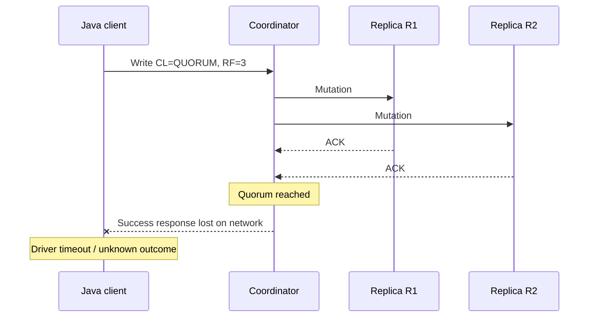
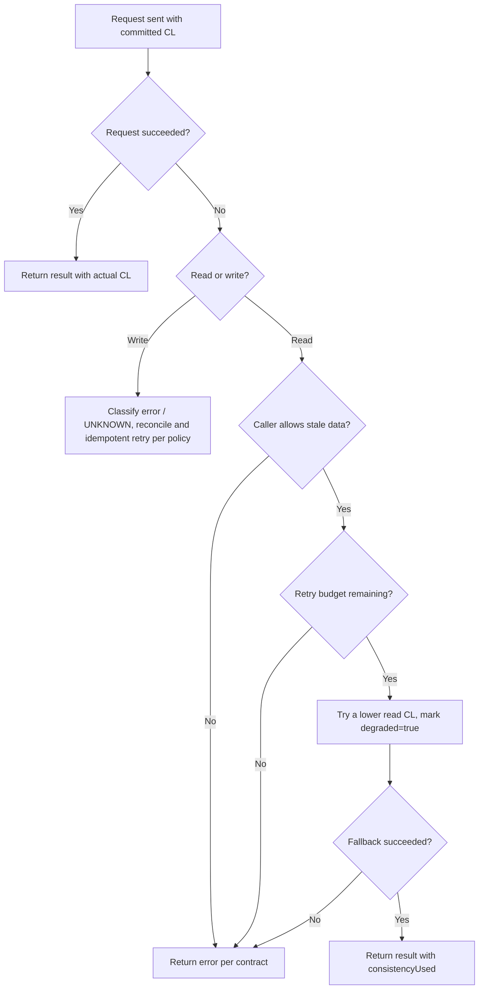

# Limits of Downgrading Consistency Levels on Retry

In Apache Cassandra, an operation can fail at the chosen consistency level (**CL**) because too few replicas respond, replicas are too slow, or cross-datacenter networking fails. A tempting idea is: **"If a write/read at `QUORUM` fails, automatically retry at `ONE` to rescue the request."** While this may allow some requests to receive a response, it also **changes the success condition the application promises to users**.

Downgrading CL on retry **is not always technically forbidden**. The real questions are **when changing the threshold is permitted**, **how the returned result must be interpreted**, and **how to avoid turning timeouts into duplicate writes, stale reads, or broken business invariants**. In particular, if the first attempt was already executed by some replicas without replying on time, the retry can interact with written data that the client is unaware of.

This lesson belongs to the **Read/Write Consistency** chapter of the `DATABASE_ENGINE_WIDE_COLUMN_CASSANDRA` module. Alongside distributed architecture and the wide-column model, partition keys, query-driven table design, CQL, replication, compaction, repair, error handling, and Java connectivity, this lesson focuses on **safe boundaries when applying retries and consistency downgrades**.

> **Principle:** A retry confirmed at `ONE` only entitles the application to claim **`ONE` was achieved** for that execution; you must never retain a prior failed **`QUORUM`**, **`LOCAL_QUORUM`**, or **`EACH_QUORUM`** guarantee. When the first attempt's outcome is unknown, never assume it definitely did not execute.

## 1. Learning Objectives

After this lesson, you will be able to:

1. Explain why retrying at a lower CL **changes the guarantee of the response**.
2. Distinguish **retrying at the same CL**, **switching coordinators**, **downgrading CL**, **eventual read fallback**, and **reconciling indeterminate writes**.
3. Compute ACK thresholds when replacing `QUORUM` with `ONE`, `LOCAL_QUORUM` with `LOCAL_ONE`, or `EACH_QUORUM` with a single-DC CL.
4. Recognize cases where **`QUORUM` and `LOCAL_QUORUM` differ in scope rather than merely strength**.
5. Classify `Unavailable`, `ReadTimeout`, `WriteTimeout`, `WriteFailure`, and Java Driver timeouts.
6. Build a retry policy with budgets, backoff, idempotency, and **no silent CL downgrades**.
7. Implement a best-effort read path **that falls back only when explicitly allowed**, without applying that pattern to critical data writes.
8. Analyze limits when retrying counters, LWT/Paxos, batches, TTLs, and mutations with side effects.

## 2. CL Is Part of the Data Contract

In Cassandra, the **partition key** and replication strategy identify a partition's target replicas. The **coordinator** receives the request and coordinates with replicas. CL dictates **how many valid responses must come from which replica set** before the coordinator can report success.

Suppose a keyspace has one DC with **RF = 3**:

```text
                          Coordinator
                              |
               +--------------+--------------+
               |              |              |
             R1             R2             R3

Write QUORUM: requires >= 2 replica ACKs.
Write ONE:    requires >= 1 replica ACK.
Write ALL:    requires all 3 replica ACKs.
```

If an API states "order status is only reported **saved** once a majority of replicas confirm," then **`QUORUM` is not just a performance knob**; it is the API's acceptance condition.

### Which Contracts Can Be Altered?

| Business Requirement | CLs Often Considered | Arbitrary CL Downgrade Can Cause |
| --- | --- | --- |
| Update order status and read back immediately in the same DC | Write/read `LOCAL_QUORUM` | Reading back at `LOCAL_ONE` may see old status. |
| Confirm mutation received by a quorum in every DC | Write `EACH_QUORUM` | Retrying `LOCAL_ONE` gives only one local-DC ACK, proving nothing about other DCs. |
| Record telemetry that tolerates loss/delayed visibility | CL chosen per risk tolerance | Degraded mode may be acceptable if the contract states so explicitly. |
| Create a single unique resource | LWT with suitable serial CL | Normal writes at lower CL lack atomic conditional checks. |
| Dashboard queries that can lag slightly | `LOCAL_ONE` or permitted fallback | Must tag result as best-effort, not present as strongly consistent data. |

**Higher CL does not mean "stronger transaction" in every sense.** `QUORUM` guarantees response thresholds and overlap under appropriate conditions, not turning `SELECT` then `UPDATE` into an atomic compare-and-set. When contention invariants exist, choose **LWT** or an appropriate protocol.

## 3. Retry and Downgrade Are Two Separate Decisions

**Retry** means resending a request after a failure or missing outcome. **Consistency downgrade** means changing CL on the new attempt so the request can finish with **fewer responses or a different scope**.

Options include:

1. **Retry at the same CL:** keeps the same threshold and scope, potentially via a different coordinator or after a replica recovers. The prior attempt may still have executed.
2. **Retry with a lower CL:** improves odds the new attempt completes if failure stemmed from lacking replicas at the old threshold, yet **weakens the confirmed condition**.
3. **Permitted read fallback:** returns a potentially stale result with a **degraded tag**, for endpoints accepting best-effort data.
4. **Write returning UNKNOWN status and reconciling:** never pretends the old CL succeeded; preserves operation ID, queries state per business policy, or processes via workflow.
5. **Do not retry:** returns a controlled error when repetition causes side effects, or during system overload/network partitions.

### Example: QUORUM Fails, ONE Succeeds

RF=3. First write attempt at `QUORUM`:

```text
Attempt 1 — CL=QUORUM (needs 2 ACKs)
  R1: ACK
  R2: did not respond before deadline
  R3: did not respond before deadline
  -> WriteTimeout

Attempt 2 — CL=ONE (needs 1 ACK)
  R1: ACK
  -> succeeds at ONE
```

The application **knows** the second attempt satisfied `ONE`. It **cannot be sure** whether the first attempt received a late second ACK. Most importantly, it **must not claim** "the write was confirmed at `QUORUM`" simply because the `ONE` retry succeeded.

For the same mutation, data may eventually propagate to every replica via normal mechanisms; that is **different from how many replicas confirmed before the API returned its response**.

## 4. Downgrading Read CL: Data Can Be Stale Despite Succeeding

Consider RF=3. A client just wrote `status=PAID` at `QUORUM` with ACKs from `R1,R2`, while `R3` still holds `status=CREATED`.

If the subsequent read uses `QUORUM`:

\[
W = 2,\quad R = 2,\quad N = 3,\quad R+W=4>3
\]

The write-ACK set and read-response set must intersect. When the write completed, no competing mutation wins by timestamp, and the read path reconciles successfully, this pair provides the basis to expect reading the confirmed mutation.

If the `QUORUM` query fails and retries at `ONE`:

\[
W = 2,\quad R = 1,\quad N = 3,\quad R+W=3\le N
\]

Overlap is no longer guaranteed. If the read hits `R3` before it receives the update, the result can be `CREATED`.

```text
QUORUM write ACKed:  R1=PAID    R2=PAID    R3=CREATED
                        ^          ^
Fallback ONE read:                             ^ ------> CREATED

Client receives a valid read response at ONE,
yet the response may be stale relative to the prior QUORUM write.
```

**Contract requirement:** an endpoint returning best-effort results at `ONE` **must not simultaneously advertise strong read-after-write guarantees like a `QUORUM` read endpoint**. You can expose the actual consistency used to clients, e.g., `consistencyUsed=LOCAL_ONE` and `degraded=true`.

### Read Errors Differ from Empty Results

- `ReadTimeout`: read request failed to complete on time.
- `Unavailable`: coordinator did not see enough live replicas for the CL.
- `null` or no rows: **a successful query result**, possibly because the row does not exist yet, was deleted, or TTL expired.

Never handle `ReadTimeout` by silently returning `null` as if the row did not exist. If you want to fall back to a lower CL, issue **a new query**, disclose the actual CL, and accept the stale-read risk.

## 5. Downgrading Write CL: Success at the New Level Does Not Inherit Old ACKs

Suppose RF=3 and the desired written state is `SHIPPED`. A `QUORUM` request hits `Unavailable` or `WriteTimeout`; the application retries at `ONE`.

| Observation | What Can Be Inferred | What Must NOT Be Inferred |
| --- | --- | --- |
| `QUORUM` fails with unavailable | Not enough replicas considered alive by coordinator to meet `QUORUM` on that attempt. | Does not prove other requests failed to write. |
| `QUORUM` hits `WriteTimeout` | Not confirmed to quorum before deadline. | Does not prove zero replicas applied the mutation. |
| `ONE` retry succeeds | The new attempt received at least one eligible replica ACK. | **Does not confirm** `QUORUM` was achieved for the mutation under the original contract. |
| Subsequent `ONE` read sees `SHIPPED` | At least that read path observed this value. | Does not prove every replica holds `SHIPPED` or that a competing mutation cannot overwrite it. |
| Subsequent `QUORUM` read succeeds | Logical state observed under the new read CL. | Does not retroactively restore a quorum ACK receipt for the initial write or turn multiple steps into a transaction. |

### Why Preserving the Primary Key Matters So Much

If a retry generates a **new UUID** or new key for the same business event, both writes can leave **two rows**. Because the client does not know whether the first write already occurred, generating new keys increases duplication risk.

For event data, assign `event_id` in the application **before the first send**. For state updates, control **operation IDs**, **timestamps**, and state-transition conditions when multiple clients contend.

**Specifically:** retrying the same primary key with a **newer** timestamp can cause a logically older mutation to overwrite a valid subsequent mutation. Idempotency is more than "the same `WHERE` clause."

## 6. Single-DC RF=3 Matrix: How Much Does Changing CL Shift Thresholds?

Assuming the coordinator can serve requests, listed replicas respond on time, and examining **count thresholds only**:

| From CL | To Retry CL | Original → New Threshold | What Changed |
| --- | --- | --- | --- |
| `ALL` | `QUORUM` | 3 → 2 | No longer waits for the third replica. |
| `QUORUM` | `ONE` | 2 → 1 | No longer confirms a majority. |
| `TWO` | `ONE` | 2 → 1 | One fewer ACK. |
| `THREE` | `TWO` | 3 → 2 | No longer requires all three ACKs. |
| `ONE` | `ANY` on **write** | 1 replica ACK → hint storage alone may suffice | **Zero target replicas may hold the data** when success returns. |
| `LOCAL_QUORUM` | `LOCAL_ONE` | 2 local → 1 local | Loses intra-DC intersection guarantee. |

**`ANY` is not used for reads** in Cassandra OSS. An `ANY` write can succeed via coordinator **hint** storage when zero target replicas ACK, yet data may not be readable yet; hinted handoff is best effort, not a fourth replica.

### When Does Lowering CL Actually Improve Availability?

If RF=3 and only one replica remains responsive:

- `QUORUM` needs two ACKs and cannot succeed.
- `ONE` can succeed with one ACK.

However, if the **coordinator dies**, the **driver cannot connect to any node**, or the **lone replica is also too slow**, lowering CL **does not guarantee** the request succeeds. CL governs ACK thresholds; it cannot fix every network, CPU, disk, schema, or authentication failure.

## 7. Multi-DC: Changing Scope Is Not Simply Lowering a Number

In Cassandra using `NetworkTopologyStrategy`, replicas of the same partition can span multiple datacenters. Example:

```text
                 partition P

dc1: RF=3                         dc2: RF=3
  A1 A2 A3                          B1 B2 B3

Total RF = 6
QUORUM = 4 arbitrary ACKs
LOCAL_QUORUM = 2 ACKs in coordinator's DC
EACH_QUORUM = 2 ACKs in each DC (writes only)
```

### 7.1. QUORUM → LOCAL_QUORUM

If the coordinator is in `dc1`:

- `QUORUM` needs **4 out of 6 total replicas**.
- `LOCAL_QUORUM` needs **2 out of 3 replicas in `dc1`**.

In this balanced topology, switching from `QUORUM` to `LOCAL_QUORUM` usually avoids waiting for remote-DC ACKs to satisfy CL. Yet **both threshold and scope changed**; clients in `dc2` are not guaranteed to immediately read a mutation just confirmed locally in `dc1`.

**Never rank the two CLs in an absolute strong/weak order for every situation**:

| Available Responders | Cluster-wide `QUORUM` | `LOCAL_QUORUM` dc1 |
| --- | --- | --- |
| 3 in dc1, 0 in dc2 | Fails (3 < 4). | Can succeed (3 ≥ 2). |
| 1 in dc1, 3 in dc2 | Can succeed (1+3=4). | Fails (1 < 2). |
| 2 in dc1, 1 in dc2 | Fails (2+1=3). | Can succeed (2 ≥ 2). |

Because their replica sets differ, switching from `QUORUM` to `LOCAL_QUORUM` **is not an "ACK reduction" with uniform effect across every failure distribution**.

### 7.2. EACH_QUORUM → LOCAL_QUORUM

An `EACH_QUORUM` write with RF=3+3 needs **2 ACKs in dc1 and 2 ACKs in dc2**. A `LOCAL_QUORUM` write in dc1 needs only **2 ACKs in dc1**.

Suppose dc2 is isolated: the `EACH_QUORUM` write fails; a `LOCAL_QUORUM` retry can succeed. However, you must never report that the write received **quorum confirmation in both DCs**. The system still attempts to forward the mutation to dc2 replicas when possible, yet **no dc2 ACK backs the returned response**.

### 7.3. Asymmetric RF: 5+1

With `dc1 RF=5` and `dc2 RF=1`:

- Cluster-wide `QUORUM` needs `floor(6/2)+1=4` ACKs.
- `LOCAL_QUORUM` in dc1 needs `floor(5/2)+1=3` ACKs.
- `EACH_QUORUM` write needs **3 ACKs dc1 and 1 ACK dc2**.

If dc2 is isolated while dc1 retains five replicas, a `QUORUM` write **can still succeed** with four ACKs in dc1. Downgrading to `LOCAL_QUORUM` in that case **is unnecessary solely due to losing dc2** if global quorum remains reachable. Never apply a blanket rule "on WAN loss, downgrade global to local" without checking RFs.

## 8. Not Every Error Has a Safe Retry Strategy

| Error/Result | Reliable Fact | Typically Appropriate Action |
| --- | --- | --- |
| `UnavailableException` | Coordinator judges insufficient live replicas for requested CL. | Check RF, local DC, replica state; wait for recovery or return error per contract. Do not auto-downgrade CL. |
| `ReadTimeoutException` | Read failed to gather enough responses/data on time. | May run bounded retry at **same CL**; fall back to lower CL only when caller explicitly accepts stale reads. |
| `ReadFailureException` | Replicas reported errors on read path. | Classify errors and node health; never just lower CL to mask errors. |
| `WriteTimeoutException` | Write was not confirmed to CL before deadline. | Mutation state **may be unknown**; requires idempotency/reconciliation. |
| `WriteFailureException` | Error occurred while replica processed mutation. | Other replicas may have written; investigate root cause and unknown state. |
| `DriverTimeoutException` or disconnect | Client missed result before deadline or connection broke. | Server may have finished; never assume no-op, especially for writes. |
| `InvalidQueryException`, syntax/schema/auth errors | Request invalid per server. | **Fix request/config**; never use lower CL as a retry policy. |

### Timeout Does Not Mean Insufficient Live Replicas

A coordinator may see two UP replicas for `QUORUM` RF=3, yet one ACK arrives past deadline due to GC, I/O, network, or load. That triggers `WriteTimeout`. If the cause is a slow replica on the same path, retrying at `ONE` might return faster occasionally, yet **it does not fix the root issue** and can add pressure to the system.

### Missing Client Response Is an Unknown Outcome

The event timeline can be:



**Never infer from a driver timeout that the write failed to reach quorum.** If the application resends the mutation with a new ID or timestamp, it can create a **second operation** rather than merely "completing the first."

## 9. Limits on Write Retries: Idempotency and Business Conditions

### 9.1. Mutations That Are Idempotent Within Appropriate Scope

A mutation can be considered idempotent if executing it multiple times produces no logical change beyond executing it once, given **documented data design and assumptions**.

| Operation | Cautious Retry Classification |
| --- | --- |
| `INSERT` reusing **same primary key and payload**, stable metadata | Usually can be designed idempotently. |
| `UPDATE status='PAID'` reusing key, payload, and timestamp | Usually safe assuming no other side effects. |
| `INSERT` generating a new `event_id` per attempt | Not idempotent for avoiding duplicate events. |
| `UPDATE counter SET count=count+1` | **Not idempotent**: may increment multiple times. |
| Append/list mutation | **Not by default** idempotent; may duplicate elements. |
| Mutation coupled with email, payment, or message publish | Needs deduplication/outbox; Cassandra does not transact with external systems. |
| `INSERT ... IF NOT EXISTS` via LWT | Must reconcile `[applied]` and request ID on timeout. |
| Write with TTL | Must check timestamp/expiration; retrying with different metadata can shift expiry. |

**A stable primary key is foundational**, yet insufficient if every retry generates a fresh timestamp. When another client has just written a newer version, retrying an older mutation with a higher timestamp can **overwrite valid state**.

### 9.2. Illustrating How Timestamps Break Business Order

```text
t0: Client A writes status=IN_TRANSIT, timestamp=100 -> timeout.
t1: Client B writes status=DELIVERED,  timestamp=200 -> succeeds.
t2: Client A retries status=IN_TRANSIT, timestamp=300 -> succeeds at ONE.

Under last-write-wins reconciliation, IN_TRANSIT@300 can beat
DELIVERED@200, even though A only meant to retry an old request.
```

To repeat **the exact same mutation**, you may need to preserve **the same CQL timestamp (microseconds)**, partition key, and payload. For flows with multiple contending clients or conditional updates, stable timestamps **do not replace** LWT/versioning.

### 9.3. Counters and Batches Need Dedicated Policies

A timed-out counter increment may have **already been applied**; retrying the increment can add another count. Logged batches use a batchlog mechanism to deliver missing mutations, yet **are not equivalent to SQL transactions with multi-partition rollback/snapshot isolation**. If a batch times out, part of the mutations may have already applied or continue processing; never assume the entire batch rolled back and re-send every step with new keys.

### 9.4. Do Not Mix External Side Effects into Blind Retries

If a workflow does:

1. write to Cassandra,
2. send email,
3. publish event,

then retrying the entire workflow on a Cassandra timeout can send emails/events multiple times. Achieving "once per business event" requires **operation IDs**, deduplication, and an appropriate workflow/outbox. Lowering CL does not solve **exactly-once** across independent systems.

## 10. LWT: Do Not Arbitrarily Downgrade SERIAL to LOCAL_SERIAL

**Lightweight transactions (LWT)** use Paxos for `IF NOT EXISTS` or `UPDATE ... IF ...` statements. They have two distinct axes:

- **Normal CL** such as `QUORUM` or `LOCAL_QUORUM` for the ordinary execution path.
- **Serial CL** such as `SERIAL` and `LOCAL_SERIAL` for the **Paxos consensus scope**.

In a `dc1 RF=3, dc2 RF=3` cluster:

| Serial CL | Consensus Quorum Scope |
| --- | --- |
| `SERIAL` | Majority of **all six replicas**, typically 4 Paxos responses. |
| `LOCAL_SERIAL` in dc1 | Majority of the three replicas in **dc1**, i.e., 2 local Paxos responses. |

If an LWT using `SERIAL` fails due to WAN loss, retrying with `LOCAL_SERIAL` in dc1 **changes the consensus scope**. If a client in dc2 is also executing a `LOCAL_SERIAL` LWT for the same key, the two local groups might not overlap. You cannot claim **cluster-wide uniqueness arbitration** using disjoint local quorums.

**Lowering normal CL does not automatically lower serial CL; lowering serial CL does not change normal CL either.** Both choices must be designed around the business contention scope.

### LWT Timeout Is an Indeterminate Outcome

Suppose `INSERT ... IF NOT EXISTS` times out. Retrying with the same key may return `[applied]=false` **because the initial attempt succeeded in creating the row while the client missed the ACK**. Never interpret `false` after a retry as proof that another client won.

Appropriate approach:

- Use an `operation_id` generated **before the first attempt**.
- Keep the same partition key/resource identifier.
- Read and reconcile `operation_id` or owner after a timeout.
- Pick a serial scope covering **all clients that may contend** on the resource.
- Never mix ordinary non-`IF` writes into an invariant protected by LWT.

## 11. CQL Practice: The Retry's CL Must Be Recorded

Assume a **lab cluster** with a DC named `dc1` and three nodes for RF=3:

```sql
CREATE KEYSPACE IF NOT EXISTS downgrade_lab
WITH replication = {
  'class': 'NetworkTopologyStrategy',
  'dc1': 3
};

CREATE TABLE IF NOT EXISTS downgrade_lab.shipment_by_id (
  shipment_id uuid PRIMARY KEY,
  status text,
  operation_id uuid,
  updated_at timestamp
);
```

`shipment_id` is the partition key; the table is designed for the query "look up shipment status by ID." `operation_id` helps reconcile **business requests** when a mutation was written yet its response was lost.

### 11.1. Writing at QUORUM and Reading Back at QUORUM

In `cqlsh`:

```sql
CONSISTENCY QUORUM;

UPDATE downgrade_lab.shipment_by_id
SET status = 'IN_TRANSIT',
    operation_id = 22222222-2222-4222-8222-222222222222,
    updated_at = '2026-11-21 11:00:00+0000'
WHERE shipment_id = 11111111-1111-4111-8111-111111111111;

SELECT status, operation_id
FROM downgrade_lab.shipment_by_id
WHERE shipment_id = 11111111-1111-4111-8111-111111111111;
```

If the write returns success at `QUORUM`, the application has proof the write CL was met. If the request **times out**, do not plug `W=2` into intersection math as if the write succeeded. A `QUORUM` read can inspect the **currently observed** state, though it does not reliably reconstruct the history of all prior mutations.

### 11.2. Demonstrating CL Downgrade in a Lab, Not a Production Recommendation

```sql
-- Suppose a QUORUM query failed in a lab with a slow replica.
-- Change cqlsh session CL for the NEXT QUERY:
CONSISTENCY ONE;

SELECT status, operation_id
FROM downgrade_lab.shipment_by_id
WHERE shipment_id = 11111111-1111-4111-8111-111111111111;

-- Restore the stronger read contract for subsequent queries:
CONSISTENCY QUORUM;
```

**Important:** `CONSISTENCY` is a **`cqlsh` command**, applying to subsequent statements; it is **not** a clause attached directly to `SELECT`. A `ONE` read returning success **does not mean** `QUORUM` was achieved; if served by a lagging replica, the value can be stale.

Never run this illustrative CL downgrade to simulate incidents on production data. In a healthy cluster, `ONE` and `QUORUM` reads may coincidentally return identical results; that does not prove both CLs provide the same guarantees.

### 11.3. Multi-DC Must Verify Per-DC RF

In a lab that genuinely has two DCs:

```sql
CREATE KEYSPACE IF NOT EXISTS downgrade_multi_dc_lab
WITH replication = {
  'class': 'NetworkTopologyStrategy',
  'dc1': 3,
  'dc2': 3
};
```

With this topology, downgrading an `EACH_QUORUM` write to `LOCAL_QUORUM` changes **2 ACKs per DC** into **2 ACKs solely in the coordinator's DC**. If the business requirement is "ready to serve from the other DC right after write," switching CL must not be done merely because the remote DC has high latency.

## 12. Java Driver 4.x: Never Auto-Downgrade on the Write Path

The design below uses a `CqlSession` configured with local datacenter, contact points, security, and request timeouts matching the environment. Prepared statements are reused.

### 12.1. Critical Writes: Fix CL and Report UNKNOWN

```java
import com.datastax.oss.driver.api.core.CqlSession;
import com.datastax.oss.driver.api.core.DefaultConsistencyLevel;
import com.datastax.oss.driver.api.core.DriverTimeoutException;
import com.datastax.oss.driver.api.core.cql.BoundStatement;
import com.datastax.oss.driver.api.core.cql.PreparedStatement;
import com.datastax.oss.driver.api.core.servererrors.UnavailableException;
import com.datastax.oss.driver.api.core.servererrors.WriteFailureException;
import com.datastax.oss.driver.api.core.servererrors.WriteTimeoutException;

import java.time.Instant;
import java.util.UUID;

public final class ShipmentWriter {
    public enum WriteStatus {
        ACKNOWLEDGED, UNAVAILABLE, UNKNOWN
    }

    private final CqlSession session;
    private final PreparedStatement update;

    public ShipmentWriter(CqlSession session) {
        this.session = session;
        this.update = session.prepare(
            "UPDATE downgrade_lab.shipment_by_id USING TIMESTAMP ? " +
            "SET status = ?, operation_id = ?, updated_at = ? " +
            "WHERE shipment_id = ?");
    }

    public WriteStatus updateStatus(
            UUID shipmentId, String status, UUID operationId,
            Instant updatedAt, long timestampMicros) {
        BoundStatement statement = update.bind(
                timestampMicros, status, operationId, updatedAt, shipmentId)
            .setConsistencyLevel(DefaultConsistencyLevel.LOCAL_QUORUM)
            .setIdempotent(true);
        // setIdempotent(true) is valid only when keys, payload, timestamp,
        // external side effects, and contention are controlled.

        try {
            session.execute(statement);
            return WriteStatus.ACKNOWLEDGED;
        } catch (UnavailableException e) {
            // Do not auto-switch to ONE: the contract remains LOCAL_QUORUM.
            return WriteStatus.UNAVAILABLE;
        } catch (WriteTimeoutException
                 | WriteFailureException
                 | DriverTimeoutException e) {
            // Write may have occurred partially or finished with a lost ACK.
            return WriteStatus.UNKNOWN;
        }
    }
}
```

This illustrates three-state classification; host errors, invalid CQL, and other exceptions must be handled individually rather than caught and silently turned into `UNKNOWN`. **`ACKNOWLEDGED` means `LOCAL_QUORUM` was satisfied for the request**, not that every replica or DC has converged.

### 12.2. Dashboard Reads: Fallback Only with Explicit Consent

Suppose a dashboard endpoint **is permitted to display potentially lagged data**. The service can let callers enable `allowStaleRead` and only then perform a **single bounded fallback read**:

```java
import com.datastax.oss.driver.api.core.CqlSession;
import com.datastax.oss.driver.api.core.DefaultConsistencyLevel;
import com.datastax.oss.driver.api.core.cql.BoundStatement;
import com.datastax.oss.driver.api.core.cql.PreparedStatement;
import com.datastax.oss.driver.api.core.cql.Row;
import com.datastax.oss.driver.api.core.servererrors.ReadTimeoutException;
import com.datastax.oss.driver.api.core.servererrors.UnavailableException;

import java.util.UUID;

public final class DashboardReader {
    public static final class ReadResult {
        public final String status;
        public final String consistencyUsed;
        public final boolean degraded;

        public ReadResult(String status, String consistencyUsed,
                          boolean degraded) {
            this.status = status;
            this.consistencyUsed = consistencyUsed;
            this.degraded = degraded;
        }
    }

    private final CqlSession session;
    private final PreparedStatement select;

    public DashboardReader(CqlSession session) {
        this.session = session;
        this.select = session.prepare(
            "SELECT status FROM downgrade_lab.shipment_by_id " +
            "WHERE shipment_id = ?");
    }

    public ReadResult readStatus(UUID shipmentId, boolean allowStaleRead) {
        try {
            BoundStatement strict = select.bind(shipmentId)
                .setConsistencyLevel(DefaultConsistencyLevel.LOCAL_QUORUM);
            Row row = session.execute(strict).one();
            return new ReadResult(
                row == null ? null : row.getString("status"),
                "LOCAL_QUORUM", false);
        } catch (UnavailableException | ReadTimeoutException e) {
            if (!allowStaleRead) {
                throw e; // Do not lower CL if caller did not opt in.
            }
            // Single fallback step only; no infinite loops.
            BoundStatement relaxed = select.bind(shipmentId)
                .setConsistencyLevel(DefaultConsistencyLevel.LOCAL_ONE);
            Row row = session.execute(relaxed).one();
            return new ReadResult(
                row == null ? null : row.getString("status"),
                "LOCAL_ONE", true);
        }
    }
}
```

The code intentionally **downgrades CL only on a read path that allows staleness**, and never auto-downgrades write CL. If the fallback also fails, the exception propagates; the code **never fabricates a `null` value** as if the query succeeded. In production, bound the total deadline and retry budget, log/record metrics on degraded occurrences, and expose `degraded` transparently to the API/client.

### 12.3. Driver Retry Policies Do Not Replace Contracts

The Java Driver has retry, load-balancing, and speculative execution policies depending on version/configuration. Never assume that **default policies automatically downgrade CL**, or that a custom "self-healing" policy preserves business guarantees. Before configuring a retry policy:

- Verify whether each query is **idempotent**; do not mark every write idempotent merely so the driver will retry it.
- Check whether retries can change **host/coordinator**, **attempt count**, **CL**, or issue parallel speculative executions.
- Bound retries by time budget and attempt count; avoid amplifying load when the cluster is already slow.
- Log/record metrics for **the actual CL used for the returned result**, not just the initially intended CL.
- Never redirect a `WriteTimeout` to a lower CL and return a response as though the initial request met its threshold.

## 13. Designing Retry Budgets and Degraded Modes

If there is a clear business reason to fall back, model the process explicitly as a **service state** rather than a hidden trick inside the driver.

### A Structured Decision Flow



**This illustrates a safe policy for one endpoint category**, not a mandate that every API must support degraded mode. Order, payment, inventory, or critical state-transition APIs may decide **never to downgrade CL under any circumstances**.

### What Should a Retry Budget Include?

| Component | Why Is It Needed? |
| --- | --- |
| Max retry attempts | Prevents unbounded retries. |
| Overall deadline | Prevents multiple retries from blowing past SLA. |
| Appropriate backoff and jitter | Prevents synchronized client retry spikes when recovering. |
| Concurrency control | Prevents retries from multiplying load on hot partitions. |
| Retry only requests verified safe | Avoids double-incrementing counters, duplicate rows, or repeated side effects. |
| Degraded and actual CL labels | Preserves transparency for lower-consistency reads. |
| Metrics and alerts | Surfaces prolonged incidents instead of hiding them behind fallbacks. |

**Note:** Lowering CL can raise request success rates temporarily, yet if the root cause is disk/CPU/GC saturation, increasing retry traffic can worsen cluster health. Diagnose the true root cause before treating fallback as a steady-state solution.

## 14. Recovery Mechanisms Do Not Retroactively Upgrade ACK Guarantees

Cassandra has several mechanisms that help replicas converge:

- **Hinted handoff:** replays missed mutations, subject to surviving hints and delivery capacity; best effort.
- **Read reconciliation/read repair:** reconciles versions observed on the read path and may repair involved replicas depending on version/configuration.
- **Anti-entropy repair:** compares replicas to resolve long-lived divergences, even when hints are gone.
- **Compaction:** manages SSTables, older versions, and tombstones; does not replace repair.

Suppose a `ONE` write succeeds, and later repair runs so all three replicas hold the mutation. That **does not turn the original `ONE` response into a `QUORUM` response**. Subsequent synchronization is a separate fact, while the ACK contract defines **the condition met before returning success**.

With deletes/tombstones, lowering write CL and letting replicas miss deletions for extended periods creates convergence risks, especially if repair is not operated in alignment with `gc_grace_seconds`. Retry policies cannot substitute for repair strategies and proper handling of long-down nodes.

## 15. Runbook When an Application Proposes Auto-Downgrading CL

Before enabling such a feature, the engineering team should answer in order:

1. **Which endpoint?** Best-effort read or critical state write?
2. **Current contract?** What ACK/freshness level does a success response promise?
3. **What error is occurring?** `Unavailable`, server timeout, driver timeout, replica failure, or CQL error?
4. **RF and local DC?** Compute thresholds for both initial and fallback CLs, including coordinator DC.
5. **Same replica set?** Especially when switching `QUORUM` ↔ `LOCAL_QUORUM` or across DCs.
6. **Could the write have partially applied?** With timeouts, state may be indeterminate.
7. **Is the mutation idempotent?** Keys, timestamps, TTLs, counters, collections, and side effects?
8. **Are LWTs/contended invariants involved?** Never switch `SERIAL` to `LOCAL_SERIAL` automatically.
9. **Did the client opt into stale data?** If not, do not fall back on reads.
10. **How is the result tagged?** Record `consistencyUsed`, `degraded`, and operation ID.
11. **What is the retry budget?** Deadline, attempt cap, backoff, and retry-storm protection?
12. **How do we exit degraded mode?** Monitor metrics, replicas/hints/repairs, and define conditions to disable fallback.

When investigating timeouts, tools like `nodetool status` and logs/metrics help spot down replicas or slow networks, yet **do not prove whether a specific mutation committed or not**. Preserve correlation IDs and operation IDs for accurate reconciliation.

## 16. Exercises and Solutions

### Exercise 1 — QUORUM Write Times Out, Then Downgraded to ONE

RF=3. A `QUORUM` write receives one ACK and hits `WriteTimeout`. A `ONE` retry succeeds. May we return "quorum write succeeded"?

**Answer:** No. The successful retry only confirms the `ONE` threshold of that attempt. The prior `QUORUM` attempt may have applied on some replicas, yet there is no success response proving quorum was met on time.

### Exercise 2 — Downgrading Read CL Breaks Intersection

RF=3. A `QUORUM` write succeeds; a `QUORUM` read fails and falls back to `ONE`. Is it still guaranteed to see the newly confirmed write?

**Answer:** No. `W=2`, `R=1`, so `R+W=3≤N=3`; the replica queried at `ONE` might not have received the mutation yet.

### Exercise 3 — Remote DC Disconnected

RF=3+3, coordinator in dc1. An `EACH_QUORUM` write fails because dc2 is down. A `LOCAL_QUORUM` retry succeeds in dc1. What must NOT be claimed?

**Answer:** Do not claim dc2 achieved quorum or that the mutation was confirmed in both DCs. The new attempt only required two ACKs in dc1.

### Exercise 4 — QUORUM vs. LOCAL_QUORUM Have No Absolute Ordering

RF=3+3, coordinator in dc1. Only 1 dc1 replica and 3 dc2 replicas respond. Can `QUORUM` and `LOCAL_QUORUM` in dc1 succeed?

**Answer:** `QUORUM` needs 4/6 so it **can** succeed (1+3). `LOCAL_QUORUM` needs 2/3 in dc1 so it **cannot**. The two CLs differ in scope, not just numerical threshold.

### Exercise 5 — Downgrading ONE to ANY

RF=3, no target replicas respond yet the coordinator stays healthy and stores a hint. Does a successful `ANY` write prove a replica already holds readable data?

**Answer:** No. Success may rest solely on a hint; data may not be present on replicas yet. Also, `ANY` is invalid for `SELECT`.

### Exercise 6 — Not Every Error Warrants a Retry

A request is rejected due to a schema-invalid CQL query. Will lowering `QUORUM` to `ONE` help?

**Answer:** No. Fix the syntax/schema or permissions. CL cannot resolve validation errors.

### Exercise 7 — Timestamp Incremented on Retry

Client A writes `IN_TRANSIT@100` and times out; Client B successfully writes `DELIVERED@200`; A retries `IN_TRANSIT@300`. What is the risk?

**Answer:** `IN_TRANSIT@300` can beat `DELIVERED@200` under last-write-wins even though A was merely retrying an old operation. Keep metadata stable or use proper concurrency control.

### Exercise 8 — Counters

A counter increment by one times out and the client retries at a lower CL. Why can't the retry be treated as harmless?

**Answer:** The prior increment may have applied; the retry can increment a second time. Counter increments are not idempotent.

### Exercise 9 — LWT Changing Scope

Two clients in dc1 and dc2 contend for a `seat_key`. After `SERIAL` times out, the application switches independently to `LOCAL_SERIAL` in each DC. Can we assert cluster-wide uniqueness via Paxos?

**Answer:** No. The two local serial quorums may not overlap; you must pick one serial scope matching the contention boundary and enforce it uniformly across all clients.

### Exercise 10 — Driver Timeout

The coordinator collected enough quorum ACKs, yet the response to the client was lost; the driver reports timeout. May the client assume the write was not applied and generate a new operation ID?

**Answer:** No. The mutation may have already completed on the server. Keep the operation ID/primary key stable and reconcile.

### Exercise 11 — Best-Effort Dashboard

A dashboard tolerates slightly delayed status display and exposes reliability metadata. When a `LOCAL_QUORUM` read fails, under what conditions is downgrading to `LOCAL_ONE` acceptable?

**Answer:** When the API/caller contract **accepts potentially stale data**, the result explicitly indicates `consistencyUsed=LOCAL_ONE`/`degraded=true`, attempt count/deadline are bounded, and fallback failures are still reported properly.

### Exercise 12 — Critical Writes

A payment API promises to return success only after writes are confirmed by a quorum in every DC. When WAN slows down, should it auto-retry `EACH_QUORUM` at `LOCAL_ONE` to keep HTTP 200 rates high?

**Answer:** No. The ACK condition changes drastically; the response would violate the API's promise. Return an error/verifying status, rely on idempotency, and fix or wait for infrastructure recovery.

### Exercise 13 — Skewed RF 5+1

dc1 RF=5 and dc2 RF=1. DC2 loses connectivity while dc1 has all five replicas healthy. Can a `QUORUM` write still succeed? Is downgrading to `LOCAL_QUORUM` mandatory?

**Answer:** Cluster-wide `QUORUM` needs `floor(6/2)+1=4` ACKs and can collect four from dc1. Downgrading CL is not mandatory solely because dc2 disconnected.

## 17. Conclusion

**Downgrading consistency level on retry alters the contract regarding the count or scope of confirmed responses**, not merely a trick to get requests "past errors." On reads, `QUORUM` → `ONE` can break overlap guarantees and return stale data. On writes, `QUORUM` → `ONE` or `EACH_QUORUM` → `LOCAL_QUORUM` may raise availability, yet forbids claiming the original threshold's ACKs were achieved.

Because write timeouts commonly lead to **unknown outcomes**, safe policies combine **fixed CLs for strict APIs**, **idempotency and stable operation IDs**, **reconciliation instead of blind retries**, **bounded retry budgets**, and degraded modes **only on read paths where business rules permit it**. For LWTs, `SERIAL`/`LOCAL_SERIAL` define the Paxos scope and must never be swapped arbitrarily to rescue cross-DC contended operations.

### References

- [Apache Cassandra — Dynamo, replication, and tunable consistency](https://cassandra.apache.org/doc/stable/cassandra/architecture/dynamo.html): replicas, RF, acknowledgment thresholds, and CL scopes.
- [Apache Cassandra — CQL Data Manipulation](https://cassandra.apache.org/doc/stable/cassandra/developing/cql/dml.html): normal writes, `USING TIMESTAMP`, counters, and conditional writes.
- [Apache Cassandra — Hints](https://cassandra.apache.org/doc/stable/cassandra/managing/operating/hints.html): hinted handoff and limits when replicas miss mutations.
- [Apache Cassandra — Repair](https://cassandra.apache.org/doc/stable/cassandra/managing/operating/repair.html): anti-entropy repair and replica convergence.
- [Apache Cassandra — cqlsh](https://cassandra.apache.org/doc/stable/cassandra/managing/tools/cqlsh.html): the `CONSISTENCY` command in practice.
