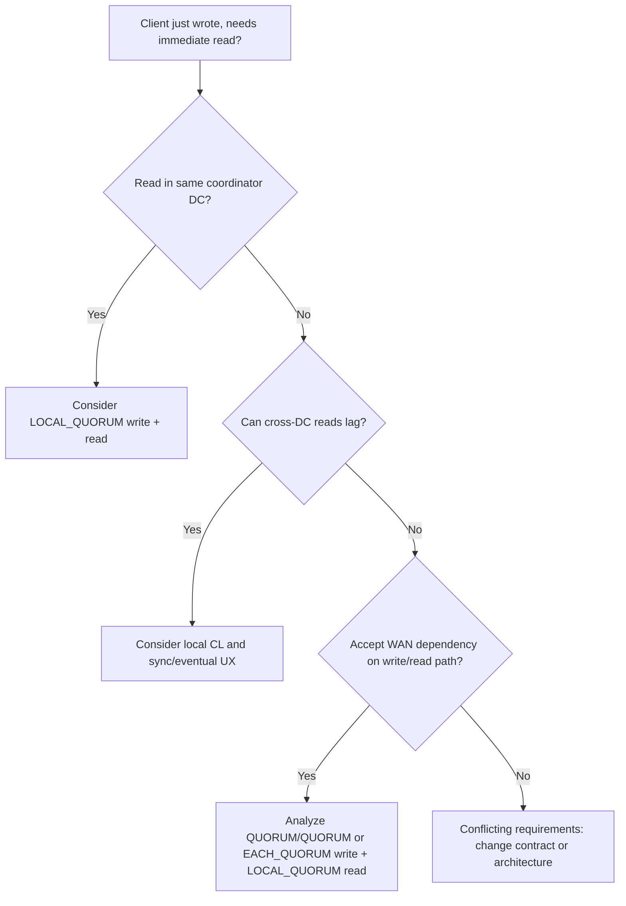

# Designing Consistency Levels from Business Requirements

There is no single **consistency level (CL)** suited for every Apache Cassandra system. An analytics dashboard may tolerate briefly delayed data; an order status page may need **immediate read-back after updating**; while a unique seat reservation must prevent **two clients from both winning the race**. Those three needs differ in **data freshness**, **availability**, **latency**, and **contention**, and therefore may require three different consistency strategies.

In Cassandra, CL primarily specifies **the number and scope of replica responses** the coordinator must wait for on a given operation. Raising CL by itself does **not** turn normal writes into conditional transactions, does **not** solve all retry errors, and does **not** ensure every datacenter receives fresh data simultaneously.

This lesson belongs to the **Read/Write Consistency** chapter of the `DATABASE_ENGINE_WIDE_COLUMN_CASSANDRA` module. It ties CL design to distributed architecture, the wide-column model, partition keys, query-driven tables, CQL, replication, compaction, repair, error handling, and connecting from Java applications. The goal is establishing **a verifiable design process**, rather than picking `ONE` or `QUORUM` out of habit.

> **Opening question:** When an API returns "success," what does the business require to be confirmed: **one replica received it**, **a majority of replicas in one DC received it**, **a cluster-wide majority received it**, **a quorum in every DC received it**, or **a contended condition was decided atomically**? Answer this before setting CL.

## 1. Learning Objectives

After this lesson, you will be able to:

1. Translate business requirements into a **read/write contract**: freshness, scope, fault tolerance, and behavior on indeterminate outcomes.
2. Calculate response thresholds from replication factor (RF) and select `ONE`, `LOCAL_ONE`, `QUORUM`, `LOCAL_QUORUM`, `EACH_QUORUM`, or `ALL` for the right operation type.
3. Apply `R + W > N` to evaluate read-after-write within **the same replica set** and recognize the limits of that math.
4. Choose single-datacenter and multi-datacenter strategies, including unequal RFs.
5. Distinguish normal read/write CLs from **LWT/Paxos and `SERIAL`/`LOCAL_SERIAL`** for conditional updates.
6. Design timeouts, retries, idempotency, degraded mode options, and reconciliation mechanisms for unknown write outcomes.
7. Build a decision matrix and test in a lab using `cqlsh` and Java Driver 4.x.

## 2. Start from Business Behavior, Not from CL Names

Describe requirements in terms of what is **observable** by the client:

| Design Question | Concrete Requirement Example | Consequences to Evaluate |
| --- | --- | --- |
| **Can reads be stale?** | Dashboard may display briefly delayed metrics. | Consider `LOCAL_ONE` reads if the application handles stale data. |
| **Must read-after-write succeed?** | User clicks "Paid" and reloads the page in the same region. | Requires an overlapping CL pair on the right replica set, plus ordering/timestamp assumptions. |
| **Do clients read in another DC?** | Written in Vietnam, immediately read in Singapore DC. | Local quorums in two DCs **do not necessarily overlap**. |
| **Must one or multiple DCs confirm?** | Critical writes must be ACKed by a quorum in every DC before returning success. | `EACH_QUORUM` write is a candidate; must accept WAN dependence. |
| **Is there a contention invariant?** | At most one customer may reserve seat A07. | Needs atomic condition via **LWT**, not just raising normal CL. |
| **Are unknown outcomes handled?** | Timed-out writes must be queryable by operation ID. | Design idempotency, UNKNOWN state, and reconciliation. |
| **Which failures must keep serving?** | One replica down or an entire remote DC isolated. | Compute CL thresholds from RF and remaining reachable regions. |

### Four Mandatory Outputs of a Design Decision

Every critical business flow should document:

1. **Write normal CL** and what the server must ACK.
2. **Read normal CL** and freshness/availability commitments.
3. **Serial CL (if using LWT)** and the protected contention scope.
4. **Failure policy**: error return, UNKNOWN, same-CL retry, reconciliation, or consented degraded read.

Never simply write "use quorum" in engineering specs. `QUORUM` over total RF `3+3` differs from `LOCAL_QUORUM` in an RF=3 DC; `EACH_QUORUM` has its own per-DC ACK distribution rule.

## 3. From Replication Factor to Required Wait Counts

The **partition key** determines the partition, while the **replication strategy** and **RF** determine the target replicas for that partition. The coordinator need not be a target replica. CL dictates **response thresholds**, without changing the configured number of copies.

For a set of `N` replicas, quorum is:

\[
Q(N) = \left\lfloor \frac{N}{2} \right\rfloor + 1
\]

In `NetworkTopologyStrategy` with multiple DCs, let `RF_i` be the RF in DC `i`:

\[
N_{\text{global}} = \sum_i RF_i,\qquad
Q_{\text{global}} = \left\lfloor \frac{\sum_i RF_i}{2} \right\rfloor +1
\]

With a coordinator in DC `d`:

\[
Q_{\text{local},d} = \left\lfloor\frac{RF_d}{2}\right\rfloor+1
\]

An `EACH_QUORUM` write requires **`Q_{\text{local},i}` ACKs in every DC `i`**, not merely a total equal to `\sum_i Q_{\text{local},i}`.

### Consistency Levels Reference Table

| CL | Scope / Responses to Wait For | Normal Reads | Normal Writes |
| --- | --- | --- | --- |
| `ONE` | One target replica, not necessarily in local DC. | Yes | Yes |
| `TWO` / `THREE` | Two / three target replicas. | Yes when RF suffices | Yes when RF suffices |
| `QUORUM` | Majority of partition's **total RF**. | Yes | Yes |
| `ALL` | Every target replica of the partition. | Yes | Yes |
| `LOCAL_ONE` | One replica in **coordinator's DC**. | Yes | Yes |
| `LOCAL_QUORUM` | Majority of replicas in **coordinator's DC**. | Yes | Yes |
| `EACH_QUORUM` | Independent quorum **in every DC**. | **No** in standard Cassandra OSS | Yes |
| `ANY` | One replica ACK **or** coordinator stores a hint per supported semantics. | **No** | Yes |
| `SERIAL` / `LOCAL_SERIAL` | Global / local **Paxos** quorum for LWT. | Supported serial reads with dedicated semantics | Serial phase of LWT; not a normal CL replacing rows above |

**Defaults for examples:** full replicas, stable topology, and standard Cassandra OSS; transient replication or active topology transitions require version-specific verification.

### Single-DC Problem

If RF=3, then `QUORUM=2`. When one replica stops responding, quorum reads/writes **can** still meet the two-response threshold. `ALL` needs three and fails; `ONE` needs only one, yet gets fewer ACKs and reads may see stale copies.

### Two-DC Problem

Suppose `dc1=3` and `dc2=3`:

```text
             A partition with RF = 3 + 3

dc1:       A1       A2       A3
dc2:       B1       B2       B3

QUORUM         = 4 ACKs across all 6 replicas.
LOCAL_QUORUM   = 2 ACKs in coordinator's DC.
EACH_QUORUM    = 2 ACKs in dc1 AND 2 ACKs in dc2 (writes).
ALL            = 6 ACKs.
```

This forms the basis to answer **which region is being optimized for**: guaranteed read-back in the same DC, ACKs across multiple DCs, or prioritizing continued writes during a WAN outage.

## 4. Determining Freshness Level: Eventual, Read-After-Write, and Contention

A practical classification:

### 4.1. Reads May Be Stale: Prioritizing Availability and Latency

Example: a table displaying sensor metrics:

- The newest reading does not need to appear immediately after every write.
- A read from a lagging replica catching up a few seconds later is acceptable by design.
- When replicas are missing, the dashboard still wants a result if one healthy local replica remains.

**Candidate:** write at a CL chosen for ingestion requirements (possibly `LOCAL_ONE` or `LOCAL_QUORUM`), read at `LOCAL_ONE`. This is an **intentional trade-off**, not a promise of always-fresh reads.

Do not equate "tolerating stale reads" with "tolerating data loss." If samples must never be lost, low CL alone is not enough to create a durable ingestion protocol; you may need queues, idempotent retries, and coordinator/replica risk controls.

### 4.2. Read-After-Write: Write ACK and Read Sets Must Overlap

Suppose a partition has `N` replicas, a write succeeds with at least `W` ACKs, and a subsequent read succeeds with `R` responses within **the same replica set**. When:

\[
R+W>N
\]

the two response sets share **at least one common replica**. For example, single DC RF=3, `QUORUM` write and `QUORUM` read:

\[
W=2,\quad R=2,\quad 2+2=4>3
\]

The overlap property supports expecting to read a confirmed mutation when **the read begins after the write finishes**, there are no competing mutations/timestamp anomalies, the replica set is unchanged, and read-path reconciliation completes.

**Not** every pair containing the word quorum overlaps:

- `QUORUM` write (W=2) then `ONE` read (R=1) at RF=3: `2+1=3≤3`. An un-updated replica can return an older value.
- `LOCAL_QUORUM` write in `dc1` then `LOCAL_QUORUM` read in `dc2`: two replica sets in **different DCs**, with no guaranteed overlap even though each achieves its own DC quorum.

### 4.3. Conditional Updates: Need LWT Instead of Just High CL

Two clients both reading `seat_status='FREE'` and then both running `UPDATE ... SET seat_status='TAKEN'` at `QUORUM` can still receive **two successful write ACKs** for two normal mutations. Cassandra reconciles competing cells by timestamp; quorum does not turn a `SELECT`/`UPDATE` pair into an atomic operation.

If the requirement is **"only one client may reserve the seat,"** use `INSERT ... IF NOT EXISTS` or `UPDATE ... IF version = ?` via **LWT/Paxos**, and inspect `[applied]`. Serial consistency is a separate axis from normal CL.

### 4.4. Freshness Does Not Equal Linearizability

Cassandra typically picks a cell's version by **timestamp (last-write-wins)**. If mutation B is ACKed after A yet carries a lower timestamp than A, a quorum read can still observe A's value. Therefore, even an overlapping quorum pair **does not automatically linearize all concurrent updates in real time**.

When designing multi-writer business state, explicitly specify **state transition conditions**, **versions**, **timestamp sources**, and **contention resolution**.

## 5. Choosing Datacenter Scope by Where Writes and Reads Occur

### 5.1. Application Operating Primarily in One DC

If all requests needing read-after-write coordinate through **the same DC**, a `LOCAL_QUORUM` write/read pair is a common candidate.

With local RF=3:

```text
Write LOCAL_QUORUM:  A1, A2 ACK.
Read  LOCAL_QUORUM:  A2, A3 respond.
                       ^
               Overlapping replica.
```

If a remote DC is temporarily unreachable, local requests **can** still succeed while enough local replicas remain. However, applications in the remote DC **are not automatically guaranteed** to read that mutation immediately.

### 5.2. Writing in One DC, Reading Immediately in Another DC

With RF=`3+3`:

| Strategy | What It Achieves | Main Trade-off |
| --- | --- | --- |
| Write `LOCAL_QUORUM` dc1, read `LOCAL_QUORUM` dc2 | Both requests can succeed independently. | **No guarantee** of cross-DC read-after-write. |
| Write global `QUORUM`, read global `QUORUM` | `W=4, R=4, N=6` guarantees overlap regardless of coordinator DC, within the same replica set. | Request path can depend on WAN; balanced 3+3 RF cannot supply four ACKs in one DC alone. |
| Write `EACH_QUORUM`, read `LOCAL_QUORUM` in either DC | Write got at least 2 ACKs **in every DC**; read needs 2 in that DC, guaranteeing overlap in the read DC. | Writes must wait for quorum in **every DC**, sensitive to WAN and remote DC failures. |
| Route the read back to the write DC with `LOCAL_QUORUM` | Overlap in the write DC, assuming stable topology and matching assumptions. | Must manage cross-region routing/latency; does not mean remote DC replicas caught up. |

**Important:** `EACH_QUORUM` is for **normal writes**. Never attempt `SELECT` with `EACH_QUORUM` in Cassandra OSS.

### 5.3. Unbalanced RF Changes the Conclusions

Example `dc1 RF=5`, `dc2 RF=1`:

- Total RF=6, `QUORUM` needs **4 ACKs**.
- `LOCAL_QUORUM` in `dc1` needs **3 ACKs**.
- `LOCAL_QUORUM` in `dc2` needs **1 ACK**.
- `EACH_QUORUM` write needs **3 ACKs dc1 and 1 ACK dc2**.

If `dc2` becomes unreachable, global `QUORUM` **can still achieve four ACKs solely within `dc1`**. Thus you cannot say multi-DC `QUORUM` always waits on the WAN. Conversely, `EACH_QUORUM` still fails because the second DC is missing.

Having a local RF of 1 also means `LOCAL_QUORUM` in that DC effectively requires only **one** ACK; never rely on the word "quorum" to assume multiple replicas confirmed.

### 5.4. Local DC in the Java Driver

"Local" in `LOCAL_ONE`, `LOCAL_QUORUM`, and `LOCAL_SERIAL` refers to **the coordinator's DC**, not the user's country or service name. Local datacenter configuration, load balancing, and routing are integral parts of consistency design. The exact same code running through coordinators in two different DCs operates over **two different local replica sets**.

## 6. Designing Fault Tolerance, Latency, and Availability

A request cannot simultaneously optimize every goal under every type of network partition. Specify **which failures the system must survive**:

| Scenario (RF=3+3, coordinator dc1) | `LOCAL_ONE` dc1 | `LOCAL_QUORUM` dc1 | Global `QUORUM` | Write `EACH_QUORUM` |
| --- | --- | --- | --- | --- |
| dc1 has 3, dc2 has 3 | Possible | Possible | Possible | Possible |
| dc1 has 2, dc2 has 1 | Possible | Possible | **Short** of 4/6 | **Short** of 2 dc2 ACKs |
| dc1 has 3, dc2 has 0 | Possible | Possible | **Short** of 4/6 | **Short** of dc2 ACKs |
| dc1 has 1, dc2 has 3 | Possible | **Short** of 2 local | Possible, 4/6 | **Short** of 2 dc1 ACKs |
| dc1 has 0, dc2 has 3 | Short of local | Short of local | Short of 4/6 | Short of dc1 |

"Possible" in the table means only **enough replicas are assumed capable of responding on time**; in practice, failures can still occur due to networking, load, coordinator, or timeouts.

### Distinguish Replica Thresholds from Latency

- `ONE` / `LOCAL_ONE` wait for fewer responses, yet can still be slow if the chosen replica is I/O-bound.
- `QUORUM` may wait for more replicas; with balanced multi-DC RF, WAN latency can appear.
- `ALL` is easily impacted by **a single** slow or down replica.
- `EACH_QUORUM` requires quorum in every DC, so latency or disconnects in one DC affect the entire write path.

Lower thresholds **do not automatically make a cluster healthy**. If the issue is a hot partition, CPU, GC, disk, commit log, compaction, or retry storm, switching CL can mask symptoms without fixing the root cause.

### RPO/RTO Are Related, Yet Not Equal to CL

In disaster recovery planning:

- **RPO** defines the maximum acceptable data loss under operational objectives.
- **RTO** defines the target time to restore service.

CL is **one factor affecting write-time acknowledgment/protection**, yet **does not by itself create an RPO/RTO guarantee**. Meeting RPO/RTO also requires replica placement, commit log policies, backups, repair, node/DC recovery, failover testing, monitoring, and client design.

Never claim "`LOCAL_QUORUM` guarantees RPO=0 across two DCs" or "`EACH_QUORUM` means zero data loss in any disaster." Those claims exceed what CL guarantees.

## 7. Classify Errors Before Proposing Fallbacks

In a distributed system, **not receiving success** does not mean knowing for sure **nothing was written**.

| Error | Cautious Interpretation | Appropriate Reaction |
| --- | --- | --- |
| `UnavailableException` | Coordinator judges insufficient live replicas for CL. | Check RF, liveness, DC; usually avoid rapid retries while state is unchanged. |
| `ReadTimeoutException` | Failed to complete enough read responses/data on time. | Bounded retry at chosen CL; fall back on reads only if business accepts stale data. |
| `WriteTimeoutException` | Failed to confirm enough write ACKs for CL before deadline. | **Unknown outcome**: some replicas may have applied mutation; reconcile and retry idempotently when safe. |
| `WriteFailureException` | Replica may have reported processing error; request missed CL. | Investigate error and portions of mutation that may have executed. |
| `DriverTimeoutException` / disconnect | Client missed response within driver deadline. | Server may still be processing or already satisfied CL; never assume no-op. |
| LWT timeout | Client does not know final Paxos/commit decision. | Preserve operation ID; reconcile `[applied]` and created resource. |

### Why Not Automatically Downgrade Write CL on Retry?

Suppose an API promises "writes succeed only when `QUORUM` ACKs." The first `QUORUM` write times out, so the app retries at `ONE` and returns HTTP success saying "quorum confirmed."

This violates the **response contract**: the retry achieved only **one ACK**. Even if the mutation eventually replicates, **there is no basis to report quorum was reached before returning the response**.

Downgrading `EACH_QUORUM` writes to `LOCAL_QUORUM` during a WAN outage carries the same flaw: you cannot claim the remote DC confirmed.

### Read Fallbacks Can Be Valid When Explicitly Specified

For a dashboard that does not strictly require immediate freshness:

- Try `LOCAL_QUORUM` if that is the preferred read path.
- On unavailable/timeout, fall back to `LOCAL_ONE` only if **caller/contract permits stale data**.
- Attach metadata such as `degraded=true` and `consistencyUsed=LOCAL_ONE`.
- Bound total retry duration; if the fallback also fails, **return an error** rather than converting it to "no data."

For money, inventory, or safety-critical flows, the answer can simply be **no degraded mode**.

## 8. Idempotency and Unknown Write Outcomes

If a client receives `WriteTimeout` after one replica applied the mutation, a retry can execute **the same business action a second time**. Thus, right when designing CL, determine how to repeat requests safely.

| Mutation Type | Risk on Retry | Control Strategy |
| --- | --- | --- |
| Event `INSERT` with same `event_id` and stable primary key | Usually avoids new rows, though timestamp/TTL still matter. | Assign ID **before the first attempt** and reuse it. |
| `UPDATE` setting fixed values for the same key | Can overwrite a newer valid update if retry uses a newer timestamp. | Preserve mutation payload/timestamp or use concurrency control. |
| Counter increment | Can increment **twice** if first attempt applied. | Avoid blind retries; consider event-ID deduplication. |
| List append / collection update | Can produce duplicate side effects depending on mutation. | Evaluate specific semantics; never assume idempotent. |
| LWT `IF NOT EXISTS` | Retry may return `[applied]=false` because **first attempt succeeded**. | Operation ID and owner/resource reconciliation. |
| Write with TTL | Retrying with fresh metadata can shift expiry time. | Control timestamp/TTL and expiration semantics. |
| Cassandra write plus external publish/email | Can emit duplicate events or send duplicate emails. | Outbox/workflow and business deduplication. |

**Note:** `setIdempotent(true)` in the Java Driver **does not protect** an operation by itself; it merely informs retry/speculative policies. Idempotency must be **guaranteed by the designer**.

### Timestamps and Competing Writes

Suppose:

```text
t0: A writes status=IN_TRANSIT @ timestamp 100 -> timeout.
t1: B writes status=DELIVERED  @ timestamp 200 -> succeeds.
t2: A retries IN_TRANSIT       @ timestamp 300.
```

Because Cassandra reconciles cells by timestamp, `IN_TRANSIT@300` can beat `DELIVERED@200`. Hence, reusing the same primary key while generating a fresh timestamp on every retry **is not safe enough** to preserve business ordering. For conditional state transitions or multi-writer contention, evaluate `LWT` and versions rather than just picking a high CL.

## 9. LWT/Paxos When the Requirement Is "Only One Client May Win"

This is a **different** question from "how many replicas must ACK?"

Example of a unique seat identified by `seat_key` (**create the keyspace and table per the DDL in Section 14 before running** this illustrative statement):

```sql
INSERT INTO business_lab.seat_reservation_by_key (
  seat_key, customer_id, operation_id
) VALUES (
  'show-42:A07',
  11111111-1111-4111-8111-111111111111,
  22222222-2222-4222-8222-222222222222
) IF NOT EXISTS;
```

An `IF NOT EXISTS` command is a **lightweight transaction**; Cassandra uses Paxos to arbitrate the condition. The result contains `[applied]=true/false`. Normal writes at `QUORUM` **do not provide** these semantics.

An LWT has two consistency components:

| Component | Example | Role |
| --- | --- | --- |
| **Normal CL** | `QUORUM` or `LOCAL_QUORUM` | Response threshold for the normal processing portion of the operation. |
| **Serial CL** | `SERIAL` or `LOCAL_SERIAL` | Paxos consensus scope for the condition. |

With RF=`3+3`, `SERIAL` takes a quorum over all six replicas, whereas `LOCAL_SERIAL` takes a quorum within the coordinator's DC. If two clients in **two different DCs** contend on a key and each uses its own `LOCAL_SERIAL`, you cannot rely on two disjoint local quorums to guarantee **a single global decision**. Design a **uniform** serial scope and routing across all contending clients.

### Limits of LWT

- Condition protection is scoped to a **partition** per CQL semantics, and does not create multi-partition ACID transactions.
- Paxos incurs higher round-trip/latency and contention costs than normal writes.
- An LWT timeout can occur after the condition was decided; a retry returning `[applied]=false` **does not prove another client won**.
- Never mix normal write paths that mutate the same invariant with LWT paths while expecting Paxos to arbitrate every client.

LWT does not replace table design, repair, or backups.

## 10. Initial Selection Matrix by Business Pattern

These are **design candidates**, not mandatory defaults. Assumptions must be validated against real RF, routing, SLOs, and failure modes before deciding.

| Problem | Core Requirement | Read | Write | What to Verify |
| --- | --- | --- | --- | --- |
| Telemetry dashboard | Tolerates lagged display; prefers local serving. | `LOCAL_ONE` | `LOCAL_ONE` or `LOCAL_QUORUM` per ingestion needs. | No read-your-writes guarantee; handle lagged data. |
| User profile in one DC | Immediate read-back after update in the same DC. | `LOCAL_QUORUM` | `LOCAL_QUORUM` | Overlaps if same local replica set, write succeeded, no winning concurrent mutation. |
| Cluster-wide order read/write | Requires overlapping global CL pair. | `QUORUM` | `QUORUM` | RF and WAN govern latency/availability. |
| Written in one region, read immediately in another | Mutation must be quorum-confirmed in every region. | `LOCAL_QUORUM` in read region | `EACH_QUORUM` | `EACH_QUORUM` is write-only; every DC affects write availability. |
| Reserving a seat or unique resource | Only one client may apply condition. | Per flow | LWT `IF NOT EXISTS` | Pick normal and serial CL matching contention scope; check `[applied]`. |
| Event ingestion with retries | Each event must not create duplicate rows. | Per needs | Suitable CL + stable event ID | Idempotency, UNKNOWN timeouts, deduplication. |
| Multi-partition transaction | Whole group succeeds/fails together. | Not solved by CL | Not solved by CL | Redesign data/workflow or use appropriate transactional tech. |

### Distinguish "Insensitive to Freshness" from "Unimportant"

Never assume a **dashboard** is always low-importance or an **order** must always use one fixed CL. A safety-alert dashboard may require ultra-fresh data; an asynchronously processed order record may accept eventual consistency when the workflow is designed properly.

**Business specifications must state**: what lag is acceptable, what happens when replicas do not respond, whether stale data may be returned, and whether writes may be rejected to preserve guarantees.

## 11. Case Study A: Order Status Within a Single DC

**Requirement:** After the API updates `status='PAID'` and receives success, the same application in that DC can immediately read back the status. The system must remain operational when one local replica goes down.

**Proposed topology to analyze:** `NetworkTopologyStrategy`, local RF=3, coordinator in the same local DC.

**Candidate CL pair:** `LOCAL_QUORUM` write, `LOCAL_QUORUM` read, each requiring 2/3 local.

**Rationale:**

- The two local quorum sets intersect because `2+2>3`.
- If one local replica stops responding, achieving two ACKs remains possible.
- No need to wait on a remote DC to satisfy local CL.

**Assumptions to document:** read begins after write returns success; no competing writes/timestamps cause another version to win; requests target the same partition/replica set; reconciliation completes. If a service coordinates the read from another DC, this overlap guarantee **does not hold**.

**On failure:** on `WriteTimeout`, never assume `PAID` was not written. The API must return an error/UNKNOWN status and provide a reconciliation path via operation ID, rather than silently dropping to `LOCAL_ONE` and claiming "local quorum achieved."

## 12. Case Study B: Writing in DC1, Reading in DC2

**Requirement:** Once a transaction creates a confirmed status event, an application in the second DC must immediately read this mutation.

With RF=`3+3`, three options can be analyzed:

1. **Write `LOCAL_QUORUM` in DC1, read `LOCAL_QUORUM` in DC2:** no guaranteed overlap. Fails strong requirements without added routing/synchronization.
2. **Cluster-wide `QUORUM` write and `QUORUM` read:** `4+4>6`, overlaps within the same replica set. Both reads and writes may incur WAN latency.
3. **Write `EACH_QUORUM`, read `LOCAL_QUORUM` in DC2:** write has at least 2 ACKs in DC2; read gets at least 2 responses out of DC2's three replicas, guaranteeing overlap in DC2. Writes depend on both DCs.

**Which option to choose?** You cannot decide on correctness alone: factor in latency budgets, availability during WAN outages, and routing capabilities. If writes must never stall when DC2 goes down, mandating `EACH_QUORUM` may miss availability SLOs; the business must either relax cross-DC freshness, choose another coordination design, or accept rejecting some requests.

### Trade-Off Flowchart



## 13. Case Study C: Exclusive Reservation with Two Contending Clients

**Requirement:** For the same `seat_key`, at most one client receives `[applied]=true` on reservation; the other client must learn the condition failed.

**Do not use:** `SELECT` at `QUORUM` to check vacancy, followed by an ordinary `INSERT`/`UPDATE` at `QUORUM`. Both clients can read the same empty state and both write successfully.

**Candidate design:**

- Single-row table keyed by `seat_key`.
- `INSERT ... IF NOT EXISTS` with **LWT/Paxos**.
- Use `SERIAL` if the same resource may face cross-DC contention and needs a shared consensus scope; `LOCAL_SERIAL` only when business partitioning/routing guarantees a matching local scope.
- Choose normal CL separately; classify `[applied]=true`, `false`, and UNKNOWN timeouts.
- Retain `operation_id` to recognize retries of the same request.

**Note:** Reserving two seats belonging to **two different partitions** does not automatically form one atomic transaction merely because each seat uses LWT.

## 14. CQL Lab: Query-Driven Table Design and Setting CL

Assume a lab with an actual DC named `dc1` and at least three replicas for RF=3. Run only in test environments or adapt settings to match a managed cluster.

### 14.1. Creating Keyspace and Tables

```sql
CREATE KEYSPACE IF NOT EXISTS business_lab
WITH replication = {
  'class': 'NetworkTopologyStrategy',
  'dc1': 3
};

CREATE TABLE IF NOT EXISTS business_lab.order_by_id (
  order_id uuid PRIMARY KEY,
  status text,
  operation_id uuid,
  updated_at timestamp
);

CREATE TABLE IF NOT EXISTS business_lab.seat_reservation_by_key (
  seat_key text PRIMARY KEY,
  customer_id uuid,
  operation_id uuid
);
```

`order_id` and `seat_key` are the **partition keys** for each table. Queries in the examples always include `WHERE` on the partition key so replica sets are well-defined. This is **query-driven** design, rather than forcing Cassandra into ad-hoc relational joins.

### 14.2. Same-DC Read-After-Write

In `cqlsh`:

```sql
-- cqlsh command: applies to subsequent statements.
CONSISTENCY LOCAL_QUORUM;

UPDATE business_lab.order_by_id
SET status = 'PAID',
    operation_id = 22222222-2222-4222-8222-222222222222,
    updated_at = '2026-11-21 12:00:00+0000'
WHERE order_id = 11111111-1111-4111-8111-111111111111;

SELECT status, operation_id, updated_at
FROM business_lab.order_by_id
WHERE order_id = 11111111-1111-4111-8111-111111111111;
```

`CONSISTENCY` is a **`cqlsh` session control command**, not a CQL clause appended to `SELECT` or `UPDATE`. With local RF=3, each request needs 2 local responses. Provided the write returns success and concurrency assumptions hold, this underpins read-after-write expectations within the same DC.

### 14.3. Conditional Reservation

```sql
-- Set normal CL; serial CL is configured separately if your cqlsh version supports it.
CONSISTENCY QUORUM;

INSERT INTO business_lab.seat_reservation_by_key (
  seat_key, customer_id, operation_id
) VALUES (
  'show-42:A07',
  33333333-3333-4333-8333-333333333333,
  44444444-4444-4444-8444-444444444444
) IF NOT EXISTS;
```

The LWT result contains `[applied]`. `true` means the condition applied; `false` means the condition did not hold. **Timeout** does not mean `false`—the earlier request may have created the row before its response was lost.

### 14.4. Multi-DC

If your lab actually has **two DCs** with enough nodes:

```sql
CREATE KEYSPACE IF NOT EXISTS business_multi_dc
WITH replication = {
  'class': 'NetworkTopologyStrategy',
  'dc1': 3,
  'dc2': 3
};

CREATE TABLE IF NOT EXISTS business_multi_dc.order_by_id (
  order_id uuid PRIMARY KEY,
  status text
);
```

To test writing in every DC, run `CONSISTENCY EACH_QUORUM;` **before an `INSERT`/`UPDATE`**, then switch back to `CONSISTENCY LOCAL_QUORUM;` **before `SELECT`**. `EACH_QUORUM` is not a valid read CL in Cassandra OSS.

**Never cut networks or stop replicas on a production cluster** just to observe unavailability; use a lab with a verified topology and a recovery plan.

## 15. Java Driver 4.x: Separating Normal CL, Serial CL, and Error Policies

Examples use a `CqlSession` configured with proper contact points, local datacenter, and authentication. Prepared statements are created once, and CL is set on each `BoundStatement` to make intent clear.

### 15.1. Write-Then-Read Flow at LOCAL_QUORUM

```java
import com.datastax.oss.driver.api.core.CqlSession;
import com.datastax.oss.driver.api.core.DefaultConsistencyLevel;
import com.datastax.oss.driver.api.core.cql.BoundStatement;
import com.datastax.oss.driver.api.core.cql.PreparedStatement;
import com.datastax.oss.driver.api.core.cql.Row;

import java.time.Instant;
import java.util.UUID;

public final class OrderRepository {
    private final CqlSession session;
    private final PreparedStatement write;
    private final PreparedStatement read;

    public OrderRepository(CqlSession session) {
        this.session = session;
        this.write = session.prepare(
            "UPDATE business_lab.order_by_id " +
            "SET status = ?, operation_id = ?, updated_at = ? " +
            "WHERE order_id = ?");
        this.read = session.prepare(
            "SELECT status, operation_id FROM business_lab.order_by_id " +
            "WHERE order_id = ?");
    }

    public void changeStatus(
            UUID orderId, String status, UUID operationId, Instant at) {
        BoundStatement request = write.bind(status, operationId, at, orderId)
            .setConsistencyLevel(DefaultConsistencyLevel.LOCAL_QUORUM);
        session.execute(request);
        // Proceed only if the write returned success per CL.
    }

    public String findStatus(UUID orderId) {
        BoundStatement request = read.bind(orderId)
            .setConsistencyLevel(DefaultConsistencyLevel.LOCAL_QUORUM);
        Row row = session.execute(request).one();
        return row == null ? null : row.getString("status");
    }
}
```

**Limitation:** The example does not guard against concurrent writes; if order statuses must transition conditionally, use LWT/versioning or an appropriate workflow. For retries, manage `operationId` and timestamps as a stable mutation instead of generating fresh values on every resend.

### 15.2. LWT and the Two Consistency Axes

```java
import com.datastax.oss.driver.api.core.CqlSession;
import com.datastax.oss.driver.api.core.DefaultConsistencyLevel;
import com.datastax.oss.driver.api.core.cql.BoundStatement;
import com.datastax.oss.driver.api.core.cql.PreparedStatement;
import com.datastax.oss.driver.api.core.cql.ResultSet;

import java.util.UUID;

public final class SeatRepository {
    private final CqlSession session;
    private final PreparedStatement reserve;

    public SeatRepository(CqlSession session) {
        this.session = session;
        this.reserve = session.prepare(
            "INSERT INTO business_lab.seat_reservation_by_key " +
            "(seat_key, customer_id, operation_id) " +
            "VALUES (?, ?, ?) IF NOT EXISTS");
    }

    public boolean reserveOnce(
            String seatKey, UUID customerId, UUID operationId) {
        BoundStatement request = reserve.bind(
                seatKey, customerId, operationId)
            .setConsistencyLevel(DefaultConsistencyLevel.QUORUM)
            .setSerialConsistencyLevel(DefaultConsistencyLevel.SERIAL);

        ResultSet result = session.execute(request);
        return result.wasApplied();
    }
}
```

`setConsistencyLevel` sets the **normal CL**; `setSerialConsistencyLevel` sets the **Paxos scope**. `result.wasApplied()` must be checked; never treat "`execute()` threw no exception" as an answer that the `IF` condition won.

### 15.3. Application Timeout Handling Path

At the service layer:

| Observed Outcome | Recommended Behavior |
| --- | --- |
| Normal write mutation completes per CL | May return `ACKNOWLEDGED` along with consistency level used. |
| `UnavailableException` | Return controlled error; investigate replicas/DC, never auto-downgrade CL. |
| `WriteTimeoutException` or `WriteFailureException` | Return/record `UNKNOWN`, reconcile via operation ID, retry only when safe. |
| `DriverTimeoutException` or disconnect | Unknown how far the server processed; also avoid blind retries. |
| LWT `[applied]=false` | Return condition-not-met result; do not treat as connection error. |
| LWT timeout | Reconcile `operation_id` and owner; never assume `[applied]=false`. |

The Java Driver provides configurable retry policies and speculative execution. `setIdempotent(true)` is only **the application's declaration that repeating the request is safe**; it does not create deduplication or guarantee exactly-once. Never turn on unbounded retries to compensate for latency.

## 16. Testing CL Decisions Before Release

Every choice should be validated on a **realistic topology**, not solely on a single-node cluster.

### Recommended Test Matrix

| Scenario | What to Observe |
| --- | --- |
| Healthy cluster | p50/p95/p99 latency, CL achievability, throughput. |
| One partition replica down | Do `LOCAL_QUORUM`/`QUORUM` still meet thresholds? How does `ALL` react? |
| Replica UP yet very slow | Distinguish `ReadTimeout`/`WriteTimeout` from `Unavailable`. |
| Remote DC unreachable | Does `LOCAL_QUORUM` keep serving? How do `QUORUM`/`EACH_QUORUM` depend on topology? |
| Write succeeds, then immediate read | Same DC vs. other DC, and at which CL? Any stale results? |
| Write timeout then retry | Any duplicate rows, timestamp overwrites, or external side effects? |
| Two clients reserve same resource concurrently | Does exactly one get `[applied]=true` within the chosen LWT scope? |
| Node recovers after outage | How do hints, repair, and data converge per operational policy? |

To inspect nodes/topology you can use `nodetool status` and keyspace configs; however, **an UP node is not proof a partition's replica already holds the latest mutation**.

### Metrics to Monitor

- Read/write path latency broken down by **CL and DC**, not just service-wide averages.
- `Unavailable`, read/write timeouts, failures, driver timeouts, and retry rates.
- Fraction of requests served in **degraded mode**, and actual response CL.
- Hot partitions, queues/pending tasks, disk/GC/compaction, and network RTT.
- Hint backlog, repair status, and replica divergence after node downtime.
- LWT contention, `[applied]=false` rate, CAS timeouts, and completion times.

If a CL frequently times out due to a **hot partition**, tuning RF or lowering CL will not fix the partition key design. Wide-column Cassandra requires tables tailored to queries and well-distributed load.

## 17. Decision Process from Requirements to Configuration

When reviewing designs with product and operations teams, follow this sequence:

1. **Write the client-facing guarantee statement.** E.g.: "When a status update returns success, the next read in this DC must see the mutation absent competing updates."
2. **Specify the scope.** Which DC are clients in, where are coordinators, and are reads hitting the same partition or another table?
3. **Choose RF/topology first.** Read actual partition replica configs and compute per-DC thresholds.
4. **Choose normal CL pair.** Verify `R+W>N` on the same replica set, or analyze ACK distributions for mixed CLs.
5. **Check for contended conditions.** If `IF NOT EXISTS`/`IF version` applies, evaluate LWT and serial scope.
6. **Agree on failure trade-offs.** When replicas are missing or WAN is partitioned, should we return errors or relax guarantees?
7. **Write the timeout policy.** UNKNOWN outcomes, operation IDs, timestamps, retry budgets, and reconciliation steps.
8. **Design observability.** Log/record actual CL, DC, exceptions, latency, and correlation IDs appropriately, avoiding sensitive data exposure.
9. **Test with controlled faults in a lab.** Explicitly verify slow nodes, down nodes, and network partitions.
10. **Document the API contract.** CL is an implementation detail; what business stakeholders need is **response semantics**, not merely enum names.

## 18. Exercises and Solutions

### Exercise 1 — Dashboard and Order Status

A dashboard tolerates delayed data display; an order page must read back immediately after updating in the same DC. Should both use the same `LOCAL_ONE`/`LOCAL_ONE` pair?

**Answer:** Not necessarily. The dashboard can use `LOCAL_ONE` reads if stale data is acceptable; the order page may need `LOCAL_QUORUM`/`LOCAL_QUORUM` within the same DC for overlap, alongside timing/timestamp assumptions.

### Exercise 2 — RF=3, Write QUORUM, Read ONE

An app writes `QUORUM` successfully and then reads `ONE`. Is the overlap condition guaranteed?

**Answer:** No. `W=2`, `R=1`, `N=3`, so `2+1=3≤3`. The read may hit an un-updated replica.

### Exercise 3 — Two Local Quorums in Different DCs

RF=3+3. Write `LOCAL_QUORUM` in dc1, read `LOCAL_QUORUM` in dc2. Does both succeeding prove the read sees the newly written mutation?

**Answer:** No. Write ACKs only needed dc1 and read responses only needed dc2, with no forced overlap.

### Exercise 4 — Write EACH_QUORUM, Read LOCAL_QUORUM

RF=3+3. An `EACH_QUORUM` write succeeds and a `LOCAL_QUORUM` read runs in dc2. Do they overlap?

**Answer:** Yes: the write required at least 2 ACKs in dc2, and the read required at least 2 responses from dc2's three replicas, giving `2+2>3` in that DC. Also account for concurrency/timestamps and request completion.

### Exercise 5 — Skewed RF 5+1

The large RF=5 DC has all five replicas healthy; the small RF=1 DC is unreachable. Can global `QUORUM` succeed? What about `EACH_QUORUM` write?

**Answer:** Global `QUORUM` needs 4/6 and can collect four ACKs in the large DC. `EACH_QUORUM` needs one ACK in the small DC and therefore fails.

### Exercise 6 — Unique Seat Reservation

Two clients both read an empty seat at `QUORUM` and then both write at `QUORUM`. How do we let at most one client win?

**Answer:** Use `INSERT ... IF NOT EXISTS` or conditional updates via LWT on the same partition, pick an appropriate serial scope, and inspect `[applied]`. Separate read-then-write queries are non-atomic.

### Exercise 7 — Retry After WriteTimeout

A client sends `UPDATE` at `LOCAL_QUORUM` and gets `WriteTimeout`. Can it conclude zero replicas wrote and generate a new operation ID to retry?

**Answer:** No. Some replicas may have applied the mutation. Preserve the operation ID, evaluate idempotency and timestamps, and reconcile at a suitable CL.

### Exercise 8 — Auto-Downgrading CL on WAN Error

An API promises writes are confirmed by a quorum in every DC. When WAN slows, the driver retries `EACH_QUORUM` as `LOCAL_ONE` and returns success. What is wrong?

**Answer:** `LOCAL_ONE` proves nothing about quorum in any remote DC; switching CL broke the API's ACK contract. Never downgrade silently.

### Exercise 9 — LWT Timeout

`INSERT ... IF NOT EXISTS` times out; a retry returns `[applied]=false`. Does that prove another client created the resource?

**Answer:** No. The first attempt may have created the resource before losing its response. Inspect `operation_id` and owner to reconcile.

### Exercise 10 — SLO and RPO

A team claims "just use `EACH_QUORUM` and you're guaranteed RPO=0, RTO=0 in any disaster." Is that accurate?

**Answer:** No. `EACH_QUORUM` sets per-DC ACK thresholds for normal writes. RPO/RTO also depend on failure type, storage durability, backups, recovery procedures, repair, routing, and operations.

### Exercise 11 — Hot Partition

RF=3, p99 latency spikes due to one hot partition. Will lowering all reads from `QUORUM` to `ONE` solve the root problem?

**Answer:** No. It may reduce response wait counts for some requests, yet the hot partition still saturates its replica set. Investigate partition key modeling and replica load/latency, while weighing stale-read consequences.

### Exercise 12 — API Allowing Degraded Reads

A dashboard tolerates stale data. A `LOCAL_QUORUM` read times out, and a `LOCAL_ONE` fallback succeeds. How must the result be represented?

**Answer:** Attach `consistencyUsed=LOCAL_ONE` and `degraded=true`, and ensure the caller/contract opted into stale data. Never report it as a successful local quorum read.

## 19. Design Handoff Checklist

A complete CL design document should cover:

- **Use case and data ownership:** table, partition key, primary queries, and business owner.
- **Response commitments:** freshness, required replica/DC confirmations, and whether read-your-writes applies.
- **Topology:** RF per DC, coordinator placement, and failover scenarios.
- **Normal CL:** read/write levels per endpoint; quorum math with explicit scope.
- **Serial CL:** if using LWT, specify Paxos scope and potentially contending clients.
- **Failure policy:** unavailable, server/driver timeouts, write failures, UNKNOWN outcomes.
- **Retry/dedup:** operation ID, stable payload/timestamps, idempotency rules.
- **Degraded mode:** enabled or not, fallback CL, response tags, retry limits.
- **Operations:** latency, error rates, hints, repair, compaction, DR, and testing.
- **Documented non-guarantees:** guarantees explicitly **not** promised, such as multi-partition transactions or linearizability for normal writes.

## 20. Summary

Designing Cassandra consistency levels is the process of **translating business requirements into verifiable confirmation and observability conditions**. `LOCAL_ONE` fits data that tolerates staleness; `LOCAL_QUORUM`/`LOCAL_QUORUM` in the same DC is a candidate for read-after-write; cluster-wide `QUORUM`/`QUORUM` or `EACH_QUORUM` write + `LOCAL_QUORUM` read suit different cross-DC requirements. No option is free: each trades off latency, availability, WAN exposure, and stale-read risk.

What matters most is not picking the "strongest CL," but **never promising beyond what the CL actually proves**. Quorum intersection does not linearize all concurrent updates; write timeouts do not mean a mutation never occurred; downgrading CL on retry does not preserve the original ACK contract; and LWT does not automatically scale into multi-partition transactions. Combine the right CL with **the right partition key, clear replica topology, idempotency, controlled retries, repair, and observability** to build a solution fit for the business.

### References

- [Apache Cassandra — Dynamo and tunable consistency](https://cassandra.apache.org/doc/stable/cassandra/architecture/dynamo.html): RF, replicas, read/write protocols, and consistency thresholds.
- [Apache Cassandra — CQL Data Manipulation](https://cassandra.apache.org/doc/stable/cassandra/developing/cql/dml.html): `INSERT`, `UPDATE`, and `IF` conditions for LWT.
- [Apache Cassandra — cqlsh](https://cassandra.apache.org/doc/stable/cassandra/managing/tools/cqlsh.html): using `CONSISTENCY` in labs.
- [Apache Cassandra — Hints](https://cassandra.apache.org/doc/stable/cassandra/managing/operating/hints.html): hinted handoff when replicas miss writes.
- [Apache Cassandra — Repair](https://cassandra.apache.org/doc/stable/cassandra/managing/operating/repair.html): role of anti-entropy repair in the data lifecycle.
