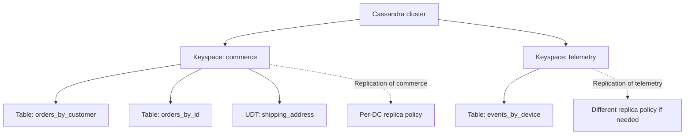
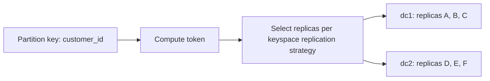

# Keyspace as the Replication Configuration Scope and Container for Data Objects

## 1. Where Does a Keyspace Fit in Apache Cassandra?

In Apache Cassandra, a **keyspace** is the highest-level data organization unit within a cluster. It serves two closely linked roles:

1. **Namespace:** contains tables, user-defined types (UDTs), and related schema objects.
2. **Replication configuration boundary:** defines how Cassandra places data replicas of **every table in the keyspace** across nodes and data centers (DCs).

You can think of a keyspace as roughly analogous to a *database/schema* in a relational database management system in terms of name organization. However, a keyspace does **not** imply a separate server, a separate disk, a transaction spanning across all tables, or JOIN/foreign key mechanisms like a relational database.



For the `DATABASE_ENGINE_WIDE_COLUMN_CASSANDRA` module, separate three decision layers:

| Layer | Key Decisions | Example |
| --- | --- | --- |
| **Cluster** | Set of nodes, DC/rack topology, resources, and general operations | Cluster with DC `dc1` and `dc2` |
| **Keyspace** | Data domain name, replication strategy and factor, `durable_writes` | `commerce`, RF = 3 in each DC |
| **Table** | Partition key, clustering columns, columns, compaction, default TTL, and query-driven design | `orders_by_customer` with partition key `customer_id` |

A Java application can query the fully qualified name `commerce.orders_by_customer` or set `commerce` as the session's default keyspace. Setting a default keyspace **does not change** replica placement; it only helps resolve table/data type names.

## 2. Why Is Replication Configured at the Keyspace Level?

Cassandra is a distributed wide-column database designed to distribute partitions and maintain replicas across multiple nodes. For each partition, the mental model is:

1. The row's **partition key** is hashed into a token; the token determines the logical position of the partition in the data distribution system.
2. The keyspace's **replication strategy** combines with the topology to select the nodes that store replicas of the partition.
3. The **replication factor (RF)** specifies the desired number of copies within the scope defined by the replication strategy.
4. The **consistency level (CL)** of each read/write operation decides how many replica responses are required for the operation to be considered successful.



The diagram illustrates a keyspace with RF = 3 in `dc1` and RF = 3 in `dc2`. **Each partition has six replicas under this configuration**, assuming the topology has enough suitable nodes. It does not mean every node in the cluster holds all data of the keyspace. Different partitions can be placed on different sets of nodes.

A very important point: **two tables in the same keyspace share the same replication strategy and RF configuration**, even if they have different partition keys, clustering orders, compaction, or TTLs. If you want to apply a substantially different replication policy to a group of tables, you typically must design them into a different keyspace.

### Replication strategy and replication factor

| Property | Meaning | What to Remember |
| --- | --- | --- |
| `replication.class` | Replica selection strategy | `NetworkTopologyStrategy` is suitable for clusters with DC/rack topology; `SimpleStrategy` is mainly for simple test environments |
| `dc1`, `dc2`, ... | RF of each DC when using `NetworkTopologyStrategy` | **DC names must match** the actual topology, including case sensitivity |
| RF | Desired number of replicas for each partition within the specified scope | RF = 3 does not mean three copies per table *on each node* |
| `durable_writes` | Enable/disable commit log writes for the keyspace | Usually set to `true`; `false` increases the risk of data loss when a node fails |

`NetworkTopologyStrategy` takes DC/rack structure into account when placing replicas and is preferred for production environments. If a DC lacks enough suitable nodes or racks, the actual fault tolerance may be lower than expected; merely setting RF in a CQL statement does not automatically create additional nodes or racks.

### Keyspace and data center are not the same concept

A **data center** is a group of nodes according to the topology declared by the cluster. A **keyspace** is a logical configuration for application data. One keyspace can place replicas in multiple DCs; one DC can hold replicas of multiple keyspaces. For example:

- Keyspace `commerce` needs to serve transactions in `dc1` and `dc2`, with RF = 3 in each.
- Keyspace `telemetry` only needs replicas in `dc1`, with RF = 2 there.

These are two policies for two keyspaces in the **same cluster**. If a DC is not declared in the replication map, that DC is not configured to hold replicas for that keyspace; the coordinator may still have to contact DCs that have replicas to serve queries.

## 3. Creating a Keyspace with CQL

Suppose the cluster has two DCs named **exactly** `dc1` and `dc2`, each with at least three nodes arranged in a proper topology. Illustrative configuration:

```sql
CREATE KEYSPACE IF NOT EXISTS commerce
WITH replication = {
    'class': 'NetworkTopologyStrategy',
    'dc1': 3,
    'dc2': 3
}
AND durable_writes = true;
```

Explanation of each component:

- `CREATE KEYSPACE`: creates a data scope and replication policy.
- `IF NOT EXISTS`: ignores errors if the keyspace already exists; does **not** update the configuration of an existing keyspace if it differs from the current statement.
- `'class': 'NetworkTopologyStrategy'`: sets the topology-aware replication policy.
- `'dc1': 3`, `'dc2': 3`: requests three replicas of each partition in each respective DC.
- `durable_writes = true`: maintains commit log writes. This is the standard choice for application data requiring durability.

**Before running:** verify the DC names in use via an administration tool, such as `nodetool status`, and check the node topology configuration. The names `dc1`, `dc2` here are examples, not default values applicable to every cluster.

For a **single-node lab environment**, you need to use the actual DC name and RF = 1 so that read/write examples can work. For instance, if the single node belongs to DC `datacenter1`:

```sql
CREATE KEYSPACE IF NOT EXISTS commerce_lab
WITH replication = {
    'class': 'NetworkTopologyStrategy',
    'datacenter1': 1
}
AND durable_writes = true;
```

Do not apply RF = 3 in a single-node lab and then conclude Cassandra is broken when a consistency level requiring multiple replicas cannot be satisfied.

### Verifying the created configuration

In `cqlsh`, you can use:

```sql
DESCRIBE KEYSPACES;
DESCRIBE KEYSPACE commerce;

SELECT keyspace_name, replication, durable_writes
FROM system_schema.keyspaces
WHERE keyspace_name = 'commerce';
```

`DESCRIBE` is a helper command in `cqlsh` to inspect schema; querying `system_schema.keyspaces` reads the schema metadata stored by Cassandra. Check whether the returned replication map matches **the entire** expected topology.

## 4. What Data Objects Does a Keyspace Contain?

A table has a fully qualified name in the form **`keyspace.table`**. UDTs and related schema objects also belong to the keyspace scope. The next example uses `commerce` created above.

```sql
USE commerce;

CREATE TYPE shipping_address (
    street text,
    city text,
    country text
);

CREATE TABLE orders_by_customer (
    customer_id uuid,
    created_at timestamp,
    order_id uuid,
    total_amount decimal,
    shipping frozen<shipping_address>,
    PRIMARY KEY ((customer_id), created_at, order_id)
) WITH CLUSTERING ORDER BY (created_at DESC, order_id ASC);
```

In this table:

- `customer_id` is the **partition key**. Orders for the same customer belong logically to the same partition, so partition size must be controlled in practical design.
- `created_at` and `order_id` are **clustering columns**, helping determine row order and ensuring the primary key uniquely distinguishes records.
- `shipping_address` is a UDT managed by keyspace `commerce`; `frozen<...>` represents the UDT value as a single value in this column.
- The table's replication configuration is **not inside** `CREATE TABLE`. The table inherits the replication policy of keyspace `commerce`.

We can write and read data with the table name resolved by `USE commerce`:

```sql
INSERT INTO orders_by_customer (
    customer_id, created_at, order_id, total_amount
) VALUES (
    11111111-1111-1111-1111-111111111111,
    '2026-10-03T10:00:00Z',
    aaaaaaaa-aaaa-4aaa-8aaa-aaaaaaaaaaaa,
    129000.00
);

SELECT order_id, created_at, total_amount
FROM commerce.orders_by_customer
WHERE customer_id = 11111111-1111-1111-1111-111111111111;
```

The `SELECT` statement can use `commerce.orders_by_customer` regardless of which keyspace the session currently sets, provided permissions allow it. With a Java application, you can also configure a default keyspace for the session or pass the fully qualified table name in the CQL query. **The keyspace does not determine the partition key**: the partition key and primary queries must be designed at the table level according to access needs.

### Not every configuration belongs to the keyspace

| What Needs Configuration | Where to Place It? | Reason |
| --- | --- | --- |
| Replication strategy and per-DC RF | **Keyspace** | Same policy for all tables in the keyspace |
| `durable_writes` | **Keyspace** | Controls commit log for writes in the keyspace |
| Partition key and clustering columns | **Table** | Determines partition grouping and how data is queried |
| Compaction strategy, caching, `default_time_to_live` | **Table** | Depends on per-table read/write characteristics and data lifecycle |
| `ONE`, `LOCAL_QUORUM`, `ALL`... | **Each read/write operation** or client execution config | Chooses how many replicas must respond, not a fixed keyspace property |

## 5. How Does Keyspace RF Interact with Consistency?

Suppose `commerce` has RF = 3 in `dc1`. An application in `dc1` performs reads and writes with **`LOCAL_QUORUM`**:

- A `LOCAL_QUORUM` write requires successful responses from at least **2 out of 3 replicas in `dc1`**.
- A `LOCAL_QUORUM` read requires responses as required by the consistency level from at least **2 out of 3 replicas in `dc1`**.
- Any two subsets of 2 elements in a set of 3 replicas always intersect in at least one element. This is the intuition behind quorum read/write configuration, given the necessary assumptions about replicas and no competing writes altering the result.

The quorum formula for RF = \(N\) is:

\[
Q = \left\lfloor \frac{N}{2} \right\rfloor + 1
\]

| RF in DC | Replicas Needed for `LOCAL_QUORUM` in That DC |
| ---: | ---: |
| 1 | 1 |
| 3 | 2 |
| 5 | 3 |

**Two commonly confused concepts:**

- **RF** specifies *how many copies* Cassandra tries to keep for each partition.
- **CL** specifies *how many responses* a read/write needs in order to return as successful.

A low CL like `ONE` often allows continued serving when fewer replicas are available, though stale data may be observed; a higher CL trades off response requirements and availability. `LOCAL_QUORUM` only counts replicas in the coordinator's local DC, whereas `QUORUM` is determined over the global replica set. Across multiple DCs, the choice of CL directly affects cross-region latency and application fault tolerance.

Quorum does not replace the repair process, nor does it turn normal operations into linearizable transactions against concurrent updates. In cases requiring conditions like **"write only if the version has not changed"**, lightweight transactions (LWTs) with `IF` may be needed, with their cost evaluated separately.

## 6. When Should You Split into Multiple Keyspaces?

You should not create a new keyspace just to separate each query type: Cassandra encourages creating multiple query-driven tables within the **same data domain** if they need to share the same replication policy. Create a separate keyspace when there is a clear reason regarding namespace or replication policy.

Examples in one cluster:

| Requirement | Reasonable Decision | Reason |
| --- | --- | --- |
| Orders need copies in two DCs to serve two regions | Keyspace `commerce` with RF for both DCs | Order tables share fault-tolerance and data distribution goals |
| Telemetry events only need to be stored in one DC | Keyspace `telemetry` declaring RF only for that DC | Different replica storage scope compared to `commerce` |
| Need to look up orders by `order_id` and by `customer_id` | Two query tables in keyspace `commerce` | Different partition models, **does not** require a new keyspace |
| One table has a short TTL while another needs long retention | Can be in the same keyspace, configuring TTL per table/data | TTL is not a keyspace-level replication option |

A keyspace provides a shared name and replication policy; separating keyspaces **does not in itself guarantee** isolation of CPU, memory, I/O, network, or access permissions. Access control and resource limits must be configured/evaluated separately depending on the version and deployment environment.

## 7. Changing Keyspace Replication: What Actually Happens?

Replication can be modified using `ALTER KEYSPACE`. For example, after deploying and configuring DC `dc3`, one option to expand the policy of `commerce` is:

```sql
ALTER KEYSPACE commerce
WITH replication = {
    'class': 'NetworkTopologyStrategy',
    'dc1': 3,
    'dc2': 3,
    'dc3': 3
};
```

This is an **operation that changes metadata/replica policy**, not a guarantee that existing data has immediately been fully replicated to `dc3`. You need real nodes/topology, to execute the appropriate data transfer procedure (e.g., `nodetool rebuild` when adding a DC, or repair when adjusting RF within a DC), monitor synchronization status, and verify thoroughly before considering the transition complete.

Safe mental workflow:

1. **Define the goal:** increase/decrease RF, add/remove a DC, or fix an incorrect DC name; analyze CL requirements and fault tolerance.
2. **Check topology:** DC/rack names, actual node count, node health, and available disk space; RF cannot compensate for missing physical nodes.
3. **Update schema:** use `ALTER KEYSPACE`, keeping exactly the DCs that still need replicas in the replication map; do not accidentally drop an old DC.
4. **Synchronize existing data:** plan streaming/rebuild/repair appropriate to the type of change and the Cassandra version being operated.
5. **Verify:** check metadata, node status, streaming/repair progress, and the application's ability to satisfy CL before finalizing the change.

Reducing RF also requires a separate operational procedure to confirm unneeded copies have been handled and data reclaimed appropriately. For a keyspace serving production, you should schedule the change and assess the impact on network, disk, read/write load, and availability.

### Dropping a keyspace has a very large impact scope

`DROP KEYSPACE commerce` deletes the **schema and data of all objects** belonging to that keyspace, not just a single table. Therefore, verify the exact target, execution permissions, backups/recovery capability, and dependent application scope before executing. `TRUNCATE` or `DROP TABLE` have different scopes, affecting only the specified table.

## 8. Common Misconceptions

| Misconception | Correct Understanding |
| --- | --- |
| "RF = 3 means the entire cluster has exactly three nodes." | RF refers to the number of replicas of **each partition** within the strategy's scope; the cluster can have many more nodes. |
| "Each table can choose its own RF right inside `CREATE TABLE`." | The replication policy is declared at the **keyspace** level. Tables in the same keyspace share that policy. |
| "Once `CREATE KEYSPACE` is run with RF = 3, data is safe even if the cluster only has one node." | Sufficient nodes/topology are needed to place replicas and satisfy CL; setting RF does not create new nodes. |
| "`USE commerce` moves data into another keyspace." | `USE` only sets the default name context for the CQL session. |
| "`LOCAL_QUORUM` is a setting inside `CREATE KEYSPACE`." | `LOCAL_QUORUM` is a CL chosen by the query or client; the keyspace provides RF to determine the threshold. |
| "`IF NOT EXISTS` automatically fixes RF if it differs." | `IF NOT EXISTS` avoids duplicate creation; it does not synchronize the configuration of an existing keyspace. |
| "Changing `ALTER KEYSPACE` means all old/new replicas are already in sync." | Changing the replica policy must be accompanied by operational actions so existing data is transferred/synchronized. |
| "A keyspace is an independent database in terms of CPU and disk." | Keyspaces typically share resources of the same cluster; resource isolation requires other mechanisms. |

## 9. Short Lab Exercise and Verification Criteria

On a test cluster with known topology, perform the following:

1. View the actual list of DCs/nodes using `nodetool status`.
2. Create keyspace `commerce_lab` with `NetworkTopologyStrategy`, an RF appropriate for the available node count, and `durable_writes = true`.
3. Use `SELECT ... FROM system_schema.keyspaces` to verify the replication map and `durable_writes`.
4. Create a small table with `PRIMARY KEY ((device_id), event_time)` in `commerce_lab`; `INSERT` and `SELECT` by `device_id`.
5. Explain to yourself why changing the name or RF of a keyspace can affect every table, whereas changing a partition key is a table design decision and usually requires a new model/table.

You have grasped the core concepts when you can accurately answer: **What objects does a keyspace contain? What is configured for the entire keyspace? By what mechanism are replicas placed for a partition? How does RF relate to the CL of read/write operations?** These questions form the foundation for upcoming topics on query-driven table design, replica repair, compaction, and integrating Cassandra from Java applications.
