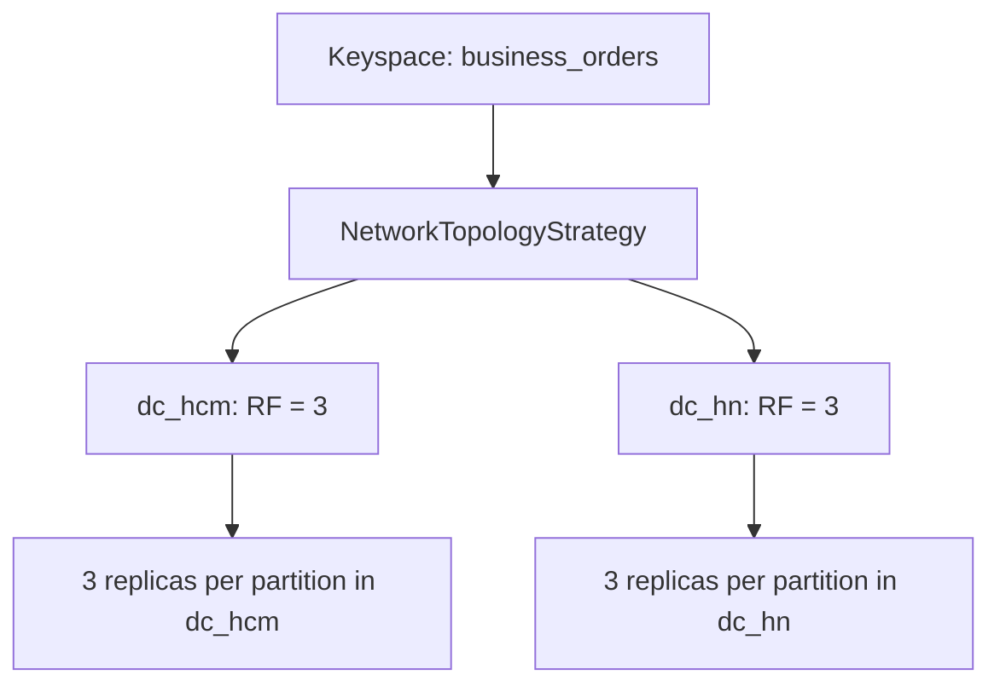

# CREATE/ALTER/DROP KEYSPACE and Inspecting Replication Properties

## 1. Objectives and Lab Context

In Apache Cassandra, a **keyspace** is a namespace containing tables and related schema objects, and it is also where the **replication policy** applying to all tables in the keyspace is defined. Because Cassandra is a distributed wide-column database, keyspace management statements do more than organize data names: they also affect how partitions are placed across nodes and data centers (DCs).

After this lesson in the **Keyspaces and Schema** chapter of module `DATABASE_ENGINE_WIDE_COLUMN_CASSANDRA`, you should be able to do four things:

1. Create a keyspace with `CREATE KEYSPACE`, choosing a replication strategy and replication factor (RF) appropriate for the topology.
2. Read back the replication map and `durable_writes` property from metadata, instead of guessing which configuration was applied.
3. Use `ALTER KEYSPACE` when replication requirements change; recognize the data synchronization work that must be performed **after** changing the schema.
4. Know the impact scope of `DROP KEYSPACE` and verify the exact target before dropping.

This content connects to other Cassandra topics: the partition key determines data partitioning at the table level; the replication policy determines replicas at the keyspace level; the consistency level (CL) of a read/write operation determines the number of required responses. When a Java application uses CQL, these layers interact without replacing one another.

### Preparing the environment

Examples in this lesson use `cqlsh` to run CQL and `nodetool` to observe topology. Appropriate permissions are required to create, alter, and drop keyspaces. First, see which DCs the nodes belong to:

```bash
nodetool status
```

In the output, look for the DC name under the `Datacenter: ...` label, the number of nodes, and node states. **The DC name in CQL must exactly match the actual DC name.** The lab examples below assume a node belonging to `datacenter1`; if your environment uses `dc1` or another name, substitute that exact name in every command.

Do not run example commands that alter or drop keyspaces against production data. The name `lab_orders` is chosen specifically for practice.

## 2. CREATE KEYSPACE: Creating a Data Scope and Replication Policy

The commonly used CQL structure is:

```sql
CREATE KEYSPACE [ IF NOT EXISTS ] ten_keyspace
WITH replication = {
    'class': 'NetworkTopologyStrategy',
    'ten_dc': 'so_replica'
}
AND durable_writes = true;
```

Here, `ten_keyspace` is the keyspace name, `class` specifies how Cassandra selects replicas, and the `ten_dc: so_replica` pair declares the RF of each DC when using `NetworkTopologyStrategy`. The RF value in the example is placed in a string literal for compatibility with the map representation of the replication property.

### Example A: Single-node lab

Suppose `nodetool status` reports the DC is `datacenter1` and only one node is active:

```sql
CREATE KEYSPACE IF NOT EXISTS lab_orders
WITH replication = {
    'class': 'NetworkTopologyStrategy',
    'datacenter1': '1'
}
AND durable_writes = true;
```

RF = 1 allows the single-node lab to perform reads/writes with the available replica count. This is only a configuration suitable for **learning CQL**, and does not provide fault tolerance if the single node stops running.

### Example B: Cluster with two data centers

Suppose a real cluster has `dc_hcm` and `dc_hn`, with each DC having enough nodes and proper rack placement:

```sql
CREATE KEYSPACE IF NOT EXISTS business_orders
WITH replication = {
    'class': 'NetworkTopologyStrategy',
    'dc_hcm': '3',
    'dc_hn': '3'
}
AND durable_writes = true;
```

With this configuration, Cassandra targets **three replicas per partition in each DC**. Given sufficient infrastructure, each partition has a total of six replicas across the two DCs; that does **not** mean every node holds the entire contents of the keyspace. Different partitions can reside on different sets of nodes.



**Do not copy DC names verbatim from examples** if your cluster uses different names. Configuring RF also does not create additional nodes: when the topology lacks enough suitable nodes or racks, fault tolerance and the ability to satisfy CL may be lower than expected.

### Properties to understand

| Property/Syntax | Effect | Key Notes |
| --- | --- | --- |
| `IF NOT EXISTS` | Ignores duplicate-name creation error | **Does not update** replication if the keyspace already exists with a different configuration |
| `replication.class` | Chooses how replicas are placed | `NetworkTopologyStrategy` fits multi-DC and production environments; `SimpleStrategy` is mainly meaningful for simple examples |
| `'dc_hcm': '3'` | Requests three replicas of each partition in DC `dc_hcm` | The DC name is the actual topology name, not an arbitrary user-chosen label |
| `durable_writes = true` | Enables commit log writes for data writes in the keyspace | Normally kept `true` to support durability when a node fails |
| Keyspace name | Defines the namespace for tables, UDTs, and other schema objects | Choose a simple `snake_case` name; a name does not establish an isolated resource boundary |

**Note on `SimpleStrategy`:** this strategy applies an RF to the cluster in a simple way, without separate per-DC RF configuration like `NetworkTopologyStrategy`. When moving to a multi-DC/rack environment or production, you should design replication according to the actual topology.

## 3. Verifying Replication After CREATE

Do not stop at a command-succeeded message. Verify the **schema currently recorded by Cassandra** using at least one of the following two methods.

### Method 1: Inspecting schema with cqlsh

```sql
DESCRIBE KEYSPACES;
DESCRIBE KEYSPACE lab_orders;
```

`DESCRIBE` is a **`cqlsh`** utility command to print schema definitions, not a standard CQL DML statement supported by all Cassandra drivers. The output of `DESCRIBE KEYSPACE lab_orders` should show the replication strategy, RF, and `durable_writes` of the existing keyspace.

### Method 2: Querying the system metadata table

```sql
SELECT keyspace_name, replication, durable_writes
FROM system_schema.keyspaces
WHERE keyspace_name = 'lab_orders';
```

`system_schema.keyspaces` provides schema metadata; the `replication` column contains a map with `class` and RF parameters. An **illustrative** output is:

```text
keyspace_name | replication                                                     | durable_writes
--------------+-----------------------------------------------------------------+---------------
lab_orders    | {'class': 'org.apache.cassandra.locator.NetworkTopologyStrategy',
              |  'datacenter1': '1'}                                            | True
```

The class name in the metadata display may be the fully qualified class name; check the **meaning of the strategy and the DC/RF pairs** rather than comparing output strings mechanically.

If you only want to list keyspaces and view their maps:

```sql
SELECT keyspace_name, replication, durable_writes
FROM system_schema.keyspaces;
```

When writing a Java application or migration tool, this metadata query helps verify the actual configuration after running DDL. However, a recorded schema **does not prove** that existing data replicas are already completely synchronized.

### Cross-checking three sources of information

| Source | What question does it answer? | What does it not guarantee? |
| --- | --- | --- |
| `nodetool status` | Which DCs/nodes exist and what are the node states? | Does not show the per-keyspace RF policy |
| `DESCRIBE KEYSPACE` or `system_schema.keyspaces` | What replication strategy, RF, and `durable_writes` does the keyspace declare? | Does not prove replicas already contain complete data |
| Monitoring streaming/repair, cluster health, and data verification | Are synchronization processes and serving capacity meeting requirements? | Does not replace reading the correct replication map |

For schema-changing operations, you also need to observe **schema agreement** across nodes (for example, `nodetool describecluster` contains schema version information, depending on the Cassandra version) before considering the change uniformly accepted by the cluster.

## 4. ALTER KEYSPACE: Changing RF and Replication Policy

`ALTER KEYSPACE` updates keyspace properties. Remember two distinct phases: the **schema phase** changes the replica selection policy; the **operational phase** brings existing data to / resynchronizes it across replicas under the new policy.

### Increasing RF in an existing DC

Suppose the lab has been expanded to **at least three suitable nodes** in `datacenter1`, and you want to change the RF of `lab_orders` from 1 to 3:

```sql
ALTER KEYSPACE lab_orders
WITH replication = {
    'class': 'NetworkTopologyStrategy',
    'datacenter1': '3'
};
```

After this statement, read the metadata again:

```sql
SELECT replication
FROM system_schema.keyspaces
WHERE keyspace_name = 'lab_orders';
```

**Increasing RF does not mean old data immediately appears completely on the additional replicas.** You must plan to run repair/synchronization according to the operational guide corresponding to your Cassandra version and topology; monitor progress and confirm all required replicas have received the data. If you only change metadata and skip this phase, reads at high consistency levels may encounter missing data or fail under failure conditions.

Do not run the RF = 3 increase example on a single-node environment. If the application subsequently sets a CL requiring multiple replicas, operations may fail because not enough replicas are available.

### Adding a new data center to the replication map

Suppose keyspace `business_orders` currently has replicas in two DCs, and the cluster has built a new DC named `dc_danang`. The statement to expand the policy is:

```sql
ALTER KEYSPACE business_orders
WITH replication = {
    'class': 'NetworkTopologyStrategy',
    'dc_hcm': '3',
    'dc_hn': '3',
    'dc_danang': '3'
};
```

Be careful to **list all DCs that must retain replicas**. Replacing the entire replication map with a map containing only `dc_danang` can lose the replication configuration for the older DCs. Adding a new DC requires the topology/nodes to be ready and a procedure to bring data to that DC (typically including streaming/rebuild steps, along with checks/repair depending on topology and Cassandra version). Simply executing `ALTER KEYSPACE` will not complete the data transfer.

When you need to **decrease RF** or **stop replicating to a DC**, you must also plan to verify replica locations, application dependencies, backups, repair, and reclaim unneeded data according to the appropriate operational procedure. Decreasing RF reduces the number of redundant copies per partition and can change the fault tolerance level.

### Changing `durable_writes`

If you need to re-establish the keyspace's commit log property:

```sql
ALTER KEYSPACE lab_orders
WITH durable_writes = true;
```

In most applications that require data preservation, `durable_writes = true` should be kept. Setting `false` causes data writes not to be protected by Cassandra's commit log in the normal way, increasing the risk of lost writes if a node crashes; it should not be used as a default performance optimization.

**`ALTER KEYSPACE` does not support renaming a keyspace** as a simple `RENAME` operation. If you need to move from an old namespace to a new namespace, you must design a plan to create the new keyspace, create the schema, copy/migrate the data, and switch the application.

## 5. Distinguishing Replication Factor and Consistency Level

Suppose `business_orders` has RF = 3 in `dc_hcm`. For a request coordinated from `dc_hcm`:

| Request CL | Simplified Success Condition | Remarks |
| --- | --- | --- |
| `ONE` | One replica responds as requested | Fewer responses, may observe out-of-sync data on reads |
| `LOCAL_QUORUM` | Majority of replicas in the local DC: 2/3 | Commonly used when the application needs stronger consistency within one DC |
| `ALL` | All replicas of the partition must respond | Sensitive to a single failed or unavailable replica |

The quorum for RF = \(N\) in one DC is:

\[
Q = \lfloor N/2 \rfloor + 1.
\]

`LOCAL_QUORUM` at RF = 3 corresponds to two responses from replicas in the local DC. CL is a choice at **each operation** (or configured as a client default), **not** a field set in `CREATE KEYSPACE`. In a multi-DC cluster, `QUORUM` and `LOCAL_QUORUM` are not equivalent: `QUORUM` computes the majority over the global replica set, whereas `LOCAL_QUORUM` considers the majority within the local DC.

When RF changes, the replica threshold required for CL levels may also change. Therefore, before increasing/decreasing RF, check the CLs that the Java application uses for reads, writes, and conditional operations. Quorum generally helps reads/writes observe newer data when there are no concurrent competing writes and relevant conditions are met, but it **does not replace repair**, nor does it turn regular writes into linearizable transactions.

## 6. DROP KEYSPACE: Deleting the Entire Data Scope

`DROP KEYSPACE` deletes the keyspace's schema along with **all tables, data types, and data belonging to the keyspace** within the scope of the drop operation. Most operations using this namespace afterward will no longer work as before.

Example **for lab use only** after completing practice:

```sql
DROP KEYSPACE IF EXISTS lab_orders;
```

`IF EXISTS` avoids an error when the keyspace does not exist; it does **not** provide a recovery mechanism. If there is data to keep, you must determine the exact backup and recovery plan **before** dropping; do not assume the keyspace can be recovered via replication, because schema deletion is applied across the cluster.

A minimal checklist before `DROP`:

1. Use `SELECT ... FROM system_schema.keyspaces WHERE keyspace_name = ...` and `DESCRIBE KEYSPACE ...` to confirm the **exact name and objects** that will be affected.
2. Check application dependencies, data processing jobs, Java drivers, and execution permissions.
3. Confirm data has been backed up and the recovery plan has been tested if retention is required.
4. Execute the statement on the right environment; verify the keyspace is no longer in metadata.

After dropping:

```sql
SELECT keyspace_name
FROM system_schema.keyspaces
WHERE keyspace_name = 'lab_orders';
```

A query returning no rows indicates that metadata no longer contains that keyspace. It is **not** independent proof that all physical copies have been immediately cleaned up; data cleanup mechanisms also depend on the version and operational tasks.

Compare the scopes of commands to avoid confusion:

| Statement | Scope of Impact |
| --- | --- |
| `DELETE ... FROM keyspace.table WHERE ...` | Deletes specified data matching valid conditions on the table |
| `TRUNCATE keyspace.table` | Deletes all data of **one table**, keeping the table definition |
| `DROP TABLE keyspace.table` | Deletes **one table** and that table's data |
| `DROP KEYSPACE keyspace` | Deletes the **entire keyspace**, schema objects inside it, and associated data |

## 7. Complete Lab Walkthrough on a Single-Node Lab

The steps below assume you have one node belonging to DC `datacenter1` and permissions to create/drop test keyspaces.

**Step 1 — Create a keyspace with RF = 1:**

```sql
CREATE KEYSPACE IF NOT EXISTS lab_orders
WITH replication = {
    'class': 'NetworkTopologyStrategy',
    'datacenter1': '1'
}
AND durable_writes = true;
```

**Step 2 — Verify the schema immediately after creation:**

```sql
DESCRIBE KEYSPACE lab_orders;

SELECT keyspace_name, replication, durable_writes
FROM system_schema.keyspaces
WHERE keyspace_name = 'lab_orders';
```

You should see `NetworkTopologyStrategy`, RF = 1 in the right DC, and `durable_writes = true`. If the keyspace already existed beforehand, `IF NOT EXISTS` does not guarantee the new parameters were applied; you must compare against the expected configuration.

**Step 3 — Create a table to see the keyspace–table relationship:**

```sql
CREATE TABLE IF NOT EXISTS lab_orders.events_by_device (
    device_id text,
    event_time timestamp,
    temperature double,
    PRIMARY KEY ((device_id), event_time)
) WITH CLUSTERING ORDER BY (event_time DESC);

INSERT INTO lab_orders.events_by_device (
    device_id, event_time, temperature
) VALUES (
    'sensor-01', '2026-11-20T08:00:00Z', 27.5
);

SELECT device_id, event_time, temperature
FROM lab_orders.events_by_device
WHERE device_id = 'sensor-01';
```

The `CREATE TABLE` statement has no separate RF. The table's partition key is `device_id`; the replication policy for this table's partitions comes from keyspace `lab_orders`. In the Cassandra module, this is the bridge from query-driven table design to replication/consistency of distributed data.

**Step 4 — Test an ALTER that does not change topology:**

```sql
ALTER KEYSPACE lab_orders
WITH durable_writes = true;

SELECT keyspace_name, replication, durable_writes
FROM system_schema.keyspaces
WHERE keyspace_name = 'lab_orders';
```

In this step, only `durable_writes = true` is re-affirmed. **Do not change RF to 3** while the lab still has only one node. If implementing the exercise on a multi-node cluster, design an RF-increase exercise paired with a separate repair procedure.

**Step 5 — Only when lab data is no longer needed, drop the keyspace and verify:**

```sql
DROP KEYSPACE IF EXISTS lab_orders;

SELECT keyspace_name
FROM system_schema.keyspaces
WHERE keyspace_name = 'lab_orders';
```

No metadata rows remaining for `lab_orders` is the expected result. Table `events_by_device` belonging to this keyspace is also no longer accessible.

## 8. Common Errors and How to Diagnose Them

| Symptom | Common Cause | How to Check or Fix |
| --- | --- | --- |
| Keyspace creation succeeds but RF differs from expected | `IF NOT EXISTS` encountered an existing keyspace | Read `system_schema.keyspaces`; deliberately use `ALTER KEYSPACE` if a change is needed |
| `InvalidRequest` when creating/altering replication | Incorrect CQL syntax, replication strategy, or property value | Re-check the `replication` map and values supported by that Cassandra version |
| RF is recorded in metadata, but high-CL requests report `Unavailable` | Not enough active replicas / topology cannot satisfy CL | Compare RF, CL, node count, and node states in the relevant DC |
| Added a DC to the map, but old data is missing in the new DC | Replica policy changed without transferring/synchronizing data | Perform streaming/rebuild/repair procedure and verify data |
| Replacing the map with only the new DC removes old DCs from config | `ALTER` replaced the entire replication map | Restore the map with **all desired DCs** and perform the corresponding operational steps |
| `DESCRIBE KEYSPACE` fails to run from Java code | `DESCRIBE` is a `cqlsh` command, not a standard CQL query | Use `system_schema.keyspaces` or the Cassandra Java Driver metadata API |
| Accidentally dropping a keyspace makes many tables inaccessible | `DROP KEYSPACE` deletes the entire namespace | Verify before dropping, manage permissions, use backups and tested recovery plans |

**An easy-to-misjudge situation:** metadata shows RF = 3 and all three nodes report normal status, yet a recently added replica still lacks old data. `nodetool status` together with `SELECT replication` is **not sufficient** to conclude that repair/streaming has finished. Additional evidence is needed regarding synchronization progress, system errors, and actual verification per the operational plan.

## 9. Checklist Before Rolling Out Keyspace Changes to Operations

| Verification Question | How to Prove |
| --- | --- |
| Is it the right cluster and right keyspace name? | Check connection environment, `DESCRIBE KEYSPACE`, and metadata |
| Does RF match the actual node, DC, and rack count? | `nodetool status`, topology, fault tolerance assessment |
| Are all DCs that need to hold replicas included in the map? | Re-read `system_schema.keyspaces.replication` |
| Which CL does the application use for reads and writes? | Check Java Driver configuration and each relevant statement |
| Does changing RF/DC require historical data on new replicas? | Have a rebuild/streaming/repair plan and verify results |
| Are success criteria and incident handling plans in place? | Compare metadata before/after, monitor nodes, errors, load, and availability |
| If dropping a keyspace, have dependencies and recovery capability been verified? | List of tables, dependent applications, backups, and recovery drills |

Remember the central rule: **`CREATE/ALTER/DROP KEYSPACE` manages the namespace and replication policy; `system_schema.keyspaces` shows the recorded schema configuration; whether data has actually been distributed and synchronized properly under the new policy must be verified separately.** Distinguishing these three things will help you avoid replication configuration mistakes, choose sensible CLs for Java applications, and prepare for topics on repair, compaction, and Cassandra cluster operations.
