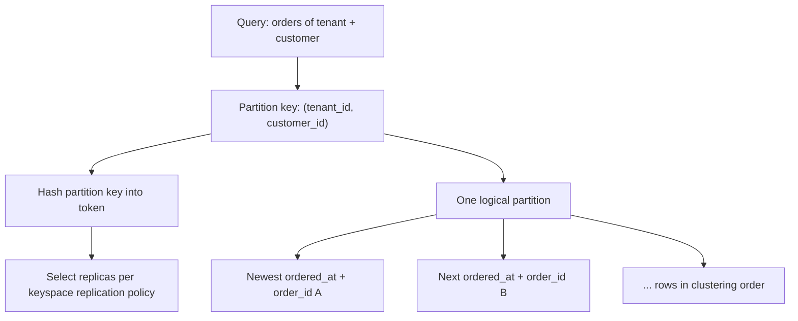

# CREATE TABLE, Columns, Primary Key, and Table Options

## 1. Learning How to Design a Cassandra Table from Queries

In Apache Cassandra, the `CREATE TABLE` statement declares columns, data types, the **primary key**, and **table options**. This is the step that determines how data is divided into partitions, how rows within the same partition are ordered, and under what policies the table is stored, compressed, cached, or expired.

In the **Keyspaces and Schema** chapter of module `DATABASE_ENGINE_WIDE_COLUMN_CASSANDRA`, distinguish three configuration layers:

| Layer | Key Properties | Scope of Impact |
| --- | --- | --- |
| **Keyspace** | `replication`, replication factor (RF), `durable_writes` | Replication policy of **every table** in the keyspace |
| **Table** | Column definitions, `PRIMARY KEY`, `CLUSTERING ORDER BY`, compaction, compression, caching, default TTL | Data organization and management of **one table** |
| **Request/client** | Consistency level (CL), timeout, paging, query parameters | How a single read/write is executed |

**Learning objectives:** after this lesson, you can create query-appropriate tables, accurately explain partition keys and clustering columns, choose reasonable column types, recognize common table options, inspect schemas, and avoid mistakes that cause oversized partitions or inefficient queries. This knowledge forms the foundation for query-driven design, tuning compaction, repair, and connecting to Cassandra from Java applications.

## 2. CREATE TABLE Syntax and a Runnable Example

Suppose an e-commerce application needs to display the **20 most recent orders of a customer belonging to a tenant**. The query needs to supply `tenant_id` and `customer_id`, then retrieve results ordered by order timestamp descending.

Prepare the keyspace in a single-node test environment (change `datacenter1` to the **actual DC name** obtained from `nodetool status`):

```sql
CREATE KEYSPACE IF NOT EXISTS shop_lab
WITH replication = {
    'class': 'NetworkTopologyStrategy',
    'datacenter1': '1'
}
AND durable_writes = true;
```

In a real cluster, RF must be chosen according to node count, DCs, racks, and fault-tolerance requirements; the RF = 1 example here is only for the lab. If `shop_lab` already exists, `IF NOT EXISTS` does not automatically fix replication. Inspect the keyspace again if needed.

Create the table serving the query mentioned above:

```sql
CREATE TABLE IF NOT EXISTS shop_lab.orders_by_customer (
    tenant_id uuid,
    customer_id uuid,
    ordered_at timestamp,
    order_id timeuuid,
    status text,
    total_amount decimal,
    note text,
    PRIMARY KEY ((tenant_id, customer_id), ordered_at, order_id)
)
WITH CLUSTERING ORDER BY (ordered_at DESC, order_id DESC)
AND comment = 'Orders by customer, newest first'
AND default_time_to_live = 0;
```

Explanation of the components:

- `shop_lab.orders_by_customer`: fully qualified name `keyspace.table`; can be used when the session has not called `USE shop_lab`.
- The part inside parentheses is the **column definitions** with CQL types; `PRIMARY KEY` specifies the partition key and clustering/sorting keys.
- `(tenant_id, customer_id)` in the **inner parentheses** is the composite partition key, consisting of two columns.
- `ordered_at` and `order_id` come **after** the composite partition key and are clustering columns in their declared order.
- `WITH CLUSTERING ORDER BY` sets the default order within a partition; `comment` and `default_time_to_live` are table options.

Other tables in `shop_lab` can have different primary keys and table options, while sharing the keyspace's replication policy.

### Writing and reading by the designed keys

```sql
INSERT INTO shop_lab.orders_by_customer (
    tenant_id, customer_id, ordered_at, order_id,
    status, total_amount, note
) VALUES (
    11111111-1111-1111-1111-111111111111,
    22222222-2222-2222-2222-222222222222,
    '2026-11-20T09:30:00Z',
    now(),
    'PAID',
    159000.00,
    'Deliver during business hours'
);

SELECT ordered_at, order_id, status, total_amount
FROM shop_lab.orders_by_customer
WHERE tenant_id = 11111111-1111-1111-1111-111111111111
  AND customer_id = 22222222-2222-2222-2222-222222222222
ORDER BY ordered_at DESC, order_id DESC
LIMIT 20;
```

`now()` generates a `timeuuid` used in the example. In a real system, the application should have a deterministic ID generation and passing strategy suited to idempotency requirements. `LIMIT 20` limits the number of rows returned; it does **not** prevent the partition from growing large over time; bucketing strategies will be discussed below.

## 3. Primary Key: Partition Key and Clustering Columns

A primary key in Cassandra is understood as:

**Primary key = partition key + clustering columns (if any).**

The partition key determines the **logical partition** to which a row belongs. Cassandra hashes the partition key to obtain a token; the keyspace's replication strategy uses the token and topology to select replicas. Clustering columns distinguish and determine the order of rows **within the same partition**.



### Three easily confused ways to write PRIMARY KEY

| Syntax | Partition Key | Clustering Columns | Result |
| --- | --- | --- | --- |
| `PRIMARY KEY (customer_id)` | `customer_id` | None | Each partition has at most one logical row corresponding to that key |
| `PRIMARY KEY (customer_id, ordered_at)` | `customer_id` | `ordered_at` | Multiple rows per customer, distinguished/ordered by timestamp |
| `PRIMARY KEY ((tenant_id, customer_id), ordered_at, order_id)` | Pair `tenant_id` + `customer_id` | `ordered_at`, `order_id` | Multiple orders of a customer within a tenant; distinguishes two orders at the same timestamp |

For example, `PRIMARY KEY (tenant_id, customer_id, ordered_at)` is **completely different** from `PRIMARY KEY ((tenant_id, customer_id), ordered_at)`: in the first syntax, only `tenant_id` is the partition key, while `customer_id` becomes a clustering column. With a large number of customers, the wrong syntax can create a partition per entire tenant, much larger than initially intended.

**Important syntax rule:** use **two levels of parentheses** when you want a partition key with multiple columns. `PRIMARY KEY ((a, b), c)` means `a` and `b` together determine the partition; `PRIMARY KEY (a, b, c)` means only `a` determines the partition.

### How a Cassandra primary key differs from a relational SQL primary key

- Cassandra does not generate `AUTO_INCREMENT` and does not enforce foreign key constraints or JOINs between tables like an RDBMS.
- Every component of the primary key must have a value when identifying a row; `null` cannot be used for key columns.
- The **full** combination of partition key and clustering columns identifies one logical row. Writing again with the same key typically performs an **upsert** on the written columns rather than automatically raising a `duplicate key` error.
- Primary key columns are part of the physical data layout. You cannot simply change an existing primary key with `ALTER TABLE`; you usually need to create a new table, backfill data, and switch queries.
- Unlike relational indexes, a Cassandra primary key primarily serves to locate a partition and order rows; it does not mean arbitrary search conditions on any key column are efficiently supported.

## 4. Clustering Columns, Read Order, and Query Constraints

With table `orders_by_customer`, Cassandra organizes rows within a partition by `(ordered_at DESC, order_id DESC)`. Once the **full partition key** is known, the application can read the most recent orders in that order.

An example query bounding a time range:

```sql
SELECT ordered_at, order_id, status
FROM shop_lab.orders_by_customer
WHERE tenant_id = 11111111-1111-1111-1111-111111111111
  AND customer_id = 22222222-2222-2222-2222-222222222222
  AND ordered_at >= '2026-11-01T00:00:00Z'
  AND ordered_at < '2026-12-01T00:00:00Z'
LIMIT 20;
```

With this model, two equality conditions on `tenant_id` and `customer_id` pinpoint the exact partition; a range condition on the first clustering column `ordered_at` narrows the slice of data to read. Cassandra supports certain filtering/range patterns on clustering columns in **their declared order**; do not infer that it can arbitrarily use any column combination like a general-purpose relational index.

Example of a seemingly reasonable query that **does not match the access path**:

```sql
-- Does not provide the full partition key for the current table.
SELECT *
FROM shop_lab.orders_by_customer
WHERE customer_id = 22222222-2222-2222-2222-222222222222;
```

Without `tenant_id`, Cassandra lacks enough information to locate a single partition. It usually rejects a query written like this or requires a different retrieval mechanism. Trying to add `ALLOW FILTERING` to run a broad query typically increases the number of partitions/rows scanned and easily causes unpredictable latency. If the application truly needs to look up by `customer_id` alone, evaluate a table serving that query or an appropriate indexing model.

### Risk of oversized partitions

The design `PRIMARY KEY ((tenant_id, customer_id), ordered_at, order_id)` groups **all historical orders** of a customer into a single partition. For a customer with very many orders over multiple years, the partition can grow large, putting pressure on reads, compaction, and repair.

A common approach is to add a **time bucket** to the partition key to bound the size of a single partition:

```sql
CREATE TABLE shop_lab.orders_by_customer_month (
    tenant_id uuid,
    customer_id uuid,
    order_month text,
    ordered_at timestamp,
    order_id timeuuid,
    status text,
    total_amount decimal,
    PRIMARY KEY (
        (tenant_id, customer_id, order_month),
        ordered_at,
        order_id
    )
) WITH CLUSTERING ORDER BY (ordered_at DESC, order_id DESC);
```

The application must compute `order_month` consistently, such as `2026-11` in UTC, for both writes and reads. A query that needs to span multiple months will have to read multiple partitions and merge results on the application side. Bucket size should be based on actual traffic/volume; **monthly bucketing is not a fixed recommendation for every workload**.

## 5. Declaring Columns and CQL Data Types

A column's syntax typically takes the form `column_name cql_type`, optionally adding `STATIC` where appropriate. Choose data types according to business semantics and how the Java Driver maps data; do not use `text` for every value just because it is easy to store.

| Group | Common Types | Examples or Notes |
| --- | --- | --- |
| Strings and binary | `text`, `ascii`, `blob` | Status codes, descriptions, binary payloads |
| Integers | `tinyint`, `smallint`, `int`, `bigint`, `varint` | Statistical counters, numeric codes, discrete quantities |
| Decimals | `decimal`, `float`, `double` | `decimal` for numbers requiring exact decimal representation; `double` for approximate measurements |
| Identifiers | `uuid`, `timeuuid` | Independent IDs or IDs with a time component |
| Time | `timestamp`, `date`, `time`, `duration` | UTC timestamps, calendar dates, time of day, time durations |
| Boolean and network | `boolean`, `inet` | Business flags, IP addresses |
| Collections/complex types | `list<T>`, `set<T>`, `map<K,V>`, UDT, `tuple<...>` | Small data attached to a row; size and update patterns must be considered |

Example:

```sql
CREATE TABLE shop_lab.product_snapshots (
    product_id uuid PRIMARY KEY,
    title text,
    price decimal,
    available boolean,
    last_updated timestamp,
    labels set<text>,
    dimensions map<text, double>
);
```

Collections are convenient for small sets of data attached to a row; large, frequently updated, or unbounded collections can lead to memory pressure, tombstones, and compaction overhead. When data grows without bound, evaluate whether it should become separate rows/partitions. `frozen<...>` is commonly used for certain nested structures or UDTs when a value needs to be treated as a single unit; check the data type rules and Cassandra version.

### STATIC columns belong to the partition

A `STATIC` column has **one logical value for the entire partition**, rather than one value per clustering row. It is only meaningful in a table that has clustering columns; do not use `STATIC` on a column that is part of the primary key itself.

```sql
CREATE TABLE shop_lab.sensor_events (
    sensor_id text,
    event_time timestamp,
    location text STATIC,
    temperature double,
    PRIMARY KEY (sensor_id, event_time)
) WITH CLUSTERING ORDER BY (event_time DESC);

-- Can update only the STATIC value using the partition key.
UPDATE shop_lab.sensor_events
SET location = 'Warehouse A'
WHERE sensor_id = 'sensor-01';

INSERT INTO shop_lab.sensor_events (
    sensor_id, event_time, temperature
) VALUES ('sensor-01', '2026-11-20T09:00:00Z', 28.5);
```

All `sensor-01` rows see the same `location` of that partition. Do not overuse `STATIC` as a mechanism for organizing complex relationships; changing a static value applies globally to all rows belonging to the partition.

### Column naming rules

Prefer unquoted identifiers in `snake_case` such as `ordered_at`. Cassandra typically normalizes CQL identifiers **not enclosed in double quotes** to lowercase. Names enclosed in double quotes can be case-sensitive and force you to quote them exactingly in subsequent queries. Avoid using CQL keywords as column names unless truly necessary.

## 6. Table Options: Tuning Table Storage Behavior

Table options appear after `WITH`; multiple options are joined with `AND`. These options **do not replace** keyspace replication and **do not modify** the primary key definition.

| Table Option | Function | Usage Considerations |
| --- | --- | --- |
| `CLUSTERING ORDER BY` | Sets sort direction for clustering columns | Design according to the primary query order; declare validly in clustering key order |
| `comment` | Notes the table's purpose in the schema | Should describe the table's access path and data |
| `default_time_to_live` | Default TTL (seconds) for new writes; `0` means no automatic expiration from this option | Do not use a table-wide TTL if data needs long-term retention |
| `compaction` | Selects the SSTable merging and optimization strategy | Depends on write, read, update, TTL, and tombstone patterns |
| `compression` | Configures SSTable data compression | Balance disk space against CPU and data characteristics |
| `caching` | Tunes key/row caching at the table level | Measure cache hits, memory, and queries before tuning |
| `gc_grace_seconds` | Tombstone protection period before eligibility for collection in compaction | Changes must account for repair and the risk of deleted data reappearing |
| `bloom_filter_fp_chance` | Target false-positive rate of the Bloom filter | Balance Bloom filter RAM against disk I/O |
| `speculative_retry` | Policy for sending extra replica requests for slow reads | Only adjust with latency metrics and an understanding of cluster load impact |

**Do not copy tuning values from lessons directly into production.** Defaults and syntax for some options can vary across Cassandra versions. Choose values after measuring the workload and verifying documentation for the running version.

### Example setting comment, TTL, and compression

Create an events table retained for seven days under the default TTL policy:

```sql
CREATE TABLE shop_lab.events_by_device (
    device_id text,
    event_time timestamp,
    event_id timeuuid,
    metric_name text,
    metric_value double,
    PRIMARY KEY (device_id, event_time, event_id)
)
WITH CLUSTERING ORDER BY (event_time DESC, event_id DESC)
AND comment = 'Sensor events: short-term data'
AND default_time_to_live = 604800
AND compression = {'class': 'LZ4Compressor'};
```

The value `604800` corresponds to 7 days. TTL applies to new writes according to the configuration; previously written values **do not automatically receive the new TTL just because the table option changed**. Expired TTLs create tombstones that Cassandra handles according to storage and compaction rules. Do not lower `gc_grace_seconds` arbitrarily to try to clean tombstones faster: this is directly tied to repair and data safety when a replica has been offline.

If the workload is time-series with relatively uniform TTLs, you can consider `TimeWindowCompactionStrategy` (TWCS); however, effectiveness depends on write distribution over time, late-arriving data, and TTLs. Transactional tables with varied updates and reads may require a different strategy. Choosing between `SizeTieredCompactionStrategy` (STCS), `LeveledCompactionStrategy` (LCS), or TWCS is an operational decision that requires measurement and testing.

## 7. Inspecting a Table's Schema After CREATE

In `cqlsh`, use:

```sql
DESCRIBE TABLE shop_lab.orders_by_customer;
DESCRIBE TABLE shop_lab.events_by_device;
```

`DESCRIBE` is a **`cqlsh`** utility to display DDL, not a standard CQL statement for a Java application to send through the driver. In code or metadata inspection tools, you can query the schema tables:

```sql
-- Table options.
SELECT keyspace_name, table_name, comment,
       default_time_to_live, compaction, compression,
       gc_grace_seconds
FROM system_schema.tables
WHERE keyspace_name = 'shop_lab'
  AND table_name = 'orders_by_customer';

-- Columns, CQL types, and the role of each column.
SELECT column_name, kind, position, type, clustering_order
FROM system_schema.columns
WHERE keyspace_name = 'shop_lab'
  AND table_name = 'orders_by_customer';
```

In `system_schema.columns`, `kind` distinguishes `partition_key`, `clustering`, `regular`, and `static`; `position` indicates the order of key components. `clustering_order` shows the sort direction for clustering columns. When inspecting a newly created table, compare **partition key components, clustering key order, and table options**, not just the list of column names.

With the Cassandra Java Driver, you can use the driver's metadata API to read the schema; table contents should still be verified against Cassandra metadata when deploying migrations. The driver needs to receive consistent schema information across nodes before the application depends on the new table.

## 8. Altering Columns and Table Options After Creation

For changes supported by CQL, use `ALTER TABLE`:

```sql
-- Add a regular column.
ALTER TABLE shop_lab.orders_by_customer
ADD delivery_channel text;

-- Update the table's business description.
ALTER TABLE shop_lab.orders_by_customer
WITH comment = 'Orders by tenant and customer';
```

Do not assume every change is supported directly: **changing the partition key, the number of clustering columns, or the PRIMARY KEY structure** typically requires a new table and a data migration process. Some operations to alter/drop columns, change data types, or update collections are restricted depending on the schema and Cassandra version. Dropping a column can affect existing data and applications; evaluate compatibility before executing.

Example adjusting the default TTL:

```sql
ALTER TABLE shop_lab.events_by_device
WITH default_time_to_live = 1209600;
```

This value is 14 days for new writes under the option's scope. Old data does not automatically have its TTL extended; new writes can use `USING TTL` for per-statement TTL if an individual policy is needed. Changing compaction or compression can trigger background work on SSTables, increasing I/O/CPU; check operational impact before making changes.

### IF NOT EXISTS and schema management

`CREATE TABLE IF NOT EXISTS` only avoids an error when **a table with the same name already exists**. It does not verify that the existing table structure matches the expected DDL. After running migrations, always read back the schema to detect differences in primary key, column types, or table options. Also, avoid letting multiple Java application instances modify schemas on their own during startup without a controlled migration process.

## 9. Choosing Tables by Query: Two Access Paths, Two Primary Keys

Suppose the system needs two business queries:

1. View the most recent orders by `tenant_id + customer_id`.
2. Open the details of a single order by `tenant_id + order_id`.

The `orders_by_customer` table above solves the first query but is not optimal for finding an arbitrary `order_id` without knowing `customer_id`. Cassandra typically solves this by **denormalizing** into another table serving the second access path:

```sql
CREATE TABLE shop_lab.orders_by_id (
    tenant_id uuid,
    order_id timeuuid,
    customer_id uuid,
    ordered_at timestamp,
    status text,
    total_amount decimal,
    PRIMARY KEY ((tenant_id, order_id))
);
```

Because this table has the full partition key `(tenant_id, order_id)` and no clustering columns, each partition corresponds to one logical order. The application can query directly:

```sql
SELECT customer_id, ordered_at, status, total_amount
FROM shop_lab.orders_by_id
WHERE tenant_id = 11111111-1111-1111-1111-111111111111
  AND order_id = f47ac10b-58cc-11cf-a447-001122334455;
```

The `order_id` value in the SELECT example above is **illustrative of a validly formatted timeuuid**, not an indication that such a record already exists. In an application, pass the actual ID assigned when writing the order (such as a timeuuid generated by the application before writing to both tables) via a prepared statement.

In practice, both tables must be written/synchronized according to business logic; Cassandra has no foreign key constraint that automatically maintains consistency between two copies of data in two tables. Both tables remain subject to the RF policy of keyspace `shop_lab`. Choosing CL and retry handling in Java helps control read/write outcomes, but does not replace query design and coordination mechanisms across tables.

## 10. Common Errors and How to Fix Them

| Issue | Cause | How to Handle |
| --- | --- | --- |
| One tenant has a huge partition | Confused `PRIMARY KEY (tenant_id, customer_id, ...)` with a composite partition key | Redesign as `PRIMARY KEY ((tenant_id, customer_id), ...)`, consider bucketing |
| Query by `customer_id` is rejected by Cassandra | Only part of a composite partition key was supplied | Provide full `tenant_id` or create an appropriate access path |
| Wanting to query/sort the whole table by `ordered_at` | Clustering is only meaningful within an identified partition | Design an additional query-specific table or another retrieval architecture |
| Re-writing the same primary key changes old values | Cassandra `INSERT`/update typically has upsert semantics | Ensure the unique key matches business meaning and handle idempotency |
| Created table with `IF NOT EXISTS` but options remain old | Table already existed and the statement skipped creation | `DESCRIBE TABLE` or query `system_schema`, then run explicit migrations |
| New rows expire unexpectedly | `default_time_to_live > 0` | Check table options, statement TTL policies, and retention requirements |
| Data has many tombstones, slow reads/compaction | Unsuitable TTL, deletes, updates, or storage model | Measure tombstones, review TTL, partitions, compaction, and repair |
| Cannot change primary key via `ALTER TABLE` | Keys are tied to data distribution/sorting | Create a new table, backfill, and switch the application |
| Operations on table lack RF or consistency level | Confused table config with keyspace/request config | Check replication at the keyspace level, CL at the client/statement level |

## 11. Exercises and Self-Check Questions

**Exercise A — Distinguishing keys:** Write three `CREATE TABLE` statements for these scenarios: (1) a profile record by `user_id`; (2) a list of user activities by `user_id` and `event_time`; (3) a list of activities by `tenant_id + user_id` and `event_time`. Precisely identify the partition key, clustering columns, and how many logical rows can exist in each partition.

**Exercise B — CQL verification:** On a single-node lab, create `shop_lab.orders_by_customer`, insert an order, and query using both parts of the composite partition key. Use `DESCRIBE TABLE` and `system_schema.columns` to cross-check `kind`, `position`, and `clustering_order`. Verify `default_time_to_live = 0` and `comment` in `system_schema.tables`.

**Exercise C — Query-driven design thinking:** Suppose each customer has 100 orders/day for 5 years. Assess the risk of partitioning by `customer_id` alone, try designing a monthly or weekly bucket, and describe what work the Java application must perform when displaying a contiguous list across bucket boundaries.

**Knowledge check questions:**

1. How does `PRIMARY KEY (a, b, c)` differ from `PRIMARY KEY ((a, b), c)`?
2. Why does adding `ORDER BY ordered_at DESC` not turn Cassandra into a full-table sorting engine?
3. Does `CLUSTERING ORDER BY` change replica placement across DCs?
4. Why can't `CREATE TABLE IF NOT EXISTS` be used to guarantee an existing schema matches a new migration?
5. When changing `default_time_to_live` from 7 to 14 days, are previously written values automatically extended?
6. When is table `orders_by_id` needed alongside `orders_by_customer`, and what is responsible for maintaining data across both tables?

If you can answer these questions, you can distinguish the **keyspace level (replication)**, the **table level (keys and storage)**, and the **Java/CQL query level (access paths and CL)**. That is the foundation for learning deeply about partitioning, query-driven design, compaction, repair, and error handling in distributed Cassandra systems.
