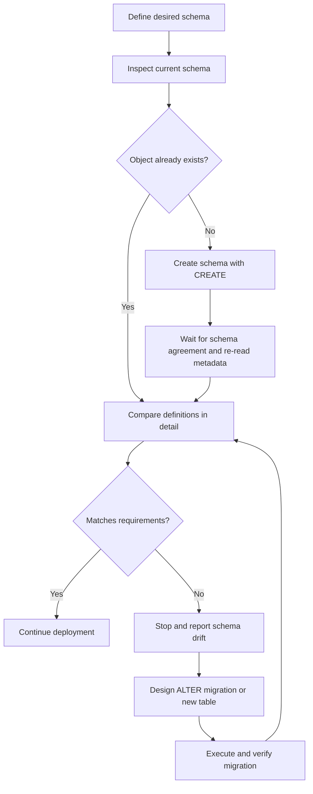

# IF NOT EXISTS/IF EXISTS and the Limits of Checking Existing Definitions

## 1. The Problem: Re-running a Statement Does Not Mean the Schema Is Right

In Apache Cassandra, many schema-management CQL statements support `IF NOT EXISTS` or `IF EXISTS`. They are convenient when provisioning a new environment, re-running scripts, and handling cases where an object already exists or has already been dropped. However, **these two clauses only check whether an object exists by name; they do not confirm that the existing definition matches the desired definition**.

This is part of the **Keyspaces and Schema** chapter in module `DATABASE_ENGINE_WIDE_COLUMN_CASSANDRA`. In distributed Cassandra and the wide-column model, a wrong schema can have major consequences: an incorrect replication factor (RF), a partition key unsuitable for queries, an incorrect data retention TTL, or a Java application reading/writing the wrong column type.

By the end of this lesson, you should be able to explain and practice:

1. What `IF NOT EXISTS` in `CREATE KEYSPACE`/`CREATE TABLE` helps do, and what it **does not check**.
2. How `IF EXISTS` in `DROP KEYSPACE`/`DROP TABLE` is useful, and why dropping can still cause data loss.
3. How to read `system_schema` to cross-check the **actual schema** against the expected schema.
4. How to structure migrations and Java application initialization with postcondition checks, schema agreement handling, and avoidance of silent mismatches.
5. How to distinguish **schema DDL** existence checks from `INSERT ... IF NOT EXISTS` data conditions in lightweight transactions (LWTs).

## 2. How Do the Two Clauses Work?

### `CREATE ... IF NOT EXISTS`

Example:

```sql
CREATE KEYSPACE IF NOT EXISTS inventory_lab
WITH replication = {
    'class': 'NetworkTopologyStrategy',
    'datacenter1': '1'
}
AND durable_writes = true;
```

If a keyspace named `inventory_lab` **does not exist yet**, Cassandra creates it with the requested configuration. If that name **already exists**, the `IF NOT EXISTS` clause allows the statement to skip duplicate creation **without using the new properties to update the old object**.

That means if the keyspace already exists with a different RF, the command above **does not change RF to 1**. This must be verified separately through metadata.

Similarly, for a table:

```sql
CREATE TABLE IF NOT EXISTS inventory_lab.items_by_id (
    item_id uuid PRIMARY KEY,
    sku text,
    price decimal
);
```

If table `inventory_lab.items_by_id` already exists with a different partition key, column types, column set, or table options, `IF NOT EXISTS` **does not synchronize those differences**.

> `IF NOT EXISTS` means "if the object already exists, skip creating it," not "if the object already exists, make sure its contents match this `CREATE` statement."

### `DROP ... IF EXISTS`

Example:

```sql
DROP TABLE IF EXISTS inventory_lab.items_by_id;
DROP KEYSPACE IF EXISTS inventory_lab;
```

If the target object no longer exists, `IF EXISTS` avoids an error from trying to drop a nonexistent object. **If the object does exist, the `DROP` statement still deletes it.** This clause does not verify whether the object belongs to a lab environment, does not compare the schema against expectations, does not check whether the table is empty, and does not back up data.

| Scenario | Has `IF NOT EXISTS`/`IF EXISTS` | Outcome |
| --- | --- | --- |
| `CREATE`, object does not exist | `IF NOT EXISTS` | Creates new object per the statement |
| `CREATE`, object already exists with same name | `IF NOT EXISTS` | Skips creation; **does not fully compare definitions** |
| `CREATE`, object already exists with same name | Without `IF NOT EXISTS` | Typically reports an already-exists error |
| `DROP`, object exists | `IF EXISTS` | Drops the object within the scope of `DROP` |
| `DROP`, object does not exist | `IF EXISTS` | Ignores the object-does-not-exist error |
| `DROP`, object does not exist | Without `IF EXISTS` | Typically reports an object-not-found error |

Even with a conditional clause, command syntax must still be valid; access permissions and other Cassandra checks can still cause the operation to fail.

## 3. Scope of Application in CQL Schema

Common schema operations include:

```sql
-- Create keyspace if it does not exist.
CREATE KEYSPACE IF NOT EXISTS inventory_lab
WITH replication = {
    'class': 'NetworkTopologyStrategy',
    'datacenter1': '1'
};

-- Create table if it does not exist.
CREATE TABLE IF NOT EXISTS inventory_lab.items_by_id (
    item_id uuid PRIMARY KEY,
    sku text,
    price decimal
);

-- Drop table if it exists.
DROP TABLE IF EXISTS inventory_lab.items_by_id;

-- Drop entire keyspace if it exists.
DROP KEYSPACE IF EXISTS inventory_lab;
```

Beyond keyspaces/tables, some statements that create/drop types, indexes, or materialized views also support existence conditions, depending on the statement type and Cassandra version. **Do not generalize** that every `ALTER` statement or every CQL construct can accept `IF EXISTS`/`IF NOT EXISTS` in any position; check the documentation syntax for the version in use.

The clauses in this lesson are mechanisms to check the existence of **schema objects**. They do not automatically create the parent keyspace before creating a table; if `inventory_lab` does not exist, `CREATE TABLE inventory_lab.items_by_id` cannot use `IF NOT EXISTS` to bypass the requirement that the keyspace must exist.

## 4. Counterintuitive Example: Same Name, Wrong Keyspace Replication

Suppose a cluster has a real DC named `dc1`, and the operations team previously created:

```sql
CREATE KEYSPACE inventory_prod
WITH replication = {
    'class': 'NetworkTopologyStrategy',
    'dc1': '1'
}
AND durable_writes = true;
```

Later, the application needs RF = 3 to tolerate node failures once `dc1` has three suitable nodes. A new deployment script runs:

```sql
CREATE KEYSPACE IF NOT EXISTS inventory_prod
WITH replication = {
    'class': 'NetworkTopologyStrategy',
    'dc1': '3'
}
AND durable_writes = true;
```

Key outcome: because `inventory_prod` **already exists**, Cassandra does not use this `CREATE` statement to raise RF to 3. The script may pass this step without reporting a duplicate-creation error, while the actual replication policy can still be RF = 1.

Check with:

```sql
SELECT keyspace_name, replication, durable_writes
FROM system_schema.keyspaces
WHERE keyspace_name = 'inventory_prod';
```

An illustrative comparison shows the discrepancy:

| Item to Check | Desired Schema | Actual Schema After `CREATE IF NOT EXISTS` |
| --- | --- | --- |
| Replication strategy | `NetworkTopologyStrategy` | `NetworkTopologyStrategy` |
| RF in `dc1` | `3` | **`1`** |
| `durable_writes` | `true` | `true` |

**The right fix:** design a deliberate migration with `ALTER KEYSPACE`, then carry out the required data synchronization procedure. Example **to run only when sufficient nodes and an operational plan are in place**:

```sql
ALTER KEYSPACE inventory_prod
WITH replication = {
    'class': 'NetworkTopologyStrategy',
    'dc1': '3'
};
```

`ALTER KEYSPACE` updates the **replica policy in the schema**; it does not mean historical data is immediately present in full on the new replicas. When increasing RF, plan repair/streaming appropriate to the version and topology, then verify data, node status, and serving capability at the desired consistency level (CL).

**Connection to distributed architecture:** RF is a keyspace property; CLs like `ONE` or `LOCAL_QUORUM` are selected at read/write time. If RF falls short of expectations, the replica threshold and actual fault tolerance of the Java application may also deviate from the design.

## 5. Counterintuitive Example: Same Table Name, Different Definition

Suppose an existing table was created to look up inventory items by ID:

```sql
CREATE TABLE inventory_lab.items_by_id (
    item_id uuid PRIMARY KEY,
    sku text,
    price decimal
) WITH default_time_to_live = 0;
```

A new application version inadvertently runs the following statement:

```sql
CREATE TABLE IF NOT EXISTS inventory_lab.items_by_id (
    item_id text PRIMARY KEY,
    sku text,
    price decimal,
    warehouse_id text
) WITH default_time_to_live = 86400;
```

If a table with the same name already exists, `CREATE TABLE IF NOT EXISTS` does **not** change:

- The type of `item_id` from `uuid` to `text`.
- The primary key structure stored in the old table.
- The column set by automatically adding `warehouse_id`.
- `default_time_to_live` from `0` to `86400` seconds.

Consequently, new Java code sending a text `item_id` or referencing `warehouse_id` may encounter query errors even though the initialization script reported no duplicate-creation error. Worse, a wrong TTL can cause data to be retained longer or expire differently than designed.

### Must compare primary key, data types, and table options

In CQL, `PRIMARY KEY ((partition_key), clustering_key)` determines how partitions are grouped and how rows are ordered within a partition. If the existing definition uses a different partition key than what the code expects, that **cannot be fixed by re-running `CREATE TABLE IF NOT EXISTS`**.

Cassandra schemas also do not automatically convert column types, add columns, change partition keys, or change compaction solely via conditional `CREATE`. For supported changes, use `ALTER TABLE` deliberately; for primary key or query design changes, you usually need to create a new table and plan a data migration.

| Component | Must Verify After `IF NOT EXISTS` | Impact if Wrong |
| --- | --- | --- |
| Table name and keyspace | Does the table belong to the right keyspace? | May query the wrong namespace |
| Partition key | Right columns/types/order? | Wrong partition distribution; may not support queries |
| Clustering columns | Right columns/types/order and sort direction? | Wrong data ordering or query conditions |
| Regular/static columns | Right names, types, and `static` property? | Binding errors, decoding errors, business logic bugs |
| `default_time_to_live` | Does it match the required TTL? | Data lives too briefly or too long |
| Compaction/compression | Matches the operational profile? | Changes disk usage, I/O, and latency |
| Keyspace replication | Do RF/DC match policy? | Wrong fault tolerance, CL, and replica placement |

## 6. Inspecting the Actual Schema with `cqlsh` and `system_schema`

To practice safely, use a **lab** keyspace with one node in DC `datacenter1`. If your DC has a different name, replace the name in the replication map to match reality:

```sql
CREATE KEYSPACE IF NOT EXISTS inventory_lab
WITH replication = {
    'class': 'NetworkTopologyStrategy',
    'datacenter1': '1'
}
AND durable_writes = true;

CREATE TABLE IF NOT EXISTS inventory_lab.items_by_id (
    item_id uuid PRIMARY KEY,
    sku text,
    price decimal
) WITH default_time_to_live = 0;
```

Before practicing, check the real DC/node names with `nodetool status`. RF = 1 makes a single-node lab work; it is **not** a fault-tolerant configuration for production.

### 6.1. Inspecting the keyspace

```sql
DESCRIBE KEYSPACE inventory_lab;

SELECT keyspace_name, replication, durable_writes
FROM system_schema.keyspaces
WHERE keyspace_name = 'inventory_lab';
```

In the results, check the replication strategy class, **every DC name and RF**, and `durable_writes`. The class name may appear in full as `org.apache.cassandra.locator.NetworkTopologyStrategy`; programmatic comparisons must handle that representation.

### 6.2. Inspecting table options

```sql
DESCRIBE TABLE inventory_lab.items_by_id;

SELECT table_name, default_time_to_live, compaction, compression
FROM system_schema.tables
WHERE keyspace_name = 'inventory_lab'
  AND table_name = 'items_by_id';
```

`DESCRIBE` is a `cqlsh` utility, whereas `system_schema.tables` is metadata queryable via CQL. When reading table options, compare the attributes **important to your requirements**; Cassandra may fill in default values that the original `CREATE` statement omitted.

### 6.3. Inspecting columns and keys

```sql
SELECT column_name, kind, position, type
FROM system_schema.columns
WHERE keyspace_name = 'inventory_lab'
  AND table_name = 'items_by_id';
```

In column metadata:

- `kind = 'partition_key'` indicates columns participating in the partition key.
- `kind = 'clustering'` indicates columns participating in the clustering key.
- `kind = 'regular'` or `'static'` shows the role of data columns.
- `position` indicates the position of a key column when there are multiple components.
- `type` shows the column's actual CQL type.

Do not just check whether a table named `items_by_id` exists. The same name with a different `kind`, `position`, or `type` can be a **completely different query model**. If the design requires a specific clustering order, read the table's clustering order/DDL metadata as well to verify.

### 6.4. Checking namespace context

```sql
SELECT keyspace_name, table_name
FROM system_schema.tables
WHERE keyspace_name = 'inventory_lab';
```

Table `items_by_id` in `inventory_lab` and a table `items_by_id` belonging to another keyspace are **two different objects**. A Java application should explicitly set the session's default keyspace or use the fully qualified name `inventory_lab.items_by_id` when needed to avoid confusion.

## 7. "Idempotent" Has Multiple Levels: Define the Goal

An operation is called *idempotent* when applying it multiple times produces the same desired end state as applying it once, under given conditions. `IF NOT EXISTS` helps **avoid duplicate-creation errors by name**, but it does not guarantee that the entire schema deployment workflow can be safely re-run and produce the right result.

| Level | Question to Answer | Solved by `IF NOT EXISTS` Alone? |
| --- | --- | --- |
| Re-running without "already exists" errors | Does the object name already exist? | Usually yes |
| Current definition is correct | Do partition key, column types, RF, and TTL match? | **No** |
| Schema is consistent across the cluster | Do nodes know the same schema version? | **No** |
| Existing data fits the new schema/policy | Has migration/repair/streaming completed fully? | **No** |
| Recoverable if a drop or migration fails | Have backups/rollback been prepared? | **No** |

Even when the first statement finishes and the next begins, that alone does not prove all nodes have reached **schema agreement**. In a distributed cluster, schema changes must propagate; deployment tooling should monitor schema agreement, perform controlled retries, and run dependent steps only once the schema is ready.

### Comparing a "just run CREATE" workflow and a workflow with postconditions



In this workflow, **schema drift** occurs when the actual configuration differs from what the application or deployment specification expects. Drift can be resolved with a migration, but that must be an explicit decision, especially for partition keys, data types, RF/DC, or TTL.

## 8. `IF EXISTS` Makes DROP Easy to Re-run, Not Safe

Look at these two statements:

```sql
DROP TABLE IF EXISTS inventory_lab.items_by_id;
DROP KEYSPACE IF EXISTS inventory_lab;
```

With `DROP TABLE`, Cassandra deletes the table and its data if present. With `DROP KEYSPACE`, Cassandra deletes the keyspace along with its tables, data types, and data within the keyspace scope. There is no safety net merely because `IF EXISTS` is present.

**Process-error example:** a lab cleanup script uses the name `inventory_prod` instead of `inventory_lab`. If `inventory_prod` exists, `DROP KEYSPACE IF EXISTS inventory_prod` can still wipe production data when the runner has sufficient privileges. The `IF EXISTS` clause does not verify the environment or whether data is disposable.

Before dropping in a controlled process:

1. Confirm the exact cluster, keyspace, and target object in metadata.
2. Check dependent tables, applications, and data that must be retained.
3. Confirm backups and recovery plans if data is important.
4. Check the permissions of the account running the migration and obtain the corresponding operational approval.
5. Execute on the right environment and then **re-read metadata**, rather than assuming success because the command reported no error.

To merely check whether an object still exists, use a **read-only** metadata query:

```sql
SELECT keyspace_name
FROM system_schema.keyspaces
WHERE keyspace_name = 'inventory_lab';

SELECT table_name
FROM system_schema.tables
WHERE keyspace_name = 'inventory_lab'
  AND table_name = 'items_by_id';
```

If no metadata row is returned, the object is no longer declared in the queried schema. This is **not** proof that all physical data files have been immediately purged on every node.

## 9. Do Not Confuse DDL `IF NOT EXISTS` with LWT `INSERT ... IF NOT EXISTS`

CQL also has conditional syntax **on data**:

```sql
INSERT INTO inventory_lab.items_by_id (item_id, sku, price)
VALUES (
    11111111-1111-4111-8111-111111111111,
    'SKU-001',
    199000.00
)
IF NOT EXISTS;
```

This is a **lightweight transaction (LWT)** applying a condition to the data row being written. It uses Cassandra's consensus mechanism to decide whether to apply the conditional operation; the result can include an `[applied]` column indicating whether the operation was applied. The performance cost and consistency semantics of LWTs differ from regular CQL writes.

| Statement | Checked Target | Check Condition | Purpose |
| --- | --- | --- | --- |
| `CREATE TABLE IF NOT EXISTS` | **Table name in schema** | Does the table already exist? | Avoid duplicate-creation errors |
| `CREATE KEYSPACE IF NOT EXISTS` | **Keyspace name in schema** | Does the keyspace already exist? | Avoid duplicate-creation errors |
| `DROP TABLE IF EXISTS` | **Table name in schema** | If present, drop it | Schema cleanup |
| `INSERT ... IF NOT EXISTS` | **Data row** | Does the target row already exist? | Conditional write / LWT |

**Do not** argue that "`CREATE ... IF NOT EXISTS` has a conditional mechanism like LWT" to conclude that schema migration is a strong transaction that simultaneously checks all definition constraints. They solve two different problems.

## 10. Schema Deployment Recommendations for Java Applications

A Java application using the Cassandra Driver typically has two parts: migration scripts or a schema-management deployer, and business code reading/writing with CQL. If the application initializes the schema at startup, that code must distinguish **object exists** from **object matches expectations**.

A practical workflow:

1. Maintain the canonical schema definition in versioned migration files or a controlled source.
2. On startup, inspect keyspaces and tables via metadata or the driver's metadata API.
3. If the object does not exist: run the appropriate `CREATE ... IF NOT EXISTS` and wait for schema agreement.
4. If it already exists: compare RF, DC names, `durable_writes`, partition/clustering keys, column types, and essential table options.
5. If there is a discrepancy: report **schema drift** and execute the designed migration; do not proceed automatically assuming the schema is right.
6. After migration: re-read metadata and verify conditions required by the application before allowing dependent queries to run.

### Java example: reading actual replication

The following snippet illustrates Cassandra Java Driver 4.x, with a `CqlSession session` already configured, connected, and lifecycle-managed by the application:

```java
import com.datastax.oss.driver.api.core.CqlSession;
import com.datastax.oss.driver.api.core.cql.Row;
import java.util.Map;

// Illustrates metadata reading only; session is already available and connected.
Row row = session.execute("""
    SELECT replication, durable_writes
    FROM system_schema.keyspaces
    WHERE keyspace_name = 'inventory_lab'
    """).one();

if (row == null) {
    throw new IllegalStateException("Missing keyspace: inventory_lab");
}

Map<String, String> replication =
    row.getMap("replication", String.class, String.class);
String strategy = replication == null ? null : replication.get("class");
String rf = replication == null ? null : replication.get("datacenter1");
boolean durable = row.getBoolean("durable_writes");

boolean networkTopologyStrategy =
    "NetworkTopologyStrategy".equals(strategy)
    || "org.apache.cassandra.locator.NetworkTopologyStrategy".equals(strategy);

if (!networkTopologyStrategy || !"1".equals(rf) || !durable) {
    throw new IllegalStateException(
        "Schema drift in inventory_lab: unexpected replication or durability");
}
```

The RF = 1 comparison example is for a **lab** whose DC is named `datacenter1`. For production, check **all** desired DCs and RFs, not just a single entry in the map; also handle strategy representation differences across versions. Right after code executes a schema change, wait for schema agreement and use bounded retries when reading metadata before treating a result as wrong.

Do not use bind markers `?` to substitute keyspace/table/column identifiers. Bind markers are for query values; schema names must come from trusted configuration/allowlists.

Another approach is to use Driver 4's metadata API, such as accessing keyspace/table metadata via `CqlIdentifier`; either way, you must **compare important properties**, rather than merely calling `getKeyspace` and concluding every definition is right.

### Should multiple Java instances create schemas concurrently?

When multiple application instances start up together, having all of them run DDL scripts simultaneously can cause schema change conflicts, make logs hard to read, and increase the likelihood of temporary schema disagreement. Use a migration mechanism with **one clear coordinator**, monitor status, verify postconditions, and only open application traffic once the schema is compatible.

`IF NOT EXISTS` can reduce duplicate-creation errors, but it **does not replace migration coordination** or cluster schema verification.

## 11. Practice Exercise: Detecting Schema Drift

This exercise applies only to a **lab keyspace**. Assume the real DC is `datacenter1`, single node, and disposable data.

**Step 1 — Create the initial schema:**

```sql
CREATE KEYSPACE IF NOT EXISTS inventory_lab
WITH replication = {
    'class': 'NetworkTopologyStrategy',
    'datacenter1': '1'
}
AND durable_writes = true;

CREATE TABLE IF NOT EXISTS inventory_lab.items_by_id (
    item_id uuid PRIMARY KEY,
    sku text,
    price decimal
) WITH default_time_to_live = 0;
```

**Step 2 — Try re-creating with a mismatched definition:**

```sql
CREATE TABLE IF NOT EXISTS inventory_lab.items_by_id (
    item_id text PRIMARY KEY,
    sku text,
    price decimal,
    warehouse_id text
) WITH default_time_to_live = 86400;
```

An object with the same name already exists, so this is not a valid way to migrate the table from the old model to the new model. Verify the actual table with a metadata query rather than relying on the command output message.

**Step 3 — Check the actual definition:**

```sql
SELECT column_name, kind, position, type
FROM system_schema.columns
WHERE keyspace_name = 'inventory_lab'
  AND table_name = 'items_by_id';

SELECT default_time_to_live
FROM system_schema.tables
WHERE keyspace_name = 'inventory_lab'
  AND table_name = 'items_by_id';
```

**Expected result:** `item_id` is still `uuid`, `warehouse_id` was not added, and the default TTL is still `0` if the table was created in Step 1 and no other schema existed beforehand.

**Step 4 — State the right decision:** if the business truly needs a different ID type and a 1-day TTL, would you create a deliberate migration or let the new application continue? Explain the impact on the partition key, Java client, existing data, and retention requirements.

**Step 5 — Clean up the lab when data is no longer needed:**

```sql
-- Execute only after confirming inventory_lab is your lab keyspace.
DROP KEYSPACE IF EXISTS inventory_lab;
```

Do not run this command on a keyspace containing data that must be preserved. Afterward, query `system_schema.keyspaces` to confirm the namespace is no longer in the schema.

## 12. Misconceptions to Avoid

| Misconception | Accurate Understanding |
| --- | --- |
| "`CREATE ... IF NOT EXISTS` succeeded, so the configuration is definitely right." | It may have **skipped** an existing object of the same name with a different definition. |
| "If RF is wrong, re-running `CREATE KEYSPACE` with the new RF is enough." | An existing keyspace requires a migration like `ALTER KEYSPACE` and potentially repair/streaming. |
| "`CREATE TABLE IF NOT EXISTS` automatically adds new columns." | It does not use the new definition to update an existing table. |
| "`IF NOT EXISTS` checks both PRIMARY KEY and TTL." | It does not guarantee a full schema match. |
| "`DROP ... IF EXISTS` only deletes if the object is temporary or empty." | If it exists, it **deletes within the command's scope**; there is no extra safety check. |
| "Seeing metadata means every replica already has the data." | Metadata shows schema configuration; data synchronization must be verified separately. |
| "Schema creation conditions are the same as LWT `INSERT IF NOT EXISTS`." | One checks schema name existence; the other checks a condition on row data. |
| "One Java instance starting successfully means the whole cluster is ready." | Schema agreement and schema compatibility conditions must be verified according to deployment requirements. |

**Remember:** in Cassandra, `IF NOT EXISTS` and `IF EXISTS` are very useful for reducing "already exists / does not exist" errors when managing schemas, but they are **not definition validators**. For keyspaces and tables serving Java applications, always compare replication, primary keys, column types, and essential options against the actual schema, and execute explicit migrations whenever discrepancies exist. This is the foundation for query-driven table design, operating replication/repair, and handling schema errors in distributed clusters.
