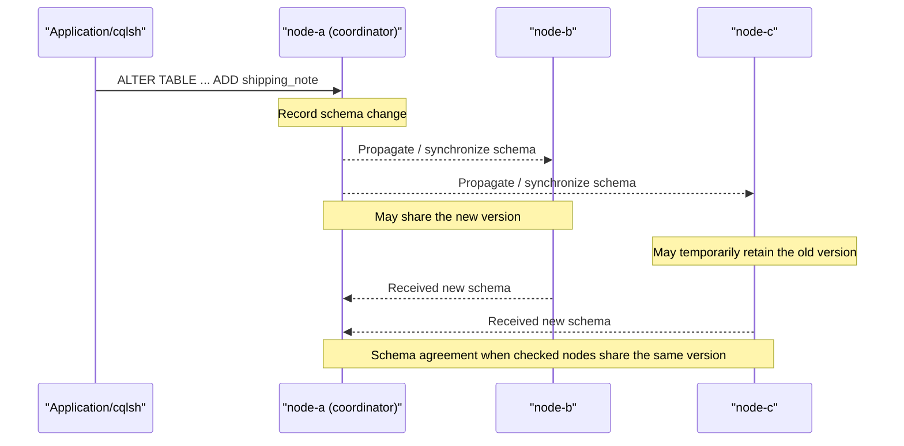
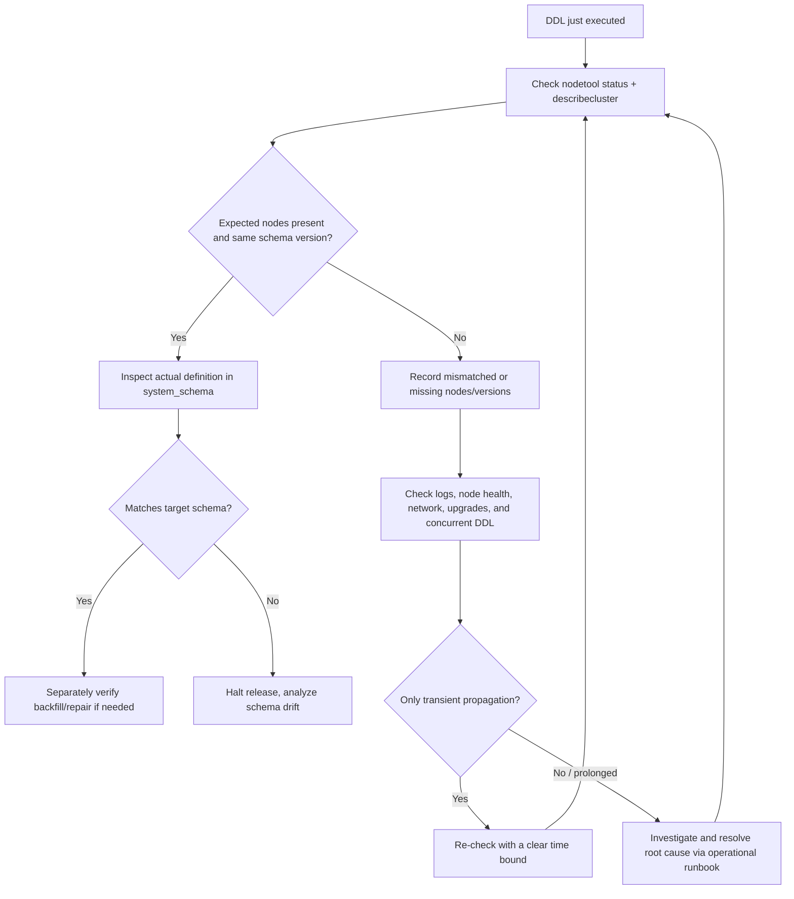

# Schema Agreement and How to Observe Out-of-Sync States

## 1. What Is Schema Agreement and Why Should You Care?

In Apache Cassandra, the **schema** describes the logical structure of data: keyspaces, tables, columns, data types, primary keys, indexes, views, and their properties. Because a cluster has multiple nodes, after a schema-changing command such as `CREATE TABLE`, `ALTER TABLE`, or `DROP TABLE`, the nodes need to know the same version of the definition.

**Schema agreement** is the state in which the nodes within the inspected scope agree on the schema version. It matters because a query received by a coordinator can fail or be interpreted differently than expected if the coordinator or replicas are using an outdated schema definition.

In the **Keyspaces and Schema** chapter of module `DATABASE_ENGINE_WIDE_COLUMN_CASSANDRA`, place schema agreement in its exact role within the distributed wide-column architecture:

| Concept | Question It Answers | Example |
| --- | --- | --- |
| **Schema agreement** | Have the relevant nodes received the same keyspace/table definition? | All see column `shipping_note text` |
| **Replication factor (RF)** | How many replicas should each partition have, and in which DCs? | RF = 3 in `dc_hcm` |
| **Consistency level (CL)** | How many replica responses does a read/write require? | `LOCAL_QUORUM` write needs a majority of replicas in the local DC |
| **Data synchronized** | Do the required replicas already hold the appropriate data? | Repair/streaming old data after increasing RF |
| **Application-compatible schema** | Does the cluster definition match the target schema? | `customer_id` has type `uuid` and is the right partition key |

> **Schema agreement does not mean data has finished replicating/repairing, nor does it prove the current schema matches the application's expectations.** It is only one of the conditions that must be checked during deployment.

After this lesson, you will know how to observe per-node schema versions, identify out-of-sync states, diagnose common causes, avoid issuing conflicting DDLs, and build appropriate verification steps for Java applications.

## 2. Why Might the Schema Not Be Uniform Immediately After DDL?

Consider a three-node cluster with `node-a`, `node-b`, and `node-c`. The application sends:

```sql
ALTER TABLE shop.orders_by_customer ADD shipping_note text;
```

One coordinator receives the statement, processes the schema change, and propagates the information to the other nodes. During the transition window, some nodes may have already applied the new definition, while another node has not yet received or fully applied it.



The diagram shows the **propagation concept**; specific procedures and communication mechanisms vary by Cassandra version. Do not infer that every node synchronizes at the exact same instant simply because the statement was accepted by the coordinator.

Causes that prolong a transient state include:

- Network latency or unstable links between data centers.
- A node starting up, busy on CPU/I/O, overloaded, or network-isolated.
- A node being down, missing the schema update at that moment.
- Multiple clients/instances concurrently submitting dependent or conflicting schema changes.
- Compatibility/metadata errors during a version upgrade, or schema inconsistency requiring investigation.

A **brief lack of agreement** right after DDL can be a normal transient phenomenon. A prolonged disagreement, accompanied by CQL errors or multiple schema versions among active nodes, requires diagnosis.

## 3. How Are Schema Versions Used?

Cassandra assigns a **schema version** to identify the state of a node's schema definition. When the schema changes, the schema version can change; version information from nodes is used by administrative tools for comparison.

A simple way to view it:

```text
Before DDL:
    node-a: version V1
    node-b: version V1
    node-c: version V1
    => in agreement

Right after DDL:
    node-a: version V2
    node-b: version V2
    node-c: version V1
    => not yet in agreement

After schema synchronization:
    node-a: version V2
    node-b: version V2
    node-c: version V2
    => agreement across the checked set of nodes
```

`V1` and `V2` are only illustrative labels; real schema versions are typically displayed as UUIDs. A different version **does not by itself tell you specifically which table or column differs**: you must inspect DDL, metadata, logs, or recent schema changes to find the cause.

**Three limits when interpreting schema versions:**

1. Two nodes reporting the same version is good evidence of a consistent schema **within the set of nodes visible to the tool**, but you must confirm all expected nodes are present and not disconnected.
2. Whether local metadata matches the desired configuration must be **verified by inspecting its contents**; a cluster can agree on **the wrong schema**.
3. Sharing the same schema version alone does not tell you that SSTables/data replicas have finished repair or backfill.

## 4. Quick Inspection with `nodetool describecluster`

`nodetool` is Cassandra's administration tool. On a node, run:

```bash
nodetool describecluster
```

In the output, look for the **`Schema versions`** section. Formatting and other sections depend on the version; the output below is only an illustrative example:

```text
Schema versions:
    11111111-1111-4111-8111-111111111111: [node-a, node-b]
    22222222-2222-4222-8222-222222222222: [node-c]
```

The example above shows the tool observes **two schema version groups**. This is a sign that the listed nodes are not in agreement. When one version includes all expected participating nodes, that is a better signal:

```text
Schema versions:
    22222222-2222-4222-8222-222222222222: [node-a, node-b, node-c]
```

**Do not rely solely on the number of schema version groups to conclude everything is safe.** If `node-c` is down and absent from the report, the remaining output may look unified even though the cluster is not ready as required. Therefore, always combine with `nodetool status`.

```bash
nodetool status
```

In the `status` output, check:

- Which DCs exist and which nodes are in each DC.
- Which nodes are `UN` (*Up/Normal*), and which are down or transitioning.
- Whether any node is bootstrapping, decommissioning, or changing topology.
- Whether the actual total node count matches the expected topology.

`nodetool status` reports observable node/topology state; it is **not** a command to verify schema definitions. Conversely, `describecluster` shows version groups but does not replace assessing overall cluster health.

### Reading results when there are multiple data centers

For a keyspace with RF in multiple DCs, do not inspect only the nodes in the DC to which the application connects. The schema is cluster-wide metadata; a DC that receives the schema slowly can cause errors when coordinators or query paths touch nodes in that DC.

Example:

| DC | Node | State | Observed Schema Version |
| --- | --- | --- | --- |
| `dc_hcm` | `hcm-1`, `hcm-2` | `UN` | `V2` |
| `dc_hn` | `hn-1` | `UN` | `V1` |
| `dc_hn` | `hn-2` | `DN` | Cannot verify with certainty |

In this illustrative scenario, the cluster is **not yet ready** to roll out code relying on the new schema across the entire application. Investigate `hn-1` and `hn-2` first, rather than looking only at `dc_hcm` which already received the change.

## 5. Reading Schema Version via CQL

Besides `nodetool`, Cassandra exposes system metadata. In `cqlsh` connected to **a specific node**, inspect the local schema version:

```sql
SELECT key, schema_version, cluster_name
FROM system.local
WHERE key = 'local';
```

`system.local` describes the **local** state on the node serving that query. If you want to compare multiple nodes, actively connect to each expected node in turn and read its local value; do not assume the driver automatically sends this query to every node.

Peer system tables can provide the schema version information that the current node **knows about other nodes**:

```sql
-- Common across many Cassandra versions:
SELECT peer, schema_version
FROM system.peers;
```

In versions that have `system.peers_v2`, you can also inspect peer/port information:

```sql
-- Use only if your Cassandra version has system.peers_v2:
SELECT peer, peer_port, schema_version
FROM system.peers_v2;
```

**Peer records reflect the viewpoint of the queried node.** They can lag behind or miss peers that are down, so they do not replace connecting directly to the relevant nodes and checking cluster health.

### Comparing schema version with actual definitions

The version indicates agreement level, whereas metadata under `system_schema` lets you inspect **definition contents**:

```sql
-- Keyspace properties and replication.
SELECT keyspace_name, replication, durable_writes
FROM system_schema.keyspaces
WHERE keyspace_name = 'schema_lab';

-- Columns currently known in the table.
SELECT column_name, kind, position, type
FROM system_schema.columns
WHERE keyspace_name = 'schema_lab'
  AND table_name = 'events_by_device';
```

If `schema_lab.events_by_device` just had `source text` added, verify that column `source` appears **on the nodes under investigation**. Comparing contents across nodes helps pinpoint specific differences, whereas `schema_version` only reflects overall version state.

An easy-to-misread case: `system_schema.columns` on one coordinator already shows `source`, while another node does not yet see it. That first query **does not prove** the entire cluster has reached agreement.

## 6. Controlled Practice: Observing an ALTER TABLE Statement

This section uses a test environment; **to genuinely observe schema lag between nodes, you need a cluster of at least two nodes**. A single-node lab can test the command and metadata, but cannot demonstrate differences between nodes.

### Step 1 — Prepare the lab keyspace

Suppose the lab has an actual DC named `datacenter1`. If running on one node, set RF = 1; if you have two nodes in the same DC, you can choose RF = 2 for testing depending on your goal. The example below uses RF = 1 so it runs easily on a small lab:

```sql
CREATE KEYSPACE IF NOT EXISTS schema_lab
WITH replication = {
    'class': 'NetworkTopologyStrategy',
    'datacenter1': '1'
}
AND durable_writes = true;
```

**Condition:** replace `datacenter1` with the DC name read from `nodetool status`. This is a test configuration, not a production RF recommendation. `IF NOT EXISTS` does not re-verify replication when the keyspace already exists; verify the existing lab schema before proceeding.

### Step 2 — Create a table and insert a row

```sql
CREATE TABLE IF NOT EXISTS schema_lab.events_by_device (
    device_id text,
    event_time timestamp,
    temperature double,
    PRIMARY KEY ((device_id), event_time)
) WITH CLUSTERING ORDER BY (event_time DESC);

INSERT INTO schema_lab.events_by_device (
    device_id, event_time, temperature
) VALUES (
    'sensor-01', '2026-11-21T00:00:00Z', 27.5
);
```

`device_id` is the partition key, and `event_time` is the clustering column. These properties serve query design and do not change when schema agreement is checked.

### Step 3 — Record the baseline schema version

Run on the lab cluster:

```bash
nodetool status
nodetool describecluster
```

If possible, open `cqlsh` connected individually to each node and record `schema_version` from `system.local`. Do not assume two connections through a load balancer hit two different nodes.

### Step 4 — Modify the schema from one session

```sql
ALTER TABLE schema_lab.events_by_device
ADD source text;
```

Right after the change, inspect the definition on the coordinator:

```sql
SELECT column_name, kind, type
FROM system_schema.columns
WHERE keyspace_name = 'schema_lab'
  AND table_name = 'events_by_device';
```

In a multi-node lab, re-check `nodetool describecluster` and read `system.local.schema_version` on each node. If nodes synchronize very quickly, you **may not catch** the disagreement window; this is normal. Do not try to induce failures or network isolation on a shared environment just to witness lag.

### Step 5 — Use the new column only after verification

Once schema agreement is reached and metadata for the new column exists:

```sql
UPDATE schema_lab.events_by_device
SET source = 'edge-gateway'
WHERE device_id = 'sensor-01'
  AND event_time = '2026-11-21T00:00:00Z';

SELECT event_time, temperature, source
FROM schema_lab.events_by_device
WHERE device_id = 'sensor-01';
```

`ALTER TABLE ADD` does not automatically backfill `source` values for old rows. Even when all nodes agree on the schema, rows that have not had `source` written can still return `null`.

### Step 6 — Clean up the lab if data truly does not need to be kept

```sql
-- Run only on a disposable lab keyspace.
DROP KEYSPACE IF EXISTS schema_lab;
```

`DROP KEYSPACE` deletes every table and all data in the keyspace, not just one table. Do not run cleanup commands on systems containing data that must be retained.

## 7. Distinguishing Commonly Misinterpreted States

| Observation | Reasonable Conclusion | What **Cannot Yet Be Concluded** |
| --- | --- | --- |
| `ALTER TABLE` returns success | The coordinator processed the request per protocol | All nodes are in agreement |
| `DESCRIBE TABLE` shows the new column | The `cqlsh` session sees the new definition | All nodes see the new column |
| `system.local` on one node has version `V2` | The queried node reports version `V2` | Other nodes have updated to `V2` |
| `describecluster` shows two versions | Sign of disagreement among observed nodes | Whether the exact cause is network, node, or DDL |
| `describecluster` shows one version | Visible nodes share the same version | That down nodes, desired schema, and replica data are all right |
| `nodetool status` shows all `UN` | Observed nodes are Up/Normal | That their schemas are in agreement |
| `system_schema` is right on all nodes and agreed | Schema matches within the checked node set | That required data backfill/repair is complete |
| DDL changing RF has reached agreement | Nodes see the new RF policy | That new replicas already hold full historical data |

The last example is very important: when increasing RF from 1 to 3, schema agreement can arrive **before** old data is sufficiently replicated onto the new nodes. You must perform repair/streaming appropriate to the topology and then verify the results. Do not use schema version to judge data transfer progress.

## 8. When Not Yet in Agreement: Diagnostic Workflow

Suppose you just executed DDL and `describecluster` still shows multiple schema versions. Follow this workflow:



### 8.1. Determine the scope of impact

Ask:

- Is only one node on a mismatched version, an entire DC, or multiple scattered nodes?
- Are those nodes in `UN` state? Are any nodes down, joining/leaving, or bootstrapping?
- What was the most recent DDL? Are multiple deployments running in parallel?
- Is the Java application seeing `Undefined column`, `Unknown table`, `InvalidRequest`, or statement preparation errors?
- Did the cluster recently undergo a rolling upgrade, topology change, or network incident?

Record the DDL timestamp, affected keyspace/table, each node's schema version, and relevant error logs. A different version may result from **DDL in another keyspace** because schema version reflects cluster schema state, not a single table in isolation.

### 8.2. Check node health and connectivity

Combine `nodetool status`, `describecluster`, Cassandra logs, and inter-node connectivity checks. Identify any node that is hard to reach, frequently timing out, or showing signs of overload.

Do not use `nodetool status` as the sole evidence. An `UN` node can still be slow or out of sync on schema, and a down node may be missing from some views of schema versions.

### 8.3. Wait for bounded propagation, then re-check

For a normal transient state, re-check after a reasonable wait **per system timeouts/policies**, instead of repeatedly firing new `ALTER`/`CREATE` statements.

If the state does not converge:

1. Pinpoint the exact nodes/versions and divergent schema contents.
2. Investigate node/network/logs, concurrent schema changes, and upgrade state.
3. Remediate the root cause on the cluster following the runbook for your Cassandra version.
4. Re-verify **all expected nodes**, schema versions, metadata definitions, and query behavior.

Do not arbitrarily edit system tables directly, delete schema metadata, restart nodes en masse, or run destructive schema synchronization commands without first identifying the root cause and following an approved administrative procedure.

### 8.4. When must you halt the release?

Stop deploying steps **that depend on the new column/table/UDT** if:

- Schema versions remain divergent across expected active nodes.
- A node is disconnected that the release process requires to participate.
- Metadata from different nodes shows different definitions.
- New CQL fails due to missing table/column/type or unstable statement preparation.
- DDL has reached agreement, but the actual schema does not match the definition expected by the application.

In these cases, deploying the application before resolving the issue can produce intermittent errors depending on the coordinator or network path.

## 9. How Do Schema Agreement, Consistency Level, and Repair Relate?

Suppose keyspace `shop` has RF = 3 in a DC and the application writes at `LOCAL_QUORUM`. A data write typically needs enough replica responses according to the chosen CL, but **CL does not control how fast schema changes propagate**.

| Task | Related Mechanism/Check |
| --- | --- |
| Aligning table definitions across nodes | Schema propagation, schema version, and schema agreement |
| Placing partition replicas on nodes/DCs | Keyspace replication strategy and RF |
| Determining success of a single read/write | Consistency level, replica responses |
| Synchronizing divergent data or new replicas | Streaming/repair, monitoring progress, and verifying data |
| Changing compaction policy | Table options and compaction/SSTable lifecycle |

**Do not confuse**:

- "`LOCAL_QUORUM` succeeded" with "every node has received the new schema."
- "Schema agreement" with "read repair/anti-entropy repair is complete."
- "Changing RF reached agreement" with "old data already has enough replicas under the new RF."
- "`DESCRIBE TABLE` is right on one node" with "Java applications can safely use the new table on every coordinator."

When a migration both alters the schema and requires backfill or repair, **two separate sets of completion criteria** are needed: schema agreement and data verification.

## 10. Integrating Checks into Java Applications

A Java application can execute DDL through the Cassandra Java Driver, yet rolling out features that use the new schema must be coordinated with the migration workflow. The driver can track metadata and schema agreement, though specific wait behavior, timeouts, warnings, and APIs depend on driver version/configuration.

### Example with Java Driver 4.x

Suppose you already have a `CqlSession session` connected to the cluster and keyspace `schema_lab`, with a coordinated migration process. After the DDL statement:

```java
import com.datastax.oss.driver.api.core.CqlSession;
import com.datastax.oss.driver.api.core.cql.Row;

// session is initialized and lifecycle-managed externally.
session.execute("""
    ALTER TABLE schema_lab.events_by_device ADD source text
    """);

// Check schema agreement using the Driver 4.x API.
boolean agreed = session.checkSchemaAgreement();
if (!agreed) {
    throw new IllegalStateException(
        "Cluster has not reached schema agreement; feature using column source not yet enabled");
}

// This only checks metadata from the current request.
Row col = session.execute("""
    SELECT column_name, type
    FROM system_schema.columns
    WHERE keyspace_name = 'schema_lab'
      AND table_name = 'events_by_device'
      AND column_name = 'source'
    """).one();

if (col == null || !"text".equals(col.getString("type"))) {
    throw new IllegalStateException(
        "Column source does not exist or has wrong type in the read schema");
}
```

**Prerequisites for the example:** Java supports text blocks (Java 15+), Cassandra Java Driver 4.x provides the corresponding API, and no prior migration has already added column `source`. If re-run, `ALTER TABLE ... ADD source` may report that the column already exists; in a real workflow, check schema/migration version before deciding to execute.

This code illustrates the verification sequence; it does **not** replace a complete migration mechanism. When the driver reports lack of agreement, the DDL statement **may already have been applied on the cluster**: do not automatically re-issue DDL without reading metadata and investigating state.

### When multiple application instances run concurrently

Do not let every Java instance issue `ALTER TABLE` simultaneously at startup. A better workflow:

1. Designate one migration coordinator; run DDLs **sequentially**.
2. Wait for/verify schema agreement using driver APIs and operational tools.
3. Verify keyspace/table/column/type/primary key against the target schema.
4. If backfill or repair is needed, wait for those separate data criteria to finish.
5. Enable features requiring the new schema and monitor CQL errors, timeouts, and metadata refreshes.

Preparing/executing prepared statements must rely on a compatible schema. For multi-version application rollouts, prefer **backward-compatible** changes (add the new column first; drop the old column only after older application versions have stopped using it).

### Distinguishing local checks from cluster-wide checks

`SELECT ... FROM system_schema.columns` via a session proves that **the coordinator serving that query** sees the column; it is not a scan of every node. Even when the driver's `checkSchemaAgreement()` returns true, understand the scope of nodes the driver knows about/can reach, any down nodes, and cluster operational policies.

If stronger release criteria are needed, combine the driver with `nodetool status`, `nodetool describecluster`, and metadata verification on critical nodes/DCs.

## 11. Real-World Failure Story: DDL Succeeded, Yet New Queries Fail

Suppose a new Java service version is deployed with the CQL query:

```sql
SELECT order_id, shipping_note
FROM shop.orders_by_customer
WHERE customer_id = 11111111-1111-4111-8111-111111111111;
```

Earlier, the migration ran:

```sql
ALTER TABLE shop.orders_by_customer ADD shipping_note text;
```

After release, some queries succeed while others report a missing column. One **possible** cause is lack of schema agreement, especially if different coordinators are using two versions; another possibility is that the application is connecting to the wrong cluster/keyspace or the DDL was not executed in the right place.

An ordered investigation path:

1. Check **which cluster, DC, and keyspace** the application is connecting to, compared to where the DDL ran.
2. Compare `nodetool status` and `describecluster` to identify down nodes or divergent schema versions.
3. Read `system_schema.columns` on suspect nodes to confirm whether `shipping_note text` exists.
4. Cross-check DDL/migration logs and application logs (coordinator, failure timestamps, exceptions).
5. Restore schema agreement or fix the environment mismatch, then re-verify prepared statements/metadata and queries.

If all nodes are in agreement yet the column is still missing, the issue is **schema drift or a missing migration**, not "Cassandra hasn't synced yet." Cross-check the actual definition and run the proper migration.

## 12. Self-Check Exercises and Pass Criteria

### Exercise 1 — Reading schema version groups

Suppose `describecluster` displays:

```text
Schema versions:
    V2: [n1, n2]
    V1: [n3]
```

Answer:

1. Has the cluster reached agreement? **No**, within the displayed set of nodes there are two versions.
2. Is there enough evidence to claim `n3` has a network failure? **No**; we only know its schema version differs.
3. After `n3` syncs to `V2`, do all replicas already have sufficient data? **Cannot be concluded yet**.
4. To find which column differs, what should you do? Compare `system_schema` metadata across nodes or investigate DDL history.

### Exercise 2 — One schema version, yet still unsafe

`nodetool describecluster` displays only one version, but `nodetool status` shows an expected node is down. Can you affirm the entire cluster is ready to release code using the new table? **No**. Clarify the inspection scope, fault-tolerance rules, and require that node to return/receive the schema before releasing.

### Exercise 3 — Distinguishing schema from data

You increase a keyspace's RF from 1 to 3 and confirm schema agreement has been reached. Explain why you still need a plan to synchronize existing data. Answer: updating RF changes the replica placement policy, whereas old data must be streamed/repaired to the required replicas; sharing the same schema version does not verify data contents.

### Deployment checklist

| Item to Check | Pass Criteria |
| --- | --- |
| Right cluster and DC | Target nodes and environment received DDL as expected |
| Sufficient nodes in observed scope | `status` and node list match expected topology |
| Schema agreement | Relevant nodes share the same schema version within the checked scope |
| Schema definition | Keyspace, table, columns, types, and keys match requirements |
| Java application | Driver/statements query stably and the new schema is compatible |
| Data synchronization | Backfill, streaming, or repair completed **if required by the migration** |
| Post-release monitoring | No schema-related CQL errors, abnormal timeouts, or mapping failures |

**Remember:** in Cassandra, schema agreement is about nodes seeing the **same definition**, not a substitute for data being synchronized or that definition being business-correct. Observing `nodetool describecluster` together with `nodetool status`, reading `system.local`/`system_schema` when needed, waiting for agreement after DDL, and verifying backfill/repair separately form the foundation for safe CQL deployments for Java systems on distributed clusters.
