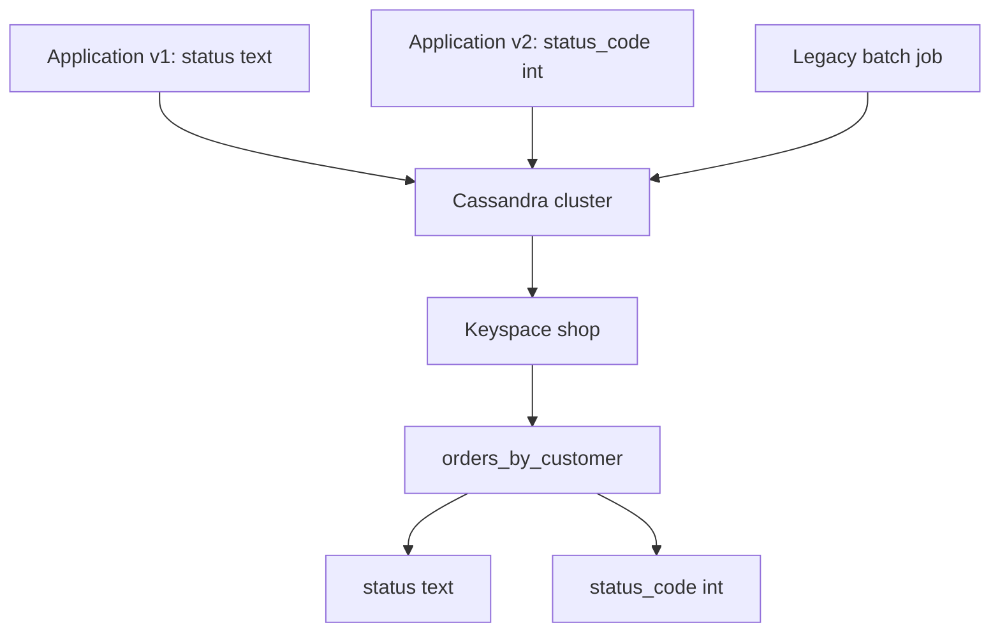
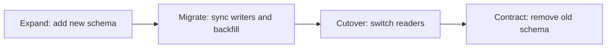

# DDL in a Cluster Serving Multiple Application Versions

## 1. Context: One Cassandra Cluster, Multiple Running Applications

When deploying a Java application via *rolling deployment*, not all instances switch to the new version at the exact same moment. Application v1, v2, background workers, consumers, and batch jobs may read/write on the same Apache Cassandra table simultaneously. Meanwhile, an engineering team needs to change the schema via CQL Data Definition Language (DDL), such as `ALTER TABLE` to add a new column or `CREATE TABLE` for a new query pattern.

In the **Keyspaces and Schema** chapter of module `DATABASE_ENGINE_WIDE_COLUMN_CASSANDRA`, this problem connects query-driven wide-column design with replication, read/write consistency levels, repair, and Java Driver management: **DDL must remain compatible with both the old and new applications while two versions coexist**.

Objectives of this lesson:

1. Distinguish **schema**, **data**, and **application** compatibility when multiple versions run concurrently.
2. Sequence rollouts into phases: *expand → migrate → cutover → contract*.
3. Practice adding a new column, dual-writing, backfilling, and switching queries in CQL.
4. Check schema agreement, actual definitions in `system_schema`, and effects on the Java Driver.
5. Know when a new table is required, when an old column must not be dropped, and when rollback is no longer safe.

### "Multiple application versions" differs from "multiple Cassandra versions"

| Scenario | What Has Multiple Versions? | Problem |
| --- | --- | --- |
| Application rolling deployment | Java service v1/v2, workers, jobs, APIs | Can both versions read/write the same schema and data semantics? |
| Cassandra rolling upgrade | Cassandra software on nodes | Server, CQL/storage compatibility, and dedicated upgrade procedures |

This lesson focuses on **application v1/v2 sharing a single cluster concurrently**. If the cluster is also upgrading Cassandra itself, you must additionally check server-version compatibility limits.

## 2. Why Can a "Successful" DDL Still Break the Application?

Suppose application v1 queries:

```sql
SELECT created_at, order_id, status
FROM shop.orders_by_customer
WHERE customer_id = 11111111-1111-4111-8111-111111111111;
```

Application v2 wants to use numeric status codes `status_code int` instead of `status text`. If `status` is dropped too early, remaining v1 instances may fail with `Undefined column`. If only the new column is added, v2 instances may read `null` because old data has not been converted yet. If v1 continues writing `status` while v2 only reads `status_code`, business results can become inconsistent even when the schema is completely synchronized.



Three layers of correctness must be distinguished:

| Layer | Verification Question |
| --- | --- |
| **Schema compatibility** | Are table/column names, primary keys, and data types still valid for both v1 and v2? |
| **Data compatibility** | Do both status representations carry the same meaning and stay properly updated on new writes? |
| **Operational readiness** | Is schema agreement reached, are replicas available, and have backfill/repair met requirements? |

**Schema agreement** means the checked nodes agree on the schema definition; it does **not** mean data in the two columns is synchronized or that the current definition meets business requirements.

## 3. Compatibility Matrix When Transitioning from Text to Numeric Code

For the order example, examine four states:

| Table State | App v1 Using `status` | App v2 Using `status_code` | Remarks |
| --- | --- | --- | --- |
| Only `status text` | Works | Fails if `status_code` is required | Cannot enable new queries yet |
| Both columns present, not backfilled | Works | May encounter `null` | Syntactically compatible, not necessarily data-correct |
| Both columns maintained by writers, old data backfilled | Works | Works once mapping is verified | Desired coexistence phase |
| `status` dropped | Fails if still referenced | Can work | Only after v1 and dependent jobs are gone |

Never automatically assume `ALTER TABLE ... ADD` is compatible in every application. Mappers using `SELECT *`, serializers relying on column order, or code checking column counts can break on a new schema. Therefore, test the **actual code** of both v1 and v2, not just CQL syntax.

## 4. The expand → migrate → cutover → contract Workflow



### Expand — extend while keeping the old path

Use `ALTER TABLE ... ADD` or `CREATE TABLE`, keeping columns/tables that v1 still uses. After DDL, verify actual definitions and schema agreement **before** allowing v2 to use the new column/table.

### Migrate — maintain data during coexistence

If new data is stored in a different column, all active writers must uphold a transitional data contract. Approaches may include dual-writing, upgrading legacy writers, routing writes through a single service, or controlled data synchronization. Backfill historical data, handle concurrent updates, and verify results.

### Cutover — gradually switch read paths

During the transition, v2 can fall back from the new column to the old column for rows not yet backfilled. Switch exclusively to reading the new structure only once it is proven complete and no legacy writer is introducing divergence.

### Contract — clean up schema once dependencies are gone

Execute `DROP COLUMN` or `DROP TABLE` only after all application versions, jobs, consumers, reports, and rollback paths no longer need them. Place contract in a **later deployment wave** to leave room for observation and recovery.

| Phase | Typical Action | Completion Condition |
| --- | --- | --- |
| Expand | `ALTER TABLE ... ADD` | Schema agreement; v1 continues working |
| Migrate | Dual-write, backfill by partition key | No writer missed; old and new data match |
| Cutover | Switch readers/mappers in Java | Complete data; application errors within bounds |
| Contract | `ALTER TABLE ... DROP` | No legacy dependencies remain; recovery plan is clear |

These phases are not a multi-table/cluster-wide transaction; handle errors per step and avoid assuming all steps complete simultaneously.

## 5. CQL Lab: Expanding the Orders Table

Practice on a **dedicated lab keyspace**. Assume the real DC is `datacenter1` and the lab cluster has one node; check `nodetool status` and replace the DC name to match your environment.

### Step 1 — Create keyspace and table for v1

```sql
CREATE KEYSPACE IF NOT EXISTS rolling_lab
WITH replication = {
    'class': 'NetworkTopologyStrategy',
    'datacenter1': '1'
}
AND durable_writes = true;

CREATE TABLE IF NOT EXISTS rolling_lab.orders_by_customer (
    customer_id uuid,
    created_at timestamp,
    order_id uuid,
    status text,
    total_amount decimal,
    PRIMARY KEY ((customer_id), created_at, order_id)
) WITH CLUSTERING ORDER BY (created_at DESC, order_id ASC);
```

RF = 1 is only for a single-node test; it is **not** a fault-tolerant production configuration. If the keyspace/table already exists, `IF NOT EXISTS` does not fix mismatched definitions; read metadata before practicing.

```sql
INSERT INTO rolling_lab.orders_by_customer (
    customer_id, created_at, order_id, status, total_amount
) VALUES (
    11111111-1111-4111-8111-111111111111,
    '2026-11-20T08:00:00Z',
    aaaaaaaa-aaaa-4aaa-8aaa-aaaaaaaaaaaa,
    'PAID',
    250000.00
);

SELECT order_id, status
FROM rolling_lab.orders_by_customer
WHERE customer_id = 11111111-1111-4111-8111-111111111111;
```

The partition key is `customer_id`; `created_at` and `order_id` are clustering columns. This table is designed for querying a customer's order history, not as a universal table for every order lookup pattern.

### Step 2 — Expand: add the new column

```sql
ALTER TABLE rolling_lab.orders_by_customer
ADD status_code int;
```

After schema agreement and verifying metadata, read back:

```sql
SELECT created_at, order_id, status, status_code
FROM rolling_lab.orders_by_customer
WHERE customer_id = 11111111-1111-4111-8111-111111111111;
```

The old row still has `status = 'PAID'`, while `status_code` can be `null`. **Adding a column does not automatically backfill existing data.**

### Step 3 — Define the business status mapping

| v1 Value | v2 Code |
| --- | ---: |
| `NEW` | 0 |
| `PROCESSING` | 1 |
| `PAID` | 2 |
| `CANCELLED` | 3 |

This mapping is merely a business example; Cassandra does not define or convert enums automatically. Every service must interpret the exact same mapping, including how to handle invalid legacy data.

### Step 4 — Migrate: backfill by row key

```sql
UPDATE rolling_lab.orders_by_customer
SET status_code = 2
WHERE customer_id = 11111111-1111-4111-8111-111111111111
  AND created_at = '2026-11-20T08:00:00Z'
  AND order_id = aaaaaaaa-aaaa-4aaa-8aaa-aaaaaaaaaaaa;
```

In this example, `UPDATE` targets the row by its **full primary key**. Cassandra has no mechanism like an `UPDATE` that scans an entire table and evaluates conversion expressions for every row as many RDBMSs do. For large datasets, build a paging/scanning tool aligned with the partition model, with checkpoints, rate limiting, retries, and reconciliation.

### Step 5 — Dual-write when creating new orders

```sql
INSERT INTO rolling_lab.orders_by_customer (
    customer_id, created_at, order_id, status, status_code, total_amount
) VALUES (
    22222222-2222-4222-8222-222222222222,
    '2026-11-20T09:00:00Z',
    bbbbbbbb-bbbb-4bbb-8bbb-bbbbbbbbbbbb,
    'NEW',
    0,
    98000.00
);
```

Writing both columns of the **same row in one statement** updates them in a single mutation. However, if any v1 instance still updates only `status`, `status_code` can immediately become stale. Enabling dual-write on only a subset of instances **does not** cover all legacy write paths.

### Step 6 — Contract after v1 is gone

```sql
-- Execute only after all application/job versions have stopped using status.
ALTER TABLE rolling_lab.orders_by_customer
DROP status;
```

Do not run this command while v1 and v2 coexist. When dropping a column, Cassandra updates the schema and handles stored data via its corresponding storage rules; do not assume all SSTables are immediately rewritten or that re-`ADD`ing a column with the same name will restore old data.

## 6. Rollout Order While v1 Writers Still Exist

A practical roadmap usually follows:

| Stage | Schema | Client/Writer | Goal |
| --- | --- | --- | --- |
| T0 | Only `status` | All v1 | Verify baseline |
| T1 | Add `status_code` | v1 | Wait for schema agreement |
| T2 | Both columns | Compatible-upgraded v1 + transitional v2 | Every write path has a sync mechanism |
| T3 | Both columns | Writers synced; readers use fallback | Backfill, check divergence |
| T4 | Both columns | v2 readers use new data | Reconcile and monitor |
| T5 | Only `status_code` if needed | No v1/legacy jobs left | Drop old column after rollback window |

Decision point at **T2–T3**: if v1 writers are still running and only write `status`, address it using one of these designs:

- Upgrade all writers to a transitional version that writes both columns.
- Centralize status writes through a single shared service with one data contract.
- Maintain a checkpointed update pipeline with monitored lag, followed by final reconciliation.
- Delay switching readers to exclusively read `status_code` until all v1 writers are retired and a final backfill pass completes.

You must prove every write path is covered. Having v2 fall back when `status_code` is `null` only handles **missing data**; it cannot reliably detect a non-`null` `status_code` value that is **already stale**.

### Race between backfill and new updates

Suppose backfill reads `status = 'NEW'` and prepares to write code `0`. Before it writes, the payment application transitions the status to `PAID`, writing code `2`. A backfill with a newer timestamp could overwrite `2` with `0`. Cassandra resolves competing writes by timestamp according to storage semantics; design backfill to avoid writing stale values, such as via writer contracts, controlled versions/conditions, or post-migration reconciliation.

LWTs can help for certain conditional updates, though they add overhead and **do not automatically turn a multi-row/multi-table migration into a global transaction**.

## 7. Which DDLs Can Affect Older Versions?

| Operation | Impact on v1 | What Must Be Checked |
| --- | --- | --- |
| `ALTER TABLE ... ADD new_col` | Usually suitable for expansion | Mappers, `SELECT *`, `null` values, schema agreement |
| `CREATE TABLE new_table` | Usually does not affect old table | Source data, backfill, and queries by new partition key |
| Changing `comment` | Usually minimal impact | Metadata and admin tools |
| Changing `default_time_to_live` | Can change lifecycle of **new writes** | TTL does not apply retroactively to all old data |
| Changing compaction/compression | Can increase I/O and CPU load | Resources, SSTables, and compaction |
| `ALTER TABLE ... DROP old_col` | Breaks clients still referencing old column | Sufficient proof of zero remaining dependencies |
| `DROP TABLE`/`DROP KEYSPACE` | Loses objects and data in deletion scope | Backups, recovery, consumer list |
| Renaming columns where supported | Old CQL may become invalid | Server version, indexes/views, mappers |
| Changing column type/partition key | Cannot be treated as a safe in-place edit | New table, migration, and query-driven design |
| `ALTER KEYSPACE` changing RF/DC | Changes replica policy, affects fault tolerance | Streaming/repair, CL, actual node/DC counts |

With `SELECT *`, even adding a column can break mappers/serializers that depend on column count or position. Select columns explicitly in application queries and verify name/type-based mapping.

### Changing partition key requires a new table

If v2 needs to look up orders by `order_id`, the new table can be:

```sql
CREATE TABLE IF NOT EXISTS rolling_lab.orders_by_id (
    order_id uuid PRIMARY KEY,
    customer_id uuid,
    created_at timestamp,
    status_code int,
    total_amount decimal
);
```

This creates partitions by `order_id`, unlike `orders_by_customer`. You must backfill/write data into both tables, handle divergence between denormalized copies, and switch queries; no simple `ALTER TABLE` can change the partition key and automatically redistribute old data.

## 8. Checking Schema Agreement Before Enabling v2

After DDL, a coordinator may already see the new column while another node still uses the old schema version. Therefore, wait and verify that the schema change has propagated.

```bash
nodetool status
nodetool describecluster
```

`nodetool status` shows DCs, nodes, and Up/Down states. `nodetool describecluster` typically displays `Schema versions` groups. Multiple versions among observed nodes indicate disagreement. A single version also does not prove a down node is synchronized.

In `cqlsh`, verify:

```sql
SELECT key, schema_version
FROM system.local
WHERE key = 'local';

SELECT column_name, kind, type
FROM system_schema.columns
WHERE keyspace_name = 'rolling_lab'
  AND table_name = 'orders_by_customer'
  AND column_name = 'status_code';
```

Querying `system.local` only reflects the connected node; `system_schema.columns` shows the definition seen by the coordinator serving that query. For multi-node evidence, cross-check version groups, node health, and when necessary, metadata on individual nodes.

Evaluate three separate states:

1. **Agreement:** relevant nodes know the same definition.
2. **Correctness:** the schema matches requirements (`int` type, keys, RF, options).
3. **Data readiness:** both data representations are consistent, and backfill plus repair/streaming if needed have met criteria.

Do not enable features solely because DDL returned success or one coordinator sees the new column.

## 9. Coordinating Migrations in Multi-Instance Systems

Letting every Java instance run `CREATE` or `ALTER` at startup can cause schema change conflicts and complicate diagnosis during concurrent deployments. The migration management process should have **one coordinator**:

1. Record the desired schema version and dependencies between migrations.
2. Read the existing schema before executing DDL.
3. Apply changes step by step, avoiding overlapping DDLs.
4. Wait for schema agreement with a time bound and verify the actual schema.
5. When needed, perform backfill/repair/streaming and verify data.
6. Allow v2 applications to receive traffic once phase conditions are met.

`IF NOT EXISTS` in `CREATE TABLE` only avoids duplicate-name creation errors; it does **not** verify that the existing table structure matches the new requirement. When schema drift is detected, halt dependent migrations, analyze, and author a deliberate migration.

If the driver reports lack of agreement after a DDL, do not automatically re-issue `ALTER TABLE ADD`. The initial command may already have been accepted and be propagating. Check metadata, schema versions, node health, and logs before deciding next steps.

## 10. Java Driver: Prepared Statements and Data Transition

Examples use **Cassandra Java Driver 4.x**, with `CqlSession session` already initialized and lifecycle-managed externally, and Java 15+ for text blocks. Assume `rolling_lab.orders_by_customer` already has `status_code int`.

### Writing both old and new representations

```java
import com.datastax.oss.driver.api.core.CqlSession;
import com.datastax.oss.driver.api.core.cql.PreparedStatement;
import java.math.BigDecimal;
import java.time.Instant;
import java.util.UUID;

// session is already created and connected elsewhere.
PreparedStatement upsert = session.prepare("""
    INSERT INTO rolling_lab.orders_by_customer (
        customer_id, created_at, order_id,
        status, status_code, total_amount
    ) VALUES (?, ?, ?, ?, ?, ?)
    """);

session.execute(upsert.bind(
    UUID.fromString("33333333-3333-4333-8333-333333333333"),
    Instant.parse("2026-11-20T10:00:00Z"),
    UUID.fromString("cccccccc-cccc-4ccc-8ccc-cccccccccccc"),
    "PAID",
    2,
    new BigDecimal("250000.00")
));
```

A single statement writes both columns in the same row. In production, use a consistent mapping function and account for retries and ambiguous write errors; do not arbitrarily replay operations with side effects.

### Compatible reads while old rows are not yet backfilled

```java
import com.datastax.oss.driver.api.core.cql.PreparedStatement;
import com.datastax.oss.driver.api.core.cql.Row;
import java.util.UUID;

PreparedStatement ps = session.prepare("""
    SELECT status, status_code
    FROM rolling_lab.orders_by_customer
    WHERE customer_id = ?
    """);

for (Row row : session.execute(ps.bind(
        UUID.fromString("11111111-1111-4111-8111-111111111111")))) {
    Integer code = row.isNull("status_code")
        ? null : row.getInt("status_code");
    String oldStatus = row.getString("status");

    int effectiveCode;
    if (code != null) {
        effectiveCode = code;
    } else if ("NEW".equals(oldStatus)) {
        effectiveCode = 0;
    } else if ("PROCESSING".equals(oldStatus)) {
        effectiveCode = 1;
    } else if ("PAID".equals(oldStatus)) {
        effectiveCode = 2;
    } else if ("CANCELLED".equals(oldStatus)) {
        effectiveCode = 3;
    } else {
        throw new IllegalStateException("Missing or unknown order status");
    }
    // Use effectiveCode according to tested business logic.
}
```

Falling back on `null` handles rows not yet backfilled. However, **if a legacy writer can still update `status` independently**, a non-`null` `status_code` can still be stale data; the code above does not solve that synchronization gap on its own.

### Checking agreement and metadata from Java

```java
import com.datastax.oss.driver.api.core.cql.Row;

boolean agreed = session.checkSchemaAgreement();
if (!agreed) {
    throw new IllegalStateException("Schema not yet in agreement");
}

Row col = session.execute("""
    SELECT column_name, type
    FROM system_schema.columns
    WHERE keyspace_name = 'rolling_lab'
      AND table_name = 'orders_by_customer'
      AND column_name = 'status_code'
    """).one();

if (col == null || !"int".equals(col.getString("type"))) {
    throw new IllegalStateException("Missing status_code int");
}
```

`checkSchemaAgreement()` uses the metadata/node view known to the driver. Combine it with operational tools to verify down nodes or missing peers. After DDL, you can wait and retry checks within limits; if it still does not converge, investigate rather than blindly repeating DDL.

The driver may need to refresh metadata or re-prepare prepared statements after schema changes. Do not prepare queries using a new column before compatibility conditions are met; avoid mapping logic that relies on `SELECT *` column order.

## 11. Cassandra-Specific Risks

### Timestamps and concurrent updates

Cassandra resolves ordinary write conflicts by timestamp according to storage semantics. A late-running backfill can overwrite a newer status when there is no mechanism to prevent stale writes. Evaluate ordering, versioning, conditional updates/LWTs within appropriate scope, and post-cutover reconciliation.

### TTL, tombstones, and compaction

`default_time_to_live` affects new writes that do not specify an explicit TTL, and does not apply retroactively by automatically converting all old data. Backfill must account for desired TTLs; `null` data may result from never being written, having expired, or having been deleted. Dropping a column updates the schema but does not mean all SSTables immediately erase physical data; data cleanup also involves compaction and dropped-column mechanics.

### Replication factor, consistency level, and repair

Changing RF/DC with `ALTER KEYSPACE` modifies the keyspace-level replica policy without altering table/column names. Schema agreement after changing RF does **not** guarantee new replicas have received old data: plan streaming/repair appropriately. CLs like `ONE` or `LOCAL_QUORUM` are chosen for reads/writes, not as tools to wait for schema synchronization. During migration, check availability and latency across DCs holding replicas.

### Writing to multiple tables to serve multiple queries

If v2 needs to look up orders by `order_id`, adding that column to `orders_by_customer` does not turn it into a new partition key. You need table `orders_by_id` and a data migration workflow. Cassandra does not provide RDBMS-style multi-row/multi-table transactions to keep all denormalized copies automatically synchronized; the application must design explicit write and recovery strategies.

## 12. Application Rollback Differs from Schema Rollback

Rolling code back to v1 is only safe if v1 can still read/write the current schema **and** the old column's data has continued to be maintained. Common situations:

| Situation | Feasibility of Rolling Back to v1 |
| --- | --- |
| Just ran `ADD status_code`, keeping `status` | Usually feasible, after verifying mappers |
| Dual-writing and backfilling in progress | Must check new data, out-of-sync writes, and transition errors |
| Stopped writing `status` but column not yet dropped | v1 may read stale status, so rollback is **not automatically safe** |
| Already ran `DROP status` | v1 instances still referencing the column will fail; reverting code does not restore data |

**Keep the contract phase separate from the v2 release phase.** Only decide to drop the old schema after the rollback window has passed and all legacy dependencies are verified gone. Re-`ADD`ing a recently `DROP`ped column does not restore old contents; a separate recovery/migration plan is needed to go back.

## 13. Release Runbook and Postcondition Checks

| Stage | Required Actions | Evidence to Collect |
| --- | --- | --- |
| Before DDL | Inventory all v1/v2, jobs, mappers, prepared statements | Compatibility matrix, baseline schema |
| After expand | Verify schema, nodes/DCs, and agreement | `system_schema`, `nodetool status/describecluster` |
| Before dual-write | Cover all status write paths | Old/new writer tests, reconciliation logs |
| During backfill | Monitor rate, checkpoints, bad data, concurrent updates | Progress, discrepancy count, remaining rows |
| Before cutover | Ensure complete data and correct v2 logic | Partition-level reconciliation, metrics, business tests |
| After v2 rollout | Monitor CQL errors, mappers, CL, timeouts, node load | Logs/metrics across all app versions and DCs |
| Before contract | Verify zero old-column dependencies and rollback window passed | Consumer list, recovery plan |
| After contract | Read metadata and test active queries | Actual schema, v2 test results |

Halt any rollout depending on the new schema if critical nodes are down/out of agreement, metadata is wrong, legacy writers still cause divergence, backfill is incomplete, or there is no handling plan for removing structures needed by v1.

## 14. Practice Exercises and Self-Check Questions

### Exercise 1 — Ordering steps

Given steps: (A) release v2 reading only `status_code`; (B) `ADD status_code`; (C) backfill data; (D) `DROP status`; (E) all writers synchronize both representations; (F) verify schema agreement.

**Correct order in principle:** B → F → E → C → A → D. Between steps, perform data reconciliation and verify v1 impact; execute D only when certain no old-column dependencies remain. If v1 writers have not been upgraded, do not rush to A.

### Exercise 2 — Finding the data bug

Backfill wrote `status_code = 2` corresponding to `PAID`. Afterward, a v1 writer changed `status` to `CANCELLED` without updating `status_code`. v2 still reads code `2`.

This is **not necessarily a schema agreement bug**: the entire cluster may have synchronized schemas. You must fix the write path or data sync mechanism, then reconcile again before v2 reads only the new column.

### Exercise 3 — Schema agreement is not enough

The cluster reached agreement after `ALTER TABLE ADD status_code`, yet 30% of old rows have not been backfilled. Can you drop `status` yet? **No**, if the application needs accurate status for those rows or v1 still runs. Schema agreement only confirms the definition; it does not populate data.

### End-of-lesson questions

1. Why is `ADD COLUMN` usually a suitable expand step yet can still break mappers?
2. Why is dual-writing in v2 insufficient if a v1 job still writes independently?
3. How do you distinguish schema agreement, schema correctness, and data readiness?
4. When is creating a new table mandatory instead of changing the partition key of an existing table?
5. What conditions must hold before dropping an old column and closing the rollback path?

**Remember:** DDL in a Cassandra cluster serving multiple application versions must follow the path **expand schema → ensure all writers are compatible and backfill → switch readers → retire old schema**. Always verify schema agreement, actual definitions, old/new data, and remaining running jobs. Combined with partition key design, replication, CL, repair, and Java Driver checks, this is how to execute rolling deployments without breaking live application versions.
