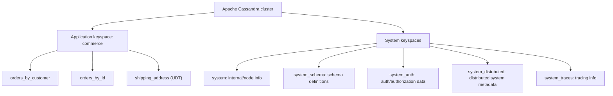

# System Keyspaces and User Data Boundaries

## 1. Why Distinguish System Keyspaces from Application Keyspaces?

In Apache Cassandra, a **keyspace** is a namespace containing tables and related schema objects, and it defines the replication policy for that keyspace's data. Alongside application-created keyspaces, Cassandra has **system keyspaces** used to operate the cluster, store schema metadata, node state, and certain administrative information.

In the **Keyspaces and Schema** chapter of module `DATABASE_ENGINE_WIDE_COLUMN_CASSANDRA`, this distinction is essential. Cassandra operates under a distributed wide-column model: application tables are designed around queries and partition keys; replicated data is placed according to the replication strategy; and system tables exist so Cassandra knows **what it is managing**.

Consider an e-commerce application:

- `commerce.orders_by_customer` stores orders partitioned by `customer_id`: **user business data**.
- `system_schema.keyspaces` records keyspace definitions: **cluster metadata**.
- `system.local` reflects information about the queried node: **system state**.

All of them can be referenced using `keyspace.table` syntax in CQL, yet their **purpose, operation, access permissions, and replication differ**.

After this lesson, you should be able to:

1. Identify common system keyspaces and the types of information they contain.
2. Explain the boundary between business data, schema metadata, local node state, and administrative metadata.
3. Query system tables in a **read-only** manner to inspect schema, topology, and synchronization state.
4. Avoid direct actions that corrupt system tables; use DDL, administrative tools, and CQL permissions as intended.
5. Connect system keyspace inspection with table design, replication, repair, and the Java Driver.

## 2. Logical Cluster Structure: Two Keyspace Groups Coexisting



This is a conceptual diagram; which system keyspaces/tables are actually present **depends on the Cassandra version and configuration**. Some Cassandra versions also provide **virtual** keyspaces/tables for observing system state. They are not necessarily stored or replicated like regular data tables.

| Criterion | Application Keyspace | System Keyspace |
| --- | --- | --- |
| Who manages it? | Application development/operations team | Cassandra and corresponding admin tools |
| Purpose | Store business data, serve queries | Schema metadata, node info, security, tracing, system tasks |
| Create tables via app DDL | Yes, per design requirements | Do not arbitrarily create/alter system tables |
| Partition key, TTL, compaction | Designed by app team within CQL limits | Governed by system mechanics and config; do not arbitrarily "tune" |
| Replication | Configured at the application keyspace | **Varies per system keyspace**; some contents are node-local |
| Backup/restore | Per business data policy | Per cluster recovery runbook and matching security config |
| Access permissions | Apply least privilege for services | Restrict access to admin info and sensitive metadata |

**Not all system keyspaces are replicated like a user keyspace.** For instance, `system.local` represents state on a specific node; you cannot infer that it has three replicas simply because an application keyspace has RF = 3.

## 3. Identifying Common System Keyspaces

The following names are common in modern Cassandra versions. Specific objects may differ across upgrades, authentication setups, or virtual tables.

| Keyspace | Primary Role | Example Information and Notes |
| --- | --- | --- |
| `system` | Internal node/cluster metadata and state | `system.local`; peer metadata; internal activity tracking tables |
| `system_schema` | Logical definitions of keyspaces, tables, columns, types, indexes/views | `keyspaces`, `tables`, `columns`, `types`; used to **inspect schema** |
| `system_auth` | Authentication and authorization metadata in configurations using this storage | Roles, permissions; must be managed via CQL role/grant commands, not direct table edits |
| `system_distributed` | Metadata supporting certain distributed operational processes | Info supporting repair and system tasks in corresponding versions |
| `system_traces` | Request trace information when tracing is enabled | Useful for analyzing query paths; has its own overhead and retention lifecycle |
| `system_views` or other virtual keyspaces | System observability framework in supported versions | Virtual tables are usually read-only; names and tables depend on version |

This is **not an immutable catalog**. To see exactly what your running cluster has, use `DESCRIBE KEYSPACES` in `cqlsh` or query the version's actual metadata.

### 3.1. `system`: local information and node viewpoint

`system.local` describes the queried node. Commonly observed columns include cluster name, data center, rack, and schema version. Additionally, many versions include `system.peers` and/or `system.peers_v2` recording information about peers known to the current node.

Note: peer metadata is the **viewpoint of the queried node**, which may lag behind or miss down nodes. When investigating topology and schema agreement, also cross-check `nodetool status`.

### 3.2. `system_schema`: where to inspect CQL structure

`system_schema` describes the names and definitions of keyspaces/tables/columns/UDTs recorded by the cluster. It is very useful when:

- Verifying `CREATE KEYSPACE` created the right `NetworkTopologyStrategy` and RF.
- Checking that `ALTER TABLE ADD` added a column with the right type.
- Detecting schema drift: the actual definition differs from the DDL expected by the application.
- Comparing partition keys and clustering columns in a query-driven table.

**Do not edit `system_schema` directly for a "quick schema change."** Use supported CQL DDL commands such as `CREATE KEYSPACE`, `ALTER KEYSPACE`, `CREATE TABLE`, `ALTER TABLE`, and appropriate migration tooling.

### 3.3. `system_auth`: identity and permission management data

Under corresponding authentication/authorization configurations, Cassandra stores role and permission metadata in `system_auth`. This is **security-sensitive administrative data**, distinct from customer or order records.

Use administrative statements such as `CREATE ROLE`, `ALTER ROLE`, `GRANT`, `REVOKE`, and appropriate permissions. **Do not perform direct `INSERT/UPDATE/DELETE/TRUNCATE`** on internal `system_auth` tables. Changing `system_auth` replication can be an important part of production operations, but must follow the version-specific runbook, include a data sync plan, and evaluate impact on logins/authorization.

### 3.4. `system_distributed` and `system_traces`

`system_distributed` supports metadata related to certain distributed operations; it is not a place to store denormalized application tables. `system_traces` relates to tracing a request to investigate read/write behavior. Tracing must be enabled intentionally, can add write/system load, and its data should not be treated as long-term business data.

These keyspaces have their own replication/retention characteristics and operational rules. **Do not infer how to maintain them from an application keyspace's RF/TTL.**

## 4. How to List Keyspaces and Tell Which Hold User Data

In `cqlsh`:

```sql
DESCRIBE KEYSPACES;
```

This is a **`cqlsh` command**, not a universal CQL query to send directly via the Java Driver.

You can query keyspaces recorded in schema metadata:

```sql
SELECT keyspace_name, replication, durable_writes
FROM system_schema.keyspaces;
```

Results can contain both Cassandra-internal keyspaces and application keyspaces. Use **names, version-documented purposes, and actual configuration** to classify them. Some virtual keyspaces have different display mechanics and should not be assumed to have all properties of a data-storing keyspace.

Naming examples:

| Name | Reasonable Owner | Purpose |
| --- | --- | --- |
| `commerce` | Application | Orders and business query tables |
| `telemetry` | Application | Device data, events, metrics |
| `schema_lab` | Learning/test environment | Testing CQL and migrations |
| `system` | Cassandra | Internal information |
| `system_schema` | Cassandra | Schema definitions |
| `system_auth` | Cassandra/auth config | Authentication and authorization metadata |

A `system_` prefix resembling internal names is a signal to be cautious, **but does not replace** checking the actual system keyspace catalog of your Cassandra version. Do not create application keyspaces with names easily confused with the system group.

## 5. Querying System Keyspaces for Observation, Never Direct Modification

### 5.1. Checking an application keyspace's replication definition

Suppose there is an application keyspace named `commerce`:

```sql
SELECT keyspace_name, replication, durable_writes
FROM system_schema.keyspaces
WHERE keyspace_name = 'commerce';
```

When using `NetworkTopologyStrategy`, the `replication` column is a map containing the strategy and per-DC RF. An **illustrative** result:

```text
keyspace_name | replication
--------------+-------------------------------------------------------------
commerce      | {'class': 'org.apache.cassandra.locator.NetworkTopologyStrategy',
              |  'dc1': '3', 'dc2': '3'}
```

This shows the **replica policy in the schema**, not proof that all historical data has been fully streamed/repaired. After increasing RF or adding a DC, separately verify sync progress and cluster readiness.

### 5.2. Viewing tables and primary key components

```sql
SELECT keyspace_name, table_name
FROM system_schema.tables
WHERE keyspace_name = 'commerce';

SELECT column_name, kind, position, type
FROM system_schema.columns
WHERE keyspace_name = 'commerce'
  AND table_name = 'orders_by_customer';
```

In `system_schema.columns`:

- `kind = 'partition_key'` indicates columns participating in the partition key.
- `kind = 'clustering'` indicates columns participating in the clustering key.
- `kind = 'regular'` or `'static'` describes data columns.
- `position` helps identify the order of key components.
- `type` shows the declared CQL type.

Cassandra chooses partitions by the **table's partition key** and the **keyspace's replication policy**, not by the name of any system keyspace.

### 5.3. Checking a node's local state

```sql
SELECT key, cluster_name, data_center, rack, schema_version
FROM system.local
WHERE key = 'local';
```

This result reflects the node the session is querying. To compare schema versions across nodes, connect to each appropriate node and combine with:

```bash
nodetool status
nodetool describecluster
```

`nodetool describecluster` typically shows `Schema versions` groups; multiple version groups across observed nodes indicate a lack of **schema agreement**. A single version group does not guarantee a down node has received the schema, nor does it mean replica data has finished repairing.

### 5.4. Querying peer metadata conditionally by version

Some versions permit:

```sql
SELECT peer, schema_version
FROM system.peers;
```

In versions supporting `system.peers_v2`, additional info such as peer and port can be observed. **Do not** assume both tables exist on every cluster. Peer metadata reflects the queried node's perspective and may be stale or missing unreachable nodes; cross-check with administrative tools.

### 5.5. Tracing a CQL query when needed

In `cqlsh`, tracing can be enabled for a short inspection:

```sql
TRACING ON;

SELECT order_id, total_amount
FROM commerce.orders_by_customer
WHERE customer_id = 11111111-1111-4111-8111-111111111111;

TRACING OFF;
```

`TRACING ON/OFF` is a `cqlsh` utility; corresponding traces may be stored by Cassandra in `system_traces` depending on configuration and version. Tracing adds observability overhead and can expose query execution details, so use it purposefully and avoid leaving it permanently enabled on production workloads.

## 6. Why Shouldn't System Keyspaces Hold Business Data?

In CQL, both examples look like `keyspace.table`:

```text
commerce.orders_by_customer
system.local
```

Yet their meanings are completely different. Creating/altering/dropping system tables arbitrarily can cause startup failures, corrupt metadata, authorization errors, failure to join the cluster, or operational outages. `system.local` is also not a place to store business records with application-chosen partition keys.

| What Needs to Be Stored | Appropriate Place | Why |
| --- | --- | --- |
| Customer orders | `commerce.orders_by_customer` | Partition key/clustering designed for queries |
| Device events over time | `telemetry.events_by_device` | Bucketing/TTL/compaction designed for workload |
| Table names and column types | Read `system_schema` | Cassandra-managed metadata, not user-written data |
| Node state/identity | Read `system.local`, admin tools | Reflects node operational state |
| Roles and permissions | Manage via CQL role/permission commands | Cassandra controls system metadata |
| Query trace results | Tracing tools when needed | Diagnostic data with a different lifecycle than business data |

**Do not store application data by adding tables to `system` or `system_schema`.** Create dedicated application keyspaces and use clear, purposeful names like `commerce`, `telemetry`, `inventory_app`.

### Separate keyspaces do not guarantee resource isolation

Separating `commerce` and `telemetry` does not automatically dedicate separate CPUs, disks, or networks to each keyspace: they normally still share cluster nodes and resources. A keyspace defines a **namespace and replication policy**, whereas performance, permission, and topology isolation must be designed and enforced separately.

## 7. Safe Lab: Creating an Application Keyspace and Cross-Checking System Metadata

This section only runs DDL on a **test keyspace** `app_orders_lab`. Queries on `system_schema` and `system.local` are **read-only**.

### Step 1 — Confirm the data center name

First run on the lab node:

```bash
nodetool status
```

The examples below assume the node belongs to a DC named exactly `datacenter1`. If your cluster uses a different name, substitute that exact name in `CREATE KEYSPACE`. RF = 1 is only for a single-node lab environment.

### Step 2 — Create the application keyspace

```sql
CREATE KEYSPACE IF NOT EXISTS app_orders_lab
WITH replication = {
    'class': 'NetworkTopologyStrategy',
    'datacenter1': '1'
}
AND durable_writes = true;
```

`IF NOT EXISTS` only avoids duplicate-creation errors; it **does not** update RF if `app_orders_lab` already exists with a different configuration.

### Step 3 — Create a table and write business data

```sql
CREATE TABLE IF NOT EXISTS app_orders_lab.orders_by_id (
    order_id uuid PRIMARY KEY,
    customer_id uuid,
    created_at timestamp,
    total_amount decimal
);

INSERT INTO app_orders_lab.orders_by_id (
    order_id, customer_id, created_at, total_amount
) VALUES (
    aaaaaaaa-aaaa-4aaa-8aaa-aaaaaaaaaaaa,
    11111111-1111-4111-8111-111111111111,
    '2026-11-21T08:00:00Z',
    199000.00
);

SELECT order_id, customer_id, total_amount
FROM app_orders_lab.orders_by_id
WHERE order_id = aaaaaaaa-aaaa-4aaa-8aaa-aaaaaaaaaaaa;
```

`order_id` is the partition key. This data belongs to a **user keyspace**; Cassandra organizes replicas according to `app_orders_lab`'s replication strategy.

### Step 4 — Inspect the table's metadata from system keyspaces

```sql
SELECT keyspace_name, replication, durable_writes
FROM system_schema.keyspaces
WHERE keyspace_name = 'app_orders_lab';

SELECT table_name
FROM system_schema.tables
WHERE keyspace_name = 'app_orders_lab';

SELECT column_name, kind, position, type
FROM system_schema.columns
WHERE keyspace_name = 'app_orders_lab'
  AND table_name = 'orders_by_id';
```

Expected result: metadata declares keyspace `app_orders_lab` with RF = 1 in the specified DC; table `orders_by_id` has `order_id` in the `partition_key` role and the remaining columns as data. **Reading `system_schema` does not move order records into a system keyspace.**

### Step 5 — Check the node and schema agreement

```sql
SELECT key, cluster_name, data_center, rack, schema_version
FROM system.local
WHERE key = 'local';
```

In a multi-node lab, also cross-check `nodetool describecluster` and `nodetool status`. Schema agreement reflects that nodes see the same schema definition; it does **not** verify that every replica's data has been backfilled or repaired.

### Step 6 — Clean up only the lab keyspace when data is no longer needed

```sql
-- Execute only if certain app_orders_lab is a disposable lab.
DROP KEYSPACE IF EXISTS app_orders_lab;
```

This command deletes **all schema and data of the lab keyspace**, not just one table. Never change the target name to a system keyspace or production keyspace to "test" `DROP`.

## 8. Do All System Keyspaces Share the Same Replication Factor?

**You cannot treat all system keyspaces as one group sharing an RF or storage mechanism.** Cassandra uses different categories of metadata:

1. **Local/node metadata:** such as `system.local`, reflecting local state on the queried node. Do not interpret it through a business keyspace's RF.
2. **Cluster schema metadata:** `system_schema` definitions exchanged so nodes agree on schemas. This state is observed via schema agreement, not order-data repair.
3. **Replicated administrative metadata:** some keyspaces like `system_auth` and distributed operational metadata may have their own replication configurations and special administrative requirements per version.
4. **Tracing/virtual tables:** have their own lifecycles or observation mechanics; you cannot apply an order table's storage/TTL formula.

For example, increasing an application keyspace's RF from 1 to 3 with `ALTER KEYSPACE commerce` changes the replica placement policy for `commerce` data. It does **not** automatically alter `system_auth` replication, nor does it prove `commerce` replicas already hold complete historical data. Appropriate repair/streaming procedures are needed when changing RF.

### Be careful with `system_auth` in multi-node operations

Cassandra access control may depend on authentication data in `system_auth`. In corresponding setups, to prevent a single node failure from breaking role/permission checks, administrators should review the authentication metadata replication strategy according to cluster architecture and version-specific documentation.

Adjusting a system keyspace's replication policy is **not a default application operation**. It must be planned, nodes/DCs checked, failure-case accessibility evaluated, supported commands applied, and data synchronized per runbook. Do not mechanically copy a user keyspace's RF.

## 9. Access Control: Reading Metadata Does Not Mean Editing Internals

Because system keyspaces contain administrative data, apply role-based permissions:

- **Application accounts:** least privilege on only the business keyspaces/tables truly needed. Restrict schema creation/alteration/deletion and administrative operations.
- **Migration accounts:** controlled DDL permissions, coordinated so multiple instances do not run conflicting migrations concurrently.
- **Operations accounts:** permissions to observe the cluster and alter system configurations per procedure; controlled access to sensitive admin/security data.

Depending on authenticator/authorizer, version, and access policies, some system tables may require dedicated permissions; operations involving `system_auth` are far more sensitive than reading column definitions. Do not treat every `system_*` table as public data.

**Avoid dangerous operations**:

```sql
-- Do NOT run commands like these on system tables:
-- TRUNCATE system.local;
-- DROP KEYSPACE system_schema;
-- UPDATE system_auth.roles SET ...;
```

The lines in the code block are written only as comments to illustrate **what not to do**. Directly accessing or editing internal metadata may be rejected by Cassandra or cause hard-to-recover damage. When changing permissions, use supported role/permission statements; when changing schema, use CQL DDL on manageable objects.

## 10. Backup, Repair, and Upgrades: Do Not Equate System Data with User Data

| Activity | For Business Data | For System Data |
| --- | --- | --- |
| Backup | Snapshot/backup application keyspaces per RPO/RTO | Needs a runbook for cluster, schema, auth metadata, and config recovery; do not arbitrarily copy all system tables |
| Restore | Restore application tables/keyspaces and data | Depends on node role, version, and config; may require selective system info reconstruction/restoration |
| Repair | Synchronize data replicas per replication strategy | Apply only when the runbook specifies a given system keyspace needs/requires repair; do not arbitrarily repair `system.local` |
| Compaction | Per table options and application workload | Internal tables have their own policies; do not tune them to optimize business workloads |
| Cassandra upgrade | Verify application query and schema compatibility | System table structures can change across versions; follow upgrade guides |

When designing backups, **schema definitions** and **actual data** are two layers to consider separately. Having backups of application tables without a plan to restore keyspaces/permissions/config can leave recovery incomplete. Conversely, copying local metadata verbatim from one node to another is not a valid node-replacement procedure.

## 11. Connecting from Java: Reading Metadata, Managing Application Keyspaces

Java applications using Cassandra Java Driver 4.x can query system metadata to inspect keyspaces and tables. `DESCRIBE KEYSPACE` is a `cqlsh` utility; in Java, use CQL queries against `system_schema` or the driver's metadata API.

For example, assume `CqlSession session` is already configured, connected, and externally lifecycle-managed:

```java
import com.datastax.oss.driver.api.core.CqlSession;
import com.datastax.oss.driver.api.core.cql.Row;

import java.util.Map;

// Check business keyspace, read-only on system_schema.
Row row = session.execute("""
    SELECT replication, durable_writes
    FROM system_schema.keyspaces
    WHERE keyspace_name = 'app_orders_lab'
    """).one();

if (row == null) {
    throw new IllegalStateException("Missing keyspace app_orders_lab");
}

Map<String, String> replication =
    row.getMap("replication", String.class, String.class);
String strategy = replication == null ? null : replication.get("class");
String rf = replication == null ? null : replication.get("datacenter1");
boolean durable = row.getBoolean("durable_writes");

boolean expectedStrategy =
    "NetworkTopologyStrategy".equals(strategy)
    || "org.apache.cassandra.locator.NetworkTopologyStrategy".equals(strategy);

if (!expectedStrategy || !"1".equals(rf) || !durable) {
    throw new IllegalStateException("Unexpected replication policy");
}
```

This example is for a lab with DC named `datacenter1` and RF = 1; in production, verify **all expected DCs/RFs** and schema agreement before running application logic that depends on the schema. Java text blocks require Java 15+.

With Java Driver 4.x, you can also use the metadata API and `CqlIdentifier` to access keyspaces/tables. Whether using the API or `system_schema`, **metadata only tells you the schema seen by the queried node/coordinator**, not that the entire cluster is in agreement or that data has finished repairing.

### Avoid letting applications modify system keyspaces

Do not implement logic such as "if a `system_schema` table is missing, recreate it" or "before starting the app, drop/recreate `system_auth`." Applications should only manage project-scoped keyspaces/tables through coordinated migrations. Metadata or auth system errors must be handled via Cassandra operational runbooks.

## 12. Common Confusions

| Confusion | Correct Understanding |
| --- | --- |
| "`system_schema.keyspaces` is an orders table inside keyspace `commerce`." | It is **cluster metadata** describing keyspaces, not order records. |
| "I can store application data in `system.local` because it is a CQL table." | `system.local` is **node-local information** managed by Cassandra. |
| "All system keyspaces have the same RF as the application keyspace." | Each metadata group has its own storage/replication nature; do not infer a shared RF. |
| "As soon as `SELECT system_schema` succeeds, schema agreement is reached." | One coordinator may see new metadata while another node has not received it; verify cluster-wide. |
| "Schema agreement means repair has finished." | Schema is definitions; repair synchronizes **data replicas**. |
| "`system_auth` is where to INSERT customer login details." | It is Cassandra authentication/authorization metadata; business account data needs its own design. |
| "I can clean up `system_traces` disk usage by arbitrarily editing system tables." | Tracing has its own storage/retention mechanics; use version-appropriate operational procedures. |
| "`DESCRIBE` can be sent verbatim through the Java Driver like any CQL SELECT." | `DESCRIBE` is a `cqlsh` utility; the driver uses its metadata API or queries `system_schema`. |
| "A new keyspace gets its own CPU and disk." | Keyspaces typically share resources of the same cluster. |
| "Changing the app's RF automatically adjusts replication for `system_auth`." | Each keyspace has its own policy/mechanism; manage separately. |

## 13. Self-Check Exercises and Operational Checklist

### Exercise A — Classifying information

Identify the appropriate component for each need:

1. Check if column `order_id` of `commerce.orders_by_customer` is a partition key → read `system_schema.columns`.
2. Store order history by customer → query-driven application table in keyspace `commerce`.
3. Check the DC/rack name of the connected node → read `system.local`, cross-check `nodetool status`.
4. Manage Cassandra access permissions → role/permission statements and Cassandra's auth mechanism, not direct edits to `system_auth`.
5. Investigate a slow query → tracing/observability tools, using `system_traces` when appropriate and authorized.
6. Check an application keyspace's RF → `system_schema.keyspaces`.

### Exercise B — Distinguishing schema from data

After `ALTER KEYSPACE commerce` raises RF from 1 to 3, `system_schema.keyspaces` shows RF = 3. Can you conclude old data now has three replicas? **No.** You must verify topology has enough nodes, execute an appropriate repair/streaming procedure, and check data and serving capacity at the required CL.

### Exercise C — Reading metadata without affecting data

On the lab, execute in order:

1. `DESCRIBE KEYSPACES` and identify which are application keyspaces and which are system keyspaces.
2. Run `SELECT keyspace_name, replication FROM system_schema.keyspaces`.
3. Pick an existing **application keyspace** and use `system_schema.tables`, `system_schema.columns` to read its schema.
4. Run `SELECT ... FROM system.local` to inspect the node's local state.
5. Compare `nodetool status` and `nodetool describecluster` if the lab has multiple nodes.
6. Explain why the `SELECT` queries above do **not** prove all data replicas are synchronized.

### Checklist for Java code and operational scripts

| Question | Expected Evidence |
| --- | --- |
| Does the target object to alter/drop truly belong to the application? | Fully qualified `keyspace.table`, confirmed owner/business scope |
| Could it accidentally target a system keyspace? | Keyspace allowlist and governance rules before DDL |
| Are least-privilege permissions in place? | App only has required read/write permissions; migrations and ops separated |
| Does the current schema match expectations? | `system_schema` and driver metadata |
| Has the cluster reached agreement? | Schema version groups, node status, and checks from driver/admin tools |
| Does changing RF/DC require repair/streaming? | Separate plan and data verification results |
| What do backup/restore cover? | Schema, application data, and required admin config/metadata per runbook |

**Remember:** system keyspaces serve **Cassandra operating and describing itself**; user keyspaces serve **business data and application queries**. Read system metadata when diagnosing, but modify schemas using CQL DDL on objects within your management scope; never arbitrarily manipulate internal tables. Distinguishing these two keyspace groups helps you design partition keys, choose replication, verify schema agreement, perform repair, and connect safely from Java.
