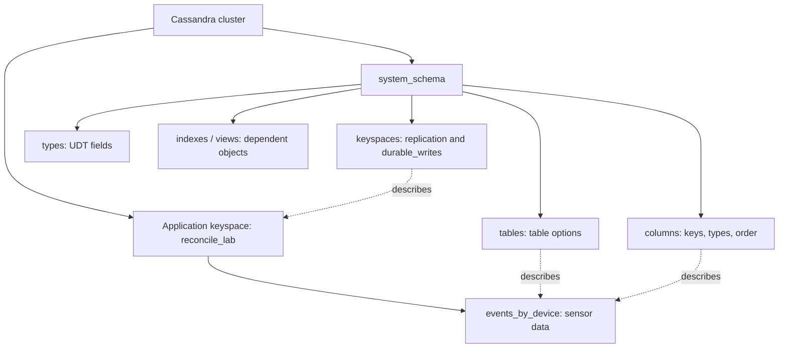
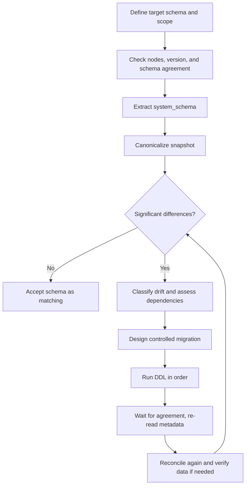

# system_schema and Extracting Definitions for Reconciliation

## 1. The Problem: Knowing the *Actual* Schema, Not Just the *Intended* Schema

When operating Apache Cassandra, development teams typically manage schemas in CQL scripts or Java application migrations. However, a `CREATE TABLE IF NOT EXISTS` statement running without error does not mean the current table definition matches the migration file. Likewise, after `ALTER KEYSPACE` or `ALTER TABLE`, you must prove the cluster has recorded the **exact change** rather than merely trusting the command's return status.

**`system_schema`** is the keyspace containing metadata about Cassandra schema objects. With read-only `SELECT` queries against metadata, we can:

- List keyspaces, tables, columns, user-defined types (UDTs), indexes, and materialized views.
- Verify replication strategy, replication factor (RF), `durable_writes`, table options, and primary key definitions.
- Extract a snapshot of actual definitions (*schema snapshot*) to compare against the design or pre/post-deployment state.
- Detect **schema drift**: the existing schema differs from what the application or operational procedure expects.

This lesson belongs to the **Keyspaces and Schema** chapter of module `DATABASE_ENGINE_WIDE_COLUMN_CASSANDRA`. When learning the distributed wide-column model, remember: a table's **partition key** determines how data is grouped into partitions; keyspace **replication** determines which DCs hold replicas; **consistency level (CL)** applies to each read/write operation. `system_schema` lets you inspect schema definitions, but does **not** replace verifying data, running repair, or validating business query results.

Lesson objectives:

1. Know which metadata each key table in `system_schema` holds.
2. Extract keyspaces, tables, columns, primary keys, UDTs, and indexes/views using CQL.
3. Canonicalize snapshot data for meaningful reconciliation, avoiding brittle DDL string comparisons.
4. Classify discrepancies by impact severity and verify migration postconditions.
5. Use metadata from `cqlsh` and the Java Driver without directly modifying system tables.

## 2. What Is `system_schema`? Boundaries of the Metadata Source

`system_schema` is a keyspace **managed by Cassandra**; it is not a keyspace holding application-designed business records. User data belongs in dedicated keyspaces such as `commerce`, `telemetry`, or `inventory`. Table `system_schema.tables` is a **table describing tables**, not a container of all rows from those tables.



Common tables:

| Table in `system_schema` | Used to Inspect | Commonly Used Columns |
| --- | --- | --- |
| `keyspaces` | Keyspace names, replication, and commit-log durability | `keyspace_name`, `replication`, `durable_writes` |
| `tables` | Table list and table-level attributes | `keyspace_name`, `table_name`, `default_time_to_live`, `gc_grace_seconds`, `compaction`, `compression`, `comment` |
| `columns` | Column names, types, roles, and key ordering | `keyspace_name`, `table_name`, `column_name`, `kind`, `position`, `type`, `clustering_order` |
| `types` | UDT definitions | `keyspace_name`, `type_name`, `field_names`, `field_types` |
| `indexes` | Indexes and associated options | `keyspace_name`, `table_name`, `index_name`, `kind`, `options` |
| `views` | Materialized views and relationship to base table | `keyspace_name`, `view_name`, `base_table_name` |
| `functions` / `aggregates` | User-defined functions/aggregates in supported versions | Name, parameter types, and related definitions |

Exact metadata table and column names can vary across **Cassandra versions**. Extract only fields supported by the target cluster, and clearly define the reconciliation tool's scope before concluding "no differences."

### `system_schema` does not provide all operational information

| What You Need to Know | Appropriate Inspection Source |
| --- | --- |
| Keyspace RF | `system_schema.keyspaces` |
| PRIMARY KEY, column types, and clustering order | `system_schema.columns`, `DESCRIBE TABLE` in cqlsh |
| Table properties such as TTL/compaction | `system_schema.tables` |
| Which DC/rack a node belongs to, and whether it is up | `nodetool status`, `system.local`, and peer metadata |
| Have nodes agreed on the schema? | Schema version, `nodetool describecluster`, and driver agreement checks |
| Has data reached new replicas after an RF increase? | Streaming/repair and data verification, **not** `system_schema` alone |
| Do read/write queries meet the required CL? | Client checks, replica states, and actual read/write results |

**Safety principle:** Only `SELECT` metadata for inspection. Do not use `INSERT`, `UPDATE`, `DELETE`, `TRUNCATE`, or internal edits on `system_schema` to "fix the schema." All definition changes must go through CQL DDL and supported migration workflows.

## 3. Preparing a Lab with an Illustrative Keyspace and Table

Run DDL only in a **practice environment** and use a dedicated keyspace `reconcile_lab`. Assume `nodetool status` shows a DC named `datacenter1` with one node. If the actual DC name differs, substitute that exact name in the replication map. RF = 1 only lets a single-node lab run; it does not provide production fault tolerance.

```bash
nodetool status
```

### Step 1 — Create keyspace and UDT

```sql
CREATE KEYSPACE IF NOT EXISTS reconcile_lab
WITH replication = {
    'class': 'NetworkTopologyStrategy',
    'datacenter1': '1'
}
AND durable_writes = true;

CREATE TYPE IF NOT EXISTS reconcile_lab.device_location (
    city text,
    zone text
);
```

`IF NOT EXISTS` only avoids duplicate-object-name errors; it does **not** confirm that existing replication or UDT field lists match the definition above.

### Step 2 — Create a table serving per-day device queries

```sql
CREATE TABLE IF NOT EXISTS reconcile_lab.events_by_device (
    device_id text,
    bucket_day date,
    event_time timestamp,
    event_id uuid,
    temperature double,
    tags set<text>,
    location frozen<device_location>,
    PRIMARY KEY ((device_id, bucket_day), event_time, event_id)
) WITH CLUSTERING ORDER BY (event_time DESC, event_id ASC)
 AND default_time_to_live = 0
 AND comment = 'Events for one device and day';
```

This table has:

- **Composite partition key**: `(device_id, bucket_day)`, to avoid piling a device's entire history into one giant partition.
- **Clustering columns**: `event_time` first, then `event_id`, with timestamp ordered descending.
- **Regular columns**: `temperature`, `tags`, `location`; `location` references UDT `device_location`.
- **Table options**: default TTL is 0; comment explains the table's purpose.

This schema was chosen to illustrate metadata extraction. In real environments, partition size, query needs, TTL, compaction, and consistency level must be decided based on the workload.

### Step 3 — View DDL as rendered by cqlsh

```sql
DESCRIBE KEYSPACE reconcile_lab;
DESCRIBE TABLE reconcile_lab.events_by_device;
DESCRIBE TYPE reconcile_lab.device_location;
```

`DESCRIBE` is a **`cqlsh`** utility: it helps humans inspect definitions in a CQL-like format. Do not treat `DESCRIBE` as a `SELECT` statement that every Cassandra Java Driver executes directly. For automated schema reconciliation, use the metadata API or `system_schema` queries.

## 4. Extracting Keyspace-Level Replication Policy

```sql
SELECT keyspace_name, replication, durable_writes
FROM system_schema.keyspaces
WHERE keyspace_name = 'reconcile_lab';
```

**Illustrative** output:

```text
keyspace_name | replication
--------------+--------------------------------------------------------------
reconcile_lab | {'class': 'org.apache.cassandra.locator.NetworkTopologyStrategy',
              |  'datacenter1': '1'}
```

Typically, `replication` is a map containing the strategy name and replication options (such as per-DC RF for `NetworkTopologyStrategy`). The `durable_writes` column reflects the keyspace's write durability configuration.

### What must be canonicalized for reconciliation?

| Component | Lab Expectation | How to Compare |
| --- | --- | --- |
| Keyspace name | `reconcile_lab` | Exact match against stored logical name |
| Strategy | `NetworkTopologyStrategy` | May appear as full class name; normalize equivalent strategy names |
| DCs and RF | `datacenter1: 1` | Compare **the entire DC set** and RFs, not just one entry |
| `durable_writes` | `true` | Boolean comparison |

If production requires RF = 3 while metadata shows RF = 1, that is **severe schema drift**. Re-running `CREATE KEYSPACE IF NOT EXISTS` does not change the RF of an existing object. You need an intentional `ALTER KEYSPACE` migration and an appropriate data synchronization procedure after changing replication.

**Do not infer availability from RF in metadata:** RF = 3 does not prove three suitable nodes are up, nor does it prove historical data is already present on new replicas. Use `nodetool status` and verify streaming/repair separately.

## 5. Extracting Tables and Table Options

To list tables in a keyspace:

```sql
SELECT keyspace_name, table_name
FROM system_schema.tables
WHERE keyspace_name = 'reconcile_lab';
```

To read specific options for reconciliation:

```sql
SELECT table_name, comment, default_time_to_live,
       gc_grace_seconds, compaction, compression
FROM system_schema.tables
WHERE keyspace_name = 'reconcile_lab'
  AND table_name = 'events_by_device';
```

Meaning:

| Attribute | Why Care? |
| --- | --- |
| `comment` | Table description; useful for governance, though usually does not affect data layout |
| `default_time_to_live` | Specifies default TTL for eligible new writes; changes can make data expire differently than designed |
| `gc_grace_seconds` | Relates to tombstone retention to stay safe against replicas that have not received deletes; must consider repair schedule |
| `compaction` | SSTable merging strategy, affecting I/O cost and performance |
| `compression` | SSTable compression parameters, affecting CPU/storage |

Metadata may display **default values** even if the original `CREATE TABLE` statement omitted that property. Do not treat a DDL file omitting an option as proof of misconfiguration; compare against the **desired effective value** on the exact Cassandra version.

**Noteworthy drift example:** expected `default_time_to_live = 0`, but metadata shows `86400`. This can cause newly written data to expire after one day, creating a much larger business impact than a comment difference. Classify severity before deciding on a migration.

## 6. Extracting Columns to Reconstruct PRIMARY KEY

This is the most critical part when reconciling a wide-column table. Cassandra does not store the `PRIMARY KEY (...)` definition as a single string for arbitrary comparison; it can be reconstructed from column metadata:

```sql
SELECT column_name, kind, position, type, clustering_order
FROM system_schema.columns
WHERE keyspace_name = 'reconcile_lab'
  AND table_name = 'events_by_device';
```

Values of `kind` to understand:

| `kind` | Meaning | How to Use When Reconstructing Keys |
| --- | --- | --- |
| `partition_key` | Partition key component | Sort by `position` and place **inside the partition key group** |
| `clustering` | Clustering key component | Sort by `position`, record `clustering_order` |
| `regular` | Regular data column | Reconcile name and type; do **not** put into PRIMARY KEY |
| `static` | Static column shared across a partition when supported | Reconcile static property separately |

In the practice exercise, the reconstructed key is:

```sql
PRIMARY KEY ((device_id, bucket_day), event_time, event_id)
```

With clustering order:

```sql
WITH CLUSTERING ORDER BY (event_time DESC, event_id ASC)
```

Why must ordering be preserved?

- `((device_id, bucket_day), event_time, event_id)` **differs** from a partition key containing only `device_id`.
- In a composite partition key, component order and types affect key representation and token calculation.
- The order of clustering columns affects data ordering and valid query conditions.
- `DESC` and `ASC` in clustering affect storage/result ordering as designed.

### Do not compare column names by returned row order

Results of a metadata query are not guaranteed to match the display order of `CREATE TABLE`. **Group by `kind`, sort by `position` within each key group**, and compare regular and static columns as canonically ordered sets (e.g., by name). The `position` field of regular columns does not carry the same meaning as key `position`; do not use it to replace `CREATE TABLE` order.

If key order, `uuid/text` types, or `partition_key/clustering` roles differ from expectations, this is not a formatting discrepancy. It can alter the partitioning/query model and usually requires **a new table and a data migration strategy**, which cannot be fixed by re-running `CREATE TABLE IF NOT EXISTS`.

## 7. Extracting UDTs, Indexes, and Materialized Views

Reconciling a table does not stop at columns because it may depend on other schema objects.

### 7.1. User-defined types (UDTs)

```sql
SELECT type_name, field_names, field_types
FROM system_schema.types
WHERE keyspace_name = 'reconcile_lab';
```

For the example `device_location`, metadata must show two fields `city text` and `zone text`. The `field_names` and `field_types` lists **must be matched position-by-position** to preserve name–type mapping and UDT field order.

A `frozen<device_location>` type in a data column has different storage semantics from separate regular fields. Do not strip the `frozen` keyword when normalizing type names if it is meaningful to the data model.

### 7.2. Indexes

```sql
SELECT table_name, index_name, kind, options
FROM system_schema.indexes
WHERE keyspace_name = 'reconcile_lab';
```

Indexes can affect performance and query paths. In Cassandra, index type choices and `options` contents depend on **version/features** (e.g., different index generations). Do not compare only index names; inspect `kind` and relevant `options`.

### 7.3. Materialized views

```sql
SELECT view_name, base_table_name
FROM system_schema.views
WHERE keyspace_name = 'reconcile_lab';
```

For full view reconciliation, also inspect the view's filter conditions, column set, and keys using appropriate metadata or `cqlsh`-rendered DDL. A view having the same name and base table is **not sufficient** to prove equivalent view definitions. Also consider materialized view limitations and operational recommendations for your Cassandra version.

### 7.4. Objects that may fall outside a basic snapshot

Depending on the cluster, schemas may also include UDFs/aggregates, triggers, virtual tables, or version-specific constructs. A tool that only reads `keyspaces`, `tables`, and `columns` is a **partial reconciliation tool**, not a validator of every schema object in the cluster.

When reporting, explicitly state the **inspection scope** and which object categories are not yet covered.

## 8. Building a Comparable Schema Snapshot

A snapshot should represent the **semantics of the schema**, not merely a verbatim copy of `SELECT *` row ordering.

Illustrative example of a target description for part of a schema:

```json
{
  "keyspace": "reconcile_lab",
  "durable_writes": true,
  "replication": {
    "class": "NetworkTopologyStrategy",
    "datacenter1": 1
  },
  "tables": {
    "events_by_device": {
      "partition_key": ["device_id", "bucket_day"],
      "clustering_key": [
        {"name": "event_time", "order": "DESC"},
        {"name": "event_id", "order": "ASC"}
      ],
      "regular_columns": {
        "temperature": "double",
        "tags": "set<text>",
        "location": "frozen<device_location>"
      },
      "default_time_to_live": 0
    }
  },
  "types": {
    "device_location": [
      {"name": "city", "type": "text"},
      {"name": "zone", "type": "text"}
    ]
  }
}
```

This is a **snapshot format proposed by the application team**, not a JSON format natively exported by Cassandra. The reconciliation tool is responsible for transforming `system_schema` data into a consistent structure.

### Canonicalization rules

1. **Preserve stored logical names.** Unquoted CQL identifiers normally normalize to lowercase; quoted identifiers preserve casing. Do not `toLowerCase()` every name: `"OrderID"` and `orderid` can be two distinct names.
2. **Normalize replication strategy names** when `NetworkTopologyStrategy` and its full class name represent the same strategy. Do not omit any DC in the replication map.
3. **Compare maps by key**, not by map print order; for example `compaction`, `compression`, and `replication`.
4. **Preserve meaningful order**: `position` of partition/clustering keys and field order in UDTs. Normalize `clustering_order` values properly.
5. **Compare effective values** of controlled table options, including server-supplied defaults.
6. **Preserve semantic data type differences** such as `frozen<...>` and nested collections; only unify aliases that are genuinely equivalent in that version (e.g., `text/varchar` where appropriate).
7. **Do not treat internal UUIDs or arbitrary display order as business drift** if they are only cluster-generated metadata or formatting. However, do not ignore IDs when a specific process needs to identify physical objects.
8. **Attach Cassandra version and extraction scope** to snapshot/report metadata to avoid comparing incompatible metadata structures.

### Why not just diff two `DESCRIBE` files?

`DESCRIBE KEYSPACE` is great for human review and recovering definitions, but text can differ due to object ordering, default option printing, whitespace, or rendering changes across `cqlsh` versions. Two textually different DDL snippets can be semantically equivalent; two snippets with the same table name can still differ in **PRIMARY KEY, TTL, or RF**.

A good approach is to store **both DDL for human review** and a **canonicalized snapshot for machine comparison**; each serves a different purpose.

## 9. Pre- and Post-DDL Reconciliation Workflow



### Pre-DDL phase

1. Confirm the exact cluster, Cassandra version, keyspace names, and DCs.
2. Define the set of objects to inspect: keyspaces, tables, UDTs, indexes, views, and additional structures.
3. Check `nodetool status` and schema agreement before capturing a baseline.
4. Pause concurrent schema migrations or use a single coordinator to reduce the risk of a "half-old, half-new" snapshot.
5. Capture actual metadata and store both the expected definition and comparison results.

### Post-DDL phase

1. Do not treat the coordinator reporting command success as cluster-wide completion.
2. Wait for schema agreement via the appropriate mechanism and confirm required nodes are present.
3. Re-read **the exact same metadata tables** captured earlier; run a semantic diff.
4. If types/primary keys changed, execute backfill/data migration per plan; if RF/DC increased, schedule streaming/repair.
5. Test CQL queries and the Java Driver for all still-active application versions before shifting traffic.

### Snapshot consistency

`SELECT` queries across multiple `system_schema` tables are **not an atomic snapshot transaction across all objects**. If DDL is still running during extraction, you might read replication from before a change and tables/columns from after the change. Mitigate this by coordinating migration windows, checking agreement, recording observation timestamps, and re-reading if schema changed mid-snapshot.

## 10. Classifying Schema Drift: Which Changes Require Immediate Action?

| Detected Drift | Typical Impact Level | Action |
| --- | --- | --- |
| Wrong RF/DC | **High**: fault tolerance and CL may not be met | Check topology, plan `ALTER KEYSPACE`, repair/streaming |
| Partition key differs from requirement | **Very high**: wrong distribution/query design | Design new table and migrate data; do not force in-place key edits |
| Different clustering order/columns | **High**: different sort/query behavior | Evaluate creating a new table, backfill, application switch |
| Missing or wrong-type column | **High** if application depends on it | Analyze migration and v1/v2 compatibility; do not assume arbitrary type conversion |
| Default TTL differs from requirement | **High** if data has retention rules | Confirm business policy; `ALTER TABLE` does not fix TTL on old data |
| UDT missing fields or different types/order | Medium to high | Check UDT dependencies and version schema modification limits |
| Different index/view | Medium to high | Check query functionality, read/write speed, operational impact |
| Different compaction/compression | Performance/resource impact | Compare workload, evaluate I/O and SSTable lifecycle |
| Comment or formatting differences | Low unless part of mandatory policy | Record; do not block release unnecessarily |

Do not automatically "fix to match" every drift via DDL. A partition key or data type change may require a new table, migration, and data validation. Dropping an index or view can also deprive an application of a required query path or dependent data.

## 11. Java Driver 4.x: Reading Metadata and Checking a Postcondition

A Java application using Cassandra Driver 4.x can verify the schema before enabling features. The snippet below does not modify the system; it only reads part of the metadata after connecting to the cluster. Assume `CqlSession session` is configured and lifecycle-managed by the application.

```java
import com.datastax.oss.driver.api.core.CqlSession;
import com.datastax.oss.driver.api.core.cql.PreparedStatement;
import com.datastax.oss.driver.api.core.cql.Row;
import java.util.Map;

// session is connected; migrations are coordinated separately.
PreparedStatement keyspaceQuery = session.prepare("""
    SELECT replication, durable_writes
    FROM system_schema.keyspaces
    WHERE keyspace_name = ?
    """);

Row ks = session.execute(keyspaceQuery.bind("reconcile_lab")).one();
if (ks == null) {
    throw new IllegalStateException("Missing keyspace reconcile_lab");
}

Map<String, String> replication =
    ks.getMap("replication", String.class, String.class);
String strategy = replication == null ? null : replication.get("class");
String rf = replication == null ? null : replication.get("datacenter1");

boolean isNts =
    "NetworkTopologyStrategy".equals(strategy)
    || "org.apache.cassandra.locator.NetworkTopologyStrategy".equals(strategy);
if (!isNts || !"1".equals(rf) || !ks.getBoolean("durable_writes")) {
    throw new IllegalStateException("Unexpected keyspace configuration");
}

PreparedStatement columnQuery = session.prepare("""
    SELECT column_name, kind, type
    FROM system_schema.columns
    WHERE keyspace_name = ? AND table_name = ? AND column_name = ?
    """);

Row column = session.execute(columnQuery.bind(
    "reconcile_lab", "events_by_device", "device_id")).one();
if (column == null
        || !"partition_key".equals(column.getString("kind"))
        || !"text".equals(column.getString("type"))) {
    throw new IllegalStateException("device_id is missing or is not a text partition key");
}
```

Notes:

- The example uses **Java text blocks** (Java 15+); older Java versions need regular Java strings.
- The result checks only part of the schema, **not** the entire keyspace/table. In production, verify all DCs/RFs, key component ordering, columns, UDTs, and options against the target schema.
- Prepared statement bind `?` is for **string values**, not for binding CQL table or column names.
- One `system_schema` query through a session only shows metadata seen by the coordinator serving that query. To assess the cluster, combine with **schema agreement** and node health.
- You can also use the driver's metadata API (e.g., `CqlIdentifier` and keyspace/table metadata), but apply consistent canonicalization before comparing against a CQL snapshot.

### Waiting for schema agreement and handling non-convergence

In Driver 4.x, there is an API to check cluster schema agreement:

```java
boolean agreed = session.checkSchemaAgreement();
if (!agreed) {
    throw new IllegalStateException(
        "Schema agreement not yet reached; halt application steps depending on new schema");
}
```

This checks from the viewpoint of nodes/metadata known and reachable by the driver. If a node is down or undiscovered, do not assume `true` proves **every expected node** is ready. Cross-check `nodetool status`, `nodetool describecluster`, and rollout scope. After DDL, use bounded waiting/retry checks; **do not** immediately fire multiple `ALTER` statements merely because agreement has not arrived yet.

## 12. A Real Reconciliation Example: Two Bugs Missed If You Only Check Table Names

Suppose the desired definition is:

```sql
CREATE TABLE reconcile_lab.events_by_device (
    device_id text,
    bucket_day date,
    event_time timestamp,
    event_id uuid,
    temperature double,
    PRIMARY KEY ((device_id, bucket_day), event_time, event_id)
) WITH CLUSTERING ORDER BY (event_time DESC, event_id ASC)
 AND default_time_to_live = 0;
```

However, the actual existing table has only `device_id` as its partition key and TTL = 86400:

```sql
-- Illustrates a WRONG definition for the new requirement,
-- DO NOT run to overwrite the existing lab table.
CREATE TABLE reconcile_lab.events_by_device (
    device_id text,
    event_time timestamp,
    event_id uuid,
    temperature double,
    PRIMARY KEY ((device_id), event_time, event_id)
) WITH CLUSTERING ORDER BY (event_time DESC, event_id ASC)
 AND default_time_to_live = 86400;
```

Running `CREATE TABLE IF NOT EXISTS` with the new definition will not transform the old schema into the desired schema. If you only query `system_schema.tables` to see that `events_by_device` exists, you can miss two major bugs:

1. **Wrong partition key:** a device's data is not bucketed by day as desired, leading to potentially abnormally large partitions and altered query behavior.
2. **Wrong TTL:** new data can expire after one day, violating the data retention policy.

The right workflow:

- Read `system_schema.columns`, ordering keys by `kind`/`position` to detect the missing `bucket_day` in the partition key.
- Read `system_schema.tables.default_time_to_live` to spot TTL = 86400.
- Plan a new table with the right key, backfill data, switch read/write paths in the Java service, fix the TTL as required, and evaluate historical data impact.
- Reconcile metadata and data after migration; never declare completion merely because a table of the same name already exists.

## 13. Common Mistakes When Extracting and Reconciling

| Symptom / Wrong Approach | Why It Is Wrong | How to Improve |
| --- | --- | --- |
| Diffing two raw `DESCRIBE TABLE` strings | Differences in formatting, defaults, or output order | Canonicalize a semantic snapshot |
| Checking only table names | Keys, types, TTL, or compaction may be wrong | Read `tables` + `columns` and dependent objects |
| Assuming `system_schema.tables` holds a table's own RF | RF belongs to the keyspace | Read `system_schema.keyspaces.replication` |
| Comparing column lists in query return order | Fails to preserve exact key order | Use `kind` + `position`; sort regular columns by name |
| Blindly lowercasing all identifiers | Loses quoted identifier distinctions | Keep the logical name stored by Cassandra |
| Comparing map element order | Maps do not guarantee corresponding print order | Compare normalized key–value sets |
| Treating two different schema UUIDs as enough to locate the bug in table X | Version reflects the node's entire schema | Investigate metadata and related DDL history |
| Taking a snapshot while multiple DDLs run concurrently | Results can mix old/new states | Coordinate migrations, check agreement, re-read |
| Extracting metadata and then updating `system_schema` directly | Bypasses DDL and schema sync mechanics | Modify only via properly scoped CQL DDL |
| Skipping repair because metadata already shows higher RF | New schema does not mean historical data is on new replicas | Plan streaming/repair and verify data |
| Ignoring UDTs/indexes/views | Snapshot misses table dependencies | Declare scope and add corresponding metadata queries |
| Running a metadata query on one node and claiming cluster agreement | One node may have the schema while another does not | Compare schema versions and node states |

## 14. Practice Exercises and Completion Checklist

### Exercise A — Extracting a snapshot from the lab

1. Check the actual DC name with `nodetool status`, then create `reconcile_lab`, the UDT, and the table as in section 3.
2. Extract replication from `system_schema.keyspaces`, accurately explaining each DC's RF.
3. Extract the table from `system_schema.tables`; record TTL, compaction, compression, and comment.
4. Extract columns from `system_schema.columns`; reconstruct `PRIMARY KEY ((device_id, bucket_day), event_time, event_id)`.
5. Extract UDTs from `system_schema.types`; match `city text` and `zone text` in order.
6. Check `system_schema.indexes` and `system_schema.views` to see if any dependent objects exist.
7. Compare the extracted definition with `DESCRIBE TABLE`, noting default options filled in by Cassandra.

### Exercise B — Creating a non-destructive difference

In the lab keyspace, change the table's comment:

```sql
ALTER TABLE reconcile_lab.events_by_device
WITH comment = 'Device events reconciled by schema lab';
```

After checking schema agreement:

```sql
SELECT table_name, comment
FROM system_schema.tables
WHERE keyspace_name = 'reconcile_lab'
  AND table_name = 'events_by_device';
```

Compare the before and after snapshots. The expected difference is only `comment`; partition key, clustering key, column types, RF, and TTL are unchanged by this command. If any unexpected difference appears, investigate before continuing.

### Exercise C — Designing a schema drift report

Suppose production requires RF = 3, `bucket_day` as part of the partition key, and TTL = 0; reality is RF = 1, missing `bucket_day`, and TTL = 86400. Build a report:

| Object | Desired | Actual | Impact | Remediation |
| --- | --- | --- | --- | --- |
| `reconcile_lab` replication | RF 3 in target DC | RF 1 | High | Assess topology, `ALTER KEYSPACE`, and repair/streaming |
| `events_by_device` partition key | `device_id, bucket_day` | Only `device_id` | Very high | New table, migrate data and queries |
| `events_by_device` TTL | 0 | 86400 | High | Analyze expired data/new writes, migrate TTL policy |

Do not run destructive changes just to complete the exercise. This is a deployment decision simulation.

### Lab cleanup

```sql
-- Warning: run only when reconcile_lab is a disposable test environment.
DROP KEYSPACE IF EXISTS reconcile_lab;
```

`DROP KEYSPACE` deletes all schemas and application data in that keyspace; do not substitute a system keyspace or production keyspace name.

### Checklist for bringing reconciliation into the release process

| Question | How to Prove |
| --- | --- |
| Right cluster, DC, and Cassandra version? | Connection config, `nodetool status`, and version info |
| Has schema agreement been reached within the required scope? | `nodetool describecluster`/driver, check for down nodes |
| Have all dependent objects been checked? | List of keyspaces/tables/columns/UDTs/indexes/views and tool scope |
| Are partition/clustering key order and UDT field order preserved? | Canonical snapshot has `kind`, `position`, `clustering_order`, and field lists |
| Are defaults and maps properly normalized? | Compare effective values instead of print order |
| Has drift been classified by impact? | Report covering RF, keys, types, TTL, indexes/views, and operations |
| Is there a data plan if RF or key design changes? | Repair/streaming/backfill separate from DDL |
| Does the Java app remain compatible during rollout? | Tests across versions, prepared statements, mappers, and CL |
| Was the schema re-read after migration? | New snapshot + diff report and actual test queries |

**Remember:** `system_schema` tells you **which schema Cassandra currently declares**. Reliable reconciliation requires extracting all relevant objects, preserving key order and data types, canonicalizing representations, verifying schema agreement, and comparing against the target definition. It does **not** prove replicas have synchronized data or that backfill migrations have finished. Combine metadata, controlled CQL DDL, repair, and Java Driver verification to keep Cassandra schemas aligned with application requirements.
