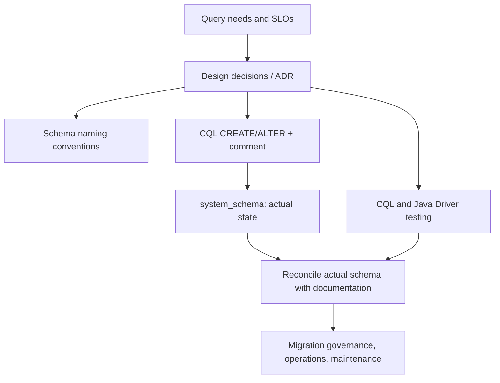

# Comments, Naming Conventions, and Documenting Design Choices

## 1. Why Does Schema Documentation Matter in Cassandra?

In Apache Cassandra, keyspace, table, and column names do more than enable writing CQL. They also help the development team understand **which query a table serves, how data is partitioned, and how it should be operated**. A table with a poorly designed partition key can cause oversized partitions or inefficient queries; a wrong table option can cause data to expire prematurely, create excessive tombstones, or increase compaction overhead.

In the **Keyspaces and Schema** chapter of module `DATABASE_ENGINE_WIDE_COLUMN_CASSANDRA`, this lesson connects three activities:

1. **Clear naming:** use consistent conventions to identify data scope and access paths.
2. **Writing `comment` in the schema:** provide a concise description living right next to the table and readable via CQL metadata.
3. **Documenting design decisions:** record why partition keys, clustering keys, replication, consistency levels, TTL/compaction, and migration plans were chosen in a versioned record.

For multi-service Java systems, clear naming and documented design rationale also help others avoid unnecessary `ALLOW FILTERING` queries, avoid modifying primary keys incorrectly, and avoid confusing the actual schema with the desired DDL file.

**Objectives:** after this lesson, you will be able to write CQL with `WITH comment`, inspect comments in `system_schema.tables`, propose naming conventions for keyspaces/tables/columns, and produce a decision record detailed enough for review or handoff to operations.

## 2. Three Layers of Information to Keep Separate

No single place can express every Cassandra design decision:

| Layer | Question Answered | Example |
| --- | --- | --- |
| **Identifier name** | What is the object, and what query pattern is it typically used for? | `orders_by_customer_month`, `placed_at` |
| **Schema comment** | What is this table for, and are there brief caveats? | `'Orders for one customer and month, newest first'` |
| **Design doc / ADR** | *Why* were the partition key, bucketing, RF/CL, TTL, and rejected alternatives chosen? | Records workload, trade-offs, partition thresholds, and runbooks |

Additionally, `system_schema` contains the **actual definition recorded by Cassandra**, while the migration repository holds the **desired definition**. If the two diverge, documentation cannot substitute for checking schema drift.



**`comment` helps orient readers; it is not a data constraint, not an index, and does not force applications to follow the documentation.**

## 3. `WITH comment`: Embedding Descriptions in Table Definitions

In Cassandra CQL, `comment` is a **table option** used to describe a table. When creating a table:

```sql
CREATE TABLE example_ks.events_by_device (
    device_id text,
    event_time timestamp,
    event_id uuid,
    value double,
    PRIMARY KEY ((device_id), event_time, event_id)
) WITH CLUSTERING ORDER BY (event_time DESC, event_id ASC)
  AND comment = 'Device events ordered by time';
```

This is a syntax template; to run it, `example_ks` must be created first. When updating the comment on an existing table:

```sql
ALTER TABLE example_ks.events_by_device
WITH comment = 'Device events for device-id lookups, latest first';
```

These two statements illustrate that `comment` belongs to the **table's schema metadata**, not a data row written by the application into the table.

### 3.1. Comment is a string literal, not a quoted identifier

CQL uses **single quotes** for string literals. If a comment contains a single quote, escape it by doubling that mark:

```sql
ALTER TABLE example_ks.events_by_device
WITH comment = 'Device''s events sorted newest first';
```

Metadata stores the string contents corresponding to `Device's events sorted newest first`. Do not use double quotes of a quoted identifier to replace single quotes in `comment`.

| Syntax | Meaning |
| --- | --- |
| `events_by_device` | Identifier, case-insensitive when unquoted |
| `"EventsByDevice"` | Identifier **distinct** from `eventsbydevice`, case-sensitive |
| `comment = 'Events by device'` | Assigns a **string value** to the table option |
| `'Device''s events'` | String value containing a single quote inside |

### 3.2. Where does `comment` live and what can it do?

`WITH comment = '...'` lets you attach a short description directly in `CREATE TABLE` or update it with `ALTER TABLE`. The comment typically appears when viewing DDL via `DESCRIBE TABLE` in `cqlsh` and through table metadata.

It does **not**:

- Enforce partition keys or query `WHERE` conditions.
- Create indexes, choose replicas, set consistency levels (CL), or perform repair.
- Change existing row contents or automatically backfill data.
- Replace operational documentation, query diagrams, or RF selection decisions.
- Automatically get updated by Cassandra if the actual design changes.

**Support note:** Cassandra CQL does not provide the same `COMMENT ON COLUMN`, `COMMENT ON TABLE`, `COMMENT ON KEYSPACE` command set as some RDBMSs. Do not assume you can attach arbitrary comments to individual columns/keyspaces using PostgreSQL/MySQL syntax. For column-level, keyspace-level, or complex decision descriptions, use versioned external documentation and maintain clear links to schema names.

### 3.3. Does `comment` affect performance or replication?

Changing `comment` is a schema property change. It does not require rewriting data rows, does not alter partition tokens, and does not increase RF. However, the schema change still must propagate across nodes: when deploying under a controlled workflow, observe **schema agreement** just like other DDLs.

Even though data impact is typically low, avoid running waves of pointless comment updates during peak hours or letting multiple services issue DDL concurrently. Bundle them into reviewable migrations with postcondition checks.

## 4. Naming Conventions for Keyspaces, Tables, and Columns

**Default recommendation:** use lowercase ASCII `snake_case` names that are business-clear, avoid CQL keywords, and do not rely on quoted identifiers:

| Object Type | Recommended | Avoid |
| --- | --- | --- |
| Keyspace | `commerce`, `inventory_app`, `telemetry` | `"CommerceApp"`, overly generic `data` |
| Table | `orders_by_customer_month`, `events_by_device_day` | `Table1`, `logs` when query pattern is unclear |
| Partition key | `customer_id`, `device_id`, `event_day` | `pk` or `key` lacking business meaning |
| Clustering column | `placed_at`, `event_time`, `order_id` | `sort1`, `date` when semantics are ambiguous |
| Data column | `total_amount`, `order_status`, `currency_code` | `value1`, vague names, or keyword collisions |
| UDT | `shipping_address`, `geo_point` | Names easily confused with tables or services |

### 4.1. Cassandra distinguishes quoted and unquoted names

In CQL:

- Unquoted `Orders_By_Customer` typically normalizes to `orders_by_customer`.
- `"Orders_By_Customer"` preserves uppercase letters and is **different** from `orders_by_customer`.
- `order_id` and `orderid` are **two different names** because the underscore is significant.

Using multiple names differing only in casing complicates scripts, Java mappings, and metadata checks. For new designs, avoid quoted identifiers unless bound by an unchangeable integration constraint.

**Valid naming is also constrained by object type and Cassandra version.** Do not assume adding double quotes allows arbitrary spaces or special characters in keyspaces/tables.

### 4.2. One table typically serves one specific group of queries

Cassandra discourages designing tables purely around entity structure and expecting arbitrary multi-dimensional queries like an RDBMS. Table names should hint at the **primary access path**:

| Business Query | Possible Table Design | Expected Partition Key |
| --- | --- | --- |
| Fetch one order by ID | `orders_by_id` | `order_id` |
| List a customer's orders in a month | `orders_by_customer_month` | `(customer_id, order_month)` |
| View device events in a day | `events_by_device_day` | `(device_id, event_day)` |
| List products by category and region | `products_by_category_region` | `(category_id, region_id)` |

The name `orders_by_customer_month` is only a **hint**. It does not enforce keys by itself; inspect `PRIMARY KEY` and actual metadata to see how data is really partitioned and sorted.

### 4.3. Clear names do not replace detailed design

A seemingly reasonable name can still produce an oversized partition if all of one customer's data lands in a single partition. If bucketing by month, explicitly document:

- How `order_month` is computed: first day of the month in the chosen business time zone.
- When a customer could still create an oversized partition despite monthly bucketing.
- Queries must supply both `customer_id` and `order_month`; multi-month queries require an application-side strategy.
- How data is ordered by `placed_at` and `order_id`, and how timestamp ties are handled.

Names and comments are the doorway to the design; they **do not contain the entire design**.

## 5. Lab: Query-Driven Naming and Meaningful Comments

This exercise uses keyspace `design_lab` in an isolated environment. Assume `nodetool status` shows the lab node belongs to a DC named exactly `datacenter1`. If different, substitute the DC name. RF = 1 is used **only for a single-node lab**, not as a fault-tolerant production configuration.

### Step 1 — Check DC and create the keyspace

```bash
nodetool status
```

```sql
CREATE KEYSPACE IF NOT EXISTS design_lab
WITH replication = {
    'class': 'NetworkTopologyStrategy',
    'datacenter1': '1'
}
AND durable_writes = true;
```

`IF NOT EXISTS` only handles an already-existing name; it does **not** verify the replication definition of `design_lab` if it existed beforehand. Read metadata before treating the keyspace as ready.

### Step 2 — Define the query to support

> "List up to 20 of the newest orders for a customer in a given month, sorted by order timestamp descending."

From this requirement, an illustrative choice:

- `customer_id` + `order_month` form a **composite partition key**, avoiding placing all of a customer's orders in an unbounded partition.
- `placed_at DESC` puts newest orders first; `order_id ASC` provides an additional clustering component to distinguish orders sharing the same timestamp.
- Columns `total_amount` and `order_status` serve the list screen without needing joins.

### Step 3 — Create table, comment, and table options

```sql
CREATE TABLE IF NOT EXISTS design_lab.orders_by_customer_month (
    customer_id uuid,
    order_month date,
    placed_at timestamp,
    order_id uuid,
    total_amount decimal,
    order_status text,
    PRIMARY KEY ((customer_id, order_month), placed_at, order_id)
) WITH CLUSTERING ORDER BY (placed_at DESC, order_id ASC)
  AND comment = 'Orders for one customer and month; newest first. ADR: ORD-007.'
  AND default_time_to_live = 0;
```

In the CQL above:

- The table name reveals the two main filters: customer and month.
- `comment` briefly states purpose, ordering, and provides an ADR reference.
- `default_time_to_live = 0` means **no default TTL**; it does not mean data can never be deleted by other commands.
- The comment does not enforce that the application computes `order_month` accurately or queries in the expected order.

**Lab limitation:** one month can still produce a large partition for customers with unusually high traffic; when moving to production, measure row counts, partition size, and load distribution before choosing bucket length.

### Step 4 — Write and read by partition key

```sql
INSERT INTO design_lab.orders_by_customer_month (
    customer_id, order_month, placed_at,
    order_id, total_amount, order_status
) VALUES (
    11111111-1111-4111-8111-111111111111,
    '2026-11-01',
    '2026-11-21T08:00:00Z',
    aaaaaaaa-aaaa-4aaa-8aaa-aaaaaaaaaaaa,
    250000.00,
    'PAID'
);

SELECT placed_at, order_id, total_amount, order_status
FROM design_lab.orders_by_customer_month
WHERE customer_id = 11111111-1111-4111-8111-111111111111
  AND order_month = '2026-11-01'
LIMIT 20;
```

The query targets only the partition identified by `(customer_id, order_month)`, avoiding `ALLOW FILTERING` across huge datasets. In a real system, the application must standardize time zone and first-of-month calculation before binding `order_month`.

### Step 5 — Update comment once documentation is clarified

```sql
ALTER TABLE design_lab.orders_by_customer_month
WITH comment = 'Customer-month order list, latest first; month is UTC first day; ADR ORD-007';
```

This statement only updates the **table comment**; it does not migrate data or alter the partition key. If you decide to change bucketing from monthly to weekly, updating the comment alone is **insufficient**: that is a key design change and may require a new table, backfill, and Java testing.

### Step 6 — Verify actual comment and keys

```sql
DESCRIBE TABLE design_lab.orders_by_customer_month;

SELECT table_name, comment, default_time_to_live, compaction
FROM system_schema.tables
WHERE keyspace_name = 'design_lab'
  AND table_name = 'orders_by_customer_month';

SELECT column_name, kind, position, type, clustering_order
FROM system_schema.columns
WHERE keyspace_name = 'design_lab'
  AND table_name = 'orders_by_customer_month';
```

`DESCRIBE TABLE` is a `cqlsh` utility, whereas `system_schema.tables`/`system_schema.columns` are metadata tables queryable via CQL. When reconstructing keys, **group by `kind` and sort by `position`**: the two partition-key components must be identified together, followed by the two clustering columns in order.

### Step 7 — Clean up the lab when no longer used

```sql
-- Warning: run only when design_lab is your own test keyspace.
DROP KEYSPACE IF EXISTS design_lab;
```

This command deletes **all tables and data** in keyspace `design_lab`. Do not run it on production keyspaces or environments with data that must be preserved.

## 6. Writing Good Comments: Short, Specific, and Maintainable

A useful comment typically answers three things: **what the table serves, which keys to filter on, and any critical caveats**.

| Comment | Rating | Why |
| --- | --- | --- |
| `'Table for data'` | Poor | Provides no information about queries or model |
| `'Orders'` | Too short | Does not explain how it differs from `orders_by_id` |
| `'Orders for one customer and month; newest first'` | Good | Clearly states query group and ordering |
| `'Monthly customer orders, UTC buckets; ADR ORD-007'` | Good | Exposes bucketing assumption and where to read rationale |
| A multi-thousand-word comment describing every process | Unsuitable | Hard to read/maintain; long explanations belong in versioned docs |

**A concise comment template:**

```text
<query purpose>; <key assumptions>; <ADR ID or related doc>
```

Example: `'Device events by device/day; UTC day buckets; ADR TEL-012'`.

### Information that must never go into a comment

Never put passwords, connection tokens, customer PII, personal phone numbers, secret paths, or sensitive data into comments. A comment is **metadata readable by authorized roles**, appearing in admin tools, schema reports, and DDL dumps.

Comments should also avoid unverifiable claims like "this table always has accurate data" or "repair is never needed." If there are genuine SLO or consistency requirements, document the measurement procedure and satisfaction criteria in reviewable documentation.

## 7. Documenting Design Choices: What Should an ADR Include?

An **ADR (Architecture Decision Record)** is a short, versioned record of an architectural decision: context, choice, rationale, consequences, and re-evaluation conditions. ADRs can live in a documentation repository or team knowledge base; the table `comment` should simply point to the ADR ID/name.

A practical ADR template for a Cassandra table:

| Field | Question to Answer | Example |
| --- | --- | --- |
| ID, status, date | Who approved, when does the decision take effect? | `ORD-007`, Accepted, review date |
| Query needs | Which `WHERE` clauses dominate? Is pagination needed? | Latest orders by customer + month, max 20 results |
| Data scope | Volume, cardinality, retention, load distribution? | Estimated orders/customer/month, whale customers |
| Partition key | Why these components and this order? | `(customer_id, order_month)` to bound partition size |
| Clustering key | Ordering, possibility of timestamp ties? | `placed_at DESC, order_id ASC` |
| Denormalized tables | Is data duplicated into other tables? | `orders_by_id` used for ID lookups |
| RF/topology | How many DCs, RF, and why? | Configured per approved production infrastructure |
| CL | Read/write goals and fault tolerance? | Specific choice per use case, e.g., `LOCAL_QUORUM` |
| TTL/retention | How long must records be kept, under what policy? | No default TTL; purged via approved retention workflow |
| Compaction/repair | Read/write workload and operational plan? | Evaluate suitable STCS/LCS/TWCS; periodic repair |
| Java access | Driver, prepared statements, mapping, and retries? | Bind full `customer_id` + `order_month`, paging |
| Alternatives | Which options were considered and why rejected? | Partitioning only by `customer_id` risks huge partitions |
| Risks & thresholds | When must the design be revisited? | Partition exceeds operational threshold, hot partitions |
| Migration/rollback | How to change schema with v1/v2? | Expand → dual-write/backfill → cutover → contract |

There is no need to cram all this information into the table comment or name. **Name + comment + ADR + actual metadata** complement one another.

### 7.1. Abbreviated ADR example for `orders_by_customer_month`

**Decision ORD-007 — Accepted**

**Context:** the Java application needs to list a customer's 20 most recent orders in a month. Storing all of a customer's orders in one partition risks creating very large partitions for heavily active customers.

**Decision:** create table `orders_by_customer_month` with partition key `(customer_id, order_month)` and clustering `placed_at DESC, order_id ASC`. The application normalizes `order_month` to the first day of the UTC month before writing and reading. Business fields needed for display are stored directly in the same row.

**Alternatives considered:**

- Unbucketed `orders_by_customer`: simpler queries, but partitions can grow unboundedly.
- Daily buckets: smaller partitions, but "whole month" queries may need to read many partitions.
- Monthly buckets: balances partition read count and data bounding for expected workload; **must be re-measured** as traffic changes.

**Consequences:** queries require both partition key components; listing across multiple months requires controlled multi-query execution in the application. If order lookup by ID is needed, add `orders_by_id` and maintain denormalized copies properly.

**Review triggers:** partitions exceed operations-approved size/row thresholds, query latency degrades, hot customers increase, or retention policies change.

**Parts NOT "hardcoded" in the example:** production RF, CL, compaction, and repair schedules must be decided based on real topology, fault tolerance, and workload; never copy the lab's RF = 1 into real environment configs.

### 7.2. Document what is *not* supported too

Examples worth documenting:

- Looking up arbitrary orders by `order_status` alone is not supported on `orders_by_customer_month`.
- Multi-partition scans with `ALLOW FILTERING` are discouraged.
- Partition keys cannot be changed with `ALTER TABLE ADD`; changing bucketing requires a new table and data migration.
- `comment` is not a contract enforcing date logic or partition quotas.

These boundaries prevent a new engineer from accidentally adding an API whose access path violates the Cassandra data model.

## 8. RF, CL, TTL, Compaction, and Repair Must Be Documented Separately

Table comments usually lack space to explain distributed operational decisions.

### Replication and consistency level

RF is configured at the **keyspace** level. A table `orders_by_customer_month` does not have an RF independent of keyspace `commerce`. In the design doc, explicitly record:

- Actual data center names and per-DC RF under `NetworkTopologyStrategy`.
- Read and write consistency levels (`LOCAL_ONE`, `LOCAL_QUORUM`, or other choices) and why they fit product requirements.
- Eligible node counts, expected failure scenarios, and cases where CL cannot be met.
- Impact of changing RF/DC: updating schema does **not** guarantee old data has reached all new replicas; a streaming/repair procedure is needed.

### TTL, compaction, tombstones

TTL policies and workload shape dictate tombstone behavior, compaction, and space reclamation. Document:

- Whether a default TTL is set, which data carries per-write TTLs, and any legal retention requirements.
- Why a specific compaction strategy is used, based on random reads, time-series, or write/delete ratios.
- How to monitor query latency, SSTable counts, tombstones, and disk usage.
- Impact of changing `gc_grace_seconds` on repair and offline replicas.

**Do not equate "TTL expired" with "physically deleted from SSTables immediately."** And never lower `gc_grace_seconds` arbitrarily to purge tombstones without considering replicas that might have missed deletes.

### Schema agreement and migrations

Changing a comment or table option is still DDL; the cluster must propagate the definition. When multiple Java application versions exist, document:

1. Which DDLs can be applied in a backward-compatible way (e.g., adding a column).
2. When all nodes must reach schema agreement.
3. Whether backfill, dual-write, and v1/v2 reader tests are required.
4. Conditions under which old columns/tables may be dropped.
5. How to check for schema drift after migration, beyond checking that CQL returned no error.

## 9. Verifying Names, Comments, and Actual Schema via CQL

Cassandra stores table comments in metadata. Typical query:

```sql
SELECT table_name, comment, default_time_to_live,
       compaction, compression
FROM system_schema.tables
WHERE keyspace_name = 'design_lab'
  AND table_name = 'orders_by_customer_month';
```

Check keyspace replication:

```sql
SELECT keyspace_name, replication, durable_writes
FROM system_schema.keyspaces
WHERE keyspace_name = 'design_lab';
```

Check keys and column types:

```sql
SELECT column_name, kind, position, type, clustering_order
FROM system_schema.columns
WHERE keyspace_name = 'design_lab'
  AND table_name = 'orders_by_customer_month';
```

If an ADR describes a partition key yet metadata shows that column as `regular` or with the wrong `position`, report **schema drift**. Do not rewrite comments to mask discrepancies; evaluate a structurally sound migration.

### Distinguishing three reconciliation situations

| Situation | How to Handle |
| --- | --- |
| Metadata is right; comment lacks description | Update comment via `ALTER TABLE ... WITH comment` |
| Comment is right; key/TTL metadata is wrong | Investigate actual schema and migration; comment does not fix data or other schema attributes |
| Metadata is right, but ADR is outdated | Update documentation and review; no DDL is needed just to fix an ADR |

Concurrent edits by multiple people can cause comments to drift from docs or applications. Ideally, manage comments as part of reviewed migrations, not as ad-hoc notes modified by arbitrary instances at startup.

## 10. Integrating into the Java Driver and Source Code

Examples use **Apache Cassandra Java Driver 4.x**, assuming `CqlSession session` is already created and externally lifecycle-managed. Java 15+ supports text blocks.

### 10.1. Reading comments to verify metadata after migration

```java
import com.datastax.oss.driver.api.core.CqlSession;
import com.datastax.oss.driver.api.core.cql.PreparedStatement;
import com.datastax.oss.driver.api.core.cql.Row;

// session is connected to the cluster; this code only reads metadata.
PreparedStatement ps = session.prepare("""
    SELECT comment, default_time_to_live
    FROM system_schema.tables
    WHERE keyspace_name = ? AND table_name = ?
    """);

Row row = session.execute(
    ps.bind("design_lab", "orders_by_customer_month")).one();

if (row == null) {
    throw new IllegalStateException("Table orders_by_customer_month missing");
}

String tableComment = row.getString("comment");
int ttl = row.getInt("default_time_to_live");

if (ttl != 0) {
    throw new IllegalStateException("Unexpected default TTL");
}
// tableComment is for metadata/reporting; do not treat it as a business constraint.
```

Bind markers `?` in the query above represent **string values** for `keyspace_name` and `table_name`; they do not substitute the `system_schema.tables` identifier.

### 10.2. Writing the exact query implied by the table name

```java
import com.datastax.oss.driver.api.core.cql.PreparedStatement;
import com.datastax.oss.driver.api.core.cql.Row;
import java.time.LocalDate;
import java.util.UUID;

PreparedStatement query = session.prepare("""
    SELECT placed_at, order_id, total_amount, order_status
    FROM design_lab.orders_by_customer_month
    WHERE customer_id = ? AND order_month = ?
    LIMIT 20
    """);

UUID customerId =
    UUID.fromString("11111111-1111-4111-8111-111111111111");
LocalDate monthBucket = LocalDate.of(2026, 11, 1);

for (Row order : session.execute(query.bind(customerId, monthBucket))) {
    // Process the list of orders in one partition/month.
}
```

`order_month date` is bound using Driver 4.x's date type. The application must normalize the month bucket according to business conventions, because Cassandra **does not automatically convert dates to the first day of the month**. Using a prepared statement binds the right value types, yet does not prove partitions remain appropriately sized as traffic grows.

### 10.3. Metadata APIs do not replace schema agreement

The driver provides a metadata API to inspect keyspaces/tables and an API to check schema agreement (depending on config/version), but a single metadata `SELECT` only reflects the view of the coordinator executing the query.

For reliable migration rollouts:

- Use a single coordinator rather than having every Java instance run DDL simultaneously.
- Wait for schema agreement, verify critical nodes, and check definition state.
- Compare reality against design—including primary key, column types, RF/DC, and TTL—not just names/comments.
- Test both new queries and queries of older application versions during rolling deployments.

## 11. When Should Names, Comments, and ADRs Be Updated?

| Change | Change Schema Name? | Update Comment? | Update ADR? |
| --- | --- | --- | --- |
| Clarifying description without changing logic | Not needed | Recommended | Optional if docs relate |
| Adding column `shipping_note` without changing keys | Not necessarily | If comment is affected | Record migration and dependencies if important |
| Changing bucket window from month to week | Evaluate a **new table** per query | Yes, on new schema | **Mandatory** to re-document partitions, migration, trade-offs |
| Adding lookup by `order_id` | Typically create `orders_by_id` | Yes, for the new table | Record denormalization/sync decision |
| Changing RF or adding a DC | No need to rename table | Not necessarily | Record topology, CL, streaming/repair |
| Changing TTL/compaction | Not necessarily | If lifecycle description changes | Should record rationale, impact, and rollback |
| Changing owner, SLO, or repair schedule | Not necessarily | Only if short description needs it | Update operational docs / ADR |

**Do not try to rename a table with an unsupported "rename" operation or without migration.** When access paths change, a new table and data migration are usually the cleaner choice in Cassandra. `ALTER TABLE RENAME`, where available, is restricted by column kind and version; it is not an arbitrary rename command for any table/column.

### Recommended review process

1. Define query requirements and dataset, analyzing cardinality/partitions.
2. Name schema objects consistently; write CQL and concise, meaningful comments.
3. Write an ADR: goals, trade-offs, RF/CL, TTL/compaction/repair, backfill, and rollback.
4. Review by application and operations owners; test on the exact target Cassandra version.
5. Apply coordinated migration and wait for schema agreement.
6. Reconcile `system_schema` and run Java query tests.
7. Sync documentation and code once actual results are verified.

## 12. Troubleshooting Errors and Common Misconceptions

| Symptom / Misconception | Cause | How to Handle |
| --- | --- | --- |
| "The comment says `by_month`, so monthly queries must be efficient." | Comments do not enforce keys | Check `PRIMARY KEY`, query plan, and actual data |
| `CREATE TABLE IF NOT EXISTS` succeeds, yet comment stays unchanged | Table of the same name existed; creation was skipped | Use `ALTER TABLE ... WITH comment` when updating only comment; reconcile schema first |
| Query omits `order_month` or fails on key | Table uses a composite partition key | Bind full partition key or design another access path |
| `order_month` computed inconsistently across time zones | App and ADR use different conventions | Specify UTC/business time zone clearly and test month boundaries |
| Comment drifts after migration | No process to update metadata/docs | Review comments in migrations; check `system_schema.tables` |
| Created as `"OrdersByCustomer"`, queried unquoted | Quoted identifiers are case-sensitive | Use exact name; prefer snake_case for new tables |
| `ALTER TABLE ... WITH comment` rejected by parser | Syntax error, quote escaping, or version mismatch | Check exact statement and escape single quotes |
| Data expires despite comment saying "retain forever" | Actual TTL differs from comment | Inspect `default_time_to_live` and per-write TTLs |
| Schema agreement reached, yet replicas still lack data | Agreement is only about definitions | Check repair/streaming after RF changes |
| Trying `COMMENT ON COLUMN` like PostgreSQL | Not a standard supported CQL syntax | Document columns in ADR/data dictionary and inspect metadata |
| Comment contains secrets | Metadata is visible in tools/DDL | Remove secrets from comments and follow incident exposure procedures if needed |

## 13. Hands-On Exercises and Self-Check Questions

### Exercise A — Naming by query

Given three requirements:

1. View events of one device within a day, newest first.
2. View one order by `order_id`.
3. View orders of one customer within a month.

Proposed names are `events_by_device_day`, `orders_by_id`, and `orders_by_customer_month` respectively. Then, **you must design** the actual partition/clustering keys and explain query constraints—do not stop at naming.

### Exercise B — Reconciling metadata with comments

In keyspace `design_lab`:

1. Use `DESCRIBE TABLE` to view the declared comment.
2. Read `system_schema.tables.comment`, `default_time_to_live`, and `compaction`.
3. Read `system_schema.columns` to reconstruct `PRIMARY KEY ((customer_id, order_month), placed_at, order_id)`.
4. Update the comment to add the UTC assumption, then re-check metadata after schema agreement.
5. Explain why updating the comment does not convert `order_month` from local-timezone values to UTC for existing rows.

### Exercise C — Writing a short ADR

Write an ADR based on the template in section 7 covering: primary query, why bucketing was chosen, partition-key cardinality, hot-partition handling, clustering order, production RF/CL for an assumed topology, TTL, compaction, repair, risks, measurement criteria, and migration plan.

**Review questions:**

1. Why should comments stay short while an ADR records rejected alternatives too?
2. Why does the table name `orders_by_customer_month` not prove the partition key is right?
3. Can `WITH comment` replace `ALTER TABLE` key changes or data backfill?
4. When should you create a new table instead of trying to "rename" an old table?
5. Which fields in `system_schema` must be reconciled to verify a query-driven table?

## 14. Schema Standardization Checklist Before Deployment

| Question | Required Evidence |
| --- | --- |
| Are keyspace/table/column names consistent? | `snake_case` names, no collisions or quoted-identifier confusion |
| Does the table name reveal the primary query? | Example query with `WHERE` supplying full partition key |
| Could partitions become oversized or hot? | Key distribution analysis, size estimates, and high-load scenarios |
| Are clustering columns and order accurate? | `PRIMARY KEY`, `CLUSTERING ORDER BY`, and sample queries |
| Does the comment briefly describe purpose without sensitive data? | `system_schema.tables.comment` |
| Does the ADR record rationale, alternatives, and owner? | Record with ID, status, date, and owner |
| Are RF/DC and CL chosen for the real topology? | `system_schema.keyspaces`, app config, and `nodetool status` |
| Do TTL/compaction/repair have runbooks? | Table options, operational thresholds, and maintenance schedules |
| Is the change compatible with old/new Java apps? | CQL/prepared statement tests, migration, and rollback plan |
| Has the cluster reached agreement and does actual schema match? | `nodetool describecluster`/driver plus metadata after DDL |
| Is there a plan if data must be migrated or replicas populated? | Backfill/dual-write or streaming/repair with verification criteria |

**Remember:** in Cassandra, *good names help find the right table; good comments help understand the table quickly; good ADRs explain why the structure is trustworthy*. All three must align with the **actual schema** and workload. Whenever partition keys, replication, TTL/compaction, or Java connection strategies change, update documentation alongside migrations and reconcile once the cluster reaches schema agreement.
