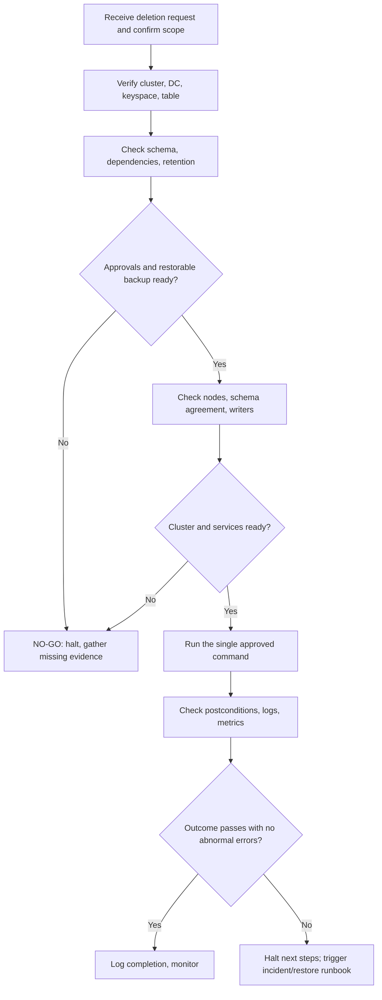

# TRUNCATE/DROP and Pre-Execution Safety Conditions

## 1. Why Do TRUNCATE and DROP Require Special Control Procedures?

In Apache Cassandra, `TRUNCATE` and `DROP` statements are operations with **large destructive scope**. They are unlike a `SELECT` query to observe data, and unlike a conditional `DELETE` by primary key to delete a few rows. A `TRUNCATE` statement can wipe all data of a table; `DROP TABLE` deletes the table definition as well; `DROP KEYSPACE` extends the scope to every object and all data inside the keyspace.

In the **Keyspaces and Schema** chapter of module `DATABASE_ENGINE_WIDE_COLUMN_CASSANDRA`, learners must place these operations in the context of a **distributed** wide-column database: data may reside across multiple replicas on multiple nodes/DCs; Java applications may rely on schema-dependent prepared statements and mappers; and replication, consistency levels (CL), compaction, repair, and backup plans all govern recoverability and operational quality.

Lesson objectives:

1. Accurately distinguish `TRUNCATE`, `DROP TABLE`, `DROP KEYSPACE`, and `DELETE`.
2. Identify the conditions that must be verified **before** running destructive commands.
3. Verify cluster name, keyspace, table, dependencies, permissions, node status, and schema agreement.
4. Understand the role of snapshots/backups, recovery limits, and why `IF EXISTS` is not a data-protection mechanism.
5. Write a safe execution runbook and understand how Java applications must respond when a table is truncated or dropped.

> **Principle:** No CQL check guarantees a destructive command is "safe" merely because it executes successfully. Safety conditions must be proven **before execution**, followed by postcondition checks afterward.

## 2. Comparing TRUNCATE, DROP, and DELETE

| Command | Scope | Does Table/Keyspace Definition Remain? | Affected Data | Typical Use Case |
| --- | --- | --- | --- | --- |
| `DELETE ... WHERE ...` | Rows or columns matching supported key conditions | Remains | Targeted rows/cells; uses tombstones | Selective business data deletion |
| `TRUNCATE [TABLE] ks.tbl` | **Entire table** | **Table remains** | All data in the table, with no `WHERE` clause | Emptying a test table or rebuildable table |
| `DROP TABLE [IF EXISTS] ks.tbl` | **One table** | **Table is gone** | Both schema and data of the table are deleted | Retiring an old table after migration |
| `DROP KEYSPACE [IF EXISTS] ks` | **Entire keyspace** | **Keyspace is gone** | All tables and objects within the keyspace scope | Tearing down a lab environment or retired keyspace |

### TRUNCATE is not DELETE without WHERE

In Cassandra, `TRUNCATE` is an **entire-table** emptying operation with no `WHERE` clause to restrict it to one partition. By contrast, `DELETE` generally must be designed around the primary key and CQL query constraints; row/cell deletions generate tombstones and have a lifecycle tied to compaction, `gc_grace_seconds`, and repair.

`TRUNCATE` is not equivalent to issuing millions of partition-key `DELETE`s. The data cleanup mechanism and storage impact differ; do not use the tombstone model of a normal `DELETE` to assume you can "undo" a truncate by removing tombstones.

### DROP TABLE deletes more than data

After `DROP TABLE`, `SELECT`, `INSERT`, `UPDATE`, or prepared statements referencing that table no longer have a valid definition. If Java applications are still running, errors can surface across many services even though the drop ran only once.

### DROP KEYSPACE has the widest scope

`DROP KEYSPACE` deletes the namespace along with all objects belonging to it, not just the single table an operator is looking at. Tables, user-defined types, and other schema objects within the keyspace are all affected per version rules. Inspecting only one table before dropping a keyspace is **not sufficient**.

## 3. CQL Syntax Patterns and Key Conditions

The statements below are **templates for learning syntax**; never substitute a production keyspace name and run them as a test.

```sql
-- Empty a table's data; the table still exists.
TRUNCATE safety_lab.temp_events;

-- The TABLE keyword is optional in CQL versions supporting this form.
TRUNCATE TABLE safety_lab.temp_events;

-- Delete both the definition and data of a table.
DROP TABLE IF EXISTS safety_lab.temp_events;

-- Delete the entire keyspace; use only when authorized to destroy everything.
DROP KEYSPACE IF EXISTS safety_lab;
```

`IF EXISTS` is supported on the corresponding `DROP` statements to avoid errors **if the object does not exist**. It does **not** check whether the table is empty, confirm a lab environment, verify the owner, create a backup, or require extra approval.

If the table or keyspace **does exist** and execution permissions allow it, `DROP ... IF EXISTS` can still delete it. A typo pointing the command to a real production table name can cause a severe outage despite `IF EXISTS`.

Exact syntax of certain conditional options and behavior when objects have dependencies can vary by Cassandra version. Do not assume `IF EXISTS` can be added to **every** `TRUNCATE` variant, or that DDL statements support general transactions/rollback.

## 4. Ten Safety Conditions to Confirm Before Execution

Recommended **GO/NO-GO** checklist model:

| Gate | Mandatory Question | Expected Evidence |
| --- | --- | --- |
| 1. Target | Are the target cluster, DC, environment, and endpoint right? | Connection config, cluster name, `nodetool status` |
| 2. Object | Has the full `keyspace.table` name been verified accurately? | `system_schema`, `DESCRIBE`, owner info |
| 3. Scope | Do you intend to delete **data**, **one table**, or **an entire keyspace**? | Business objective and approved command |
| 4. Dependencies | Are any Java services, jobs, indexes, views, ETL/CDC, or consumers still using it? | Query inventory, dependency map, usage logs |
| 5. Data | Is any data required to be kept for business, legal, audit, or incident investigation? | Retention policy, data owner sign-off |
| 6. Recovery | Is there a complete backup/snapshot stored safely and **tested for restore**? | Manifest, tag, checksum, recovery guide |
| 7. Cluster state | Are required nodes/replicas available and is the schema in agreement? | `nodetool status`, `describecluster`, system alerts |
| 8. Permissions & approval | Which account executes, who approves, is two-person verification needed? | Change ticket, CQL roles, approval record |
| 9. Maintenance window | Have writers/retries/crons been stopped and outage notices planned? | Maintenance window, feature flags, job states |
| 10. Postconditions | What will be verified afterward, and who decides success/halt/recovery? | Runbook, read-only CQL checks, metrics/alerts |

**If any critical condition lacks verifiable answers, choose NO-GO.** "Nobody probably uses this table" or "the script has run many times" is not evidence.

### A two-person operational model

The proposer specifies the **exact full name, scope, rationale, and backup**. An independent approver verifies the same details on the real cluster. Only after confirmation does the operator execute the exact prepared statement.

This matters far more than trying to insert a "safety" CQL clause into the command, because CQL has no `DROP ... ONLY IF BACKUP VERIFIED` mode.

## 5. Preflight: Verifying the Right Cluster and System State

Before touching data, inspect topology from a Cassandra node:

```bash
nodetool status
nodetool describecluster
```

`nodetool status` shows the observed state of nodes and DCs; example statuses include `UN` (*Up/Normal*) or `DN` (*Down/Normal*). Identify any nodes that are down, bootstrapping/decommissioning, or experiencing inter-DC issues.

`nodetool describecluster` typically displays **Schema versions** groups. If active nodes are split across multiple schema versions, do **not** proceed with destructive DDL before investigating the cause.

In `cqlsh`, inspect the connected node:

```sql
SELECT key, cluster_name, data_center, rack, schema_version
FROM system.local
WHERE key = 'local';
```

`system.local` is metadata **of the node serving that query**; it does not prove all nodes are in the same state. If the session goes through a load balancer, do not assume two query runs hit two different nodes.

### Why is a down node a dangerous signal?

In a distributed cluster, `TRUNCATE` must ensure the emptying operation is handled according to cluster mechanics. Cassandra versions may reject truncate when unable to contact/complete with required nodes; never rely on an assumption that "as long as quorum remains, truncate is safe."

For `DROP`, schema changes also need to propagate. A down node may not learn the new metadata yet; when it returns, schema synchronization must be handled properly. Policies allowing operations while nodes are down must come from the runbook and Cassandra version, **never** inferred directly from a `SELECT`'s CL.

## 6. Preflight: Confirming the Exact Keyspace, Table, and Dependencies

The following queries are **metadata read-only** and useful before any destructive action:

```sql
-- Verify the target keyspace and replication.
SELECT keyspace_name, replication, durable_writes
FROM system_schema.keyspaces
WHERE keyspace_name = 'safety_lab';

-- List all tables in the keyspace.
SELECT table_name, comment
FROM system_schema.tables
WHERE keyspace_name = 'safety_lab';

-- Inspect column/key definitions of the target table.
SELECT column_name, kind, position, type
FROM system_schema.columns
WHERE keyspace_name = 'safety_lab'
  AND table_name = 'temp_events';

-- Detect indexes declared in the keyspace.
SELECT table_name, index_name, kind
FROM system_schema.indexes
WHERE keyspace_name = 'safety_lab';

-- Detect materialized views, if any.
SELECT view_name, base_table_name
FROM system_schema.views
WHERE keyspace_name = 'safety_lab';

-- Inspect UDTs of the keyspace.
SELECT type_name
FROM system_schema.types
WHERE keyspace_name = 'safety_lab';
```

These queries show the **schema seen by the current coordinator**. For production systems, combine with schema agreement and, when needed, check metadata on multiple nodes to avoid reading unsynchronized state.

To view readable DDL in `cqlsh`:

```sql
DESCRIBE KEYSPACE safety_lab;
DESCRIBE TABLE safety_lab.temp_events;
```

`DESCRIBE` is a `cqlsh` utility; Java drivers typically use `system_schema` or the metadata API instead of sending `DESCRIBE` verbatim as a CQL query.

### Not all dependencies live in `system_schema`

`system_schema` helps find indexes/views/types, but does not list every program using the table. Also check:

- Source code repositories, prepared statements, mappers, and dynamic CQL queries.
- Java APIs, batch jobs, schedulers, consumers, CDC/ETL pipelines, and analytical queries.
- Data denormalized into other tables where business logic relies on the original source.
- Reporting stores, dashboards, data pipelines, and older running service versions.
- Retry mechanisms or queues that could write back to the table after you thought writers were stopped.

For `DROP KEYSPACE`, inspect the **entire** list of tables, types, indexes, and views—not just a single table.

## 7. Lab: Creating Small Data and Verifying Before Deleting

This practice runs only in an **isolated lab cluster**, with keyspace `safety_lab` and disposable dummy data. Assume `nodetool status` reports the real DC is `datacenter1`, with one node. If your DC has a different name, replace it accurately; RF = 1 is only for a single-node lab.

### Step 1 — Create the lab keyspace

```sql
CREATE KEYSPACE IF NOT EXISTS safety_lab
WITH replication = {
    'class': 'NetworkTopologyStrategy',
    'datacenter1': '1'
}
AND durable_writes = true;
```

If `safety_lab` already existed, `IF NOT EXISTS` does not verify RF or structure. Proceed only if this is a lab keyspace you own and whose data is completely disposable.

### Step 2 — Create the test table

```sql
CREATE TABLE IF NOT EXISTS safety_lab.temp_events (
    device_id text,
    event_time timestamp,
    event_id uuid,
    message text,
    PRIMARY KEY ((device_id), event_time, event_id)
) WITH CLUSTERING ORDER BY (event_time DESC, event_id ASC)
  AND comment = 'Disposable training data only';
```

`device_id` is the partition key. Even though the lab table is named `temp_events`, **the word "temp" and the comment do not make it an auto-expiring temporary table**; Cassandra does not infer data-deletion policies from name strings.

### Step 3 — Insert a few rows and verify by reading

```sql
INSERT INTO safety_lab.temp_events (
    device_id, event_time, event_id, message
) VALUES (
    'sensor-01', '2026-11-21T08:00:00Z',
    aaaaaaaa-aaaa-4aaa-8aaa-aaaaaaaaaaaa, 'one'
);

INSERT INTO safety_lab.temp_events (
    device_id, event_time, event_id, message
) VALUES (
    'sensor-01', '2026-11-21T08:01:00Z',
    bbbbbbbb-bbbb-4bbb-8bbb-bbbbbbbbbbbb, 'two'
);

SELECT event_time, event_id, message
FROM safety_lab.temp_events
WHERE device_id = 'sensor-01';
```

Querying **by partition key** confirms your own test data. It does not prove a production table has no data outside the tested partition.

### Step 4 — Record pre-operation state

```sql
SELECT table_name, comment
FROM system_schema.tables
WHERE keyspace_name = 'safety_lab'
  AND table_name = 'temp_events';
```

Record that the table has its schema, test rows, and intended scope to empty. If lab recoverability is genuinely needed, take and verify a backup/snapshot first.

## 8. TRUNCATE: Emptying the Whole Table While Keeping Structure

**Only in a disposable lab**, after completing preflight:

```sql
-- Destructive to data: execute only on disposable lab data.
TRUNCATE safety_lab.temp_events;
```

### Expected postconditions

```sql
-- Test data by partition key is gone.
SELECT event_time, event_id, message
FROM safety_lab.temp_events
WHERE device_id = 'sensor-01';

-- Table definition still exists.
SELECT table_name
FROM system_schema.tables
WHERE keyspace_name = 'safety_lab'
  AND table_name = 'temp_events';
```

After a successful truncate on the lab:

- The table's data is removed via the truncate mechanism; test rows can no longer be read as before.
- **The table name, columns, and PRIMARY KEY still exist**; you can continue `INSERT`ing into that table.
- Other tables in the same keyspace are not truncated merely by sharing the namespace.
- Java code writing to the table **can immediately resume writing new data** afterward unless writers were stopped. Thus "table empty right after truncate" does not guarantee "table will stay empty."

### Why not use TRUNCATE as a conditional deletion tool?

`TRUNCATE` has no `WHERE device_id = ...`. If the business requirement is to delete data for **one** device or a specific time range, design a `DELETE` using Cassandra-supported keys/conditions, or an appropriate retention/TTL strategy. You cannot turn truncate into "fast delete one partition" by adding a filter.

### Storage and tombstone impact

`TRUNCATE` uses a different data-removal mechanism from bulk row-level `DELETE`s and does not generate one tombstone per row like ordinary row deletions. However, **do not assume** this operation lets you recover data or that every backup/snapshot was deleted. Automatic snapshot creation, truncation metadata, and SSTable cleanup depend on Cassandra version/configuration.

Never use "faster than bulk deletes" as an excuse to skip backups or run truncate on a production table holding data that must be preserved.

## 9. DROP TABLE: Deleting Both Table Definition and Data

For the lesson, consider this only after truncating or verifying that the lab data is disposable:

```sql
-- Destroys both data and table definition: run only on a verified lab.
DROP TABLE IF EXISTS safety_lab.temp_events;
```

Check postconditions:

```sql
SELECT table_name
FROM system_schema.tables
WHERE keyspace_name = 'safety_lab'
  AND table_name = 'temp_events';

-- The keyspace still exists if only DROP TABLE was run.
SELECT keyspace_name
FROM system_schema.keyspaces
WHERE keyspace_name = 'safety_lab';
```

Once the table is dropped and schema synchronized:

- The table definition metadata is gone.
- `SELECT`/`INSERT` queries targeting the old table are no longer valid.
- The keyspace remains; other tables are not deleted just by dropping one table.
- Dependent indexes and views can cause the command to be rejected or require handling per version and object type rules; **do not** assume a safe cascade.

### Why is DROP TABLE a major risk for Java applications?

Prepared statements, mappers, repositories, background jobs, or APIs still using the old table name can fail on coordinators that have received the new schema. When multiple application versions run simultaneously, never drop an old table just because v2 switched to a new table; you must prove **v1, legacy jobs, and the rollback path** no longer need it.

### DROP is not "undone" by CREATE

Re-running `CREATE TABLE` with the previous structure does **not** restore lost rows. Reusing the table name does not guarantee the same internal ID and storage metadata as before. Recovery requires a data restore procedure matching your snapshots/backups, schema, and Cassandra version, tested prior to the operation.

## 10. DROP KEYSPACE: Deleting the Entire Namespace

This is the broadest-scope operation in this lesson. Use it only when **every object** in the keyspace is confirmed disposable:

```sql
-- Drop only a verified lab keyspace; do not use on production.
DROP KEYSPACE IF EXISTS safety_lab;
```

After schema agreement, read:

```sql
SELECT keyspace_name
FROM system_schema.keyspaces
WHERE keyspace_name = 'safety_lab';
```

If no keyspace metadata remains, that namespace is no longer declared in the queried schema. This is **not** proof that all old snapshot files have been deleted or that all applications have stopped referencing that keyspace name.

### Additional conditions before DROP KEYSPACE

1. List **every table**, UDT, index/view, and application-managed object.
2. Confirm no data or dependency needs to be kept in **any table**.
3. Confirm cluster/endpoint/environment; ensure zero risk of lab/production keyspace name collision.
4. Save schema DDL and any data to preserve per the recovery plan.
5. Stop writers, jobs, streams, and consumers using any table in the keyspace.
6. Obtain specific approval for a deletion scope wider than a single table.

**Especially:** never run `DROP KEYSPACE` on `system`, `system_schema`, `system_auth`, or other internal keyspaces to "clean up." They are managed by Cassandra; direct edits/deletes can break the cluster or security.

## 11. Snapshots, Backups, and Restores: Preparing Before Destruction

### A snapshot does not automatically equal a safe backup

Cassandra snapshots typically rely on SSTable data on a node and related file mechanisms; creating a snapshot with `nodetool` captures state at a point in time. Example:

```bash
# Illustrative example for a lab keyspace; verify nodetool syntax per version.
nodetool snapshot -t before_cleanup_lab safety_lab
```

This is only **one step in a process**: in a multi-node cluster, confirm relevant nodes are snapshotted as planned, contain needed data/schema, are copied off-node to safe backup storage, pass integrity checks, and have a tested restore procedure.

Do not rely on *auto_snapshot* during `TRUNCATE` or `DROP`: behavior, defaults, and snapshot contents can differ by version/configuration; it does not guarantee data is always available for recovery. Moreover, snapshots **do not automatically capture full application config, permissions, secrets, or system dependencies**.

### Four questions requiring evidence

| Question | Example Evidence |
| --- | --- |
| What does this backup cover? | Keyspace/tables, schema DDL, SSTables, and relevant nodes/DCs |
| Is the data off the at-risk environment? | Copy to off-node backup storage with a retention policy |
| Can it restore within RPO/RTO limits? | Restore drill results in an isolated environment |
| How is a restored copy verified? | Metadata, sample key counts/sets, app-layer checksums, query tests |

### Recovery sequence must be designed in advance

Restoring a dropped table is not merely re-running `CREATE TABLE`; it may require recreating a compatible schema, restoring SSTables via a supported workflow, running streaming/repair per topology, and validating data. Exact steps depend on Cassandra version, backup mechanism, and node/DC counts.

Never claim "we have a snapshot so rollback is instant": snapshots do not eliminate downtime risk, loss of writes after snapshot time, or missing schema dependencies.

## 12. TRUNCATE/DROP in a Multi-Node Cluster: Things to Remember

### Schema agreement and data are two separate layers

`DROP TABLE` and `DROP KEYSPACE` are DDLs that alter the schema; wait for and verify **schema agreement** across nodes in the operational scope. `TRUNCATE` empties a table's data **without removing the table definition**; therefore schema agreement is not the sole criterion to declare truncate complete. Check the operation outcome, node health, and actual data.

| Check | TRUNCATE | DROP TABLE/KEYSPACE |
| --- | --- | --- |
| Right object and environment | Mandatory | Mandatory |
| Required nodes/replicas ready | Mandatory assessment | Mandatory assessment |
| Post-op data state | Verify by dataset and monitoring | Data no longer queryable from dropped object |
| Schema agreement | Schema remains; check if related DDL or suspected drift | Mandatory verification after DDL |
| Java/service/job dependencies | Data may immediately be re-written | Queries/mappers may fail immediately |
| Backup/restore | Must not skip | Must not skip |

### Consistency level is not a safety switch

A write at `LOCAL_QUORUM` or read at `ONE` governs replica responses for data statements. It does not turn `TRUNCATE` into a conditional operation and does not prove `DROP` has been received by every node.

### Repair and compaction are not an undo button

Repair synchronizes data across replicas according to Cassandra's mechanics; it is not a tool to "recover a dropped table." Compaction manages SSTables/tombstones, not backups. Once a destructive process has completed, do **not** run repair expecting old data to magically return.

## 13. Safe Operation Runbook with Explicit Stop Gates



### Before the maintenance window

- Create a change ticket specifying the **exact intended CQL** and full object name.
- Verify the environment against connection configs and `nodetool`; confirm Cassandra version.
- List tables/UDTs/indexes/views and active clients; secure owner approval.
- Check retention policies, prepare backups/snapshots, and run a restore drill.
- Prepare the plan to stop writers and ensure no retries/jobs immediately recreate data.

### During the maintenance window

- Put services into appropriate maintenance state; confirm related write streams are stopped.
- Re-check metadata and node health **immediately before** execution.
- Operator runs **one properly scoped command**, not bundling multiple `DROP`s into an ambiguous script.
- If the command times out or state is uncertain, do **not** blindly re-run it. First read actual state and logs to see how far it took effect.

### After the maintenance window

- For `TRUNCATE`: verify the table still exists and test rows are gone per criteria, while watching whether writers re-insert data.
- For `DROP TABLE`: verify the table is gone from `system_schema.tables`, the keyspace remains, and schema agreement is reached.
- For `DROP KEYSPACE`: verify the keyspace is gone from `system_schema.keyspaces`, and node/application state matches expectations.
- Record timestamp, operator, backup tag, check results, and monitor Java errors.

## 14. Java Driver Integration: Blocking Accidental Operations via Preflight

Normal Java applications **should never run `TRUNCATE` or `DROP` at startup**, and especially should never let external APIs interpolate table names into DDL. That belongs to migrations/operations with separate privileges and approvals.

**Metadata read-only** example using Cassandra Java Driver 4.x, with `CqlSession session` configured/initialized externally:

```java
import com.datastax.oss.driver.api.core.CqlSession;
import com.datastax.oss.driver.api.core.cql.PreparedStatement;
import com.datastax.oss.driver.api.core.cql.Row;

// Only check lab keyspace and table names; do NOT execute TRUNCATE/DROP.
final String expectedKeyspace = "safety_lab";
final String expectedTable = "temp_events";

PreparedStatement keyspaceStatement = session.prepare("""
    SELECT keyspace_name
    FROM system_schema.keyspaces
    WHERE keyspace_name = ?
    """);
Row keyspace = session.execute(
    keyspaceStatement.bind(expectedKeyspace)).one();

PreparedStatement tableStatement = session.prepare("""
    SELECT table_name, comment
    FROM system_schema.tables
    WHERE keyspace_name = ? AND table_name = ?
    """);
Row table = session.execute(
    tableStatement.bind(expectedKeyspace, expectedTable)).one();

if (keyspace == null || table == null) {
    throw new IllegalStateException(
        "Approved keyspace/table not found; halting operation");
}

if (!"Disposable training data only".equals(table.getString("comment"))) {
    throw new IllegalStateException(
        "Lab identification comment mismatch; re-verification required");
}

// Only an additional identification check, NOT proof that data is disposable.
// DDL execution must be controlled by operational runbooks and external approval.
```

Java text blocks require Java 15 or later. `?` in prepared statements is for `keyspace_name`/`table_name` **values**; bind markers cannot substitute identifiers directly in `TRUNCATE ks.tbl` or `DROP TABLE ks.tbl`. Never interpolate identifiers from arbitrary HTTP inputs into DDL: if generation is unavoidable, allowlist only approved names, apply CQL escaping/quoting rules properly, and enforce separate permission controls.

### Comment is not sole proof

In the example, checking the comment helps catch target mix-ups, but it is **not a safety guardrail**: comments can be miswritten or intentionally altered. Production requires verifying cluster, account, permissions, backups, dependencies, owner, and approvals from independent sources.

### If the schema changes while Java is still running

`DROP TABLE` invalidates prepared statements and legacy code referencing that table. Depending on driver and schema state, the application may see query/prepare errors or need a metadata refresh; do **not** "fix" it by having the app automatically recreate the table and keep writing without an operational decision. `TRUNCATE` keeps the table but can make the application see empty data; a clear business contract must govern this.

## 15. Common Errors and How to Handle Them

| Mistake / Symptom | Cause or Risk | How to Handle |
| --- | --- | --- |
| Using `TRUNCATE` to delete one partition | `TRUNCATE` has no `WHERE` | Build a valid key-based `DELETE` or retention strategy |
| Treating `DROP TABLE IF EXISTS` as "safe" | Only skips error if **nonexistent**, does not check data | Apply approval, backup, and dependency checklist |
| Dropping a table on the wrong cluster | Wrong endpoint/environment | Verify cluster name, DC, account, and schema first |
| Dropping a keyspace thinking it held only one table | Failed to list all objects | Query `system_schema.tables/types/indexes/views` |
| Data reappears right after `TRUNCATE` | Writers/jobs still inserting, or check was inaccurate | Stop writers and inspect write timestamps; do not blindly repeat truncate |
| `TRUNCATE` fails when a node is unavailable | Cluster prerequisites for the operation are not met | Check nodes/network/logs; do not assume CL quorum suffices |
| After `DROP TABLE`, Java reports missing table | Services/statements still depend on old schema | Compatible rollout; stop/switch clients before dropping |
| Re-running `CREATE TABLE` does not bring data back | Creating new schema does not restore data | Restore from verified backups/snapshots |
| Relying blindly on auto-snapshot | Config/version/retention policy differs from expectations | Create and verify dedicated backups; test restore |
| Running `SELECT COUNT(*)` on a huge table to prove it is empty | Full data scan can be very resource-intensive | Use partition-scoped checks, metrics/`tablestats`, and proper inventory tools |
| Seeing one schema version in `nodetool describecluster` and assuming all data is deleted | Agreement reflects only schema | Verify truncate/data path outcomes and node states |
| Running multiple destructive commands at once and losing track of failures | Lack of sequencing and logging | Execute step by step per runbook, reading postconditions |

### Do not use full-table `COUNT(*)` as a default preflight

In Cassandra, `SELECT COUNT(*) FROM large_table` can read massive amounts of data and impose heavy load—it is not an instant metadata count. For large tables, use metrics, version-appropriate `nodetool tablestats`, known partition ranges, and proper data inventory workflows. Those numbers also have their own margins and observation scopes, so combine them with business requirements and backups.

## 16. Self-Check Exercises and Summary

### Exercise A — Choosing the right command for each requirement

| Requirement | Option to Consider |
| --- | --- |
| Empty an entire lab table, keeping columns/keys to reload | `TRUNCATE` after safety checks |
| Retire an old table after migration with zero dependencies left | `DROP TABLE` after backup/approval |
| Tear down an entire lab keyspace and all test tables | `DROP KEYSPACE` after listing every object |
| Delete records for one specific partition key | `DELETE` with valid key conditions, **never** `TRUNCATE` |
| Change partition key or move table to a new query | Design new table, dual-write/backfill/cutover; never use `TRUNCATE` to "migrate" |

### Exercise B — Identifying a NO-GO

Suppose there is a request for `DROP KEYSPACE inventory_prod`. The cluster has one node down, a legacy application account still runs a job writing to a table in that keyspace, and the latest backup has never been restore-tested. What should you do?

**Answer:** **NO-GO**. Resolve/assess the down node, stop or migrate all dependent clients, verify data/retention, obtain a restorable backup, and secure approval before considering the operation. `IF EXISTS` fixes none of those gaps.

### Exercise C — Understanding recovery limits

After `TRUNCATE safety_lab.temp_events`, someone suggests running `nodetool repair` to get old data back. Why is that wrong?

**Answer:** repair is a mechanism to synchronize replicas toward valid cluster data; it is not an "undo" for truncate. Recovering deleted data requires an appropriate backup/snapshot and a tested restore procedure.

### Review questions

1. How does `TRUNCATE` differ from `DROP TABLE` regarding schema and data?
2. Why can `DROP KEYSPACE IF EXISTS` still cause severe data loss?
3. Why must you check `nodetool status` alongside schema agreement?
4. Beyond `system_schema`, where must you look for application dependencies?
5. Why does the existence of a snapshot not prove a restore will succeed?
6. When should you use a key-based `DELETE` instead of truncating the entire table?
7. Why should individual Java instances never run destructive commands at startup?

### Final GO/NO-GO checklist

| Criterion | GO When |
| --- | --- |
| Cluster and environment | Endpoint, cluster name, DC, and account verified |
| Object | Exact full keyspace/table name confirmed by owner |
| Scope | Clear whether deleting data or schema too; no scope confusion |
| Dependencies | No remaining services/jobs/readers need the data or schema being deleted |
| Data and retention | No violation of retention, audit, or business requirements |
| Backup | Full-scope backup stored safely, restore verified |
| Nodes and schema | Cluster meets operational prerequisites, no unresolved inconsistencies |
| Permissions and approval | Approved change, account has sufficient yet minimal privileges |
| Writers and schedule | Unwanted new writes/retries blocked and maintenance window active |
| Postconditions | Verification queries, metrics, incident handling, and restore procedures ready |

**Remember:** `TRUNCATE` deletes data while keeping the table definition; `DROP TABLE` deletes the entire table; `DROP KEYSPACE` deletes the namespace and all objects within it. Neither `IF EXISTS`, schema agreement, nor consistency levels turn a destructive command into a safe one. Execute only after verifying the exact object, dependencies, cluster state, restorable backup, and approval; then re-read metadata and verify results per the runbook.
