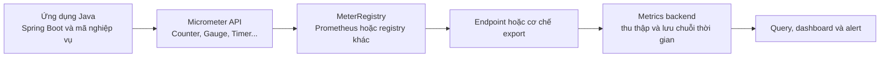

# Vai trò của Micrometer trong kiến trúc quan sát hệ thống

Micrometer là lớp instrumentation metrics dành cho ứng dụng Java. Nó cung cấp một API thống nhất để mã ứng dụng ghi nhận số lần xảy ra sự kiện, giá trị hiện tại của tài nguyên, thời gian xử lý và phân bố của các đại lượng. Nhờ đó, logic nghiệp vụ có thể phát ra số đo mà không phải phụ thuộc trực tiếp vào giao thức hoặc cách lưu trữ của một nền tảng giám sát cụ thể.

Trong kiến trúc observability, Micrometer nằm giữa ứng dụng và hệ thống thu thập metrics. Ứng dụng quyết định **đo điều gì và đo ở đâu**; Micrometer chuẩn hóa cách tạo và quản lý số đo; registry tương ứng với backend quyết định **metrics được biểu diễn và xuất đi như thế nào**. Backend tiếp nhận dữ liệu, lưu chuỗi thời gian, cho phép truy vấn, dựng dashboard và thiết lập cảnh báo.

## 1. Micrometer nằm ở đâu trong kiến trúc observability?

Một luồng metrics điển hình có thể hình dung như sau:



Các bước diễn ra theo thứ tự:

1. **Ứng dụng tạo số đo tại điểm có ý nghĩa.** Ví dụ, sau khi tạo đơn hàng thành công, ứng dụng tăng một counter; khi xử lý một request, ứng dụng ghi thời gian vào timer.
2. **Micrometer quản lý các meter.** Mỗi meter có tên, loại, đơn vị phù hợp và tập tag mô tả ngữ cảnh. API của Micrometer giữ cách instrument nhất quán giữa các backend.
3. **MeterRegistry tiếp nhận và xuất số đo.** Registry là cầu nối với hệ thống metrics. Registry cho Prometheus có thể cung cấp dữ liệu qua endpoint để Prometheus chủ động scrape; các registry khác có thể dùng cơ chế export phù hợp với backend tương ứng.
4. **Backend lưu và xử lý chuỗi thời gian.** Backend nhận các mẫu đo theo thời gian, hỗ trợ truy vấn, tổng hợp giữa nhiều instance và tính toán các chỉ số vận hành.
5. **Dashboard và alert biến số đo thành hành động.** Nhóm vận hành theo dõi lưu lượng, lỗi, độ trễ, hàng đợi hoặc mức sử dụng tài nguyên; cảnh báo được kích hoạt khi số đo vi phạm ngưỡng hoặc SLO đã đặt ra.

Micrometer vì vậy giải quyết phần instrumentation và tích hợp metrics trong ứng dụng. Nó không thay thế kho lưu trữ metrics, công cụ truy vấn, dashboard hay hệ thống quản lý cảnh báo. Registry cũng không phải kho lưu trữ lịch sử dài hạn: dữ liệu lịch sử thường được backend giám sát lưu giữ.

## 2. Những thành phần chính

### Meter

**Meter** là một phép đo được đăng ký trong registry. Một meter thường được nhận diện bởi tên và tập tag. Loại meter quyết định cách giá trị được ghi nhận và diễn giải.

Ví dụ:

- `orders.created`: số đơn hàng được tạo.
- `http.server.requests`: số lượng và thời gian xử lý request HTTP.
- `worker.queue.depth`: số phần tử hiện có trong hàng đợi.
- `orders.processing`: thời gian xử lý thao tác tạo đơn hàng.

Tên metric nên mô tả đại lượng được đo, ổn định theo thời gian và không chứa giá trị thay đổi theo từng request. Phần ngữ cảnh ổn định nên được biểu diễn bằng tag.

### MeterRegistry

**MeterRegistry** quản lý các meter và cung cấp điểm tích hợp với backend. Mã nghiệp vụ thường nhận `MeterRegistry` qua dependency injection rồi đăng ký hoặc lấy meter từ registry đó.

Micrometer có nhiều registry implementation. Chẳng hạn, `PrometheusMeterRegistry` chuyển số đo sang định dạng Prometheus; những registry khác kết nối với các hệ thống metrics tương ứng. Mỗi registry có thể áp dụng quy ước đặt tên, đơn vị và cách xuất dữ liệu riêng. Vì vậy, cùng một meter trong mã Java có thể được biểu diễn khác nhau ở backend mà không cần viết lại logic nghiệp vụ.

Khi ứng dụng cần xuất metrics đến nhiều hệ thống, có thể dùng composite registry hoặc cấu hình nhiều registry theo khả năng của ứng dụng. Cần cân nhắc chi phí export và số lượng chuỗi thời gian mà mỗi backend phải tiếp nhận.

### Registry và backend là hai trách nhiệm khác nhau

Registry nằm trong tiến trình ứng dụng và quản lý các meter được instrument. Backend nằm trong hạ tầng giám sát, tiếp nhận dữ liệu từ một hoặc nhiều tiến trình rồi lưu và truy vấn dữ liệu theo thời gian.

Với mô hình pull, ví dụ Prometheus, ứng dụng mở endpoint metrics và Prometheus định kỳ đọc endpoint đó. Với mô hình push, registry gửi số đo đến dịch vụ nhận dữ liệu theo cấu hình của nó. Cơ chế cụ thể phụ thuộc registry được chọn; không nên giả định mọi backend đều scrape cùng một endpoint.

## 3. Các loại meter thường dùng

Micrometer cung cấp nhiều loại meter. Chọn đúng loại giúp số đo phản ánh đúng ý nghĩa của hoạt động.

| Loại meter | Ý nghĩa | Ví dụ phù hợp | Cách diễn giải |
|---|---|---|---|
| **Counter** | Đếm sự kiện tích lũy; giá trị chỉ tăng | Đơn hàng được tạo, lần thanh toán thất bại | Dùng tốc độ tăng trong một khoảng thời gian để biết tần suất sự kiện |
| **Gauge** | Đo giá trị hiện tại có thể tăng hoặc giảm | Độ dài hàng đợi, số kết nối đang hoạt động | Quan sát trạng thái tại thời điểm lấy mẫu |
| **Timer** | Đo thời lượng và số lần thao tác được thực hiện | Độ trễ request, thời gian gọi dịch vụ ngoài | Theo dõi count, tổng thời gian và phân bố thời lượng khi được cấu hình |
| **DistributionSummary** | Ghi nhận phân bố của các giá trị không phải thời lượng | Kích thước payload, giá trị đơn hàng | Theo dõi số mẫu, tổng và phân bố của đại lượng |

Một số lưu ý khi lựa chọn:

- Dùng **Counter** cho sự kiện đã xảy ra, không dùng nó để biểu diễn trạng thái hiện tại. Counter có thể bắt đầu lại khi tiến trình khởi động lại; backend cần xử lý việc reset khi tính tốc độ.
- Dùng **Gauge** cho giá trị có thể tăng hoặc giảm. Đối tượng cung cấp giá trị cho gauge cần còn tồn tại trong suốt thời gian cần đo; tránh đăng ký gauge từ một đối tượng tạm thời rồi để đối tượng đó bị thu gom bộ nhớ.
- Dùng **Timer** cho thời gian xử lý. Timer đã ghi nhận số lần và thời lượng, do đó thường phù hợp hơn việc tự tạo một counter và một gauge riêng để mô tả cùng một thao tác.
- Dùng **DistributionSummary** cho đại lượng như byte, số phần tử hoặc giá trị nghiệp vụ. Nếu đang đo thời gian, hãy ưu tiên Timer để có ngữ nghĩa và đơn vị thời lượng phù hợp.

Không nên tạo metric chỉ vì có thể đo được một biến. Mỗi meter cần trả lời một câu hỏi vận hành hoặc nghiệp vụ cụ thể.

## 4. Tích hợp Micrometer trong ứng dụng Spring Boot

Spring Boot tích hợp Micrometer để thu thập nhiều metrics nền tảng và cho phép bổ sung meter tùy chỉnh. Với Prometheus, ứng dụng thường cần Actuator và registry tương ứng.

### Khai báo dependency

Ví dụ Maven:

```xml
<dependencies>
    <dependency>
        <groupId>org.springframework.boot</groupId>
        <artifactId>spring-boot-starter-actuator</artifactId>
    </dependency>

    <dependency>
        <groupId>io.micrometer</groupId>
        <artifactId>micrometer-registry-prometheus</artifactId>
    </dependency>
</dependencies>
```

Khi dự án dùng Spring Boot dependency management, phiên bản thư viện Micrometer thường được quản lý theo phiên bản Spring Boot đang sử dụng.

### Cấu hình endpoint metrics

Ví dụ cấu hình `application.yml`:

```yaml
management:
  endpoints:
    web:
      exposure:
        include: health,metrics,prometheus
```

Sau khi ứng dụng khởi động, endpoint Prometheus thường có đường dẫn `/actuator/prometheus`; endpoint `/actuator/metrics` hữu ích khi kiểm tra một metric trong môi trường phát triển. Endpoint được expose cần được giới hạn và bảo vệ phù hợp với mạng triển khai, vì dữ liệu metrics có thể tiết lộ thông tin về cấu trúc và trạng thái nội bộ của dịch vụ.

### Gắn tag chung cho dịch vụ

Các tag chung giúp phân biệt metrics giữa dịch vụ, môi trường hoặc vùng triển khai. Có thể cấu hình chúng một lần cho registry:

```java
@Configuration
class MetricsConfiguration {

    @Bean
    MeterRegistryCustomizer<MeterRegistry> commonTags() {
        return registry -> registry.config().commonTags(
            "service", "order-service",
            "environment", "production"
        );
    }
}
```

Các tag như `service`, `environment` hoặc `region` thường có tập giá trị giới hạn và hữu ích khi lọc dashboard. Tên và giá trị tag cần nhất quán giữa các dịch vụ để việc tổng hợp không bị chia thành những nhóm khó so sánh.

### Instrument một thao tác nghiệp vụ

Ví dụ sau ghi nhận số đơn hàng được tạo, thời gian xử lý thao tác và phân bố giá trị đơn hàng:

```java
@Component
public class OrderMetrics {

    private final Counter ordersCreated;
    private final Timer orderProcessing;
    private final DistributionSummary orderAmount;

    public OrderMetrics(MeterRegistry registry) {
        this.ordersCreated = registry.counter(
            "orders.created",
            "channel", "web"
        );

        this.orderProcessing = registry.timer(
            "orders.processing",
            "operation", "create"
        );

        this.orderAmount = DistributionSummary.builder("orders.amount")
            .baseUnit("VND")
            .tag("channel", "web")
            .register(registry);
    }

    public void recordCreated(double amountVnd) {
        ordersCreated.increment();
        orderAmount.record(amountVnd);
    }

    public <T> T measureCreate(Supplier<T> operation) {
        return orderProcessing.record(operation);
    }
}
```

Lớp metrics chỉ chịu trách nhiệm ghi nhận số đo. Luồng nghiệp vụ có thể gọi `measureCreate(...)` quanh thao tác cần đo và gọi `recordCreated(...)` khi đơn hàng đã được tạo thành công. Cần đặt điểm tăng counter đúng tại sự kiện có ý nghĩa để không đếm trùng khi thao tác được retry hoặc khi nhiều lớp cùng xử lý một sự kiện.

Ví dụ trên dùng tag `channel=web` vì đây là nhóm kênh có tập giá trị được kiểm soát. Nếu giá trị kênh đến từ đầu vào tự do, cần chuẩn hóa về một tập hữu hạn trước khi dùng làm tag.

## 5. Kiểm soát tag và cardinality

Trong metrics, một chuỗi thời gian thường được xác định bởi **tên metric cùng toàn bộ tập tag**. Cùng tên metric nhưng khác giá trị tag sẽ tạo ra chuỗi thời gian khác.

Ví dụ, metric `orders.created` có tag `channel=web` và `channel=mobile` tạo thành hai chuỗi thời gian. Đây là cách hữu ích để so sánh các nhóm có ý nghĩa. Nhưng nếu tag chứa mã đơn hàng, mã người dùng hoặc request ID, mỗi giá trị mới có thể tạo thêm một chuỗi thời gian.

Đó là vấn đề **cardinality**. Cardinality cao làm tăng số chuỗi thời gian, bộ nhớ, chi phí lưu trữ và tải truy vấn của backend. Một metric có vài tag với tập giá trị lớn có thể tạo ra số chuỗi thời gian tăng rất nhanh.

### Nên dùng tag nào?

| Tag phù hợp khi tập giá trị được giới hạn | Tag cần tránh |
|---|---|
| HTTP method: `GET`, `POST` | Request ID |
| HTTP status hoặc nhóm status: `2xx`, `4xx`, `5xx` | User ID, email hoặc session ID |
| Route template: `/orders/{id}` | URL đầy đủ có ID động hoặc query string |
| Kết quả: `success`, `failure` | Nội dung lỗi hoặc exception message tự do |
| Kênh: `web`, `mobile`, `partner` | Mã giao dịch duy nhất |

Các nguyên tắc thực hành:

1. **Chỉ dùng tag có tập giá trị hữu hạn và dự đoán được.** Hãy chuẩn hóa dữ liệu đầu vào trước khi đưa vào tag.
2. **Không dùng định danh duy nhất làm tag.** Request ID, trace ID, user ID và order ID phù hợp hơn với log hoặc trace.
3. **Dùng route template thay cho URL động.** Ví dụ `/orders/{id}` giữ được ngữ cảnh endpoint mà không tạo chuỗi thời gian cho từng đơn hàng.
4. **Đặt tag chung một cách nhất quán.** Service, environment và region giúp phân tách dữ liệu có kiểm soát.
5. **Theo dõi số lượng chuỗi thời gian sau khi triển khai.** Nếu cardinality tăng bất thường, rà soát các tag mới và nơi đăng ký meter.

Một tag có vẻ hữu ích ở quy mô nhỏ vẫn có thể trở thành nguồn chi phí lớn khi số instance, số người dùng và lưu lượng tăng. Vì vậy, thiết kế tag cần được xem là một phần của thiết kế instrumentation.

## 6. Micrometer phối hợp với logs và traces như thế nào?

Metrics, logs và traces trả lời các câu hỏi khác nhau:

| Tín hiệu | Câu hỏi chính | Ví dụ |
|---|---|---|
| **Metrics** | Hệ thống đang có xu hướng gì? | Tỷ lệ lỗi tăng, p95 latency cao, hàng đợi dài |
| **Logs** | Một sự kiện cụ thể đã xảy ra điều gì? | Một lần thanh toán thất bại do nhà cung cấp từ chối |
| **Traces** | Một request đi qua những thành phần nào và chậm ở đâu? | Request mất nhiều thời gian tại bước gọi payment service |

Micrometer cung cấp instrumentation metrics. Trong hệ sinh thái Micrometer, Observation API còn có thể kết nối một điểm quan sát với metrics và tracing khi ứng dụng cấu hình các handler tương ứng. Tuy vậy, metric vẫn nên giữ cardinality thấp; không đưa trace ID hoặc request ID vào tag chỉ để liên kết dữ liệu.

Một quy trình điều tra sự cố thường bắt đầu từ dashboard metrics để nhận ra xu hướng, sau đó dùng log và trace để tìm request hoặc thành phần cụ thể gây ra vấn đề. Cách phối hợp này giúp metrics có thể tổng hợp ở quy mô lớn mà vẫn giữ được khả năng điều tra chi tiết ở các tín hiệu khác.

## 7. Đọc metrics để hiểu tình trạng vận hành

Có thể bắt đầu từ các nhóm chỉ số phổ biến:

- **Rate:** số request hoặc sự kiện xảy ra trong một khoảng thời gian.
- **Errors:** số lượng hoặc tỷ lệ thao tác thất bại.
- **Duration:** thời gian xử lý, thường cần xem cả p50, p95 hoặc p99 thay vì chỉ nhìn giá trị trung bình.
- **Saturation:** mức đầy của hàng đợi, mức sử dụng pool kết nối, thread pool hoặc tài nguyên giới hạn.

Với dịch vụ xử lý request, nhóm **RED** (Rate, Errors, Duration) giúp đánh giá lưu lượng, độ tin cậy và độ trễ. Với tài nguyên hoặc thành phần xử lý nền, nhóm **USE** (Utilization, Saturation, Errors) giúp nhận biết tài nguyên đang được sử dụng đến đâu, có bị nghẽn hay không và có phát sinh lỗi hay không.

Một vài điểm cần chú ý khi diễn giải:

- Counter là số tích lũy. Muốn biết tốc độ sự kiện, hãy tính mức tăng trong một cửa sổ thời gian và tổng hợp trên các instance phù hợp.
- Timer có thể cung cấp count, tổng thời gian và dữ liệu phân bố. Muốn truy vấn p95 hoặc p99, cần cấu hình histogram hoặc percentile phù hợp với registry và backend.
- Giá trị trung bình có thể che khuất một nhóm request rất chậm. Hãy xem phân vị và phân bố khi đánh giá trải nghiệm người dùng.
- Metrics của một instance không đại diện cho toàn dịch vụ khi ứng dụng chạy nhiều replica. Dashboard cần tổng hợp đúng theo service và các chiều phân tích có chủ đích.
- Một metric tăng chưa chắc là sự cố. Hãy đối chiếu với lưu lượng, ngưỡng kỳ vọng, SLO và các tín hiệu liên quan trước khi kết luận.

## 8. Kiểm thử instrumentation

Instrumentation là một phần hành vi có thể kiểm thử. Kiểm thử nên xác nhận rằng sự kiện nghiệp vụ tạo đúng meter, đúng loại, đúng số lần và đúng tag quan trọng.

Micrometer cung cấp `SimpleMeterRegistry` để kiểm thử trong bộ nhớ mà không cần kết nối backend bên ngoài. Ví dụ với lớp `OrderMetrics` ở trên:

```java
@Test
void recordsCreatedOrder() {
    SimpleMeterRegistry registry = new SimpleMeterRegistry();
    OrderMetrics metrics = new OrderMetrics(registry);

    metrics.recordCreated(120_000);

    assertThat(
        registry.get("orders.created")
            .tag("channel", "web")
            .counter()
            .count()
    ).isEqualTo(1.0);

    assertThat(
        registry.get("orders.amount")
            .tag("channel", "web")
            .summary()
            .count()
    ).isEqualTo(1);
}
```

Bên cạnh unit test, integration test có thể kiểm tra endpoint export khi ứng dụng khởi động với registry thật. Điều này giúp phát hiện lỗi cấu hình dependency, endpoint hoặc quy tắc export mà một `SimpleMeterRegistry` không thể đại diện.

Không nên chỉ kiểm tra rằng meter tồn tại. Hãy kiểm tra cả ý nghĩa của nó: counter chỉ tăng khi sự kiện thành công, timer bao quanh đúng đoạn cần đo, gauge phản ánh đúng trạng thái và tag không chứa dữ liệu động ngoài dự kiến.

## 9. Những lỗi thiết kế thường gặp

- **Dùng tag có cardinality cao:** đưa ID hoặc URL động vào tag khiến số chuỗi thời gian tăng mạnh.
- **Chọn sai loại meter:** dùng gauge cho sự kiện tích lũy hoặc dùng counter để mô tả giá trị hiện tại khiến dashboard khó diễn giải.
- **Đo sai ranh giới nghiệp vụ:** tăng counter ở nhiều lớp hoặc trước khi thao tác hoàn tất dẫn đến đếm trùng hay số liệu sai.
- **Chỉ xem trung bình:** bỏ qua p95/p99 có thể khiến độ trễ của nhóm request chậm không được phát hiện.
- **Không thống nhất tên và tag:** các dịch vụ dùng nhiều cách đặt tên cho cùng một khái niệm làm dashboard và truy vấn khó tái sử dụng.
- **Expose endpoint thiếu kiểm soát:** endpoint metrics có thể tiết lộ thông tin vận hành; cần giới hạn quyền truy cập theo môi trường.
- **Nhầm registry với hệ thống lưu trữ:** dữ liệu trong tiến trình không thay thế backend lưu lịch sử, tổng hợp và cảnh báo.

## 10. Checklist khi đưa Micrometer vào một dịch vụ

- [ ] Xác định câu hỏi vận hành hoặc nghiệp vụ mà mỗi metric cần trả lời.
- [ ] Chọn đúng Counter, Gauge, Timer hoặc DistributionSummary.
- [ ] Đặt tên metric ổn định, có ý nghĩa và nhất quán.
- [ ] Dùng tag có tập giá trị giới hạn; không đưa ID động hoặc dữ liệu cá nhân vào tag.
- [ ] Cấu hình registry và xác nhận backend thực sự nhận được metrics.
- [ ] Thiết lập dashboard theo service, environment và các chiều phân tích cần thiết.
- [ ] Cấu hình histogram hoặc percentile nếu cần theo dõi p95/p99.
- [ ] Bảo vệ endpoint Actuator theo môi trường triển khai.
- [ ] Viết test cho số lần ghi nhận, giá trị đo và tag quan trọng.
- [ ] Theo dõi cardinality và chi phí metrics sau khi triển khai.

Micrometer tạo ra một lớp đo lường nhất quán bên trong ứng dụng Java và nối lớp đó với hệ thống giám sát. Khi điểm instrument được đặt đúng, meter được chọn đúng và tag được kiểm soát, metrics sẽ giúp nhóm phát hiện xu hướng bất thường, đánh giá chất lượng dịch vụ và khoanh vùng vấn đề vận hành một cách có hệ thống.

