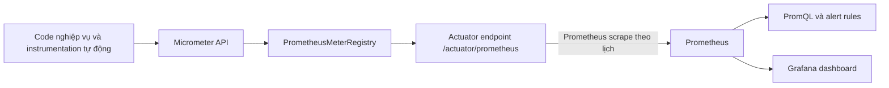

# Quan hệ giữa Micrometer, Spring Boot Actuator và Prometheus

Khi vận hành một ứng dụng Java, nhóm phát triển cần biết ứng dụng đang xử lý bao nhiêu yêu cầu, mất bao lâu để hoàn thành một thao tác, hàng đợi đang có bao nhiêu phần tử và tài nguyên JVM thay đổi ra sao. Những số đo này giúp phát hiện suy giảm hiệu năng, tìm điểm nghẽn và đặt cảnh báo trước khi sự cố ảnh hưởng rộng đến người dùng.

Micrometer, Spring Boot Actuator và Prometheus thường xuất hiện cùng nhau trong một hệ thống quan sát ứng dụng Spring Boot. Chúng liên kết chặt chẽ nhưng đảm nhiệm các phần việc khác nhau: Micrometer cung cấp API và mô hình đo lường, Actuator tích hợp các số đo đó vào ứng dụng Spring Boot và công bố endpoint quản trị, còn Prometheus thu thập rồi lưu trữ chuỗi thời gian để truy vấn và cảnh báo.

## 1. Vai trò của từng thành phần

### Micrometer: API và mô hình instrumentation

Micrometer là thư viện instrumentation cho ứng dụng Java. Thư viện cung cấp một API thống nhất để mã ứng dụng ghi nhận các loại số đo như:

- **Counter** đếm số lần một sự kiện xảy ra, chẳng hạn số đơn hàng được chấp nhận hoặc số lần xử lý thất bại. Giá trị bộ đếm tăng dần trong vòng đời của tiến trình; khi tiến trình khởi động lại, bộ đếm trong bộ nhớ có thể bắt đầu lại.
- **Gauge** biểu diễn giá trị tại một thời điểm, chẳng hạn số phần tử hiện có trong hàng đợi hoặc số kết nối đang được sử dụng. Giá trị có thể tăng hoặc giảm.
- **Timer** đo thời gian thực hiện và đồng thời ghi nhận số lần thao tác xảy ra. Timer thường được dùng để theo dõi độ trễ của request, truy vấn hoặc tác vụ nền.
- **Distribution Summary** ghi nhận phân bố của các giá trị không nhất thiết là thời gian, chẳng hạn kích thước payload hoặc số byte được xử lý.

Ứng dụng ghi số đo thông qua các API như `MeterRegistry`, `Counter`, `Gauge`, `Timer` và `DistributionSummary`. Nhờ đó, mã nghiệp vụ không cần phụ thuộc trực tiếp vào định dạng xuất dữ liệu của một hệ thống giám sát cụ thể. Micrometer chuyển các meter sang registry tương ứng, ví dụ Prometheus, StatsD hoặc hệ thống giám sát khác.

Micrometer cũng định nghĩa quy ước về tên meter, đơn vị đo và tag. Một meter thường được nhận diện bằng tên cùng tập hợp tag. Ví dụ, meter `orders.accepted` có thể mang tag `source=api` để phân biệt nguồn tiếp nhận đơn hàng.

### Spring Boot Actuator: tích hợp và công bố thông tin vận hành

Spring Boot Actuator bổ sung các chức năng quản trị và giám sát cho ứng dụng Spring Boot. Khi có Actuator và registry phù hợp trên classpath, Spring Boot có thể tự cấu hình `MeterRegistry`, kết nối các binder có sẵn và cung cấp các endpoint để truy cập thông tin vận hành.

Một số endpoint thường gặp:

| Endpoint | Mục đích |
| --- | --- |
| `/actuator/health` | Báo trạng thái sức khỏe của ứng dụng và các thành phần được kiểm tra. |
| `/actuator/metrics` | Tra cứu meter theo tên và có thể lọc theo tag; hữu ích khi kiểm tra hoặc chẩn đoán. |
| `/actuator/prometheus` | Xuất các meter dưới định dạng Prometheus có thể scrape. Endpoint này cần registry Prometheus tương ứng. |

Actuator là lớp tích hợp ở phía ứng dụng Spring Boot. Nó giúp đưa dữ liệu từ registry ra các endpoint HTTP, đồng thời cung cấp cơ chế cấu hình đường dẫn, cổng quản trị và phạm vi endpoint được công bố. Actuator không thay thế Micrometer: các meter vẫn được tạo và quản lý theo mô hình của Micrometer.

### Prometheus: thu thập, lưu trữ và truy vấn chuỗi thời gian

Prometheus là hệ thống giám sát thu thập dữ liệu theo mô hình pull. Theo lịch scrape đã cấu hình, Prometheus gửi HTTP request đến endpoint metrics của ứng dụng, đọc các mẫu số đo và lưu chúng thành chuỗi thời gian. Mỗi chuỗi thời gian được xác định bởi tên metric cùng các nhãn (label), kèm dấu thời gian và giá trị.

Sau khi thu thập, Prometheus cung cấp PromQL để tính toán tốc độ tăng của counter, tổng hợp theo nhãn, phân tích phân vị và xây dựng điều kiện cảnh báo. Grafana thường được dùng ở lớp hiển thị để tạo dashboard từ dữ liệu Prometheus; Grafana là thành phần bổ sung, không phải điều kiện bắt buộc để Micrometer xuất metrics.

Prometheus không phải thư viện mà ứng dụng gọi trực tiếp trong mã nghiệp vụ. Ứng dụng cung cấp endpoint theo định dạng Prometheus, còn Prometheus chủ động scrape endpoint đó.

## 2. Ba thành phần phối hợp với nhau như thế nào?

Luồng dữ liệu phổ biến trong một ứng dụng Spring Boot có thể mô tả như sau:



Quá trình diễn ra theo các bước:

1. **Ứng dụng phát sinh số đo.** Instrumentation tích hợp sẵn của Spring Boot có thể ghi nhận các chỉ số HTTP, JVM, tiến trình, hệ thống hoặc các thành phần khác tùy cấu hình và dependency. Mã nghiệp vụ cũng có thể chủ động tạo meter cho các sự kiện và thao tác riêng của domain.
2. **Micrometer ghi nhận số đo vào registry.** Các thành phần instrumentation sử dụng API Micrometer. `PrometheusMeterRegistry` nhận các meter và quản lý cách chuyển chúng sang mô hình metrics của Prometheus.
3. **Actuator công bố dữ liệu.** Endpoint `/actuator/prometheus` đọc dữ liệu từ registry và trả về nội dung theo định dạng Prometheus exposition.
4. **Prometheus scrape endpoint.** Prometheus kết nối đến địa chỉ ứng dụng theo chu kỳ cấu hình, lấy mẫu metric và lưu vào time-series database của nó.
5. **Người vận hành phân tích dữ liệu.** PromQL dùng dữ liệu đã lưu để tính toán xu hướng, tốc độ, phân vị hoặc điều kiện cảnh báo. Dashboard có thể đọc dữ liệu từ Prometheus.

Vì Prometheus dùng mô hình pull, việc ứng dụng ghi được meter chưa có nghĩa Prometheus đã thu thập được dữ liệu. Endpoint phải truy cập được từ máy hoặc container chạy Prometheus, và cấu hình scrape phải trỏ đúng địa chỉ, cổng, đường dẫn.

## 3. Tích hợp trong Spring Boot

### Thêm dependency

Với dự án Gradle sử dụng Spring Boot dependency management, có thể khai báo:

```groovy
dependencies {
    implementation("org.springframework.boot:spring-boot-starter-actuator")
    runtimeOnly("io.micrometer:micrometer-registry-prometheus")
}
```

Dependency Actuator cung cấp các endpoint quản trị và tích hợp với hệ sinh thái Spring Boot. Dependency `micrometer-registry-prometheus` cung cấp registry để chuyển meter của Micrometer sang định dạng Prometheus. Nên để Spring Boot quản lý phiên bản dependency tương thích thay vì tự chọn các phiên bản Micrometer rời rạc.

Nếu thiếu registry Prometheus, ứng dụng vẫn có thể dùng Micrometer và các registry khác, nhưng endpoint xuất dữ liệu Prometheus sẽ không được cấu hình theo cách tích hợp này.

### Cấu hình endpoint và nhãn chung

Ví dụ `application.yml`:

```yaml
management:
  endpoints:
    web:
      exposure:
        include: health,info,prometheus
  metrics:
    tags:
      application: orders-api
```

`management.endpoints.web.exposure.include` xác định những endpoint được công bố qua HTTP. Trong ví dụ này, endpoint `prometheus` được mở để Prometheus scrape; `health` và `info` phục vụ các nhu cầu quản trị tương ứng. Có thể thêm `metrics` khi cần dùng endpoint tra cứu meter trong môi trường kiểm thử hoặc chẩn đoán, nhưng nên giới hạn các endpoint được công bố theo nhu cầu thực tế.

Nhãn chung `application=orders-api` giúp phân biệt chuỗi thời gian của ứng dụng khi nhiều dịch vụ cùng gửi dữ liệu về một Prometheus. Tên ứng dụng nên ổn định giữa các lần triển khai của cùng một dịch vụ. Nếu cần phân biệt môi trường hoặc khu vực triển khai, hãy dùng các nhãn có tập giá trị hữu hạn và có quy ước thống nhất.

Sau khi ứng dụng khởi động, có thể kiểm tra endpoint bằng lệnh:

```bash
curl http://localhost:8080/actuator/prometheus
```

Đường dẫn mặc định của Actuator là `/actuator`; nếu dự án thay đổi base path, cổng quản trị hoặc cấu hình web management thì URL cần điều chỉnh tương ứng. Kết quả thường là văn bản chứa tên metric, kiểu metric, giá trị và các label theo định dạng Prometheus.

### Tạo meter tùy chỉnh bằng Micrometer

Spring Boot có thể tự ghi nhận nhiều chỉ số kỹ thuật, nhưng chỉ số nghiệp vụ cần được thiết kế theo mục tiêu quan sát của ứng dụng. Ví dụ sau tạo một counter đếm số đơn hàng được chấp nhận qua API:

```java
import io.micrometer.core.instrument.Counter;
import io.micrometer.core.instrument.MeterRegistry;
import org.springframework.stereotype.Component;

@Component
public class OrderMetrics {

    private final Counter acceptedOrders;

    public OrderMetrics(MeterRegistry registry) {
        this.acceptedOrders = Counter.builder("orders.accepted")
                .description("Number of orders accepted by the API")
                .tag("source", "api")
                .register(registry);
    }

    public void markAccepted() {
        acceptedOrders.increment();
    }
}
```

Service xử lý đơn hàng có thể gọi `markAccepted()` sau khi thao tác chấp nhận đơn hàng thành công. Meter được đăng ký một lần khi Spring tạo bean và được tái sử dụng; không nên tạo meter mới trong mỗi lần xử lý request. Tag `source` trong ví dụ có giá trị cố định, vì vậy số lượng chuỗi thời gian phát sinh được kiểm soát.

Khi xuất sang Prometheus, tên meter có thể được chuẩn hóa theo quy ước đặt tên của registry, chẳng hạn dấu chấm trong `orders.accepted` được chuyển thành dấu gạch dưới và counter thường có hậu tố `_total`. Tag `source` trở thành label. Cách biểu diễn cụ thể nên được xác nhận trực tiếp trên endpoint của phiên bản thư viện đang dùng.

## 4. Cấu hình Prometheus để scrape ứng dụng

Một cấu hình Prometheus đơn giản có thể dùng `prometheus.yml` như sau:

```yaml
global:
  scrape_interval: 15s

scrape_configs:
  - job_name: orders-api
    metrics_path: /actuator/prometheus
    static_configs:
      - targets:
          - localhost:8080
```

Trong cấu hình này:

- `scrape_interval` là khoảng thời gian giữa các lần Prometheus thu thập dữ liệu.
- `job_name` đặt tên cho nhóm mục tiêu scrape.
- `metrics_path` trỏ đến endpoint do Actuator công bố.
- `targets` chứa địa chỉ và cổng mà tiến trình Prometheus có thể truy cập.

Giá trị `localhost:8080` chỉ phù hợp khi Prometheus và ứng dụng nhìn thấy nhau qua cùng môi trường mạng trên địa chỉ đó. Nếu Prometheus chạy trong Docker hoặc Kubernetes, `localhost` thường trỏ về chính container hoặc pod Prometheus. Khi đó cần dùng tên service, DNS nội bộ hoặc địa chỉ mạng có thể định tuyến đến ứng dụng.

Sau khi nạp cấu hình, kiểm tra trang trạng thái targets của Prometheus để xác nhận mục tiêu `orders-api` ở trạng thái `UP`. Trạng thái này cho biết lần scrape gần nhất thành công; nó chưa khẳng định mọi metric nghiệp vụ đều được thiết kế đúng.

## 5. Truy vấn và đọc số liệu

Prometheus cung cấp PromQL để phân tích dữ liệu đã scrape. Ví dụ, truy vấn tốc độ request trung bình trong cửa sổ năm phút, nhóm theo method và status:

```promql
sum by (method, status) (
  rate(http_server_requests_seconds_count[5m])
)
```

Tên metric thực tế phụ thuộc instrumentation và quy ước xuất dữ liệu của phiên bản đang dùng. Hãy xem nội dung `/actuator/prometheus` để xác nhận tên metric và label trước khi viết truy vấn.

Để tính phân vị độ trễ p95 từ histogram, ứng dụng cần xuất các bucket histogram cho timer tương ứng. Có thể bật histogram cho metric request HTTP bằng cấu hình:

```yaml
management:
  metrics:
    distribution:
      percentiles-histogram:
        http.server.requests: true
```

Khi các bucket đã có mặt, có thể truy vấn:

```promql
histogram_quantile(
  0.95,
  sum by (le) (
    rate(http_server_requests_seconds_bucket[5m])
  )
)
```

Kết quả là ước lượng phân vị thứ 95 của độ trễ trong cửa sổ truy vấn. Histogram tạo thêm chuỗi thời gian cho các bucket, vì vậy chỉ nên bật cho những metric cần phân tích phân bố và cần đánh giá chi phí lưu trữ trước khi áp dụng rộng.

## 6. Kiểm soát cardinality và thiết kế label

Trong Prometheus, mỗi tổ hợp tên metric và label-value tạo thành một chuỗi thời gian riêng. Nếu một metric có nhiều label và mỗi label có rất nhiều giá trị, số chuỗi thời gian có thể tăng nhanh. Hiện tượng này gọi là cardinality cao; nó làm tăng bộ nhớ, dung lượng lưu trữ và chi phí truy vấn.

Ví dụ, các label sau thường không phù hợp:

- `user_id` hoặc `customer_id` có thể có hàng triệu giá trị.
- `order_id` tạo một chuỗi thời gian gần như cho từng đơn hàng.
- URL thô chứa UUID hoặc mã tài nguyên khiến mỗi request có thể tạo label mới.
- Email, token, nội dung tìm kiếm hoặc dữ liệu cá nhân vừa làm cardinality tăng vừa có nguy cơ đưa thông tin nhạy cảm vào hệ thống metrics.

Nên ưu tiên label có tập giá trị hữu hạn và được kiểm soát, chẳng hạn `method`, `status`, `operation`, `source` hoặc tên route dạng mẫu như `/orders/{id}`. Với request HTTP, dùng route template do framework cung cấp thay vì URL đầy đủ có tham số định danh.

Nếu cần phân tích theo từng người dùng hoặc từng đơn hàng, nên dùng log hoặc trace có khả năng lưu định danh theo cách phù hợp. Metrics phù hợp để tổng hợp hành vi ở quy mô lớn; không nên biến mỗi thực thể nghiệp vụ thành một label.

## 7. Bảo mật endpoint metrics

Endpoint metrics có thể tiết lộ tên thành phần nội bộ, lưu lượng request, trạng thái lỗi, cấu trúc dịch vụ và một số thông tin vận hành. Vì vậy, chỉ công bố endpoint cần thiết và giới hạn quyền truy cập.

Trong môi trường triển khai thực tế, nên cân nhắc:

- Giới hạn truy cập endpoint Prometheus bằng mạng nội bộ, firewall, ingress policy hoặc cơ chế xác thực phù hợp.
- Chỉ cho phép máy Prometheus hoặc thành phần giám sát được chỉ định scrape endpoint.
- Dùng cổng quản trị riêng thông qua cấu hình management server khi kiến trúc triển khai yêu cầu tách lưu lượng quản trị khỏi lưu lượng nghiệp vụ.
- Không công bố toàn bộ endpoint Actuator ra Internet chỉ để phục vụ metrics.
- Tránh đưa dữ liệu cá nhân, bí mật hoặc định danh nhạy cảm vào tên metric và label.

Việc đưa `prometheus` vào danh sách exposure chỉ cho phép endpoint được phục vụ qua web theo cấu hình Actuator; quyền truy cập cuối cùng vẫn cần được kiểm soát bằng cấu hình bảo mật và hạ tầng mạng của hệ thống.

## 8. Chẩn đoán khi không thấy metrics

Khi Prometheus không có dữ liệu mong muốn, nên kiểm tra theo từng lớp của luồng tích hợp:

| Hiện tượng | Nguyên nhân thường gặp | Cách kiểm tra |
| --- | --- | --- |
| `/actuator/prometheus` trả về `404` | Thiếu dependency registry Prometheus, endpoint không được expose hoặc URL/base path sai. | Kiểm tra dependency, cấu hình exposure và đường dẫn Actuator. |
| Endpoint trả về `401` hoặc `403` | Cấu hình Spring Security hoặc lớp bảo vệ ở proxy chặn request. | Kiểm tra quyền của tài khoản scrape và chính sách truy cập. |
| Prometheus hiển thị target `DOWN` | Prometheus không kết nối được đến host, cổng hoặc endpoint. | Kiểm tra `targets`, DNS, routing, firewall và `metrics_path`. |
| Target `UP` nhưng thiếu metric nghiệp vụ | Meter chưa được đăng ký, nhánh code chưa chạy hoặc tên metric/label đang được tìm sai. | Gọi endpoint trực tiếp, tìm tên metric và kiểm tra luồng nghiệp vụ tạo số đo. |
| Số lượng time series tăng bất thường | Label có quá nhiều giá trị hoặc URL thô được dùng làm label. | Kiểm tra các label-value, loại bỏ định danh biến thiên và giới hạn tập giá trị. |

Việc kiểm tra theo lớp giúp xác định lỗi nằm ở instrumentation, registry, endpoint Actuator hay cấu hình scrape của Prometheus. Không nên kết luận rằng ứng dụng không ghi nhận số đo chỉ dựa vào việc dashboard đang trống.

## 9. Phân định trách nhiệm khi thiết kế hệ thống

| Thành phần | Trách nhiệm chính | Câu hỏi cần trả lời |
| --- | --- | --- |
| Micrometer | Định nghĩa và ghi nhận meter qua API thống nhất; chuyển số đo vào registry phù hợp. | Ứng dụng cần đo điều gì, dùng loại meter nào và tag nào? |
| Spring Boot Actuator | Tự cấu hình instrumentation tích hợp, cung cấp registry và công bố endpoint quản trị. | Endpoint nào được bật, nằm ở đường dẫn/cổng nào và ai được truy cập? |
| Prometheus | Scrape endpoint, lưu chuỗi thời gian, cung cấp PromQL và đánh giá alert rules. | Thu thập mục tiêu nào, theo chu kỳ nào và cần truy vấn/cảnh báo gì? |
| Grafana (tùy chọn) | Hiển thị dữ liệu từ Prometheus dưới dạng dashboard. | Người vận hành cần theo dõi chỉ số nào và theo góc nhìn nào? |

Khi hiểu rõ ranh giới này, việc thay đổi backend metrics thường ít ảnh hưởng đến mã nghiệp vụ: phần lớn instrumentation vẫn dùng API Micrometer, còn registry và cách thu thập được cấu hình theo hệ thống đích. Trong mô hình Spring Boot với Prometheus, Actuator là cầu nối công bố dữ liệu tại ứng dụng, còn Prometheus chịu trách nhiệm thu thập và lưu trữ dữ liệu đó.
