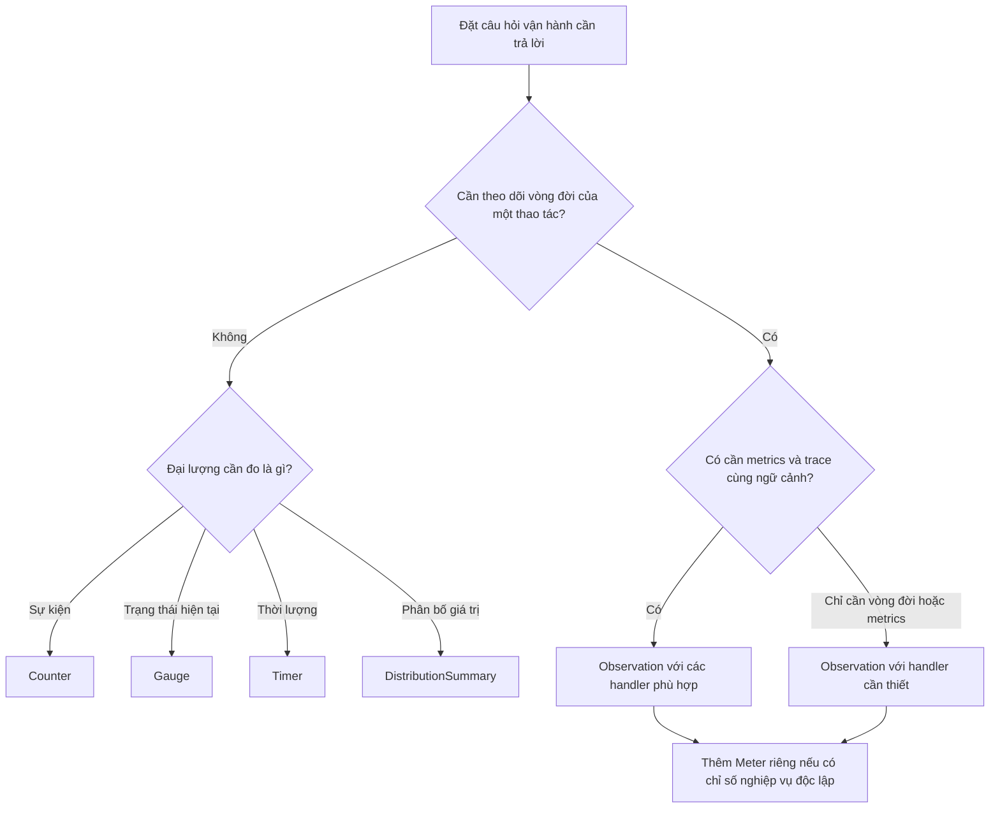

# Chọn đo trực tiếp bằng meter hoặc quan sát một thao tác bằng Observation

Micrometer cung cấp hai cách phổ biến để đưa thông tin vận hành vào ứng dụng: ghi số đo trực tiếp bằng các meter, hoặc mô tả vòng đời của một thao tác bằng Observation. Hai cách này cùng phục vụ observability nhưng nằm ở hai mức trừu tượng khác nhau.

Meter phù hợp khi ứng dụng đã biết rõ đại lượng cần đo, chẳng hạn số đơn hàng được chấp nhận, độ sâu hàng đợi hoặc thời gian gọi một hàm. Observation phù hợp khi cần mô tả một thao tác có điểm bắt đầu, kết thúc, lỗi và ngữ cảnh; các bộ xử lý được đăng ký có thể chuyển thao tác đó thành metrics, trace hoặc loại telemetry khác.

Quyết định nên dựa vào câu hỏi vận hành cần trả lời và phạm vi của thao tác được đo. Không cần đưa mọi phép đo qua Observation, cũng không cần tự tạo Timer cho một thao tác đã được Observation ghi nhận thành thời lượng.

## 1. Meter và Observation nằm ở hai mức khác nhau

### Đo trực tiếp bằng Meter

Meter là một công cụ đo cụ thể được đăng ký trong `MeterRegistry`. Mỗi meter có tên, các tag và cấu hình tương ứng. Registry quản lý meter theo định danh đó để ứng dụng có thể ghi nhận số đo trong suốt vòng đời hoạt động.

Các loại meter thường gặp gồm:

| Meter | Đại lượng | Ví dụ vận hành |
|---|---|---|
| `Counter` | Số lần một sự kiện xảy ra; giá trị tăng dần | Số đơn hàng được chấp nhận, số lần xử lý thất bại |
| `Gauge` | Giá trị hiện tại tại thời điểm được lấy mẫu | Số phần tử trong hàng đợi, số kết nối đang mở |
| `Timer` | Thời lượng của thao tác và số lần ghi nhận | Độ trễ truy vấn, thời gian gọi cổng thanh toán |
| `DistributionSummary` | Phân bố của một đại lượng không phải thời gian | Kích thước payload, số byte xử lý mỗi lần |

Với cách này, mã ứng dụng chủ động chọn meter, thời điểm ghi nhận và tag cần gắn. Điều đó làm cho phép đo dễ hiểu, trực tiếp và thích hợp với những chỉ số có ý nghĩa riêng trong miền nghiệp vụ.

Một số điểm cần nhớ khi chọn meter:

- `Timer` đã có số lần ghi nhận (`count`) cùng tổng thời lượng. Nếu mục tiêu chỉ là đếm số lần một thao tác được thực hiện và đo thời gian của chính thao tác đó, thường không cần tạo thêm một `Counter` trùng nghĩa.
- `Gauge` biểu diễn trạng thái hiện tại, không phải số sự kiện tích lũy. Nó được lấy mẫu khi registry thu thập metrics; không nên dùng gauge để đếm số lần một hành động xảy ra.
- Gauge của Micrometer giữ tham chiếu yếu đến đối tượng được quan sát. Đối tượng đó cần được ứng dụng giữ tham chiếu mạnh trong suốt thời gian cần đo, nếu không gauge có thể không còn đối tượng để đọc giá trị.
- Mỗi tổ hợp tên meter và tag tạo ra một chuỗi thời gian riêng. Tag có quá nhiều giá trị khác nhau sẽ làm tăng cardinality và chi phí lưu trữ, truy vấn.

### Quan sát thao tác bằng Observation

Observation mô tả một thao tác có vòng đời: bắt đầu, chạy trong một ngữ cảnh, kết thúc hoặc phát sinh lỗi. Ứng dụng tạo Observation thông qua `ObservationRegistry`. Các `ObservationHandler` đã đăng ký nhận những sự kiện trong vòng đời đó và chuyển chúng thành dữ liệu phù hợp.

Ví dụ, cùng một Observation có thể được xử lý bởi:

- Handler metrics để tạo số đo thời lượng và các tag có cardinality thấp.
- Handler tracing để tạo span, thể hiện thao tác trong trace và liên kết nó với thao tác cha.
- Handler tùy chỉnh để ghi nhận thông tin theo quy ước riêng của hệ thống.

Observation không tự động xuất metrics hoặc trace chỉ vì mã đã tạo một đối tượng Observation. Kết quả phụ thuộc vào các handler đang được cấu hình trong registry. Nếu chỉ có handler metrics, ứng dụng có metrics mà không nhất thiết có trace; nếu chưa có handler phù hợp, Observation vẫn mô tả vòng đời trong mã nhưng không tự tạo dữ liệu xuất ra backend.

Một Observation thường đại diện cho một đơn vị công việc có ý nghĩa, chẳng hạn xử lý checkout, gọi dịch vụ bên ngoài, đọc dữ liệu hoặc xử lý một thông điệp. Nó có tên ổn định, ngữ cảnh, các key-value và trạng thái lỗi. Observation cũng có thể mở scope để các thao tác con nhận biết ngữ cảnh hiện tại và tạo quan hệ cha-con phù hợp.

Observation phân biệt hai nhóm key-value:

- **Low-cardinality key-value** có số lượng giá trị hữu hạn, ổn định, ví dụ `channel=web`, `result=success` hoặc `payment.method=card`. Đây là nhóm phù hợp để đưa vào metrics và tracing.
- **High-cardinality key-value** có nhiều giá trị khác nhau, ví dụ mã yêu cầu hoặc mã đơn hàng. Các handler tracing mặc định thường có thể dùng nhóm này cho span, trong khi handler metrics không dùng chúng để tạo chuỗi thời gian. Handler tùy chỉnh có thể có quy tắc riêng, vì vậy vẫn cần xem xét dung lượng và dữ liệu nhạy cảm trước khi thêm giá trị.

Không đưa email, số điện thoại, mã khách hàng, mã giao dịch, request ID hoặc URL đầy đủ vào low-cardinality key-value. Các giá trị như vậy có thể tạo ra hàng triệu chuỗi thời gian nếu được chuyển thành tag metrics.

## 2. Khi nào nên dùng Meter trực tiếp?

Chọn meter trực tiếp khi câu hỏi cần trả lời là về một đại lượng cụ thể và không cần mô tả toàn bộ vòng đời thao tác để kết nối metrics với tracing.

| Câu hỏi cần trả lời | Meter phù hợp | Lý do |
|---|---|---|
| Có bao nhiêu đơn hàng được chấp nhận? | `Counter` | Đây là sự kiện nghiệp vụ cần đếm |
| Hiện có bao nhiêu công việc đang chờ? | `Gauge` | Đây là trạng thái thay đổi theo thời gian |
| Gọi cổng thanh toán mất bao lâu? | `Timer` | Cần đo thời lượng và số lần gọi |
| Mỗi payload có kích thước bao nhiêu? | `DistributionSummary` | Cần quan sát phân bố của một đại lượng số |

Ví dụ, một thành phần metrics có thể đăng ký meter một lần khi khởi tạo rồi dùng lại trong các lần xử lý:

```java
@Component
final class PaymentMetrics {
    private final Counter acceptedPayments;
    private final Timer authorizationTimer;

    PaymentMetrics(MeterRegistry registry) {
        this.acceptedPayments = Counter.builder("payment.accepted")
                .description("Number of accepted payments")
                .register(registry);

        this.authorizationTimer = Timer.builder("payment.authorization")
                .description("Payment authorization duration")
                .register(registry);
    }

    PaymentResult authorize(PaymentCommand command, PaymentGateway gateway) {
        PaymentResult result = authorizationTimer.record(
                () -> gateway.authorize(command)
        );

        if (result.accepted()) {
            acceptedPayments.increment();
        }

        return result;
    }
}
```

Trong ví dụ này, Timer đo thời lượng và số lần gọi gateway. Counter biểu diễn một sự kiện nghiệp vụ khác: kết quả thanh toán được chấp nhận. Hai meter không đếm cùng một ý nghĩa.

Gauge phù hợp với trạng thái mà ứng dụng có thể đọc tại thời điểm thu thập. Ví dụ sau đăng ký độ sâu hàng đợi dựa trên một đối tượng được giữ trong field:

```java
final class QueueMetrics {
    private final AtomicInteger queueDepth;

    QueueMetrics(MeterRegistry registry, AtomicInteger queueDepth) {
        this.queueDepth = queueDepth;

        Gauge.builder("jobs.queue.depth", this.queueDepth, AtomicInteger::get)
                .description("Current number of queued jobs")
                .register(registry);
    }
}
```

Ứng dụng cập nhật `queueDepth` khi hàng đợi thay đổi; registry đọc giá trị hiện tại khi thu thập. Không gọi `increment()` trên gauge để biểu diễn sự kiện. Nếu cần đếm số công việc được đưa vào hàng đợi, hãy dùng một Counter riêng.

Meter trực tiếp thường là lựa chọn rõ ràng khi:

1. Chỉ số có định nghĩa cụ thể, độc lập với một vòng đời thao tác lớn hơn.
2. Cần kiểm soát chính xác loại meter, tên, tag và cấu hình phân bố.
3. Chỉ cần metrics, hoặc tracing không mang lại thêm thông tin cần thiết cho tình huống đó.
4. Đo trạng thái dài hạn như độ sâu hàng đợi, số phiên đang hoạt động hoặc dung lượng bộ đệm.

## 3. Khi nào nên dùng Observation?

Chọn Observation khi muốn đánh dấu ranh giới của một thao tác và giữ ngữ cảnh của thao tác đó xuyên suốt quá trình thực thi. Cách này đặc biệt hữu ích khi cần kết hợp thời lượng, kết quả, lỗi và trace trong cùng một đơn vị công việc.

Ví dụ, một thao tác checkout có thể gọi nhiều thành phần: kiểm tra tồn kho, tính phí, gọi cổng thanh toán và ghi đơn hàng. Observation ở ranh giới checkout giúp hệ thống theo dõi toàn bộ thao tác; các thành phần con có thể tạo Observation riêng để trace thể hiện nơi phát sinh độ trễ.

Với Spring Boot đã cấu hình Micrometer Observation, có thể inject `ObservationRegistry` và dùng `observe` để quản lý vòng đời:

```java
@Service
final class CheckoutService {
    private final ObservationRegistry observationRegistry;

    CheckoutService(ObservationRegistry observationRegistry) {
        this.observationRegistry = observationRegistry;
    }

    Receipt checkout(CheckoutCommand command) {
        return Observation.createNotStarted("checkout.process", observationRegistry)
                .lowCardinalityKeyValue("channel", command.channel().name())
                .lowCardinalityKeyValue("payment.provider", command.provider().code())
                .observe(() -> doCheckout(command));
    }

    private Receipt doCheckout(CheckoutCommand command) {
        // Validate the order, reserve inventory, charge payment and persist it.
        return performCheckout(command);
    }
}
```

Tên Observation `checkout.process` nên ổn định qua các lần gọi. Các giá trị `channel` và `payment.provider` chỉ nên dùng làm low-cardinality key-value nếu tập giá trị của chúng được giới hạn, chẳng hạn enum hoặc danh mục nhà cung cấp đã kiểm soát. `observe` bao quanh thao tác, quản lý việc bắt đầu và kết thúc; khi thao tác ném lỗi, Observation ghi nhận lỗi trước khi kết thúc rồi lỗi tiếp tục được truyền ra ngoài.

Khi cần kiểm soát thủ công vòng đời, có thể gọi `start()`, mở scope và bảo đảm `stop()` luôn được gọi:

```java
Observation observation = Observation.createNotStarted(
        "inventory.reserve", observationRegistry
).lowCardinalityKeyValue("warehouse", warehouseTier).start();

try (Observation.Scope scope = observation.openScope()) {
    return inventoryService.reserve(command);
} catch (RuntimeException error) {
    observation.error(error);
    throw error;
} finally {
    observation.stop();
}
```

Scope làm cho Observation hiện tại sẵn có trong quá trình thực thi đồng bộ, nhờ đó instrumentation ở các tầng gọi bên dưới có thể tham chiếu ngữ cảnh hiện tại. Khi chuyển công việc sang thread khác hoặc qua ranh giới bất đồng bộ, không nên giả định scope thread-local tự truyền theo; hãy cấu hình cơ chế context propagation phù hợp với cách ứng dụng thực thi.

Observation thường là lựa chọn phù hợp khi:

1. Cần đo một thao tác từ lúc bắt đầu đến lúc kết thúc, bao gồm cả thời lượng và lỗi.
2. Cần cùng một instrumentation tạo metrics và trace thông qua các handler.
3. Muốn các thao tác lồng nhau có quan hệ ngữ cảnh để điều tra một request hoặc một luồng xử lý.
4. Muốn áp dụng quy ước đặt tên và key-value nhất quán cho nhiều thành phần.

## 4. Bảng quyết định nhanh

| Tình huống | Nên bắt đầu từ | Cách triển khai |
|---|---|---|
| Đếm một sự kiện nghiệp vụ độc lập | Meter | Đăng ký Counter và tăng khi sự kiện thực sự xảy ra |
| Đọc trạng thái hiện tại của tài nguyên | Meter | Đăng ký Gauge trên đối tượng có vòng đời ổn định |
| Đo thời lượng một hàm hoặc một lời gọi riêng lẻ | Meter | Dùng Timer quanh đoạn mã cần đo |
| Theo dõi một thao tác nghiệp vụ xuyên nhiều tầng | Observation | Tạo Observation ở ranh giới thao tác và mở scope khi cần |
| Cần thời lượng và trace cho cùng một thao tác | Observation | Cấu hình handler metrics và tracing trên ObservationRegistry |
| Cần cả số đo nghiệp vụ riêng và trace của thao tác | Kết hợp | Dùng Observation cho vòng đời; thêm meter riêng cho sự kiện hoặc trạng thái khác nghĩa |

Có thể hình dung quy trình lựa chọn như sau:



Sơ đồ chỉ là điểm khởi đầu. Một thao tác có thể cần Observation để theo dõi thời lượng và lỗi, đồng thời cần Counter để đếm một kết quả nghiệp vụ đặc biệt. Điều quan trọng là mỗi số đo phải có ý nghĩa riêng và không lặp lại cùng một đại lượng.

## 5. Có thể kết hợp Meter và Observation như thế nào?

Hai API bổ sung cho nhau. Một quy tắc thực tế là dùng Observation cho ranh giới của thao tác, rồi dùng meter trực tiếp cho các số đo không được biểu diễn đầy đủ bởi vòng đời đó.

Ví dụ với quy trình xử lý đơn hàng:

- Observation `order.process` ghi nhận thời lượng, lỗi và ngữ cảnh của toàn bộ quy trình.
- Counter `orders.accepted` đếm số đơn hàng đã vượt qua kiểm tra nghiệp vụ và được chấp nhận.
- Gauge `orders.queue.depth` phản ánh số đơn hàng đang chờ xử lý tại thời điểm thu thập.
- DistributionSummary `orders.payload.size` ghi nhận phân bố kích thước dữ liệu đầu vào.

Các phép đo trên trả lời những câu hỏi khác nhau. Nếu handler metrics đã tạo Timer cho `order.process`, không nên tạo thêm Timer thủ công chỉ để đo lại cùng thời lượng và cùng số lần gọi. Việc ghi trùng sẽ làm dashboard khó diễn giải và có thể khiến người vận hành cộng nhầm số liệu.

Tương tự, không nên dùng một Observation cho mọi hàm tiện ích nhỏ. Chọn ranh giới có ý nghĩa với người vận hành: request, thao tác nghiệp vụ, lời gọi phụ thuộc bên ngoài hoặc một đơn vị xử lý nền. Quá nhiều Observation lồng nhau có thể làm trace rối và tăng lượng dữ liệu cần xử lý.

## 6. Kiểm soát cardinality và tên đo

Cardinality là yếu tố cần xem xét ngay khi thiết kế meter hoặc Observation. Một tag có số lượng giá trị không giới hạn có thể tạo ra một chuỗi thời gian mới cho mỗi giá trị. Điều này làm tăng bộ nhớ, dung lượng lưu trữ, chi phí truy vấn và độ khó khi vận hành.

Ví dụ tag có tập giá trị thường có thể kiểm soát:

- `method=GET|POST|PUT|DELETE`
- `outcome=success|failure`
- `payment.method=card|bank_transfer|wallet`
- `region=ap_southeast_1|ap_northeast_1`

Ví dụ giá trị thường không phù hợp làm tag metrics:

- `user.id` hoặc `order.id`
- Email, số điện thoại hoặc tên khách hàng
- Request ID, trace ID hoặc session ID
- URL đầy đủ có path động hoặc query string
- Nội dung lỗi, câu SQL đã nội suy tham số hoặc dữ liệu đầu vào tùy ý

Đối với meter trực tiếp, chỉ đăng ký tag từ tập giá trị đã giới hạn. Tránh tạo meter với tag tùy ý theo từng request. Đối với Observation, đưa thông tin có tập giá trị hữu hạn vào low-cardinality key-value; chỉ đưa thông tin cần thiết cho việc điều tra vào high-cardinality key-value khi handler và chính sách dữ liệu cho phép.

Tên meter và tên Observation cũng nên ổn định, mô tả đại lượng hoặc thao tác, và tuân theo quy ước đặt tên của hệ thống. Không ghép ID người dùng, ID request hoặc timestamp vào tên. Thông tin phân loại nên nằm trong tag có cardinality được kiểm soát.

## 7. Tích hợp với Spring Boot

Trong ứng dụng Spring Boot, Actuator và các registry Micrometer được cấu hình sẽ cung cấp các bean phục vụ metrics. Spring Boot cũng tích hợp Observation để các thành phần được hỗ trợ có thể phát ra Observation theo quy ước chung. Khi backend metrics và tracing tương ứng đã được cấu hình, các handler phù hợp sẽ chuyển Observation thành dữ liệu telemetry.

Khi viết service:

- Inject `MeterRegistry` nếu thành phần cần đăng ký Counter, Gauge, Timer hoặc DistributionSummary trực tiếp.
- Inject `ObservationRegistry` nếu thành phần cần bao quanh một thao tác bằng Observation.
- Ưu tiên tái sử dụng các bean registry do Spring quản lý; tránh tự tạo registry riêng trong service vì dữ liệu có thể không đi đến backend mà ứng dụng đang xuất.
- Kiểm tra dependency và cấu hình registry của backend. Có Observation trong mã không đồng nghĩa metrics hoặc trace đã được xuất thành công.

Nếu tạo ObservationRegistry thủ công ngoài cấu hình tự động của Spring Boot, cần đăng ký các handler cần thiết. Ví dụ, trong một bài kiểm thử hoặc ứng dụng Micrometer độc lập, có thể nối handler metrics với `SimpleMeterRegistry`:

```java
SimpleMeterRegistry meterRegistry = new SimpleMeterRegistry();
ObservationRegistry observationRegistry = ObservationRegistry.create();

observationRegistry.observationConfig().observationHandler(
        new DefaultMeterObservationHandler(meterRegistry)
);

Observation.createNotStarted("checkout.process", observationRegistry)
        .lowCardinalityKeyValue("channel", "web")
        .observe(() -> checkout());
```

Đoạn mã này minh họa mối nối giữa Observation và metrics. Trong ứng dụng Spring Boot đã tự cấu hình handler, không đăng ký thêm một handler giống hệt nếu không có chủ đích, vì cấu hình trùng có thể làm việc ghi nhận khó kiểm soát.

## 8. Kiểm thử instrumentation

Kiểm thử cần xác minh ý nghĩa của phép đo, không chỉ xác minh mã gọi được API Micrometer.

Với meter trực tiếp, `SimpleMeterRegistry` giúp kiểm tra số lần tăng, số lần ghi nhận hoặc giá trị đã ghi mà không cần khởi chạy backend metrics:

```java
SimpleMeterRegistry registry = new SimpleMeterRegistry();
Counter counter = registry.counter("payment.accepted");
Timer timer = registry.timer("payment.authorization");

counter.increment();
timer.record(() -> authorizePayment());

assertThat(counter.count()).isEqualTo(1.0);
assertThat(timer.count()).isEqualTo(1L);
```

Với Observation, có thể dùng `TestObservationRegistry` từ artifact `micrometer-observation-test` hoặc một ObservationHandler kiểm thử để xác minh tên, low-cardinality key-value, trạng thái lỗi và việc kết thúc Observation. Nếu kiểm tra việc chuyển Observation thành metrics, kết hợp ObservationRegistry với `SimpleMeterRegistry` và handler metrics như ví dụ ở phần trước.

Một bộ kiểm thử hữu ích nên bao phủ các tình huống sau:

1. Thao tác thành công tạo đúng phép đo và ghi nhận kết quả mong đợi.
2. Thao tác thất bại vẫn kết thúc Observation và có thông tin lỗi.
3. Tag được phát ra thuộc tập giá trị đã định nghĩa; không có ID hoặc dữ liệu đầu vào tùy ý lọt vào metrics.
4. Timer hoặc Counter không bị ghi hai lần cho cùng một ý nghĩa.
5. Gauge đọc trạng thái hiện tại của đúng đối tượng được ứng dụng giữ tham chiếu.

## 9. Những lỗi thiết kế thường gặp

**Dùng Counter để thay Timer khi cần đo thời lượng.** Counter chỉ cho biết số lần sự kiện xảy ra. Timer vừa ghi thời lượng vừa có số lần ghi nhận, nên phù hợp hơn khi câu hỏi bao gồm độ trễ.

**Dùng Gauge để đếm sự kiện.** Gauge phản ánh một giá trị hiện tại được lấy mẫu. Dùng Counter cho số sự kiện tích lũy và Gauge cho trạng thái.

**Đo cùng một thời lượng bằng cả Observation và Timer thủ công.** Nếu Observation handler đã tạo Timer cho thao tác, meter thứ hai có thể ghi trùng. Chỉ thêm Timer riêng khi nó đo một đoạn công việc khác có ý nghĩa độc lập.

**Đưa ID động vào tag metrics.** Điều này tạo cardinality cao và làm tăng chi phí vận hành. Hãy dùng các nhóm giá trị hữu hạn cho metrics; cân nhắc high-cardinality key-value cho tracing khi thật sự cần.

**Cho rằng Observation tự xuất telemetry.** Observation cần handler phù hợp và registry/backend được cấu hình. Hãy kiểm tra đường đi từ ObservationRegistry đến nơi nhận metrics hoặc trace.

**Tạo Observation ở mọi hàm nhỏ.** Chỉ đặt ranh giới tại những thao tác có ý nghĩa để người vận hành hiểu được trace và metrics.

## 10. Kết luận lựa chọn trong thiết kế

Hãy bắt đầu từ câu hỏi mà dashboard, cảnh báo hoặc người điều tra sự cố cần trả lời. Nếu câu hỏi nói về một sự kiện, trạng thái hoặc đại lượng cụ thể, chọn meter tương ứng. Nếu câu hỏi nói về toàn bộ vòng đời của một thao tác và cần ngữ cảnh để kết nối thời lượng, lỗi với trace, chọn Observation.

Khi hai nhu cầu cùng tồn tại, dùng Observation cho vòng đời thao tác và meter trực tiếp cho các chỉ số nghiệp vụ hoặc trạng thái độc lập. Đặt tên ổn định, giữ tag ở cardinality có thể kiểm soát, kiểm thử cả trường hợp thành công lẫn thất bại, và xác minh handler thực sự đưa dữ liệu đến backend mong muốn.
