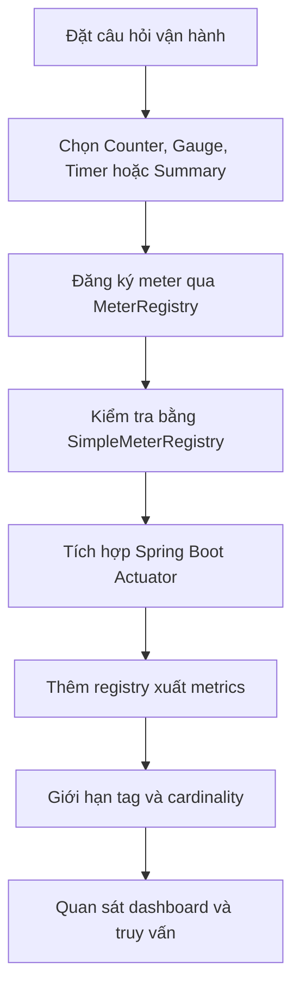

# Kiến thức đầu vào và trình tự học từ phép đo đơn giản đến tích hợp thực tế

Micrometer cung cấp một API đo lường thống nhất cho ứng dụng Java. Thay vì để mã nghiệp vụ phụ thuộc trực tiếp vào Prometheus, Datadog hay một hệ thống giám sát cụ thể, ứng dụng ghi nhận số liệu qua các meter của Micrometer. Một registry phù hợp với môi trường triển khai sẽ chuyển các số liệu đó sang định dạng mà hệ thống giám sát có thể thu thập.

Trong module này, mục tiêu là biết đặt câu hỏi vận hành, chọn đúng loại meter, gắn nhãn có kiểm soát, tích hợp với Spring Boot, xuất metrics và kiểm chứng kết quả. Hãy đi từ một phép đo nhỏ trong mã Java, sau đó mới mở rộng sang ứng dụng đang chạy và hệ thống giám sát.

## 1. Kiến thức cần có trước khi bắt đầu

Bạn không cần biết sâu về một nền tảng giám sát cụ thể để học Micrometer. Tuy nhiên, một số kiến thức nền sẽ giúp bạn hiểu số đo và tránh ghi nhận sai dữ liệu.

- **Java cơ bản:** biết tạo class, inject dependency, sử dụng interface và làm việc với các kiểu dữ liệu số. Ví dụ bên dưới dùng `AtomicInteger`, lambda và `Supplier`.
- **Spring Boot cơ bản:** hiểu dependency injection, bean và cách cấu hình ứng dụng bằng `application.yml` hoặc `application.properties`.
- **HTTP và ứng dụng backend:** biết request, response, status code, endpoint và vòng đời xử lý một yêu cầu.
- **Khái niệm vận hành:** phân biệt thông lượng (throughput), độ trễ (latency), lỗi (error rate), mức sử dụng tài nguyên và trạng thái hiện tại của hệ thống.
- **Một ít kiến thức về số liệu theo thời gian:** hiểu rằng metric được thu thập lặp lại theo thời gian; một giá trị đơn lẻ thường không đủ để kết luận hệ thống đang khỏe hay gặp sự cố.

Nếu chưa quen Prometheus hoặc một công cụ tương tự, bạn vẫn có thể học phần API và kiểm thử bằng `SimpleMeterRegistry`. Registry này lưu số liệu trong bộ nhớ, phù hợp để quan sát hành vi của meter trong ví dụ và bài kiểm thử.

## 2. Hiểu mô hình metric của Micrometer

Micrometer tổ chức phép đo quanh ba khái niệm:

1. **Meter** mô tả đại lượng cần đo, chẳng hạn số đơn hàng được tạo hoặc thời gian xử lý đơn hàng.
2. **Tag** bổ sung một chiều phân loại có tập giá trị hữu hạn, chẳng hạn kênh bán hàng hoặc kết quả xử lý.
3. **MeterRegistry** quản lý meter và cung cấp cách xuất dữ liệu đến hệ thống giám sát tương ứng.

Ví dụ, metric `app.orders.created` có tag `channel=web` biểu diễn số đơn hàng được tạo từ kênh web. Cùng tên metric với `channel=mobile` là một chuỗi thời gian khác. Tên metric và toàn bộ tập tag xác định một chuỗi thời gian; vì vậy, mỗi giá trị tag mới có thể làm tăng số chuỗi mà hệ thống phải lưu trữ và truy vấn.

Micrometer giữ API đo lường tách biệt với backend. Mã ứng dụng thường làm việc với `MeterRegistry`, `Counter`, `Timer` hoặc `Gauge`; registry cụ thể chịu trách nhiệm chuyển dữ liệu sang định dạng của Prometheus hay một hệ thống khác. Cách tổ chức này giúp thay đổi backend với ít ảnh hưởng đến mã nghiệp vụ.

## 3. Chọn đúng loại meter

Bốn loại meter sau là nền tảng của phần lớn phép đo ứng dụng.

| Loại meter | Câu hỏi cần trả lời | Ví dụ phù hợp | Lưu ý |
| --- | --- | --- | --- |
| `Counter` | Có bao nhiêu sự kiện đã xảy ra? | Đơn hàng tạo thành công, lần gửi email thất bại | Chỉ tăng; không dùng để biểu diễn giá trị có thể giảm. |
| `Gauge` | Giá trị hiện tại đang là bao nhiêu? | Số request đang xử lý, số phần tử trong hàng đợi | Đọc trạng thái tại thời điểm thu thập; không dùng để đếm tổng sự kiện. |
| `Timer` | Một thao tác mất bao lâu và có bao nhiêu lần thực hiện? | Thời gian xử lý đơn hàng, gọi dịch vụ bên ngoài | Ghi nhận thời lượng và số lần; có thể cấu hình histogram hoặc percentile. |
| `DistributionSummary` | Các giá trị được ghi nhận phân bố như thế nào? | Kích thước payload, số bản ghi trong một batch | Ghi nhận phân phối của đại lượng số không nhất thiết là thời gian. |

### 3.1. Counter: đếm sự kiện tích lũy

Counter thích hợp với sự kiện chỉ tăng theo thời gian. Ví dụ, sau mỗi lần tạo đơn hàng thành công, gọi `increment()` một lần. Nếu cần đếm cả thành công lẫn thất bại, có thể dùng một metric với tag `result` có hai giá trị cố định, hoặc hai metric riêng có tên rõ nghĩa.

Không giảm counter khi một đơn hàng bị hủy. Nếu nghiệp vụ cần biết số đơn đang tồn tại, đó là một trạng thái hiện tại và nên được đo bằng gauge hoặc được tính từ dữ liệu nghiệp vụ phù hợp. Với hệ thống như Prometheus, thường quan tâm tốc độ tăng của counter trong một khoảng thời gian (`rate`) hơn là chỉ nhìn tổng tích lũy từ lúc tiến trình khởi động.

### 3.2. Gauge: đo trạng thái hiện tại

Gauge phù hợp với đại lượng có thể tăng hoặc giảm, chẳng hạn số request đang chạy hoặc độ dài hàng đợi. Gauge đọc giá trị của một đối tượng tại thời điểm registry thu thập số liệu.

Đối tượng được đo cần có vòng đời đủ dài để tiếp tục tồn tại khi metric được đọc. Một cách thông dụng là giữ `AtomicInteger` hoặc đối tượng trạng thái trong một bean sống cùng ứng dụng, đăng ký gauge một lần rồi cập nhật đối tượng đó khi trạng thái thay đổi. Tránh tạo một đối tượng tạm thời chỉ để đăng ký gauge, vì gauge cần tham chiếu đến đúng trạng thái cần quan sát.

### 3.3. Timer: đo thời lượng thao tác

Timer dành cho thao tác có thời gian thực hiện. Ngoài thời lượng, timer còn ghi nhận số lần được thực hiện và tổng thời gian. Tùy cấu hình registry, bạn có thể xuất histogram hoặc percentile để phân tích độ trễ.

Đo thời gian bằng timer giúp trả lời những câu hỏi như: mỗi phút có bao nhiêu thao tác, thời gian trung bình thay đổi ra sao, hoặc 95% thao tác hoàn tất trong bao lâu. Khi thao tác có thể ném exception, hãy dùng API `record` để thời gian vẫn được ghi nhận khi luồng xử lý kết thúc bằng lỗi.

### 3.4. DistributionSummary: đo phân phối giá trị

DistributionSummary có cách sử dụng gần với timer nhưng dành cho giá trị số bất kỳ. Ví dụ, ứng dụng có thể ghi nhận kích thước payload theo byte hoặc số phần tử trong mỗi batch. Summary cho biết số mẫu, tổng giá trị và các thông tin phân phối đã cấu hình.

Không dùng summary chỉ để lưu một giá trị trạng thái hiện tại. Nếu câu hỏi là “hàng đợi hiện có bao nhiêu phần tử?”, gauge phù hợp hơn. Nếu câu hỏi là “mỗi batch thường chứa bao nhiêu phần tử và phân phối kích thước batch ra sao?”, distribution summary phù hợp hơn.

## 4. Lộ trình thực hành từ Java đến ứng dụng thật

Có thể học theo trình tự sau. Mỗi bước tạo ra một kết quả có thể kiểm chứng trước khi chuyển sang bước tiếp theo.



### Bước 1: bắt đầu bằng một câu hỏi cụ thể

Trước khi viết code, hãy mô tả điều bạn muốn biết. Ví dụ:

- “Mỗi phút có bao nhiêu đơn hàng được tạo thành công?”
- “Hiện có bao nhiêu đơn hàng đang được xử lý?”
- “Thời gian xử lý đơn hàng ở phân vị 95 thay đổi thế nào?”
- “Kích thước payload thường gặp là bao nhiêu byte?”

Từ câu hỏi, xác định đại lượng, đơn vị và thời điểm ghi nhận. Một sự kiện thành công chỉ nên được đếm sau khi nghiệp vụ xác nhận thành công. Thời gian xử lý nên bao trùm đúng đoạn công việc cần đo. Đơn vị của một đại lượng cần nhất quán, ví dụ byte cho kích thước payload và giây cho thời lượng.

### Bước 2: làm quen với MeterRegistry

Trong ứng dụng, hãy phụ thuộc vào abstraction `MeterRegistry`. Đừng để lớp nghiệp vụ tự tạo hoặc phụ thuộc trực tiếp vào một registry dành riêng cho backend.

Ví dụ đơn giản với counter:

```java
import io.micrometer.core.instrument.Counter;
import io.micrometer.core.instrument.MeterRegistry;
import org.springframework.stereotype.Component;

@Component
public class OrderMetrics {
    private final Counter ordersCreated;

    public OrderMetrics(MeterRegistry registry) {
        this.ordersCreated = Counter.builder("app.orders.created")
                .description("Number of successfully created orders")
                .register(registry);
    }

    public void recordCreated() {
        ordersCreated.increment();
    }
}
```

Bean giữ tham chiếu đến counter đã đăng ký và tái sử dụng nó khi sự kiện xảy ra. Trong mã nghiệp vụ, gọi `recordCreated()` tại điểm đơn hàng đã được tạo thành công. Cách đặt tên nên mô tả đại lượng và ý nghĩa nghiệp vụ; phần mô tả giúp người đọc registry hiểu metric đang đo gì.

### Bước 3: thêm tag có tập giá trị hữu hạn

Tag giúp phân tích metric theo một chiều có ý nghĩa. Ví dụ, số đơn hàng có thể được chia theo `channel`. Các giá trị hợp lệ nên được giới hạn như `web`, `mobile`, `partner` và `other`.

```java
public void recordCreated(MeterRegistry registry, String channel) {
    String boundedChannel = switch (channel) {
        case "web", "mobile", "partner" -> channel;
        default -> "other";
    };

    registry.counter("app.orders.created", "channel", boundedChannel)
            .increment();
}
```

Đoạn code trên minh họa cách chuẩn hóa đầu vào về một tập giá trị cố định. Trong đường chạy có lưu lượng cao, có thể tạo và giữ sẵn các meter cho từng giá trị đã biết để giảm thao tác tìm meter lặp lại. Dù chọn cách nào, tập giá trị tag vẫn phải được kiểm soát.

### Bước 4: đo thời gian và trạng thái đồng thời

Ví dụ sau kết hợp timer và gauge. `Timer` đo thời gian xử lý; `Gauge` đọc số tác vụ đang chạy. `finally` bảo đảm bộ đếm trạng thái được giảm kể cả khi thao tác phát sinh exception.

```java
import io.micrometer.core.instrument.Gauge;
import io.micrometer.core.instrument.MeterRegistry;
import io.micrometer.core.instrument.Timer;
import java.util.concurrent.atomic.AtomicInteger;
import java.util.function.Supplier;
import org.springframework.stereotype.Component;

@Component
public class OrderProcessingMetrics {
    private final AtomicInteger inFlight = new AtomicInteger();
    private final Timer processingTimer;

    public OrderProcessingMetrics(MeterRegistry registry) {
        this.processingTimer = Timer.builder("app.orders.processing")
                .description("Time spent processing an order")
                .publishPercentileHistogram()
                .register(registry);

        Gauge.builder("app.orders.inflight", inFlight, AtomicInteger::get)
                .description("Number of orders currently being processed")
                .register(registry);
    }

    public <T> T measure(Supplier<T> operation) {
        inFlight.incrementAndGet();
        try {
            return processingTimer.record(operation);
        } finally {
            inFlight.decrementAndGet();
        }
    }
}
```

Ở đây `inFlight` là đối tượng được giữ trong bean, vì vậy gauge tiếp tục đọc được trạng thái hiện tại. Histogram được bật để backend có thể tổng hợp các bucket và tính percentile trên nhiều instance. Histogram làm tăng lượng chuỗi thời gian, nên chỉ bật cho những phép đo có giá trị vận hành rõ ràng.

### Bước 5: đo phân phối của dữ liệu không phải thời gian

Ví dụ ghi nhận kích thước batch:

```java
import io.micrometer.core.instrument.DistributionSummary;
import io.micrometer.core.instrument.MeterRegistry;
import org.springframework.stereotype.Component;

@Component
public class BatchMetrics {
    private final DistributionSummary batchSize;

    public BatchMetrics(MeterRegistry registry) {
        this.batchSize = DistributionSummary.builder("app.orders.batch.size")
                .baseUnit("items")
                .description("Number of orders in a processed batch")
                .publishPercentileHistogram()
                .register(registry);
    }

    public void recordBatchSize(int size) {
        if (size < 0) {
            throw new IllegalArgumentException("Batch size cannot be negative");
        }
        batchSize.record(size);
    }
}
```

`baseUnit` ghi rõ đơn vị của số đo. Với dữ liệu kích thước, hãy thống nhất cách biểu diễn trong toàn ứng dụng, ví dụ luôn dùng byte thay vì lúc dùng byte, lúc dùng kilobyte.

## 5. Tích hợp Micrometer với Spring Boot

Spring Boot Actuator giúp ứng dụng cung cấp các endpoint vận hành và tự cấu hình nhiều metric phổ biến. Khi có `MeterRegistry` trong context, các bean có thể inject registry để đăng ký metric nghiệp vụ.

Với Maven, hai dependency thường dùng khi xuất metrics qua endpoint Prometheus là:

```xml
<dependency>
    <groupId>org.springframework.boot</groupId>
    <artifactId>spring-boot-starter-actuator</artifactId>
</dependency>
<dependency>
    <groupId>io.micrometer</groupId>
    <artifactId>micrometer-registry-prometheus</artifactId>
</dependency>
```

Phiên bản dependency nên được quản lý theo Spring Boot dependency management của dự án. Khi thêm registry tương ứng vào classpath, Spring Boot có thể tự cấu hình registry và endpoint tích hợp.

Ví dụ cấu hình `application.yml` để expose endpoint Prometheus:

```yaml
management:
  endpoints:
    web:
      exposure:
        include: health,info,prometheus
  metrics:
    tags:
      application: order-service
```

Sau khi ứng dụng khởi động, endpoint thường có đường dẫn `/actuator/prometheus`. Hãy kiểm tra endpoint này từ môi trường phù hợp và xác nhận metric tùy chỉnh xuất hiện cùng các metric do Spring Boot hoặc thư viện tích hợp cung cấp. Endpoint metrics có thể tiết lộ thông tin vận hành; chỉ expose trong phạm vi cần thiết và áp dụng cơ chế bảo vệ phù hợp với môi trường triển khai.

Spring Boot và các thư viện có thể cung cấp sẵn số liệu cho JVM, bộ nhớ, CPU, HTTP server, datasource hoặc cache tùy dependency và cấu hình. Các metric tự động này giúp quan sát sức khỏe nền tảng. Metric nghiệp vụ do nhóm phát triển bổ sung để trả lời câu hỏi riêng của sản phẩm, chẳng hạn số đơn hàng tạo thành công hoặc thời gian xử lý một bước nghiệp vụ.

Prometheus thường hoạt động theo mô hình pull: máy chủ Prometheus định kỳ scrape endpoint metrics của ứng dụng. Với backend khác, có thể thêm registry tương ứng của Micrometer. Mã nghiệp vụ vẫn nên phụ thuộc vào API chung để tránh gắn chặt logic ứng dụng với cách vận chuyển dữ liệu.

## 6. Kiểm soát tag và cardinality

Cardinality là số lượng chuỗi thời gian riêng biệt được tạo ra. Với một metric, mỗi tổ hợp tag khác nhau có thể tạo một chuỗi thời gian. Nếu metric có tag `method` với 5 giá trị, `status` với 6 giá trị và `region` với 4 giá trị, tổ hợp tối đa có thể là 5 × 6 × 4 = 120 chuỗi. Khi thêm một tag có hàng chục nghìn giá trị, số chuỗi có thể tăng rất nhanh.

Nên ưu tiên các tag có tập giá trị nhỏ, ổn định và giúp trả lời câu hỏi vận hành:

- `method`: GET, POST, PUT, DELETE.
- `status`: nhóm trạng thái hoặc mã trạng thái đã được giới hạn.
- `result`: success, error, timeout.
- `channel`: web, mobile, partner, other.
- `region`: mã vùng nằm trong danh sách cấu hình.

Tránh đưa các giá trị thay đổi theo từng request hoặc từng người dùng vào tag:

- user ID, order ID, email hoặc session ID;
- request ID, trace ID hoặc transaction ID;
- URL đầy đủ chứa ID động hoặc query string;
- exception message, nội dung tìm kiếm hoặc dữ liệu đầu vào tự do.

Ví dụ, dùng route template `/orders/{id}` thay vì URL thực tế `/orders/12345`. Nếu cần điều tra một request cụ thể, log hoặc distributed trace phù hợp hơn metrics. Metrics nên giữ số chiều thấp để có thể tổng hợp qua thời gian và qua nhiều instance.

Một số nguyên tắc thực tế:

1. Quy định danh sách giá trị hợp lệ cho từng tag ngay tại điểm instrumentation.
2. Chuẩn hóa giá trị lạ về một nhóm như `other` hoặc `unknown`.
3. Không thêm tag chỉ vì dữ liệu đó đang có sẵn trong request; hãy xác định trước câu hỏi cần trả lời.
4. Theo dõi số lượng meter và chuỗi thời gian sau khi triển khai.
5. Cân nhắc bộ lọc giới hạn số tag hoặc số meter của Micrometer như một lớp bảo vệ bổ sung; bộ lọc không thay thế việc thiết kế tag đúng từ đầu.

Cardinality cao làm tăng bộ nhớ, chi phí lưu trữ, lượng dữ liệu truyền đi và độ phức tạp khi truy vấn. Đây là vấn đề thiết kế ngay trong mã instrumentation, không chỉ là vấn đề cấu hình của hệ thống giám sát.

## 7. Kiểm thử instrumentation

Metric là một phần hành vi quan sát được của ứng dụng, vì vậy nên kiểm tra nó giống như kiểm tra kết quả của một thành phần khác. Với unit test, `SimpleMeterRegistry` cho phép kiểm tra số lần tăng, thời lượng và giá trị gauge mà không cần chạy Prometheus.

Ví dụ kiểm tra counter:

```java
import static org.assertj.core.api.Assertions.assertThat;

import io.micrometer.core.instrument.simple.SimpleMeterRegistry;
import org.junit.jupiter.api.Test;

class OrderMetricsTest {
    @Test
    void recordsCreatedOrders() {
        try (var registry = new SimpleMeterRegistry()) {
            var counter = registry.counter("app.orders.created");

            counter.increment();
            counter.increment();

            assertThat(counter.count()).isEqualTo(2.0);
        }
    }
}
```

Trong test cho class thực tế, hãy khởi tạo class đó với `SimpleMeterRegistry`, gọi phương thức instrumentation qua hành vi nghiệp vụ cần kiểm tra, rồi đọc meter từ registry. Cách này xác nhận code đã ghi đúng metric và tag. Với timer, có thể kiểm tra `count()` và `totalTime(...)`; với gauge, cập nhật đối tượng trạng thái rồi kiểm tra `value()`.

Ngoài unit test, integration test nên kiểm tra các điểm sau:

- Spring context khởi tạo được registry và inject đúng bean.
- Metric nghiệp vụ xuất hiện ở endpoint sau khi thực hiện thao tác tương ứng.
- Tag có đúng tên và chỉ nhận các giá trị đã cho phép.
- Endpoint chỉ được expose và truy cập theo cấu hình bảo mật của ứng dụng.
- Một thao tác lỗi vẫn ghi nhận timer và cập nhật trạng thái gauge đúng cách.

Không nên kiểm thử bằng cách phụ thuộc vào thời lượng chạy thực tế quá chính xác. Với timer, kiểm tra số lần ghi nhận và giới hạn thời gian rộng, hoặc kiểm tra API được gọi theo cách xác định. Mục tiêu là xác minh instrumentation, không đo hiệu năng của máy chạy test.

## 8. Đọc và diễn giải số liệu

Sau khi metrics được xuất, hãy đọc chúng theo câu hỏi ban đầu. Một số cách diễn giải thường gặp:

| Câu hỏi | Số liệu nên quan sát | Cách đọc |
| --- | --- | --- |
| Lưu lượng đơn hàng thay đổi ra sao? | Counter `app.orders.created` | Quan sát tốc độ tăng trong một cửa sổ thời gian, có thể nhóm theo `channel`. |
| Có bao nhiêu đơn đang xử lý? | Gauge `app.orders.inflight` | Đọc giá trị hiện tại và xem nó có tăng kéo dài hay không. |
| Độ trễ xử lý có xấu đi không? | Timer `app.orders.processing` | Theo dõi phân vị như p95/p99 cùng thông lượng; percentile cần histogram phù hợp để tổng hợp giữa các instance. |
| Batch thường có kích thước bao nhiêu? | DistributionSummary `app.orders.batch.size` | Xem count, tổng và phân phối; đối chiếu với giới hạn batch của ứng dụng. |

Với Prometheus, truy vấn minh họa cho tốc độ tạo đơn theo kênh có thể là:

```promql
sum by (channel) (rate(app_orders_created_total[5m]))
```

Truy vấn phân vị 95 của timer khi histogram được xuất có thể có dạng:

```promql
histogram_quantile(
  0.95,
  sum by (le) (rate(app_orders_processing_seconds_bucket[5m]))
)
```

Tên metric trong ví dụ là tên theo quy ước Prometheus thường gặp; registry có thể chuẩn hóa tên và đơn vị. Hãy xem trực tiếp `/actuator/prometheus` để xác nhận tên thực tế trước khi viết truy vấn dashboard hoặc alert.

Percentile được tính riêng ở từng instance không thể luôn cộng gộp chính xác thành percentile toàn cụm. Khi cần tổng hợp percentile giữa nhiều instance, histogram bucket là lựa chọn phù hợp hơn. Việc bật histogram cũng làm tăng số chuỗi thời gian, vì vậy hãy cân nhắc độ chính xác cần thiết và chi phí thu thập.

Đừng kết luận từ một metric riêng lẻ. Ví dụ, số request đang xử lý tăng có thể do lưu lượng tăng bình thường; nếu đồng thời độ trễ p95 và tỷ lệ lỗi tăng, đó mới là dấu hiệu cần điều tra sâu hơn. Dashboard hữu ích thường kết hợp thông lượng, độ trễ, lỗi và mức sử dụng tài nguyên để cung cấp bối cảnh.

## 9. Những lỗi thường gặp khi bắt đầu

- **Chọn sai meter:** dùng counter cho số lượng đang chờ, hoặc dùng gauge để đếm tổng sự kiện. Hãy xác định đại lượng là sự kiện tích lũy hay trạng thái hiện tại.
- **Đo sai ranh giới nghiệp vụ:** tăng counter trước khi giao dịch thành công khiến số liệu thể hiện số lần thử thay vì số đơn được tạo. Đặt điểm ghi nhận đúng với ý nghĩa metric.
- **Đăng ký gauge với đối tượng tạm:** đối tượng không còn được giữ tham chiếu có thể khiến gauge không còn đọc được trạng thái mong muốn. Giữ đối tượng trạng thái sống cùng bean.
- **Gắn tag động:** đưa ID, URL đầy đủ hoặc exception message vào tag khiến cardinality tăng khó kiểm soát. Chuẩn hóa về nhóm giá trị hữu hạn.
- **Bật histogram tràn lan:** histogram hữu ích cho phân tích phân phối nhưng làm tăng dữ liệu. Chỉ bật cho metric cần phân tích percentile hoặc bucket.
- **Không thống nhất đơn vị:** trộn byte với kilobyte hoặc milliseconds với seconds làm dashboard khó so sánh. Chọn đơn vị rõ ràng và dùng nhất quán.
- **Chỉ kiểm tra endpoint có phản hồi:** endpoint hoạt động chưa chứng minh metric nghiệp vụ được ghi đúng. Kiểm tra cả tên, tag, count và giá trị.
- **Đồng nhất metrics với log và trace:** metrics cho xu hướng và tổng hợp; log và trace giúp điều tra chi tiết một sự kiện hoặc request cụ thể. Ba loại dữ liệu bổ sung cho nhau.

## 10. Checklist hoàn thành phần nhập môn

Bạn đã nắm được nền tảng khi có thể tự thực hiện các việc sau:

- [ ] Diễn đạt một câu hỏi vận hành thành đại lượng có đơn vị và điểm ghi nhận rõ ràng.
- [ ] Chọn đúng giữa `Counter`, `Gauge`, `Timer` và `DistributionSummary`.
- [ ] Inject `MeterRegistry` và đăng ký meter theo tên có ý nghĩa.
- [ ] Dùng tag với tập giá trị hữu hạn và giải thích được cardinality phát sinh.
- [ ] Kiểm tra counter, timer và gauge bằng `SimpleMeterRegistry`.
- [ ] Cấu hình Spring Boot Actuator và xác nhận metric xuất hiện ở endpoint.
- [ ] Đọc được tốc độ tăng counter, trạng thái gauge và phân phối thời lượng hoặc kích thước.
- [ ] Giải thích vì sao metrics cần kết hợp với log, trace và bối cảnh vận hành.

Khi đã hoàn thành các bước này, bạn có thể tiếp tục với các chủ đề sâu hơn như quy ước đặt tên metric theo backend, cấu hình histogram và percentile theo nhu cầu, lọc meter bằng `MeterFilter`, instrumentation cho JDBC hoặc HTTP client, và tích hợp metrics vào dashboard cùng cảnh báo của môi trường triển khai.
