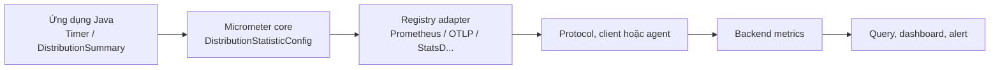

# Phạm vi hỗ trợ histogram của từng registry và thư viện phía dưới

Micrometer cung cấp API chung để ghi nhận Timer và DistributionSummary, nhưng khả năng xuất histogram phụ thuộc vào registry implementation, giao thức truyền dữ liệu, thư viện client hoặc agent và backend nhận metrics. Việc một builder chấp nhận `publishPercentileHistogram()` không tự bảo đảm toàn bộ đường đi sẽ giữ được bucket, cho phép tổng hợp giữa các instance hoặc cung cấp truy vấn percentile.

Để đánh giá đúng phạm vi hỗ trợ, cần phân biệt ba cơ chế: percentile tính trong tiến trình, histogram dạng bucket được xuất ra ngoài và thống kê phân phối do backend hoặc agent tính. Ba cơ chế này có dữ liệu đầu vào, chi phí và khả năng tổng hợp khác nhau. Một registry có thể hỗ trợ một cơ chế nhưng không hỗ trợ cơ chế còn lại.

Bài học thuộc module OBSERVABILITY_INSTRUMENTATION_MICROMETER. Module này hướng dẫn sử dụng Micrometer để đo lường ứng dụng Java bằng counter, gauge, timer, distribution summary và nhãn có kiểm soát; tích hợp Spring Boot, xuất metrics đến hệ giám sát, kiểm soát cardinality, kiểm thử instrumentation và diễn giải số đo vận hành.

## Mục tiêu học tập

Sau bài này, bạn có thể:

- Phân biệt Micrometer core, registry adapter, giao thức export, client/agent và backend.
- Giải thích khác biệt giữa client-side percentile, bucket histogram và backend distribution.
- Đánh giá phạm vi histogram của các registry phổ biến mà không giả định mọi registry hỗ trợ giống nhau.
- Hiểu vai trò của `publishPercentiles`, `publishPercentileHistogram` và `serviceLevelObjectives`.
- Kiểm tra histogram ở đầu ra thực tế của registry và backend.
- Chọn cấu hình phù hợp với mục tiêu truy vấn, cardinality và chi phí vận hành.

## 1. Histogram là khả năng end-to-end

Một ứng dụng có thể ghi giá trị vào DistributionSummary hoặc Timer mà không cần biết backend cụ thể. Micrometer core quản lý API meter và cấu hình thống kê. Registry implementation chuyển meter sang định dạng mà hệ thống nhận hỗ trợ. Giao thức, client hoặc agent quyết định cách dữ liệu được truyền; backend quyết định cách lưu trữ, tổng hợp và truy vấn.

Có thể hình dung luồng như sau:



Một histogram chỉ hữu ích cho truy vấn khi các lớp trong đường đi bảo toàn được thông tin phân phối cần thiết. Ví dụ, ứng dụng có thể cấu hình bucket trong Micrometer, nhưng nếu registry chỉ xuất một giá trị tổng hợp, backend sẽ không có bucket để tính percentile toàn cục.

Khi đánh giá một registry, hãy đặt lần lượt các câu hỏi:

1. Micrometer core có nhận cấu hình histogram hoặc percentile cho meter đó không?
2. Registry adapter có chuyển cấu hình thành dữ liệu phân phối không?
3. Giao thức hoặc thư viện phía dưới có biểu diễn được histogram hay distribution không?
4. Agent hoặc collector có giữ nguyên bucket và temporality không?
5. Backend có lưu và cung cấp phép truy vấn cần thiết không?
6. Các instance có dùng cùng bucket boundaries và cùng quy ước đơn vị không?

Không nên chỉ kiểm tra mã ứng dụng đã gọi builder thành công rồi kết luận histogram đã hoạt động ở production.

## 2. Ba cơ chế thường bị nhầm lẫn

### Client-side percentile

`publishPercentiles(0.50, 0.95, 0.99)` yêu cầu Micrometer tính các percentile đã chọn trong tiến trình. Kết quả được xuất như các giá trị percentile riêng của meter, tùy khả năng của registry.

Ưu điểm:

- Có thể đọc percentile mà không cần backend tính lại từ bucket.
- Có thể hữu ích với registry hoặc backend không hỗ trợ histogram bucket.
- Có thể cấu hình các percentile cần theo dõi.

Giới hạn:

- Các percentile được tính riêng trên từng instance.
- Không thể cộng hoặc lấy trung bình p95 của nhiều instance để tạo p95 toàn hệ thống.
- Chỉ có các percentile đã cấu hình; không thể tùy ý tính lại percentile khác từ các giá trị percentile rời rạc.
- Việc tính toán và xuất percentile có chi phí bộ nhớ, CPU và số chuỗi metrics.

### Percentile histogram dạng bucket

`publishPercentileHistogram()` yêu cầu Micrometer công bố histogram theo các bucket phù hợp với registry hỗ trợ. Backend có thể tổng hợp bucket của nhiều instance có cùng ranh giới rồi tính percentile trên tập dữ liệu hợp nhất.

Ưu điểm:

- Backend có thể tính percentile theo khoảng thời gian và theo nhóm instance.
- Có thể truy vấn nhiều percentile khác nhau từ cùng tập bucket nếu backend hỗ trợ.
- Phù hợp với các hệ thống cần percentile toàn dịch vụ.

Giới hạn:

- Tạo thêm chuỗi metrics cho mỗi bucket và tổ hợp tag.
- Cần registry, giao thức và backend hỗ trợ bucket histogram.
- Bucket boundaries và đơn vị phải nhất quán để tổng hợp có ý nghĩa.
- Không phải mọi backend đều dùng cùng cú pháp truy vấn hoặc cùng mô hình histogram.

### Service level objective buckets

`serviceLevelObjectives(...)` khai báo các ranh giới bucket cụ thể theo ngưỡng nghiệp vụ. Ví dụ, với payload, có thể quan tâm bao nhiêu phần trăm payload không vượt quá 4 KiB hoặc 64 KiB. Với Timer, có thể quan tâm bao nhiêu request hoàn tất trong 100 ms, 250 ms hoặc 500 ms.

SLO bucket hữu ích khi câu hỏi vận hành gắn với ngưỡng rõ ràng. Chúng không tự tạo ra một hệ thống histogram end-to-end nếu registry hoặc backend không hỗ trợ xuất và truy vấn bucket.

| Cơ chế | Nơi tính | Có thể tổng hợp giữa instance? | Dùng khi |
| --- | --- | --- | --- |
| Client-side percentile | Trong tiến trình ứng dụng | Không bằng cách cộng/trung bình percentile | Cần percentile riêng từng instance hoặc registry chỉ xuất được giá trị percentile |
| Percentile histogram | Bucket được ghi nhận, percentile tính ở backend | Có, nếu backend hỗ trợ và bucket tương thích | Cần percentile toàn dịch vụ |
| SLO bucket | Bucket tại các ngưỡng được chọn | Có, nếu backend giữ bucket | Cần theo dõi tỷ lệ đáp ứng ngưỡng cụ thể |

## 3. Phạm vi hỗ trợ theo registry

Không có một bảng hỗ trợ duy nhất đúng cho mọi phiên bản. Khả năng cụ thể phụ thuộc phiên bản Micrometer, registry artifact, thư viện client được kéo theo, cấu hình và backend. Bảng sau mô tả cách đánh giá các họ registry thường gặp; hãy dùng nó làm hướng dẫn kiểm tra, sau đó xác nhận với dependency và tài liệu đúng phiên bản đang triển khai.

| Registry hoặc họ giao thức | Hỗ trợ aggregable percentile histogram trong Micrometer | Cách sử dụng và giới hạn |
| --- | --- | --- |
| Prometheus | Có | Xuất classic bucket histogram; backend dùng `histogram_quantile`. Native histogram là cơ chế riêng, phụ thuộc Prometheus server, Java client và phiên bản registry |
| Atlas | Có | Có thể tổng hợp bucket và tính percentile bằng toán tử `:percentile` của Atlas |
| Wavefront | Có | Có thể tổng hợp bucket và tính percentile bằng hàm `hs()` |
| OTLP | Không nằm trong danh sách registry hỗ trợ aggregable percentile histogram của Micrometer reference hiện hành | OTLP data model có Histogram, nhưng khả năng của giao thức không đồng nghĩa Micrometer registry chuyển `publishPercentileHistogram()` thành OTLP histogram. Kiểm tra adapter đúng phiên bản |
| Datadog, Dynatrace, Elastic, Influx, New Relic, SignalFx, Stackdriver và các registry khác | Không nên giả định có | Micrometer không gửi percentile histogram được tạo bởi `publishPercentileHistogram()` đến các hệ thống không hỗ trợ aggregable percentile approximation. Client-side percentile hoặc SLO buckets có thể là lựa chọn khác nếu registry hỗ trợ |
| StatsD | Không nằm trong danh sách aggregable percentile histogram | Kết quả phụ thuộc flavor và agent. Metric distribution của DogStatsD không tự động đồng nghĩa với histogram bucket do Micrometer tạo |
| Graphite | Không | Graphite nhận các series scalar; percentile phải được tính ở client hoặc dùng pipeline khác có giữ dữ liệu phân phối |
| SimpleMeterRegistry | Không có export histogram ra backend | Dùng để kiểm thử thống kê trong bộ nhớ; không chứng minh khả năng export hoặc truy vấn histogram |

Danh sách aggregable percentile histogram ở trên theo tài liệu Micrometer reference hiện hành. Khi dự án dùng phiên bản khác, hãy đối chiếu đúng tài liệu của phiên bản đó và kiểm tra đầu ra thực tế. Một backend có thể có kiểu metric distribution riêng nhưng registry Micrometer vẫn không chuyển cấu hình percentile histogram sang kiểu đó.

### Prometheus

Prometheus có kiểu metric histogram với các bucket tích lũy, count và sum. Với registry tương thích, Micrometer có thể xuất histogram bucket để Prometheus scrape. Khi đó, backend có thể dùng các bucket để tính quantile theo khoảng thời gian và nhóm instance.

Ví dụ cấu hình builder:

```java
Timer requestTimer = Timer.builder("http.server.requests")
        .description("Thời lượng xử lý HTTP request")
        .publishPercentileHistogram()
        .serviceLevelObjectives(
                Duration.ofMillis(100),
                Duration.ofMillis(250),
                Duration.ofMillis(500)
        )
        .register(registry);
```

Với Prometheus classic histogram, đầu ra thường gồm các series bucket có label `le`, cùng count và sum. Tên metric cuối cùng có thể được chuyển đổi theo NamingConvention và đơn vị của registry. Với Timer, backend thường nhận đơn vị thời gian đã chuẩn hóa; đừng giả định tên cuối cùng luôn giống tên builder.

Một truy vấn PromQL minh họa để tính p95 từ bucket:

```promql
histogram_quantile(
  0.95,
  sum by (le) (
    rate(http_server_requests_seconds_bucket[5m])
  )
)
```

Trong thực tế, tên metric phải khớp đầu ra scrape của ứng dụng. Khi tổng hợp, giữ label `le` để các bucket được cộng đúng ranh giới; chỉ nhóm theo các chiều nghiệp vụ cần thiết.

Prometheus native histogram là một cơ chế khác với classic bucket histogram. Việc sử dụng native histogram phụ thuộc khả năng của Prometheus server, Prometheus Java client và phiên bản Micrometer registry. Không suy ra rằng bật `publishPercentileHistogram()` tự động bật native histogram. Hãy kiểm tra tài liệu và cấu hình đúng phiên bản client/server đang dùng.

Với Prometheus Java Client 1.x, tài liệu Micrometer lưu ý không thể xuất đồng thời client-side percentiles và histogram dưới cùng một tên metric. Nếu đang nâng cấp từ client cũ, hãy kiểm tra lại cấu hình meter và nội dung scrape endpoint.

### Atlas

Atlas là một trong các hệ thống được Micrometer hỗ trợ aggregable percentile histogram. Registry có thể gửi bucket để Atlas tổng hợp theo các chiều và tính percentile bằng toán tử `:percentile`. Khả năng này giúp tính percentile sau khi gộp dữ liệu của nhiều instance, miễn là chúng dùng cùng metric, đơn vị và bucket boundaries.

Khi xác minh, hãy kiểm tra bucket được gửi đến Atlas và thử một truy vấn percentile theo cú pháp của Atlas. Không lấy trung bình các percentile đã tính riêng trên từng instance.

### Wavefront

Wavefront cũng hỗ trợ percentile histogram có thể tổng hợp. Micrometer xuất bucket để Wavefront xử lý; truy vấn histogram percentile dùng hàm `hs()`. Cần xác nhận registry đang dùng đúng cơ chế histogram và dữ liệu bucket đến Wavefront không bị chuyển thành các giá trị scalar riêng lẻ.

Khi kiểm thử, tạo dữ liệu đã biết, xác minh các bucket và chạy truy vấn `hs()` trên metric đó. Cú pháp cụ thể và cách nhóm series phải theo phiên bản Wavefront đang triển khai.

### OTLP

OTLP có mô hình dữ liệu Histogram riêng, trong đó một data point có thể mang count, sum, bucket counts và explicit bounds. Tuy nhiên, không được suy ra từ mô hình giao thức rằng Micrometer OTLP registry hỗ trợ aggregable percentile histogram của `publishPercentileHistogram()`. Tài liệu Micrometer reference hiện hành chỉ liệt kê Prometheus, Atlas và Wavefront cho cơ chế percentile histogram có thể tổng hợp. Với OTLP, hãy kiểm tra registry version và dữ liệu Histogram thực sự được export; nếu adapter không chuyển cấu hình histogram, collector không thể khôi phục bucket đã không được gửi.

Khi registry có xuất OTLP Histogram, đầu ra không nhất thiết được hiển thị thành các series có hậu tố `_bucket` như Prometheus. Collector có thể nhận histogram, chuyển tiếp hoặc chuyển đổi nó trước khi gửi đến backend. Cần kiểm tra:

- Registry đang xuất histogram hay chỉ các thống kê tổng hợp.
- Temporality là cumulative hay delta theo cấu hình và pipeline.
- Collector có giữ explicit bounds, count và sum không.
- Backend nhận OTLP có hỗ trợ histogram và phép tính percentile không.
- Các resource attributes và metric attributes có được chuẩn hóa giữa instance không.

Nếu collector chuyển histogram thành dữ liệu khác, hãy xác nhận dữ liệu bucket còn đủ để tổng hợp. Đừng đánh giá hỗ trợ chỉ bằng việc endpoint OTLP trả mã thành công.

### StatsD và các flavor

StatsD là họ giao thức, không phải một định dạng thống nhất cho mọi kiểu phân phối. Các flavor có thể hỗ trợ các loại metric khác nhau. Chẳng hạn, một số biến thể hỗ trợ distribution hoặc histogram, trong khi cách biểu diễn của StatsD cơ bản thường tập trung vào counter, gauge, timing và set.

Với Micrometer StatsD registry, phải xác định flavor đang cấu hình và cú pháp mà agent nhận hiểu. Cần kiểm tra riêng:

- Timer được gửi thành timing, distribution hay một kiểu dữ liệu khác.
- DistributionSummary được chuyển thành distribution, histogram hay giá trị scalar.
- Percentile được tính ở ứng dụng, agent hay backend.
- Agent có tổng hợp dữ liệu giữa các host và giữ được bucket không.
- Cấu hình sampling, aggregation và flush interval ảnh hưởng thế nào đến kết quả.

Không dùng một cấu hình percentile histogram chung rồi giả định mọi StatsD flavor sẽ xuất cùng dữ liệu. Hãy bắt một gói metric mẫu ở phía agent hoặc kiểm tra tài liệu của flavor tương ứng.

### Graphite

Graphite thường nhận các điểm dữ liệu dạng series theo tên và timestamp. Đây là mô hình time-series scalar, không phải một giao thức histogram tổng quát có bucket bounds và bucket counts.

Registry có thể xuất các giá trị thống kê của Timer hoặc DistributionSummary thành những series riêng, tùy implementation. Nếu chỉ có count, sum, mean hoặc max, backend không thể tái tạo chính xác phân phối gốc và tính một percentile tùy ý.

Nếu yêu cầu cần p95/p99 hoặc percentile toàn dịch vụ, cần xác định rõ percentile được tính trước ở ứng dụng hay chuyển sang registry/protocol/backend có histogram bucket. Đừng xem nhiều series scalar là tương đương với histogram.

### SimpleMeterRegistry

SimpleMeterRegistry phù hợp để kiểm tra việc đăng ký meter và một số thống kê trong bộ nhớ. Nó không gửi dữ liệu đến hệ thống giám sát, do đó không thể chứng minh exporter, collector hoặc backend đã hỗ trợ histogram.

Dùng SimpleMeterRegistry cho unit test count, total amount, max và mean. Dùng registry thực tế để kiểm tra định dạng export; dùng backend hoặc môi trường tích hợp để xác minh phép tổng hợp percentile.

## 4. Thư viện phía dưới có thể thay đổi kết quả

Một registry adapter có thể phụ thuộc vào thư viện client hoặc SDK khác nhau theo phiên bản. Cùng tên registry nhưng major version của client có thể có mô hình histogram, API cấu hình, naming convention và khả năng native histogram khác nhau.

Ví dụ với Prometheus, cần phân biệt:

- Micrometer core: API meter và cấu hình thống kê.
- Micrometer Prometheus registry: adapter kết nối Micrometer với Prometheus client.
- Prometheus Java client: thư viện thực hiện biểu diễn và export metric.
- Prometheus server: scrape, lưu trữ và truy vấn dữ liệu.

Tương tự với OTLP:

- Micrometer OTLP registry: chuyển meter thành dữ liệu OTLP.
- OTLP exporter hoặc HTTP client: gửi dữ liệu qua transport.
- OpenTelemetry Collector: nhận, xử lý và chuyển tiếp.
- Backend: lưu trữ và truy vấn histogram.

Một lớp có hỗ trợ không bảo đảm lớp kế tiếp giữ nguyên dữ liệu. Khi nâng cấp registry hoặc client, cần kiểm tra lại format export và truy vấn đang dùng.

## 5. Cấu hình histogram trong Micrometer

Với Timer hoặc DistributionSummary, có thể khai báo các thống kê ngay trên builder. Ví dụ với kích thước payload:

```java
DistributionSummary payloadSize = DistributionSummary
        .builder("http.request.payload")
        .description("Kích thước payload HTTP")
        .baseUnit("bytes")
        .minimumExpectedValue(1)
        .maximumExpectedValue(1_000_000)
        .publishPercentileHistogram()
        .serviceLevelObjectives(1024, 4096, 16384, 65536)
        .register(registry);
```

Đoạn cấu hình minh họa ba yêu cầu khác nhau:

- `publishPercentileHistogram`: yêu cầu histogram bucket theo khả năng registry.
- `serviceLevelObjectives`: khai báo các ranh giới bucket cụ thể theo ngưỡng nghiệp vụ.

Nếu registry không hỗ trợ aggregable percentile histogram và chỉ cần percentile riêng trên từng instance, có thể cấu hình client-side percentile:

~~~java
DistributionSummary payloadSize = DistributionSummary
        .builder("http.request.payload")
        .description("Kích thước payload HTTP")
        .baseUnit("bytes")
        .publishPercentiles(0.50, 0.90, 0.99)
        .register(registry);
~~~

Không ghép hai cách trên một cách máy móc. Với Prometheus Java Client 1.x, tài liệu Micrometer lưu ý không thể xuất đồng thời client-side percentiles và histogram dưới cùng một tên metric.

Với DistributionSummary, nên đặt `minimumExpectedValue` và `maximumExpectedValue` khi bật percentile histogram để giới hạn miền bucket và bộ nhớ cần thiết. Theo tài liệu Micrometer reference hiện hành, DistributionSummary không có miền min/max mặc định được giới hạn; nếu không clamp miền giá trị, histogram có thể dùng toàn bộ tập bucket dựng sẵn. Với Timer, Micrometer có miền mặc định khác; hãy kiểm tra đúng loại meter và phiên bản đang dùng.

Không nhất thiết bật cả ba. Nếu cần percentile toàn cục và registry/backend hỗ trợ histogram, bucket histogram thường là lựa chọn phù hợp. Nếu chỉ cần kiểm tra tỷ lệ dưới các ngưỡng cụ thể, SLO buckets có thể đủ; trên registry không hỗ trợ aggregable percentile histogram, Micrometer có thể chỉ xuất histogram gồm các SLO boundaries nếu registry triển khai cơ chế đó. Nếu backend không hỗ trợ bucket, client-side percentile có thể phù hợp cho từng instance nhưng phải chấp nhận giới hạn tổng hợp.

### Cấu hình chung và cấu hình riêng

Micrometer cho phép cấu hình thống kê ở cấp meter thông qua builder hoặc áp dụng chính sách chung bằng MeterFilter và cơ chế tùy chỉnh registry. Trong Spring Boot, các thuộc tính distribution có thể được cấu hình theo tên meter; tên property, cách bind và khả năng cụ thể phụ thuộc phiên bản Spring Boot/Micrometer.

Hãy tránh bật histogram toàn cục cho tất cả meter nếu chỉ một số metric cần percentile. Mỗi bucket bổ sung nhân với số tổ hợp tag và số instance, làm tăng cardinality. Ưu tiên bật cho các Timer hoặc DistributionSummary phục vụ SLO, dashboard hoặc điều tra hiệu năng cụ thể.

## 6. Cách xác minh histogram thực sự được xuất

Một quy trình kiểm tra nên đi qua từng lớp, từ ứng dụng đến backend.

### Bước 1: Xác nhận dependency thực tế

Ghi nhận phiên bản của:

- `micrometer-core`.
- Registry artifact, ví dụ Prometheus hoặc OTLP.
- Prometheus Java client, OpenTelemetry SDK hoặc thư viện StatsD tương ứng nếu có.
- Agent/collector.
- Backend metrics.

Dùng dependency insight hoặc dependency tree của build tool để biết phiên bản thực sự được resolve, kể cả dependency bắc cầu. Đừng chỉ nhìn phiên bản được khai báo trực tiếp trong build file.

### Bước 2: Xác nhận meter và cấu hình

Kiểm tra meter có đúng tên, tag, loại và cấu hình histogram hay không. Bảo đảm builder được đăng ký vào registry đang export dữ liệu. Một meter được tạo trên SimpleMeterRegistry riêng sẽ không tự xuất hiện trong Prometheus registry của Spring Boot.

### Bước 3: Kiểm tra đầu ra registry

- Với Prometheus: đọc endpoint scrape và tìm bucket, count, sum cùng label `le`.
- Với OTLP: kiểm tra receiver hoặc collector có nhận Histogram data point, explicit bounds, bucket counts, count và sum.
- Với StatsD: kiểm tra dòng protocol và loại metric mà agent nhận được; xác nhận flavor có hỗ trợ distribution/histogram.
- Với Graphite: kiểm tra các series scalar thực tế được xuất và xác định có đủ thông tin để trả lời truy vấn mong muốn hay không.

### Bước 4: Kiểm tra backend query

Tạo dữ liệu có phân phối biết trước, chẳng hạn các giá trị 100, 200, 300 và 400. Xác nhận backend nhận đủ bucket và có thể tính kết quả mong đợi. Với nhiều instance, ghi dữ liệu ở ít nhất hai instance rồi kiểm tra phép tổng hợp toàn dịch vụ.

### Bước 5: Đo chi phí

Theo dõi số series tăng thêm khi bật histogram. Thử với số tag values và số instance gần với production. Xác nhận chi phí ingest, dung lượng lưu trữ và thời gian truy vấn vẫn trong ngân sách.

## 7. Kiểm thử với dữ liệu có phân phối đã biết

Unit test với SimpleMeterRegistry xác nhận các thống kê cơ bản:

```java
import static org.assertj.core.api.Assertions.assertThat;

import io.micrometer.core.instrument.DistributionSummary;
import io.micrometer.core.instrument.simple.SimpleMeterRegistry;
import org.junit.jupiter.api.Test;

class DistributionHistogramTest {

    @Test
    void recordsKnownDistributionSamples() {
        var registry = new SimpleMeterRegistry();

        DistributionSummary summary = DistributionSummary
                .builder("payload.size")
                .baseUnit("bytes")
                .register(registry);

        summary.record(100);
        summary.record(200);
        summary.record(300);
        summary.record(400);

        assertThat(summary.count()).isEqualTo(4L);
        assertThat(summary.totalAmount()).isEqualTo(1000.0);
        assertThat(summary.mean()).isEqualTo(250.0);
        assertThat(summary.max()).isEqualTo(400.0);
    }
}
```

Bài test này không chứng minh backend nhận histogram bucket. Nó chỉ xác minh dữ liệu đã được ghi và các thống kê cơ bản được cập nhật.

Để kiểm tra histogram end-to-end, hãy viết test tích hợp dùng đúng registry production. Với Prometheus, có thể gọi phương thức scrape của registry hoặc endpoint Actuator rồi kiểm tra bucket và count. Với OTLP, dùng receiver test để thu metric export và kiểm tra Histogram data point. Với StatsD, dùng sink hoặc agent thử nghiệm để bắt protocol line. Với Graphite, kiểm tra series được ghi và đánh giá xem dữ liệu có đáp ứng truy vấn cần thiết không.

Test tích hợp nên xác nhận:

- Tên metric sau NamingConvention.
- Đơn vị và scale của giá trị.
- Bucket boundaries hoặc SLO boundaries được mong đợi.
- Count và sum khớp với dữ liệu đã ghi.
- Tag values không tạo thêm cardinality ngoài dự kiến.
- Backend có thể tính percentile theo cách vận hành sẽ sử dụng.

## 8. Histogram và percentile khi có nhiều instance

Giả sử hai instance ghi nhận các quan sát khác nhau:

| Instance | Dữ liệu |
| --- | --- |
| A | 100, 200, 300 |
| B | 200, 400, 800 |

Nếu mỗi instance tự tính p95, hai giá trị percentile đó không thể lấy trung bình để tạo p95 chung. Percentile là thống kê phi tuyến; cần dữ liệu phân phối đã hợp nhất hoặc một cấu trúc có thể tổng hợp.

Histogram bucket với cùng ranh giới cho phép cộng số lượng trong từng bucket giữa các instance. Backend có thể tính percentile từ phân phối đã hợp nhất. Cách này chỉ đúng khi:

- Bucket boundaries tương thích.
- Cùng một đơn vị được sử dụng.
- Các series thuộc đúng cùng một họ metric.
- Query giữ lại chiều bucket cần thiết.
- Dữ liệu không bị collector chuyển đổi làm mất bucket.

Nếu các instance dùng cấu hình histogram khác nhau, phép cộng bucket có thể sai hoặc backend không thể tổng hợp. Vì vậy, hãy quản lý cấu hình histogram tập trung và triển khai đồng nhất.

## 9. Cardinality và chi phí của histogram

Histogram tạo nhiều chuỗi hơn một meter scalar. Số chuỗi tăng theo:

- Số bucket của histogram.
- Số tổ hợp tag.
- Số meter family.
- Số instance được scrape.
- Các series bổ sung như count, sum hoặc các thống kê khác mà exporter tạo ra.

Một ước tính đơn giản cho histogram classic là:

`series ≈ (bucket count + series phụ) × tag combinations × instances`

Số series phụ và cách biểu diễn phụ thuộc backend. Không dùng công thức này thay cho số liệu exporter thực tế.

Trước khi bật histogram:

1. Xác định câu hỏi vận hành cần trả lời.
2. Chọn một tập bucket hoặc SLO boundary đủ dùng.
3. Giới hạn tag values bằng allow-list.
4. Ước tính số series theo số instance.
5. Đo series thực tế trên backend.
6. Theo dõi thay đổi sau mỗi release.

Không dùng tag có giá trị không giới hạn như user ID, request ID, raw URL hoặc payload. Histogram nhân số chuỗi theo từng tổ hợp tag nên cardinality cao có thể gây tác động lớn hơn dự kiến.

## 10. Chọn registry theo nhu cầu

| Nhu cầu | Hướng lựa chọn |
| --- | --- |
| Muốn tính percentile toàn dịch vụ từ bucket | Chọn registry/backend hỗ trợ histogram có bucket và query tổng hợp |
| Đã dùng Prometheus classic histogram | Dùng Prometheus registry tương thích và xác minh bucket series |
| Đang export qua OTLP | Xác minh OTLP Histogram qua collector đến backend |
| Dùng StatsD | Xác định flavor, agent và distribution type trước khi bật cấu hình |
| Chỉ cần series scalar trong Graphite | Xuất thống kê phù hợp; không giả định có thể tái tạo phân phối đầy đủ |
| Chỉ kiểm thử instrumentation trong unit test | Dùng SimpleMeterRegistry; bổ sung test tích hợp cho exporter |

Đừng chọn registry chỉ dựa vào việc API builder có một phương thức cấu hình histogram. Hãy chọn theo khả năng truy vấn cần có, hệ thống đã triển khai, khả năng tổng hợp giữa instance và ngân sách vận hành.

## 11. Các lỗi thường gặp

| Lỗi | Hệ quả | Cách xử lý |
| --- | --- | --- |
| Cho rằng mọi registry hỗ trợ histogram giống nhau | Cấu hình được chấp nhận nhưng đầu ra không có bucket mong muốn | Kiểm tra tài liệu và output đúng phiên bản registry |
| Nhầm client-side percentile với histogram | Không thể tổng hợp percentile giữa instance | Dùng bucket histogram khi backend hỗ trợ |
| Chỉ kiểm tra SimpleMeterRegistry | Không phát hiện lỗi export hoặc backend không hỗ trợ | Viết test tích hợp cho registry production |
| Giả định OTLP histogram sẽ thành series `_bucket` | Tìm sai định dạng ở backend | Kiểm tra OTLP data point và cách backend chuyển đổi |
| Không xác định StatsD flavor | Agent có thể diễn giải metric khác mong muốn | Kiểm tra protocol line và agent |
| Cộng các percentile riêng của instance | Percentile toàn cục sai | Tổng hợp histogram bucket rồi tính quantile |
| Bật histogram cho mọi meter | Cardinality và chi phí tăng mạnh | Chỉ bật cho meter có nhu cầu |
| Dùng bucket boundaries khác nhau giữa instance | Không thể tổng hợp bucket đúng | Quản lý cấu hình thống nhất |
| Nâng cấp client mà không kiểm tra lại export | Thay đổi format hoặc semantics | Chạy lại kiểm thử export sau nâng cấp |

## 12. Checklist review hỗ trợ histogram

Trước khi triển khai, hãy xác nhận:

1. Registry artifact và phiên bản Micrometer đã được xác định chưa?
2. Thư viện client hoặc SDK phía dưới là phiên bản nào?
3. Giao thức export biểu diễn histogram theo định dạng nào?
4. Agent hoặc collector có giữ nguyên bucket, count, sum và temporality không?
5. Backend có hỗ trợ truy vấn percentile từ dữ liệu đó không?
6. Đang dùng client-side percentile, percentile histogram hay SLO buckets?
7. Bucket boundaries và đơn vị có thống nhất giữa các instance không?
8. Số chuỗi tăng thêm có nằm trong ngân sách không?
9. Đầu ra registry đã được kiểm tra bằng dữ liệu có phân phối biết trước chưa?
10. Có kiểm thử lại khi nâng cấp Micrometer, registry, client hoặc backend không?

## Tài liệu tham khảo

- [Micrometer: Histograms and Percentiles](https://docs.micrometer.io/micrometer/reference/concepts/histogram-quantiles.html) — danh sách registry hỗ trợ aggregable percentile histogram, client-side percentile, SLO buckets và giới hạn bucket.
- [Micrometer: Supported Monitoring Systems](https://docs.micrometer.io/micrometer/reference/implementations.html) — các registry implementation và đặc điểm của hệ thống giám sát.

## Kết luận

Phạm vi hỗ trợ histogram là đặc tính của toàn bộ đường đi từ Micrometer core qua registry adapter, thư viện client hoặc giao thức, agent/collector đến backend. Prometheus thường dùng bucket histogram để tính quantile ở server; OTLP có mô hình Histogram riêng; StatsD phụ thuộc flavor và agent; Graphite thường làm việc với các series scalar; SimpleMeterRegistry phù hợp cho unit test chứ không chứng minh khả năng export.

Hãy phân biệt percentile tính trong tiến trình với bucket histogram có thể tổng hợp. Chỉ bật histogram khi backend có thể sử dụng dữ liệu đó cho truy vấn cần thiết, bucket được cấu hình đồng nhất và chi phí cardinality nằm trong ngân sách. Kiểm tra đầu ra thực tế của registry và backend theo đúng dependency/version là bước xác nhận cuối cùng trước khi dựa vào percentile trong dashboard hoặc cảnh báo.
