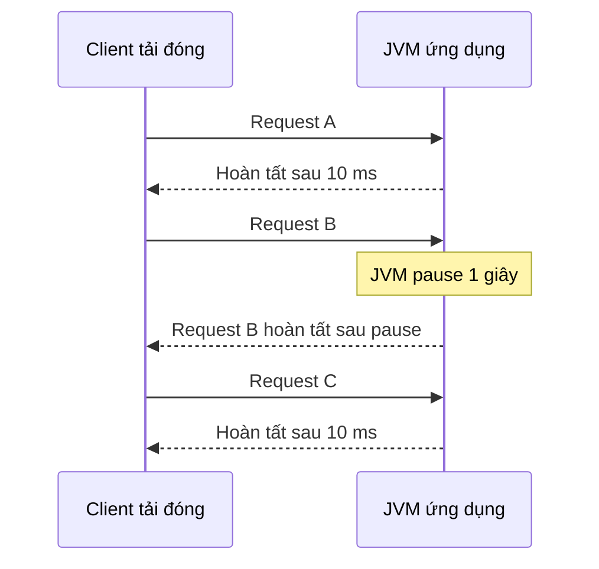

# Ảnh hưởng của khoảng dừng JVM và cấu hình bù sai lệch khi lấy mẫu độ trễ

Khi JVM tạm ngừng thực thi ứng dụng, chẳng hạn trong một đợt garbage collection kiểu stop-the-world, luồng xử lý request có thể bị dừng trong một khoảng thời gian. Nếu hệ thống chỉ ghi nhận những request thực sự được xử lý và hoàn tất, phân phối độ trễ quan sát được đôi khi không phản ánh đầy đủ thời gian chờ mà người dùng trải qua. Hiện tượng thiếu các mẫu độ trễ do hệ thống bị pause được gọi là **coordinated omission**.

Micrometer hỗ trợ bù sai lệch này cho thống kê phân phối của `Timer` thông qua cơ chế pause detection. `ClockDriftPauseDetector` theo dõi độ lệch đồng hồ để phát hiện các khoảng dừng và bổ sung các mẫu độ trễ ước lượng vào thống kê phân phối. `NoPauseDetector` không thực hiện bước bù này và là lựa chọn mặc định trong các phiên bản Micrometer hiện đại. Muốn bật phát hiện khoảng dừng, ứng dụng cần cấu hình detector và đưa thư viện `LatencyUtils` vào runtime classpath.

Trong module `OBSERVABILITY_INSTRUMENTATION_MICROMETER`, hiểu đúng cơ chế này giúp diễn giải percentile, histogram và SLO chính xác hơn khi ứng dụng chịu GC pause, CPU starvation hoặc các khoảng ngừng thực thi khác. Đây là một phép hiệu chỉnh thống kê, không phải cơ chế loại bỏ pause hay thay thế việc điều tra nguyên nhân JVM.

## 1. JVM pause làm sai lệch số đo độ trễ như thế nào?

Một ứng dụng Java có thể gặp những khoảng thời gian mà các luồng ứng dụng không được chạy bình thường. Các nguyên nhân thường gặp gồm:

- Stop-the-world garbage collection: JVM tạm dừng các luồng ứng dụng để thực hiện một số pha của GC.
- Safepoint hoặc hoạt động runtime: JVM cần đưa các luồng đến trạng thái an toàn để thực hiện một số thao tác nội bộ.
- CPU starvation hoặc scheduler delay: tiến trình không được hệ điều hành cấp CPU đủ nhanh.
- Tạm dừng tiến trình hoặc máy ảo: container bị throttling, máy chủ quá tải hoặc môi trường chạy bị suspend.

Một request bắt đầu trước khi pause và hoàn tất sau khi pause thường có thời gian đo bao gồm cả khoảng dừng đó. Tuy nhiên, các request dự kiến được xử lý trong thời gian pause có thể chưa bắt đầu hoặc chưa được tạo ra, tùy cách tải được gửi đến ứng dụng. Nếu chỉ nhìn các request đã được ghi nhận, phân phối có thể thiếu những độ trễ đáng lẽ phải xuất hiện.

### Ví dụ về coordinated omission

Giả sử một client tạo request theo mô hình đóng: gửi request tiếp theo sau khi request trước hoàn tất. Bình thường, một request mất 10 ms. Sau đó JVM pause trong 1 giây.

Trong khoảng pause, client không gửi thêm request vì nó đang chờ request trước hoàn tất. Khi JVM hoạt động trở lại, request đang chờ có thể hoàn tất sau khoảng 1 giây; client mới tiếp tục gửi request tiếp theo. Các request đáng lẽ được gửi trong khoảng 1 giây đó không tồn tại dưới dạng các mẫu độc lập trong phép đo.



Phân phối thô có thể chứa một mẫu khoảng 1 giây và nhiều mẫu khoảng 10 ms, nhưng không có các mẫu đại diện cho những request lẽ ra có thể được gửi trong thời gian pause. Percentile cao vì thế có thể thấp hơn mức độ chậm mà một tải đến liên tục sẽ trải nghiệm.

Hiện tượng này thường xuất hiện trong benchmark hoặc hệ thống tải đóng, nơi tốc độ gửi request phụ thuộc vào tốc độ phản hồi. Tải mở với lịch gửi độc lập có thể bộc lộ hiện tượng khác, vì request vẫn được lên lịch trong lúc server pause và có thể tích tụ thành hàng đợi.

## 2. Phân biệt thời gian request thực tế và thống kê đã hiệu chỉnh

Có hai khái niệm cần tách biệt:

| Khái niệm | Ý nghĩa |
| --- | --- |
| Thời gian request được đo trực tiếp | Thời gian từ lúc instrumentation bắt đầu đến lúc thao tác hoàn tất; nếu request đi qua một JVM pause, thời gian đó thường bao gồm khoảng pause |
| Phân phối đã bù coordinated omission | Phân phối được bổ sung các mẫu ước lượng để phản ánh những độ trễ bị bỏ sót do khoảng dừng |

Pause detection của Micrometer không làm cho JVM chạy nhanh hơn và cũng không khôi phục chính xác từng request chưa từng được gửi. Nó dùng thông tin về khoảng dừng để thêm các mẫu tổng hợp vào thống kê phân phối, nhằm giảm xu hướng đánh giá thấp tail latency.

Điều này quan trọng khi đọc `Timer`: số lần gọi và tổng thời gian được ghi bởi instrumentation vẫn mô tả các thao tác thực sự được ghi nhận. Các thống kê phân phối như percentile và số lượng quan sát nằm trong các ngưỡng SLO có thể chịu ảnh hưởng của mẫu bù. Vì vậy, không nên coi các mẫu bù là số request nghiệp vụ thực tế hoặc dùng chúng thay cho counter đếm sự kiện.

## 3. Micrometer hỗ trợ những pause detector nào?

Micrometer cung cấp hai triển khai chính:

| Detector | Cách hoạt động | Khi sử dụng |
| --- | --- | --- |
| `NoPauseDetector` | Không theo dõi clock drift và không thêm mẫu bù | Mặc định hiện đại; dùng khi không muốn có bước hiệu chỉnh hoặc cần so sánh với dữ liệu thô |
| `ClockDriftPauseDetector` | Theo dõi độ lệch giữa thời gian thực tế trôi qua và thời gian dự kiến giữa các lần kiểm tra | Dùng khi muốn bù ảnh hưởng của các khoảng dừng hệ thống/JVM trong thống kê phân phối |

`ClockDriftPauseDetector` sử dụng một chu kỳ ngủ (`sleepInterval`) và một ngưỡng pause (`pauseThreshold`). Nếu thời gian thực tế giữa hai lần kiểm tra lớn hơn dự kiến đủ nhiều, detector xem đó là một khoảng dừng cần bù.

Micrometer ghi nhận rằng mức tiêu thụ CPU tăng khi giảm `sleepInterval`, trong khi độ chính xác phát hiện pause cũng tăng. Giá trị 100 ms cho cả chu kỳ kiểm tra và ngưỡng pause là một điểm khởi đầu hợp lý theo tài liệu Micrometer. Đây là cấu hình tham khảo, không phải ngưỡng phù hợp cho mọi ứng dụng.

### Lưu ý về giá trị mặc định

Các phiên bản Micrometer cũ từng sử dụng clock-drift detector mặc định. Từ các dòng phát hành 1.0.10, 1.1.4 và 1.2.0, mặc định chuyển sang `NoPauseDetector`. Vì vậy, không nên giả định rằng chỉ cần tạo `Timer` là ứng dụng đã tự động bù coordinated omission.

Hãy kiểm tra phiên bản Micrometer thực tế được Spring Boot BOM quản lý và cấu hình detector một cách tường minh nếu ứng dụng cần chức năng này. Khi nâng cấp phiên bản, cần xem lại cấu hình và hành vi mặc định thay vì dựa vào giả định từ một dự án cũ.

## 4. Bổ sung LatencyUtils vào runtime classpath

`ClockDriftPauseDetector` dựa trên thư viện `LatencyUtils`. Thư viện này cần có trong runtime classpath để detector hoạt động. Nếu thiếu, Micrometer có thể ghi cảnh báo và không thực hiện pause detection.

Với Gradle Groovy DSL:

```groovy
dependencies {
    runtimeOnly 'org.latencyutils:LatencyUtils'
}
```

Với Gradle Kotlin DSL:

```kotlin
dependencies {
    runtimeOnly("org.latencyutils:LatencyUtils")
}
```

Với Maven:

```xml
<dependency>
    <groupId>org.latencyutils</groupId>
    <artifactId>LatencyUtils</artifactId>
    <scope>runtime</scope>
</dependency>
```

Nếu dự án không có dependency management quản lý phiên bản LatencyUtils, hãy khai báo phiên bản tương thích theo quy ước dependency của dự án. Không tự chọn phiên bản Micrometer hoặc LatencyUtils tách rời khỏi bộ phiên bản mà Spring Boot quản lý.

Chỉ thêm dependency là chưa đủ để bật bù sai lệch: ứng dụng còn phải cấu hình `ClockDriftPauseDetector` vào registry hoặc timer. Ngược lại, nếu chỉ cấu hình detector mà thiếu LatencyUtils ở runtime, detector không thể thực hiện đầy đủ chức năng.

## 5. Cấu hình ClockDriftPauseDetector cho MeterRegistry

Cách đơn giản nhất là cấu hình detector ở cấp registry. Ví dụ dưới đây sử dụng API `Duration` của Micrometer hiện đại:

```java
import java.time.Duration;

import io.micrometer.core.instrument.MeterRegistry;
import io.micrometer.core.instrument.distribution.pause.ClockDriftPauseDetector;
import org.springframework.boot.actuate.autoconfigure.metrics.MeterRegistryCustomizer;
import org.springframework.context.annotation.Bean;
import org.springframework.context.annotation.Configuration;

@Configuration(proxyBeanMethods = false)
public class MetricsPauseConfiguration {
    @Bean
    MeterRegistryCustomizer<MeterRegistry> pauseDetectorCustomizer() {
        return registry -> registry.config().pauseDetector(
                new ClockDriftPauseDetector(
                        Duration.ofMillis(100),
                        Duration.ofMillis(100)));
    }
}
```

`MeterRegistryCustomizer` được Spring Boot áp dụng cho registry do auto-configuration quản lý. Cấu hình này đặt detector mặc định cho các timer được đăng ký trên registry đó. Nếu ứng dụng không dùng Spring Boot, có thể gọi trực tiếp:

```java
MeterRegistry registry = createRegistry();

registry.config().pauseDetector(
        new ClockDriftPauseDetector(
                Duration.ofMillis(100),
                Duration.ofMillis(100)));
```

Hai tham số lần lượt là chu kỳ ngủ và ngưỡng pause. Tên và kiểu constructor có thể khác ở các phiên bản Micrometer cũ; hãy dùng API của phiên bản đang được dự án quản lý. Ví dụ `Duration` ở trên phù hợp với các phiên bản Micrometer hiện đại.

Nếu cần cấu hình riêng một timer thay vì toàn registry, có thể đặt detector trên builder:

```java
Timer requestTimer = Timer.builder("http.server.requests")
        .pauseDetector(new ClockDriftPauseDetector(
                Duration.ofMillis(100),
                Duration.ofMillis(100)))
        .register(registry);
```

Cấu hình riêng phù hợp khi chỉ một nhóm timer cần pause detection. Với ứng dụng có nhiều timer cùng yêu cầu, cấu hình registry giúp tránh lặp lại chính sách ở nhiều nơi.

## 6. Tắt pause detection một cách tường minh

Nếu muốn xác nhận số liệu thô không có mẫu bù, có thể cấu hình `NoPauseDetector`:

```java
import io.micrometer.core.instrument.distribution.pause.NoPauseDetector;

registry.config().pauseDetector(new NoPauseDetector());
```

Việc tắt detector hữu ích khi:

- Muốn so sánh số đo thô và số đo có bù trong cùng một bài kiểm tra.
- Ứng dụng đã thực hiện một cơ chế hiệu chỉnh coordinated omission ở lớp khác và muốn tránh hiệu chỉnh hai lần.
- Môi trường chạy không chấp nhận overhead của clock-drift detector.
- Mục tiêu đo lường yêu cầu chỉ lưu các thời lượng thực tế của thao tác đã được instrumentation ghi nhận.

Không nên bật hoặc tắt detector tùy tiện giữa các phiên bản triển khai nhưng giữ nguyên tên metric và dashboard mà không ghi nhận thay đổi. Phân phối percentile và SLO có thể thay đổi dù tải nghiệp vụ không thay đổi, bởi cách hiệu chỉnh thống kê đã khác.

## 7. Pause detection ảnh hưởng đến percentile, histogram và SLO

Pause detector tác động đến thống kê phân phối của `Timer`. Khi phát hiện khoảng dừng, cơ chế bù có thể bổ sung các giá trị độ trễ ước lượng. Các giá trị đó có thể làm thay đổi:

- Percentile như p90, p95 và p99.
- Số lượng mẫu nằm dưới hoặc vượt các ngưỡng SLO.
- Histogram bucket được dùng để tổng hợp phân phối ở backend.

Mục tiêu là làm cho tail latency phản ánh tốt hơn những khoảng chờ có thể bị bỏ qua bởi cách tạo tải hoặc lịch thực thi. Tuy nhiên, `Timer.count()` vẫn nên được hiểu là số thao tác thực tế được instrumentation ghi nhận, không phải tổng số mẫu tổng hợp do detector thêm vào phân phối.

Để quan sát percentile ở Prometheus, ứng dụng cần bật histogram cho timer tương ứng. Ví dụ cấu hình Spring Boot:

```yaml
management:
  metrics:
    distribution:
      percentiles-histogram:
        http.server.requests: true
      slo:
        http.server.requests: 100ms,250ms,500ms
```

Sau khi xác nhận tên metric thực tế tại `/actuator/prometheus`, có thể truy vấn p99:

```promql
histogram_quantile(
  0.99,
  sum by (le) (
    rate(http_server_requests_seconds_bucket[5m])
  )
)
```

Để tính tỷ lệ quan sát nằm trong ngưỡng 300 ms, nếu bucket `le="0.3"` đã được xuất:

```promql
sum(rate(http_server_requests_seconds_bucket{le="0.3"}[5m]))
/
sum(rate(http_server_requests_seconds_count[5m]))
```

Khi pause detection được bật, thống kê histogram và SLO có thể chịu ảnh hưởng của các mẫu bù. Vì thế, dashboard cần ghi rõ chính sách pause detection đang áp dụng để người đọc hiểu tại sao percentile hoặc tỷ lệ SLO thay đổi sau khi cấu hình.

## 8. Chọn sleepInterval và pauseThreshold

Hai tham số của `ClockDriftPauseDetector` điều khiển độ nhạy và chi phí:

| Tham số | Ý nghĩa | Tác động khi giảm |
| --- | --- | --- |
| `sleepInterval` | Khoảng thời gian giữa hai lần detector kiểm tra clock drift | Kiểm tra thường xuyên hơn, tăng khả năng phát hiện pause ngắn nhưng tiêu thụ CPU nhiều hơn |
| `pauseThreshold` | Mức chênh lệch tối thiểu để xem là một pause cần bù | Dễ phát hiện khoảng dừng ngắn hơn nhưng cũng nhạy hơn với dao động lịch chạy |

Ví dụ cấu hình tham khảo:

```java
new ClockDriftPauseDetector(
        Duration.ofMillis(100),
        Duration.ofMillis(100));
```

Không nên chọn các giá trị rất nhỏ chỉ vì muốn phát hiện mọi khoảng dừng. Detector cần được chạy định kỳ và bản thân nó cũng sử dụng tài nguyên. Khi giảm chu kỳ kiểm tra, hãy đo CPU của ứng dụng trong điều kiện tải đại diện.

Một quy trình chọn tham số thực tế:

1. Bắt đầu với 100 ms cho cả hai giá trị theo khuyến nghị tham khảo của Micrometer.
2. Thu thập p95/p99, GC pause, CPU usage và thời gian scheduler delay trong tải đại diện.
3. Nếu các khoảng dừng quan trọng ngắn hơn ngưỡng, thử giảm `pauseThreshold` và đánh giá độ nhiễu.
4. Nếu cần phát hiện nhanh hơn, giảm `sleepInterval` từng bước và đo overhead CPU.
5. So sánh kết quả trước và sau hiệu chỉnh, đồng thời ghi lại cấu hình được sử dụng.

## 9. Những giới hạn cần hiểu

Pause detection không phải phép đo GC chuyên dụng. Clock drift detector nhận biết một khoảng thời gian mà luồng theo dõi không chạy theo lịch dự kiến; nó không tự xác định nguyên nhân là GC, safepoint, CPU starvation hay hệ điều hành suspend tiến trình.

Một số giới hạn khác:

- **Phát hiện mang tính ước lượng:** detector không biết chính xác những request nào lẽ ra phải được gửi trong pause; nó thêm mẫu tổng hợp để hiệu chỉnh phân phối.
- **Không thay thế GC logging:** dùng GC log, JFR hoặc công cụ runtime để xác định nguyên nhân và thời lượng pause của JVM.
- **Không khôi phục request bị mất:** nếu ứng dụng dừng trước khi xử lý request, pause detector không tạo lại request hay sự kiện nghiệp vụ.
- **Không thay thế thiết kế load test:** benchmark cần mô hình tải phù hợp và công cụ có khả năng xử lý coordinated omission ở phía client khi cần.
- **Có thể hiệu chỉnh hai lần:** nếu load generator hoặc một lớp instrumentation khác đã bù cùng hiện tượng, bật thêm correction có thể làm phân phối bị bù quá mức.
- **Có chi phí runtime:** clock-drift detector cần luồng kiểm tra định kỳ và LatencyUtils; hãy đánh giá chi phí cùng lợi ích trong môi trường thật.

Pause detection phù hợp để cải thiện cách đọc thống kê độ trễ khi có pause, nhưng không nên được xem là bằng chứng duy nhất cho nguyên nhân p99 tăng. Cần đối chiếu với GC log, JFR, CPU throttling, thread dump và tín hiệu hạ tầng.

## 10. Kiểm thử và xác minh cấu hình

Không nên viết unit test phụ thuộc vào một đợt GC pause ngẫu nhiên hoặc dùng `Thread.sleep()` để khẳng định detector luôn tạo ra một percentile cụ thể. Những test như vậy dễ dao động theo máy chạy, scheduler và tải hệ thống.

Thay vào đó, hãy kiểm tra theo nhiều lớp:

**Kiểm tra cấu hình detector:** xác nhận registry nhận đúng implementation được chọn. Ví dụ với một registry trong bộ nhớ:

```java
import static org.assertj.core.api.Assertions.assertThat;

import java.time.Duration;

import io.micrometer.core.instrument.simple.SimpleMeterRegistry;
import io.micrometer.core.instrument.distribution.pause.ClockDriftPauseDetector;
import org.junit.jupiter.api.Test;

class PauseDetectorConfigurationTest {
    @Test
    void configuresClockDriftPauseDetector() {
        try (SimpleMeterRegistry registry = new SimpleMeterRegistry()) {
            registry.config().pauseDetector(
                    new ClockDriftPauseDetector(
                            Duration.ofMillis(100),
                            Duration.ofMillis(100)));

            assertThat(registry.config().pauseDetector())
                    .isInstanceOf(ClockDriftPauseDetector.class);
        }
    }
}
```

Test này chỉ xác nhận cấu hình registry, không chứng minh detector đã phát hiện một pause thực tế. Cần thêm kiểm tra runtime để xác minh LatencyUtils có mặt và không có cảnh báo thiếu dependency.

**Kiểm tra export:** bật histogram/SLO cho timer, gọi một số thao tác và xác nhận các chuỗi `_bucket`, `_count`, `_sum` xuất hiện tại endpoint Prometheus. Việc này xác nhận đường export đang hoạt động; nó không kiểm tra thuật toán phát hiện pause.

**Đánh giá trong môi trường kiểm thử có kiểm soát:** tạo tải đại diện, quan sát GC log/JFR và so sánh phân phối trước và sau khi bật detector. Ghi rõ phiên bản Micrometer, LatencyUtils, `sleepInterval`, `pauseThreshold`, cấu hình histogram và cách tạo tải. Chỉ kết luận có cải thiện khi số liệu lặp lại được và tương quan với các khoảng dừng quan sát được.

## 11. Những lỗi thường gặp

| Lỗi | Hệ quả | Cách xử lý |
| --- | --- | --- |
| Nghĩ Micrometer tự bật pause detection | Percentile vẫn có thể bị coordinated omission | Cấu hình `ClockDriftPauseDetector` rõ ràng |
| Thiếu LatencyUtils ở runtime | Detector không thực hiện bù và có thể ghi cảnh báo | Thêm `org.latencyutils:LatencyUtils` vào runtime classpath |
| Chỉ thêm LatencyUtils nhưng không cấu hình detector | Registry vẫn dùng `NoPauseDetector` mặc định | Cấu hình `registry.config().pauseDetector(...)` |
| Chọn `sleepInterval` quá nhỏ | Tăng overhead CPU và độ nhiễu | Bắt đầu từ giá trị tham khảo, đo rồi điều chỉnh |
| Coi mẫu bù là request thật | Đếm sai lưu lượng nghiệp vụ | Dùng counter hoặc log để đếm sự kiện thực; hiểu percentile/SLO là thống kê phân phối |
| Nhầm pause detector với GC monitor | Không xác định được nguyên nhân JVM pause | Đối chiếu GC log, JFR và tín hiệu hạ tầng |
| Bật correction ở cả client và server mà không kiểm soát | Phân phối có thể bị bù hai lần | Xác định rõ lớp nào chịu trách nhiệm hiệu chỉnh |
| Thay detector nhưng không ghi nhận thay đổi | Dashboard có thể thay đổi mà không rõ lý do | Quản lý detector như một phần cấu hình observability |

## 12. Quy trình áp dụng

Khi quyết định bật pause detection cho timer, hãy thực hiện theo trình tự:

1. Xác định ứng dụng có gặp GC pause, scheduler delay hoặc coordinated omission trong cách đo hiện tại hay không.
2. Kiểm tra phiên bản Micrometer và xác nhận detector mặc định đang được sử dụng.
3. Thêm LatencyUtils vào runtime classpath nếu chọn `ClockDriftPauseDetector`.
4. Cấu hình detector ở cấp registry hoặc trên timer cần hiệu chỉnh.
5. Bắt đầu với `sleepInterval` và `pauseThreshold` khoảng 100 ms, sau đó đo overhead và hiệu quả.
6. Bật histogram/SLO nếu cần quan sát phân phối ở backend.
7. Kiểm tra cấu hình, dependency runtime và endpoint export.
8. Đánh giá trong tải đại diện, đối chiếu percentile với GC log/JFR và chính sách correction phía load generator.
9. Ghi lại thay đổi cấu hình để dashboard và alert được diễn giải đúng.

JVM pause có thể khiến phân phối độ trễ thiếu những mẫu đáng lẽ phải xuất hiện trong thời gian hệ thống không xử lý được request. Micrometer cho phép bù một phần sai lệch đó bằng pause detector, nhưng chức năng này cần được cấu hình tường minh và đánh giá theo môi trường thực tế. Khi hiểu rõ sự khác nhau giữa thời gian request được đo, mẫu bù thống kê và số sự kiện nghiệp vụ, đội vận hành có thể đọc percentile và SLO chính xác hơn mà không nhầm dữ liệu hiệu chỉnh với lưu lượng thật.

## Tài liệu tham khảo

- [Micrometer: Timers và Pause Detection](https://docs.micrometer.io/micrometer/reference/concepts/timers.html)
- [Micrometer: MeterRegistry.Config Javadoc](https://javadoc.io/doc/io.micrometer/micrometer-core/latest/io/micrometer/core/instrument/MeterRegistry.Config.html)
- [LatencyUtils](https://github.com/LatencyUtils/LatencyUtils)
