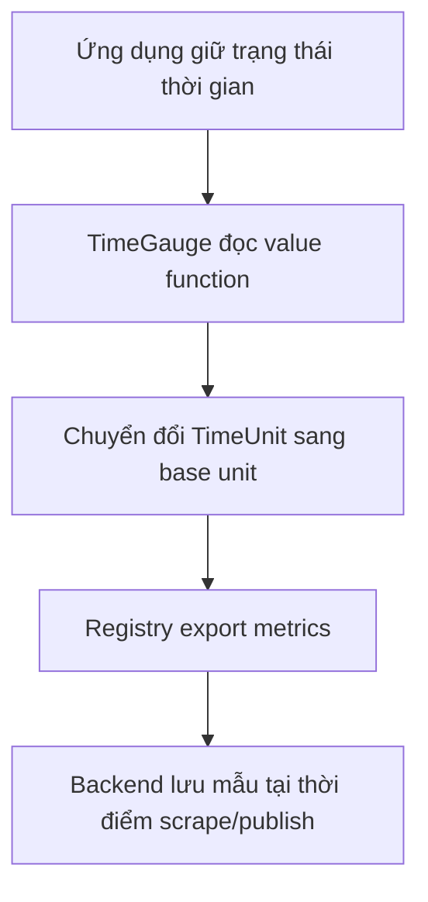

# TimeGauge cho giá trị thời gian được lấy tại thời điểm quan sát

Micrometer cung cấp `TimeGauge` để đo một giá trị có đơn vị thời gian tại thời điểm registry lấy mẫu. Ví dụ, ứng dụng có thể xuất thời gian JVM đã chạy, tuổi của tác vụ đang hoạt động hoặc khoảng thời gian kể từ lần đồng bộ gần nhất.

TimeGauge có cách hoạt động giống một Gauge: nó đọc một giá trị hiện tại từ đối tượng hoặc hàm được cung cấp khi metrics được quan sát. Điểm khác biệt là giá trị đầu vào có đơn vị thời gian rõ ràng. Micrometer chuyển đổi giá trị đó sang đơn vị thời gian cơ sở của registry/backend khi xuất metrics.

TimeGauge phù hợp khi câu hỏi cần trả lời là **giá trị thời gian hiện tại đang là bao nhiêu**. Nếu cần ghi nhận thời lượng của nhiều lần thực hiện, hãy dùng Timer; nếu cần theo dõi từng tác vụ đang hoạt động, hãy cân nhắc LongTaskTimer.

## 1. TimeGauge đo giá trị thời gian tại thời điểm lấy mẫu

TimeGauge không đo thời gian của một khối mã theo cách Timer làm. Thay vào đó, nó đọc một giá trị thời gian đã có trong ứng dụng hoặc tính giá trị đó tại thời điểm quan sát.

Ví dụ, JVM đã chạy được 25 phút. Một TimeGauge theo dõi uptime sẽ xuất giá trị tương ứng với 25 phút ở lần scrape hiện tại. Sau một phút, lần scrape tiếp theo sẽ đọc giá trị mới, khoảng 26 phút.



Mỗi lần lấy mẫu, TimeGauge gọi hàm đọc giá trị. Nó không lưu lại mọi giá trị trung gian giữa hai lần scrape. Vì vậy, đây vẫn là một phép đo trạng thái hiện tại, chịu ảnh hưởng của chu kỳ thu thập.

## 2. Khác biệt giữa TimeGauge, Gauge, Timer và LongTaskTimer

Các meter này có thể cùng liên quan đến thời gian nhưng trả lời những câu hỏi khác nhau:

| Meter | Dữ liệu được ghi nhận | Câu hỏi phù hợp |
|---|---|---|
| **Gauge** | Giá trị hiện tại của một trạng thái số | Hiện có bao nhiêu phần tử trong hàng đợi? |
| **TimeGauge** | Giá trị thời gian hiện tại, có chuyển đổi đơn vị | JVM đã chạy bao lâu? Tuổi hiện tại của tác vụ là bao nhiêu? |
| **Timer** | Số lần thực hiện và thời lượng của các lần đã record | Các lần xử lý request mất bao lâu? p95 là bao nhiêu? |
| **LongTaskTimer** | Số tác vụ đang hoạt động và thời lượng của các sample còn mở | Có bao nhiêu tác vụ đang chạy? Tác vụ đang chạy lâu nhất bao lâu? |

Ví dụ:

- `worker.queue.depth` nên là Gauge vì nó đếm số phần tử hiện có.
- `process.uptime` phù hợp với TimeGauge vì nó là giá trị thời gian đã chạy tại thời điểm quan sát.
- `http.server.requests` phù hợp với Timer vì mỗi request hoàn tất tạo một lần ghi nhận thời lượng.
- `report.generation.active` phù hợp với LongTaskTimer vì cần theo dõi nhiều lần chạy đang hoạt động và thời lượng của chúng.

Không dùng TimeGauge để thay thế Timer khi cần phân bố thời lượng của các request đã hoàn tất. TimeGauge chỉ xuất một giá trị hiện tại cho mỗi meter và không cung cấp count, histogram hoặc percentile của từng lần thực hiện.

## 3. TimeUnit và chuyển đổi đơn vị

Khi tạo TimeGauge, cần chỉ rõ đơn vị của giá trị mà hàm đọc trả về. API builder có dạng:

```java
TimeGauge.builder(
    "metric.name",
    object,
    TimeUnit.MILLISECONDS,
    valueFunction
)
```

Tham số `TimeUnit` mô tả đơn vị của giá trị do `valueFunction` trả về. Micrometer chuyển đổi giá trị sang base time unit mà registry sử dụng khi xuất dữ liệu.

Ví dụ, nếu hàm trả về `1500` và khai báo `TimeUnit.MILLISECONDS`, giá trị tương ứng là 1,5 giây. Nếu khai báo nhầm `TimeUnit.SECONDS`, Micrometer sẽ hiểu đó là 1500 giây và số liệu bị sai rất lớn.

| Giá trị từ hàm | TimeUnit khai báo | Thời lượng thực | Giá trị quy đổi |
|---:|---|---:|---:|
| 1500 | MILLISECONDS | 1,5 giây | 1,5 giây |
| 1,5 | SECONDS | 1,5 giây | 1,5 giây |
| 1500000000 | NANOSECONDS | 1,5 giây | 1,5 giây |

Đơn vị cần khớp với dữ liệu thực tế. Đừng chỉ nhìn vào tên biến như `duration` hoặc `elapsed`; hãy kiểm tra API nguồn trả về nano giây, mili giây hay giây.

Với Prometheus, các giá trị thời gian thường được chuẩn hóa theo giây và tên series thường có hậu tố đơn vị như `_seconds`. Tên cuối cùng phụ thuộc naming convention của registry. Hãy xác nhận endpoint export trước khi viết truy vấn dashboard hoặc alert.

## 4. Ví dụ: theo dõi JVM uptime

`RuntimeMXBean.getUptime()` trả về thời gian JVM đã hoạt động tính bằng mili giây. Đây là một giá trị thời gian hiện tại, phù hợp để xuất bằng TimeGauge.

```java
import io.micrometer.core.instrument.MeterRegistry;
import io.micrometer.core.instrument.TimeGauge;

import java.lang.management.ManagementFactory;
import java.lang.management.RuntimeMXBean;
import java.util.concurrent.TimeUnit;

import org.springframework.stereotype.Component;

@Component
public class ProcessTimeMetrics {

    private final RuntimeMXBean runtimeBean;
    private final TimeGauge processUptime;

    public ProcessTimeMetrics(MeterRegistry registry) {
        this.runtimeBean = ManagementFactory.getRuntimeMXBean();

        this.processUptime = TimeGauge.builder(
                "process.uptime",
                runtimeBean,
                TimeUnit.MILLISECONDS,
                RuntimeMXBean::getUptime
            )
            .description("Time since the JVM process started")
            .register(registry);
    }
}
```

Ở mỗi lần lấy mẫu, Micrometer gọi `RuntimeMXBean.getUptime()` và chuyển mili giây sang đơn vị cơ sở của registry. Dashboard có thể hiển thị uptime hiện tại của từng instance.

Ví dụ, nếu một instance vừa khởi động lại, uptime của instance đó sẽ nhỏ hơn các instance còn lại. Điều này giúp nhận biết restart hoặc rollout khi quan sát cùng các metrics khác như process start time, request rate và lỗi khởi động.

Trong ví dụ, `runtimeBean` được giữ trong field của component. Điều này quan trọng vì Gauge và TimeGauge thường giữ tham chiếu yếu đến đối tượng được theo dõi; nếu không còn tham chiếu mạnh, đối tượng có thể bị garbage collector thu hồi và meter có thể trả về `NaN`.

## 5. Ví dụ: tuổi của tác vụ đang hoạt động

TimeGauge cũng có thể đọc tuổi hiện tại của một tác vụ. Giá trị này cần được tính tại thời điểm scrape, thay vì chỉ lưu một duration cố định lúc tác vụ bắt đầu.

Ví dụ sau theo dõi một tác vụ batch đơn lẻ đang hoạt động:

```java
public class ActiveJobState {

    private volatile long startedAtNanos;
    private volatile boolean active;

    public void start() {
        startedAtNanos = System.nanoTime();
        active = true;
    }

    public void finish() {
        active = false;
    }

    public double ageNanos() {
        if (!active) {
            return 0.0;
        }

        return System.nanoTime() - startedAtNanos;
    }
}
```

Đăng ký TimeGauge với đơn vị nano giây:

```java
import io.micrometer.core.instrument.MeterRegistry;
import io.micrometer.core.instrument.TimeGauge;

import java.util.concurrent.TimeUnit;

public class BatchJobMetrics {

    private final ActiveJobState jobState;
    private final TimeGauge activeJobAge;

    public BatchJobMetrics(
            MeterRegistry registry,
            ActiveJobState jobState
    ) {
        this.jobState = jobState;

        this.activeJobAge = TimeGauge.builder(
                "batch.job.active.age",
                jobState,
                TimeUnit.NANOSECONDS,
                ActiveJobState::ageNanos
            )
            .description("Current age of the active batch job")
            .register(registry);
    }
}
```

Khi tác vụ đang chạy, hàm `ageNanos()` tính khoảng thời gian từ lúc bắt đầu đến thời điểm lấy mẫu. Khi tác vụ hoàn tất, `finish()` chuyển trạng thái về không hoạt động và TimeGauge trả về 0.

Ví dụ này chỉ đại diện cho một tác vụ đang hoạt động tại một thời điểm. Nếu hệ thống chạy nhiều tác vụ đồng thời và cần biết số tác vụ, tổng thời lượng hoặc tác vụ lâu nhất, hãy dùng LongTaskTimer. Không nên tạo một tag chứa job ID cho mỗi lần chạy vì sẽ làm tăng cardinality.

### Vì sao dùng System.nanoTime()?

`System.nanoTime()` phù hợp để đo khoảng thời gian đã trôi qua vì nó dùng đồng hồ monotonic, không bị thay đổi bởi việc chỉnh đồng hồ hệ thống hoặc đồng bộ NTP như đồng hồ thời gian thực.

Không nên lấy `System.currentTimeMillis()` trừ một timestamp rồi xem kết quả là thời lượng nếu mục tiêu cần chống ảnh hưởng của thay đổi đồng hồ hệ thống. `currentTimeMillis()` phù hợp với timestamp lịch, còn `nanoTime()` phù hợp với elapsed time.

## 6. Khi nào dùng TimeGauge cho thời gian kể từ một sự kiện?

Một ví dụ khác là tuổi của lần đồng bộ thành công gần nhất. Ứng dụng lưu thời điểm monotonic khi lần đồng bộ thành công, rồi tính khoảng thời gian đã trôi qua mỗi khi TimeGauge được lấy mẫu.

```java
import java.util.concurrent.atomic.AtomicLong;

public class SyncState {

    private final AtomicLong lastSuccessNanos = new AtomicLong();
    private volatile boolean hasSucceeded;

    public void markSuccess() {
        lastSuccessNanos.set(System.nanoTime());
        hasSucceeded = true;
    }

    public double ageSinceLastSuccessNanos() {
        if (!hasSucceeded) {
            return 0.0;
        }

        return System.nanoTime() - lastSuccessNanos.get();
    }

    public boolean hasSucceeded() {
        return hasSucceeded;
    }
}
```

Đăng ký meter:

```java
TimeGauge.builder(
        "catalog.sync.last.success.age",
        syncState,
        TimeUnit.NANOSECONDS,
        SyncState::ageSinceLastSuccessNanos
    )
    .description("Elapsed time since the last successful catalog sync")
    .register(registry);
```

Giá trị tăng dần theo thời gian cho đến khi một lần đồng bộ thành công mới cập nhật mốc bắt đầu. Nếu chưa từng đồng bộ thành công, ví dụ trả về 0 chỉ để minh họa cách tính; trong hệ thống thật cần phân biệt trạng thái chưa từng thành công bằng một Gauge hoặc trạng thái riêng như `catalog.sync.has.succeeded`. Không nên diễn giải số 0 là vừa đồng bộ thành công nếu trạng thái chưa từng chạy.

TimeGauge trong ví dụ đo tuổi của sự kiện gần nhất, không phải thời lượng của lần đồng bộ. Nếu cần thời gian thực thi của mỗi lần đồng bộ, hãy record Timer quanh thao tác.

## 7. Giá trị được lấy mẫu, không phải lịch sử

TimeGauge đọc giá trị mỗi khi registry hoặc backend lấy metrics. Nếu giá trị thay đổi nhiều lần giữa hai lần scrape, backend chỉ lưu các giá trị ở thời điểm thu thập.

Ví dụ tuổi tác vụ tăng liên tục:

| Thời điểm scrape | Tuổi tác vụ |
|---|---:|
| 10:00:00 | 10 giây |
| 10:00:15 | 25 giây |
| 10:00:30 | 40 giây |
| 10:00:45 | 55 giây |

Backend lưu bốn mẫu trên. Nó không lưu từng mili giây mà hàm `ageNanos()` đã trả về giữa các lần scrape.

Điều này phù hợp để xem xu hướng hoặc cảnh báo một trạng thái thời gian hiện tại đã vượt ngưỡng. Nếu trạng thái vượt ngưỡng rồi biến mất giữa hai lần scrape, alert có thể bỏ lỡ; khi mọi lần vượt ngưỡng cần được lưu lại, ứng dụng nên phát sự kiện hoặc tăng Counter khi điều kiện xảy ra.

## 8. Xuất TimeGauge và truy vấn backend

TimeGauge được đăng ký vào MeterRegistry và xuất qua registry tương ứng. Với Spring Boot Actuator và Prometheus registry, có thể kiểm tra các series tại endpoint:

```text
/actuator/prometheus
```

Ví dụ, nếu registry xuất uptime dưới tên `process_uptime_seconds`, có thể truy vấn:

```promql
process_uptime_seconds
```

Với tuổi tác vụ đang hoạt động, giả sử series là `batch_job_active_age_seconds`, có thể cảnh báo khi tuổi vượt 10 phút:

```promql
batch_job_active_age_seconds > 600
```

Tên series trong ví dụ chỉ minh họa. Cần kiểm tra chính xác tên được export, đơn vị và tags tại endpoint của ứng dụng trước khi dùng truy vấn.

Nếu ứng dụng chạy nhiều instance, mỗi instance thường có một series riêng theo các nhãn định danh như `instance`, `service` hoặc `environment`. Có thể dùng `max` để tìm giá trị tuổi lớn nhất trong nhóm:

```promql
max by (service, environment) (
  batch_job_active_age_seconds
)
```

Chỉ giữ các nhãn có tập giá trị hữu hạn và có ý nghĩa phân tích. Không đưa ID của từng job, tên file hoặc user ID vào tag. Nếu cần truy tìm một lần chạy cụ thể, dùng log hoặc trace.

## 9. Kiểm thử TimeGauge

Có thể dùng `SimpleMeterRegistry` để kiểm tra meter đọc giá trị từ đối tượng theo dõi. Ví dụ dưới đây dùng một giá trị thời gian tính bằng mili giây; SimpleMeterRegistry dùng mili giây làm base time unit.

```java
import io.micrometer.core.instrument.TimeGauge;
import io.micrometer.core.instrument.simple.SimpleMeterRegistry;

import java.util.concurrent.TimeUnit;
import java.util.concurrent.atomic.AtomicLong;

import org.junit.jupiter.api.Test;

import static org.assertj.core.api.Assertions.assertThat;

class TimeGaugeTest {

    @Test
    void readsCurrentTimeValue() {
        SimpleMeterRegistry registry = new SimpleMeterRegistry();
        AtomicLong elapsedMillis = new AtomicLong(1500);

        TimeGauge gauge = TimeGauge.builder(
                "task.elapsed",
                elapsedMillis,
                TimeUnit.MILLISECONDS,
                AtomicLong::get
            )
            .register(registry);

        assertThat(gauge.value()).isEqualTo(1500.0);

        elapsedMillis.set(2500);

        assertThat(gauge.value()).isEqualTo(2500.0);
    }
}
```

Test xác nhận TimeGauge đọc giá trị mới từ đối tượng mỗi khi `value()` được gọi. Với registry có base time unit khác, giá trị đọc ra sẽ được chuyển đổi theo đơn vị cơ sở của registry. Khi kiểm tra endpoint export, cần xác nhận cả tên series và hậu tố đơn vị.

Không nên kiểm tra thời gian thực với một giá trị tuyệt đối thay đổi theo lịch chạy test. Hãy dùng nguồn thời gian có thể điều khiển hoặc một đối tượng giữ giá trị cố định như ví dụ trên.

## 10. Các lỗi thường gặp

- **Khai báo sai TimeUnit:** giá trị mili giây nhưng khai báo giây làm số đo sai theo hệ số 1000.
- **Dùng TimeGauge để đo mọi lần thực thi:** TimeGauge chỉ lấy một giá trị hiện tại; Timer mới lưu count và phân bố duration của các lần record.
- **Dùng TimeGauge cho nhiều tác vụ đồng thời:** một giá trị không thể mô tả riêng từng sample; LongTaskTimer phù hợp hơn để tổng hợp active task.
- **Truyền timestamp epoch như thể là duration:** TimeGauge hiểu giá trị là đại lượng thời gian cần quy đổi, không tự diễn giải timestamp lịch.
- **Dùng đồng hồ wall-clock cho elapsed time:** thay đổi đồng hồ hệ thống có thể làm tuổi tác vụ nhảy hoặc âm; dùng monotonic clock như `System.nanoTime()`.
- **Không giữ tham chiếu đến đối tượng được theo dõi:** tham chiếu yếu có thể khiến đối tượng bị garbage collector thu hồi và meter trả về `NaN`.
- **Cho rằng TimeGauge lưu các thay đổi trung gian:** backend chỉ nhận giá trị tại thời điểm scrape/publish.
- **Đưa định danh duy nhất vào tag:** làm tăng cardinality; dùng log hoặc trace cho định danh từng lần chạy.

## 11. Checklist sử dụng TimeGauge

- [ ] Đại lượng cần đo là một giá trị thời gian hiện tại.
- [ ] Đã chọn đúng đối tượng hoặc hàm cung cấp giá trị.
- [ ] Đơn vị của giá trị trả về khớp với `TimeUnit` khai báo.
- [ ] Đối tượng được giữ tham chiếu mạnh trong suốt vòng đời meter.
- [ ] Dùng monotonic clock khi tính elapsed time.
- [ ] Phân biệt trạng thái chưa có dữ liệu với giá trị thời gian bằng 0.
- [ ] Dùng Timer nếu cần count và phân bố thời lượng của các lần thực hiện.
- [ ] Dùng LongTaskTimer nếu cần theo dõi nhiều tác vụ đang hoạt động.
- [ ] Xác nhận base unit, tên series và tag sau khi export.
- [ ] Kiểm soát cardinality và không đưa task ID vào tag.

TimeGauge là lựa chọn phù hợp khi ứng dụng có một giá trị thời gian cần được quan sát như trạng thái hiện tại. Khai báo đúng TimeUnit giúp Micrometer chuyển đổi sang đơn vị của backend, còn việc giữ đối tượng sống đủ lâu giúp giá trị luôn có thể được đọc. Hãy chọn TimeGauge cho uptime hoặc tuổi hiện tại của một trạng thái; chọn Timer cho lịch sử thời lượng đã hoàn tất và LongTaskTimer cho các tác vụ dài đang hoạt động.

## Tài liệu tham khảo

- [Micrometer TimeGauge API](https://javadoc.io/doc/io.micrometer/micrometer-core/latest/io/micrometer/core/instrument/TimeGauge.html) — builder, TimeUnit và giá trị được quy đổi.
- [Micrometer Gauges](https://docs.micrometer.io/micrometer/reference/concepts/gauges.html) — cách Gauge lấy mẫu giá trị hiện tại và lưu ý về weak reference.
- [Micrometer Timers](https://docs.micrometer.io/micrometer/reference/concepts/timers.html) — ghi nhận số lần thực hiện và phân bố thời lượng.
- [Micrometer Long Task Timers](https://docs.micrometer.io/micrometer/reference/concepts/long-task-timers.html) — quan sát tác vụ đang hoạt động.

