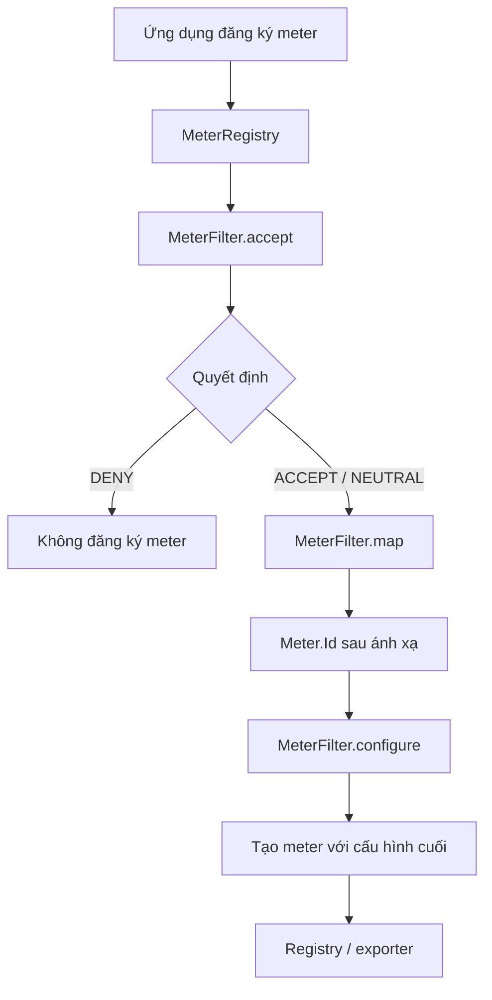

# Vai trò của MeterFilter trong chấp nhận, ánh xạ và cấu hình meter

MeterFilter là điểm mở rộng của Micrometer để áp dụng chính sách lên meter khi chúng được đăng ký vào MeterRegistry. Filter có thể quyết định một meter được chấp nhận hay bị từ chối, ánh xạ lại định danh của meter hoặc cấu hình các thống kê phân phối như histogram và percentile.

Ba trách nhiệm này giải quyết ba nhóm vấn đề khác nhau. Chấp nhận kiểm soát meter nào được phép xuất hiện; ánh xạ chuẩn hóa tên và tag; cấu hình điều chỉnh cách Timer hoặc DistributionSummary ghi nhận thống kê phân phối. Hiểu đúng vai trò của từng phương thức giúp giữ instrumentation nhất quán và ngăn metrics không cần thiết làm tăng cardinality.

Bài học thuộc module OBSERVABILITY_INSTRUMENTATION_MICROMETER. Module này hướng dẫn sử dụng Micrometer để đo lường ứng dụng Java bằng counter, gauge, timer, distribution summary và nhãn có kiểm soát; tích hợp Spring Boot, xuất metrics đến hệ giám sát, kiểm soát cardinality, kiểm thử instrumentation và diễn giải số đo vận hành.

## Mục tiêu học tập

Sau bài này, bạn có thể:

- Giải thích vai trò của MeterFilter trong vòng đời đăng ký meter.
- Phân biệt ba phương thức `accept`, `map` và `configure`.
- Chọn filter có sẵn để cho phép, từ chối, đổi tên hoặc chuẩn hóa tag.
- Áp dụng chính sách giới hạn số meter và số giá trị tag.
- Cấu hình histogram hoặc percentile cho một nhóm meter.
- Đăng ký MeterFilter đúng thời điểm trong ứng dụng Spring Boot.
- Kiểm thử filter bằng SimpleMeterRegistry và hiểu giới hạn của unit test.

## 1. MeterFilter nằm ở đâu trong kiến trúc?

Ứng dụng tạo Counter, Gauge, Timer hoặc DistributionSummary thông qua MeterRegistry. Khi một meter được đăng ký, registry áp dụng các MeterFilter đã cấu hình. Filter có thể từ chối meter, biến đổi Meter.Id hoặc điều chỉnh DistributionStatisticConfig trước khi meter được tạo.

Có thể hình dung luồng như sau:



MeterFilter tham gia lúc đăng ký meter. Nó không được gọi lại mỗi khi ứng dụng gọi `increment()`, `record()` hoặc khi registry đọc giá trị Gauge. Vì vậy, filter phù hợp với chính sách metadata và cấu hình meter, không phải xử lý từng measurement.

Một MeterFilter được thêm vào registry sau khi meter đã tồn tại không tự động sửa lại meter đó. Hãy cấu hình filter trước khi các component nghiệp vụ hoặc binder đăng ký meter.

## 2. Ba phương thức chính

MeterFilter cung cấp ba điểm mở rộng chính:

| Phương thức | Trách nhiệm | Ví dụ |
| --- | --- | --- |
| `accept(Meter.Id id)` | Chấp nhận, từ chối hoặc không đưa ra quyết định | Từ chối meter debug |
| `map(Meter.Id id)` | Trả về định danh đã ánh xạ | Đổi tag cũ thành tag chuẩn, loại tag không cần |
| `configure(Meter.Id id, DistributionStatisticConfig config)` | Điều chỉnh cấu hình thống kê phân phối | Bật histogram cho HTTP Timer |

### accept: quyết định meter có được đăng ký không

`accept` trả về một trong các giá trị MeterFilterReply:

- `ACCEPT`: chấp nhận meter.
- `DENY`: từ chối đăng ký meter.
- `NEUTRAL`: filter hiện tại không đưa ra ý kiến, để các filter khác tiếp tục quyết định.

Nếu một meter bị từ chối, registry không tạo meter thực tế cho định danh đó. Mã instrumentation vẫn có thể nhận một meter no-op để lời gọi ghi nhận không làm hỏng luồng nghiệp vụ, nhưng số đo sẽ không được xuất.

Ví dụ từ chối nhóm meter phục vụ debug:

```java
import io.micrometer.core.instrument.config.MeterFilter;
import org.springframework.context.annotation.Bean;
import org.springframework.context.annotation.Configuration;

@Configuration
public class MetricsFilterConfiguration {

    @Bean
    MeterFilter denyDebugMeters() {
        return MeterFilter.denyNameStartsWith("internal.debug");
    }
}
```

Filter trên từ chối các meter có tên bắt đầu bằng `internal.debug`. Có thể dùng cách tương tự để từ chối một họ metric không còn được sử dụng hoặc không thuộc phạm vi quan sát của dịch vụ.

Để cho phép một nhóm tên cụ thể, có thể dùng `acceptNameStartsWith`. Hãy cân nhắc thứ tự và các filter khác trong registry để chính sách cho phép không vô tình làm mất tác dụng của quy tắc từ chối rộng hơn.

### map: chuẩn hóa Meter.Id

`map` nhận Meter.Id hiện tại và trả về định danh có thể đã thay đổi name, tag hoặc metadata. Đây là điểm phù hợp để thống nhất quy ước giữa các component, loại bỏ chiều tag không cần thiết hoặc ánh xạ giá trị tag về tập hữu hạn.

Ví dụ, chuẩn hóa các giá trị `channel` về một allow-list:

```java
import java.util.Set;

import io.micrometer.core.instrument.config.MeterFilter;
import org.springframework.context.annotation.Bean;

@Bean
MeterFilter normalizeChannelTag() {
    Set<String> allowed = Set.of("web", "mobile", "partner");

    return MeterFilter.replaceTagValues(
            "channel",
            value -> allowed.contains(value) ? value : "other"
    );
}
```

Các giá trị ngoài danh sách được ánh xạ thành `other`. Điều này giảm số giá trị khác nhau của tag và làm dữ liệu nhất quán hơn. Chỉ dùng cách này khi việc gộp các giá trị không nhận diện được thành `other` phù hợp với mục tiêu phân tích.

Có thể đổi tên tag trong một nhóm meter:

```java
@Bean
MeterFilter renameLegacyCheckoutTag() {
    return MeterFilter.renameTag(
            "checkout",
            "client",
            "channel"
    );
}
```

Ví dụ này đổi tag `client` thành `channel` đối với meter có tên bắt đầu bằng `checkout`. Trước khi áp dụng, cần bảo đảm meter không đồng thời có cả hai tag với ý nghĩa khác nhau. Nếu hai key cùng tồn tại, việc đổi tên có thể làm mất hoặc gây xung đột chiều phân loại.

Một số factory method hữu ích khác:

| Factory method | Tác dụng |
| --- | --- |
| `ignoreTags("sessionId", "requestId")` | Loại các tag key được chỉ định khỏi định danh |
| `replaceTagValues(...)` | Thay giá trị tag bằng hàm ánh xạ |
| `renameTag(prefix, from, to)` | Đổi tên tag trong nhóm meter theo prefix |
| `commonTags(...)` | Bổ sung tag chung cho meter |
| `denyNameStartsWith(prefix)` | Từ chối meter theo tiền tố tên |
| `acceptNameStartsWith(prefix)` | Chấp nhận meter theo tiền tố tên |

Không nên dựa vào filter để làm sạch dữ liệu nhạy cảm đã được thu thập một cách tùy tiện. Tốt nhất hãy loại dữ liệu nhạy cảm ngay tại nguồn instrumentation. `ignoreTags` và các phép ánh xạ là lớp bảo vệ bổ sung; chúng không thay thế chính sách dữ liệu ở nơi tạo meter.

### configure: điều chỉnh thống kê phân phối

`configure` nhận Meter.Id và DistributionStatisticConfig hiện tại, rồi trả về cấu hình được áp dụng cho meter. Đây là nơi thích hợp để điều chỉnh các thống kê như:

- Bật hoặc tắt percentile histogram.
- Chọn các percentile tính trong tiến trình.
- Khai báo service level objective boundaries.
- Đặt miền giá trị kỳ vọng nhỏ nhất và lớn nhất.
- Điều chỉnh expiry và buffer length cho thống kê time-window.

Ví dụ bật percentile histogram cho HTTP server request Timer:

```java
import io.micrometer.core.instrument.Meter;
import io.micrometer.core.instrument.config.MeterFilter;
import io.micrometer.core.instrument.distribution.DistributionStatisticConfig;
import org.springframework.context.annotation.Bean;

@Bean
MeterFilter httpRequestHistogram() {
    return new MeterFilter() {
        @Override
        public DistributionStatisticConfig configure(
                Meter.Id id,
                DistributionStatisticConfig config
        ) {
            if (!id.getName().startsWith("http.server.requests")) {
                return config;
            }

            DistributionStatisticConfig histogram =
                    DistributionStatisticConfig.builder()
                            .percentilesHistogram(true)
                            .build();

            return histogram.merge(config);
        }
    };
}
```

Filter chỉ tác động đến meter có tên bắt đầu bằng `http.server.requests`. Các meter khác giữ nguyên cấu hình hiện tại. Ví dụ dùng `merge(config)` để kết hợp chính sách histogram với các giá trị cấu hình đã có; khi cần ghi đè một thuộc tính cụ thể, hãy kiểm tra quy tắc merge của phiên bản Micrometer đang dùng.

Không bật histogram cho mọi meter một cách mặc định nếu chỉ một số metric cần percentile. Histogram làm tăng số chuỗi thời gian theo bucket, tổ hợp tag và số instance.

## 3. Dùng factory method hay tự triển khai MeterFilter?

Micrometer cung cấp nhiều factory method cho các chính sách phổ biến. Hãy ưu tiên chúng khi hành vi đã đủ rõ:

- Dùng `denyNameStartsWith` để loại một họ meter.
- Dùng `maximumAllowableMetrics` để giới hạn số Meter.Id trong registry.
- Dùng `maximumAllowableTags` để giới hạn số giá trị của một tag trong nhóm meter.
- Dùng `replaceTagValues` để chuẩn hóa giá trị tag.
- Dùng `renameTag` để chuyển đổi quy ước tag trong quá trình di trú.
- Dùng `ignoreTags` để loại các chiều tag không cần thiết.

Tự triển khai MeterFilter khi chính sách cần kết hợp điều kiện phức tạp hoặc cần điều chỉnh DistributionStatisticConfig theo tên và loại meter.

### Giới hạn số giá trị tag

Ví dụ giới hạn số route được chấp nhận cho HTTP server request:

```java
@Bean
MeterFilter limitHttpRoutes() {
    return MeterFilter.maximumAllowableTags(
            "http.server.requests",
            "uri",
            40,
            MeterFilter.deny()
    );
}
```

Filter giới hạn tối đa 40 giá trị tag `uri` cho nhóm meter có tên bắt đầu bằng `http.server.requests`. Khi số giá trị mới vượt ngưỡng, filter được truyền vào làm `onMaxReached` sẽ quyết định xử lý; ở đây `MeterFilter.deny()` từ chối meter vượt giới hạn.

Đây là hàng rào bảo vệ cardinality. Nó không thay thế việc chuẩn hóa URI thành route template như `/orders/{id}`. Nếu ứng dụng gửi raw URL, các giá trị đầu tiên vẫn có thể được chấp nhận trước khi chạm ngưỡng.

### Giới hạn tổng số meter

```java
@Bean
MeterFilter limitRegistryMeters() {
    return MeterFilter.maximumAllowableMetrics(5000);
}
```

Giới hạn này kiểm soát số meter được đăng ký trong registry. Nó không đồng nghĩa với giới hạn tổng số chuỗi thời gian ở backend. Timer hoặc histogram có thể được xuất thành nhiều series cho một Meter.Id, do đó vẫn cần theo dõi series thực tế ở hệ thống giám sát.

## 4. Thứ tự và phạm vi áp dụng filter

MeterFilter được thêm vào cấu hình của một MeterRegistry. Khi đăng ký meter, registry sử dụng các filter đã cấu hình để quyết định chấp nhận, ánh xạ và cấu hình meter. Nếu có nhiều filter, thứ tự đăng ký có thể ảnh hưởng kết quả, đặc biệt khi một filter đổi tên hoặc tag và filter tiếp theo kiểm tra định danh.

Ví dụ, nếu một filter đổi tag `client` thành `channel`, filter giới hạn cardinality cần kiểm tra đúng key sau ánh xạ. Hãy tổ chức filter theo thứ tự dễ hiểu và tránh nhiều filter cùng thay đổi một tag theo các quy tắc mâu thuẫn.

Một số nguyên tắc:

- Đăng ký filter trước khi meter được tạo.
- Đặt quy tắc từ chối rõ ràng để tránh xuất meter không cần thiết.
- Chuẩn hóa name và tag trước khi áp dụng chính sách phụ thuộc định danh đã chuẩn hóa.
- Đặt giới hạn cardinality cho tên meter và tag key sau khi đã xác định quy ước cuối cùng.
- Tránh các filter trùng lặp hoặc ánh xạ vòng lặp giữa nhiều key.
- Kiểm tra hành vi khi nhiều filter cùng tác động đến một meter.

MeterFilter áp dụng ở cấp registry. Nếu ứng dụng có nhiều registry, hãy xác nhận filter được cấu hình cho từng registry cần bảo vệ. Không giả định filter trên một registry tự động điều chỉnh registry khác được tạo riêng.

## 5. Tích hợp MeterFilter trong Spring Boot

Trong ứng dụng Spring Boot có Micrometer Actuator, có thể khai báo MeterFilter dưới dạng bean. Cơ chế auto-configuration của Spring Boot áp dụng các bean MeterFilter vào MeterRegistry được quản lý.

Ví dụ kết hợp chính sách từ chối và giới hạn tag:

```java
import io.micrometer.core.instrument.config.MeterFilter;
import org.springframework.context.annotation.Bean;
import org.springframework.context.annotation.Configuration;

@Configuration
public class MetricsPolicyConfiguration {

    @Bean
    MeterFilter denyInternalDebugMetrics() {
        return MeterFilter.denyNameStartsWith("internal.debug");
    }

    @Bean
    MeterFilter limitHttpRoutes() {
        return MeterFilter.maximumAllowableTags(
                "http.server.requests",
                "uri",
                40,
                MeterFilter.deny()
        );
    }
}
```

Các component nghiệp vụ vẫn inject MeterRegistry như bình thường. Filter hoạt động ở bước đăng ký meter, nên mã nghiệp vụ không cần biết chi tiết chính sách.

Nếu tự tạo MeterRegistry thay vì dùng auto-configuration, hãy thêm filter qua `registry.config().meterFilter(...)` trước khi đăng ký meter:

```java
registry.config()
        .meterFilter(MeterFilter.denyNameStartsWith("internal.debug"));
```

Phân biệt MeterFilter với MeterRegistryCustomizer:

| Thành phần | Phạm vi | Mục đích |
| --- | --- | --- |
| MeterFilter | Từng meter khi đăng ký | Chấp nhận, ánh xạ và cấu hình meter |
| MeterRegistryCustomizer | Toàn registry | Cấu hình registry, ví dụ common tags hoặc chính sách chung |

Dùng MeterRegistryCustomizer khi muốn cấu hình đối tượng registry. Dùng MeterFilter khi chính sách cần đánh giá hoặc thay đổi từng Meter.Id.

## 6. Kiểm thử MeterFilter bằng SimpleMeterRegistry

Có thể kiểm tra hành vi filter mà không cần khởi động backend bên ngoài. Điều quan trọng là thêm filter trước khi đăng ký meter.

### Kiểm thử từ chối meter

```java
import static org.assertj.core.api.Assertions.assertThat;

import io.micrometer.core.instrument.Counter;
import io.micrometer.core.instrument.config.MeterFilter;
import io.micrometer.core.instrument.simple.SimpleMeterRegistry;
import org.junit.jupiter.api.Test;

class MeterFilterAcceptTest {

    @Test
    void deniesInternalDebugMeter() {
        var registry = new SimpleMeterRegistry();

        registry.config().meterFilter(
                MeterFilter.denyNameStartsWith("internal.debug")
        );

        Counter.builder("internal.debug.events")
                .register(registry)
                .increment();

        assertThat(registry.find("internal.debug.events").counter())
                .isNull();
    }
}
```

Test xác nhận meter bị từ chối không xuất hiện trong registry. Trong mã nghiệp vụ, thao tác increment vẫn không làm gián đoạn luồng xử lý vì meter bị từ chối được thay bằng implementation no-op phù hợp.

### Kiểm thử ánh xạ tag

```java
import static org.assertj.core.api.Assertions.assertThat;

import java.util.Set;

import io.micrometer.core.instrument.Counter;
import io.micrometer.core.instrument.config.MeterFilter;
import io.micrometer.core.instrument.simple.SimpleMeterRegistry;
import org.junit.jupiter.api.Test;

class MeterFilterMapTest {

    @Test
    void mapsUnknownChannelToOther() {
        var registry = new SimpleMeterRegistry();
        Set<String> allowed = Set.of("web", "mobile");

        registry.config().meterFilter(
                MeterFilter.replaceTagValues(
                        "channel",
                        value -> allowed.contains(value) ? value : "other"
                )
        );

        Counter.builder("checkout.completed")
                .tag("channel", "unknown-client")
                .register(registry)
                .increment();

        assertThat(registry.find("checkout.completed")
                .tag("channel", "other")
                .counter()).isNotNull();

        assertThat(registry.find("checkout.completed")
                .tag("channel", "unknown-client")
                .counter()).isNull();
    }
}
```

Test kiểm tra định danh sau ánh xạ. Có thể bổ sung trường hợp các giá trị hợp lệ vẫn được giữ nguyên và trường hợp nhiều giá trị không hợp lệ cùng được gom vào `other`.

### Kiểm thử giới hạn cardinality

Với `maximumAllowableTags`, hãy kiểm tra các trường hợp:

1. Các giá trị tag khác nhau dưới ngưỡng đều được đăng ký.
2. Giá trị mới sau ngưỡng bị từ chối theo `onMaxReached`.
3. Các meter khác prefix không bị ảnh hưởng.
4. Các giá trị tag lặp lại không bị tính thành giá trị mới.
5. Tên meter và tag key khớp với định danh thực tế sau các filter ánh xạ.

SimpleMeterRegistry xác nhận hành vi ở lớp Micrometer. Nó không chứng minh exporter hoặc backend có đúng số series như mong muốn; cần kiểm tra thêm đầu ra registry production khi chính sách ảnh hưởng đến export.

## 7. Các lỗi thường gặp

| Lỗi | Hệ quả | Cách xử lý |
| --- | --- | --- |
| Thêm filter sau khi meter đã được đăng ký | Meter hiện có không tự được cập nhật | Cấu hình filter trước khi tạo meter |
| Dùng `ACCEPT` cho mọi meter mà không xem các quy tắc khác | Có thể làm chính sách chấp nhận quá rộng | Dùng `NEUTRAL` khi filter không có quyết định |
| Nhầm `map` với xử lý measurement | Kỳ vọng filter thay đổi giá trị Counter hoặc Gauge | Dùng filter cho Meter.Id và cấu hình; xử lý dữ liệu tại instrumentation |
| Đổi tên tag sau khi filter giới hạn đã chạy | Giới hạn có thể kiểm tra sai key | Xác định thứ tự ánh xạ và giới hạn |
| Chỉ dùng maximumAllowableMetrics | Không kiểm soát được series do histogram sinh ra | Theo dõi cardinality thực tế ở backend |
| Dùng replaceTagValues để che dữ liệu nhạy cảm | Dữ liệu gốc có thể vẫn được thu thập ở nơi khác | Loại bỏ dữ liệu nhạy cảm tại nguồn |
| Bật histogram cho toàn bộ meter | Tăng chi phí lưu trữ và ingest | Chỉ cấu hình nhóm meter cần percentile |
| Cho rằng filter ở registry A áp dụng registry B | Một registry riêng vẫn có thể xuất meter ngoài chính sách | Cấu hình và kiểm tra từng registry |
| Chỉ kiểm thử factory method đơn lẻ | Không phát hiện xung đột thứ tự filter | Kiểm thử chuỗi filter thực tế |

## 8. Checklist thiết kế MeterFilter

Trước khi đưa chính sách vào ứng dụng, hãy xác nhận:

1. Meter nào cần được chấp nhận hoặc từ chối?
2. Điều kiện có dựa trên tên, loại meter hay tag không?
3. Có cần ánh xạ tên hoặc tag về quy ước chung không?
4. Các giá trị tag có tập hữu hạn và được chuẩn hóa trước không?
5. Giới hạn tag và giới hạn tổng meter có phù hợp với ngân sách không?
6. Có meter nào cần histogram hoặc percentile riêng không?
7. Filter đã được đăng ký trước khi binder và component tạo meter chưa?
8. Thứ tự filter có làm thay đổi kết quả ánh xạ hoặc giới hạn không?
9. Unit test đã kiểm tra accept, map và configure chưa?
10. Đầu ra exporter có phản ánh đúng chính sách đã cấu hình không?

## Kết luận

MeterFilter là cơ chế áp dụng chính sách ở thời điểm meter được đăng ký vào MeterRegistry. `accept` quyết định meter có được tạo hay không; `map` chuẩn hóa Meter.Id; `configure` điều chỉnh thống kê phân phối của meter. Các factory method có sẵn đáp ứng nhiều nhu cầu thường gặp như từ chối meter, đổi tên tag, chuẩn hóa giá trị và giới hạn cardinality.

Hãy cấu hình filter sớm, tổ chức thứ tự rõ ràng và kiểm thử cả chuỗi filter thay vì chỉ kiểm tra từng factory method. Kết hợp chính sách ở MeterFilter với thiết kế tag an toàn tại nguồn và kiểm tra đầu ra registry sẽ giúp hệ thống metrics nhất quán, dễ vận hành và có chi phí kiểm soát được.
