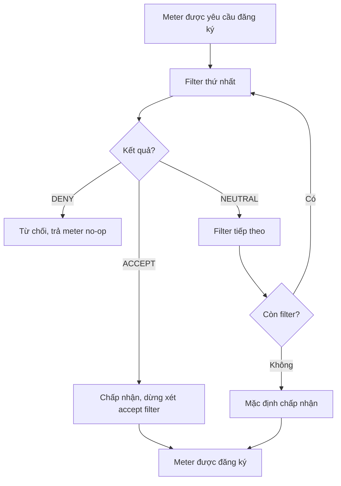

# Ý nghĩa của ACCEPT, DENY, NEUTRAL và meter không ghi nhận dữ liệu

`MeterFilter` cho phép kiểm soát meter trước khi `MeterRegistry` đăng ký và xuất chúng. Một filter có thể chấp nhận meter, từ chối meter hoặc để filter tiếp theo quyết định. Ba kết quả `ACCEPT`, `DENY` và `NEUTRAL` vì vậy ảnh hưởng trực tiếp đến việc một meter có được tạo trong registry hay không.

Điểm cần phân biệt là **meter được chấp nhận** không đồng nghĩa với **meter đã ghi nhận observation** hoặc **backend đã nhận dữ liệu**. `ACCEPT` chỉ cho phép meter được đăng ký; ứng dụng vẫn phải cập nhật meter hoặc cung cấp nguồn dữ liệu hợp lệ, exporter phải xuất dữ liệu và backend phải thu thập được nó. Ngược lại, `DENY` khiến meter bị từ chối và các thao tác ghi qua meter trả về thường trở thành no-op.

## Ba kết quả quyết định của MeterFilter

Khi registry đánh giá một meter, phương thức `accept(Meter.Id)` của filter trả về một trong ba giá trị:

| Kết quả | Ý nghĩa | Điều gì xảy ra tiếp theo? |
|---|---|---|
| `ACCEPT` | Chấp nhận meter | Kết thúc quá trình đánh giá accept filter cho meter đó; các accept filter tiếp theo không được hỏi |
| `DENY` | Từ chối meter | Dừng đánh giá và không đăng ký meter vào registry |
| `NEUTRAL` | Chưa đưa ra quyết định | Tiếp tục hỏi filter tiếp theo; nếu tất cả đều neutral, registry mặc định chấp nhận meter |

Có thể hình dung quá trình như sau:



`NEUTRAL` không có nghĩa là bỏ qua meter hay từ chối meter. Nó chỉ có nghĩa filter hiện tại không quyết định. Đây là kết quả phù hợp cho filter chỉ quản lý một nhóm tên hoặc một điều kiện cụ thể, để các meter còn lại được đánh giá bởi filter khác.

## Dùng filter dựng sẵn

Micrometer cung cấp một số factory method để tạo filter thông dụng:

```java
import io.micrometer.core.instrument.config.MeterFilter;

MeterFilter acceptEverything = MeterFilter.accept();
MeterFilter denyEverything = MeterFilter.deny();

MeterFilter denyDebugMeters = MeterFilter.denyNameStartsWith("debug.");
MeterFilter denyHealthMeters = MeterFilter.deny(id ->
        id.getName().startsWith("healthcheck."));
MeterFilter acceptBillingMeters = MeterFilter.accept(id ->
        id.getName().startsWith("billing."));
```

`accept()` luôn trả về `ACCEPT`; `deny()` luôn trả về `DENY`. Các biến thể nhận predicate chỉ đưa ra quyết định khi predicate khớp: `accept(predicate)` trả `ACCEPT` khi đúng và `NEUTRAL` khi sai; `deny(predicate)` trả `DENY` khi đúng và `NEUTRAL` khi sai.

Trong ví dụ, `denyNameStartsWith("debug.")` từ chối các meter có tên bắt đầu bằng `debug.`. Những meter khác tiếp tục được đánh giá. `acceptBillingMeters` chấp nhận meter thuộc nhóm `billing.` và kết thúc chuỗi quyết định accept filter cho các meter đó.

## Đăng ký filter và thứ tự đánh giá

Filter được thêm vào cấu hình của registry bằng `registry.config().meterFilter(...)`. Ví dụ, từ chối meter debug trước, rồi chấp nhận nhóm billing:

```java
import io.micrometer.core.instrument.MeterRegistry;
import io.micrometer.core.instrument.config.MeterFilter;

public class MetricsConfiguration {
    public MetricsConfiguration(MeterRegistry registry) {
        registry.config()
                .meterFilter(MeterFilter.denyNameStartsWith("debug."))
                .meterFilter(MeterFilter.accept(id ->
                        id.getName().startsWith("billing.")));
    }
}
```

Các accept filter được xét theo thứ tự thêm vào registry. Khi một filter trả `ACCEPT` hoặc `DENY`, quyết định đã kết thúc; chỉ `NEUTRAL` mới cho phép đi tiếp. Vì vậy, filter từ chối những meter cần loại bỏ nên được đặt trước một filter chấp nhận rộng.

Ví dụ sau có thể làm mất tác dụng của giới hạn được thêm sau:

```java
registry.config()
        .meterFilter(MeterFilter.accept())
        .meterFilter(MeterFilter.maximumAllowableMetrics(500));
```

Filter `accept()` đầu tiên chấp nhận mọi meter và kết thúc quá trình đánh giá accept filter. Filter giới hạn số meter phía sau không còn cơ hội từ chối chúng. Nếu cần kết hợp filter từ chối, giới hạn và chấp nhận có điều kiện, hãy sắp xếp thứ tự có chủ đích; tránh `accept()` toàn cục trừ khi thực sự muốn bỏ qua các quyết định accept filter tiếp theo.

Trong ứng dụng Spring Boot, có thể khai báo `MeterFilter` dưới dạng bean để auto-configuration áp dụng cho registry phù hợp:

```java
import io.micrometer.core.instrument.config.MeterFilter;
import org.springframework.context.annotation.Bean;
import org.springframework.context.annotation.Configuration;

@Configuration
public class MetricsFilterConfiguration {
    @Bean
    MeterFilter denyDebugMeters() {
        return MeterFilter.denyNameStartsWith("debug.");
    }
}
```

Đặt filter trong giai đoạn cấu hình registry, trước khi các binder hoặc bean nghiệp vụ đăng ký meter. Thêm filter sau khi meter đã được đăng ký không tự đánh giá lại hay xóa những meter hiện có; filter được áp dụng khi registry xử lý đăng ký meter.

## DENY và meter không ghi nhận dữ liệu

Khi filter trả `DENY`, registry không đăng ký meter đó như một meter hoạt động. API đăng ký vẫn có thể trả về một meter no-op để mã ứng dụng tiếp tục gọi `increment()`, `record(...)` hoặc các phương thức tương ứng mà không cần kiểm tra kết quả từ chối ở mọi nơi. Các thao tác trên no-op meter không tạo số liệu trong registry và không được xuất tới backend.

Ví dụ:

```java
import static org.assertj.core.api.Assertions.assertThat;

import io.micrometer.core.instrument.Counter;
import io.micrometer.core.instrument.config.MeterFilter;
import io.micrometer.core.instrument.simple.SimpleMeterRegistry;

SimpleMeterRegistry registry = new SimpleMeterRegistry();
registry.config().meterFilter(MeterFilter.denyNameStartsWith("debug."));

Counter denied = registry.counter("debug.events");
denied.increment();

assertThat(denied.count()).isZero();
assertThat(registry.find("debug.events").counter()).isNull();

registry.close();
```

Counter trả về vẫn có thể được gọi, nhưng nó không lưu giá trị. `registry.find(...)` không tìm thấy meter đã đăng ký. Đây là hành vi có chủ đích của filter, không phải lỗi của `Counter.increment()`.

Không nên dùng `DENY` chỉ để che một metric đang có giá trị bất thường nếu đội vận hành vẫn cần điều tra nó. Từ chối meter làm mất dữ liệu ở nguồn instrumentation. Nếu chỉ muốn bỏ một số tag hoặc đổi tên meter, hãy xem xét các filter mapping tương ứng thay vì từ chối toàn bộ meter.

## NEUTRAL không làm mất dữ liệu

Một filter có thể chỉ quan tâm đến một nhóm meter. Với các meter ngoài nhóm đó, trả `NEUTRAL` để registry tiếp tục đánh giá:

```java
import io.micrometer.core.instrument.Meter;
import io.micrometer.core.instrument.config.MeterFilter;
import io.micrometer.core.instrument.config.MeterFilterReply;

MeterFilter applicationFilter = new MeterFilter() {
    @Override
    public MeterFilterReply accept(Meter.Id id) {
        if (id.getName().startsWith("internal.debug.")) {
            return MeterFilterReply.DENY;
        }
        return MeterFilterReply.NEUTRAL;
    }
};
```

Filter trên chỉ từ chối meter debug nội bộ. Với meter khác, nó không quyết định; nếu không có filter tiếp theo từ chối thì registry mặc định chấp nhận. Trả `NEUTRAL` là cách an toàn để filter chuyên biệt không vô tình chặn toàn bộ metric còn lại.

Nếu filter trả `ACCEPT` cho một meter, các accept filter sau không được xét cho meter đó. Vì vậy, không dùng `ACCEPT` như cách diễn đạt “filter này không phản đối”; ý nghĩa đó thuộc về `NEUTRAL`.

## ACCEPT không đảm bảo có observation

`ACCEPT` chỉ xác nhận meter được phép đăng ký. Meter có thể vẫn không ghi nhận dữ liệu vì những nguyên nhân khác:

1. Mã nghiệp vụ chưa đi qua nhánh gọi `increment()` hoặc `record(...)`.
2. Tác vụ chưa chạy hoặc chưa hoàn tất nên Timer chưa có observation.
3. Function meter đọc một nguồn tích lũy chưa thay đổi.
4. Gauge phản ánh giá trị hiện tại bằng 0 hoặc đối tượng nguồn không còn hợp lệ.
5. Meter được đăng ký nhưng exporter chưa được cấu hình, endpoint chưa được scrape hoặc backend loại bỏ dữ liệu ở bước ingest.
6. Dashboard truy vấn sai tên metric, tag, đơn vị hoặc cửa sổ thời gian.

Do đó, khi thấy metric bằng 0 hoặc không xuất hiện, hãy phân biệt ba trạng thái: meter bị filter từ chối; meter đã đăng ký nhưng chưa có observation có giá trị; và meter có dữ liệu trong registry nhưng chưa đến được backend.

## Phân biệt meter bị từ chối với meter chưa được cập nhật

Có thể kiểm tra registry trong JVM để thu hẹp nguyên nhân:

```java
Counter counter = registry.find("orders.created")
        .tag("channel", "web")
        .counter();

if (counter == null) {
    // Không tìm thấy meter có tên và tag này trong registry.
} else if (counter.count() == 0.0) {
    // Meter tồn tại nhưng chưa ghi nhận lần tăng nào.
} else {
    // Meter có số liệu tích lũy trong tiến trình hiện tại.
}
```

`find(...)` trả về meter phù hợp với tên và tag đã chỉ định, hoặc `null` nếu không có meter tương ứng trong registry. Kết quả `null` có thể do filter từ chối, code chưa đăng ký meter, hoặc tên/tag không khớp. Không nên kết luận ngay rằng `DENY` là nguyên nhân duy nhất.

Nếu meter tồn tại nhưng count bằng 0, hãy kiểm tra điểm gọi `increment()`, điều kiện nghiệp vụ, retry, transaction và vòng đời tác vụ. Với Timer, kiểm tra `count()` thay vì chỉ xem `totalTime()`: timer chưa có observation thường có cả count và tổng thời gian bằng 0.

Nếu meter có số liệu trong registry nhưng backend không thấy, kiểm tra endpoint exposition, cấu hình exporter, scrape target, relabel/filter ở backend và tên metric sau khi chuẩn hóa.

## Kết hợp quyết định với giới hạn cardinality

MeterFilter thường được dùng cùng các giới hạn số meter và số giá trị tag:

```java
registry.config()
        .meterFilter(MeterFilter.denyNameStartsWith("debug."))
        .meterFilter(MeterFilter.maximumAllowableMetrics(2_000))
        .meterFilter(MeterFilter.maximumAllowableTags(
                "http.server.requests",
                "uri",
                100,
                MeterFilter.deny()));
```

Ví dụ từ chối meter debug, giới hạn số meter được chấp nhận và giới hạn tối đa 100 giá trị tag `uri` cho meter `http.server.requests`. Khi vượt giới hạn tag, filter cuối cùng từ chối meter mới có giá trị tag vượt ngưỡng. Những meter đã đăng ký trước khi đạt ngưỡng vẫn tồn tại.

Các giới hạn này bảo vệ registry khỏi số meter hoặc tổ hợp tag tăng quá mức. Chúng không thay thế thiết kế tag có cardinality thấp. Nếu một metric tạo hàng trăm giá trị route hợp lệ nhưng không cần thiết, hãy chuẩn hóa route về template trước khi đăng ký meter.

Chú ý thứ tự: không đặt filter `accept()` toàn cục trước các filter giới hạn. Với filter chấp nhận có điều kiện, đặt các filter từ chối và giới hạn quan trọng trước filter có thể trả `ACCEPT`.

## Kiểm thử ACCEPT, DENY và NEUTRAL

Unit test có thể dùng `SimpleMeterRegistry` để xác nhận kết quả quyết định:

```java
import static org.assertj.core.api.Assertions.assertThat;

import io.micrometer.core.instrument.Counter;
import io.micrometer.core.instrument.config.MeterFilter;
import io.micrometer.core.instrument.simple.SimpleMeterRegistry;
import org.junit.jupiter.api.Test;

class MeterFilterTest {
    @Test
    void deniedMeterIsNotRegistered() {
        SimpleMeterRegistry registry = new SimpleMeterRegistry();
        registry.config().meterFilter(MeterFilter.denyNameStartsWith("debug."));

        Counter counter = registry.counter("debug.events");
        counter.increment();

        assertThat(counter.count()).isZero();
        assertThat(registry.find("debug.events").counter()).isNull();

        registry.close();
    }

    @Test
    void neutralMeterIsAcceptedWhenNoOtherFilterDeniesIt() {
        SimpleMeterRegistry registry = new SimpleMeterRegistry();
        registry.config().meterFilter(MeterFilter.denyNameStartsWith("debug."));

        Counter counter = registry.counter("orders.created");
        counter.increment();

        assertThat(registry.find("orders.created").counter()).isNotNull();
        assertThat(counter.count()).isEqualTo(1.0);

        registry.close();
    }

    @Test
    void acceptStopsLaterAcceptanceFilters() {
        SimpleMeterRegistry registry = new SimpleMeterRegistry();
        registry.config()
                .meterFilter(MeterFilter.accept())
                .meterFilter(MeterFilter.denyNameStartsWith("orders."));

        Counter counter = registry.counter("orders.created");
        counter.increment();

        assertThat(registry.find("orders.created").counter()).isNotNull();
        assertThat(counter.count()).isEqualTo(1.0);

        registry.close();
    }
}
```

Ba test minh họa ba trường hợp: `DENY` khiến meter không được đăng ký; `NEUTRAL` cho phép filter tiếp theo quyết định và cuối cùng được mặc định chấp nhận; `ACCEPT` kết thúc chuỗi accept filter nên filter từ chối thêm sau nó không được gọi. Trong test của dự án, có thể bổ sung trường hợp filter trả `DENY` sau một hoặc nhiều `NEUTRAL` để xác nhận quyết định từ chối được áp dụng.

## Lỗi thường gặp

| Hiện tượng | Nguyên nhân thường gặp | Cách kiểm tra |
|---|---|---|
| Metric không xuất hiện trong registry | Một filter trả `DENY`, meter chưa được đăng ký hoặc tên/tag truy vấn sai | Kiểm tra filter, `registry.find(...)` và định danh meter |
| Gọi `increment()` nhưng count vẫn bằng 0 | API trả về no-op meter do bị từ chối | Kiểm tra filter `DENY` và meter có xuất hiện trong registry không |
| Filter từ chối không có tác dụng | Filter `ACCEPT` rộng hơn được thêm trước và kết thúc đánh giá | Sắp xếp filter từ chối trước filter chấp nhận |
| `NEUTRAL` bị hiểu là từ chối | Nhầm nghĩa “không quyết định” với “deny” | Nhớ rằng tất cả neutral thì registry mặc định chấp nhận |
| ACCEPT nhưng backend không có dữ liệu | Chưa có observation hoặc exporter/backend chưa nhận | Kiểm tra lần ghi nhận, exposition, scrape và ingest |
| Thêm filter nhưng meter cũ vẫn xuất | Filter không áp dụng hồi tố cho meter đã đăng ký | Cấu hình filter trước khi binder và bean tạo meter |
| Một số meter biến mất sau khi chạm giới hạn | `maximumAllowableMetrics` hoặc `maximumAllowableTags` từ chối meter mới | Theo dõi giới hạn và chuẩn hóa tag |

## Checklist triển khai

- [ ] Mỗi filter có phạm vi rõ ràng và chỉ quyết định cho nhóm meter nó quản lý.
- [ ] Dùng `NEUTRAL` khi filter không có ý kiến; không dùng `ACCEPT` thay cho neutral.
- [ ] Đặt filter từ chối và giới hạn trước filter có thể trả `ACCEPT`.
- [ ] Hiểu rằng `ACCEPT` chỉ cho phép đăng ký meter, không tạo observation.
- [ ] Hiểu rằng `DENY` có thể trả về no-op meter và không xuất dữ liệu.
- [ ] Cấu hình filter trước khi các meter được đăng ký.
- [ ] Kiểm tra meter bằng `registry.find(...)` và giá trị count/measurement trong JVM.
- [ ] Kiểm tra riêng endpoint exporter và dữ liệu ở backend.
- [ ] Kiểm thử các nhánh ACCEPT, DENY, NEUTRAL và thứ tự filter.
- [ ] Theo dõi giới hạn meter/tag để tránh mất metric quan trọng do cardinality.

`ACCEPT`, `DENY` và `NEUTRAL` là các quyết định về việc đăng ký meter. `ACCEPT` chấp nhận và kết thúc đánh giá, `DENY` loại meter khỏi registry, còn `NEUTRAL` chuyển quyền quyết định cho filter tiếp theo. Khi meter không có dữ liệu, cần xác định nó đã bị từ chối, chưa được cập nhật hay chưa được exporter/backend thu thập trước khi thay đổi instrumentation.
