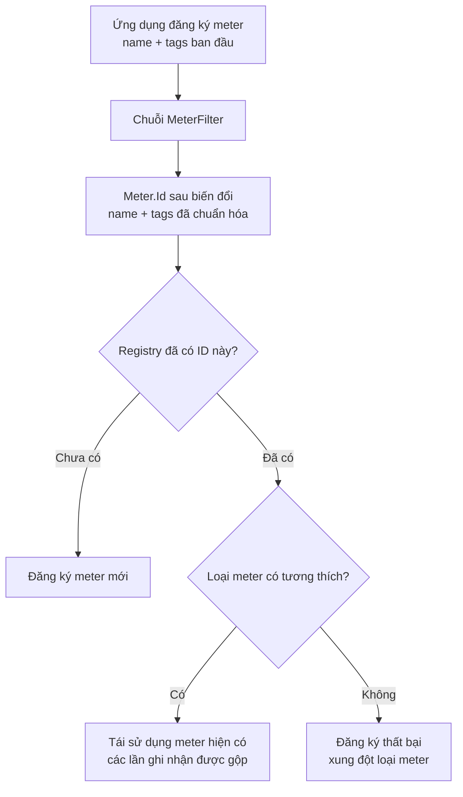

# Xung đột danh tính sau khi bỏ tag hoặc đổi tên

`MeterFilter` cho phép chuẩn hóa, đổi tên hoặc loại bỏ tag và thay đổi tên meter trước khi meter được đăng ký vào `MeterRegistry`. Đây là cách hữu ích để kiểm soát cardinality và thống nhất quy ước metrics giữa các thành phần. Tuy nhiên, một phép biến đổi có thể khiến hai meter vốn có danh tính khác nhau trở thành cùng một danh tính.

Ví dụ, hai meter `orders.process{tenant=acme}` và `orders.process{tenant=globex}` là hai meter riêng trước khi áp dụng filter. Nếu filter loại bỏ tag `tenant`, cả hai cùng trở thành `orders.process`. Registry lúc này chỉ còn một vị trí cho danh tính đã biến đổi đó.

Kết quả phụ thuộc loại meter và ngữ nghĩa dữ liệu:

- Nếu hai meter cùng loại, registry thường tái sử dụng meter đã đăng ký. Các lần ghi nhận từ hai nguồn sẽ được cộng vào cùng một meter.
- Nếu hai meter khác loại, ví dụ Counter và Gauge, đăng ký có thể thất bại do cùng danh tính không thể đại diện cho hai loại meter khác nhau.
- Ngay cả khi đăng ký thành công, việc gộp dữ liệu có thể làm mất chiều phân tích quan trọng, chẳng hạn tenant, route hoặc nguồn phát sinh.

Vì vậy, khi cấu hình MeterFilter, cần đánh giá danh tính sau biến đổi, không chỉ nhìn tên và tag ban đầu.

## 1. Danh tính meter trước và sau MeterFilter

Trong một registry, meter được tra cứu theo tên và tập tag. Khi ứng dụng đăng ký meter, các filter cấu hình trên registry có thể biến đổi `Meter.Id` trước khi registry tìm hoặc tạo meter tương ứng.

Có thể mô tả luồng này như sau:



Ví dụ, hai danh tính ban đầu:

```text
orders.process{operation=create, tenant=acme}
orders.process{operation=create, tenant=globex}
```

Sau khi bỏ tag `tenant`:

```text
orders.process{operation=create}
orders.process{operation=create}
```

Hai meter đã nhập thành một danh tính. Registry không còn thông tin để phân biệt dữ liệu đến từ tenant nào.

## 2. Bỏ tag có thể gộp nhiều meter

Một cách phổ biến để bỏ tag là dùng `MeterFilter.ignoreTags(...)`:

```java
import io.micrometer.core.instrument.MeterRegistry;
import io.micrometer.core.instrument.config.MeterFilter;

import org.springframework.boot.actuate.autoconfigure.metrics.MeterRegistryCustomizer;
import org.springframework.context.annotation.Bean;
import org.springframework.context.annotation.Configuration;

@Configuration
class MetricsConfiguration {

    @Bean
    MeterRegistryCustomizer<MeterRegistry> removeTenantDimension() {
        return registry -> registry.config()
            .meterFilter(MeterFilter.ignoreTags("tenant"));
    }
}
```

Sau cấu hình này, tag `tenant` bị loại khỏi danh tính meter khi registry xử lý đăng ký. Nếu hai meter chỉ khác nhau ở tag đó, chúng có thể được gộp.

Ví dụ:

| Danh tính trước filter | Danh tính sau filter |
|---|---|
| `orders.created{tenant=acme, channel=web}` | `orders.created{channel=web}` |
| `orders.created{tenant=globex, channel=web}` | `orders.created{channel=web}` |
| `orders.created{tenant=acme, channel=mobile}` | `orders.created{channel=mobile}` |

Việc bỏ tag `tenant` có thể là chủ đích nếu dashboard chỉ cần tổng số đơn hàng theo kênh. Nhưng nếu cần so sánh từng tenant, filter đã loại bỏ chiều dữ liệu cần thiết.

Không nên xem việc giảm cardinality là lý do đủ để xóa mọi tag. Trước khi bỏ một tag, hãy xác định liệu các giá trị khác nhau có thể được gộp mà vẫn giữ đúng ý nghĩa của metric hay không.

## 3. Đổi tên tag có thể khiến hai danh tính nhập lại

`MeterFilter.renameTag(...)` đổi key của một tag cho các meter có tên phù hợp với prefix đã cấu hình. Điều này hữu ích khi hợp nhất quy ước tag giữa các thư viện hoặc module.

Ví dụ:

```java
registry.config().meterFilter(
    MeterFilter.renameTag(
        "orders.process",
        "channel",
        "source"
    )
);
```

Giả sử một thành phần đăng ký meter với tag `channel=web`, còn một thành phần khác đã dùng tag `source=web`:

```text
orders.process{channel=web, operation=create}
orders.process{source=web, operation=create}
```

Sau khi đổi `channel` thành `source`, cả hai cùng có danh tính:

```text
orders.process{source=web, operation=create}
```

Đổi tên tag không phải lúc nào cũng gây xung đột. Xung đột xảy ra khi kết quả biến đổi trùng với một danh tính khác đã tồn tại hoặc sẽ được đăng ký sau đó. Vì vậy, cần kiểm tra cả các key tag cũ lẫn key tag đích đang được dùng trong ứng dụng.

## 4. Chuẩn hóa giá trị tag cũng có thể gộp meter

Một filter có thể thay nhiều giá trị tag thành một giá trị chuẩn. Ví dụ, các route động:

```text
/orders/101
/orders/205
/orders/987
```

có thể được chuẩn hóa thành route template:

```text
/orders/{id}
```

Đây thường là điều nên làm vì URL đầy đủ chứa ID động có thể tạo cardinality cao. Nhưng nếu hai giá trị có ý nghĩa vận hành khác nhau bị chuẩn hóa về cùng một giá trị, metrics sẽ bị gộp.

Ví dụ, chuẩn hóa `region=sg` và `region=ap-southeast-1` thành cùng một tag có thể hợp lý nếu chúng thực sự chỉ cùng một vùng triển khai. Ngược lại, gộp `result=success` và `result=failure` thành `result=other` sẽ làm mất thông tin lỗi.

Cần phân biệt:

- **Chuẩn hóa có chủ đích:** nhiều giá trị biểu diễn cùng một khái niệm được chuyển về một giá trị chuẩn.
- **Gộp nhầm:** các giá trị có ý nghĩa khác nhau bị chuyển thành cùng một giá trị và làm sai cách diễn giải metrics.

## 5. Cùng loại meter: dữ liệu có thể bị gộp

Khi hai meter sau filter có cùng danh tính và cùng loại, registry thường trả lại meter đã tồn tại thay vì tạo meter độc lập thứ hai.

Ví dụ, hai tenant cùng ghi nhận số đơn hàng:

```java
Counter acmeOrders = registry.counter(
    "orders.created",
    "tenant", "acme"
);

Counter globexOrders = registry.counter(
    "orders.created",
    "tenant", "globex"
);
```

Nếu registry đã cấu hình `MeterFilter.ignoreTags("tenant")`, hai lời gọi có thể trả về cùng một Counter. Khi mỗi tenant tăng counter, tổng số đơn hàng được ghi vào cùng meter.

Điều này có thể hữu ích nếu mục tiêu là đo tổng số đơn hàng toàn hệ thống. Nhưng nó sẽ không còn phù hợp nếu dashboard cần so sánh từng tenant.

Một hậu quả khó nhận biết là code vẫn chạy bình thường và số liệu vẫn tăng, nhưng chiều phân tích đã biến mất. Vì vậy, test cần kiểm tra danh tính meter sau filter và xác nhận việc gộp có đúng với yêu cầu nghiệp vụ hay không.

## 6. Khác loại meter: đăng ký có thể thất bại

Nếu hai meter khác loại bị biến đổi thành cùng danh tính, registry không thể sử dụng cùng ID cho cả hai loại.

Ví dụ, một thành phần đăng ký Counter:

```java
Counter queueDepth = registry.counter(
    "worker.queue.depth",
    "queue", "email",
    "tenant", "acme"
);
```

Thành phần khác lại đăng ký Gauge:

```java
AtomicInteger currentDepth = new AtomicInteger(5);

Gauge.builder(
        "worker.queue.depth",
        currentDepth,
        AtomicInteger::get
    )
    .tag("queue", "email")
    .tag("tenant", "globex")
    .register(registry);
```

Nếu registry bỏ tag `tenant`, hai ID sau biến đổi đều là:

```text
worker.queue.depth{queue=email}
```

Một meter là Counter, meter kia là Gauge. Việc đăng ký meter thứ hai có thể ném `IllegalArgumentException` vì loại meter không khớp với meter đã có.

Đây là lỗi cần được phát hiện sớm trong quá trình khởi tạo ứng dụng hoặc trong test instrumentation. Không nên xử lý bằng cách đổi tag tùy tiện chỉ để tránh exception; cần xem lại ý nghĩa đo lường và chọn tên meter phù hợp.

## 7. Đổi tên metric cũng có thể tạo xung đột

MeterFilter có thể thay đổi tên metric. Nếu hai tên khác nhau được chuyển thành cùng tên và có cùng tag sau biến đổi, registry sẽ coi chúng là cùng danh tính.

Ví dụ:

```text
legacy.orders.created{channel=web}
orders.created{channel=web}
```

Nếu một filter đổi `legacy.orders.created` thành `orders.created`, hai meter có thể nhập thành một ID.

Việc hợp nhất tên có thể hữu ích khi di chuyển từ quy ước cũ sang quy ước mới, nhưng cần xem xét:

- Hai meter có cùng đơn vị và cùng ngữ nghĩa không?
- Chúng có cùng loại meter không?
- Có đang đo cùng một tập sự kiện không?
- Có cần giữ lại cả hai metric trong giai đoạn chuyển đổi không?
- Dashboard, alert và consumer hiện tại có đang phụ thuộc vào tên cũ không?

Nếu hai meter cùng tên sau biến đổi nhưng đo hai đại lượng khác nhau, cần giữ tên riêng. Không nên dùng rename để che đi sự khác biệt ngữ nghĩa.

## 8. Thứ tự filter và thời điểm cấu hình

MeterFilter được áp dụng khi meter được đăng ký. Vì vậy, nên cấu hình filter trước khi các component nghiệp vụ hoặc instrumentation tự động tạo meter.

Ví dụ, nếu một bean tạo Timer trong constructor trước khi filter được thêm vào registry, Timer đã được đăng ký với ID tại thời điểm đó. Việc thêm filter sau đó không tự động đổi lại danh tính của meter hiện có. Những lần đăng ký tiếp theo mới chịu ảnh hưởng của cấu hình filter mới.

Nếu có nhiều filter biến đổi cùng ID, thứ tự cấu hình cũng cần được xem xét. Ví dụ:

1. Đổi tên tag `channel` thành `source`.
2. Bỏ tag `source`.

Kết quả cuối cùng sẽ khác với việc bỏ tag trước rồi mới đổi tên. Khi nhiều filter phối hợp, cần kiểm tra danh tính sau toàn bộ chuỗi biến đổi.

Một cấu hình rõ ràng nên tập trung ở nơi khởi tạo registry, có chú thích lý do từng phép biến đổi và được kiểm thử cùng các meter quan trọng.

## 9. Kiểm thử xung đột sau khi bỏ tag

Có thể dùng `SimpleMeterRegistry` để kiểm tra hai meter khác nhau trước filter có trở thành cùng một meter sau filter hay không.

```java
import io.micrometer.core.instrument.Timer;
import io.micrometer.core.instrument.config.MeterFilter;
import io.micrometer.core.instrument.simple.SimpleMeterRegistry;

import java.time.Duration;

import org.junit.jupiter.api.Test;

import static org.assertj.core.api.Assertions.assertThat;

class MeterFilterIdentityTest {

    @Test
    void ignoredTagMergesMetersWithTheSameRemainingIdentity() {
        SimpleMeterRegistry registry = new SimpleMeterRegistry();

        registry.config().meterFilter(
            MeterFilter.ignoreTags("tenant")
        );

        Timer acme = registry.timer(
            "orders.process",
            "operation", "create",
            "tenant", "acme"
        );

        Timer globex = registry.timer(
            "orders.process",
            "operation", "create",
            "tenant", "globex"
        );

        assertThat(globex).isSameAs(acme);

        acme.record(Duration.ofMillis(100));
        globex.record(Duration.ofMillis(300));

        assertThat(acme.count()).isEqualTo(2);
        assertThat(acme.totalTime(java.util.concurrent.TimeUnit.MILLISECONDS))
            .isEqualTo(400.0);
    }
}
```

Test chứng minh hai Timer cùng loại được gộp sau khi bỏ tag `tenant`. Hai lần ghi nhận từ hai biến tham chiếu cùng cập nhật một meter.

Nếu đây là hành vi mong muốn, test giúp bảo vệ quy tắc tổng hợp. Nếu cần tách dữ liệu theo tenant, hãy giữ tag hoặc chọn một cách phân nhóm khác.

## 10. Kiểm thử xung đột khác loại meter

Có thể kiểm tra trường hợp cùng danh tính sau filter nhưng khác loại:

```java
import io.micrometer.core.instrument.Counter;
import io.micrometer.core.instrument.Gauge;
import io.micrometer.core.instrument.config.MeterFilter;
import io.micrometer.core.instrument.simple.SimpleMeterRegistry;

import java.util.concurrent.atomic.AtomicInteger;

import org.junit.jupiter.api.Test;

import static org.assertj.core.api.Assertions.assertThatThrownBy;

class MeterFilterTypeConflictTest {

    @Test
    void rejectsDifferentMeterTypesAfterTagRemoval() {
        SimpleMeterRegistry registry = new SimpleMeterRegistry();

        registry.config().meterFilter(
            MeterFilter.ignoreTags("tenant")
        );

        Counter counter = registry.counter(
            "worker.queue.depth",
            "queue", "email",
            "tenant", "acme"
        );

        AtomicInteger currentDepth = new AtomicInteger(5);

        assertThatThrownBy(() ->
            Gauge.builder(
                    "worker.queue.depth",
                    currentDepth,
                    AtomicInteger::get
                )
                .tag("queue", "email")
                .tag("tenant", "globex")
                .register(registry)
        ).isInstanceOf(IllegalArgumentException.class);
    }
}
```

Counter được đăng ký trước. Khi Gauge được đăng ký, filter loại bỏ tag `tenant`, khiến Gauge có cùng danh tính với Counter. Vì loại meter không tương thích, đăng ký thất bại.

Hai test trên giúp xác nhận cả hai kết quả quan trọng: cùng loại thì có thể gộp dữ liệu; khác loại thì phát hiện xung đột. Không nên chỉ kiểm tra số lượng meter vì điều đó không cho biết việc gộp có đúng ngữ nghĩa hay không.

## 11. Cách thiết kế filter an toàn

Trước khi bỏ tag, đổi tên hoặc chuẩn hóa giá trị, hãy đánh giá theo các nguyên tắc sau:

1. **Xác định mục tiêu tổng hợp.** Nếu muốn số liệu toàn hệ thống, việc bỏ tag tenant có thể phù hợp. Nếu cần phân tích theo tenant, phải giữ chiều này.
2. **Kiểm tra tất cả meter cùng tên.** Một filter áp dụng cho prefix rộng có thể ảnh hưởng đến nhiều instrumentation khác nhau.
3. **Giữ nguyên ngữ nghĩa.** Chỉ gộp những meter đo cùng đại lượng, cùng đơn vị và cùng loại.
4. **Kiểm tra tên sau biến đổi.** Đảm bảo rename không khiến metric khác ý nghĩa nhập vào cùng tên.
5. **Kiểm tra tag sau biến đổi.** Xem cả key và value; hai bộ tag ban đầu khác nhau có thể trở thành giống nhau.
6. **Cấu hình filter sớm.** Thêm filter trước khi các meter được đăng ký.
7. **Viết test cho các trường hợp biên.** Kiểm tra meter cùng loại, khác loại và các tag có khả năng nhập lại.
8. **Theo dõi dashboard sau triển khai.** Xác nhận count, total time và các phân nhóm vẫn phản ánh đúng dữ liệu mong muốn.

Nếu mục tiêu chỉ là giảm cardinality, có thể chuẩn hóa route động thành route template hoặc gom các giá trị lỗi vào một tập hữu hạn. Nhưng không nên xóa một tag có ý nghĩa nghiệp vụ mà chưa xác định tác động tới dashboard và alert.

## 12. Phân biệt gộp có chủ đích và xung đột ngoài ý muốn

| Tình huống | Đánh giá | Cách xử lý |
|---|---|---|
| Gộp tenant để chỉ theo dõi tổng số đơn hàng | Có thể hợp lệ | Ghi rõ metric là số tổng hợp và kiểm thử |
| Bỏ tag route nhưng cần dashboard theo endpoint | Không phù hợp | Giữ route template làm tag |
| Đổi tên tag để thống nhất schema, nhưng key đích chưa được dùng | Có thể hợp lệ | Kiểm tra toàn bộ ID sau biến đổi |
| Đổi tên tag khiến hai meter khác loại trùng ID | Xung đột | Sửa quy tắc map hoặc tên/loại meter |
| Chuẩn hóa nhiều URL động về cùng route template | Thường hợp lý | Giữ route template có tập giá trị giới hạn |
| Đổi tên hai metric khác đơn vị thành cùng tên | Không hợp lệ về ngữ nghĩa | Duy trì tên metric riêng |

Gộp dữ liệu không tự động là lỗi. Nó chỉ đúng khi metric sau khi gộp vẫn trả lời được câu hỏi vận hành ban đầu. Một dashboard tổng hợp có thể chấp nhận mất chiều tenant, trong khi báo cáo SLA theo tenant thì không.

## 13. Checklist trước khi triển khai MeterFilter

- [ ] Liệt kê tên và tag của các meter trước khi biến đổi.
- [ ] Xác định chính xác các filter sẽ bỏ tag, đổi key, đổi value hoặc đổi tên.
- [ ] Tính danh tính sau toàn bộ chuỗi filter cho các meter quan trọng.
- [ ] Kiểm tra các ID sau biến đổi có trùng nhau không.
- [ ] Nếu trùng, xác nhận chúng cùng loại meter và cùng ngữ nghĩa.
- [ ] Kiểm tra việc gộp có làm mất chiều phân tích cần thiết không.
- [ ] Đăng ký filter trước khi meter được tạo.
- [ ] Viết test cho cả trường hợp cùng loại và khác loại meter.
- [ ] Kiểm tra dashboard, alert và tên series sau khi export.
- [ ] Theo dõi cardinality và số liệu thực tế sau triển khai.

MeterFilter là công cụ mạnh để chuẩn hóa danh tính meter và kiểm soát cardinality. Nhưng mọi phép bỏ tag, đổi tên hoặc chuẩn hóa giá trị đều có thể khiến những meter riêng biệt nhập thành một. Hãy kiểm tra danh tính sau biến đổi, xác nhận ngữ nghĩa và loại meter tương thích, rồi dùng test để bảo vệ hành vi tổng hợp mong muốn. Như vậy, việc giảm cardinality sẽ không vô tình làm sai số liệu hoặc gây lỗi đăng ký khi ứng dụng khởi động.

## Tài liệu tham khảo

- [Micrometer Meter Filters](https://docs.micrometer.io/micrometer/reference/concepts/meter-filters.html) — các filter để đổi tên, chuẩn hóa tag và giới hạn meter.
- [Micrometer MeterRegistry API](https://javadoc.io/doc/io.micrometer/micrometer-core/latest/io/micrometer/core/instrument/MeterRegistry.html) — quy trình đăng ký và quản lý meter trong registry.
- [Micrometer MeterFilter API](https://javadoc.io/doc/io.micrometer/micrometer-core/latest/io/micrometer/core/instrument/config/MeterFilter.html) — các filter dựng sẵn như ignoreTags và renameTag.

