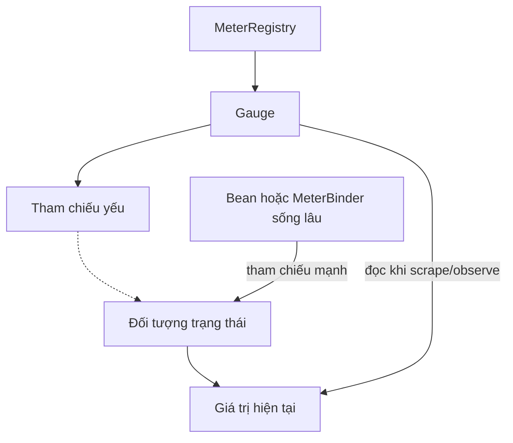

# Giữ tham chiếu cho Gauge được tạo trong binder

`MeterBinder` thường đăng ký các meter dùng để quan sát trạng thái của một thành phần trong ứng dụng. Với `Gauge`, chỉ đăng ký meter là chưa đủ: đối tượng mà gauge đọc giá trị phải còn sống trong bộ nhớ khi registry lấy số đo. Micrometer giữ tham chiếu yếu đến đối tượng nguồn của gauge để tránh việc registry vô tình kéo dài vòng đời của mọi đối tượng được đo.

Vì vậy, nếu tạo một đối tượng tạm ngay bên trong `bindTo(...)` rồi chỉ truyền đối tượng đó vào `Gauge.builder(...)`, đối tượng có thể bị garbage collector thu hồi sau khi phương thức kết thúc. Khi đó gauge thường trả về `NaN` vì không còn đối tượng để đọc. Cách đúng là giữ tham chiếu mạnh đến đối tượng nguồn trong một bean hoặc một thành phần có vòng đời dài, chẳng hạn field `final` của chính binder.

## Vì sao Gauge cần giữ đối tượng nguồn?

Gauge đọc một giá trị tại thời điểm được quan sát. Ví dụ, gauge có thể đọc độ dài hàng đợi, số kết nối đang mở hoặc số tác vụ đang chờ. Nó không tích lũy các lần cập nhật như `Counter` và không ghi nhận thời lượng của từng lần như `Timer`.

Khi đăng ký gauge, ứng dụng cung cấp:

- Tên meter và các tag.
- Đối tượng chứa trạng thái cần quan sát.
- Hàm đọc giá trị từ đối tượng đó.

Micrometer giữ hàm đọc và định danh meter, nhưng tham chiếu đến đối tượng nguồn thường là tham chiếu yếu. Thiết kế này có chủ đích: registry không nên giữ sống một cache, queue hoặc component chỉ vì một gauge đang quan sát nó.



Đối tượng nguồn phải được một chủ sở hữu khác giữ bằng tham chiếu mạnh. Chủ sở hữu đó có thể là service, component quản lý queue hoặc binder singleton do Spring quản lý. Nếu không còn bất kỳ tham chiếu mạnh nào đến đối tượng, garbage collector có thể thu hồi nó dù gauge vẫn còn trong registry.

## Điều gì xảy ra khi đối tượng nguồn bị thu hồi?

Khi đối tượng nguồn không còn tồn tại, gauge không thể gọi hàm đọc trên nó. Micrometer biểu diễn tình huống này bằng `NaN` thay vì coi giá trị là 0.

Điều này quan trọng khi đọc dashboard:

- `0` có nghĩa đối tượng vẫn tồn tại và hàm đọc trả về giá trị bằng không.
- `NaN` có thể cho biết đối tượng nguồn đã bị garbage collector thu hồi hoặc giá trị đo không hợp lệ.
- Không có chuỗi metric có thể do meter chưa được đăng ký, bị filter từ chối hoặc exporter/backend chưa thu thập.

Không diễn giải `NaN` thành một hàng đợi rỗng. Hãy kiểm tra vòng đời đối tượng nguồn và cách binder giữ tham chiếu.

## Ví dụ sai: chỉ tạo đối tượng cục bộ trong bindTo

Đoạn binder sau tạo `AtomicInteger` cục bộ rồi đăng ký gauge:

```java
import java.util.concurrent.atomic.AtomicInteger;

import io.micrometer.core.instrument.Gauge;
import io.micrometer.core.instrument.MeterRegistry;
import io.micrometer.core.instrument.binder.MeterBinder;

public class QueueMetrics implements MeterBinder {
    @Override
    public void bindTo(MeterRegistry registry) {
        AtomicInteger queueDepth = new AtomicInteger();

        Gauge.builder("worker.queue.depth", queueDepth, AtomicInteger::get)
                .description("Số tác vụ đang chờ xử lý")
                .register(registry);
    }
}
```

Sau khi `bindTo(...)` kết thúc, biến cục bộ `queueDepth` không còn là tham chiếu mạnh có thể truy cập từ binder. Gauge chỉ giữ tham chiếu yếu đến đối tượng nguồn, vì vậy đối tượng có thể bị thu hồi ở một lần GC sau đó. Lỗi có thể không xuất hiện ngay khi khởi động; dashboard có thể hiển thị giá trị bình thường trong một khoảng thời gian rồi chuyển thành `NaN`.

Giữ một field `Gauge` cũng không giải quyết vấn đề này. Tham chiếu đến meter không đồng nghĩa với tham chiếu mạnh đến đối tượng nguồn mà meter quan sát.

## Cách đúng: giữ nguồn trạng thái trong field của binder

Đưa đối tượng trạng thái thành field của binder. Binder giữ tham chiếu mạnh đến field đó trong suốt vòng đời của nó:

```java
import java.util.concurrent.atomic.AtomicInteger;

import io.micrometer.core.instrument.Gauge;
import io.micrometer.core.instrument.MeterRegistry;
import io.micrometer.core.instrument.binder.MeterBinder;

public class QueueMetrics implements MeterBinder {
    private final AtomicInteger queueDepth;

    public QueueMetrics(AtomicInteger queueDepth) {
        this.queueDepth = queueDepth;
    }

    @Override
    public void bindTo(MeterRegistry registry) {
        Gauge.builder("worker.queue.depth", queueDepth, AtomicInteger::get)
                .description("Số tác vụ đang chờ xử lý")
                .register(registry);
    }
}
```

Trong ví dụ, binder không tự tạo trạng thái mới trong `bindTo(...)`; nó nhận đối tượng từ chủ sở hữu bên ngoài và giữ trong field `final`. Khi registry đọc gauge, hàm `AtomicInteger::get` lấy giá trị hiện tại của đúng đối tượng đó.

Có thể để binder tự tạo và sở hữu trạng thái nếu trạng thái đó thực sự thuộc vòng đời binder:

```java
public class QueueMetrics implements MeterBinder {
    private final AtomicInteger queueDepth = new AtomicInteger();

    public void taskQueued() {
        queueDepth.incrementAndGet();
    }

    public void taskStarted() {
        queueDepth.updateAndGet(value -> Math.max(0, value - 1));
    }

    @Override
    public void bindTo(MeterRegistry registry) {
        Gauge.builder("worker.queue.depth", queueDepth, AtomicInteger::get)
                .description("Số tác vụ đang chờ xử lý")
                .register(registry);
    }
}
```

Trong trường hợp này, `queueDepth` được tạo một lần khi binder được khởi tạo và được giữ sống bằng field. Các phương thức cập nhật trạng thái và gauge cùng tham chiếu đến một bộ đếm. Ứng dụng phải gọi `taskQueued()` và `taskStarted()` tại đúng điểm thay đổi hàng đợi; gauge chỉ đọc giá trị, nó không tự tăng hoặc giảm.

Với queue thực tế, nên để thành phần sở hữu queue cập nhật trạng thái và binder đọc cùng trạng thái đó. Không duy trì hai biến độ dài queue độc lập nếu chúng có thể lệch nhau khi có nhiều luồng thêm hoặc lấy tác vụ.

## Quản lý binder bằng Spring Boot

Spring Boot Actuator tự cấu hình registry và phát hiện các bean triển khai `MeterBinder` để bind meter. Có thể khai báo binder như một bean Spring:

```java
import java.util.concurrent.atomic.AtomicInteger;

import org.springframework.context.annotation.Bean;
import org.springframework.context.annotation.Configuration;

@Configuration
public class QueueMetricsConfiguration {
    @Bean
    AtomicInteger queueDepthState() {
        return new AtomicInteger();
    }

    @Bean
    QueueMetrics queueMetrics(AtomicInteger queueDepthState) {
        return new QueueMetrics(queueDepthState);
    }
}
```

Spring quản lý vòng đời singleton của bean `QueueMetrics` và bean trạng thái. Binder giữ tham chiếu đến `queueDepthState`, nên đối tượng nguồn còn sống trong khi binder còn được container quản lý. Trong ứng dụng lớn, nên dùng một lớp trạng thái có tên theo nghiệp vụ thay vì dùng một `AtomicInteger` chung cho nhiều loại metric.

Nếu trạng thái đã thuộc một service hoặc component khác, binder có thể inject chính component đó:

Hai lớp dưới đây là hai class riêng trong cùng package; Spring quản lý chúng như hai bean singleton.

```java
import java.util.concurrent.atomic.AtomicInteger;

import io.micrometer.core.instrument.Gauge;
import io.micrometer.core.instrument.MeterRegistry;
import io.micrometer.core.instrument.binder.MeterBinder;
import org.springframework.stereotype.Component;

@Component
public class QueueState {
    private final AtomicInteger depth = new AtomicInteger();

    public int depth() {
        return depth.get();
    }

    public void queued() {
        depth.incrementAndGet();
    }

    public void started() {
        depth.updateAndGet(value -> Math.max(0, value - 1));
    }
}

@Component
public class QueueMetrics implements MeterBinder {
    private final QueueState queueState;

    public QueueMetrics(QueueState queueState) {
        this.queueState = queueState;
    }

    @Override
    public void bindTo(MeterRegistry registry) {
        Gauge.builder("worker.queue.depth", queueState, QueueState::depth)
                .register(registry);
    }
}
```

Trong ví dụ, `QueueMetrics` giữ tham chiếu mạnh đến `QueueState`; bản thân Spring cũng quản lý cả hai bean. `QueueState` là nguồn trạng thái duy nhất, còn binder chỉ đăng ký cách đọc. Cần bảo đảm logic cập nhật `queued()` và `started()` phản ánh đúng vòng đời queue, bao gồm cả trường hợp tác vụ bị hủy hoặc bị từ chối.

## Khi dùng registry độc lập

Nếu không dùng Spring Boot, ứng dụng tự tạo registry và gọi `bindTo(...)`. Hãy giữ binder hoặc đối tượng trạng thái trong một thành phần có vòng đời dài:

```java
SimpleMeterRegistry registry = new SimpleMeterRegistry();
AtomicInteger queueDepth = new AtomicInteger();
QueueMetrics queueMetrics = new QueueMetrics(queueDepth);

queueMetrics.bindTo(registry);

queueDepth.set(4);
double currentDepth = registry.get("worker.queue.depth")
        .gauge()
        .value();
```

Trong ví dụ, biến `queueMetrics` và `queueDepth` vẫn nằm trong phạm vi sống của ứng dụng. Nếu binder sở hữu field trạng thái, cần giữ chính binder sống. Nếu binder chỉ giữ tham chiếu đến đối tượng do service khác sở hữu, service đó phải giữ đối tượng nguồn sống trong suốt thời gian gauge cần đọc.

Khi ứng dụng đóng registry hoặc dừng component, cần quản lý vòng đời theo đúng thứ tự. Không xóa hoặc thay thế nguồn trạng thái trong khi registry vẫn tiếp tục scrape gauge đó.

## Giữ nguồn trạng thái an toàn khi nhiều luồng cập nhật

Giữ tham chiếu mạnh giải quyết vòng đời đối tượng, nhưng không tự bảo đảm giá trị được đọc an toàn khi có nhiều luồng. Nguồn trạng thái phải có cơ chế đồng bộ phù hợp:

- Dùng `AtomicInteger` hoặc `AtomicLong` cho các số đếm đơn giản cần đọc/cập nhật đồng thời.
- Dùng cấu trúc dữ liệu concurrent khi gauge cần đọc trạng thái của collection được cập nhật từ nhiều luồng.
- Tránh getter thực hiện phép tính nặng, khóa lâu hoặc I/O mỗi lần scrape.
- Đảm bảo phép cập nhật phản ánh đúng nghiệp vụ; ví dụ độ sâu queue không được giảm âm khi một tác vụ bị hủy hoặc không được đưa vào queue.

Gauge đọc một giá trị tại thời điểm lấy mẫu. Nó không bảo đảm snapshot nhất quán của nhiều field. Nếu cần quan sát một nhóm giá trị phải thay đổi nguyên tử cùng nhau, hãy cung cấp một snapshot bất biến hoặc một đối tượng trạng thái có cơ chế đồng bộ rõ ràng.

## Kiểm thử binder và vòng đời tham chiếu

Unit test nên xác nhận binder đăng ký gauge trỏ đến đúng đối tượng trạng thái, và giá trị thay đổi ở nguồn được phản ánh khi đọc gauge:

```java
import static org.assertj.core.api.Assertions.assertThat;

import java.util.concurrent.atomic.AtomicInteger;

import io.micrometer.core.instrument.Gauge;
import io.micrometer.core.instrument.simple.SimpleMeterRegistry;
import org.junit.jupiter.api.Test;

class QueueMetricsTest {
    @Test
    void gaugeReadsTheStateOwnedByBinder() {
        SimpleMeterRegistry registry = new SimpleMeterRegistry();
        AtomicInteger state = new AtomicInteger(2);
        QueueMetrics binder = new QueueMetrics(state);

        binder.bindTo(registry);

        Gauge gauge = registry.find("worker.queue.depth").gauge();
        assertThat(gauge).isNotNull();
        assertThat(gauge.value()).isEqualTo(2.0);

        state.set(5);
        assertThat(gauge.value()).isEqualTo(5.0);

        registry.close();
    }
}
```

Test giữ cả binder và nguồn trạng thái trong phạm vi phương thức. Nó xác nhận gauge đọc giá trị hiện tại từ đúng nguồn, thay vì chụp một giá trị cố định tại thời điểm bind. Có thể bổ sung test cho nhiều luồng cập nhật nếu trạng thái được dùng đồng thời.

Không nên viết test dựa vào việc gọi `System.gc()` rồi khẳng định đối tượng chắc chắn bị thu hồi. Garbage collector không bảo đảm chạy ngay hoặc thu hồi một đối tượng cụ thể theo yêu cầu. Thay vào đó, kiểm tra cấu trúc sở hữu: binder hoặc component sống lâu phải có field giữ nguồn; không có biến cục bộ duy nhất trong `bindTo(...)` làm chủ sở hữu.

## Các lỗi thường gặp

| Hiện tượng | Nguyên nhân thường gặp | Cách xử lý |
|---|---|---|
| Gauge chuyển thành `NaN` sau một thời gian | Đối tượng nguồn chỉ được tạo trong `bindTo(...)` và bị GC thu hồi | Giữ nguồn trong field của binder hoặc bean sở hữu |
| Đã giữ field `Gauge` nhưng vẫn thấy `NaN` | Giữ meter không đồng nghĩa giữ đối tượng nguồn | Giữ chính đối tượng được truyền vào `Gauge.builder(...)` |
| Gauge luôn bằng 0 | Nguồn còn sống nhưng code chưa cập nhật trạng thái | Kiểm tra các điểm thêm/lấy tác vụ hoặc thay đổi trạng thái |
| Giá trị gauge không đổi | Đọc nhầm đối tượng, dùng snapshot cố định hoặc cập nhật một instance khác | Xác nhận binder và nghiệp vụ dùng cùng đối tượng nguồn |
| Giá trị âm hoặc không hợp lý | Logic cập nhật trạng thái không cân bằng hoặc thiếu xử lý hủy/thất bại | Rà soát toàn bộ vòng đời thay đổi trạng thái |
| Giá trị đọc không ổn định khi có nhiều luồng | Nguồn không có cơ chế truy cập đồng thời phù hợp | Dùng atomic/concurrent state hoặc snapshot có đồng bộ |

## Checklist triển khai

- [ ] Xác định rõ đối tượng nguồn mà `Gauge.builder(...)` sẽ đọc.
- [ ] Đối tượng nguồn được giữ bằng tham chiếu mạnh trong bean hoặc component sống lâu.
- [ ] Binder không chỉ tạo đối tượng cục bộ rồi trả về sau `bindTo(...)`.
- [ ] Không nhầm việc giữ tham chiếu đến `Gauge` với việc giữ tham chiếu đến nguồn trạng thái.
- [ ] Binder và logic nghiệp vụ cùng dùng một đối tượng nguồn.
- [ ] Getter của gauge nhanh, không có side effect và an toàn khi được gọi đồng thời.
- [ ] Đã xử lý đầy đủ các nhánh cập nhật, hủy và thất bại của trạng thái.
- [ ] Unit test xác nhận gauge phản ánh thay đổi ở nguồn sau khi bind.
- [ ] Đã phân biệt giá trị `0`, `NaN` và metric không xuất hiện khi chẩn đoán.

Gauge chỉ có thể phản ánh trạng thái nếu đối tượng nguồn còn tồn tại khi registry đọc nó. Hãy để một bean hoặc binder có vòng đời dài sở hữu tham chiếu mạnh đến nguồn, còn gauge giữ vai trò đọc giá trị hiện tại. Thiết kế này giúp tránh `NaN` do garbage collection và giữ instrumentation gắn với đúng trạng thái mà ứng dụng đang quản lý.
