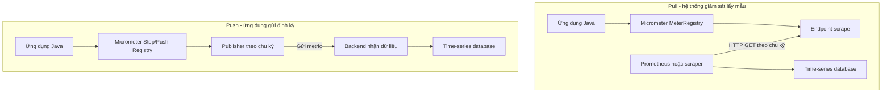

# Phân biệt registry lấy mẫu chủ động với registry gửi dữ liệu định kỳ

Micrometer cung cấp API instrumentation thống nhất, nhưng cách dữ liệu rời khỏi ứng dụng phụ thuộc vào loại registry và backend. Với mô hình **pull**, hệ thống giám sát chủ động gọi endpoint của ứng dụng để lấy số đo theo chu kỳ scrape. Với mô hình **push**, ứng dụng hoặc registry chủ động gửi số đo đến backend theo một lịch xuất dữ liệu, thường được cấu hình bằng một khoảng thời gian step.

Hai mô hình khác nhau về hướng kết nối, thời điểm thu thập, cách xử lý khi mất kết nối và ngữ nghĩa của số liệu theo thời gian. Hiểu rõ khác biệt này giúp chọn đúng registry, đặt chu kỳ phù hợp và tránh tính tốc độ sai từ dữ liệu đã được tổng hợp theo từng khoảng.

## Hai luồng thu thập dữ liệu

Trong cả hai mô hình, mã nghiệp vụ vẫn ghi nhận số đo qua `Counter`, `Timer`, `Gauge` hoặc `DistributionSummary`. Khác biệt nằm ở cách registry cung cấp dữ liệu cho hệ thống giám sát.



### Pull: backend chủ động scrape

Ứng dụng mở một endpoint chứa metric. Prometheus hoặc một scraper tương thích định kỳ gửi HTTP request đến endpoint đó, đọc toàn bộ số đo được registry cung cấp rồi lưu thành các chuỗi thời gian.

Trong mô hình này:

- Ứng dụng không cần biết chính xác thời điểm scraper sẽ gọi endpoint.
- Backend kiểm soát danh sách target, chu kỳ scrape và timeout.
- Registry cung cấp giá trị hiện tại của meter khi endpoint được đọc.
- Nếu một lần scrape thất bại, backend thường ghi nhận trạng thái scrape lỗi hoặc bỏ lỡ mẫu ở thời điểm đó; lần scrape tiếp theo có thể lấy được dữ liệu mới.

Prometheus là ví dụ phổ biến của mô hình pull. Với Spring Boot Actuator và Prometheus registry, endpoint thường dùng là `/actuator/prometheus`.

### Push: ứng dụng chủ động gửi metric

Với registry kiểu push, ứng dụng giữ cấu hình kết nối đến backend và publisher gửi metric theo lịch. Nhiều registry push của Micrometer sử dụng cơ chế step: số liệu được tổng hợp trong một khoảng, sau đó được xuất khi khoảng đó kết thúc hoặc theo chu kỳ publisher.

Trong mô hình này:

- Ứng dụng chủ động mở kết nối ra hệ thống nhận dữ liệu.
- Chu kỳ xuất thường do cấu hình registry quyết định.
- Backend không cần scrape trực tiếp từng instance của ứng dụng.
- Khi gửi thất bại, việc retry, buffering, bỏ mẫu hoặc phục hồi dữ liệu phụ thuộc registry và backend cụ thể.

Các registry gửi dữ liệu đến dịch vụ giám sát như Datadog hoặc một hệ thống nhận OTLP có thể hoạt động theo mô hình push. Hãy kiểm tra tài liệu registry tương ứng để biết dữ liệu được gửi theo step, theo batch hay theo cơ chế khác.

Không phải mọi `MeterRegistry` đều thuộc một trong hai mô hình. `SimpleMeterRegistry` chỉ giữ số liệu trong bộ nhớ của tiến trình, không mở endpoint scrape và cũng không tự gửi dữ liệu đến backend. Nó hữu ích cho unit test hoặc ví dụ độc lập. `CompositeMeterRegistry` cũng không tự quyết định pull hay push; nó chuyển tiếp meter đến các registry con, và mỗi registry con giữ cơ chế xuất riêng.

## Phân biệt thời điểm ghi nhận và thời điểm thu thập

Instrumentation ghi nhận sự kiện khi nghiệp vụ xảy ra. Việc scrape hoặc push chỉ quyết định lúc số liệu được chuyển đến hệ thống giám sát.

Ví dụ, một request hoàn tất ở giây thứ 7:

| Thời điểm | Sự kiện |
|---:|---|
| 0 giây | Bắt đầu một khoảng quan sát |
| 7 giây | Request hoàn tất; `Timer` ghi nhận count và duration |
| 15 giây | Scraper pull lấy mẫu endpoint |
| 30 giây | Publisher push kết thúc step 0–30 giây và gửi dữ liệu của step đó |
| 45 giây | Lần scrape tiếp theo nếu chu kỳ pull là 30 giây tính từ giây 15 |

Trong ví dụ, sự kiện được ghi nhận ở giây 7 nhưng dữ liệu chỉ đến backend khi có lần thu thập phù hợp. Với pull, thời điểm lấy mẫu phụ thuộc lịch scraper. Với push theo step, publisher thường gửi số liệu đã tổng hợp khi step kết thúc. Thời điểm backend nhận và lưu dữ liệu còn có thể muộn hơn do mạng và xử lý ingest.

Không nên dùng thời điểm backend nhận dữ liệu để suy ra chính xác thời điểm nghiệp vụ xảy ra. Metric là dữ liệu tổng hợp theo ngữ nghĩa của meter và registry; khi cần điều tra một sự kiện cụ thể, log hoặc trace có timestamp và ID tương quan phù hợp hơn.

## Counter trong mô hình pull và push

Với registry pull như Prometheus, counter thường được xuất dưới dạng giá trị tích lũy tăng dần trong vòng đời tiến trình. Backend lưu các điểm theo thời gian và có thể tính tốc độ hoặc số lượng tăng trong cửa sổ:

```promql
sum by (service) (
  rate(http_server_requests_seconds_count[5m])
)
```

Truy vấn trên minh họa cách tính request mỗi giây từ chuỗi count của Timer theo cửa sổ 5 phút. Tên metric thực tế phụ thuộc tên meter, đơn vị và quy tắc chuẩn hóa của Prometheus registry.

Với registry push kiểu step, một số implementation xuất số liệu đã tổng hợp trong từng step. Counter có thể được biểu diễn dưới dạng số tăng trong step hoặc tốc độ đã chuẩn hóa, tùy registry và backend. Không được mặc định mọi push registry đều xuất cùng một dạng dữ liệu.

Trước khi viết truy vấn hoặc dashboard, xác định backend đang nhận:

- Giá trị counter tích lũy từ lúc tiến trình khởi động.
- Delta của counter trong một step.
- Rate đã được registry tính theo đơn vị thời gian.

Nếu dữ liệu đã là delta hoặc rate, áp dụng thêm phép `rate()` như với counter tích lũy có thể làm kết quả sai. Ngữ nghĩa chính xác phải lấy từ tài liệu exporter và kiểm tra trên metric thực tế.

## Timer và phân phối thời lượng

`Timer` ghi nhận số lần thực hiện và tổng thời gian, cùng histogram hoặc percentile nếu được cấu hình. Với registry pull có định dạng Prometheus, count và sum thường là các chuỗi tích lũy. Prometheus có thể dùng `rate()` để tính throughput và thời gian trung bình trong cửa sổ.

```promql
sum by (service) (
  rate(http_server_requests_seconds_sum[5m])
)
/
sum by (service) (
  rate(http_server_requests_seconds_count[5m])
)
```

Với registry push theo step, dữ liệu có thể được tổng hợp và gửi theo khoảng. Một số backend nhận count, sum hoặc percentile theo từng step; cách tính mean hoặc percentile phải phù hợp với loại giá trị được xuất. Đừng cộng các giá trị trung bình của từng instance nếu cần trung bình toàn dịch vụ; hãy dùng tổng thời gian và tổng số lần khi backend cung cấp hai đại lượng đó.

Percentile phía client được tính riêng trong từng tiến trình. Không thể lấy trung bình p95 của các instance để tạo p95 toàn cụm. Nếu cần percentile có thể gộp, hãy xuất histogram bucket tương thích và để backend tổng hợp theo đúng định dạng mà registry hỗ trợ.

## Gauge và giới hạn của lấy mẫu định kỳ

Gauge phản ánh trạng thái tại thời điểm đọc, chẳng hạn độ dài queue, số kết nối đang mở hoặc bộ nhớ đang sử dụng. Cả pull và push theo chu kỳ đều có thể bỏ lỡ một biến động ngắn xảy ra giữa hai lần thu thập.

Ví dụ, queue tăng từ 0 lên 100 rồi trở về 0 trong vòng 3 giây, trong khi scraper lấy mẫu mỗi 15 giây. Nếu không có lần scrape nào rơi vào khoảng queue đang cao, backend có thể chỉ thấy giá trị 0. Với push theo step, nếu registry chỉ xuất giá trị gauge tại thời điểm publisher đọc nó, biến động ngắn cũng có thể không xuất hiện.

Nếu cần biết mọi lần sự kiện xảy ra, hãy dùng counter hoặc timer phù hợp thay vì dựa vào gauge. Nếu cần quan sát số tác vụ còn chạy giữa các lần scrape, có thể dùng `LongTaskTimer` và chọn chu kỳ lấy mẫu đủ phù hợp; tuy nhiên một tác vụ bắt đầu và kết thúc giữa hai lần scrape vẫn có thể không được nhìn thấy ở trạng thái active.

## Cấu hình pull với Spring Boot và Prometheus

Một ứng dụng Spring Boot thường cần Actuator và Prometheus registry:

```kotlin
dependencies {
    implementation("org.springframework.boot:spring-boot-starter-actuator")
    runtimeOnly("io.micrometer:micrometer-registry-prometheus")
}
```

Ví dụ `application.properties` để expose endpoint Prometheus:

```properties
management.endpoints.web.exposure.include=health,prometheus
```

Sau khi ứng dụng chạy, scraper truy cập endpoint:

```text
GET /actuator/prometheus
```

Phía Prometheus cấu hình target và chu kỳ scrape, ví dụ:

```yaml
scrape_configs:
  - job_name: checkout-service
    scrape_interval: 15s
    metrics_path: /actuator/prometheus
    static_configs:
      - targets:
          - checkout-1:8080
          - checkout-2:8080
```

`scrape_interval` thuộc cấu hình Prometheus, không phải cấu hình `MeterRegistry`. `metrics_path` cần khớp với management base path và endpoint thực tế của ứng dụng. Trong môi trường triển khai thật, cần bảo vệ endpoint bằng mạng nội bộ, xác thực hoặc chính sách truy cập phù hợp; không expose metric công khai chỉ để tiện scrape.

## Cấu hình push registry theo step

Với push registry, dependency và cấu hình phụ thuộc backend. Spring Boot thường auto-configure registry khi implementation tương ứng có trên classpath và cấu hình export được bật. Các thuộc tính như endpoint, API key, step và timeout có tên riêng theo từng backend và phiên bản Spring Boot/Micrometer.

Ví dụ cấu hình minh họa cho một registry push có step 30 giây:

```yaml
management:
  metrics:
    export:
      example-backend:
        enabled: true
        step: 30s
        # endpoint và thông tin xác thực dùng thuộc tính riêng của registry
```

`example-backend` là chỗ giữ chỗ, không phải tên property có thể dùng nguyên văn. Hãy thay bằng prefix cấu hình thực tế của registry được chọn và tra metadata cấu hình tương ứng. Không ghi API key trực tiếp vào file cấu hình được commit; lấy từ biến môi trường hoặc secret store.

Nếu tạo registry độc lập bằng Java, cần quản lý vòng đời publisher và scheduler đúng cách. Khi ứng dụng dừng, cho registry thời gian hoàn tất việc gửi dữ liệu cuối nếu implementation hỗ trợ shutdown/close; không giả định mọi registry đều tự flush toàn bộ số liệu chưa gửi.

## Chọn chu kỳ scrape hoặc step

Chu kỳ thu thập ảnh hưởng độ trễ hiển thị, độ phân giải biểu đồ, lượng dữ liệu và chi phí hệ thống.

| Chu kỳ | Ưu điểm | Đánh đổi |
|---|---|---|
| Ngắn, ví dụ 5 giây | Phát hiện biến động nhanh hơn | Tăng số lần scrape hoặc push, tải mạng và lượng mẫu |
| Trung bình, ví dụ 15–30 giây | Cân bằng độ trễ và chi phí cho nhiều hệ thống | Có thể bỏ lỡ biến động ngắn hơn chu kỳ |
| Dài, ví dụ 1–5 phút | Giảm tần suất gửi và lượng mẫu | Dashboard, cảnh báo phản ứng chậm; chi tiết biến động bị làm mờ |

Khi chọn chu kỳ, hãy cân nhắc:

1. Mức nhanh mà đội vận hành cần phát hiện sự cố.
2. Số instance và số metric/tag mà mỗi lần thu thập phải xử lý.
3. Backend cần dữ liệu theo step hay cần mẫu chi tiết hơn.
4. Thời gian giữ dữ liệu và chi phí ingest.
5. Cửa sổ truy vấn và thời gian đánh giá cảnh báo.

Chu kỳ scrape và step của registry không nhất thiết phải bằng nhau. Với pull, backend điều khiển scrape interval. Với push, registry điều khiển step hoặc lịch gửi. Nếu hai khoảng này không đồng bộ, có thể xuất hiện độ trễ hoặc cửa sổ dữ liệu khó đối chiếu; cần hiểu cách backend đóng dấu thời gian và tổng hợp mẫu.

## Điều gì xảy ra khi thu thập thất bại?

### Pull thất bại

Nếu scraper không kết nối được endpoint, mẫu ở lần scrape đó bị thiếu và trạng thái scrape có thể báo lỗi. Ứng dụng vẫn có thể tiếp tục ghi nhận meter; lần scrape sau sẽ lấy giá trị hiện tại. Với counter tích lũy, backend thường vẫn có thể tính mức tăng qua khoảng bị gián đoạn nếu có mẫu trước và sau, nhưng không thể tái tạo chính xác diễn biến bên trong khoảng trống.

### Push thất bại

Nếu publisher không gửi được dữ liệu, kết quả phụ thuộc registry: có thể retry, giữ batch, bỏ dữ liệu của step hoặc báo lỗi. Không nên giả định mọi push registry đều có durable queue. Hãy kiểm tra log, metric sức khỏe exporter, retry policy, timeout và hành vi shutdown của implementation.

Với push, cần đặc biệt quan tâm backpressure. Nếu backend chậm hoặc không sẵn sàng trong thời gian dài, việc retry hoặc buffer không giới hạn có thể ảnh hưởng bộ nhớ và luồng ứng dụng. Registry nên có giới hạn và chính sách gửi phù hợp với mức độ quan trọng của metric.

## Chọn pull hay push?

| Tiêu chí | Pull | Push |
|---|---|---|
| Hướng kết nối | Backend kết nối vào ứng dụng | Ứng dụng kết nối ra backend |
| Ai quản lý chu kỳ? | Scraper/backend | Registry hoặc publisher của ứng dụng |
| Khả năng phát hiện target | Backend thường quản lý service discovery và target health | Ứng dụng cần biết endpoint đích và trạng thái gửi |
| Mạng | Backend phải truy cập được endpoint của ứng dụng | Ứng dụng cần outbound access đến backend |
| Khi thu thập lỗi | Mất mẫu scrape; lần sau có thể lấy giá trị mới | Retry/buffer/drop tùy implementation |
| Ngữ nghĩa dữ liệu | Thường là giá trị tích lũy được scrape | Có thể là dữ liệu theo step hoặc batch; phụ thuộc registry |
| Tình huống thường gặp | Prometheus scrape ứng dụng trong mạng có thể truy cập | Ứng dụng gửi đến dịch vụ giám sát tập trung hoặc môi trường khó scrape |

Không có mô hình nào luôn tốt hơn. Pull thuận tiện khi backend có thể khám phá và truy cập các instance, đồng thời cần kiểm soát target health từ phía scraper. Push hữu ích khi ứng dụng chỉ có outbound connectivity hoặc backend cung cấp API nhận metric định kỳ. Một hệ thống có thể dùng nhiều registry cho các backend khác nhau, nhưng cần tính đến chi phí, cardinality và việc cùng một sự kiện có thể xuất hiện ở nhiều nơi.

## Kiểm thử đường đi của metric

Unit test với `SimpleMeterRegistry` có thể xác nhận mã nghiệp vụ gọi `increment()` hoặc `record(...)` đúng lúc. Tuy nhiên, nó không kiểm tra scrape endpoint, lịch step, giao thức gửi hoặc backend ingest.

Với pull, kiểm thử tích hợp nên:

1. Khởi động ứng dụng cùng Prometheus registry.
2. Gọi endpoint nghiệp vụ để tạo metric.
3. Đọc `/actuator/prometheus` và xác nhận tên, tag, đơn vị, count hoặc bucket.
4. Kiểm tra Prometheus có scrape target thành công và truy vấn nhìn thấy chuỗi tương ứng.

Với push, kiểm thử tích hợp nên:

1. Dùng backend thử nghiệm hoặc HTTP receiver giả lập theo giao thức exporter.
2. Ghi nhận một số sự kiện vào meter.
3. Chờ hoặc kích hoạt chu kỳ publish theo khả năng của registry.
4. Xác nhận payload, timestamp, đơn vị và tag được gửi đúng.
5. Mô phỏng backend tạm ngừng để quan sát retry, timeout, buffering hoặc drop.

Không dùng thời gian `Thread.sleep(...)` ngắn cố định để khẳng định publisher đã chạy; hãy dùng cấu hình step có thể kiểm soát, latch hoặc receiver ghi nhận request và timeout rõ ràng. Test cần đóng registry và executor sau khi hoàn tất để tránh tác vụ nền còn chạy.

## Những lỗi thường gặp

| Hiện tượng | Nguyên nhân thường gặp | Cách xử lý |
|---|---|---|
| Pull endpoint có metric nhưng backend không thấy | Target sai, endpoint chưa expose, scrape lỗi hoặc bị chặn mạng | Kiểm tra target health, path, port, auth và log scrape |
| Push registry không gửi ngay sau `increment()` | Dữ liệu được xuất theo step hoặc lịch batch | Kiểm tra step, publisher schedule và ngữ nghĩa registry |
| Tốc độ counter sai | Áp dụng `rate()` cho dữ liệu vốn đã là delta/rate hoặc hiểu sai kiểu metric | Xác định temporality của exporter trước khi viết query |
| Gauge bỏ lỡ spike ngắn | Biến động xảy ra giữa hai lần lấy mẫu | Giảm chu kỳ nếu cần hoặc dùng metric sự kiện phù hợp |
| Dữ liệu push bị thiếu khi backend gián đoạn | Registry không buffer bền vững hoặc retry đã hết | Kiểm tra chính sách retry, queue, log và metric sức khỏe exporter |
| Dashboard có độ trễ cao | Chu kỳ scrape/step dài hoặc backend ingest chậm | Đo riêng thời gian thu thập và ingest, điều chỉnh chu kỳ phù hợp |
| Dữ liệu giữa các backend khác nhau | Khác đơn vị, step, filter, timestamp hoặc cách tổng hợp | So sánh exposition, cấu hình và ngữ nghĩa metric từng registry |

## Checklist triển khai

- [ ] Đã xác định registry đang dùng pull, push hay cơ chế khác.
- [ ] Biết thành phần nào điều khiển chu kỳ: scraper hay publisher.
- [ ] Đã xác định metric được xuất dưới dạng cumulative, delta hay rate.
- [ ] Đã phân biệt thời điểm nghiệp vụ ghi nhận với thời điểm backend thu thập.
- [ ] Endpoint pull được bảo vệ và scraper truy cập được.
- [ ] Push registry có endpoint, xác thực, timeout và step phù hợp.
- [ ] Đã xem xét retry, buffering, backpressure và shutdown.
- [ ] Chu kỳ thu thập phù hợp với độ trễ cảnh báo và chi phí ingest.
- [ ] Đã kiểm thử đường đi dữ liệu ở mức exporter/backend, không chỉ unit test meter.
- [ ] Tag và histogram được kiểm soát để tránh cardinality quá lớn.

Pull và push khác nhau chủ yếu ở bên khởi tạo việc chuyển dữ liệu và cách chu kỳ thu thập được quản lý. Pull để backend scrape giá trị registry tại thời điểm lấy mẫu; push để ứng dụng gửi dữ liệu theo lịch của registry, thường qua các step hoặc batch. Trước khi phân tích tốc độ, trung bình hay percentile, hãy xác định chính xác dạng dữ liệu mà exporter gửi để truy vấn phù hợp với ngữ nghĩa của backend.
