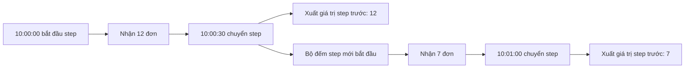

# StepMeterRegistry và việc chuyển cửa sổ thống kê

Trong module `OBSERVABILITY_INSTRUMENTATION_MICROMETER`, `MeterRegistry` quản lý các meter và kết nối chúng với hệ thống giám sát. Mỗi loại registry có cách thu thập và xuất số liệu riêng. `StepMeterRegistry` là nền tảng cho các registry theo chu kỳ (*step-based registry*): những thống kê tích lũy như counter, số lần ghi nhận và tổng thời gian được gom theo từng cửa sổ thời gian, sau đó xuất theo nhịp đã cấu hình.

Điều này khác với registry kiểu cumulative như Prometheus, nơi counter thường tiếp tục tăng từ lúc tiến trình khởi động và backend dùng `rate()` hoặc `increase()` để tính tốc độ trong một khoảng truy vấn. Với step registry, giá trị được xuất thường biểu diễn phần phát sinh trong step vừa hoàn tất. Hiểu đúng thời điểm chuyển cửa sổ giúp tránh đọc nhầm số liệu, chọn sai truy vấn và chẩn đoán sai khi một lần publish bị trễ.

## 1. StepMeterRegistry là gì?

`StepMeterRegistry` là lớp nền của Micrometer dành cho các registry xuất số liệu theo chu kỳ. Một registry cụ thể kế thừa cơ chế này và triển khai cách gửi dữ liệu đến backend tương ứng. Khoảng thời gian giữa các lần chuyển step được gọi là *step duration*.

Ví dụ, nếu step là 30 giây, registry chia thời gian thành các cửa sổ liên tiếp:

- 10:00:00–10:00:30
- 10:00:30–10:01:00
- 10:01:00–10:01:30

Các meter step-based tích lũy sự kiện trong cửa sổ hiện tại. Khi cửa sổ chuyển, số liệu của cửa sổ đã hoàn tất được dùng cho lần xuất tiếp theo, còn bộ tích lũy bắt đầu nhận sự kiện cho cửa sổ mới.

`StepMeterRegistry` là lớp nền, không phải tên một backend mà ứng dụng thường khởi tạo trực tiếp. Trong thực tế, ứng dụng sử dụng registry cụ thể như Datadog hoặc một backend khác có implementation dựa trên step registry. Registry cụ thể quyết định định dạng, giao thức, retry và cách ánh xạ từng meter.

## 2. Hình dung việc chuyển cửa sổ

Giả sử ứng dụng ghi nhận counter `orders.accepted` với step 30 giây:



Trong ví dụ này, backend nhận các giá trị theo cửa sổ là 12 và 7. Giá trị 7 không phải tổng số đơn kể từ lúc ứng dụng khởi động; nó là số đơn được ghi nhận trong step tương ứng. Tổng cộng hai cửa sổ có 19 đơn, nhưng step registry không nhất thiết xuất một counter cumulative bằng 19.

Thời điểm chính xác mà dữ liệu được quan sát phụ thuộc đồng hồ, lịch publish và implementation của registry. Khi kiểm tra số liệu sát ranh giới step, cần tính đến độ trễ lập lịch và thời gian truyền dữ liệu tới backend.

## 3. Bộ tích lũy được luân phiên như thế nào?

Về mặt khái niệm, một meter step-based cần giữ phần dữ liệu đang được cập nhật và phần dữ liệu của cửa sổ vừa hoàn tất. Khi chuyển step, hai vai trò này được luân phiên:

1. Request và worker tiếp tục ghi nhận vào bộ tích lũy của step hiện tại.
2. Đến ranh giới step, registry chốt phần dữ liệu đã tích lũy.
3. Phần dữ liệu đã chốt được đọc để publish.
4. Bộ tích lũy mới tiếp tục nhận các sự kiện của step kế tiếp.

Việc luân phiên cho phép luồng ứng dụng tiếp tục cập nhật meter trong khi registry chuẩn bị xuất số liệu. Chi tiết đồng bộ và thời điểm đọc thuộc implementation của Micrometer và registry cụ thể; ứng dụng chỉ nên ghi nhận thông qua API meter như `increment()` hoặc `record(...)`.

Ví dụ instrumentation không cần tự quản lý step:

```java
@Component
public class OrderMetrics {
    private final Counter accepted;
    private final Timer processing;

    public OrderMetrics(MeterRegistry registry) {
        this.accepted = registry.counter("orders.accepted");
        this.processing = registry.timer("orders.processing");
    }

    public void orderAccepted() {
        accepted.increment();
    }

    public void process(Runnable operation) {
        processing.record(operation);
    }
}
```

Code nghiệp vụ vẫn ghi nhận qua API Micrometer. Registry quyết định việc lưu số liệu theo cửa sổ và thời điểm xuất. Không tự reset counter trong code để mô phỏng step; làm vậy sẽ tạo race condition và phá vỡ ý nghĩa meter.

## 4. Cấu hình step duration

Step duration xác định độ dài cửa sổ thống kê và thường cũng là nhịp xuất dữ liệu của registry. Một step ngắn giúp số liệu phản ánh thay đổi nhanh hơn, nhưng làm tăng tần suất publish và chi phí giao tiếp. Một step dài giảm tần suất gửi nhưng làm dữ liệu bị gom trong khoảng thời gian dài hơn.

Ví dụ cấu hình step cho Datadog registry trong Spring Boot 3.x:

```yaml
management:
  datadog:
    metrics:
      export:
        step: 30s
```

Ở các phiên bản Spring Boot cũ, prefix cấu hình có thể khác. Hãy đối chiếu metadata cấu hình của đúng phiên bản Spring Boot và registry trong dự án; không phải mọi registry đều dựa trên `StepMeterRegistry` hoặc dùng cùng thuộc tính cấu hình.

Khi chọn step, cân nhắc:

- **Độ trễ quan sát:** step ngắn đưa số liệu mới đến backend sớm hơn.
- **Lưu lượng xuất:** step ngắn tạo nhiều lần publish hơn.
- **Chi phí backend:** nhiều lần gửi và nhiều series có thể tăng tải ingest.
- **Độ phân giải dashboard:** step cần phù hợp với chu kỳ truy vấn và cách backend lưu dữ liệu.
- **Tính chất tải:** workload burst ngắn có thể bị làm mờ khi step quá dài.

Không nên chọn step chỉ dựa trên mong muốn dashboard cập nhật nhanh. Cần cân bằng tần suất thu thập, tần suất publish và khả năng tiếp nhận của backend.

## 5. Step-based và cumulative registry khác nhau ra sao?

Hai kiểu registry có thể dùng cùng API `Counter` hoặc `Timer`, nhưng ý nghĩa của giá trị được xuất khác nhau.

| Khía cạnh | Step-based registry | Cumulative registry |
| --- | --- | --- |
| Counter được xuất | Số tăng trong step đã hoàn tất | Tổng tăng từ khi meter/tiến trình bắt đầu |
| Timer count và total time | Thống kê của step theo implementation | Thống kê tích lũy từ khi meter bắt đầu |
| Chuyển cửa sổ | Registry luân phiên bộ tích lũy theo step | Backend chọn cửa sổ bằng truy vấn trên chuỗi tích lũy |
| Nhịp xuất | Thường theo chu kỳ publish của registry | Thường scrape theo chu kỳ của backend như Prometheus |
| Tính tốc độ | Có thể backend nhận delta hoặc rate theo step | Thường dùng `rate()` hoặc `increase()` trên counter cumulative |

Không thể nhìn một con số counter mà bỏ qua loại registry rồi kết luận nó là tổng từ lúc khởi động. Hãy xác định registry đang dùng và semantics của metric do registry đó xuất.

Với cumulative counter, Prometheus thường dùng:

```promql
rate(orders_accepted_total[5m])
```

Với step registry, dữ liệu có thể đã là số tăng theo từng cửa sổ hoặc được backend diễn giải thành rate. Không áp dụng máy móc `rate()` lên một metric vốn đã là delta mỗi step; cần dùng loại truy vấn đúng với kiểu dữ liệu backend nhận được.

## 6. Timer và DistributionSummary qua ranh giới step

Các meter phân phối cũng chịu ảnh hưởng của cửa sổ step. Với một `Timer`, các lần hoàn tất trong step đóng góp vào count và tổng thời gian của step. Với `DistributionSummary`, các giá trị được ghi nhận trong step đóng góp vào count và tổng amount của step.

Ví dụ, một timer nhận 4 lần thực thi trong step hiện tại với tổng thời gian 2 giây. Sau khi step hoàn tất, registry step-based có thể xuất count 4 và total time 2 giây cho cửa sổ đó. Ở step tiếp theo, bộ tích lũy mới bắt đầu ghi nhận các lần thực thi tiếp theo.

Các phép đo như max, percentile và histogram còn phụ thuộc cấu hình thống kê phân phối cùng implementation của registry. Không giả định tất cả phép đo đều reset chính xác cùng thời điểm hoặc có cùng cửa sổ nội bộ chỉ vì registry có một step duration. Đặc biệt, các thống kê kiểu time-window max có thể có expiry và buffer riêng.

Nếu dashboard cần trung bình thời lượng trong một step, có thể tính từ tổng thời gian chia cho count của cùng cửa sổ, nếu backend xuất hai giá trị theo semantics step. Không chia tổng thời gian của step này cho count cumulative của toàn tiến trình hoặc ngược lại.

## 7. Gauge không phải counter theo step

`Gauge` phản ánh trạng thái hiện tại tại thời điểm registry lấy mẫu, ví dụ độ dài queue hoặc số kết nối đang mở. Nó không phải một bộ tích lũy sự kiện để luân phiên như counter step-based.

```java
AtomicInteger queueDepth = new AtomicInteger();

Gauge.builder("orders.queue.depth", queueDepth, AtomicInteger::get)
    .register(registry);
```

Khi registry publish, gauge đọc giá trị hiện tại từ `queueDepth`. Nếu queue tăng từ 3 lên 8 rồi giảm còn 5 trong cùng step, gauge thường phản ánh snapshot tại lúc đọc, không phải tổng các thay đổi 3, 8 và 5.

Điều này tạo ra khác biệt quan trọng:

- Counter step-based cho biết số sự kiện trong cửa sổ.
- Gauge cho biết trạng thái ở thời điểm thu thập.
- Timer/DistributionSummary step-based ghi nhận phân phối của các quan sát thuộc cửa sổ theo implementation.

Không dùng gauge để tính số sự kiện phát sinh trong step. Nếu cần số lần enqueue và dequeue, tạo counter riêng cho từng sự kiện; nếu cần độ sâu queue hiện tại, dùng gauge.

## 8. Đồng hồ và ranh giới step

Step registry cần một nguồn thời gian để xác định cửa sổ hiện tại và lúc chuyển step. Micrometer trừu tượng hóa nguồn này qua `Clock`; các implementation step-based dùng đồng hồ đó để tính toán thời điểm chuyển cửa sổ.

Trong vận hành, hãy phân biệt:

- **Step duration:** độ dài cửa sổ thống kê.
- **Publish schedule:** lịch chạy tác vụ gửi dữ liệu.
- **Backend ingestion time:** thời điểm backend nhận và lưu dữ liệu.
- **Dashboard query window:** khoảng thời gian mà dashboard truy vấn.

Các mốc này liên quan nhưng không nhất thiết trùng nhau. Một điểm dữ liệu có thể đại diện cho step vừa kết thúc nhưng chỉ xuất hiện trên dashboard sau một khoảng trễ do scheduler, mạng hoặc ingest.

Nếu nhiều instance khởi động ở thời điểm khác nhau, cách căn chỉnh step phụ thuộc clock và implementation registry. Không tự giả định mọi instance cùng có ranh giới cửa sổ giống nhau. Khi tổng hợp, cần hiểu backend xử lý timestamp và step value như thế nào.

## 9. Publish bị trễ hoặc thất bại

Step registry thường gửi dữ liệu theo chu kỳ, nên lỗi publish có thể ảnh hưởng tới tính liên tục của số liệu. Hành vi khi gửi thất bại phụ thuộc registry cụ thể: có implementation retry, có implementation ghi log lỗi, và chính sách giữ hoặc bỏ dữ liệu đã chốt cũng có thể khác nhau.

Không giả định mọi step thất bại sẽ tự động được phát lại hoặc backend sẽ nhận đúng một lần. Khi chọn registry, hãy kiểm tra:

- Cách implementation xử lý lỗi kết nối và mã phản hồi từ backend.
- Có retry hay không, retry có thể gửi trùng không.
- Dữ liệu step đang chờ được giữ trong bộ nhớ hay bị loại bỏ sau lần publish.
- Có metric/log riêng để quan sát lỗi publish và thời gian publish không.
- Shutdown có flush dữ liệu cuối cùng hay chỉ dừng scheduler.

Khi backend mất kết nối, ứng dụng vẫn có thể tiếp tục xử lý request và ghi nhận meter trong bộ nhớ. Tuy nhiên, khả năng dữ liệu của các step bị ảnh hưởng phụ thuộc registry. Metrics là dữ liệu quan sát, không nên dùng làm nguồn giao dịch bền vững.

## 10. Kiểm thử chuyển cửa sổ bằng clock có thể điều khiển

Kiểm thử step boundary bằng `Thread.sleep()` thường không ổn định vì phụ thuộc lịch CPU và thời gian thực. Cách tốt hơn là dùng clock giả hoặc clock có thể tiến thời gian trong test registry để điều khiển chính xác thời điểm chuyển step.

Một kịch bản kiểm thử nên xác minh:

1. Tạo registry với step ngắn trong test và clock giả.
2. Ghi một số sự kiện trong step đầu.
3. Đọc giá trị trước ranh giới để xác nhận cách registry cung cấp dữ liệu đang hoạt động.
4. Tiến clock qua ranh giới step và kích hoạt cơ chế publish/đọc theo API của implementation test.
5. Xác minh giá trị của step vừa hoàn tất được xuất đúng.
6. Ghi sự kiện vào step kế tiếp và xác nhận chúng được tính vào cửa sổ mới.

Vì `StepMeterRegistry` là lớp nền và `publish()` thuộc registry cụ thể, test tích hợp nên dùng registry thực tế mà ứng dụng triển khai hoặc một test subclass tối thiểu. `SimpleMeterRegistry` không mô phỏng semantics chuyển step, nên không thể dùng nó để chứng minh việc luân phiên cửa sổ.

Ví dụ mô tả phần chuẩn bị clock giả (API constructor và phương thức điều khiển thời gian phụ thuộc phiên bản Micrometer):

```java
MockClock clock = new MockClock();
Duration step = Duration.ofSeconds(30);

// Tạo registry step-based dùng clock giả và step đã chọn.
// Ghi nhận meter, tiến clock qua ranh giới, sau đó kiểm tra publish.
```

Giữ test tập trung vào semantics: sự kiện trước ranh giới thuộc step cũ, sự kiện sau ranh giới thuộc step mới, và việc publish không làm ứng dụng phải tự reset meter.

## 11. Các lỗi thường gặp

| Hiện tượng | Nguyên nhân nên kiểm tra |
| --- | --- |
| Counter trở về số nhỏ sau mỗi lần publish | Có thể đó là delta của step mới, không phải counter cumulative bị mất dữ liệu |
| Dashboard dùng `rate()` nhưng kết quả sai | Metric đã là delta/rate theo step; cần truy vấn theo semantics backend |
| Step hiện tại chưa có dữ liệu | Chưa qua ranh giới step hoặc registry chưa publish cửa sổ đó |
| Dữ liệu xuất hiện trễ | Scheduler, network hoặc backend ingestion chậm |
| Một step không xuất hiện | Publish thất bại, registry không retry hoặc dữ liệu step bị bỏ theo implementation |
| Timer count không khớp số request hiện tại | Timer ghi nhận lần hoàn tất trong step; request còn chạy chưa được tính cho tới khi record kết thúc |
| Gauge thay đổi giữa các lần publish | Gauge phản ánh snapshot trạng thái, không tích lũy theo step |
| Test step thất bại ngẫu nhiên | Dựa vào `Thread.sleep()` và clock thật thay vì clock điều khiển được |

Khi điều tra, trước tiên xác định backend và loại registry, sau đó kiểm tra step duration, lịch publish, timestamp và cách backend diễn giải delta. Chỉ sau khi hiểu semantics dữ liệu mới điều chỉnh PromQL hoặc dashboard.

## 12. Nguyên tắc áp dụng

`StepMeterRegistry` chia việc ghi nhận và xuất các thống kê tích lũy thành những cửa sổ thời gian liên tiếp. Counter, count và total time được xuất theo step thay vì nhất thiết là tổng từ lúc tiến trình bắt đầu. Gauge vẫn biểu diễn trạng thái tại thời điểm lấy mẫu. Registry cụ thể quyết định cách publish, retry và ánh xạ số liệu sang backend.

Chọn step duration dựa trên độ trễ quan sát, chi phí publish và khả năng ingest. Phân biệt step duration với lịch publish và cửa sổ truy vấn dashboard. Không áp dụng truy vấn dành cho cumulative counter lên metric step delta nếu backend không định nghĩa nó theo cách đó. Khi kiểm thử, dùng clock có thể điều khiển và registry step-based thực tế để xác minh dữ liệu chuyển đúng từ cửa sổ này sang cửa sổ kế tiếp.
