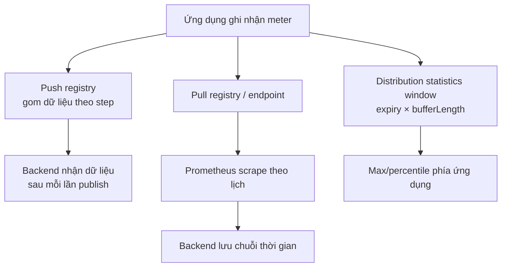

# Chu kỳ gửi, chu kỳ scrape và cửa sổ phân phối là các tham số riêng

Khi đưa metrics từ Micrometer đến hệ thống giám sát, có nhiều mốc thời gian cùng tồn tại. Ba tham số thường bị nhầm lẫn là **chu kỳ gửi (publish/step interval)**, **chu kỳ scrape**, và **cửa sổ phân phối (distribution statistics window)**.

Chúng điều khiển ba việc khác nhau:

- Chu kỳ gửi quyết định registry dạng push tổng hợp và gửi dữ liệu lên backend theo nhịp nào.
- Chu kỳ scrape quyết định backend dạng pull đọc endpoint metrics của ứng dụng thường xuyên đến đâu.
- Cửa sổ phân phối quyết định các thống kê phân phối theo thời gian trong Micrometer giữ dữ liệu gần đây trong bao lâu.

Thay đổi một tham số không tự động thay đổi hai tham số còn lại. Nếu cấu hình nhầm hoặc diễn giải chúng như một khoảng thời gian duy nhất, dashboard có thể hiển thị dữ liệu cũ, percentile có thể thay đổi theo cách khó hiểu, hoặc cảnh báo có thể phát hiện chậm hơn dự kiến.

## 1. Ba khoảng thời gian, ba trách nhiệm

| Tham số | Thành phần điều khiển | Câu hỏi nó trả lời | Ví dụ |
|---|---|---|---|
| **Publish/step interval** | Micrometer push registry | Bao lâu registry gửi một lần dữ liệu đã tích lũy? | Mỗi 30 giây |
| **Scrape interval** | Metrics backend pull như Prometheus | Bao lâu backend đọc endpoint của ứng dụng? | Mỗi 15 giây |
| **Distribution window** | Thống kê phân phối của meter trong Micrometer | Thống kê theo cửa sổ như max/percentile giữ các quan sát gần đây trong khoảng nào? | Expiry 2 phút, buffer length 3, cửa sổ xấp xỉ 6 phút |

Một hệ thống có thể dùng push registry mà không có scrape interval. Một hệ thống dùng Prometheus scrape có scrape interval nhưng không có chu kỳ publish push của Prometheus registry. Cửa sổ phân phối là cấu hình thống kê của meter và có thể tồn tại ở cả hai kiểu tích hợp.

Có thể mô tả các luồng như sau:



Cửa sổ phân phối tác động đến thống kê được tính trong ứng dụng. Nó không phải lịch gửi dữ liệu và cũng không phải lịch backend đọc endpoint.

## 2. Chu kỳ gửi (publish interval hoặc step interval)

Với registry dạng push, ứng dụng gửi metrics đến backend theo lịch. Trong Micrometer, nhiều registry dạng này kế thừa mô hình `StepMeterRegistry`. Một step xác định khoảng thời gian mà dữ liệu được tích lũy trước khi registry publish.

Ví dụ, cấu hình step 30 giây:

- Từ 10:00:00 đến 10:00:30: registry tích lũy dữ liệu của step thứ nhất.
- Khoảng 10:00:30: registry publish dữ liệu của step đó.
- Từ 10:00:30 đến 10:01:00: registry tích lũy dữ liệu cho step tiếp theo.
- Khoảng 10:01:00: registry publish step tiếp theo.

Với các meter dạng step counter hoặc step timer, giá trị xuất ra thường phản ánh dữ liệu của step vừa hoàn tất. Cách này phù hợp với backend nhận dữ liệu định kỳ và các phép đo theo cửa sổ cố định.

### Ví dụ cấu hình step

Với registry có cấu hình kế thừa `StepRegistryConfig`, step được cung cấp qua phương thức `step()`. Ví dụ minh họa một cấu hình registry tùy chỉnh:

```java
import io.micrometer.core.instrument.step.StepRegistryConfig;

import java.time.Duration;

public interface MetricsPushConfig extends StepRegistryConfig {

    @Override
    default String prefix() {
        return "example";
    }

    @Override
    default Duration step() {
        return Duration.ofSeconds(30);
    }

    @Override
    default String get(String key) {
        return null;
    }
}
```

Trong ứng dụng thực tế, registry cụ thể thường có interface cấu hình riêng và có thể lấy step từ property tương ứng. Hãy dùng property do registry và phiên bản Spring Boot đang dùng công bố; tên prefix không giống nhau giữa mọi backend.

Step quá dài làm dữ liệu đến backend chậm hơn và làm các thay đổi ngắn khó quan sát theo nhịp publish. Step quá ngắn làm tăng số lần gửi, overhead mạng và áp lực xử lý ở backend. Chọn step theo yêu cầu độ trễ dữ liệu và khả năng tiếp nhận của hệ thống giám sát.

## 3. Chu kỳ scrape của hệ thống pull

Với mô hình pull, ứng dụng mở endpoint metrics và backend chủ động đọc endpoint đó. Prometheus là ví dụ phổ biến. Chu kỳ scrape do Prometheus cấu hình, không phải do `MeterRegistry` tự quyết định.

Ví dụ Prometheus scrape mỗi 15 giây:

```yaml
scrape_configs:
  - job_name: order-service
    scrape_interval: 15s
    scrape_timeout: 10s
    metrics_path: /actuator/prometheus
    static_configs:
      - targets:
          - order-service:8080
```

Nếu scrape interval là 15 giây, Prometheus cố gắng thu thập một mẫu mỗi 15 giây. Nếu một lần scrape mất quá thời gian timeout hoặc endpoint không truy cập được, lần thu thập đó có thể thất bại.

Chu kỳ scrape ảnh hưởng đến:

- Độ trễ từ lúc trạng thái thay đổi đến khi backend có mẫu mới.
- Khả năng quan sát các biến động ngắn.
- Số lượng mẫu được lưu và tải do scrape tạo ra.
- Độ phân giải thời gian của truy vấn và cảnh báo.

Scrape mỗi 5 giây không có nghĩa Micrometer sẽ publish mỗi 5 giây. Với Prometheus pull registry, Prometheus chỉ đọc giá trị hiện tại mà endpoint cung cấp tại thời điểm scrape.

### Scrape interval không phải thời gian giữ dữ liệu

Prometheus lưu các mẫu đã scrape theo chính sách retention của server. Scrape interval quyết định mật độ mẫu mới, còn retention quyết định backend giữ lịch sử trong bao lâu. Hai khái niệm này cũng độc lập với cửa sổ phân phối trong Micrometer.

## 4. Cửa sổ phân phối trong Micrometer

Timer và DistributionSummary có thể xuất thống kê phân phối như max và percentile. Một số thống kê được tính theo cửa sổ thời gian thay vì giữ giá trị lớn nhất hoặc phân vị từ khi ứng dụng khởi động.

Micrometer dùng hai cấu hình quan trọng:

- `expiry`: thời gian của một đoạn trong cửa sổ thống kê.
- `bufferLength`: số đoạn thời gian được giữ trong bộ đệm vòng.

Cửa sổ thời gian xấp xỉ được xác định bởi:

$$
	ext{time window} = 	ext{expiry} 	imes 	ext{bufferLength}
$$

Ví dụ:

$$
2 	ext{ phút} 	imes 3 = 6 	ext{ phút}
$$

Với `expiry=2m` và `bufferLength=3`, các thống kê cửa sổ như max và percentile phía ứng dụng có thể phản ánh các quan sát trong vùng thời gian gần đây khoảng 6 phút. Khi các đoạn cũ hết hạn và không có quan sát mới, giá trị max theo cửa sổ có thể giảm hoặc trở về 0.

Đây không phải retention của Prometheus. Micrometer không giữ dữ liệu trong bộ đệm này để thay thế kho chuỗi thời gian của backend.

## 5. Cấu hình expiry và bufferLength

Có thể cấu hình thống kê phân phối toàn cục trong Spring Boot:

```yaml
management:
  metrics:
    distribution:
      expiry: 2m
      buffer-length: 3
```

Cấu hình này đặt expiry và buffer length mặc định cho các distribution statistics được tạo qua cơ chế cấu hình tương ứng. Có thể cấu hình riêng histogram, percentile hoặc SLO cho từng meter:

```yaml
management:
  metrics:
    distribution:
      expiry: 2m
      buffer-length: 3
      percentiles:
        http.server.requests: 0.5, 0.95, 0.99
      percentiles-histogram:
        http.server.requests: true
      slo:
        http.server.requests: 100ms, 300ms, 500ms, 1s
```

Tên meter phải khớp với meter mà ứng dụng thực sự đăng ký. Cấu hình percentile hoặc histogram không tự tạo meter nếu ứng dụng chưa instrument thao tác đó.

Nếu thay đổi expiry từ 2 phút thành 30 giây trong khi giữ buffer length là 3, cửa sổ thống kê xấp xỉ giảm từ 6 phút xuống 90 giây. Điều đó làm max/percentile phía ứng dụng nhạy hơn với thay đổi gần đây, nhưng cũng khiến kết quả biến động nhanh hơn.

## 6. Percentile phía ứng dụng và histogram phía backend

Cần phân biệt hai kiểu percentile:

### Percentile phía ứng dụng

Khi cấu hình `publishPercentiles(0.5, 0.95, 0.99)`, Micrometer tính percentile trong tiến trình và xuất các giá trị đó. Các thống kê percentile này chịu ảnh hưởng của cấu hình cửa sổ phân phối như `expiry` và `bufferLength`.

Ưu điểm là có thể quan sát percentile mà không cần backend tự tính histogram. Hạn chế là percentile của từng instance không thể cộng hoặc lấy trung bình để tạo percentile toàn hệ thống chính xác.

### Histogram phía backend

Khi cấu hình `publishPercentileHistogram()`, registry xuất bucket để backend có thể tổng hợp phân bố từ nhiều instance rồi tính percentile. Với Prometheus classic histogram, bucket là các bộ đếm tích lũy và truy vấn thường dùng `rate(...[5m])` cùng `histogram_quantile(...)`.

Ví dụ:

```java
Timer requestTimer = Timer.builder("http.server.requests")
    .publishPercentileHistogram()
    .serviceLevelObjectives(
        Duration.ofMillis(100),
        Duration.ofMillis(300),
        Duration.ofMillis(500)
    )
    .register(registry);
```

Cấu hình histogram bucket có thể được backend truy vấn trên một cửa sổ độc lập, chẳng hạn 5 phút. Cửa sổ truy vấn PromQL này không tự động bằng `expiry × bufferLength`.

## 7. Cửa sổ truy vấn ở backend cũng là một tham số riêng

Khi dùng Prometheus, truy vấn:

```promql
histogram_quantile(
  0.95,
  sum by (le) (
    rate(http_server_requests_seconds_bucket[5m])
  )
)
```

có ba yếu tố thời gian cần hiểu:

1. Prometheus scrape interval quyết định tần suất lấy mẫu từ endpoint.
2. `[5m]` trong PromQL xác định cửa sổ dữ liệu mà `rate` dùng để ước lượng tốc độ tăng của bucket.
3. Micrometer `expiry` và `bufferLength` điều khiển các thống kê cửa sổ phía ứng dụng, chẳng hạn max hoặc percentile client-side.

Cửa sổ `[5m]` không cấu hình scrape interval và cũng không thay đổi expiry của Micrometer. Nó chỉ là phạm vi thời gian mà truy vấn Prometheus xem xét.

Nếu scrape interval là 15 giây, cửa sổ 5 phút thường chứa khoảng 20 mẫu scrape cho mỗi series nếu không có lần scrape thất bại. Thay đổi cửa sổ PromQL sang 1 phút làm truy vấn phản ứng nhanh hơn với biến động gần đây, nhưng có ít mẫu hơn và có thể kém ổn định khi lưu lượng thấp.

## 8. Một ví dụ kết hợp ba tham số

Giả sử dịch vụ order có cấu hình:

| Tham số | Giá trị |
|---|---:|
| Push registry step | 30 giây |
| Prometheus scrape interval | 15 giây |
| Micrometer distribution expiry | 2 phút |
| Micrometer buffer length | 3 |
| Cửa sổ PromQL cho p95 | 5 phút |

Các giá trị này minh họa những cơ chế khác nhau; trong triển khai thực tế, push registry và Prometheus pull thường là hai phương án export khác nhau. Bảng giúp so sánh khái niệm, không có nghĩa cùng một registry phải dùng đồng thời cả step push và scrape.

Nếu dùng push registry:

- Registry tích lũy dữ liệu theo step 30 giây.
- Backend nhận bản publish theo nhịp của registry.
- Cửa sổ phân phối phía ứng dụng vẫn được điều khiển bởi expiry và buffer length.

Nếu dùng Prometheus pull:

- Prometheus scrape endpoint mỗi 15 giây.
- Không có chu kỳ push 30 giây từ Prometheus registry.
- Micrometer vẫn có thể tính percentile phía ứng dụng theo cửa sổ phân phối.
- Nếu dùng histogram bucket, Prometheus có thể tính p95 từ rate trên cửa sổ truy vấn 5 phút.

Không nên đặt cùng lúc cả hai cách export chỉ để "đồng bộ chu kỳ". Hãy chọn registry và backend theo mô hình thu thập của hệ thống, rồi cấu hình từng khoảng thời gian theo trách nhiệm của nó.

## 9. Ảnh hưởng khi các khoảng thời gian không phù hợp

| Cấu hình | Hệ quả có thể gặp | Cách xem xét |
|---|---|---|
| Push step quá dài | Backend nhận dữ liệu chậm, các đợt tăng tải bị gộp trong khoảng dài | Giảm step nếu cần độ trễ dữ liệu thấp hơn và backend chịu được |
| Push step quá ngắn | Tăng số lần publish và overhead mạng | Tăng step hoặc giảm số meter xuất nếu chi phí cao |
| Scrape interval quá dài | Có thể bỏ lỡ biến động ngắn giữa các lần scrape | Giảm interval cho nhóm metrics cần độ phân giải cao |
| Scrape interval quá ngắn | Tăng tải endpoint, Prometheus và số mẫu lưu | Chọn interval theo yêu cầu quan sát và ngân sách lưu trữ |
| Distribution window quá dài | Max/percentile phía ứng dụng thay đổi chậm, phản ánh nhiều dữ liệu cũ hơn | Giảm expiry hoặc buffer length nếu cần nhạy hơn |
| Distribution window quá ngắn | Thống kê dao động mạnh khi lưu lượng thấp | Tăng cửa sổ để có nhiều quan sát hơn |
| PromQL range quá ngắn | Rate và percentile dễ nhiễu hoặc thiếu dữ liệu khi scrape thưa | Dùng cửa sổ chứa đủ mẫu cho lưu lượng và scrape interval |
| PromQL range quá dài | Đột biến gần đây bị làm mượt bởi lịch sử dài | Dùng cửa sổ ngắn hơn cho cảnh báo nhanh, dài hơn cho xu hướng |

Không có một bộ giá trị đúng cho mọi ứng dụng. HTTP request lưu lượng cao, tác vụ batch chạy vài giờ và worker nền ít sự kiện có đặc tính dữ liệu rất khác nhau.

## 10. Chọn khoảng thời gian theo mục tiêu

### Dashboard độ trễ request

- Dùng Timer để ghi nhận duration.
- Bật histogram nếu cần p95/p99 tổng hợp giữa các instance.
- Chọn scrape interval phù hợp với độ phân giải dashboard.
- Chọn PromQL range đủ mẫu, ví dụ 5 phút.
- Dùng SLO bucket tại các ngưỡng quan trọng như 300 ms hoặc 1 giây.

### Theo dõi trạng thái hoặc max phía ứng dụng

- Dùng Gauge/TimeGauge cho trạng thái hiện tại.
- Nếu dùng max hoặc percentile client-side, xem xét expiry và buffer length.
- Không nhầm cửa sổ max trong Micrometer với retention backend.
- Chọn scrape interval đủ ngắn để quan sát trạng thái biến động.

### Registry dạng push

- Chọn step theo độ trễ mong muốn khi backend nhận dữ liệu.
- Kiểm tra step mặc định của registry cụ thể.
- Cân nhắc tải publish và cách backend diễn giải giá trị step.
- Xem riêng expiry/buffer length nếu meter có thống kê phân phối theo cửa sổ.

## 11. Kiểm tra cấu hình trong ứng dụng

Có thể kiểm tra ba nhóm cấu hình ở những nơi khác nhau:

1. **Push step:** kiểm tra cấu hình registry cụ thể hoặc property Spring Boot mà registry đó hỗ trợ.
2. **Scrape interval:** kiểm tra file cấu hình Prometheus hoặc cấu hình collector pull tương ứng.
3. **Distribution window:** kiểm tra `management.metrics.distribution.expiry`, `management.metrics.distribution.buffer-length` hoặc cấu hình `DistributionStatisticConfig` của meter.

Với Prometheus, kiểm tra cấu hình scrape:

```yaml
scrape_configs:
  - job_name: order-service
    scrape_interval: 15s
```

Với Spring Boot, kiểm tra cấu hình distribution:

```yaml
management:
  metrics:
    distribution:
      expiry: 2m
      buffer-length: 3
```

Sau khi khởi động, kiểm tra endpoint metrics để xác nhận meter và histogram thực sự được xuất. Nếu endpoint không có series dự kiến, hãy kiểm tra dependency registry, cấu hình Actuator, meter name và filter trước khi điều chỉnh chu kỳ.

## 12. Những nhầm lẫn thường gặp

- **Cho rằng publish step và scrape interval là một:** một cái do push registry quản lý, một cái do backend pull quản lý.
- **Cho rằng expiry quyết định thời điểm gửi metrics:** expiry điều khiển cửa sổ thống kê phân phối trong ứng dụng.
- **Cho rằng PromQL range thay đổi cấu hình Micrometer:** range vector chỉ thay đổi dữ liệu truy vấn được xem xét.
- **Cho rằng scrape thường xuyên hơn làm histogram chính xác tuyệt đối hơn:** scrape chỉ lấy mẫu các series đã export; độ chính xác percentile còn phụ thuộc bucket và dữ liệu quan sát.
- **Cho rằng mọi registry đều có step:** chỉ các registry hoặc meter có mô hình step mới dùng tham số đó theo cách tương ứng.
- **Cho rằng histogram bucket và percentile client-side dùng cùng cửa sổ:** histogram backend được truy vấn theo range của backend; percentile phía ứng dụng dùng thống kê cửa sổ của Micrometer.
- **Cho rằng retention của backend bằng distribution window:** backend retention lưu chuỗi thời gian lâu hơn nhiều tùy chính sách lưu trữ, độc lập với cửa sổ trong tiến trình.

## 13. Checklist cấu hình thời gian

- [ ] Xác định registry dùng mô hình push hay pull.
- [ ] Nếu push, xác định step/publish interval của registry cụ thể.
- [ ] Nếu pull, xác định scrape interval và scrape timeout của collector.
- [ ] Xác định meter có xuất percentile phía ứng dụng, histogram hay cả hai.
- [ ] Kiểm tra expiry và buffer length cho thống kê phân phối theo cửa sổ.
- [ ] Phân biệt cửa sổ phân phối Micrometer với range vector trong PromQL.
- [ ] Chọn PromQL range phù hợp với scrape interval và lưu lượng.
- [ ] Kiểm tra tên series, bucket và đơn vị thực tế sau export.
- [ ] Đánh giá tải publish, scrape, cardinality và dung lượng lưu trữ.
- [ ] Ghi lại lý do lựa chọn từng khoảng thời gian để dễ vận hành.

Chu kỳ gửi, chu kỳ scrape và cửa sổ phân phối đều liên quan đến thời gian nhưng điều khiển những phần khác nhau của pipeline metrics. Step quyết định nhịp publish của push registry; scrape interval quyết định nhịp backend đọc endpoint; expiry và buffer length quyết định cửa sổ thống kê phân phối phía Micrometer. Khi cần tính percentile ở backend, cửa sổ truy vấn như PromQL `[5m]` lại là một tham số riêng. Giữ rõ các ranh giới này giúp dashboard, percentile và cảnh báo phản ánh đúng dữ liệu mà hệ thống đã thu thập.

## Tài liệu tham khảo

- [Micrometer Distribution Statistics](https://docs.micrometer.io/micrometer/reference/concepts/distribution-summaries.html) — cấu hình histogram, percentile, expiry và buffer length cho thống kê phân phối.
- [Micrometer StepMeterRegistry API](https://javadoc.io/doc/io.micrometer/micrometer-core/latest/io/micrometer/core/instrument/step/StepMeterRegistry.html) — mô hình registry xuất metrics theo step.
- [Micrometer StepRegistryConfig API](https://javadoc.io/doc/io.micrometer/micrometer-core/latest/io/micrometer/core/instrument/step/StepRegistryConfig.html) — cấu hình khoảng step của registry.
- [Prometheus Configuration](https://prometheus.io/docs/prometheus/latest/configuration/configuration/) — cấu hình `scrape_interval` và `scrape_timeout`.
- [Prometheus Histograms](https://prometheus.io/docs/practices/histograms/) — truy vấn histogram và percentile bằng PromQL.

