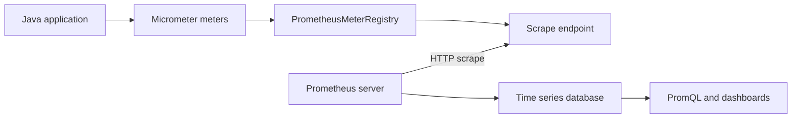

# PrometheusMeterRegistry và cách cung cấp nội dung scrape

`PrometheusMeterRegistry` là implementation của Micrometer dùng để chuyển các meter của ứng dụng thành dữ liệu theo định dạng exposition mà Prometheus có thể scrape. Ứng dụng ghi nhận số liệu qua API chung của Micrometer; registry quản lý các meter, áp dụng quy ước tên và nhãn của Prometheus, rồi cung cấp nội dung scrape.

Trong ứng dụng Spring Boot, cách phổ biến là thêm Prometheus registry và Spring Boot Actuator, sau đó expose endpoint `/actuator/prometheus`. Prometheus chủ động gửi HTTP request đến endpoint này theo chu kỳ, đọc snapshot metrics và lưu các mẫu theo thời gian. Trong ứng dụng Java độc lập, có thể gọi `PrometheusMeterRegistry.scrape()` để lấy nội dung exposition rồi tự cung cấp nội dung đó qua một HTTP server.

## 1. Luồng dữ liệu từ Micrometer đến Prometheus

Micrometer tách mã instrumentation khỏi backend giám sát. Component nghiệp vụ đăng ký `Counter`, `Gauge`, `Timer` hoặc `DistributionSummary` thông qua `MeterRegistry`. Khi dùng Prometheus registry, các meter được chuyển thành tên metric và label phù hợp với Prometheus.



Các bước diễn ra như sau:

1. Mã ứng dụng cập nhật meter khi sự kiện hoặc thao tác xảy ra.
2. `PrometheusMeterRegistry` quản lý các meter đã đăng ký và ánh xạ tên, tag, đơn vị sang quy ước Prometheus.
3. Endpoint scrape yêu cầu registry tạo nội dung exposition tại thời điểm được gọi.
4. Prometheus gửi HTTP request đến endpoint theo cấu hình scrape, đọc nội dung và lưu mẫu cùng timestamp.
5. Người vận hành dùng PromQL để tính rate, tổng hợp histogram, tạo dashboard và alert.

Prometheus thường sử dụng mô hình pull. Ứng dụng không cần chủ động gửi từng sự kiện đến Prometheus; nó duy trì trạng thái meter và cung cấp snapshot khi được scrape.

## 2. Thêm Prometheus registry vào ứng dụng

Với Maven và Spring Boot, hai dependency thường dùng là Actuator và Prometheus registry:

```xml
<dependency>
    <groupId>org.springframework.boot</groupId>
    <artifactId>spring-boot-starter-actuator</artifactId>
</dependency>
<dependency>
    <groupId>io.micrometer</groupId>
    <artifactId>micrometer-registry-prometheus</artifactId>
</dependency>
```

Nên để Spring Boot dependency management quản lý phiên bản tương thích. Không tự chọn phiên bản Micrometer registry lệch khỏi phiên bản Spring Boot đang dùng nếu chưa kiểm tra compatibility.

Khi registry nằm trên classpath, Spring Boot Actuator có thể tự cấu hình `PrometheusMeterRegistry` và endpoint Prometheus. Component nghiệp vụ chỉ cần inject `MeterRegistry`, vì vậy vẫn phụ thuộc API chung của Micrometer:

```java
import io.micrometer.core.instrument.Counter;
import io.micrometer.core.instrument.MeterRegistry;
import org.springframework.stereotype.Component;

@Component
public class OrderMetrics {
    private final Counter ordersCreated;

    public OrderMetrics(MeterRegistry registry) {
        this.ordersCreated = Counter.builder("shop.orders.created")
                .description("Number of successfully created orders")
                .register(registry);
    }

    public void recordCreated() {
        ordersCreated.increment();
    }
}
```

Spring Boot inject registry đã được cấu hình. Khi `recordCreated()` được gọi, counter cập nhật trong registry; lần scrape kế tiếp sẽ phản ánh giá trị mới.

## 3. Expose endpoint /actuator/prometheus

Actuator endpoint Prometheus cần được expose qua web endpoint. Ví dụ `application.yml`:

```yaml
management:
  endpoints:
    web:
      exposure:
        include:
          - health
          - info
          - prometheus
```

Với cấu hình mặc định của ứng dụng chạy ở cổng 8080, endpoint thường là:

```text
http://localhost:8080/actuator/prometheus
```

Có thể kiểm tra nhanh bằng curl:

```bash
curl -i http://localhost:8080/actuator/prometheus
```

Phản hồi thành công thường có status HTTP 200, content type phù hợp với định dạng exposition và body chứa các dòng metric. Endpoint có thể trả về nhiều nhóm metrics: metric nghiệp vụ do ứng dụng đăng ký, metric JVM, HTTP server, datasource và các binder tự động khác nếu dependency tương ứng có mặt.

Nếu Actuator chạy ở management port riêng, có base path khác hoặc ứng dụng nằm sau reverse proxy, URL scrape phải phản ánh cấu hình triển khai thực tế. Hãy xác minh port, context path, base path và network route thay vì mặc định mọi ứng dụng đều dùng `8080/actuator/prometheus`.

Chỉ expose endpoint cần thiết. Trong production, nên giới hạn đường truy cập metrics ở mạng nội bộ hoặc cấu hình xác thực/ủy quyền phù hợp. Nội dung metrics có thể tiết lộ tên service, route, trạng thái dependency và thông tin vận hành.

## 4. PrometheusMeterRegistry cung cấp nội dung scrape như thế nào?

`PrometheusMeterRegistry` là registry chuyên biệt cho Prometheus. Khi endpoint scrape được gọi, registry chuyển trạng thái meter hiện tại thành nội dung exposition. Nội dung thường gồm metadata `HELP`, `TYPE` và một hoặc nhiều sample metric kèm label.

Ví dụ minh họa cho counter đơn hàng:

```text
# HELP shop_orders_created_total Number of successfully created orders
# TYPE shop_orders_created_total counter
shop_orders_created_total{application="order-service",channel="web"} 42.0
```

Đây là ví dụ rút gọn để minh họa cấu trúc. Tên metric, hậu tố, label chung và cách định dạng thực tế phụ thuộc naming convention, loại meter, registry variant và cấu hình của ứng dụng. Hãy xem trực tiếp endpoint để biết tên mà Prometheus nhận được.

### 4.1. Gọi scrape() trong Java độc lập

Khi không dùng Actuator endpoint, có thể gọi `scrape()` trên `PrometheusMeterRegistry` để lấy nội dung exposition:

```java
import io.micrometer.core.instrument.Counter;
import io.micrometer.prometheusmetrics.PrometheusConfig;
import io.micrometer.prometheusmetrics.PrometheusMeterRegistry;

public class PrometheusScrapeExample {
    public static void main(String[] args) {
        try (PrometheusMeterRegistry registry =
                     new PrometheusMeterRegistry(PrometheusConfig.DEFAULT)) {
            Counter.builder("shop.orders.created")
                    .description("Number of successfully created orders")
                    .register(registry)
                    .increment(3.0);

            String exposition = registry.scrape();
            System.out.println(exposition);
        }
    }
}
```

Ví dụ dùng package của Prometheus Java client 1.x. Với integration dựa trên Prometheus simpleclient cũ, package của `PrometheusConfig` và `PrometheusMeterRegistry` khác; hãy dùng package đúng với artifact Micrometer đang cài. Phần API cần chú ý ở đây là registry có phương thức `scrape()` để tạo payload exposition.

`scrape()` chỉ tạo nội dung. Nó không tự mở HTTP port, không tạo endpoint web và không cấu hình Prometheus server. Ứng dụng độc lập vẫn cần một HTTP server hoặc framework web để trả payload qua một URL mà Prometheus có thể truy cập.

### 4.2. Không tạo endpoint tùy chỉnh nếu Actuator đã đáp ứng

Trong Spring Boot, endpoint Actuator đã tích hợp registry và xử lý việc cung cấp nội dung scrape. Không cần viết controller riêng chỉ để gọi `scrape()` nếu `/actuator/prometheus` đã đáp ứng nhu cầu.

Nếu có yêu cầu đặc biệt phải tự phục vụ payload, HTTP handler cần:

- Gọi `scrape()` trên đúng Prometheus registry đang nhận các meter của ứng dụng.
- Trả body nguyên vẹn, không bọc thành JSON hoặc HTML.
- Đặt content type tương ứng với định dạng exposition được registry tạo ra.
- Không tạo registry mới bên trong mỗi HTTP request.
- Áp dụng timeout, network policy và bảo vệ endpoint phù hợp.

Không nên lấy một `SimpleMeterRegistry` khác để tạo payload, vì các meter của ứng dụng có thể đang được ghi vào registry Prometheus do Spring Boot quản lý.

## 5. Cấu hình Prometheus scrape target

Sau khi endpoint có thể truy cập từ máy Prometheus, thêm job vào cấu hình Prometheus. Ví dụ `prometheus.yml`:

```yaml
scrape_configs:
  - job_name: order-service
    metrics_path: /actuator/prometheus
    scrape_interval: 15s
    static_configs:
      - targets:
          - order-service:8080
```

Trong ví dụ:

- `job_name` định danh nhóm target trong Prometheus.
- `metrics_path` trỏ đến endpoint Actuator.
- `scrape_interval` quy định tần suất Prometheus thu thập dữ liệu.
- `targets` là địa chỉ host và port mà Prometheus có thể truy cập từ network của nó.

Nếu Prometheus chạy trong container hoặc Kubernetes, `localhost` có thể trỏ đến chính container hoặc pod Prometheus chứ không phải ứng dụng. Dùng service DNS, Kubernetes service discovery hoặc địa chỉ mạng đúng với topology triển khai.

Khi cấu hình nhiều instance của cùng service, mỗi target cần được Prometheus nhận diện riêng. Các label target như `job` và `instance` giúp phân biệt nguồn dữ liệu. Không đưa `instance` vào tag do mã ứng dụng tự tạo nếu Prometheus đã gắn label target tương ứng.

## 6. Đọc cấu trúc exposition và quy ước tên

Prometheus biểu diễn metrics bằng tên metric, label và sample value. Micrometer áp dụng naming convention để chuyển tên meter và tag sang định dạng phù hợp.

Một số quy tắc thường gặp:

- Dấu chấm trong tên Micrometer thường được chuyển thành dấu gạch dưới.
- Counter có thể được xuất với hậu tố `_total`.
- Timer xuất thời lượng theo đơn vị chuẩn của registry, thường là giây với Prometheus.
- Tag của Micrometer trở thành label của Prometheus.
- Description được dùng cho dòng `HELP`; loại meter được biểu diễn bằng `TYPE` khi định dạng hỗ trợ.

Ví dụ timer có thể tạo các sample dạng:

```text
# TYPE shop_http_request_duration_seconds summary
shop_http_request_duration_seconds_count{method="GET"} 120.0
shop_http_request_duration_seconds_sum{method="GET"} 8.42
shop_http_request_duration_seconds_max{method="GET"} 0.31
```

Đây là ví dụ minh họa cấu trúc count, sum và max; loại metric và các sample thực tế phụ thuộc cấu hình histogram/percentile cùng registry variant. Nếu bật percentile histogram, registry có thể xuất thêm bucket như `_bucket` và nhãn `le`.

### 6.1. Counter và rate

Counter là số tích lũy. Không nên so sánh giá trị raw giữa hai instance hoặc dùng raw counter làm tốc độ tức thời. Trong Prometheus, `rate()` tính tốc độ tăng trung bình trên một cửa sổ thời gian:

```promql
sum(rate(shop_orders_created_total[5m]))
```

Nếu cần tổng số đơn hàng tăng thêm trong 15 phút:

```promql
sum(increase(shop_orders_created_total[15m]))
```

Các hàm này có thể xử lý counter reset khi tiến trình restart theo semantics của Prometheus. Chúng hoạt động tốt nhất khi metric thực sự tuân thủ semantics counter và không bị ứng dụng chủ động giảm trong cùng vòng đời.

### 6.2. Gauge

Gauge biểu diễn trạng thái tại thời điểm scrape, ví dụ số request đang xử lý hoặc độ dài queue:

```promql
app_queue_depth
```

Gauge có thể tăng hoặc giảm. Không áp dụng `rate()` cho gauge thông thường để suy ra tốc độ sự kiện; nếu cần đếm số lần thay đổi hoặc sự kiện, hãy instrument bằng counter riêng.

## 7. Histogram và percentile trong Prometheus

Khi cần tính percentile trên nhiều instance, hãy cấu hình histogram cho Timer hoặc DistributionSummary. Histogram cung cấp số lượng mẫu theo bucket để Prometheus tổng hợp trước khi tính quantile.

Ví dụ cấu hình timer:

```java
import io.micrometer.core.instrument.MeterRegistry;
import io.micrometer.core.instrument.Timer;
import java.time.Duration;
import org.springframework.stereotype.Component;

@Component
public class HttpMetrics {
    private final Timer requestDuration;

    public HttpMetrics(MeterRegistry registry) {
        this.requestDuration = Timer.builder("shop.http.request.duration")
                .description("HTTP request duration")
                .publishPercentileHistogram()
                .serviceLevelObjectives(
                        Duration.ofMillis(100),
                        Duration.ofMillis(300),
                        Duration.ofSeconds(1))
                .register(registry);
    }

    public <T> T record(java.util.function.Supplier<T> operation) {
        return requestDuration.record(operation);
    }
}
```

PromQL để tính p95 toàn service từ classic histogram:

```promql
histogram_quantile(
  0.95,
  sum by (le) (
    rate(shop_http_request_duration_seconds_bucket[5m])
  )
)
```

Để tính p95 theo route nhưng gộp qua các instance:

```promql
histogram_quantile(
  0.95,
  sum by (le, route) (
    rate(shop_http_request_duration_seconds_bucket[5m])
  )
)
```

Phải cộng bucket tương ứng trước rồi mới tính percentile. Không lấy trung bình p95 của từng instance để suy ra p95 toàn service. Histogram tạo thêm chuỗi thời gian theo bucket, do đó cần giới hạn tag cardinality và chỉ bật histogram cho metric cần phân tích phân phối.

## 8. Kiểm tra endpoint và xử lý lỗi scrape

Khi Prometheus không thu thập được metrics, hãy kiểm tra theo thứ tự từ ứng dụng đến server:

1. Ứng dụng đã có Prometheus registry trên classpath và registry được tạo thành công chưa?
2. Actuator endpoint Prometheus đã được expose chưa?
3. Endpoint có trả HTTP 200 khi gọi từ máy hoặc container Prometheus không?
4. Địa chỉ target, port, scheme và metrics path trong `prometheus.yml` có chính xác không?
5. Network policy, firewall, service routing hoặc reverse proxy có chặn request không?
6. Prometheus có báo target `UP` trong trang Targets không?
7. Nội dung scrape có metric mong đợi, tên và tag đúng không?

Một số lỗi thường gặp:

| Triệu chứng | Nguyên nhân có thể | Hướng kiểm tra |
| --- | --- | --- |
| HTTP 404 | Sai path hoặc endpoint chưa expose | Kiểm tra `management.endpoints.web.exposure.include` và base path. |
| HTTP 401/403 | Endpoint yêu cầu xác thực hoặc thiếu quyền | Kiểm tra security chain và cấu hình truy cập metrics. |
| Connection refused | Sai host/port hoặc ứng dụng chưa listen | Kiểm tra process, management port và network namespace. |
| Timeout | Endpoint chậm, callback meter tốn thời gian hoặc network lỗi | Kiểm tra scrape duration và callback gauge/function meter. |
| Target DOWN | Prometheus không truy cập được endpoint | Xem lỗi scrape trong Targets và kiểm tra từ chính môi trường Prometheus. |
| Endpoint có dữ liệu nhưng thiếu metric | Meter chưa được đăng ký hoặc chưa có sample | Kiểm tra bean instrumentation, điều kiện kích hoạt và tên metric. |
| Tên metric khác dự kiến | Naming convention hoặc đơn vị registry chuẩn hóa | Đọc trực tiếp exposition và cập nhật truy vấn. |

Endpoint trả HTTP 200 không đồng nghĩa instrumentation đã đúng. Hãy kiểm tra cả nội dung, tên metric, label và giá trị sample.

## 9. Bảo mật và vận hành endpoint metrics

Metrics endpoint thường được scrape nội bộ, nhưng vẫn cần kiểm soát truy cập:

- Chỉ expose endpoint Prometheus và các endpoint vận hành thật sự cần thiết.
- Giới hạn truy cập theo mạng nội bộ, security group, network policy hoặc cơ chế xác thực phù hợp.
- Không đưa password, token, email, ID cá nhân hoặc dữ liệu nhạy cảm vào tên metric hay label.
- Không dùng label có cardinality cao như request ID, trace ID hoặc URL đầy đủ chứa ID động.
- Theo dõi thời gian scrape, kích thước response và số chuỗi thời gian để phát hiện endpoint trở nên quá nặng.
- Khi chạy nhiều instance, bảo đảm Prometheus scrape đúng từng target và không scrape trùng qua nhiều đường mạng ngoài dự kiến.

Metrics endpoint nên có chi phí đọc thấp. Callback của Gauge và FunctionCounter cần nhanh, không gọi database hoặc HTTP client trong mỗi lần scrape. Nếu endpoint scrape chậm, kiểm tra cả số lượng meter, cardinality và logic callback.

## 10. Kiểm thử Prometheus exposition

Có thể kiểm tra registry trực tiếp trong unit test bằng Prometheus registry và xác minh nội dung scrape chứa metric đã đăng ký. Package và constructor cụ thể phụ thuộc registry variant mà dự án sử dụng.

Ví dụ minh họa với Prometheus Java client 1.x:

```java
import static org.assertj.core.api.Assertions.assertThat;

import io.micrometer.core.instrument.Counter;
import io.micrometer.prometheusmetrics.PrometheusConfig;
import io.micrometer.prometheusmetrics.PrometheusMeterRegistry;
import org.junit.jupiter.api.Test;

class PrometheusScrapeTest {
    @Test
    void scrapeContainsRegisteredCounter() {
        try (PrometheusMeterRegistry registry =
                     new PrometheusMeterRegistry(PrometheusConfig.DEFAULT)) {
            Counter.builder("shop.orders.created")
                    .tag("channel", "web")
                    .register(registry)
                    .increment(2.0);

            String exposition = registry.scrape();

            assertThat(exposition).contains("shop_orders_created_total");
            assertThat(exposition).contains("channel=\"web\"");
        }
    }
}
```

Nếu dùng simpleclient integration, thay package import theo artifact tương ứng. Test nên xác minh metric và label thực tế mà registry xuất ra, vì naming convention có thể thay đổi cách viết tên so với tên builder.

Với Spring Boot, nên có integration test xác minh endpoint `/actuator/prometheus` trả HTTP 200 và chứa metric tùy chỉnh sau khi thực hiện thao tác nghiệp vụ tương ứng. Integration test cũng có thể xác nhận endpoint không được expose ngoài cấu hình mong muốn.

## 11. Những lỗi thường gặp

- **Chỉ thêm dependency registry nhưng quên expose endpoint:** Prometheus không có URL để scrape.
- **Nhầm `scrape()` với HTTP server:** phương thức này tạo payload, ứng dụng vẫn phải cung cấp payload qua HTTP nếu không dùng Actuator.
- **Tạo registry mới trong controller:** registry mới không chứa meter mà application đang cập nhật.
- **Cấu hình target bằng localhost sai ngữ cảnh:** localhost trong container Prometheus không phải host ứng dụng.
- **Dùng tên metric theo cách Micrometer mà không kiểm tra tên export:** naming convention có thể chuẩn hóa dấu chấm, hậu tố và đơn vị.
- **Không expose đúng content type hoặc bọc payload thành JSON:** Prometheus không parse được exposition như mong đợi.
- **Dùng raw counter để biểu diễn tốc độ:** hãy dùng `rate()` hoặc `increase()`.
- **Lấy trung bình percentile giữa instance:** cần histogram bucket và tính quantile sau khi tổng hợp.
- **Bật histogram cho mọi metric:** làm tăng số chuỗi thời gian và chi phí lưu trữ.
- **Mở metrics endpoint công khai:** có thể tiết lộ thông tin vận hành nội bộ.

## 12. Checklist triển khai Prometheus scrape

- [ ] Thêm Actuator và Prometheus registry dependency tương thích với Spring Boot.
- [ ] Xác nhận Spring Boot tạo `PrometheusMeterRegistry`.
- [ ] Expose endpoint `prometheus` qua Actuator.
- [ ] Gọi endpoint và xác minh HTTP status, content type cùng exposition body.
- [ ] Cấu hình `scrape_configs` với đúng target và metrics path.
- [ ] Kiểm tra target `UP` từ Prometheus server.
- [ ] Xác minh tên metric, label và đơn vị trong dữ liệu export.
- [ ] Dùng `rate()`/`increase()` cho counter và histogram khi cần percentile tổng hợp.
- [ ] Kiểm soát cardinality và số bucket.
- [ ] Giới hạn truy cập endpoint và theo dõi scrape duration.
- [ ] Có unit test cho registry output và integration test cho Actuator endpoint.

`PrometheusMeterRegistry` là cầu nối giữa meter của Micrometer và định dạng exposition mà Prometheus thu thập. Trong Spring Boot, Actuator cung cấp endpoint scrape tích hợp; trong ứng dụng độc lập, `scrape()` tạo payload để HTTP server phục vụ. Khi endpoint có thể truy cập, Prometheus scrape theo chu kỳ và lưu dữ liệu để truy vấn. Hãy xác minh cả cấu hình target, nội dung exposition, semantics từng loại meter và bảo mật endpoint để pipeline metrics hoạt động tin cậy.
