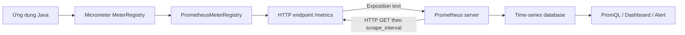

# Công bố endpoint trong Java độc lập hoặc qua Spring Boot Actuator

Prometheus thu thập metrics bằng cách chủ động gửi HTTP request đến endpoint của ứng dụng theo chu kỳ scrape. Với Micrometer, endpoint này có thể được tạo thủ công trong một ứng dụng Java độc lập bằng PrometheusMeterRegistry, hoặc được Spring Boot Actuator tự cấu hình khi ứng dụng có Prometheus registry trên classpath.

Hai cách triển khai dùng chung nguồn dữ liệu Micrometer nhưng khác nhau ở phần HTTP server và vòng đời cấu hình. Ứng dụng Java độc lập tự tạo registry, mở route, trả nội dung scrape và quản lý server. Spring Boot Actuator quản lý endpoint, còn ứng dụng tập trung khai báo dependency, cấu hình exposure và bảo vệ cổng quản trị.

Bài học thuộc module OBSERVABILITY_INSTRUMENTATION_MICROMETER. Module này hướng dẫn sử dụng Micrometer để đo lường ứng dụng Java bằng counter, gauge, timer, distribution summary và nhãn có kiểm soát; tích hợp Spring Boot, xuất metrics đến hệ giám sát, kiểm soát cardinality, kiểm thử instrumentation và diễn giải số đo vận hành.

## Mục tiêu học tập

Sau bài này, bạn có thể:

- Giải thích cách Prometheus scrape metrics qua HTTP endpoint.
- Tạo PrometheusMeterRegistry trong Java độc lập.
- Công bố nội dung scrape qua HTTP server và chọn đúng đường dẫn.
- Bật endpoint Prometheus trong Spring Boot Actuator.
- Cấu hình Prometheus scrape target tương ứng với port và path.
- Kiểm tra endpoint bằng HTTP client và nội dung exposition.
- Bảo vệ endpoint và tránh công bố dữ liệu metrics ra mạng công cộng.

## 1. Mô hình scrape của Prometheus

Prometheus thường hoạt động theo mô hình pull. Prometheus server định kỳ gửi HTTP GET đến endpoint metrics của ứng dụng, đọc dữ liệu được xuất theo Prometheus exposition format rồi lưu các sample theo timestamp.

Luồng cơ bản:



Endpoint là giao diện đọc metrics. Ứng dụng cập nhật Counter, Gauge, Timer hoặc DistributionSummary trong quá trình xử lý nghiệp vụ; khi Prometheus scrape, registry tạo nội dung phản ánh trạng thái và số liệu hiện có.

Một endpoint scrape cần đáp ứng các yêu cầu chính:

- Cho phép Prometheus truy cập qua mạng và port đã cấu hình.
- Trả nội dung metrics theo định dạng mà Prometheus client và server hỗ trợ.
- Dùng HTTP GET và trả status thành công khi scrape hợp lệ.
- Có thời gian phản hồi ổn định, không thực hiện công việc nghiệp vụ nặng trong lúc xuất metrics.
- Không làm lộ dữ liệu nhạy cảm trong tên metric, tag, description hoặc label.
- Có chính sách mạng và xác thực phù hợp với môi trường triển khai.

Prometheus không yêu cầu ứng dụng chủ động gửi từng sample lên server trong mô hình scrape thông thường. Ứng dụng chỉ cần công bố endpoint để Prometheus đọc.

## 2. Dependency Prometheus registry

Để dùng Micrometer với Prometheus, cần thêm registry implementation. Với Gradle trong dự án Spring Boot, có thể khai báo:

```kotlin
dependencies {
    implementation("org.springframework.boot:spring-boot-starter-actuator")
    runtimeOnly("io.micrometer:micrometer-registry-prometheus")
}
```

Spring Boot dependency management thường quản lý phiên bản Micrometer tương thích. Với ứng dụng Java độc lập không dùng Spring Boot, thêm dependency `io.micrometer:micrometer-registry-prometheus` và quản lý phiên bản cùng hệ Micrometer đang dùng. Tránh trộn các phiên bản registry và micrometer-core không tương thích.

Prometheus registry cung cấp hai thành phần chính:

- `PrometheusMeterRegistry` là MeterRegistry implementation chuyển meter Micrometer thành dữ liệu Prometheus.
- `PrometheusConfig.DEFAULT` cung cấp cấu hình mặc định cho registry.

Sau khi có registry, ứng dụng đăng ký meter vào đó như với bất kỳ MeterRegistry nào khác.

## 3. Công bố endpoint trong Java độc lập

Ứng dụng Java độc lập không có Spring Boot Actuator nên phải tự tạo HTTP endpoint. Có thể dùng JDK HttpServer cho ví dụ nhỏ hoặc tích hợp registry vào HTTP server/framework mà ứng dụng đang sử dụng.

### Tạo registry và meter

Ví dụ tạo Counter cho số lượt checkout hoàn tất:

```java
import io.micrometer.core.instrument.Counter;
import io.micrometer.prometheusmetrics.PrometheusConfig;
import io.micrometer.prometheusmetrics.PrometheusMeterRegistry;

public final class MetricsApplication {

    public static void main(String[] args) throws Exception {
        PrometheusMeterRegistry registry =
                new PrometheusMeterRegistry(PrometheusConfig.DEFAULT);

        Counter completed = Counter.builder("checkout.completed")
                .description("Số lượt checkout hoàn tất")
                .tag("channel", "web")
                .register(registry);

        completed.increment();

        // Phần tạo HTTP server và công bố registry nằm ở ví dụ tiếp theo.
    }
}
```

Các import trong ví dụ dùng package của Prometheus Java client 1.x integration trong các phiên bản Micrometer hiện hành. Với dự án đang dùng registry dựa trên Prometheus simpleclient cũ, package và artifact có thể khác; hãy theo dependency thực tế thay vì trộn hai thế hệ client.

### Mở HTTP endpoint bằng JDK HttpServer

Đoạn mã sau minh họa một endpoint GET tại đường dẫn `/metrics`. Registry tạo nội dung scrape bằng `scrape()`, còn HttpServer chịu trách nhiệm nhận request và trả response:

```java
import java.io.OutputStream;
import java.net.InetSocketAddress;
import java.nio.charset.StandardCharsets;
import java.util.concurrent.ExecutorService;
import java.util.concurrent.Executors;

import com.sun.net.httpserver.HttpServer;
import io.micrometer.core.instrument.Counter;
import io.micrometer.prometheusmetrics.PrometheusConfig;
import io.micrometer.prometheusmetrics.PrometheusMeterRegistry;

public final class StandaloneMetricsServer {

    public static void main(String[] args) throws Exception {
        PrometheusMeterRegistry registry =
                new PrometheusMeterRegistry(PrometheusConfig.DEFAULT);

        Counter completed = Counter.builder("checkout.completed")
                .description("Số lượt checkout hoàn tất")
                .tag("channel", "web")
                .register(registry);
        completed.increment();

        HttpServer server = HttpServer.create(
                new InetSocketAddress("0.0.0.0", 9464),
                0
        );

        server.createContext("/metrics", exchange -> {
            if (!"GET".equals(exchange.getRequestMethod())) {
                exchange.getResponseHeaders().set("Allow", "GET");
                exchange.sendResponseHeaders(405, -1);
                exchange.close();
                return;
            }

            byte[] body = registry.scrape()
                    .getBytes(StandardCharsets.UTF_8);

            exchange.getResponseHeaders().set(
                    "Content-Type",
                    "text/plain; version=0.0.4; charset=utf-8"
            );
            exchange.sendResponseHeaders(200, body.length);

            try (OutputStream output = exchange.getResponseBody()) {
                output.write(body);
            }
        });

        ExecutorService executor = Executors.newFixedThreadPool(2);
        server.setExecutor(executor);
        server.start();

        Runtime.getRuntime().addShutdownHook(new Thread(() -> {
            server.stop(1);
            executor.shutdown();
            registry.close();
        }));
    }
}
```

Một số điểm cần hiểu trong ví dụ:

- Port `9464` là port ví dụ dành cho endpoint metrics độc lập; có thể thay bằng cấu hình triển khai.
- Context `/metrics` là path Prometheus sẽ scrape.
- `registry.scrape()` tạo nội dung exposition từ các meter đã đăng ký.
- Handler chỉ phục vụ GET; request method khác nhận HTTP 405.
- Executor cho phép HTTP server xử lý request bằng thread pool.
- Shutdown hook dừng server và đóng registry khi JVM kết thúc.

JDK HttpServer thuộc module `jdk.httpserver`. Nếu ứng dụng dùng Java module system, khai báo `requires jdk.httpserver;` trong module descriptor. Trong ứng dụng thực tế, có thể công bố cùng registry qua HTTP server hiện có thay vì mở thêm một server riêng.

Địa chỉ bind `0.0.0.0` cho phép truy cập qua các interface mạng của tiến trình. Chỉ sử dụng khi Prometheus cần truy cập qua mạng và đã có firewall, network policy hoặc lớp kiểm soát tương ứng. Nếu Prometheus chạy cùng máy, có thể bind vào loopback; nếu chạy trong container, hãy cấu hình địa chỉ bind và network theo mô hình container.

Content-Type trong ví dụ là Prometheus text exposition format cổ điển. Nếu cấu hình một exposition format khác, chẳng hạn OpenMetrics, cần để response header và serializer tương ứng thống nhất. Với registry/client khác phiên bản, hãy xác nhận format mặc định mà phương thức scrape trả về.

### Kiểm tra endpoint độc lập

Sau khi chạy ứng dụng, có thể kiểm tra bằng curl:

```bash
curl -i http://localhost:9464/metrics
```

Response hợp lệ thường có:

- HTTP status 200.
- Header Content-Type phù hợp với exposition format.
- Các dòng HELP và TYPE mô tả metric nếu registry xuất metadata.
- Sample của metric đã đăng ký.

Tên logic trong Micrometer có thể được NamingConvention chuyển đổi khi xuất. Ví dụ `checkout.completed` có thể xuất dưới tên Prometheus như `checkout_completed_total`. Hãy dùng đúng tên thực tế từ response khi viết truy vấn.

Nếu endpoint trả 404, kiểm tra context path. Nếu kết nối bị từ chối, kiểm tra server đã start, port bind và network. Nếu endpoint trả 200 nhưng không có metric mong đợi, kiểm tra meter có được đăng ký vào đúng PrometheusMeterRegistry hay không.

## 4. Công bố endpoint qua Spring Boot Actuator

Với Spring Boot, không cần tự tạo HttpServer cho metrics endpoint. Khi ứng dụng có Actuator và Prometheus registry trên classpath, auto-configuration tạo PrometheusMeterRegistry và endpoint scrape tương ứng.

### Thêm dependency

Với Gradle:

```kotlin
dependencies {
    implementation("org.springframework.boot:spring-boot-starter-actuator")
    runtimeOnly("io.micrometer:micrometer-registry-prometheus")
}
```

Dùng Spring Boot dependency management để chọn phiên bản tương thích. Không cần tự tạo PrometheusMeterRegistry nếu ứng dụng dùng registry do auto-configuration quản lý.

### Bật exposure endpoint

Trong `application.properties`:

```properties
management.endpoints.web.exposure.include=health,prometheus
```

Mặc định, Actuator sử dụng base path `/actuator`, vì vậy endpoint scrape là:

```text
/actuator/prometheus
```

Nếu ứng dụng chạy trên port 8080, URL đầy đủ thường là:

```text
http://localhost:8080/actuator/prometheus
```

Actuator chỉ công bố endpoint qua HTTP khi endpoint được expose theo cấu hình. Có dependency Prometheus registry mà chưa expose endpoint thì Prometheus có thể không truy cập được route scrape.

Không cần expose tất cả Actuator endpoint chỉ để lấy metrics. Chỉ đưa những endpoint thực sự cần thiết vào danh sách exposure.

### Tách management port

Có thể dùng port riêng cho các endpoint quản trị:

```properties
server.port=8080
management.server.port=8081
management.endpoints.web.exposure.include=health,prometheus
```

Khi đó, ứng dụng nghiệp vụ tiếp tục nhận traffic trên port 8080, còn Actuator phục vụ endpoint quản trị trên port 8081. Prometheus phải scrape port 8081:

```text
http://localhost:8081/actuator/prometheus
```

Port riêng giúp áp dụng network policy và firewall rõ ràng hơn. Nó không tự động bảo vệ endpoint; cần cấu hình quyền truy cập ở lớp mạng hoặc security của ứng dụng.

### Đăng ký custom meter

Các component Spring có thể inject MeterRegistry để đăng ký meter:

```java
import io.micrometer.core.instrument.Counter;
import io.micrometer.core.instrument.MeterRegistry;
import org.springframework.stereotype.Component;

@Component
public class CheckoutMetrics {

    private final Counter completed;

    public CheckoutMetrics(MeterRegistry registry) {
        this.completed = Counter.builder("checkout.completed")
                .description("Số lượt checkout hoàn tất")
                .tag("channel", "web")
                .register(registry);
    }

    public void checkoutCompleted() {
        completed.increment();
    }
}
```

Meter được đăng ký vào registry do Spring Boot quản lý, nên endpoint `/actuator/prometheus` có thể xuất metric đó. Tránh tự tạo SimpleMeterRegistry trong component nghiệp vụ nếu mục tiêu là xuất metrics qua Actuator; một registry độc lập không tự động được kết nối với Prometheus registry của ứng dụng.

## 5. Cấu hình Prometheus scrape target

Sau khi endpoint hoạt động, Prometheus cần biết địa chỉ target và path. Ví dụ với ứng dụng Java độc lập:

```yaml
scrape_configs:
  - job_name: "checkout-standalone"
    scrape_interval: 15s
    metrics_path: "/metrics"
    static_configs:
      - targets:
          - "localhost:9464"
```

Ví dụ với Spring Boot Actuator trên port ứng dụng mặc định:

```yaml
scrape_configs:
  - job_name: "checkout-api"
    scrape_interval: 15s
    metrics_path: "/actuator/prometheus"
    static_configs:
      - targets:
          - "localhost:8080"
```

Nếu management port là 8081, đổi target thành `localhost:8081`. Nếu chạy trong Docker hoặc Kubernetes, target phải là hostname và port mà Prometheus có thể truy cập trong network tương ứng; `localhost` bên trong container Prometheus chỉ trỏ đến chính container Prometheus.

Các trường chính:

| Trường | Vai trò |
| --- | --- |
| `job_name` | Tên job dùng để nhóm target |
| `scrape_interval` | Chu kỳ Prometheus thu thập metrics |
| `metrics_path` | Đường dẫn HTTP endpoint |
| `targets` | Host và port của ứng dụng |

Chọn scrape interval phù hợp với tần suất thay đổi metrics và yêu cầu vận hành. Scrape quá thường xuyên làm tăng tải và lượng sample; scrape quá thưa có thể bỏ qua biến động ngắn của Gauge. Với Counter, Prometheus có thể tính tốc độ tăng giữa các lần scrape bằng các hàm như `rate()`.

## 6. Xác minh endpoint và dữ liệu scrape

Có thể kiểm tra theo ba lớp.

### Lớp HTTP

Gọi endpoint trực tiếp:

```bash
curl -i http://localhost:8080/actuator/prometheus
```

Kiểm tra:

- Status code là 200.
- URL và port đúng.
- Content-Type phù hợp.
- Response body không rỗng khi đã có meter.
- Không bị redirect đến trang đăng nhập hoặc trang lỗi.

Với endpoint bảo vệ bằng xác thực, dùng cơ chế credential hoặc client certificate phù hợp để kiểm tra. Không ghi token hoặc password vào file cấu hình công khai.

### Lớp Prometheus exposition

Tìm metric custom trong body. Ví dụ, nếu ứng dụng đã gọi Counter increment:

```text
# HELP checkout_completed_total Số lượt checkout hoàn tất
# TYPE checkout_completed_total counter
checkout_completed_total{channel="web",...} 1.0
```

Đây là dạng minh họa; tên, metadata, label và hậu tố chính xác phụ thuộc registry/client version và NamingConvention. Đừng hard-code tên xuất ra khi chưa kiểm tra response thực tế.

Kiểm tra thêm một số metric JVM hoặc HTTP do binder và Spring Boot cung cấp nếu chúng được bật trong ứng dụng.

### Lớp Prometheus server

Trong giao diện Prometheus, kiểm tra trang Targets để xác nhận target có trạng thái UP. Nếu target DOWN, xem error message để phân biệt lỗi DNS, connection refused, timeout, HTTP status hoặc lỗi parse exposition.

Sau khi target UP, chạy truy vấn PromQL theo tên metric thực tế. Ví dụ:

```promql
checkout_completed_total
```

Tốc độ tăng của Counter có thể được quan sát bằng:

```promql
rate(checkout_completed_total[5m])
```

Nếu metric có tag, Prometheus biểu diễn tag dưới dạng label. Có thể nhóm theo label đã được kiểm soát, ví dụ:

```promql
sum by (channel) (
  rate(checkout_completed_total[5m])
)
```

## 7. Bảo vệ endpoint metrics

Endpoint metrics có thể tiết lộ cấu trúc hệ thống, tên dependency, thông tin môi trường, trạng thái JVM và nhãn do ứng dụng tạo. Vì vậy, cần xem đây là endpoint quản trị.

Các nguyên tắc triển khai:

- Chỉ expose endpoint Prometheus cần thiết; không dùng wildcard exposure trong production nếu không có lý do.
- Hạn chế network access đến các Prometheus server hoặc collector được phép scrape.
- Nếu endpoint đi qua mạng không tin cậy, dùng xác thực, TLS hoặc mTLS theo kiến trúc triển khai.
- Không đưa token, email, user ID, session ID, request ID hoặc dữ liệu cá nhân vào tag.
- Không đưa nội dung exception, raw URL hoặc payload vào metric name, label hay description.
- Kiểm tra Spring Security rules để endpoint không vô tình bị chặn hoặc mở công khai.
- Tránh ghi toàn bộ nội dung scrape vào application log ở mỗi lần request.

Việc expose qua management port riêng giúp phân tách traffic nhưng không thay thế xác thực hoặc network policy. Tương tự, một path khó đoán không phải cơ chế bảo vệ đáng tin cậy.

## 8. Java độc lập và Spring Boot Actuator: chọn cách nào?

| Tiêu chí | Java độc lập | Spring Boot Actuator |
| --- | --- | --- |
| Tạo registry | Tự tạo PrometheusMeterRegistry | Auto-configuration khi registry dependency có mặt |
| HTTP endpoint | Tự triển khai bằng server/framework | Endpoint Prometheus được Actuator cung cấp |
| Path | Do ứng dụng chọn, ví dụ `/metrics` | Mặc định `/actuator/prometheus` |
| Port | Do HTTP server của ứng dụng quản lý | Có thể dùng server port hoặc management port riêng |
| Exposure | Do route và HTTP server quyết định | Cấu hình qua Actuator exposure |
| Security | Do HTTP server/framework hiện có quản lý | Tích hợp với Spring Security và network policy |
| Phù hợp | Java app nhỏ, service không dùng Spring Boot hoặc cần kiểm soát HTTP riêng | Ứng dụng Spring Boot muốn dùng cơ chế quản trị chuẩn |

Nếu ứng dụng đã dùng Spring Boot Actuator, hãy tận dụng endpoint do Actuator quản lý. Với ứng dụng Java không dùng Spring Boot, tạo PrometheusMeterRegistry rồi gắn vào HTTP server đang có thường là cách trực tiếp.

## 9. Các lỗi thường gặp

| Lỗi | Nguyên nhân | Cách xử lý |
| --- | --- | --- |
| Endpoint trả 404 | Sai path hoặc Actuator chưa expose endpoint | Kiểm tra context path và `management.endpoints.web.exposure.include` |
| Endpoint trả 401/403 | Security rule chặn Prometheus | Cho phép đúng scrape identity hoặc network theo chính sách |
| Prometheus target DOWN | Sai host, port, path hoặc ứng dụng chưa listen | Kiểm tra curl từ môi trường Prometheus có thể truy cập |
| Target UP nhưng thiếu custom metric | Meter đăng ký vào registry khác hoặc chưa được tạo | Inject đúng MeterRegistry và kiểm tra instrumentation |
| Response parse error | Content-Type hoặc exposition format không tương thích | Dùng serializer/format và header tương ứng |
| Chạy trong container nhưng target dùng localhost | localhost trỏ vào container Prometheus | Dùng service DNS hoặc địa chỉ mạng của ứng dụng |
| Expose toàn bộ Actuator endpoint | Cấu hình exposure quá rộng | Chỉ expose endpoint cần thiết |
| Metric xuất hiện với tên khác | NamingConvention chuyển đổi tên và đơn vị | Dùng tên thực tế từ scrape response |
| Dùng SimpleMeterRegistry để công bố endpoint | SimpleMeterRegistry không phải Prometheus exporter | Dùng PrometheusMeterRegistry |
| Tạo registry mới cho từng component | Mỗi registry có bộ meter và vòng đời riêng | Dùng registry do ứng dụng quản lý và inject |

## 10. Checklist triển khai

Trước khi đưa endpoint Prometheus vào môi trường thật, hãy xác nhận:

1. Đã thêm đúng Prometheus registry dependency và phiên bản tương thích chưa?
2. Custom meter có đăng ký vào đúng PrometheusMeterRegistry không?
3. Endpoint có trả HTTP 200 và exposition format hợp lệ không?
4. Path và port trong Prometheus scrape config có khớp endpoint không?
5. Prometheus có truy cập được target qua network thực tế không?
6. Target có trạng thái UP và query thấy metric mong đợi không?
7. Actuator chỉ expose endpoint cần thiết chưa?
8. Endpoint có được bảo vệ bằng network policy hoặc security phù hợp không?
9. Tag và description có tránh dữ liệu nhạy cảm và cardinality không giới hạn không?
10. Có kiểm tra lại endpoint sau khi nâng cấp Spring Boot, Micrometer hoặc Prometheus client không?

## Kết luận

Công bố endpoint là bước nối giữa instrumentation Micrometer và Prometheus server. Trong Java độc lập, ứng dụng tạo PrometheusMeterRegistry, gọi scrape để lấy exposition text và phục vụ nội dung qua HTTP server. Trong Spring Boot, chỉ cần thêm Prometheus registry, Actuator và cấu hình exposure để dùng endpoint mặc định `/actuator/prometheus`.

Sau khi endpoint hoạt động, cấu hình Prometheus scrape đúng host, port và path; kiểm tra response HTTP, exposition body và trạng thái target. Bảo vệ endpoint cùng dữ liệu label giúp hệ thống giám sát thu thập được metrics cần thiết mà không làm lộ thông tin nội bộ hoặc tạo bề mặt truy cập ngoài dự kiến.
