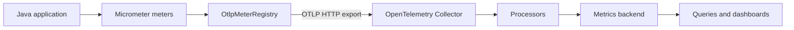

# OtlpMeterRegistry và vai trò của giao thức OTLP đối với dữ liệu metric

`OtlpMeterRegistry` là registry của Micrometer dùng để xuất metrics theo OpenTelemetry Protocol (OTLP). Ứng dụng vẫn instrument bằng API Micrometer quen thuộc như `Counter`, `Gauge`, `Timer` và `DistributionSummary`; registry chuyển các meter thành dữ liệu metric theo mô hình OTLP rồi gửi đến một endpoint nhận OTLP, thường là OpenTelemetry Collector.

OTLP là giao thức chuẩn hóa cách truyền telemetry giữa ứng dụng, collector và backend quan sát. Nó định nghĩa cấu trúc dữ liệu, cách biểu diễn resource, metric, thuộc tính và cách vận chuyển qua HTTP hoặc gRPC. OTLP không phải cơ sở dữ liệu, dashboard hay hệ thống cảnh báo. Collector hoặc backend phía sau chịu trách nhiệm nhận, xử lý, lưu trữ và cung cấp công cụ truy vấn.

## 1. Luồng dữ liệu từ Micrometer qua OTLP

Khi dùng Prometheus registry, ứng dụng thường cung cấp endpoint để Prometheus chủ động scrape. Với `OtlpMeterRegistry`, ứng dụng thường chủ động export metrics theo chu kỳ đến endpoint OTLP. Đây là mô hình push.



Luồng điển hình:

1. Mã ứng dụng cập nhật meter qua API Micrometer.
2. `OtlpMeterRegistry` chuyển số liệu thành cấu trúc OTLP Metrics.
3. Registry export dữ liệu theo chu kỳ đến OTLP receiver.
4. OpenTelemetry Collector nhận dữ liệu, có thể batch, lọc, thêm thuộc tính hoặc biến đổi dữ liệu.
5. Collector chuyển tiếp metrics đến một hoặc nhiều backend phù hợp.
6. Backend lưu trữ và cung cấp truy vấn, dashboard hoặc alert.

Collector tạo một ranh giới hữu ích giữa ứng dụng và backend. Ứng dụng chỉ cần biết endpoint OTLP; nhóm vận hành có thể thay đổi backend hoặc thêm pipeline xử lý ở Collector mà không phải thay mã instrumentation trong ứng dụng.

## 2. OTLP chuẩn hóa dữ liệu metric như thế nào?

OTLP Metrics mô tả số liệu bằng các thành phần có quan hệ với nhau:

| Thành phần | Vai trò | Ví dụ |
| --- | --- | --- |
| Resource | Mô tả thực thể phát ra telemetry | `service.name=order-service`, `deployment.environment=production` |
| Instrumentation scope | Mô tả thư viện hoặc phạm vi instrumentation | Tên và phiên bản thư viện instrumentation nếu có |
| Metric | Mô tả đại lượng được đo | `shop.orders.created`, `shop.request.duration` |
| Data point | Một điểm dữ liệu tại thời điểm hoặc khoảng thời gian xác định | Giá trị counter, gauge hoặc bucket histogram |
| Attributes | Các chiều phân loại gắn với metric/data point | `channel=web`, `result=success` |
| Temporality | Cách diễn giải dữ liệu tích lũy hoặc theo khoảng | Cumulative hoặc delta đối với các loại metric hỗ trợ |

Resource attributes trả lời câu hỏi **telemetry đến từ service hoặc process nào**. Metric attributes trả lời câu hỏi **điểm dữ liệu thuộc nhóm nghiệp vụ nào**. Ví dụ, `service.name=order-service` nên là resource attribute; `channel=web` có thể là attribute của metric đơn hàng.

Tách hai nhóm thuộc tính giúp backend lọc theo service, môi trường hoặc phiên bản triển khai mà không phải lặp các thông tin định danh hạ tầng trong từng phép đo. Các metric attributes vẫn cần cardinality thấp và được kiểm soát.

## 3. Thêm OTLP registry vào ứng dụng

Với Maven, dependency registry của Micrometer thường là:

```xml
<dependency>
    <groupId>io.micrometer</groupId>
    <artifactId>micrometer-registry-otlp</artifactId>
</dependency>
```

Trong Spring Boot, có thể dùng thêm Actuator để tích hợp registry với application context và các metric tự động. Hãy để Spring Boot dependency management quản lý phiên bản Micrometer tương thích; không tự nâng riêng registry lên một phiên bản không khớp với hệ sinh thái Spring Boot đang sử dụng.

Mã nghiệp vụ vẫn inject `MeterRegistry`, không cần phụ thuộc trực tiếp vào `OtlpMeterRegistry`:

```java
import io.micrometer.core.instrument.Counter;
import io.micrometer.core.instrument.MeterRegistry;
import org.springframework.stereotype.Component;

@Component
public class OrderMetrics {
    private final Counter ordersCreated;

    public OrderMetrics(MeterRegistry registry) {
        this.ordersCreated = Counter.builder("shop.orders.created")
                .description("Number of successfully created orders")
                .tag("channel", "web")
                .register(registry);
    }

    public void recordCreated() {
        ordersCreated.increment();
    }
}
```

Spring Boot có thể tự cấu hình OTLP registry khi dependency và cấu hình export tương ứng được cung cấp. Component chỉ cập nhật meter; registry chịu trách nhiệm export theo cấu hình.

## 4. Cấu hình OTLP export trong Spring Boot

Ví dụ cấu hình `application.yml` cho một Collector nhận OTLP/HTTP:

```yaml
management:
  otlp:
    metrics:
      export:
        url: http://otel-collector:4318/v1/metrics
        step: 30s
        resource-attributes:
          service.name: order-service
          service.namespace: commerce
          deployment.environment: production
```

Các thuộc tính quan trọng trong ví dụ:

- `url` là endpoint nhận OTLP Metrics. Với OTLP/HTTP, đường dẫn metrics thường kết thúc bằng `/v1/metrics`.
- `step` là chu kỳ export của registry dạng push. Chọn khoảng phù hợp với độ trễ quan sát và khả năng nhận dữ liệu của Collector/backend.
- `resource-attributes` cung cấp thông tin định danh ổn định cho service hoặc môi trường phát ra metrics.

Tên property và tập tùy chọn export có thể thay đổi theo phiên bản Spring Boot/Micrometer. Hãy đối chiếu cấu hình của phiên bản dự án đang dùng, đặc biệt khi cần cấu hình headers, timeout, batch size hoặc temporality. Không sao chép một property từ phiên bản mới hơn vào ứng dụng cũ mà chưa xác minh nó được hỗ trợ.

### 4.1. Resource attributes và common tags

Resource attributes và metric tags có mục đích khác nhau:

| Thuộc tính | Ví dụ | Nên dùng cho |
| --- | --- | --- |
| `service.name` | `order-service` | Tên service phát ra telemetry |
| `service.namespace` | `commerce` | Nhóm hoặc namespace logic của service |
| `deployment.environment` | `production` | Môi trường triển khai |
| `service.version` | `2.4.1` | Phiên bản ứng dụng đang chạy |
| `channel` | `web`, `mobile` | Phân loại sự kiện hoặc request nghiệp vụ |
| `result` | `success`, `error` | Kết quả của thao tác được đo |

Thông tin nhận diện service/process nên được đặt ở resource. Các chiều cần phân tích metric nên là attributes của metric. Tránh lặp các resource attributes trong mọi meter nếu registry hoặc exporter đã gắn chúng ở cấp resource.

Resource attributes thường tồn tại ổn định trong vòng đời process. Không đặt request ID, user ID hoặc giá trị thay đổi theo từng sự kiện vào resource attributes. Những giá trị đó vừa không mô tả resource, vừa làm tăng cardinality.

## 5. OTLP/HTTP và OTLP/gRPC

OTLP định nghĩa hai cách vận chuyển phổ biến:

| Giao thức | Cổng mặc định thường gặp | Đặc điểm |
| --- | ---: | --- |
| OTLP/gRPC | 4317 | Dùng gRPC và các service OTLP được định nghĩa trong protocol |
| OTLP/HTTP | 4318 | Dùng HTTP; metrics được gửi đến đường dẫn `/v1/metrics` |

Với cấu hình `OtlpMeterRegistry` dùng HTTP export, endpoint thường có dạng `http://collector-host:4318/v1/metrics`. Không cấu hình URL của OTLP/HTTP vào cổng gRPC 4317 hoặc ngược lại. Cần xác minh protocol mà registry và receiver đang bật hỗ trợ.

OTLP/HTTP có thể dùng protobuf hoặc JSON encoding tùy exporter và cấu hình. Các registry/exporter Micrometer thường chọn encoding theo implementation của phiên bản đang dùng. Collector phải bật OTLP HTTP receiver tương thích với request mà client gửi.

Nếu tổ chức yêu cầu gRPC, hãy kiểm tra khả năng của exporter cụ thể. Không giả định mọi registry có chữ OTLP đều hỗ trợ cả hai transport giống nhau.

## 6. Cấu hình OpenTelemetry Collector nhận OTLP

Collector có thể nhận OTLP/HTTP trên cổng 4318, batch dữ liệu rồi chuyển tiếp sang backend. Ví dụ cấu hình tối giản dùng debug exporter để kiểm tra dữ liệu đã đến Collector:

```yaml
receivers:
  otlp:
    protocols:
      http:
        endpoint: 0.0.0.0:4318

processors:
  batch:

exporters:
  debug:
    verbosity: basic

service:
  pipelines:
    metrics:
      receivers: [otlp]
      processors: [batch]
      exporters: [debug]
```

`debug` exporter phù hợp cho môi trường phát triển hoặc kiểm tra pipeline. Trong production, thay hoặc bổ sung exporter đến backend metrics thực tế, đồng thời cấu hình retry, queue, TLS và xác thực theo yêu cầu triển khai.

Collector cũng có thể nhận metrics từ nhiều ứng dụng, áp dụng processor để thêm hoặc chuẩn hóa resource attributes, loại bỏ thuộc tính không cần thiết, lọc dữ liệu và gửi đến nhiều đích. Hãy thiết kế pipeline theo nhu cầu thực tế và theo dõi lỗi export ở Collector.

### 6.1. Prometheus có thể nằm phía sau Collector

OTLP và Prometheus có thể cùng xuất hiện trong một kiến trúc. Ứng dụng gửi metrics bằng OTLP đến Collector; Collector sau đó có thể chuyển dữ liệu sang backend hỗ trợ OTLP hoặc cung cấp một endpoint Prometheus để Prometheus scrape.

Điều này khác với việc ứng dụng trực tiếp dùng `PrometheusMeterRegistry`. Trong trường hợp trực tiếp, ứng dụng cung cấp endpoint exposition cho Prometheus scrape. Trong trường hợp OTLP, ứng dụng push đến Collector; Prometheus có thể scrape endpoint do Collector hoặc một thành phần khác cung cấp nếu pipeline được cấu hình như vậy.

Không nên trộn hai mô hình chỉ vì cả hai cùng đưa metrics vào Prometheus. Hãy xác định rõ ai là bên push, ai là bên scrape và endpoint nào đang phục vụ từng giao thức.

## 7. Mapping meter Micrometer sang OTLP Metrics

Micrometer chuyển loại meter thành dạng dữ liệu OTLP phù hợp. Mapping cụ thể phụ thuộc loại meter, cấu hình phân phối và registry version, nhưng có thể hiểu ở mức khái niệm như sau:

| Meter Micrometer | Biểu diễn OTLP thường dùng | Ý nghĩa |
| --- | --- | --- |
| `Counter` | Sum với tính chất monotonic | Tổng sự kiện tích lũy, chỉ tăng trong một vòng đời |
| `FunctionCounter` | Sum monotonic đọc từ nguồn bên ngoài | Tổng tích lũy do đối tượng nguồn quản lý |
| `Gauge` | Gauge data point | Trạng thái tại thời điểm đọc, có thể tăng hoặc giảm |
| `Timer` | Histogram thời lượng | Phân phối thời gian thao tác, count và tổng thời lượng |
| `DistributionSummary` | Histogram giá trị | Phân phối đại lượng số như byte hoặc số item |

Tên metric, đơn vị và attributes được chuyển sang các trường tương ứng của OTLP. Backend có thể chuẩn hóa hoặc hiển thị tên theo quy ước riêng; vì vậy, hãy kiểm tra dữ liệu ở Collector hoặc backend khi truy vấn không khớp tên bạn khai báo trong Micrometer.

### 7.1. Counter và monotonic Sum

Counter biểu diễn tổng số sự kiện. Trong OTLP, nó thường được thể hiện bằng Sum có thuộc tính monotonic. Monotonic có nghĩa tổng không giảm trong chuỗi dữ liệu, ngoại trừ trường hợp reset do process hoặc nguồn khởi động lại được nhận diện theo semantics của hệ thống.

Không dùng Counter để biểu diễn số request đang xử lý hoặc độ dài queue. Những giá trị có thể tăng và giảm thuộc về Gauge.

### 7.2. Timer và Histogram

Timer ghi nhận thời lượng của thao tác. Khi export histogram, dữ liệu có thể gồm số lượng mẫu, tổng thời lượng và các bucket. Backend có thể sử dụng histogram để tính percentile sau khi tổng hợp dữ liệu từ nhiều instance.

Histogram tạo thêm dữ liệu theo bucket và có thể làm tăng cardinality. Chỉ bật histogram hoặc bucket bổ sung khi cần phân tích phân phối, SLO hoặc tail latency.

## 8. Cumulative và delta temporality

OTLP Metrics có khái niệm aggregation temporality để diễn tả một số loại dữ liệu được tích lũy theo cách nào:

- **Cumulative**: điểm dữ liệu thể hiện tổng tích lũy từ một thời điểm bắt đầu hoặc reset đến thời điểm hiện tại.
- **Delta**: điểm dữ liệu thể hiện phần tăng thêm trong một khoảng thời gian giữa hai lần export.

Ví dụ counter có thể được biểu diễn như sau:

| Khoảng export | Giá trị tích lũy | Giá trị delta |
| --- | ---: | ---: |
| 10:00–10:01 | 100 | 100 |
| 10:01–10:02 | 135 | 35 |
| 10:02–10:03 | 160 | 25 |

Với cumulative, các điểm lần lượt là 100, 135 và 160. Với delta, các điểm là 100, 35 và 25. Hai cách có cùng thông tin tổng hợp nếu backend diễn giải đúng temporality, nhưng không thể dùng cùng một phép xử lý cho cả hai mà bỏ qua metadata.

Gauge không dùng temporality theo cùng cách với Sum hoặc Histogram. Khi nhận metrics từ nhiều nguồn, Collector/backend cần hiểu temporality để xử lý reset, tính rate và tránh cộng lặp hoặc mất dữ liệu.

Không giả định registry và backend luôn dùng cùng một temporality mặc định. Hãy kiểm tra cấu hình, khả năng của phiên bản Micrometer và yêu cầu của backend. Nếu đổi temporality, cần kiểm thử toàn bộ đường export và xử lý ở Collector/backend.

## 9. Chu kỳ export và độ trễ quan sát

Registry dạng push thường gom số liệu trong một khoảng rồi export theo `step`. Nếu step là 30 giây, dữ liệu có thể đến Collector trễ tối đa xấp xỉ một chu kỳ, cộng thêm thời gian mạng và xử lý pipeline.

Step ngắn hơn giúp backend nhận dữ liệu thường xuyên hơn nhưng làm tăng số request export và overhead. Step dài hơn giảm tần suất gửi nhưng tăng độ trễ và có thể làm mất nhiều dữ liệu hơn nếu ứng dụng dừng đột ngột trước khi kỳ export tiếp theo hoàn tất, tùy cách registry lưu trạng thái và cơ chế shutdown.

Hãy chọn step theo:

- Mục tiêu độ trễ dashboard và alert.
- Số lượng metric, cardinality và histogram bucket.
- Số instance cùng export đến Collector.
- Năng lực nhận, batch và lưu trữ của Collector/backend.
- Thời gian shutdown và khả năng flush dữ liệu khi ứng dụng dừng.

Không đặt step rất ngắn chỉ để dashboard trông có vẻ realtime nếu backend không cần độ phân giải đó.

## 10. Bảo mật và độ tin cậy của OTLP export

Metrics thường chứa thông tin về service, route, dependency và hành vi vận hành. Đường truyền OTLP cần được bảo vệ như một kênh telemetry nội bộ:

- Dùng TLS khi dữ liệu đi qua network không đáng tin cậy hoặc ranh giới môi trường.
- Dùng header/token hoặc cơ chế xác thực được Collector/backend hỗ trợ.
- Lưu secret trong secret manager hoặc cơ chế cấu hình an toàn; không commit token vào source control.
- Chỉ cho phép ứng dụng kết nối đến endpoint Collector cần thiết.
- Không đưa password, email, user ID, request ID hoặc dữ liệu nhạy cảm vào metric attributes.
- Giới hạn cardinality để tránh tạo tải quá lớn cho Collector và backend.
- Theo dõi lỗi export, retry, queue và tình trạng Collector.

Nếu Collector không truy cập được, registry có thể ghi log lỗi hoặc retry theo implementation/configuration. Hãy kiểm tra hành vi cụ thể của phiên bản đang dùng, tránh giả định dữ liệu sẽ được lưu bền vững vô thời hạn khi endpoint ngừng hoạt động.

## 11. Kiểm thử OTLP export

Nên chia kiểm thử thành hai lớp:

1. **Kiểm thử instrumentation**: dùng `SimpleMeterRegistry` để xác minh code nghiệp vụ cập nhật đúng meter, tên và tag.
2. **Kiểm thử export**: dùng một OTLP receiver thử nghiệm hoặc HTTP test server để xác minh registry gửi request đến đúng endpoint, theo đúng định dạng và resource attributes mong đợi.

Không nên chỉ kiểm tra counter trong `SimpleMeterRegistry` rồi kết luận OTLP pipeline hoạt động. Test đó không xác minh URL, protocol, payload, xác thực hay Collector receiver.

Checklist cho integration test:

- Endpoint nhận đúng đường dẫn `/v1/metrics` nếu dùng OTLP/HTTP.
- Request dùng content type/encoding mà receiver hỗ trợ.
- Resource attributes có `service.name` và môi trường mong muốn.
- Metric name, unit, attributes và loại dữ liệu đúng với instrumentation.
- Counter hoặc histogram được export theo temporality đã cấu hình.
- Lỗi HTTP hoặc receiver unavailable được ghi nhận theo cách có thể quan sát.
- Registry được đóng đúng lifecycle trong test để hoàn tất export đang chờ nếu API hỗ trợ flush/shutdown.

Với test dùng thời gian thực, cấu hình step ngắn và có timeout hữu hạn. Tránh `Thread.sleep()` dài tùy tiện; nếu registry hoặc exporter hỗ trợ clock giả hay scheduler có thể điều khiển, ưu tiên dùng cơ chế đó.

## 12. Xử lý lỗi OTLP thường gặp

| Triệu chứng | Nguyên nhân có thể | Hướng kiểm tra |
| --- | --- | --- |
| Connection refused | Collector chưa listen hoặc sai host/port | Kiểm tra service, container network và receiver endpoint. |
| HTTP 404 | Sai path, thường thiếu `/v1/metrics` | Kiểm tra URL OTLP/HTTP và route của proxy. |
| HTTP 415 | Encoding/content type không được receiver hỗ trợ | Đối chiếu protocol và encoding của exporter với receiver. |
| HTTP 401/403 | Thiếu hoặc sai thông tin xác thực | Kiểm tra headers, token, TLS và policy. |
| Export timeout | Collector/backend chậm hoặc network lỗi | Kiểm tra timeout, batch, queue và tải Collector. |
| Không thấy metric ở backend | Collector nhận nhưng pipeline/exporter không chuyển tiếp | Kiểm tra receiver, processor, exporter và pipeline metrics. |
| Thiếu resource attributes | Cấu hình resource chưa được áp dụng hoặc tên thuộc tính sai | Kiểm tra cấu hình registry và dữ liệu tại Collector. |
| Giá trị counter/rate bất thường | Temporality hoặc reset được diễn giải sai | Kiểm tra cumulative/delta và cách backend xử lý dữ liệu. |
| Dữ liệu đến trễ | Step dài hoặc pipeline batch | Đối chiếu export interval, batch timeout và scrape/query window. |

Hãy kiểm tra từng chặng: ứng dụng có tạo registry không, registry có export không, Collector có nhận không, pipeline có xử lý không và exporter cuối có gửi thành công không. Việc chỉ thấy log khởi động ứng dụng không chứng minh dữ liệu đã đến backend.

## 13. So sánh Prometheus registry và OTLP registry

| Tiêu chí | `PrometheusMeterRegistry` | `OtlpMeterRegistry` |
| --- | --- | --- |
| Mô hình phổ biến | Pull | Push |
| Bên khởi tạo trao đổi | Prometheus scrape endpoint ứng dụng | Ứng dụng export đến OTLP endpoint |
| Định dạng | Prometheus exposition | OTLP Metrics |
| Thành phần nhận | Prometheus server | OTLP receiver, thường là Collector |
| Cấu hình trọng tâm | Endpoint scrape, target, scrape interval | Export URL, step, resource attributes, transport và auth |
| Trung gian xử lý | Có thể dùng Prometheus relabeling/remote write | Collector có thể batch, filter, transform và route |
| Dùng khi | Hạ tầng vận hành theo mô hình Prometheus scrape | Muốn chuẩn hóa telemetry qua OTLP và Collector/backend hỗ trợ |

Hai registry đều triển khai API Micrometer nhưng có cách vận chuyển và cấu hình vận hành khác nhau. Hãy chọn theo kiến trúc quan sát của tổ chức, không chọn chỉ dựa trên tên backend cuối cùng.

## 14. Checklist triển khai OtlpMeterRegistry

- [ ] Thêm `micrometer-registry-otlp` với phiên bản tương thích Spring Boot/Micrometer.
- [ ] Xác nhận ứng dụng tạo đúng `OtlpMeterRegistry`.
- [ ] Cấu hình endpoint OTLP đúng protocol và đường dẫn.
- [ ] Bật OTLP receiver tương ứng trên Collector.
- [ ] Đặt `service.name`, namespace, environment và version ở resource attributes.
- [ ] Dùng metric attributes có cardinality thấp.
- [ ] Chọn step phù hợp với độ trễ quan sát và tải export.
- [ ] Xác minh mapping Counter, Gauge, Timer và DistributionSummary.
- [ ] Kiểm tra cumulative/delta temporality ở cả exporter và backend.
- [ ] Bảo vệ đường truyền bằng TLS và xác thực khi cần.
- [ ] Kiểm thử export end-to-end qua Collector, không chỉ kiểm thử meter cục bộ.
- [ ] Theo dõi lỗi export, batch, queue và khả năng nhận dữ liệu của Collector.

`OtlpMeterRegistry` cho phép ứng dụng Micrometer xuất metrics theo một giao thức telemetry chuẩn hóa. OTLP mô tả cấu trúc và cách vận chuyển dữ liệu; Collector nhận, xử lý và chuyển tiếp metrics đến backend. Khi phân biệt rõ resource attributes với metric attributes, hiểu temporality và chọn đúng OTLP transport, bạn có thể xây dựng pipeline metrics linh hoạt mà không gắn mã nghiệp vụ với một backend cụ thể.
