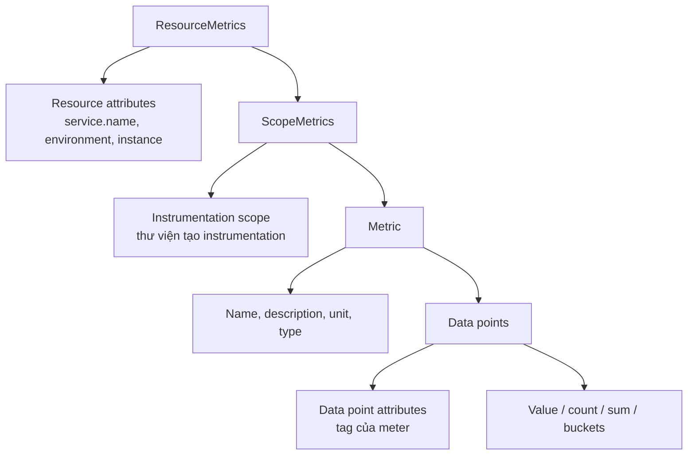

# Resource attributes và tag của từng meter

Khi Micrometer xuất metrics qua OTLP, mỗi phép đo có thể mang hai nhóm thuộc tính ở hai phạm vi khác nhau: Resource attributes mô tả thực thể đang phát telemetry, còn tag của meter mô tả chiều phân loại của phép đo. Cả hai đều được biểu diễn thành các cặp key-value trong dữ liệu OTLP, nhưng nằm ở các tầng khác nhau và phục vụ mục đích khác nhau.

Resource attributes giúp backend nhận biết metrics đến từ service, phiên bản, môi trường hoặc instance nào. Tag của meter giúp phân tích metric theo route, channel, operation hoặc kết quả xử lý. Đặt đúng thuộc tính vào đúng phạm vi giúp truy vấn nhất quán, giảm cardinality và tránh làm mất danh tính của từng instance.

Bài học thuộc module OBSERVABILITY_INSTRUMENTATION_MICROMETER. Module này hướng dẫn sử dụng Micrometer để đo lường ứng dụng Java bằng counter, gauge, timer, distribution summary và nhãn có kiểm soát; tích hợp Spring Boot, xuất metrics đến hệ giám sát, kiểm soát cardinality, kiểm thử instrumentation và diễn giải số đo vận hành.

## Mục tiêu học tập

Sau bài này, bạn có thể:

- Phân biệt Resource attributes với tag của từng meter.
- Nhận biết các tầng Resource, instrumentation scope, metric metadata và data point attributes trong OTLP.
- Chọn các thuộc tính nhận diện service, môi trường và instance.
- Gắn tag có cardinality thấp vào Counter, Gauge, Timer hoặc DistributionSummary.
- Cấu hình Resource attributes trong OtlpConfig hoặc Spring Boot.
- Hiểu common tags được áp dụng như thế nào và vì sao chúng vẫn là tag của meter.
- Kiểm tra Resource và data point attributes trong payload OTLP.
- Tránh xung đột danh tính giữa các instance và kiểm soát chi phí cardinality.

## 1. Hai phạm vi thuộc tính trong OTLP

OpenTelemetry định nghĩa Resource là tập thuộc tính mô tả thực thể đang được quan sát. Với ứng dụng Java, Resource thường đại diện cho một service instance đang chạy trong một môi trường cụ thể.

Tag của meter trong Micrometer được chuyển thành attributes của từng data point trong OTLP. Chúng mô tả chiều phân tích của phép đo, chẳng hạn channel của checkout hoặc route của HTTP request.

Ví dụ:

- Resource: service là `checkout-api`, namespace là `commerce`, môi trường là `production`, instance là `checkout-api-01`.
- Metric: `checkout.completed`.
- Data point attributes: `channel=web`, `result=success`.
- Data point value: số lượt checkout hoàn tất trong khoảng thời gian tương ứng.

Có thể hình dung cấu trúc OTLP theo các tầng:



Các tầng trả lời những câu hỏi khác nhau:

| Tầng | Mô tả | Ví dụ |
| --- | --- | --- |
| Resource | Thực thể nào đang được quan sát? | `service.name=checkout-api` |
| Instrumentation scope | Thư viện nào tạo ra instrumentation? | Tên và phiên bản thư viện |
| Metric metadata | Đang đo đại lượng nào? | `checkout.completed`, unit `orders` |
| Data point attributes | Đo theo chiều nào? | `channel=web`, `result=success` |
| Data point value | Giá trị được ghi nhận là bao nhiêu? | Count, gauge value hoặc histogram |

Resource attributes và data point attributes đều là attributes trong mô hình OTLP, nhưng chúng không nằm cùng một vị trí. Không nên chuyển tag của từng request thành Resource attribute hoặc dùng Resource để thay thế các chiều phân tích của metric.

## 2. Resource attributes mô tả service và instance

Resource attributes nên mô tả những đặc điểm ổn định của thực thể phát telemetry trong vòng đời của Resource. Với một ứng dụng Java, các thuộc tính thường dùng gồm:

| Attribute | Ý nghĩa | Ví dụ |
| --- | --- | --- |
| `service.name` | Tên logic của service | `checkout-api` |
| `service.namespace` | Nhóm hoặc miền chứa service | `commerce` |
| `service.version` | Phiên bản ứng dụng đang chạy | `1.4.0` |
| `service.instance.id` | Định danh duy nhất của instance trong service | `checkout-api-01` |
| `deployment.environment.name` | Môi trường triển khai | `production` |
| `host.name` | Tên máy chủ hoặc node | `worker-node-3` |
| `k8s.namespace.name` | Namespace Kubernetes | `commerce-prod` |
| `k8s.pod.name` | Tên Pod đang chạy ứng dụng | `checkout-api-7f8c9d` |

### Chọn giá trị ổn định và có ý nghĩa

**service.name** nên giống nhau giữa các replica của cùng một service. Ví dụ, tất cả instance của dịch vụ checkout đều dùng `checkout-api`. Không gắn số replica vào service.name vì khi đó backend sẽ xem mỗi replica như một service logic khác.

**service.instance.id** phân biệt các instance chạy đồng thời. Mỗi process hoặc instance cần có định danh duy nhất trong phạm vi service. Trong Kubernetes, có thể dùng Pod UID hoặc một giá trị được nền tảng triển khai cấp. Khi instance thay thế, định danh mới giúp backend phân biệt vòng đời của instance mới.

**service.version** biểu diễn phiên bản ứng dụng hoặc release đang chạy. Không dùng request version hay version do client gửi làm Resource attribute.

**deployment.environment.name** mô tả môi trường như development, staging hoặc production. Môi trường phải được lấy từ cấu hình triển khai, không lấy từ request.

**host.name** và các thuộc tính Kubernetes cung cấp thêm ngữ cảnh hạ tầng. Chỉ thêm các thuộc tính thực sự hữu ích cho việc tìm kiếm và điều tra sự cố.

Resource attributes được dùng cho tất cả metrics được xuất từ Resource đó. Vì vậy, chúng phải nhất quán trong suốt vòng đời của instance. Nếu một thuộc tính thay đổi theo từng request, đó không phải thuộc tính Resource phù hợp.

### Resource và danh tính của nhiều instance

Giả sử có ba replica cùng chạy:

| Instance | service.name | service.instance.id | environment |
| --- | --- | --- | --- |
| A | checkout-api | checkout-api-a | production |
| B | checkout-api | checkout-api-b | production |
| C | checkout-api | checkout-api-c | production |

Ba instance cùng thuộc một service logic, nhưng mỗi instance có Resource identity riêng. Backend có thể nhóm theo service.name để xem toàn dịch vụ hoặc lọc theo service.instance.id để điều tra một replica cụ thể.

Nếu nhiều process gửi cùng một metric với cùng Resource attributes và cùng tập data point attributes trong cùng thời điểm, chúng có thể tạo ra các metric stream trùng danh tính. Mô hình OTLP yêu cầu mỗi metric stream có một logical writer. Vì vậy, cần cung cấp Resource attributes đủ để phân biệt các nguồn ghi độc lập, đặc biệt là service instance.

## 3. Tag của từng meter mô tả chiều phân tích

Tag trong Micrometer là cặp key-value được gắn vào Meter.Id. Tag thường mô tả các chiều có thể thay đổi giữa các phép đo trong cùng một service hoặc instance.

Ví dụ với checkout:

```java
Counter completed = Counter.builder("checkout.completed")
        .description("Số lượt checkout hoàn tất")
        .baseUnit("orders")
        .tag("channel", "web")
        .tag("result", "success")
        .register(registry);
```

Trong ví dụ này:

- Name `checkout.completed` xác định loại phép đo.
- Tag `channel=web` phân loại theo kênh.
- Tag `result=success` phân loại theo kết quả.
- Base unit `orders` mô tả đơn vị.
- Counter ghi nhận số lượt hoàn tất.

Nếu có thêm channel `mobile`, Micrometer đăng ký một meter khác với cùng tên nhưng tag value khác. Trong OTLP, hai meter này tạo các data point attributes khác nhau thuộc cùng Resource và metric stream phù hợp theo mô hình export.

### Chọn tag theo ý nghĩa của phép đo

| Nhóm metric | Tag có thể dùng | Giá trị minh họa |
| --- | --- | --- |
| HTTP server request | `method`, `route`, `status` | GET, `/orders/{id}`, 2xx |
| Checkout | `channel`, `result` | web, success |
| Database | `pool`, `operation` | primary, SELECT |
| Cache | `cache`, `operation` | product, hit |
| Queue | `queue`, `result` | invoice, processed |
| Worker | `worker`, `outcome` | image, success |

Tag cần có tập giá trị hữu hạn hoặc có thể giới hạn rõ ràng. Không gắn user ID, order ID, request ID, trace ID, email, session ID, raw URL hoặc nội dung payload làm tag. Những giá trị này thường thay đổi liên tục và làm số Meter.Id tăng rất nhanh.

### Tag là một phần của định danh meter

Một meter được nhận diện bằng tên và tập tag. Nếu mỗi lần gọi builder lại truyền một tag value khác, registry có thể tạo một meter mới cho mỗi tổ hợp.

Ví dụ không an toàn:

```java
Counter.builder("checkout.completed")
        .tag("order.id", orderId)
        .register(registry)
        .increment();
```

Nếu mỗi đơn hàng có một order ID khác nhau, ứng dụng sẽ tạo nhiều meter riêng. Cách này vừa tăng cardinality vừa khiến metric không còn mang ý nghĩa tổng hợp.

Cách phù hợp là dùng chiều hữu hạn:

```java
Counter.builder("checkout.completed")
        .tag("channel", normalizeChannel(channel))
        .register(registry)
        .increment();
```

Nếu cần truy vết một order cụ thể, hãy dùng trace hoặc log có kiểm soát thay vì metric tag.

## 4. Phân biệt tag riêng với common tags

Micrometer cho phép thêm tag trực tiếp vào từng meter hoặc thêm common tags vào registry.

Tag riêng mô tả một chiều chỉ có ý nghĩa với một meter:

```java
Timer paymentDuration = Timer.builder("checkout.payment.duration")
        .description("Thời gian xử lý thanh toán")
        .tag("provider", "card")
        .tag("result", "success")
        .register(registry);
```

Common tags được áp dụng cho tất cả meter trong registry:

```java
registry.config().commonTags(
        "region", "ap-southeast-1",
        "cluster", "commerce-prod"
);
```

Common tags giúp bổ sung chiều môi trường hoặc vùng triển khai một cách nhất quán. Tuy nhiên, chúng vẫn là tag của meter và trở thành data point attributes trong OTLP. Chúng không tự động trở thành Resource attributes.

| Cách cấu hình | Phạm vi | Vị trí trong OTLP |
| --- | --- | --- |
| `Counter.builder(...).tag(...)` | Một meter | Data point attributes |
| `Timer.builder(...).tags(...)` | Một meter | Data point attributes |
| `registry.config().commonTags(...)` | Mọi meter trong registry | Data point attributes của từng metric |
| `OtlpConfig.resourceAttributes()` | Tất cả metrics của Resource | Resource attributes |

Nếu muốn thêm `service.name`, `service.instance.id` hoặc `deployment.environment.name` cho toàn bộ metrics, hãy cấu hình Resource attributes. Không nên dùng common tags như một cách thay thế Resource identity.

## 5. Cấu hình Resource attributes trong Micrometer OTLP độc lập

Micrometer cung cấp `OtlpConfig` để cấu hình `OtlpMeterRegistry`. Thuộc tính `resourceAttributes` là map key-value được áp dụng cho tất cả metrics xuất từ registry.

Ví dụ tạo cấu hình bằng một Map:

```java
import java.time.Clock;
import java.util.Map;

import io.micrometer.core.instrument.Counter;
import io.micrometer.core.instrument.MeterRegistry;
import io.micrometer.registry.otlp.OtlpConfig;
import io.micrometer.registry.otlp.OtlpMeterRegistry;

public final class OtlpMetricsConfiguration {

    public static MeterRegistry createRegistry() {
        Map<String, String> properties = Map.of(
                "url", "http://localhost:4318/v1/metrics",
                "step", "30s",
                "resourceAttributes",
                "service.name=checkout-api,"
                        + "service.namespace=commerce,"
                        + "service.version=1.4.0,"
                        + "deployment.environment.name=production,"
                        + "service.instance.id=checkout-api-01"
        );

        OtlpConfig config = new OtlpConfig() {
            @Override
            public String get(String key) {
                return properties.get(key);
            }
        };

        return new OtlpMeterRegistry(config, Clock.SYSTEM);
    }

    public static void registerCheckoutMetric(MeterRegistry registry) {
        Counter completed = Counter.builder("checkout.completed")
                .description("Số lượt checkout hoàn tất")
                .baseUnit("orders")
                .tag("channel", "web")
                .tag("result", "success")
                .register(registry);

        completed.increment();
    }
}
```

Trong ví dụ:

- `url` là endpoint nhận OTLP metrics qua HTTP.
- `step` là chu kỳ xuất metrics.
- `resourceAttributes` là danh sách Resource attributes dạng `key=value`, phân tách bằng dấu phẩy.
- `channel` và `result` vẫn là tag của meter.
- Registry gửi Resource attributes cùng các metric data point khi xuất dữ liệu.

Trong ứng dụng thực tế, không hard-code service version, instance ID hoặc endpoint. Hãy lấy các giá trị này từ cấu hình triển khai hoặc biến môi trường. Với `service.instance.id`, mỗi instance đồng thời cần một giá trị khác nhau.

### Giá trị mặc định của Micrometer

Theo cấu hình mặc định của Micrometer OTLP, Resource thường có các thuộc tính:

| Key | Giá trị mặc định |
| --- | --- |
| `telemetry.sdk.name` | `io.micrometer` |
| `telemetry.sdk.language` | `java` |
| `telemetry.sdk.version` | Phiên bản micrometer-core |
| `service.name` | `unknown_service` |

Hãy khai báo `service.name` rõ ràng để backend phân biệt service. Nếu không cấu hình Resource attributes trong OtlpConfig, implementation mặc định có thể đọc `OTEL_RESOURCE_ATTRIBUTES`. Biến `OTEL_SERVICE_NAME` được hỗ trợ để thiết lập tên service. Kiểm tra quy tắc ưu tiên theo phiên bản Micrometer đang dùng khi đồng thời khai báo cấu hình và biến môi trường.

## 6. Cấu hình trong Spring Boot

Spring Boot có thể auto-configure OtlpMeterRegistry khi dependency `micrometer-registry-otlp` có trên runtime classpath.

Với Gradle:

```kotlin
dependencies {
    implementation("org.springframework.boot:spring-boot-starter-actuator")
    runtimeOnly("io.micrometer:micrometer-registry-otlp")
}
```

Cấu hình endpoint và chu kỳ export trong `application.properties`:

```properties
management.otlp.metrics.export.url=http://otel-collector:4318/v1/metrics
management.otlp.metrics.export.step=30s
management.otlp.metrics.export.aggregation-temporality=cumulative
```

### Cấu hình Resource attributes theo phiên bản Spring Boot

Tên property cho Resource attributes thay đổi giữa các thế hệ Spring Boot. Cần dùng đúng namespace mà phiên bản dự án hỗ trợ.

Với Spring Boot 3.0 đến 3.3, property thường dùng là:

```properties
management.otlp.metrics.export.resource-attributes[service.name]=checkout-api
management.otlp.metrics.export.resource-attributes[service.namespace]=commerce
management.otlp.metrics.export.resource-attributes[service.version]=1.4.0
management.otlp.metrics.export.resource-attributes[deployment.environment.name]=production
management.otlp.metrics.export.resource-attributes[service.instance.id]=checkout-api-01
```

Từ Spring Boot 3.4, property cũ được thay bằng cấu hình Resource dùng chung:

```properties
management.opentelemetry.resource-attributes[service.name]=checkout-api
management.opentelemetry.resource-attributes[service.namespace]=commerce
management.opentelemetry.resource-attributes[service.version]=1.4.0
management.opentelemetry.resource-attributes[deployment.environment.name]=production
management.opentelemetry.resource-attributes[service.instance.id]=checkout-api-01
```

Trong Spring Boot hiện hành, Micrometer OTLP registry không sử dụng trực tiếp bean `Resource` của OpenTelemetry SDK. Tuy nhiên, `OTEL_RESOURCE_ATTRIBUTES`, `OTEL_SERVICE_NAME` và `management.opentelemetry.resource-attributes` vẫn được hỗ trợ để cấu hình Resource cho metrics OTLP. Nếu ứng dụng tự khai báo Resource bean, không nên mặc định rằng bean đó sẽ tự động thay đổi Resource của Micrometer OTLP registry.

Khi nâng cấp Spring Boot, hãy kiểm tra deprecated application properties và metadata của đúng phiên bản để chuyển namespace cấu hình. Không khai báo cả hai namespace chỉ để thử; cấu hình rõ một nguồn có hiệu lực giúp tránh nhầm lẫn khi xác định giá trị cuối cùng.

### Cấu hình qua biến môi trường

Có thể truyền Resource attributes bằng các biến môi trường chuẩn:

```bash
OTEL_SERVICE_NAME=checkout-api
OTEL_RESOURCE_ATTRIBUTES=service.namespace=commerce,service.version=1.4.0,deployment.environment.name=production,service.instance.id=checkout-api-01
```

`OTEL_RESOURCE_ATTRIBUTES` dùng danh sách key-value phân tách bằng dấu phẩy. Nếu giá trị chứa ký tự đặc biệt ngoài phạm vi được cho phép, cần percent-encode theo quy tắc OpenTelemetry. Tránh để dấu phẩy hoặc dấu bằng trong giá trị chưa được mã hóa vì chúng có thể làm sai cách phân tách.

Biến môi trường hữu ích khi cùng một image được triển khai qua nhiều môi trường. Mỗi môi trường có thể cấp service version, environment và instance ID khác nhau mà không cần sửa mã nguồn.

## 7. Tag theo từng meter trong Spring Boot

Các component nghiệp vụ có thể inject MeterRegistry và tạo meter với tag riêng:

```java
import io.micrometer.core.instrument.Counter;
import io.micrometer.core.instrument.MeterRegistry;
import org.springframework.stereotype.Component;

@Component
public class CheckoutMetrics {

    private final Counter completed;

    public CheckoutMetrics(MeterRegistry registry) {
        this.completed = Counter.builder("checkout.completed")
                .description("Số lượt checkout hoàn tất")
                .baseUnit("orders")
                .tag("channel", "web")
                .tag("result", "success")
                .register(registry);
    }

    public void checkoutCompleted() {
        completed.increment();
    }
}
```

Các tag `channel` và `result` được xuất cùng data point của metric. Resource attributes của registry vẫn được áp dụng cho metrics này mà không cần thêm lại ở builder.

Nếu muốn thêm common tags cho toàn registry:

```java
registry.config().commonTags(
        "region", "ap-southeast-1",
        "cluster", "commerce-prod"
);
```

Hãy phân biệt rõ:

- Resource attributes nhận diện service và instance.
- Common tags bổ sung chiều phân tích chung cho mọi meter.
- Tag riêng mô tả chiều chỉ áp dụng cho một meter.
- Name, description và base unit mô tả bản thân metric.

### Tag từ Micrometer Observation

Nếu dùng Micrometer Observation, các key-value cũng có phân loại cardinality:

```java
Observation.createNotStarted("checkout.process", observationRegistry)
        .lowCardinalityKeyValue("channel", "web")
        .lowCardinalityKeyValue("result", "success")
        .highCardinalityKeyValue("order.id", orderId)
        .observe(() -> checkoutService.process(orderId));
```

Low-cardinality key-value được đưa vào metrics và traces. High-cardinality key-value chỉ được đưa vào traces theo cơ chế mặc định của Observation, không trở thành metric tag. Đây là cách giữ chiều phân tích của metrics có giới hạn trong khi vẫn có thể truy vết request cụ thể qua trace.

Không đưa `order.id` vào low-cardinality key-value. Nếu dùng API tạo meter trực tiếp, hãy tự bảo đảm chỉ đăng ký các tag có tập giá trị hữu hạn.

## 8. Chọn đúng phạm vi cho từng thuộc tính

Một câu hỏi thực tế khi thiết kế metrics là: thuộc tính này mô tả service, instance hay một phép đo?

| Thuộc tính | Nên đặt ở đâu? | Lý do |
| --- | --- | --- |
| Tên service | Resource | Ổn định cho toàn bộ metrics của service |
| Phiên bản ứng dụng | Resource | Mô tả release đang chạy |
| Môi trường triển khai | Resource | Dùng để phân biệt production, staging, development |
| Instance ID | Resource | Phân biệt nguồn ghi metrics |
| Region | Resource hoặc tag chung theo quy ước hệ thống | Resource nếu mô tả vị trí của instance; tag nếu cần chiều metric có chủ đích và backend yêu cầu |
| HTTP method | Tag của meter | Phân loại request theo thao tác |
| Route template | Tag của meter | Phân tích latency hoặc request count theo endpoint |
| Kết quả checkout | Tag của meter | Phân tích thành công, thất bại hoặc bị từ chối |
| Database operation | Tag của meter | Phân loại SELECT, INSERT, UPDATE |
| Order ID | Không đưa vào metric | Định danh riêng của một nghiệp vụ |
| Request ID | Không đưa vào metric | Định danh riêng của một lần gọi |
| Trace ID | Exemplar hoặc trace context | Dùng liên kết metrics với trace, không dùng làm dimension |

Region có thể xuất hiện như Resource attribute hoặc meter tag tùy mục tiêu và quy ước của hệ thống. Nếu region mô tả vị trí triển khai của instance, Resource là phạm vi tự nhiên. Nếu cần phân tích một metric theo vùng và backend yêu cầu dimension ở data point, có thể dùng tag với tập giá trị vùng hữu hạn. Không thêm cùng một chiều vào nhiều nơi nếu chưa xác định rõ lý do truy vấn.

## 9. Cardinality và chi phí của tag

Cardinality là số tổ hợp giá trị khác nhau của name và tag tạo thành các meter hoặc metric stream. Mỗi tag mới có thể nhân số tổ hợp theo số giá trị của tag đó.

Ví dụ, metric `http.server.requests` có:

- `method`: 5 giá trị.
- `route`: 30 route template.
- `status`: 5 nhóm status.

Số tổ hợp tối đa là:

`5 × 30 × 5 = 750`

Nếu thêm tag `user.id` với 100.000 giá trị, số tổ hợp lý thuyết có thể tăng đến:

`750 × 100.000 = 75.000.000`

Điều này có thể làm tăng bộ nhớ trong ứng dụng, payload export, lượng dữ liệu ingest và chi phí lưu trữ.

Resource attributes cũng có vai trò trong danh tính metric stream. Mỗi instance có Resource riêng là điều cần thiết để phân biệt nguồn dữ liệu, nhưng không nên thêm các thuộc tính biến đổi theo request vào Resource. Resource attributes cần ổn định trong vòng đời của instance.

### Quy tắc thiết kế

- Dùng enum hoặc allow-list cho tag values.
- Chuẩn hóa URL thành route template.
- Dùng nhóm status như 2xx, 4xx, 5xx nếu mã status chi tiết không cần thiết.
- Không dùng email, user ID, session ID, request ID hoặc order ID.
- Không đưa token, cookie, API key, nội dung request hoặc exception message vào attributes.
- Chỉ thêm common tags thật sự cần cho truy vấn.
- Đặt giới hạn cardinality bằng MeterFilter như lớp bảo vệ bổ sung.
- Theo dõi số lượng metric streams sau khi export đến collector hoặc backend.

Không dùng Resource attributes như cách né giới hạn cardinality. Dù Resource và data point attributes nằm ở phạm vi khác nhau, mỗi Resource identity mới vẫn tạo thêm luồng dữ liệu cần quản lý.

## 10. Kiểm tra dữ liệu Resource và meter tags trong OTLP

Kiểm tra ở lớp Micrometer và lớp OTLP giúp xác nhận các thuộc tính nằm đúng vị trí.

### Kiểm tra Meter.Id

Với meter tạo trực tiếp, có thể kiểm tra tên và tag thông qua registry:

```java
Counter completed = Counter.builder("checkout.completed")
        .tag("channel", "web")
        .tag("result", "success")
        .register(registry);

assertThat(completed.getId().getName())
        .isEqualTo("checkout.completed");
assertThat(completed.getId().getTag("channel"))
        .isEqualTo("web");
assertThat(completed.getId().getTag("result"))
        .isEqualTo("success");
```

Đoạn kiểm thử này xác nhận tag được gắn vào Meter.Id. Nó chưa chứng minh Resource attributes đã được export.

### Kiểm tra Resource attributes của OtlpConfig

Có thể tạo OtlpConfig dùng Map trong unit test để xác minh việc phân tích cấu hình Resource attributes:

```java
import static org.assertj.core.api.Assertions.assertThat;

import java.util.Map;

import io.micrometer.registry.otlp.OtlpConfig;
import org.junit.jupiter.api.Test;

class OtlpResourceAttributesTest {

    @Test
    void parsesResourceAttributes() {
        Map<String, String> properties = Map.of(
                "resourceAttributes",
                "service.name=checkout-api,"
                        + "deployment.environment.name=production"
        );

        OtlpConfig config = new OtlpConfig() {
            @Override
            public String get(String key) {
                return properties.get(key);
            }
        };

        assertThat(config.resourceAttributes())
                .containsEntry("service.name", "checkout-api")
                .containsEntry(
                        "deployment.environment.name",
                        "production"
                );
    }
}
```

Test này xác minh map cấu hình được phân tích đúng ở lớp OtlpConfig. Nó không thay thế kiểm thử export thực tế.

### Kiểm tra payload qua OpenTelemetry Collector

Trong môi trường thử nghiệm, có thể cấu hình Collector nhận OTLP HTTP và dùng debug exporter để quan sát cấu trúc telemetry:

```yaml
receivers:
  otlp:
    protocols:
      http:
        endpoint: 0.0.0.0:4318

exporters:
  debug:
    verbosity: detailed

service:
  pipelines:
    metrics:
      receivers: [otlp]
      exporters: [debug]
```

Khi ứng dụng gửi metrics, output debug giúp xác nhận:

- Resource attributes xuất hiện ở Resource của metrics.
- Metric name, description và unit đúng như instrumentation.
- Tag của meter nằm trong attributes của data point.
- Mỗi instance có Resource identity phù hợp.
- Không có ID hoặc dữ liệu nhạy cảm xuất hiện trong attributes.

Chỉ dùng debug exporter ở môi trường kiểm thử vì output có thể lớn và chứa toàn bộ metadata metrics. Không bật verbosity chi tiết trên production nếu chưa đánh giá lượng log và quyền truy cập.

## 11. Các lỗi thường gặp

| Lỗi | Hệ quả | Cách xử lý |
| --- | --- | --- |
| Đưa `service.name` vào tag của mọi meter | Lặp lại thông tin service trong từng data point và làm phức tạp quy ước | Đặt service identity ở Resource |
| Dùng common tags để cấu hình Resource | Nghĩ rằng common tags trở thành Resource attributes | Dùng OtlpConfig hoặc cấu hình Resource của Spring Boot |
| Không đặt `service.name` | Backend hiển thị `unknown_service` hoặc khó nhóm metrics | Khai báo tên service ổn định |
| Dùng cùng `service.instance.id` cho mọi replica | Nhiều writer có thể trùng Resource identity | Cấp ID duy nhất cho từng instance |
| Đưa user ID vào meter tag | Cardinality tăng mạnh | Dùng trace hoặc log có kiểm soát |
| Đưa request ID vào Resource | Resource identity thay đổi theo request | Giữ Resource ổn định theo vòng đời process |
| Thay Resource attributes giữa lúc process chạy | Một process có thể phát dữ liệu với danh tính không nhất quán | Khởi tạo Resource attributes từ cấu hình ổn định |
| Nhầm metric metadata với attributes | Đặt unit hoặc description thành tag | Dùng name, description, base unit đúng vai trò |
| Chỉ test Meter.Id | Không phát hiện lỗi cấu hình Resource export | Kiểm thử OtlpConfig và payload Collector |
| Dùng property namespace cũ sau nâng cấp Spring Boot | Resource attributes không được bind như dự kiến | Kiểm tra deprecated properties và namespace mới |

## 12. Checklist thiết kế

Trước khi phát hành metrics OTLP, hãy xác nhận:

1. Resource có `service.name` rõ ràng và ổn định không?
2. Mỗi instance có `service.instance.id` riêng không?
3. Service version và environment có lấy từ cấu hình triển khai không?
4. Resource attributes có giữ nguyên trong vòng đời instance không?
5. Tag của từng meter có phản ánh chiều phân tích cần thiết không?
6. Tag values có cardinality thấp và không chứa dữ liệu nhạy cảm không?
7. Common tags có được hiểu đúng là meter tags không?
8. Property namespace có đúng phiên bản Spring Boot không?
9. Payload OTLP đã được kiểm tra ở Collector hoặc backend chưa?
10. Backend có thể nhóm theo service, environment và instance đúng như mong muốn không?

## Kết luận

Resource attributes nhận diện service và instance đang phát telemetry; tag của meter phân loại từng phép đo theo các chiều như route, channel, operation hoặc result. Trong OTLP, Resource attributes nằm ở ResourceMetrics, còn tag của Micrometer trở thành attributes của data point. Common tags được áp dụng cho mọi meter nhưng vẫn thuộc phạm vi data point.

Hãy đặt service.name, service.version, environment và service.instance.id ở Resource; đặt các chiều nghiệp vụ có cardinality thấp vào tag của meter. Cấu hình đúng theo phiên bản Micrometer và Spring Boot, rồi kiểm tra payload tại Collector để xác nhận thuộc tính xuất hiện ở đúng tầng. Cách tổ chức này giúp backend phân biệt nguồn dữ liệu, tổng hợp metrics chính xác và giữ cardinality trong giới hạn vận hành.

## Tài liệu tham khảo

- [Micrometer OTLP Registry](https://docs.micrometer.io/micrometer/reference/implementations/otlp.html) — cấu hình OtlpConfig, resourceAttributes, các kiểu metric và export.
- [OpenTelemetry Resource Data Model](https://opentelemetry.io/docs/specs/otel/resource/data-model/) — ý nghĩa và danh tính của Resource.
- [OpenTelemetry Metrics Data Model](https://opentelemetry.io/docs/specs/otel/metrics/data-model/) — Resource, instrumentation scope, metric stream và data point attributes.
- [Spring Boot Metrics](https://docs.spring.io/spring-boot/reference/actuator/metrics.html) — registry, common tags và OTLP export.
- [Spring Boot Observability](https://docs.spring.io/spring-boot/reference/actuator/observability.html) — Resource attributes và khác biệt giữa Micrometer metrics với OpenTelemetry SDK.
