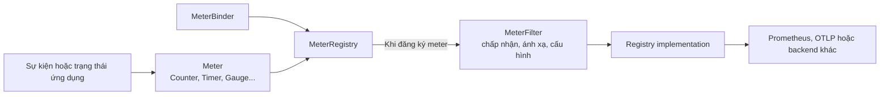

# Vai trò của Meter, MeterRegistry, MeterBinder và MeterFilter

Micrometer cung cấp một lớp API thống nhất để ứng dụng Java ghi nhận số đo vận hành mà không phải gắn chặt mã nghiệp vụ với một hệ thống giám sát cụ thể. Bốn thành phần Meter, MeterRegistry, MeterBinder và MeterFilter đảm nhiệm bốn việc khác nhau: mô tả số đo, quản lý và xuất số đo, gom nhóm việc đăng ký instrumentation, và áp dụng chính sách cho các meter.

Hiểu ranh giới giữa chúng giúp thiết kế instrumentation dễ kiểm thử, có thể đổi backend và kiểm soát số lượng chuỗi thời gian khi ứng dụng chạy ở quy mô lớn.

## Mục tiêu học tập

Sau bài này, bạn có thể:

- Phân biệt một Meter với MeterRegistry và backend nhận metrics.
- Chọn Counter, Gauge, Timer hoặc DistributionSummary theo ý nghĩa của dữ liệu.
- Dùng MeterBinder để đăng ký một nhóm meter từ trạng thái của ứng dụng.
- Dùng MeterFilter để giới hạn, đổi tên hoặc cấu hình meter trước khi chúng được đăng ký.
- Tổ chức các thành phần trên trong ứng dụng Spring Boot và kiểm thử bằng SimpleMeterRegistry.

## 1. Bức tranh kiến trúc

Một luồng metrics điển hình bắt đầu từ sự kiện hoặc trạng thái trong ứng dụng. Mã instrumentation biểu diễn thông tin đó bằng meter. Meter được đăng ký vào một MeterRegistry. Registry áp dụng các MeterFilter đã cấu hình khi xử lý đăng ký, sau đó dùng implementation tương ứng để lưu trữ tạm thời và xuất số đo đến hệ thống giám sát.

MeterBinder hỗ trợ bước đăng ký bằng cách gom các meter có liên quan vào một đơn vị có thể bind vào registry.



MeterFilter là một phần của quy trình đăng ký trong registry. Nó không nằm trên đường đi của từng lần gọi increment hoặc record sau khi meter đã được tạo. Vì vậy, cần cấu hình filter trước khi instrumentation đăng ký các meter.

## 2. Meter: đại diện cho một phép đo

Meter là abstraction cơ bản mà Micrometer dùng để biểu diễn một phép đo. Mỗi meter có một định danh, thường được gọi là Meter.Id, gồm tên, tập tag và thông tin mô tả như loại meter, đơn vị cơ sở hoặc description. Tên cùng tập tag xác định một meter trong registry.

Ví dụ, `checkout.completed` với tag `channel=web` là một meter khác với `checkout.completed` có tag `channel=mobile`. Khi tên hoặc giá trị tag thay đổi, hệ thống giám sát có thể tạo một chuỗi thời gian riêng.

Micrometer cung cấp nhiều loại meter. Hãy chọn loại dựa trên ý nghĩa của đại lượng cần đo:

| Loại meter | Dùng khi | Ví dụ |
| --- | --- | --- |
| Counter | Đếm sự kiện chỉ tăng | Số đơn hàng hoàn tất, số lần xử lý lỗi |
| Gauge | Quan sát giá trị hiện tại có thể tăng hoặc giảm | Số tác vụ đang chạy, độ sâu hàng đợi |
| Timer | Đo thời lượng và số lần một thao tác được thực hiện | Thời gian xử lý request hoặc thanh toán |
| DistributionSummary | Đo phân phối của một giá trị không phải thời gian | Kích thước payload, số bản ghi mỗi batch |
| LongTaskTimer | Theo dõi thời lượng của tác vụ vẫn đang chạy | Tác vụ import hoặc báo cáo kéo dài |
| FunctionCounter / FunctionTimer | Đọc số liệu từ một hàm hoặc đối tượng có sẵn | Bộ đếm tích lũy do thư viện khác quản lý |
| TimeGauge | Quan sát một giá trị thời gian hiện tại | Thời điểm hoặc khoảng thời gian được biểu diễn bằng đơn vị thời gian |

### Chọn đúng loại meter

**Counter** phù hợp với sự kiện tích lũy. Giá trị chỉ tăng; backend thường tính tốc độ tăng theo một khoảng thời gian. Không dùng Counter để biểu diễn số lượng hiện tại có thể giảm, chẳng hạn số kết nối đang mở. Trường hợp đó phù hợp với Gauge.

**Gauge** đọc giá trị tại thời điểm registry thu thập hoặc xuất metrics. Nó không phải bộ đếm sự kiện. Đối tượng được Gauge quan sát cần còn được giữ tham chiếu trong ứng dụng; nếu đối tượng bị garbage collector thu hồi, Gauge có thể không còn cung cấp giá trị hữu ích. Với trạng thái quan trọng, hãy giữ đối tượng đó trong một field hoặc một bean có vòng đời phù hợp.

**Timer** thường là lựa chọn tốt nhất khi đo latency. Nó ghi nhận số lần thực hiện và tổng thời lượng, đồng thời có thể cấu hình histogram hoặc percentile tùy backend và yêu cầu quan sát. Dùng Timer thay vì tự tạo một Counter cho số lần gọi và một Gauge cho thời gian xử lý.

**DistributionSummary** phù hợp với phân phối của các giá trị như byte, số phần tử hoặc kích thước batch. Nếu đại lượng là thời gian, ưu tiên Timer vì Timer có ngữ nghĩa và cách biểu diễn dành riêng cho thời lượng.

### Ví dụ ghi nhận metrics trong mã ứng dụng

Ví dụ dưới đây tạo Counter và Timer từ MeterRegistry được Spring inject:

```java
import io.micrometer.core.instrument.Counter;
import io.micrometer.core.instrument.MeterRegistry;
import io.micrometer.core.instrument.Timer;
import org.springframework.stereotype.Component;

@Component
public class CheckoutMetrics {

    private final Counter completed;
    private final Timer paymentDuration;

    public CheckoutMetrics(MeterRegistry registry) {
        this.completed = Counter.builder("checkout.completed")
                .description("Số lượt checkout hoàn tất")
                .tag("channel", "web")
                .register(registry);

        this.paymentDuration = Timer.builder("checkout.payment.duration")
                .description("Thời gian xử lý thanh toán")
                .register(registry);
    }

    public void recordCompleted() {
        completed.increment();
    }

    public void recordPayment(Runnable paymentOperation) {
        paymentDuration.record(paymentOperation);
    }
}
```

Tag `channel=web` trong ví dụ là giá trị cố định. Nếu cần phân biệt nhiều kênh, hãy dùng một tập giá trị hữu hạn đã được kiểm soát, chẳng hạn `web`, `mobile` và `partner`. Tránh đưa mã người dùng, mã request hoặc chuỗi URL chứa ID vào tag.

## 3. MeterRegistry: nơi quản lý meter và xuất metrics

MeterRegistry quản lý các meter được đăng ký trong một registry. Mã instrumentation tạo meter thông qua registry; registry quản lý định danh, cấu hình, tra cứu và cơ chế xuất số đo tương ứng với implementation đang dùng.

Một số implementation thường gặp:

- SimpleMeterRegistry lưu số đo trong bộ nhớ, hữu ích cho kiểm thử hoặc ví dụ cục bộ.
- PrometheusMeterRegistry cung cấp metrics theo định dạng mà Prometheus có thể scrape.
- OtlpMeterRegistry xuất metrics theo OpenTelemetry Protocol.
- Các registry khác có thể gửi metrics đến hệ thống giám sát tương ứng.
- CompositeMeterRegistry có thể chuyển tiếp meter đến nhiều registry con.

Micrometer core định nghĩa API chung. Implementation cụ thể quyết định cách metrics được lưu và chuyển đến hệ thống nhận. Vì thế, mã nghiệp vụ nên phụ thuộc vào MeterRegistry và các abstraction của Micrometer, thay vì gọi trực tiếp API của Prometheus hay một nhà cung cấp khác.

Trong ứng dụng Spring Boot, khi có Actuator và dependency registry phù hợp, auto-configuration có thể tạo MeterRegistry tương ứng. Các service hoặc component có thể nhận registry qua constructor injection:

```java
@Component
public class OrderMetrics {

    private final Counter created;

    public OrderMetrics(MeterRegistry registry) {
        this.created = registry.counter("orders.created");
    }

    public void orderCreated() {
        created.increment();
    }
}
```

Cách này làm rõ dependency, thuận tiện thay registry trong test và tránh phụ thuộc ngầm vào global registry. Hạn chế dùng `Metrics.globalRegistry` trong mã ứng dụng nếu không có lý do cụ thể, vì nó khiến cấu hình và vòng đời metrics khó kiểm soát hơn.

Registry cũng cung cấp điểm cấu hình chung thông qua `registry.config()`. Tại đây có thể thêm common tags, MeterFilter và các chính sách liên quan đến việc đăng ký meter.

## 4. MeterBinder: gom nhóm việc đăng ký meter

MeterBinder là một interface có phương thức:

```java
void bindTo(MeterRegistry registry);
```

Một implementation của MeterBinder nhận registry rồi đăng ký một nhóm meter vào registry đó. Đây là cách tổ chức phù hợp khi các phép đo thuộc cùng một thành phần, chẳng hạn hàng đợi, cache, client kết nối hoặc một nhóm trạng thái nghiệp vụ.

Micrometer có sẵn nhiều binder cho thông tin JVM và hệ thống. Ví dụ, các binder có thể cung cấp số liệu về bộ nhớ, garbage collection, thread, class loader hoặc bộ xử lý. Nhờ binder, ứng dụng không cần tự viết lại toàn bộ phần đọc trạng thái nền tảng.

### Tạo binder cho trạng thái của ứng dụng

Giả sử ứng dụng có một đối tượng QueueState quản lý hàng đợi và cung cấp phương thức size():

```java
import io.micrometer.core.instrument.Gauge;
import io.micrometer.core.instrument.MeterRegistry;
import io.micrometer.core.instrument.binder.MeterBinder;
import org.springframework.stereotype.Component;

@Component
public class QueueMetrics implements MeterBinder {

    private final QueueState queueState;

    public QueueMetrics(QueueState queueState) {
        this.queueState = queueState;
    }

    @Override
    public void bindTo(MeterRegistry registry) {
        Gauge.builder("queue.depth", queueState, QueueState::size)
                .description("Số phần tử hiện có trong hàng đợi")
                .register(registry);
    }
}
```

QueueState ở đây là thành phần của ứng dụng, không phải lớp của Micrometer. Gauge đọc trực tiếp trạng thái hiện tại thông qua hàm được cung cấp.

Trong Spring Boot, các bean triển khai MeterBinder được auto-configuration phát hiện và bind vào MeterRegistry. Khi không dùng cơ chế tự động này, ứng dụng có thể gọi `bindTo(registry)` một cách tường minh.

Một binder nên giữ tham chiếu đến đối tượng trạng thái cần quan sát và tạo meter cho registry được truyền vào. Đừng giả định một binder chỉ luôn được gọi với duy nhất một registry: cấu hình nhiều registry hoặc composite có thể khiến binder được bind vào nhiều registry. Vì vậy, tránh lưu một meter handle gắn với registry cụ thể vào field dùng chung nếu binder có thể được tái sử dụng.

### Khi nào nên dùng MeterBinder?

Dùng MeterBinder khi cần đóng gói một nhóm phép đo có cùng nguồn dữ liệu hoặc cùng vòng đời. Ví dụ, QueueMetrics chịu trách nhiệm cho các số đo của hàng đợi; CacheMetrics chịu trách nhiệm cho trạng thái cache. Với một Counter hoặc Timer đơn lẻ gắn trực tiếp với một thao tác nghiệp vụ, tạo meter từ MeterRegistry trong component sở hữu thao tác đó thường dễ hiểu hơn.

## 5. MeterFilter: áp dụng chính sách khi đăng ký meter

MeterFilter cho phép điều chỉnh meter trong quá trình đăng ký vào MeterRegistry. Filter hữu ích để:

- Chấp nhận hoặc từ chối meter theo tên hay định danh.
- Ánh xạ tên hoặc tag để thống nhất quy ước.
- Áp dụng cấu hình phân phối như percentile hoặc histogram cho một nhóm meter.
- Giới hạn số lượng meter hoặc số giá trị tag để kiểm soát cardinality.

Ở mức interface, MeterFilter có ba điểm mở rộng chính:

- `accept(Meter.Id id)` quyết định meter được chấp nhận, từ chối hay để filter khác quyết định tiếp. Kết quả thuộc nhóm ACCEPT, DENY hoặc NEUTRAL.
- `map(Meter.Id id)` cho phép ánh xạ định danh, ví dụ điều chỉnh tên hoặc tag.
- `configure(Meter.Id id, DistributionStatisticConfig config)` cho phép điều chỉnh cấu hình thống kê phân phối của meter.

Micrometer cũng cung cấp các factory method để tạo filter phổ biến, nên phần lớn ứng dụng không cần tự triển khai interface.

### Từ chối một nhóm meter

Ví dụ sau từ chối meter có tên bắt đầu bằng `internal.debug`:

```java
import io.micrometer.core.instrument.config.MeterFilter;
import org.springframework.context.annotation.Bean;
import org.springframework.context.annotation.Configuration;

@Configuration
public class MetricsFilterConfiguration {

    @Bean
    MeterFilter denyInternalDebugMetrics() {
        return MeterFilter.denyNameStartsWith("internal.debug");
    }
}
```

Trong Spring Boot, các bean MeterFilter được cấu hình vào registry bởi cơ chế metrics auto-configuration. Nếu tự tạo MeterRegistry, hãy thêm filter qua `registry.config().meterFilter(...)` trước khi đăng ký các meter cần chịu chính sách đó.

### Giới hạn cardinality của tag

Cardinality là số lượng tổ hợp định danh khác nhau mà metrics tạo ra. Với meter có tên `http.server.requests`, mỗi giá trị `uri` mới có thể tạo thêm một chuỗi thời gian. Nếu tag chứa URL thô như `/orders/10001`, `/orders/10002`, mỗi order ID có thể trở thành một giá trị riêng và làm số chuỗi thời gian tăng nhanh.

Có thể đặt giới hạn cho số giá trị tag:

```java
@Bean
MeterFilter limitUriCardinality() {
    return MeterFilter.maximumAllowableTags(
            "http.server.requests",
            "uri",
            100,
            MeterFilter.deny()
    );
}
```

Ví dụ này giới hạn số giá trị `uri` được chấp nhận cho nhóm meter `http.server.requests`. Khi vượt ngưỡng, filter cuối cùng từ chối meter mới không đáp ứng giới hạn. Hãy chọn ngưỡng dựa trên số route hợp lệ của ứng dụng và theo dõi tác động của chính sách.

Giới hạn ở filter là lớp bảo vệ bổ sung. Thiết kế tag ngay từ đầu vẫn rất quan trọng: chuẩn hóa đường dẫn thành route template như `/orders/{id}`, dùng enum hoặc tập giá trị hữu hạn cho `method`, `status`, `channel`; không dùng email, user ID, session ID, request ID, địa chỉ IP hoặc thông báo lỗi đầy đủ làm tag.

### Common tags và cấu hình phân phối

Common tags gắn những chiều phân loại ổn định vào các meter trong một registry, chẳng hạn tên ứng dụng hoặc môi trường. Với Spring Boot, có thể dùng MeterRegistryCustomizer:

```java
import io.micrometer.core.instrument.MeterRegistry;
import org.springframework.boot.actuate.autoconfigure.metrics.MeterRegistryCustomizer;
import org.springframework.context.annotation.Bean;
import org.springframework.context.annotation.Configuration;

@Configuration
public class MetricsRegistryConfiguration {

    @Bean
    MeterRegistryCustomizer<MeterRegistry> commonTags() {
        return registry -> registry.config().commonTags(
                "application", "checkout-api",
                "environment", "production"
        );
    }
}
```

Trong hệ thống thực tế, các giá trị như tên ứng dụng và môi trường nên lấy từ cấu hình triển khai. Đảm bảo key common tag không xung đột với tag được thêm riêng ở từng meter.

MeterFilter còn có thể điều chỉnh cấu hình phân phối của Timer hoặc DistributionSummary, ví dụ bật percentile histogram hoặc đặt giới hạn kỳ vọng thấp nhất và cao nhất. Cấu hình này ảnh hưởng đến lượng dữ liệu được tạo ra và khả năng tổng hợp ở backend; hãy chọn dựa trên mục tiêu quan sát và chi phí lưu trữ.

## 6. Phối hợp các thành phần trong Spring Boot

Một cấu hình điển hình có thể được tổ chức như sau:

1. Dependency Actuator và registry implementation cung cấp MeterRegistry phù hợp với backend.
2. Các service hoặc component nghiệp vụ inject MeterRegistry để tạo Counter, Timer hoặc meter cần thiết.
3. Các component cần công bố một nhóm trạng thái triển khai MeterBinder.
4. MeterRegistryCustomizer thêm common tags hoặc tùy chỉnh registry.
5. MeterFilter áp dụng chính sách chấp nhận, ánh xạ và cardinality.
6. Registry implementation xuất metrics theo cơ chế của backend, chẳng hạn để Prometheus scrape hoặc gửi dữ liệu qua OTLP.

Không nên nhầm MeterBinder với MeterFilter. Binder tạo và đăng ký meter. Filter kiểm soát meter được đăng ký như thế nào. Cũng không nên nhầm MeterRegistry với hệ thống giám sát: registry là thành phần Micrometer trong tiến trình ứng dụng, còn backend chịu trách nhiệm thu thập, lưu trữ, truy vấn và hiển thị dữ liệu.

## 7. Kiểm thử instrumentation

Có thể dùng SimpleMeterRegistry để kiểm tra hành vi instrumentation mà không cần khởi động Prometheus hoặc một backend bên ngoài:

```java
import static org.assertj.core.api.Assertions.assertThat;

import io.micrometer.core.instrument.Counter;
import io.micrometer.core.instrument.simple.SimpleMeterRegistry;
import org.junit.jupiter.api.Test;

class CheckoutMetricsTest {

    @Test
    void recordsCompletedCheckout() {
        var registry = new SimpleMeterRegistry();
        Counter completed = registry.counter(
                "checkout.completed",
                "channel",
                "web"
        );

        completed.increment();

        assertThat(registry.get("checkout.completed")
                .tag("channel", "web")
                .counter()
                .count()).isEqualTo(1.0);
    }
}
```

Với instrumentation thực tế, hãy khởi tạo component bằng SimpleMeterRegistry, gọi phương thức nghiệp vụ rồi kiểm tra meter được tạo, tag đúng và giá trị thay đổi như mong đợi. Với MeterBinder, gọi bindTo(registry) rồi kiểm tra Gauge hoặc meter tương ứng. Với MeterFilter, kiểm tra cả trường hợp được chấp nhận và trường hợp bị từ chối hoặc vượt giới hạn.

Kiểm thử ở cấp registry xác nhận instrumentation đã phát ra số đo đúng. Nó không thay thế kiểm thử cấu hình exporter, endpoint scrape, xác thực kết nối hoặc việc backend thực sự nhận dữ liệu.

## 8. Lỗi thiết kế thường gặp

| Vấn đề | Hệ quả | Cách xử lý |
| --- | --- | --- |
| Dùng Gauge để đếm sự kiện tích lũy | Giá trị có thể không phản ánh tổng số sự kiện | Dùng Counter |
| Dùng Counter cho số lượng hiện tại | Không thể biểu diễn việc giá trị giảm | Dùng Gauge |
| Đo latency bằng nhiều meter tự ghép | Dễ sai lệch giữa số lần gọi và thời lượng | Dùng Timer |
| Đưa ID động vào tag | Cardinality và chi phí backend tăng mạnh | Chuẩn hóa hoặc loại bỏ tag có giá trị không giới hạn |
| Tạo meter trong mỗi lần gọi mà tag thay đổi liên tục | Registry tích lũy nhiều meter khác nhau | Dùng tập tag hữu hạn và tạo meter có chủ đích |
| Thêm MeterFilter sau khi meter đã đăng ký | Meter đã tồn tại có thể không chịu chính sách mới | Cấu hình filter sớm trong vòng đời registry |
| Binder giữ meter handle của một registry trong field dùng chung | Có thể gắn nhầm handle khi bind nhiều registry | Tạo meter trên registry được truyền vào và giữ trạng thái nguồn |
| Chỉ kiểm tra số liệu trong SimpleMeterRegistry | Chưa xác nhận đường xuất đến backend | Bổ sung kiểm thử tích hợp cho exporter và backend |

## 9. Cách ghi nhớ ranh giới trách nhiệm

| Thành phần | Câu hỏi nó trả lời | Trách nhiệm chính |
| --- | --- | --- |
| Meter | Đang đo điều gì? | Biểu diễn một phép đo cùng tên, tag và loại đo |
| MeterRegistry | Meter được quản lý và xuất đi đâu? | Đăng ký, quản lý, cấu hình và xuất metrics |
| MeterBinder | Làm sao đăng ký một nhóm meter? | Đóng gói việc bind các meter vào registry |
| MeterFilter | Meter nào được phép và được cấu hình ra sao? | Áp dụng chính sách lên định danh và cấu hình khi đăng ký |

Khi thiết kế instrumentation, hãy bắt đầu từ đại lượng cần quan sát và chọn Meter phù hợp. Để MeterRegistry quản lý vòng đời và kết nối backend. Dùng MeterBinder khi một thành phần cần công bố nhiều phép đo liên quan. Dùng MeterFilter để áp dụng quy ước chung và bảo vệ cardinality. Phân tách đúng bốn vai trò này giúp metrics nhất quán, dễ kiểm thử và dễ vận hành khi ứng dụng mở rộng.
