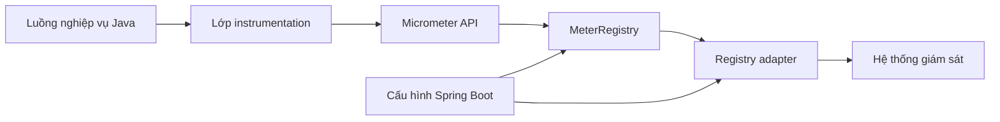

# Tách mã ghi nhận phép đo khỏi cấu hình xuất dữ liệu

Khi thêm metrics vào ứng dụng Java, mã nghiệp vụ cần mô tả **điều gì đang được đo**: số đơn hàng được tạo, thời gian xử lý một yêu cầu, hay số kết nối đang mở. Mã nghiệp vụ không nên phải biết metrics sẽ được gửi đến Prometheus, Datadog hay một hệ thống giám sát khác, cũng không nên tự quyết định địa chỉ máy chủ, thông tin xác thực hoặc chu kỳ gửi dữ liệu.

Micrometer cung cấp một lớp API chung để tách hai mối quan tâm này. Phần instrumentation đăng ký và cập nhật các meter thông qua `MeterRegistry`; phần cấu hình ứng dụng cung cấp registry phù hợp với môi trường chạy và thiết lập cách metrics được xuất. Nhờ đó, cùng một mã ghi nhận có thể chạy với registry kiểm thử ở máy phát triển và registry xuất dữ liệu ở môi trường triển khai.

Trong phạm vi `OBSERVABILITY_INSTRUMENTATION_MICROMETER`, kiến trúc này là nền tảng để sử dụng counter, gauge, timer và distribution summary, tích hợp với Spring Boot, xuất metrics đến hệ thống giám sát, kiểm soát cardinality, kiểm thử instrumentation và diễn giải số đo vận hành.

## 1. Hai mối quan tâm cần tách biệt

Instrumentation và export có liên quan với nhau nhưng trả lời hai câu hỏi khác nhau:

| Mối quan tâm | Câu hỏi cần trả lời | Ví dụ |
| --- | --- | --- |
| Ghi nhận phép đo (instrumentation) | Ứng dụng cần đo sự kiện hoặc trạng thái nào? | Tăng counter khi tạo đơn hàng; đo thời gian xử lý; đọc số tác vụ đang chờ |
| Đăng ký meter | Meter có tên, loại và tập tag nào? | `orders.created`, `orders.processing`, tag `channel=web` |
| Cấu hình registry | Meter được quản lý và chuyển đổi ra sao? | Chọn Prometheus registry; thêm common tags; áp dụng bộ lọc và chính sách histogram |
| Xuất dữ liệu (export) | Hệ thống giám sát lấy hoặc nhận metrics bằng cách nào? | Prometheus scrape endpoint; registry khác đẩy dữ liệu theo cấu hình riêng |

Mã instrumentation mô tả ngữ nghĩa của phép đo. Registry tiếp nhận meter, giữ dữ liệu đo và chuyển chúng sang định dạng mà backend tương ứng hiểu được. Backend là nơi lưu trữ, truy vấn, trực quan hóa và cảnh báo.



Một điểm quan trọng là `MeterRegistry` vừa là điểm đăng ký vừa là điểm truy cập các meter. Mã ứng dụng thường nhận một registry qua dependency injection, sau đó tạo hoặc lấy meter từ registry đó. Ứng dụng không cần tự khởi tạo một registry cụ thể như `PrometheusMeterRegistry` trong service nghiệp vụ.

## 2. Đặt instrumentation tại ranh giới có ý nghĩa

Hãy ghi nhận phép đo ở nơi sự kiện hoặc thao tác thực sự xảy ra. Ví dụ, counter đơn hàng được tạo nên tăng sau khi thao tác tạo đơn đã được chấp nhận thành công; timer xử lý nên bao quanh phần công việc mà tên metric mô tả. Tránh đặt meter rải rác trong nhiều tầng khiến cùng một sự kiện bị đếm nhiều lần.

Một lớp nhỏ chuyên trách metrics có thể che giấu chi tiết Micrometer khỏi service nghiệp vụ. Lớp này vẫn sử dụng API Micrometer, nhưng service chỉ gọi các phương thức mang ý nghĩa của ứng dụng.

```java
import java.util.function.Supplier;

import io.micrometer.core.instrument.Counter;
import io.micrometer.core.instrument.MeterRegistry;
import io.micrometer.core.instrument.Timer;
import org.springframework.stereotype.Component;

@Component
public class OrderMetrics {
    private final Counter created;
    private final Timer processing;

    public OrderMetrics(MeterRegistry registry) {
        this.created = Counter.builder("orders.created")
                .description("Number of orders created successfully")
                .tag("channel", "web")
                .register(registry);

        this.processing = Timer.builder("orders.processing")
                .description("Time spent processing an order")
                .register(registry);
    }

    public void recordCreated() {
        created.increment();
    }

    public <T> T recordProcessing(Supplier<T> operation) {
        return processing.record(operation);
    }
}
```

Service nghiệp vụ có thể sử dụng lớp này mà không cần biết registry cụ thể:

```java
public OrderResult createOrder(OrderCommand command) {
    return orderMetrics.recordProcessing(() -> {
        OrderResult result = orderRepository.create(command);
        orderMetrics.recordCreated();
        return result;
    });
}
```

Ví dụ trên giả định `create` chỉ trả về sau khi đơn hàng được tạo thành công. Nếu quy tắc nghiệp vụ phân biệt đơn được tiếp nhận, thanh toán thành công và đơn hoàn tất, hãy đặt tên meter và vị trí tăng counter theo đúng sự kiện cần quan sát. Đừng dùng một counter chung cho các trạng thái khác nhau.

`Timer` ghi nhận cả số lần thực hiện và tổng thời gian, đồng thời có thể cung cấp phân phối thời gian khi được cấu hình. Vì vậy, không cần tạo thêm một counter riêng chỉ để đếm cùng những lần gọi đã được timer ghi nhận, trừ khi hai meter thực sự biểu diễn hai khái niệm khác nhau.

### Chọn meter theo ý nghĩa dữ liệu

| Loại meter | Dùng khi | Ví dụ |
| --- | --- | --- |
| `Counter` | Cần đếm số sự kiện tăng dần | Số đơn hàng được tạo; số lần xử lý thất bại |
| `Gauge` | Cần quan sát giá trị hiện tại có thể tăng hoặc giảm | Số tác vụ đang chờ; số kết nối đang được sử dụng |
| `Timer` | Cần đo thời lượng và số lần thực hiện | Thời gian xử lý đơn hàng; độ trễ gọi dịch vụ |
| `DistributionSummary` | Cần đo phân phối của một đại lượng số không phải thời gian | Kích thước payload; số bản ghi trong một lô |

Gauge có cách vận hành khác counter và timer: nó đọc giá trị từ một đối tượng được tham chiếu khi registry thu thập metrics. Đối tượng được theo dõi phải còn tồn tại và phản ánh đúng trạng thái cần đo. Không tạo gauge từ một biến cục bộ sắp bị giải phóng hoặc một giá trị snapshot không được cập nhật.

## 3. Để Spring Boot cấu hình registry

Với Spring Boot Actuator, ứng dụng có thể nhận `MeterRegistry` do cơ chế auto-configuration tạo ra. Khi thêm dependency registry tương ứng vào classpath, Spring Boot có thể cấu hình adapter phù hợp. Ví dụ với Prometheus, dự án thường có hai dependency do Spring Boot quản lý phiên bản:

```xml
<dependency>
    <groupId>org.springframework.boot</groupId>
    <artifactId>spring-boot-starter-actuator</artifactId>
</dependency>

<dependency>
    <groupId>io.micrometer</groupId>
    <artifactId>micrometer-registry-prometheus</artifactId>
</dependency>
```

Không nên ghim phiên bản riêng cho Micrometer registry nếu dự án đã dùng Spring Boot dependency management; hãy để bộ phiên bản tương thích của Spring Boot quản lý các thư viện liên quan.

Có thể cấu hình endpoint và common tag trong `application.yml`:

```yaml
spring:
  application:
    name: order-service

management:
  endpoints:
    web:
      exposure:
        include: health,prometheus
  metrics:
    tags:
      application: ${spring.application.name}
```

Khi dependency Prometheus registry và endpoint được cấu hình phù hợp, Actuator cung cấp endpoint `/actuator/prometheus` để Prometheus scrape. Việc expose endpoint cần phù hợp với cấu hình bảo mật và mạng của môi trường triển khai; chỉ expose những endpoint thực sự cần thiết.

Nếu cần thêm cấu hình chung bằng Java, có thể khai báo `MeterRegistryCustomizer`. Bean này được Spring Boot áp dụng cho registry được quản lý:

```java
import org.springframework.boot.actuate.metrics.MeterRegistryCustomizer;
import org.springframework.context.annotation.Bean;
import org.springframework.context.annotation.Configuration;

import io.micrometer.core.instrument.MeterRegistry;

@Configuration(proxyBeanMethods = false)
public class MetricsConfiguration {
    @Bean
    MeterRegistryCustomizer<MeterRegistry> commonTags() {
        return registry -> registry.config()
                .commonTags("application", "order-service");
    }
}
```

Trong ứng dụng thực tế, nên lấy tên dịch vụ từ cấu hình môi trường hoặc thuộc tính Spring thay vì lặp lại một chuỗi cố định ở nhiều nơi. Common tag phù hợp thường là tên ứng dụng, môi trường hoặc vùng triển khai. Chỉ thêm tag có tập giá trị được kiểm soát.

Phần cấu hình registry là nơi thích hợp để đặt chính sách áp dụng cho nhiều meter, chẳng hạn giới hạn tag, lọc meter không mong muốn hoặc cấu hình histogram cho một nhóm timer. Các thiết lập như địa chỉ backend, thông tin xác thực, chu kỳ push và endpoint thường thuộc cấu hình triển khai hoặc secret management. Không đưa những giá trị này vào constructor của service nghiệp vụ.

## 4. Kiểm soát tag và cardinality

Tag giúp phân tích metric theo một chiều có ý nghĩa, ví dụ `channel`, `outcome` hoặc `region`. Tuy nhiên, mỗi tổ hợp tên meter và giá trị tag có thể tạo ra một time series riêng. Khi một tag nhận quá nhiều giá trị khác nhau, cardinality tăng nhanh, làm tăng bộ nhớ, chi phí lưu trữ và tải truy vấn của hệ thống giám sát.

Các giá trị sau thường không phù hợp làm tag:

- ID người dùng, email, ID đơn hàng hoặc request ID.
- URL thô chứa mã tài nguyên; nên dùng route template như `/orders/{id}`.
- Nội dung exception, câu SQL hoặc chuỗi do người dùng nhập.
- Timestamp, giá trị ngẫu nhiên hoặc bất kỳ dữ liệu nào gần như duy nhất cho mỗi request.

Ưu tiên các tập giá trị hữu hạn, ổn định như `channel=web|mobile|partner` hoặc `outcome=success|failure`. Nếu đầu vào có thể chứa giá trị ngoài danh sách, hãy chuẩn hóa về một nhóm như `other` trước khi tạo tag. Không để dữ liệu đầu vào trực tiếp quyết định số lượng meter.

Có thể thêm một bộ lọc ở cấu hình registry để đặt giới hạn phòng vệ:

```java
import io.micrometer.core.instrument.config.MeterFilter;
import org.springframework.context.annotation.Bean;

@Bean
MeterFilter limitOrderChannels() {
    return MeterFilter.maximumAllowableTags(
            "orders.created", "channel", 5, MeterFilter.deny());
}
```

Bộ lọc này giới hạn số giá trị `channel` được chấp nhận cho meter có tên bắt đầu bằng `orders.created`; khi vượt giới hạn, meter mới bị từ chối theo bộ lọc được truyền vào. Đây là lớp bảo vệ bổ sung. Thiết kế tag hữu hạn ngay trong instrumentation vẫn là trách nhiệm chính.

Không nên dùng tag để lưu dữ liệu cần phân tích chi tiết theo từng thực thể. Nếu cần điều tra một đơn hàng cụ thể, hãy dùng log hoặc trace với correlation ID; metrics nên giữ ở mức tổng hợp để phục vụ quan sát xu hướng và tình trạng hệ thống.

## 5. Đặt chính sách phân phối ở cấu hình

Với timer và distribution summary, ngoài count và tổng giá trị, hệ thống có thể cần histogram hoặc các bucket theo ngưỡng để truy vấn percentile và kiểm tra SLO. Đây là chính sách phân phối của metric. Có thể cấu hình theo tên meter trong cấu hình Spring Boot hoặc thông qua `MeterFilter`, tùy phiên bản Micrometer và Spring Boot của dự án.

Ví dụ cấu hình theo thuộc tính Spring Boot:

```yaml
management:
  metrics:
    distribution:
      percentiles-histogram:
        orders.processing: true
      slo:
        orders.processing: 100ms,250ms,500ms
```

Các ngưỡng SLO phải xuất phát từ yêu cầu vận hành của dịch vụ. Không bật histogram cho mọi meter theo mặc định nếu không có nhu cầu, vì histogram tạo thêm chuỗi dữ liệu và có thể làm tăng cardinality. Khi đổi backend hoặc đổi chính sách xuất, có thể điều chỉnh cấu hình tương ứng mà không phải sửa luồng nghiệp vụ đang đo.

## 6. Kiểm thử instrumentation độc lập với backend

Unit test nên kiểm tra hành vi ghi nhận bằng `SimpleMeterRegistry`. Registry này lưu meter trong bộ nhớ, phù hợp để xác minh counter tăng đúng số lần, timer ghi nhận số lần thực thi và tag có giá trị mong đợi.

```java
import static org.assertj.core.api.Assertions.assertThat;

import io.micrometer.core.instrument.simple.SimpleMeterRegistry;
import org.junit.jupiter.api.Test;

class OrderMetricsTest {
    @Test
    void recordsCreatedOrders() {
        try (SimpleMeterRegistry registry = new SimpleMeterRegistry()) {
            OrderMetrics metrics = new OrderMetrics(registry);

            metrics.recordCreated();
            metrics.recordCreated();

            assertThat(registry.get("orders.created")
                    .tag("channel", "web")
                    .counter()
                    .count()).isEqualTo(2.0);
        }
    }

    @Test
    void recordsProcessingCount() {
        try (SimpleMeterRegistry registry = new SimpleMeterRegistry()) {
            OrderMetrics metrics = new OrderMetrics(registry);

            String result = metrics.recordProcessing(() -> "created");

            assertThat(result).isEqualTo("created");
            assertThat(registry.get("orders.processing")
                    .timer()
                    .count()).isEqualTo(1L);
        }
    }
}
```

Các test này xác minh instrumentation mà không phụ thuộc định dạng Prometheus hoặc một máy chủ metrics bên ngoài. Ở cấp tích hợp, có thể kiểm tra Spring tạo đúng registry, common tag được áp dụng và endpoint Prometheus được expose khi cấu hình bật. Nên tách hai mục tiêu: unit test kiểm tra hành vi ghi nhận; integration test kiểm tra wiring và đường xuất dữ liệu.

## 7. Đọc số đo sau khi xuất

Khi Prometheus scrape timer `orders.processing` với histogram được bật, có thể dùng dữ liệu bucket để ước lượng percentile trong một cửa sổ thời gian. Ví dụ truy vấn p95:

```promql
histogram_quantile(
  0.95,
  sum by (le) (rate(orders_processing_seconds_bucket[5m]))
)
```

Để theo dõi tốc độ tạo đơn hàng, dùng rate trên counter thay vì chỉ nhìn giá trị tích lũy từ lúc ứng dụng khởi động:

```promql
sum(rate(orders_created_total[5m]))
```

Tên metric cuối cùng trong backend có thể được chuẩn hóa theo quy tắc của registry. Ví dụ Prometheus thường chuyển tên meter Micrometer sang dạng phù hợp với quy ước Prometheus và biểu diễn timer theo đơn vị thời gian. Khi viết truy vấn, hãy kiểm tra tên thực tế tại endpoint metrics của ứng dụng.

Không diễn giải một chỉ số riêng lẻ mà bỏ qua ngữ cảnh. Counter tăng có thể phản ánh lưu lượng tăng hoặc lỗi tăng; timer p95 cao có thể xuất hiện do phụ thuộc bên ngoài, tranh chấp tài nguyên hoặc thay đổi phân bố request. Hãy kết hợp lưu lượng, độ trễ, tỷ lệ lỗi và các tín hiệu tài nguyên để tìm nguyên nhân.

## 8. Các lỗi kiến trúc thường gặp

| Cách làm | Hệ quả | Cách xử lý |
| --- | --- | --- |
| Service tự tạo `PrometheusMeterRegistry` | Logic ứng dụng phụ thuộc backend cụ thể; khó thay registry khi kiểm thử | Inject `MeterRegistry` từ Spring |
| Service chứa URL, credential hoặc push interval | Cấu hình triển khai bị trộn với luồng nghiệp vụ | Đưa cấu hình export vào properties, environment hoặc secret management |
| Tạo meter mới với tag là ID mỗi request | Cardinality tăng không giới hạn | Chuẩn hóa tag thành tập giá trị hữu hạn |
| Tăng counter ở nhiều tầng cho cùng một sự kiện | Đếm trùng và khó diễn giải | Chọn một ranh giới ghi nhận rõ ràng |
| Tạo gauge từ giá trị snapshot hoặc object không còn được giữ | Giá trị không cập nhật hoặc meter không còn phản ánh trạng thái thật | Theo dõi object có vòng đời ổn định và cập nhật được |
| Unit test phụ thuộc Prometheus server | Test chậm và khó chạy ổn định ở máy phát triển | Dùng `SimpleMeterRegistry` cho test instrumentation; kiểm tra export ở integration test |

## 9. Quy trình áp dụng

Khi thêm một metric mới, có thể đi theo trình tự sau:

1. Xác định câu hỏi vận hành mà metric cần trả lời và chọn counter, gauge, timer hoặc distribution summary phù hợp.
2. Chọn tên meter ổn định, đơn vị rõ ràng và các tag có tập giá trị hữu hạn.
3. Đặt điểm ghi nhận tại ranh giới nghiệp vụ đúng, tránh đếm hoặc đo lặp.
4. Đăng ký meter qua `MeterRegistry` được inject; giữ cấu hình registry và export trong lớp cấu hình.
5. Bổ sung chính sách histogram, SLO và giới hạn tag khi có nhu cầu đo lường cụ thể.
6. Viết unit test với `SimpleMeterRegistry`, sau đó kiểm tra wiring và endpoint ở integration test.
7. Xác minh backend nhận được metric, truy vấn đúng tên và diễn giải số đo trong cùng cửa sổ thời gian.

Kiến trúc tách biệt tốt cho phép mã instrumentation giữ nguyên ý nghĩa khi thay đổi cách triển khai observability. Ứng dụng tập trung ghi nhận những sự kiện và trạng thái có giá trị; Spring Boot và Micrometer registry đảm nhiệm việc quản lý, chuẩn hóa và xuất dữ liệu theo môi trường. Ranh giới rõ ràng này giúp metrics dễ kiểm thử, hạn chế phụ thuộc backend và kiểm soát tốt hơn chi phí cardinality trong vận hành.
