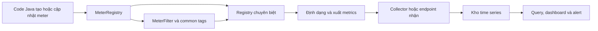

# Từ một meter trong ứng dụng đến nhiều chuỗi ở hệ thống nhận

Khi thêm một `Counter` hoặc `Timer` vào ứng dụng, ta thường nghĩ mình đang tạo ra một chỉ số duy nhất. Nhưng dữ liệu mà hệ thống giám sát nhận được có thể gồm nhiều chuỗi thời gian (time series) cho cùng một điểm instrumentation. Một meter có thể được đăng ký với nhiều bộ tag; riêng các meter phân phối như `Timer` còn có thể xuất nhiều thống kê như số lần ghi nhận, tổng thời gian, giá trị cực đại và các bucket của histogram.

Muốn đọc đúng số liệu vận hành, cần theo dõi toàn bộ đường đi: mã ứng dụng tạo meter, `MeterRegistry` quản lý meter, registry chuyên biệt chuyển đổi và xuất dữ liệu, rồi hệ thống nhận lưu các chuỗi thời gian theo tên metric cùng nhãn. Hiểu đường đi này cũng giúp kiểm soát cardinality trước khi một thay đổi nhỏ trong code làm tăng mạnh lượng dữ liệu phải thu thập và lưu trữ.

## Mục tiêu

Sau bài học, bạn có thể:

- Phân biệt meter, meter ID, measurement và time series.
- Mô tả vai trò của `MeterRegistry`, registry xuất dữ liệu và backend giám sát.
- Giải thích vì sao một điểm instrumentation có thể tạo nhiều meter ID hoặc nhiều chuỗi thời gian.
- Nhận diện các yếu tố làm tăng cardinality và chọn tag có miền giá trị hữu hạn.
- Lần theo dữ liệu từ mã Java đến endpoint Prometheus hoặc luồng OTLP.

## Bốn khái niệm cần tách biệt

| Khái niệm | Ý nghĩa | Ví dụ |
|---|---|---|
| Meter | Công cụ đo một đại lượng có ý nghĩa trong ứng dụng | `Counter` đếm đơn hàng; `Timer` đo thời gian xử lý |
| Meter ID | Danh tính dùng để phân biệt một meter trong registry, chủ yếu dựa trên tên và tập tag | `orders.created` với `channel=web` |
| Measurement | Giá trị hoặc thống kê mà meter cung cấp khi thu thập | Giá trị counter; count và total time của timer |
| Time series | Dãy điểm dữ liệu theo thời gian được backend phân biệt bằng tên metric và tập nhãn | `orders_created_total{channel="web"}` |

Meter là khái niệm instrumentation ở phía ứng dụng. Time series là cách hệ thống nhận lưu và truy vấn dữ liệu. Hai khái niệm này liên quan trực tiếp nhưng không có quan hệ một-một.

## Đường đi của một meter



### 1. Code ứng dụng ghi nhận sự kiện hoặc trạng thái

Ứng dụng chọn meter theo ý nghĩa của đại lượng cần đo:

- `Counter` dành cho số lần xảy ra sự kiện và chỉ tăng.
- `Gauge` biểu diễn giá trị hiện tại có thể tăng hoặc giảm, chẳng hạn số tác vụ đang chờ.
- `Timer` ghi thời lượng và số lần một thao tác được thực hiện.
- `DistributionSummary` ghi nhận phân phối của một đại lượng không nhất thiết là thời gian, chẳng hạn kích thước payload.

Ví dụ, một ứng dụng bán hàng đếm số đơn được tạo theo kênh bán:

```java
@Component
public class OrderMetrics {
    private final MeterRegistry registry;

    public OrderMetrics(MeterRegistry registry) {
        this.registry = registry;
    }

    public void orderCreated(String channel) {
        registry.counter(
            "orders.created",
            "channel", normalizeChannel(channel)
        ).increment();
    }

    private String normalizeChannel(String channel) {
        if (channel == null) {
            return "other";
        }
        return switch (channel) {
            case "web", "store", "partner" -> channel;
            default -> "other";
        };
    }
}
```

`MeterRegistry` được Spring Boot cung cấp dưới dạng bean khi ứng dụng đã tích hợp Actuator và một registry phù hợp. Mã nghiệp vụ chỉ cần dùng API Micrometer chung; không phải tự định dạng dòng Prometheus hay tự gửi HTTP đến hệ thống giám sát.

Lệnh `registry.counter(...)` tìm hoặc đăng ký meter có tên và tập tag tương ứng. Khi cùng tên và cùng tag được yêu cầu nhiều lần, registry tái sử dụng meter đã đăng ký. Khi giá trị `channel` khác nhau, mỗi tổ hợp tag tạo một meter ID riêng. Trong ví dụ trên, `web`, `store`, `partner` và `other` là bốn giá trị hữu hạn có thể xuất hiện.

### 2. MeterRegistry quản lý meter

`MeterRegistry` là điểm đăng ký và truy cập tập meter trong ứng dụng. API chung của Micrometer giúp phần instrumentation ít phụ thuộc vào nhà cung cấp backend. Registry cũng là nơi cấu hình các quy tắc áp dụng cho meter, ví dụ:

- Gắn tag chung như `application`, `environment` hoặc `region`.
- Từ chối meter hoặc tag không được phép.
- Đổi tên meter hoặc chuẩn hóa tag bằng `MeterFilter`.
- Cấu hình cách thu thập phân phối cho `Timer` và `DistributionSummary`.

Một ứng dụng có thể dùng `SimpleMeterRegistry` để kiểm thử trong bộ nhớ, hoặc dùng registry chuyên biệt để xuất dữ liệu. `CompositeMeterRegistry` có thể chuyển cùng một lần ghi nhận đến nhiều registry con, chẳng hạn vừa phục vụ Prometheus vừa gửi dữ liệu đến một hệ thống nhận OTLP. Khi đó, cùng instrumentation trong code có thể xuất hiện ở nhiều đích, theo quy tắc đặt tên và đơn vị của từng registry.

### 3. Registry chuyên biệt chuyển đổi và xuất dữ liệu

Micrometer cung cấp API và mô hình meter chung; mỗi registry triển khai cách biểu diễn phù hợp với hệ thống nhận. Ví dụ:

- `PrometheusMeterRegistry` cung cấp dữ liệu theo định dạng Prometheus để Prometheus scrape.
- Registry OTLP chuyển dữ liệu sang OpenTelemetry Protocol để gửi đến collector hoặc endpoint tương thích.
- Các registry khác có thể dùng cơ chế push theo chu kỳ hoặc giao thức riêng.

Registry có thể chuẩn hóa tên, đơn vị và kiểu dữ liệu khi xuất. Vì vậy tên được viết trong Java như `orders.created` không nhất thiết xuất hiện nguyên dạng ở backend. Prometheus thường dùng quy ước tên có dấu gạch dưới và hậu tố thể hiện loại hoặc đơn vị metric. Hãy kiểm tra dữ liệu thực tế tại endpoint hoặc trong backend thay vì suy ra tên cuối cùng chỉ từ tên trong code.

Với Spring Boot, một cấu hình Prometheus phổ biến cần dependency Actuator và registry Prometheus, sau đó mở endpoint cần thiết:

```yaml
management:
  endpoints:
    web:
      exposure:
        include: health,prometheus
```

Khi ứng dụng chạy, endpoint `/actuator/prometheus` cho phép Prometheus lấy dữ liệu nếu endpoint được bật và được mạng giám sát truy cập. Với OTLP, ứng dụng thường gửi dữ liệu đến collector; collector có thể xử lý, định tuyến hoặc chuyển tiếp đến backend lưu trữ.

### 4. Hệ thống nhận lưu chuỗi thời gian

Ở phía Prometheus, một chuỗi thời gian được xác định bởi tên metric và tập label. Mỗi điểm dữ liệu có giá trị cùng timestamp. Với hệ thống nhận khác, thuật ngữ và mô hình lưu trữ có thể khác, nhưng nguyên tắc phân biệt dữ liệu theo tên metric và thuộc tính đi kèm vẫn rất quan trọng.

Một metric có cùng tên nhưng có `channel="web"` và `channel="store"` là hai chuỗi thời gian riêng. Backend có thể nhóm chúng khi truy vấn bằng cách bỏ hoặc tổng hợp theo label, nhưng chúng vẫn là hai chuỗi riêng trong dữ liệu được lưu.

## Vì sao một meter có thể tạo nhiều chuỗi thời gian?

Có hai nguyên nhân chính cần xem xét riêng.

### Nhiều tổ hợp tag tạo nhiều meter ID

Quay lại `orders.created`. Nếu ứng dụng ghi nhận đơn hàng từ hai kênh, dữ liệu Prometheus minh họa có thể trông như sau:

```text
# TYPE orders_created_total counter
orders_created_total{channel="web"} 12
orders_created_total{channel="store"} 7
```

Đây là một metric family với hai chuỗi thời gian vì tập label khác nhau. Trong Micrometer, hai tập tag đó cũng tương ứng với hai meter ID. Nếu ứng dụng tiếp tục thêm tag `region`, mỗi kênh có thể được chia thành nhiều chuỗi theo từng vùng đã quan sát.

Về mặt khái niệm, danh tính meter được tạo từ tên và tập tag. Thứ tự tag không nên được dùng để tạo ý nghĩa khác nhau; `channel=web` và `region=apac` mô tả cùng một tập thuộc tính dù thứ tự khai báo thay đổi. Loại meter, mô tả và đơn vị cung cấp thêm ngữ nghĩa cho việc xử lý và xuất dữ liệu.

### Một meter phân phối có nhiều thống kê

`Timer` là một meter, nhưng nó không chỉ cung cấp một con số. Tối thiểu, nó theo dõi số lần ghi nhận và tổng thời gian. Tùy registry và cấu hình phân phối, dữ liệu xuất còn có thể gồm giá trị cực đại, bucket histogram hoặc percentile.

Ví dụ, một `Timer` đo thời gian xử lý thanh toán:

```java
Timer paymentTimer = Timer.builder("payment.processing")
    .description("Thời gian xử lý thanh toán")
    .tag("provider", "card")
    .publishPercentileHistogram()
    .register(registry);

paymentTimer.record(() -> paymentGateway.charge(command));
```

Với cùng meter ID `payment.processing` và `provider=card`, Prometheus có thể nhận các chuỗi có dạng minh họa sau:

```text
payment_processing_seconds_count{provider="card"} 20
payment_processing_seconds_sum{provider="card"} 5.8
payment_processing_seconds_bucket{provider="card",le="0.1"} 8
payment_processing_seconds_bucket{provider="card",le="0.5"} 17
payment_processing_seconds_bucket{provider="card",le="+Inf"} 20
```

Đây là ví dụ rút gọn để thể hiện quan hệ giữa một timer và nhiều chuỗi; tên, số bucket và các chuỗi phụ thuộc registry, phiên bản và cấu hình thực tế. `count` cho biết số lần ghi nhận, `sum` là tổng thời gian, còn các bucket cho biết số lần có thời lượng nhỏ hơn hoặc bằng một ngưỡng. Nếu bật percentile phía client, registry có thể xuất thêm các chuỗi percentile; percentile tính riêng trên từng instance thường không thể cộng hoặc lấy trung bình để tạo percentile chính xác cho toàn cụm. Histogram bucket phù hợp hơn khi cần tổng hợp phân phối giữa nhiều instance.

`DistributionSummary` có mô hình tương tự nhưng ghi nhận các giá trị số tùy ý thay vì thời lượng. Ví dụ, một summary đo kích thước payload có thể xuất count, sum và histogram của kích thước. Do đó, khi nhìn số chuỗi ở backend, hãy tính cả số tổ hợp tag lẫn số thống kê mà meter tạo ra.

Có thể ước lượng sơ bộ:

```text
số chuỗi thời gian ≈ số tổ hợp tag thực tế × số chuỗi thống kê mỗi meter ID
```

Đây là cách ước lượng cho một metric family; tổng toàn ứng dụng là tổng đóng góp của các meter family, registry và instance đang được thu thập. Số bucket, percentile, tag chung và số replica đều có thể làm con số tăng thêm.

## Cardinality: chi phí ẩn của tag

Cardinality là số lượng chuỗi thời gian riêng biệt. Với một metric có nhiều tag, mỗi tổ hợp giá trị tag được quan sát có thể tạo một chuỗi. Nếu một metric có 100 route, 5 method, 10 mã trạng thái và 20 instance, số tổ hợp tối đa theo tích các miền giá trị là:

```text
100 × 5 × 10 × 20 = 100.000 tổ hợp
```

Không phải mọi tổ hợp đều nhất thiết xuất hiện, nhưng phép nhân này cho thấy một tag có miền giá trị lớn có thể khuếch đại số chuỗi rất nhanh. Nếu meter là histogram, mỗi tổ hợp còn có nhiều bucket cùng chuỗi count và sum.

Các tag thường an toàn khi miền giá trị nhỏ và ổn định:

- `method`: `GET`, `POST`, `PUT`, `DELETE`.
- `outcome`: `SUCCESS`, `CLIENT_ERROR`, `SERVER_ERROR`.
- `channel`: `web`, `store`, `partner`, `other`.
- `environment`: `dev`, `staging`, `prod`.

Các giá trị thường gây cardinality cao và không nên đưa trực tiếp vào tag:

- ID đơn hàng, ID người dùng, session ID hoặc request ID.
- Email, số điện thoại, địa chỉ IP hoặc token.
- URL đầy đủ có ID động, ví dụ `/orders/849203`.
- Nội dung tìm kiếm, tên file hoặc thông điệp lỗi tùy biến.

Với HTTP server metrics, hãy dùng route template như `/orders/{id}` thay cho URL đã được thay ID thực tế. Nếu cần điều tra một request riêng lẻ, log hoặc trace thường phù hợp hơn metrics; metrics nên mô tả xu hướng tổng hợp với tập nhãn nhỏ.

### Đặt giới hạn ngay tại registry

Trong Spring Boot, có thể cấu hình tag chung và bộ lọc cho registry. Ví dụ dưới đây giới hạn số giá trị `uri` được chấp nhận cho metric `http.server.requests`:

```java
@Bean
MeterRegistryCustomizer<MeterRegistry> metricsConfiguration() {
    return registry -> registry.config()
        .commonTags(
            "application", "checkout",
            "environment", "prod"
        )
        .meterFilter(MeterFilter.maximumAllowableTags(
            "http.server.requests",
            "uri",
            100,
            MeterFilter.deny()
        ));
}
```

Giới hạn này là lớp bảo vệ bổ sung khi có giá trị tag ngoài dự kiến. Nó không thay thế việc thiết kế tag đúng từ đầu: nếu metric bị từ chối, dashboard hoặc alert phụ thuộc metric đó có thể thiếu dữ liệu. Hãy chọn miền giá trị hữu hạn, chuẩn hóa đầu vào và theo dõi số chuỗi trước khi triển khai rộng.

## Đọc số liệu đúng ở backend

Counter là giá trị tích lũy và thường không giảm trong vòng đời của process. Để xem tốc độ phát sinh sự kiện, truy vấn tốc độ tăng thay vì đọc trực tiếp giá trị tích lũy. Ví dụ PromQL:

```promql
rate(orders_created_total[5m])
```

Để so sánh kênh bán, giữ label `channel` trong phép nhóm. Khi cần tổng số đơn trên mọi kênh, có thể tổng hợp và bỏ label đó:

```promql
sum by (channel) (rate(orders_created_total[5m]))
```

Với timer có histogram, có thể ước lượng percentile trên nhiều instance bằng bucket rate. Ví dụ p95 theo ứng dụng:

```promql
histogram_quantile(
  0.95,
  sum by (le) (rate(payment_processing_seconds_bucket[5m]))
)
```

Khi cần phân tích theo provider, thêm `provider` vào nhóm tổng hợp. Kết quả percentile là ước lượng dựa trên bucket và độ phân giải histogram; nó không giống percentile chính xác được tính riêng trong từng process.

Một số kiểm tra hữu ích khi dashboard đột nhiên có nhiều chuỗi hoặc thiếu dữ liệu:

1. Xem tên metric và toàn bộ label tại endpoint export của ứng dụng.
2. So sánh các giá trị tag thực tế với miền giá trị đã thiết kế.
3. Kiểm tra có ID hoặc URL động nào bị đưa vào tag hay không.
4. Kiểm tra cấu hình histogram, percentile và số bucket của `Timer` hoặc `DistributionSummary`.
5. Kiểm tra common tags, số replica và số registry đang xuất dữ liệu.
6. Kiểm tra `MeterFilter` có từ chối meter hoặc tag mới hay không.

## Kiểm thử đường đi ở cấp ứng dụng

`SimpleMeterRegistry` hữu ích để xác minh code tạo đúng meter và cập nhật đúng giá trị mà không cần chạy backend giám sát:

```java
SimpleMeterRegistry registry = new SimpleMeterRegistry();

Counter webOrders = registry.counter(
    "orders.created", "channel", "web"
);
webOrders.increment(2);

Counter storeOrders = registry.counter(
    "orders.created", "channel", "store"
);
storeOrders.increment();

assertEquals(2.0, webOrders.count());
assertEquals(1.0, storeOrders.count());
```

Kiểm thử này xác nhận hai tập tag được phân biệt và mỗi counter nhận đúng số lần tăng. Với `Timer`, có thể ghi một số thời lượng xác định rồi kiểm tra `count()` và `totalTime(...)`. Những kiểm thử này không xác nhận endpoint Prometheus hoặc luồng OTLP hoạt động; cần kiểm thử tích hợp riêng để xác minh cấu hình registry, endpoint, kết nối collector và tên metric thực tế.

## Những điểm cần nhớ

- Một điểm instrumentation trong code không đồng nghĩa với một time series ở backend.
- Cùng tên meter nhưng khác tập tag tạo các meter ID riêng; cùng meter ID được đăng ký lặp lại sẽ được registry tái sử dụng.
- Một `Timer` hoặc `DistributionSummary` có thể xuất nhiều chuỗi thống kê cho cùng một meter ID.
- Registry chuyên biệt quyết định cách chuyển đổi tên, đơn vị, thống kê và giao thức xuất.
- Cardinality tăng theo số tổ hợp tag thực tế, số thống kê được xuất và số instance được thu thập.
- Tag nên có miền giá trị nhỏ, ổn định và có ý nghĩa tổng hợp; dữ liệu định danh từng request nên nằm trong log hoặc trace.

Khi thêm một meter mới, hãy trả lời ba câu hỏi trước khi phát hành: đại lượng này cần đo bằng meter nào, tag nào tạo ra các chiều phân tích có ích, và registry sẽ xuất những chuỗi nào đến backend? Ba câu hỏi đó nối được ý nghĩa trong code với chi phí và khả năng sử dụng của dữ liệu vận hành.
