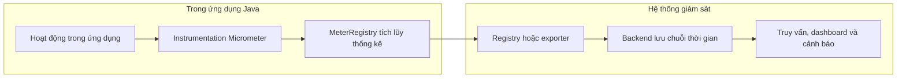

# Tổng hợp dữ liệu tại ứng dụng và tính toán khi truy vấn

Trong một hệ thống Java dùng Micrometer, dữ liệu quan sát thường được xử lý ở hai thời điểm. Ứng dụng ghi nhận sự kiện và cập nhật các meter ngay khi hoạt động xảy ra; hệ thống giám sát lấy những số đo đó, kết hợp nhiều chuỗi thời gian rồi tính toán khi truy vấn. Hai lớp này bổ sung cho nhau: lớp ứng dụng giữ lại những thống kê cần thiết với chi phí thấp, còn lớp truy vấn tạo ra góc nhìn vận hành theo dịch vụ, phiên bản, vùng triển khai hoặc khoảng thời gian.

Hiểu rõ ranh giới giữa hai lớp giúp chọn đúng loại meter, tránh tính toán sai khi có nhiều instance và kiểm soát lượng chuỗi thời gian được xuất ra.

## Hai nơi thực hiện phép tổng hợp

Micrometer là lớp instrumentation trung lập với backend. Mã ứng dụng ghi nhận số đo qua các meter như `Counter`, `Timer`, `DistributionSummary` và `Gauge`. `MeterRegistry` quản lý các meter đó và cung cấp dữ liệu cho registry hoặc exporter tương ứng. Backend giám sát tiếp nhận dữ liệu, lưu thành chuỗi thời gian và cho phép người vận hành truy vấn.



Có thể phân biệt hai lớp bằng câu hỏi: **Ứng dụng cần ghi nhớ điều gì về các sự kiện đã xảy ra?** và **Người vận hành cần kết hợp các số đo đó như thế nào để trả lời một câu hỏi?**

- **Tổng hợp tại ứng dụng** diễn ra trong tiến trình Java. Mỗi lần một sự kiện xảy ra, meter cập nhật trạng thái thống kê như số lần, tổng thời gian, giá trị cực đại hoặc số lượng quan sát rơi vào từng bucket. Khi registry thu thập dữ liệu, ứng dụng xuất các thống kê này thay vì phải gửi toàn bộ sự kiện riêng lẻ.
- **Tính toán khi truy vấn** diễn ra ở backend giám sát. Truy vấn có thể tính tốc độ tăng của counter trong một cửa sổ thời gian, cộng số đo từ nhiều instance, tính tỷ lệ lỗi, lấy trung bình có trọng số hoặc ước lượng percentile từ histogram.

Ví dụ, một dịch vụ chạy trên sáu instance có thể ghi nhận số request và thời gian xử lý riêng trong từng tiến trình. Truy vấn ở backend cộng số request của sáu instance để tạo lưu lượng toàn dịch vụ, hoặc tính p95 từ các bucket histogram của tất cả instance.

## Ứng dụng tổng hợp những gì?

Mỗi loại meter có ngữ nghĩa và cách tích lũy riêng. Chọn meter dựa trên đại lượng cần quan sát, vì backend chỉ có thể tính toán chính xác trong giới hạn dữ liệu mà ứng dụng đã xuất.

| Meter | Dữ liệu được ghi nhận | Câu hỏi thường gặp |
|---|---|---|
| `Counter` | Tổng số lần một sự kiện xảy ra; giá trị chỉ tăng trong vòng đời của meter | Có bao nhiêu đơn hàng được tạo? |
| `Timer` | Số lần ghi nhận, tổng thời gian và các thống kê phân phối được cấu hình | Có bao nhiêu request, tổng thời gian xử lý là bao nhiêu, độ trễ phân bố thế nào? |
| `DistributionSummary` | Số lượng và tổng các giá trị được ghi nhận, cùng thống kê phân phối nếu được bật | Payload có kích thước bao nhiêu? |
| `Gauge` | Giá trị tại thời điểm đọc, thường phản ánh trạng thái hiện tại | Hàng đợi hiện có bao nhiêu phần tử? |
| `LongTaskTimer` | Số tác vụ đang chạy và thời gian của các tác vụ chưa hoàn tất | Có bao nhiêu tác vụ dài đang hoạt động? |

`Counter` phù hợp với sự kiện tích lũy như request hoàn tất hoặc đơn hàng được tạo. Khi cần tốc độ theo thời gian, ứng dụng xuất counter và backend tính tốc độ tăng. Không nên tự tạo một gauge chứa tốc độ bằng cách lấy hiệu hai lần đọc counter trong ứng dụng: cách làm đó phụ thuộc chu kỳ cập nhật, xử lý reset phức tạp và làm mất khả năng chọn cửa sổ thời gian khi truy vấn.

`Timer` là lựa chọn phù hợp để đo thời gian thực hiện một thao tác. Timer tích lũy số lần ghi nhận và tổng thời gian; tùy cấu hình và registry, nó còn xuất histogram hoặc percentile. `DistributionSummary` dùng cho các đại lượng phân phối không phải thời gian, chẳng hạn kích thước payload hoặc số byte xử lý. `Gauge` có ý nghĩa khác: nó đọc một giá trị hiện tại, không tích lũy các giá trị đã xuất hiện trong quá khứ.

### Ví dụ ghi nhận sự kiện và thời gian

Có thể inject `MeterRegistry` vào service để ghi nhận số đơn hàng và thời gian xử lý:

```java
import io.micrometer.core.instrument.MeterRegistry;
import io.micrometer.core.instrument.Timer;
import org.springframework.stereotype.Service;

@Service
public class CheckoutService {
    private final MeterRegistry registry;
    private final PaymentGateway paymentGateway;

    public CheckoutService(
            MeterRegistry registry,
            PaymentGateway paymentGateway) {
        this.registry = registry;
        this.paymentGateway = paymentGateway;
    }

    public Receipt checkout(Order order) {
        Timer.Sample sample = Timer.start(registry);
        String result = "success";

        try {
            Receipt receipt = paymentGateway.charge(order);
            registry.counter("orders.created", "channel", order.channel())
                    .increment();
            return receipt;
        } catch (RuntimeException exception) {
            result = "failure";
            throw exception;
        } finally {
            sample.stop(registry.timer("checkout.duration", "result", result));
        }
    }
}
```

Trong ví dụ, counter chỉ tăng khi thanh toán thành công. Timer ghi nhận cả trường hợp thành công và thất bại, với nhãn `result` có hai giá trị hữu hạn. `Timer.Sample` cho phép chọn meter và tag khi thao tác kết thúc, vì vậy có thể gắn kết quả thực tế của thao tác vào số đo.

Các giá trị tag phải có tập giá trị được kiểm soát. `channel` nên là một tập kênh hữu hạn như `web`, `mobile` hoặc `partner`; không gắn `orderId`, email, mã khách hàng hay URL chứa mã định danh vào meter. Nếu mỗi request tạo ra một tổ hợp tag mới, số chuỗi thời gian sẽ tăng nhanh và gây áp lực lên bộ nhớ, mạng, backend lưu trữ cũng như truy vấn.

### Histogram và percentile

Để truy vấn percentile trên nhiều instance, backend cần dữ liệu phân phối có thể kết hợp. Với `Timer`, có thể bật percentile histogram và các ngưỡng dịch vụ (SLO) phù hợp với câu hỏi vận hành:

```java
import java.time.Duration;
import io.micrometer.core.instrument.MeterRegistry;
import io.micrometer.core.instrument.Timer;

public class RequestMetrics {
    private final Timer requestTimer;

    public RequestMetrics(MeterRegistry registry) {
        this.requestTimer = Timer.builder("http.server.request")
                .description("Thời gian xử lý HTTP request")
                .publishPercentileHistogram()
                .serviceLevelObjectives(
                        Duration.ofMillis(100),
                        Duration.ofMillis(300),
                        Duration.ofSeconds(1))
                .register(registry);
    }

    public void record(Runnable handler) {
        requestTimer.record(handler);
    }
}
```

Các bucket histogram biểu diễn số quan sát nằm trong những khoảng giá trị. Backend có thể cộng số đếm của các bucket tương ứng từ nhiều instance rồi ước lượng percentile. Những ranh giới bucket cần nhất quán giữa các instance để kết quả tổng hợp có ý nghĩa.

`publishPercentiles(...)` có thể xuất percentile được tính ngay trong từng tiến trình. Các giá trị percentile độc lập này không thể cộng hoặc lấy trung bình để tạo percentile chính xác cho toàn dịch vụ. Ví dụ, p95 của instance A là 100 ms và p95 của instance B là 500 ms không có nghĩa p95 toàn hệ thống là 300 ms. Khi cần percentile tổng hợp, hãy dùng histogram có bucket phù hợp và để backend tính toán từ dữ liệu đã gộp.

Khả năng xuất histogram và cách biểu diễn số đo phụ thuộc registry/backend. Cần kiểm tra định dạng metric thực tế mà exporter cung cấp trước khi viết truy vấn.

## Backend tính toán khi truy vấn

Backend nhận chuỗi thời gian từ nhiều tiến trình và thường gắn chúng với các chiều như `service`, `instance`, `region`, `method` hoặc `status`. Truy vấn quyết định nhóm các chuỗi nào, chọn khoảng thời gian nào và áp dụng phép tính nào. Với Prometheus, PromQL là một ví dụ cụ thể; backend khác có thể dùng ngôn ngữ truy vấn khác nhưng nguyên tắc tổng hợp vẫn tương tự.

### Tính tốc độ từ counter

Counter của từng tiến trình tăng theo thời gian và có thể quay về giá trị ban đầu khi tiến trình khởi động lại. Với PromQL, hãy tính `rate` trên từng chuỗi trước rồi mới cộng các chuỗi theo chiều mong muốn:

```promql
sum by (service) (
  rate(http_server_requests_seconds_count[5m])
)
```

Truy vấn này ước lượng số request mỗi giây trong cửa sổ năm phút, sau đó cộng các instance cùng dịch vụ. Tên metric minh họa theo quy ước Prometheus của Micrometer cho một `Timer`; tên thực tế còn phụ thuộc tên meter, base unit và registry được sử dụng.

Tính tốc độ trước khi cộng giúp Prometheus xử lý việc counter của một instance bị reset. Nếu cộng counter thô từ nhiều instance trước rồi mới tính tốc độ, một lần reset có thể làm sai kết quả của tổng.

### Tính thời gian xử lý trung bình

Với timer được xuất thành tổng thời gian và số lần ghi nhận, thời gian trung bình trong cửa sổ truy vấn là tổng thời gian tăng thêm chia cho số lần ghi nhận tăng thêm:

```promql
sum by (service) (
  rate(http_server_requests_seconds_sum[5m])
)
/
sum by (service) (
  rate(http_server_requests_seconds_count[5m])
)
```

Đây là trung bình có trọng số theo số request. Không lấy trung bình đơn giản của các giá trị trung bình từng instance, vì instance có 10 request và instance có 10.000 request không đóng góp số lượng quan sát ngang nhau.

### Ước lượng p95 từ histogram

Khi timer xuất histogram bucket, có thể tính p95 trên các instance cùng dịch vụ:

```promql
histogram_quantile(
  0.95,
  sum by (le, service) (
    rate(http_server_requests_seconds_bucket[5m])
  )
)
```

`le` là nhãn biểu thị giới hạn trên của bucket trong histogram Prometheus. Truy vấn tính tốc độ tăng của từng bucket, cộng các bucket tương ứng theo dịch vụ rồi ước lượng percentile. Kết quả là ước lượng dựa trên ranh giới bucket, không phải phép tính chính xác từ toàn bộ mẫu request gốc.

### Tính tỷ lệ lỗi

Nếu timer hoặc counter request có nhãn trạng thái được chuẩn hóa, có thể lấy lưu lượng lỗi chia cho tổng lưu lượng:

```promql
sum by (service) (
  rate(http_server_requests_seconds_count{status=~"5.."}[5m])
)
/
sum by (service) (
  rate(http_server_requests_seconds_count[5m])
)
```

Tên nhãn và cách phân loại status phải khớp với dữ liệu thực tế. Khi lưu lượng bằng không, truy vấn có thể không có mẫu hoặc cho kết quả không xác định; dashboard và cảnh báo cần xử lý trường hợp này theo mục đích sử dụng.

## Chọn nơi đặt phép tính

| Nhu cầu | Nên xử lý tại ứng dụng | Nên xử lý khi truy vấn |
|---|---|---|
| Đếm sự kiện phát sinh | Tăng `Counter` tại thời điểm sự kiện xảy ra | Tính tốc độ, tổng theo dịch vụ hoặc tỷ lệ trong cửa sổ thời gian |
| Đo thời gian thao tác | Ghi nhận bằng `Timer` | Tính trung bình, p95/p99 hoặc so sánh giữa các phiên bản |
| Đo kích thước hoặc số lượng phân phối | Ghi nhận bằng `DistributionSummary` | Tổng hợp phân phối và so sánh theo nhóm |
| Trạng thái tức thời | Cung cấp `Gauge` cho giá trị hiện tại | So sánh, nhóm hoặc áp dụng ngưỡng cảnh báo |
| Quy tắc thống kê cố định, gắn với từng sự kiện | Tích lũy bằng meter có ngữ nghĩa phù hợp | Dùng lại số liệu để tạo nhiều góc nhìn và cửa sổ khác nhau |

Một nguyên tắc hữu ích là để ứng dụng ghi nhận **sự kiện và thống kê cơ bản**, còn backend thực hiện **phép tính phụ thuộc thời gian hoặc phạm vi tổng hợp**. Ví dụ, ứng dụng ghi nhận từng request vào timer; backend có thể tính p95 trong năm phút, một giờ hoặc theo từng vùng mà không cần thay đổi mã ứng dụng.

Phép tính chỉ nên đặt trong ứng dụng khi nó là một phần ổn định của cách đo và có thể biểu diễn bằng meter phù hợp. Nếu ứng dụng tự tổng hợp nhiều sự kiện thành một giá trị duy nhất rồi chỉ xuất giá trị đó, backend sẽ mất khả năng đổi cửa sổ, phân nhóm hoặc kiểm tra phân phối chi tiết hơn.

## Những sai lệch thường gặp khi tổng hợp

### Lấy trung bình của các trung bình

Trung bình từng instance không thể được cộng hoặc lấy trung bình không trọng số để đại diện cho toàn hệ thống. Hãy tổng hợp `sum` và `count`, sau đó chia tổng cho tổng số quan sát. Với percentile, hãy dùng histogram có thể gộp thay vì tổng hợp các percentile riêng lẻ.

### Cộng counter trước khi xử lý reset

Counter có thể reset khi tiến trình khởi động lại. Với truy vấn PromQL, áp dụng `rate` hoặc `increase` trên từng chuỗi trước phép `sum` để xử lý reset theo từng instance.

### Tạo quá nhiều tag

Mỗi tổ hợp tên meter và tag tạo thành một chuỗi thời gian riêng. Tag có giá trị không giới hạn như `userId`, `orderId`, token, địa chỉ IP hoặc URL đầy đủ có thể tạo cardinality rất lớn. Hãy chuẩn hóa đường dẫn thành route template, phân loại kết quả thành các nhóm hữu hạn và chỉ giữ những chiều thực sự cần cho dashboard hoặc cảnh báo.

### So sánh histogram không tương thích

Nếu các instance xuất histogram với cấu hình bucket khác nhau, việc gộp có thể tạo ra phân phối khó diễn giải hoặc không tương thích. Cấu hình histogram và SLO nên được thống nhất trên các instance cùng một dịch vụ. Cũng cần kiểm tra backend có hỗ trợ loại histogram mà registry xuất ra hay không.

### Nhầm lẫn giữa giá trị tức thời và giá trị tích lũy

Gauge phản ánh trạng thái khi được đọc; counter phản ánh sự kiện tích lũy; timer ghi nhận các lần thực hiện. Dùng gauge cho số sự kiện đã xảy ra có thể làm mất dữ liệu giữa hai lần scrape. Dùng counter để mô tả độ dài hàng đợi hiện tại cũng không phản ánh đúng trạng thái khi phần tử được thêm và lấy ra.

### Chọn cửa sổ truy vấn không phù hợp

Khoảng thời gian ngắn phản ứng nhanh nhưng dễ biến động khi lưu lượng thấp; khoảng thời gian dài ổn định hơn nhưng có độ trễ khi sự cố mới xuất hiện. Chọn cửa sổ theo mục tiêu của biểu đồ hoặc cảnh báo, đồng thời xét đến chu kỳ scrape và lưu lượng thực tế.

## Kiểm tra thiết kế instrumentation

Trước khi đưa metric vào dashboard hoặc cảnh báo, hãy kiểm tra các điểm sau:

1. Mỗi meter phản ánh đúng đại lượng: sự kiện dùng counter, thời lượng dùng timer, phân phối giá trị dùng distribution summary, trạng thái hiện tại dùng gauge.
2. Tên meter và tag có quy ước nhất quán giữa các instance, phiên bản và môi trường.
3. Giá trị tag có tập hữu hạn, không chứa định danh hoặc dữ liệu nhạy cảm của từng request hay người dùng.
4. Nếu cần percentile toàn dịch vụ, histogram được bật và các bucket tương thích trên mọi instance.
5. Truy vấn xử lý counter reset, tổng hợp theo đúng chiều và dùng cửa sổ thời gian phù hợp.
6. Trung bình được tính từ tổng thời gian và số lần ghi nhận; percentile được tính từ histogram có thể tổng hợp.
7. Metric thực tế đã được kiểm tra tại endpoint hoặc trong backend, vì tên và đơn vị xuất ra có thể thay đổi theo registry.

Có thể kiểm thử phần instrumentation bằng `SimpleMeterRegistry` để xác nhận counter tăng đúng, timer ghi nhận đúng số lần và thời lượng, hoặc gauge đọc đúng giá trị. Sau đó cần kiểm tra riêng exporter và truy vấn ở backend để xác nhận tên metric, tag, đơn vị và bucket đúng với giả định của dashboard.

## Kết luận

Micrometer cung cấp cách ghi nhận số đo thống nhất trong ứng dụng Java; registry chuyển các số đo đó sang hệ thống giám sát. Ứng dụng chịu trách nhiệm chọn meter và tích lũy dữ liệu cơ bản đúng ngữ nghĩa. Backend chịu trách nhiệm kết hợp chuỗi thời gian theo instance, chiều dữ liệu và cửa sổ thời gian để tạo ra tốc độ, tỷ lệ, trung bình hoặc percentile. Khi giữ đúng ranh giới này, số đo có thể được tái sử dụng cho nhiều câu hỏi vận hành mà không làm instrumentation phức tạp hoặc tạo cardinality vượt kiểm soát.
