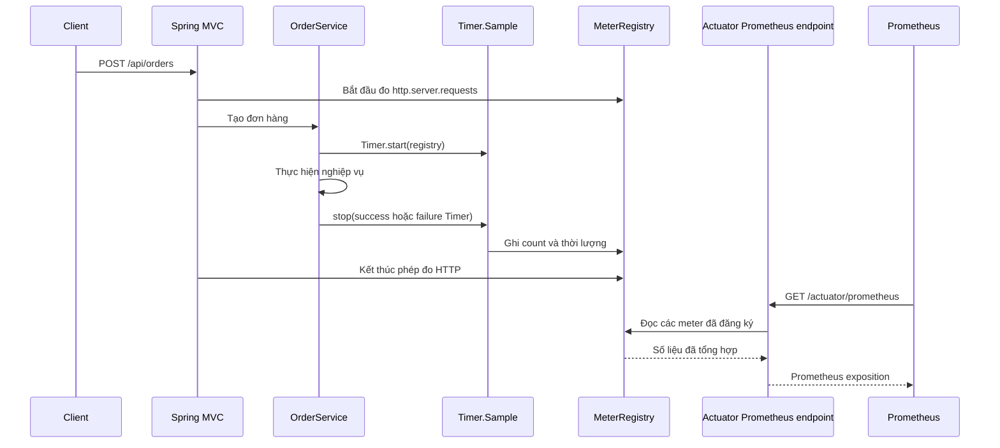

# Theo dấu một yêu cầu từ ghi thời gian đến số liệu được công bố

Trong module `OBSERVABILITY_INSTRUMENTATION_MICROMETER`, Micrometer cung cấp một lớp API thống nhất để đo lường ứng dụng Java. Bài này theo dõi một yêu cầu tạo đơn hàng từ lúc bắt đầu xử lý, ghi nhận thời lượng, cập nhật `MeterRegistry`, cho đến khi hệ thống giám sát đọc được số liệu. Các ví dụ dùng Spring Boot 3.x, Spring MVC và Prometheus; tên metric hoặc tập tag mặc định có thể khác đôi chút giữa các phiên bản và framework.

Ta sẽ phân biệt hai phép đo thường xuất hiện trong cùng một yêu cầu:

- `http.server.requests` do Spring Boot tự động ghi nhận thời gian xử lý HTTP ở tầng máy chủ.
- `orders.create` do ứng dụng chủ động ghi nhận thời gian của nghiệp vụ tạo đơn hàng.

Phép đo thứ nhất giúp quan sát toàn bộ endpoint. Phép đo thứ hai giúp xác định phần thời gian thuộc về nghiệp vụ. Khi đặt chúng cạnh nhau, ta có thể nhận ra độ trễ nằm ở tầng HTTP hay ở đoạn xử lý đơn hàng.

## 1. Luồng từ yêu cầu đến số liệu

Một metric không được gửi lên dashboard ngay tại thời điểm từng request kết thúc. Ứng dụng cập nhật các meter trong registry; exporter trình bày các số liệu đó; hệ thống giám sát đọc chúng theo chu kỳ hoặc nhận chúng theo cơ chế xuất của registry đang dùng.



Các bước chính là:

1. Một phép đo bắt đầu bằng đồng hồ của Micrometer, thường thông qua `Timer.record(...)` hoặc `Timer.Sample`.
2. Khi công việc kết thúc, thời lượng được ghi vào một `Timer` đã đăng ký trong `MeterRegistry`.
3. `Timer` cập nhật các thống kê tổng hợp như số lần ghi nhận, tổng thời gian và các bucket histogram nếu được bật.
4. Registry tương ứng với backend chuyển các thống kê sang định dạng mà backend hiểu được.
5. Prometheus scrape endpoint của ứng dụng; dashboard và alert đọc time series đã được Prometheus lưu trữ.

Metrics là số liệu tổng hợp theo tên meter và tag. Chúng cho biết một nhóm request hoạt động ra sao, nhưng không lưu lại đầy đủ diễn biến của từng request. Nếu cần lần theo một request cụ thể qua nhiều service, hãy kết hợp metrics với distributed tracing.

## 2. Meter, registry và các loại số đo

Micrometer gọi một đơn vị đo là *meter*. Mỗi meter có tên, loại, đơn vị cơ sở và tập tag. Ví dụ, `orders.create` với tag `result=success` là một meter khác với `orders.create` có tag `result=failure`.

`MeterRegistry` quản lý các meter và cung cấp cách ghi nhận thống nhất. Trong Spring Boot, registry thường được tự cấu hình từ dependency của backend. Ứng dụng nên nhận `MeterRegistry` qua dependency injection thay vì tự tạo một registry mới cho từng request.

| Loại meter | Dùng khi nào | Ví dụ |
| --- | --- | --- |
| `Counter` | Đếm sự kiện chỉ tăng | Số đơn hàng được tiếp nhận |
| `Gauge` | Đọc giá trị có thể tăng hoặc giảm tại thời điểm quan sát | Độ dài hàng đợi hiện tại |
| `Timer` | Đo thời lượng và số lần một thao tác hoàn tất | Thời gian xử lý request hoặc tạo đơn |
| `DistributionSummary` | Đo phân phối của một đại lượng không phải thời gian | Kích thước payload theo byte |

`Timer` thường đã cung cấp cả `count` và `totalTime`. Vì vậy, nếu mục đích chỉ là đếm số lần thao tác được đo thời gian, không cần tạo thêm một `Counter` trùng nghĩa. Hãy tạo counter riêng khi nó biểu diễn một sự kiện khác, chẳng hạn số đơn hàng được chấp nhận kể cả khi không đo thời lượng của toàn bộ nghiệp vụ.

Ví dụ ngắn cho các loại meter khác:

```java
// Counter: channel phải đến từ một tập giá trị hữu hạn, chẳng hạn web hoặc mobile.
registry.counter("orders.accepted", "channel", channel).increment();

// Gauge: queue là đối tượng sống lâu do một bean quản lý.
Gauge.builder("orders.queue.depth", queue, Queue::size)
    .register(registry);

// DistributionSummary: đo kích thước payload, không phải thời gian.
DistributionSummary.builder("orders.payload.size")
    .baseUnit("bytes")
    .register(registry)
    .record(payload.length);
```

Gauge được đọc khi registry lấy số liệu. Đối tượng mà gauge tham chiếu phải tiếp tục tồn tại và được cập nhật đúng cách; không tạo một đối tượng tạm thời chỉ để đăng ký gauge. Với `Counter`, `Timer` và `DistributionSummary`, hãy ghi nhận sự kiện tại đúng ranh giới nghiệp vụ để số liệu phản ánh cùng một ý nghĩa ở mọi instance.

## 3. Bật Micrometer và endpoint trong Spring Boot

Với Gradle và dependency management của Spring Boot, có thể thêm Actuator cùng registry Prometheus như sau:

```groovy
dependencies {
    implementation("org.springframework.boot:spring-boot-starter-actuator")
    runtimeOnly("io.micrometer:micrometer-registry-prometheus")
}
```

Actuator cung cấp endpoint quản trị và tích hợp metrics. Dependency `micrometer-registry-prometheus` bổ sung registry và định dạng exposition cho Prometheus. Phiên bản Micrometer nên được quản lý bởi Spring Boot dependency management để tránh ghép các phiên bản không tương thích.

Cấu hình minh họa trong `application.yml`:

```yaml
management:
  endpoints:
    web:
      exposure:
        include: health,metrics,prometheus
  metrics:
    tags:
      application: orders-api
    distribution:
      percentiles-histogram:
        http.server.requests: true
      slo:
        http.server.requests: 100ms, 300ms, 1s
```

`orders-api` chỉ là tên minh họa cho tag nhận diện ứng dụng. Trong môi trường thật, giá trị này nên lấy từ cấu hình triển khai thống nhất giữa các instance. Chỉ expose các endpoint cần thiết và đặt cơ chế bảo vệ phù hợp cho endpoint quản trị.

Khi có Actuator và instrumentation tương ứng, Spring Boot tự ghi nhận request HTTP của Spring MVC bằng meter thường có tên `http.server.requests`. Tập tag thường gồm method, URI theo route pattern, status, outcome và exception; chi tiết phụ thuộc phiên bản và framework. Tag `uri` nên là route template như `/api/orders/{id}`, không phải đường dẫn thực tế chứa ID của từng đơn hàng.

Có thể kiểm tra registry qua hai endpoint:

- `/actuator/metrics/http.server.requests` hiển thị thông tin meter trong ứng dụng. Có thể lọc theo tag bằng query parameter `tag`.
- `/actuator/prometheus` trả về dữ liệu dạng Prometheus để Prometheus scrape.

Nếu endpoint không xuất hiện, hãy kiểm tra dependency registry, cấu hình exposure và quyền truy cập Actuator. Endpoint `metrics` và endpoint `prometheus` phục vụ mục đích kiểm tra hoặc xuất số liệu; chúng không thay thế hệ thống lưu trữ time series.

## 4. Ghi thời gian cho nghiệp vụ tạo đơn hàng

Spring Boot đã đo request HTTP ở tầng máy chủ. Ta bổ sung một `Timer` cho phần nghiệp vụ để có thể phân tích riêng thời gian tạo đơn. `Timer.Sample` hữu ích khi tag kết quả chỉ được biết sau khi thao tác hoàn tất.

```java
import io.micrometer.core.instrument.MeterRegistry;
import io.micrometer.core.instrument.Timer;
import org.springframework.stereotype.Component;

import java.time.Duration;
import java.util.function.Supplier;

@Component
public class OrderMetrics {
    private final MeterRegistry registry;
    private final Timer successTimer;
    private final Timer failureTimer;

    public OrderMetrics(MeterRegistry registry) {
        this.registry = registry;

        this.successTimer = Timer.builder("orders.create")
            .description("Time spent creating an order")
            .tag("result", "success")
            .publishPercentileHistogram()
            .serviceLevelObjectives(
                Duration.ofMillis(100),
                Duration.ofMillis(300),
                Duration.ofSeconds(1))
            .register(registry);

        this.failureTimer = Timer.builder("orders.create")
            .description("Time spent creating an order")
            .tag("result", "failure")
            .publishPercentileHistogram()
            .serviceLevelObjectives(
                Duration.ofMillis(100),
                Duration.ofMillis(300),
                Duration.ofSeconds(1))
            .register(registry);
    }

    public <T> T recordCreate(Supplier<T> operation) {
        Timer.Sample sample = Timer.start(registry);
        try {
            T value = operation.get();
            sample.stop(successTimer);
            return value;
        } catch (RuntimeException | Error exception) {
            sample.stop(failureTimer);
            throw exception;
        }
    }
}
```

Timer được đăng ký một lần trong constructor. Mỗi lần gọi `recordCreate`, `Timer.Sample` chỉ giữ mốc bắt đầu; khi thao tác hoàn tất, `sample.stop(...)` tính thời lượng và ghi vào timer tương ứng. Ngoại lệ vẫn được ném tiếp cho luồng xử lý của ứng dụng, đồng thời thời lượng được ghi vào meter `result=failure`.

Một controller có thể dùng recorder như sau:

```java
@PostMapping("/api/orders")
public ResponseEntity<OrderResponse> create(
        @RequestBody CreateOrderRequest request) {
    Order order = orderMetrics.recordCreate(
        () -> orderService.create(request.toCommand()));

    return ResponseEntity.status(HttpStatus.CREATED)
        .body(OrderResponse.from(order));
}
```

Trong ví dụ này, `orders.create` đo lời gọi `orderService.create`. Nó không bao gồm toàn bộ thời gian parse request, chạy filter, serialize response hoặc gửi dữ liệu qua mạng. `http.server.requests` đo phạm vi HTTP rộng hơn. Khi so sánh hai meter, cần nhớ chúng có ranh giới đo khác nhau.

Nếu muốn đo một đoạn mã đồng bộ đơn giản và không cần tag kết quả tùy biến, có thể dùng trực tiếp `Timer.record(...)`:

```java
Timer timer = Timer.builder("inventory.lookup")
    .description("Time spent looking up inventory")
    .register(registry);

Inventory inventory = timer.record(() -> inventoryService.find(sku));
```

Không tạo timer hoặc registry mới cho mỗi request. Tên meter và tập tag ổn định giúp Micrometer tái sử dụng meter đã đăng ký và giúp backend gom dữ liệu đúng cách.

## 5. Từ Timer đến dữ liệu Prometheus

`Timer` lưu các thống kê tổng hợp. Với Prometheus registry, một timer tên `orders.create` thường được xuất thành các metric có đơn vị giây, ví dụ:

```text
orders_create_seconds_count{application="orders-api",result="success"} 120
orders_create_seconds_sum{application="orders-api",result="success"} 18.4
orders_create_seconds_bucket{application="orders-api",result="success",le="0.1"} 90
orders_create_seconds_bucket{application="orders-api",result="success",le="0.3"} 112
orders_create_seconds_bucket{application="orders-api",result="success",le="1.0"} 119
```

Đây là ví dụ minh họa hình dạng dữ liệu; giá trị và số bucket thực tế phụ thuộc các request đã xử lý cùng cấu hình histogram. `_count` là số lần ghi nhận, `_sum` là tổng thời lượng tính bằng giây, còn `_bucket` cho biết số quan sát nằm trong ngưỡng thời gian tương ứng. Các bucket Prometheus là bucket tích lũy: bucket có `le="0.3"` cũng bao gồm các quan sát đã nằm trong bucket `le="0.1"`.

Prometheus thường scrape endpoint theo chu kỳ. Ví dụ, cấu hình target trỏ tới `http://orders-api:8080/actuator/prometheus`; tại mỗi lần scrape, Prometheus đọc snapshot số liệu hiện có và lưu các time series theo nhãn. Nếu dùng backend push thay vì Prometheus, cách vận chuyển và chu kỳ xuất dữ liệu sẽ phụ thuộc registry tương ứng.

`publishPercentileHistogram()` yêu cầu Micrometer xuất histogram phù hợp với registry. `serviceLevelObjectives(...)` bổ sung các ngưỡng có ý nghĩa vận hành, chẳng hạn 100 ms, 300 ms và 1 giây. Chỉ bật histogram khi có câu hỏi cần trả lời, vì mỗi bucket và mỗi tổ hợp tag làm tăng số time series.

Có hai cách thường gặp để xem percentile:

- Percentile tính tại client, ví dụ `publishPercentiles(0.95)`, được tính riêng trên từng meter/instance và không thể cộng gộp chính xác giữa nhiều instance.
- Histogram xuất bucket để backend tổng hợp dữ liệu của nhiều instance rồi ước lượng percentile. Đây là lựa chọn phù hợp khi cần percentile ở cấp toàn service trên Prometheus.

## 6. Kiểm soát cardinality của tag

Tag giúp phân tích metric theo chiều như method, route, status hoặc kết quả nghiệp vụ. Tuy nhiên, mỗi tổ hợp tag khác nhau có thể tạo một time series riêng. Nếu đưa dữ liệu có vô số giá trị vào tag, số series tăng nhanh, làm tăng bộ nhớ, dung lượng lưu trữ và chi phí truy vấn.

Các tag thường phù hợp gồm:

- `method`: `GET`, `POST`, `PUT`, `DELETE`.
- `uri`: route pattern đã chuẩn hóa như `/api/orders/{id}`.
- `status` hoặc `outcome`: mã HTTP hoặc nhóm kết quả có giới hạn.
- `result`: một tập nhỏ như `success` và `failure`.
- `channel`: tập kênh được định nghĩa trước như `web`, `mobile`.

Không dùng các giá trị sau làm tag:

- `userId`, `orderId`, email hoặc số điện thoại.
- URL thô có query string hoặc path chứa ID thực tế.
- Nội dung exception, câu SQL, tên file hoặc giá trị do người dùng nhập.
- Timestamp, request ID hoặc trace ID.

Ví dụ, `GET /api/orders/1001` và `GET /api/orders/1002` phải được gom vào cùng route pattern `/api/orders/{id}`. Nếu mỗi ID trở thành một tag value, một endpoint có lưu lượng lớn có thể tạo hàng triệu series mà không giúp dashboard trả lời câu hỏi tổng hợp nào tốt hơn.

Có thể đặt thêm giới hạn phòng vệ bằng `MeterFilter`:

```java
@Bean
MeterFilter limitOrderChannels() {
    return MeterFilter.maximumAllowableTags(
        "orders.accepted",
        "channel",
        4,
        MeterFilter.deny());
}
```

Ví dụ này giới hạn số giá trị khác nhau của tag `channel` cho meter có tên bắt đầu bằng `orders.accepted`. Khi vượt ngưỡng, meter mới bị từ chối. Đây là hàng rào bổ sung; thiết kế tag với tập giá trị hữu hạn ngay từ đầu vẫn là biện pháp chính.

## 7. Kiểm thử instrumentation

Không cần khởi động Prometheus để kiểm tra logic ghi nhận. `SimpleMeterRegistry` cung cấp registry trong bộ nhớ, phù hợp cho unit test. Kiểm thử nên xác minh cả đường thành công lẫn thất bại, bởi hai đường này phải ghi vào đúng tag và vẫn bảo toàn hành vi ném exception.

```java
import io.micrometer.core.instrument.simple.SimpleMeterRegistry;
import org.junit.jupiter.api.Test;

import static org.junit.jupiter.api.Assertions.assertEquals;
import static org.junit.jupiter.api.Assertions.assertThrows;

class OrderMetricsTest {
    @Test
    void recordsSuccessfulOperation() {
        SimpleMeterRegistry registry = new SimpleMeterRegistry();
        OrderMetrics metrics = new OrderMetrics(registry);

        String result = metrics.recordCreate(() -> "order-1");

        assertEquals("order-1", result);
        assertEquals(1L, registry.get("orders.create")
            .tag("result", "success")
            .timer()
            .count());
    }

    @Test
    void recordsFailedOperationAndRethrowsException() {
        SimpleMeterRegistry registry = new SimpleMeterRegistry();
        OrderMetrics metrics = new OrderMetrics(registry);

        assertThrows(IllegalStateException.class, () ->
            metrics.recordCreate(() -> {
                throw new IllegalStateException("storage unavailable");
            }));

        assertEquals(1L, registry.get("orders.create")
            .tag("result", "failure")
            .timer()
            .count());
    }
}
```

Các test này xác nhận timer được cập nhật và exception được truyền ra ngoài. Chúng không kiểm tra HTTP endpoint hay định dạng Prometheus. Ở mức tích hợp, có thể chạy ứng dụng với Prometheus registry rồi gọi `/actuator/prometheus` để xác minh tên metric, nhãn và bucket đã được xuất như cấu hình.

## 8. Đọc số liệu để hiểu tình trạng vận hành

Với `http.server.requests`, một số truy vấn PromQL cơ bản có thể trả lời các câu hỏi thường gặp. Tên metric dưới đây là tên Prometheus thường sinh ra từ timer `http.server.requests`; nhãn khả dụng phụ thuộc phiên bản Spring Boot và cấu hình.

**Thông lượng request theo route và method:**

```promql
sum by (method, uri) (
  rate(http_server_requests_seconds_count[5m])
)
```

`rate` tính tốc độ tăng của counter trong cửa sổ 5 phút, nên kết quả gần với số request mỗi giây. Nếu lưu lượng tăng đột ngột, cần xem đồng thời độ trễ và tỷ lệ lỗi để biết service có đang chịu tải vượt khả năng hay không.

**Độ trễ trung bình:**

```promql
sum by (uri) (rate(http_server_requests_seconds_sum[5m]))
/
sum by (uri) (rate(http_server_requests_seconds_count[5m]))
```

Đây là tổng thời gian chia cho số request trong cùng cửa sổ, đơn vị là giây/request. Trung bình hữu ích để quan sát xu hướng chung nhưng có thể che khuất một nhóm nhỏ request rất chậm.

**Độ trễ p95 từ histogram:**

```promql
histogram_quantile(
  0.95,
  sum by (le, uri) (
    rate(http_server_requests_seconds_bucket[5m])
  )
)
```

P95 là ngưỡng mà khoảng 95% quan sát nằm bằng hoặc thấp hơn trong cửa sổ đo. Nếu p95 tăng trong khi trung bình gần như ổn định, một nhóm request ở đuôi phân phối có thể đang chậm. Truy vấn này cần histogram được bật cho meter tương ứng.

**Tỷ lệ response 5xx:**

```promql
sum(rate(http_server_requests_seconds_count{status=~"5.."}[5m]))
/
sum(rate(http_server_requests_seconds_count[5m]))
```

Truy vấn này giả định metric có tag `status`. Nếu phiên bản hoặc instrumentation đang dùng tên tag khác, hãy điều chỉnh selector theo dữ liệu thực tế tại `/actuator/prometheus`.

Khi đọc dashboard, hãy đặt các tín hiệu cạnh nhau:

- Request rate cho biết tải đang tăng hay giảm.
- P95 hoặc p99 cho biết trải nghiệm ở nhóm request chậm.
- Error ratio cho biết có bao nhiêu request thất bại.
- `orders.create` cho biết phần nghiệp vụ tạo đơn mất bao lâu, tách khỏi overhead HTTP.
- Queue depth hoặc số kết nối đang dùng giúp tìm dấu hiệu nghẽn tài nguyên.

Không nên kết luận service khỏe chỉ vì độ trễ trung bình thấp. Hãy kiểm tra percentile, lỗi và lưu lượng trong cùng khoảng thời gian. Với timer có tag `result`, so sánh riêng thành công và thất bại có thể giúp phát hiện lỗi xảy ra sau một khoảng chờ dài.

## 9. Các lỗi thường gặp khi triển khai

| Hiện tượng | Nguyên nhân nên kiểm tra |
| --- | --- |
| Không thấy `http.server.requests` | Thiếu Actuator hoặc instrumentation cho web stack; request chưa đi qua stack được đo; đang xem sai registry hoặc sai tên meter |
| Có meter trong `/actuator/metrics` nhưng không thấy ở Prometheus | Thiếu Prometheus registry, endpoint chưa được expose, scrape target sai hoặc bị chặn bởi bảo mật/network |
| Không có p95 | Histogram chưa được bật, backend không nhận bucket hoặc truy vấn đang dùng sai tên metric/nhãn |
| Số time series tăng nhanh | Có tag chứa ID, URL thô, query string hoặc dữ liệu không giới hạn |
| Thời lượng nghiệp vụ thấp hơn thời lượng HTTP | Hai meter đo hai ranh giới khác nhau; phần chênh lệch có thể gồm filter, routing, serialize response và các bước HTTP khác |
| Số liệu khác nhau giữa các instance | Cấu hình tag, phiên bản, registry hoặc sampling/export có thể không đồng nhất; cần so sánh theo instance trước khi gộp |

Khi một meter không xuất hiện, kiểm tra lần lượt việc code có chạy đến điểm ghi nhận hay không, meter có được đăng ký trong registry đang dùng không, filter có từ chối meter không, rồi mới kiểm tra exporter và scrape. Trình tự này giúp khoanh vùng lỗi ở đúng lớp.

## 10. Nguyên tắc áp dụng

Một instrumentation hữu ích cần có ý nghĩa đo rõ ràng, tag có tập giá trị hữu hạn và được kiểm thử ở cả đường thành công lẫn thất bại. Với Spring Boot, hãy tận dụng metric HTTP tự động cho bức tranh toàn request, sau đó bổ sung timer nghiệp vụ ở các ranh giới cần phân tích. Chọn histogram và SLO theo câu hỏi vận hành thực tế, vì mỗi chiều phân tích và mỗi bucket đều làm tăng lượng dữ liệu phải lưu trữ.

Khi đi từ `Timer.Sample` đến `MeterRegistry`, rồi từ registry qua endpoint Prometheus đến dashboard, điều quan trọng là giữ nhất quán ý nghĩa của phép đo. Khi đó, số liệu mới giúp trả lời được request nào chậm, phần nghiệp vụ nào đang chiếm thời gian và service có đang đáp ứng mục tiêu vận hành hay không.
