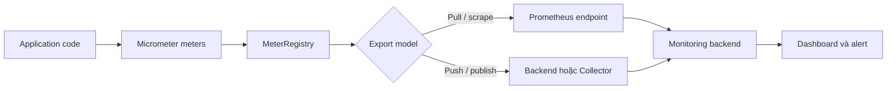

# Chọn registry theo giao thức, khả năng thống kê và môi trường vận hành

Trong module `OBSERVABILITY_INSTRUMENTATION_MICROMETER`, `MeterRegistry` là điểm kết nối giữa instrumentation trong ứng dụng Java và hệ thống nhận metrics. Micrometer cung cấp API chung cho `Counter`, `Gauge`, `Timer`, `DistributionSummary` và các meter khác; registry cụ thể quyết định cách đặt tên, ánh xạ loại meter, thu thập và chuyển dữ liệu tới backend.

Vì vậy, chọn registry là một quyết định kiến trúc. Cần xét cách dữ liệu được vận chuyển (pull hay push), giao thức backend hỗ trợ, khả năng biểu diễn histogram/percentile, semantics tích lũy hay theo step, môi trường triển khai, bảo mật và cách vận hành khi mạng hoặc backend gặp lỗi. Không có một registry phù hợp cho mọi hệ thống.

## 1. MeterRegistry nằm ở đâu trong luồng metrics?

Ứng dụng ghi nhận dữ liệu vào meter. Registry quản lý meter và kết nối chúng với exporter hoặc backend tương ứng. Hệ giám sát sau đó lưu trữ, truy vấn và hiển thị time series.



API instrumentation có thể giữ nguyên khi thay registry, nhưng dữ liệu xuất không nhất thiết giống nhau hoàn toàn. Registry có thể chuẩn hóa tên metric, đổi đơn vị, ánh xạ `Timer` thành các series riêng, hoặc hỗ trợ một số thống kê mà registry khác không hỗ trợ. Hãy xem registry là lớp tích hợp với backend, không chỉ là một nơi lưu meter.

## 2. Phân biệt pull và push

Hai mô hình vận chuyển phổ biến có cách vận hành khác nhau.

**Pull (scrape):** hệ thống giám sát chủ động gọi endpoint metrics của ứng dụng theo chu kỳ. Prometheus thường dùng mô hình này: ứng dụng expose endpoint, Prometheus phát hiện target và scrape dữ liệu.

**Push (publish):** ứng dụng hoặc registry chủ động gửi metrics đến backend, gateway hoặc collector theo chu kỳ hay giao thức mà registry hỗ trợ. Nhiều registry SaaS và step-based registry hoạt động theo mô hình này.

| Tiêu chí | Pull / scrape | Push / publish |
| --- | --- | --- |
| Bên khởi tạo truyền dữ liệu | Monitoring server | Ứng dụng, registry hoặc agent |
| Điểm kết nối | Backend gọi endpoint của ứng dụng | Ứng dụng kết nối ra backend/collector |
| Khám phá instance | Backend cần service discovery hoặc danh sách target | Ứng dụng thường biết endpoint nhận dữ liệu |
| Kiểm tra target | Có thể theo dõi trạng thái scrape và scrape duration | Cần theo dõi lỗi gửi, độ trễ publish và trạng thái collector |
| Môi trường phù hợp | Hạ tầng cho phép backend truy cập endpoint ứng dụng | Môi trường chỉ cho phép outbound hoặc backend cung cấp API nhận dữ liệu |
| Tác vụ ngắn hạn | Cần giải pháp lưu giữ/scrape phù hợp để tránh job kết thúc trước lần scrape | Có thể gửi dữ liệu trước khi tiến trình kết thúc, tùy registry và cơ chế flush |

Pull thường giúp monitoring server kiểm soát nhịp lấy mẫu và biết target nào không scrape được. Push phù hợp khi ứng dụng không thể expose endpoint cho hệ thống giám sát, hoặc tổ chức đã có collector/backend nhận dữ liệu. Với push, ứng dụng cần xử lý cấu hình endpoint, xác thực, timeout, retry và shutdown theo hướng dẫn của registry.

Không nên chọn chỉ dựa trên tên giao thức. Hãy xem xét đường mạng thực tế giữa ứng dụng, collector và backend, cũng như ai chịu trách nhiệm phát hiện instance mới hoặc instance đã biến mất.

## 3. Các nhóm registry thường gặp

Micrometer có nhiều registry tích hợp với backend khác nhau. Bảng dưới đây mô tả vai trò phổ biến; khả năng cụ thể phụ thuộc phiên bản Micrometer, client backend và cấu hình.

| Registry | Mô hình thường gặp | Khi nào cân nhắc |
| --- | --- | --- |
| `PrometheusMeterRegistry` | Pull qua endpoint scrape | Hệ thống dùng Prometheus hoặc tương thích Prometheus exposition |
| `DatadogMeterRegistry` | Push theo chu kỳ đến Datadog hoặc endpoint được cấu hình | Tổ chức dùng Datadog và có API key/agent/network tương ứng |
| `OtlpMeterRegistry` | Push OTLP tới OpenTelemetry Collector hoặc endpoint OTLP | Muốn chuẩn hóa đường xuất metrics qua OpenTelemetry Collector |
| `StatsdMeterRegistry` | Gửi datagram theo giao thức StatsD | Hệ thống đã có StatsD-compatible agent hoặc daemon nhận metrics |
| `GraphiteMeterRegistry` | Push theo giao thức Graphite | Hạ tầng đang sử dụng Graphite/Carbon |
| `InfluxMeterRegistry` | Push theo giao thức InfluxDB | Backend InfluxDB là nền tảng metrics/time series hiện có |
| `SimpleMeterRegistry` | Lưu trong bộ nhớ, không export ra hệ thống bên ngoài | Unit test hoặc ví dụ cục bộ |
| `CompositeMeterRegistry` | Chuyển cùng meter đến nhiều registry con | Cần fan-out sang nhiều backend hoặc chuyển tiếp có kiểm soát |

`CompositeMeterRegistry` không phải backend lưu trữ độc lập. Nó là registry tổng hợp, chuyển các thao tác ghi nhận đến những registry con đã được thêm vào. `SimpleMeterRegistry` cũng không phải lựa chọn production để gửi metrics; dữ liệu chỉ tồn tại trong bộ nhớ của tiến trình.

## 4. Chọn theo giao thức và topology mạng

Trước khi thêm dependency, hãy vẽ đường đi của dữ liệu:

- Với Prometheus pull, Prometheus phải phân giải được địa chỉ target và kết nối đến endpoint metrics. Nếu ứng dụng nằm sau NAT, trong mạng riêng hoặc chỉ có outbound, cần giải quyết topology trước.
- Với OTLP push, ứng dụng thường gửi đến OpenTelemetry Collector. Collector có thể nhận metrics từ nhiều service, áp dụng processor, thêm resource attributes và xuất tiếp đến backend.
- Với Datadog hoặc registry SaaS, xác định ứng dụng gửi trực tiếp đến dịch vụ hay gửi qua agent trong mạng nội bộ. Cấu hình endpoint và credentials theo kiến trúc được chọn.
- Với StatsD, xác định UDP/TCP transport, địa chỉ agent, khả năng mất datagram và cách backend diễn giải metric type.

Các câu hỏi nên trả lời trước khi chọn:

1. Ứng dụng có thể expose endpoint cho monitoring server không?
2. Hạ tầng cho phép inbound, outbound hay chỉ giao tiếp qua collector/agent?
3. Có service discovery cho pod, VM và job ngắn hạn không?
4. Khi mạng mất kết nối, registry có buffer/retry hay số liệu của step có thể bị mất?
5. Ai vận hành collector, credential, certificate và nâng cấp giao thức?

Giao thức cần tương thích với chính sách mạng và năng lực vận hành của đội ngũ. Một kiến trúc có collector tập trung có thể giảm số kết nối backend trực tiếp từ từng service, nhưng thêm một thành phần cần giám sát và mở rộng.

## 5. Chọn theo khả năng thống kê

Không phải registry nào cũng biểu diễn mọi meter hoặc thống kê theo cùng cách. Trước khi chọn, liệt kê các câu hỏi mà dashboard và alert cần trả lời:

- Có cần count và total time của `Timer` không?
- Có cần histogram bucket để tính p95/p99 tổng hợp nhiều instance không?
- Có cần percentile phía client cho từng instance không?
- Có cần SLO bucket tại các ngưỡng cụ thể không?
- Backend có hỗ trợ `LongTaskTimer`, `FunctionCounter`, `FunctionTimer` và `Gauge` theo cách ứng dụng cần không?
- Có cần exemplar hoặc liên kết metrics với trace không?

`publishPercentiles(...)` tính percentile phía client. Giá trị percentile theo từng instance không thể cộng gộp chính xác thành percentile của toàn service. Histogram bucket cho phép backend tổng hợp bucket trước khi tính quantile, nhưng làm tăng số time series và chi phí lưu trữ.

Ví dụ cấu hình histogram cho timer:

```java
import java.time.Duration;

Timer requestTimer = Timer.builder("http.server.requests.custom")
    .publishPercentileHistogram()
    .serviceLevelObjectives(
        Duration.ofMillis(100),
        Duration.ofMillis(300),
        Duration.ofSeconds(1))
    .register(registry);
```

Trước khi dựa vào cấu hình này, xác minh registry và backend có xuất/nhận histogram theo định dạng cần thiết. Một API builder có thể chấp nhận cấu hình nhưng khả năng và hình thức export vẫn do registry cụ thể quyết định.

## 6. Step-based và cumulative semantics

Một tiêu chí quan trọng là cách registry xuất các giá trị tích lũy.

- Registry cumulative thường xuất counter tăng dần trong vòng đời meter/tiến trình. Prometheus scrape các snapshot và dùng `rate()` hoặc `increase()` để tính tốc độ hay mức tăng trong cửa sổ truy vấn.
- Nhiều push registry dựa trên `StepMeterRegistry`, chia dữ liệu thành các cửa sổ step và xuất phần phát sinh của cửa sổ đã hoàn tất. Cách backend nhận và diễn giải delta phụ thuộc registry.

| Câu hỏi | Cumulative registry | Step-based registry |
| --- | --- | --- |
| Counter đại diện | Tổng tích lũy | Thường là phần tăng trong step |
| Tính tốc độ | Backend tính từ các mẫu, ví dụ PromQL `rate()` | Backend có thể nhận delta/rate theo step |
| Cửa sổ | Do truy vấn hoặc backend xác định | Do registry cấu hình bằng step duration |
| Điều cần kiểm tra | Reset, scrape interval, nhãn instance | Step duration, publish schedule, retry và semantics delta |

Không áp dụng máy móc PromQL `rate()` lên dữ liệu đã là delta mỗi step. Nếu đổi registry, cần rà soát lại truy vấn, dashboard và alert vì cùng tên meter có thể mang semantics khác.

## 7. Chọn theo môi trường vận hành

**Kubernetes và Prometheus:** pull thường tự nhiên khi Prometheus hoặc Prometheus Operator có thể khám phá service/pod và scrape endpoint. Cần quản lý annotation/service monitor, port, path, network policy và bảo mật endpoint.

**Hệ thống dùng dịch vụ metrics SaaS:** registry push có thể phù hợp khi tổ chức đã dùng backend như Datadog, có API key hoặc agent và đã thiết lập quy trình quản lý credentials. Kiểm tra giới hạn ingest, retry và chi phí theo custom metrics.

**Môi trường nhiều mạng hoặc nhiều backend:** OpenTelemetry Collector có thể làm điểm nhận OTLP, xử lý và định tuyến dữ liệu. Điều này tách cấu hình ứng dụng khỏi từng backend đích, nhưng cần vận hành collector, pipeline và khả năng backpressure.

**Job ngắn hạn hoặc batch:** pull có rủi ro job kết thúc trước khi lần scrape tiếp theo diễn ra. Có thể dùng push gateway hoặc registry push phù hợp, nhưng cần chính sách dọn dữ liệu của job, định danh job và tránh giữ series cũ vô hạn. Push gateway không thay thế cơ chế scrape của Prometheus; Prometheus vẫn scrape gateway.

**Unit test:** dùng `SimpleMeterRegistry` để kiểm tra logic meter mà không gửi dữ liệu ra ngoài. Test này không xác minh giao thức hoặc định dạng export của production registry.

## 8. Tích hợp registry trong Spring Boot

Trong Spring Boot, thêm dependency của registry mong muốn để auto-configuration tạo registry phù hợp. Ví dụ với Prometheus:

```groovy
dependencies {
    implementation("org.springframework.boot:spring-boot-starter-actuator")
    runtimeOnly("io.micrometer:micrometer-registry-prometheus")
}
```

Expose endpoint Prometheus:

```yaml
management:
  endpoints:
    web:
      exposure:
        include: health,prometheus
```

Prometheus có thể scrape endpoint `/actuator/prometheus` khi ứng dụng chạy và endpoint được bảo vệ/phơi bày đúng cách. Với registry push, thêm dependency tương ứng và cấu hình endpoint, step, credentials theo phiên bản Spring Boot và registry đang dùng. Ví dụ Datadog trong Spring Boot 3.x:

```yaml
management:
  datadog:
    metrics:
      export:
        api-key: ${DD_API_KEY}
        step: 30s
```

Không commit API key vào repository. Dùng secret manager hoặc biến môi trường do nền tảng triển khai cấp. Prefix cấu hình có thể khác giữa các phiên bản Spring Boot; kiểm tra configuration metadata của phiên bản dự án trước khi áp dụng.

Trong code nghiệp vụ, inject `MeterRegistry` qua constructor:

```java
@Component
public class CheckoutMetrics {
    private final Counter accepted;

    public CheckoutMetrics(MeterRegistry registry) {
        this.accepted = registry.counter("checkout.accepted");
    }

    public void orderAccepted() {
        accepted.increment();
    }
}
```

Không tự tạo một registry mới trong mỗi service hoặc request. Nếu Spring Boot đã cấu hình registry, dùng registry được inject để exporter đọc được các meter của ứng dụng.

## 9. Khi nào dùng CompositeMeterRegistry?

`CompositeMeterRegistry` hữu ích khi cần gửi cùng instrumentation tới nhiều registry, ví dụ Prometheus và một backend SaaS trong giai đoạn chuyển đổi. Có thể tạo composite và thêm các registry con:

```java
CompositeMeterRegistry composite = new CompositeMeterRegistry();
composite.add(prometheusRegistry);
composite.add(datadogRegistry);

Counter requests = composite.counter("api.requests");
requests.increment();
```

Mỗi lần increment được chuyển tới các registry con. Điều này giúp không phải viết hai đoạn instrumentation cho cùng sự kiện. Tuy nhiên, fan-out làm tăng lưu lượng và chi phí; cùng một dữ liệu xuất đến hai backend cũng có thể bị tính trùng nếu dashboard truy vấn cả hai nguồn.

Tránh vô tình đăng ký cùng một registry con nhiều lần hoặc vừa dùng auto-configured composite vừa tự tạo một composite không được exporter quản lý. Trong Spring Boot, hãy hiểu registry nào được auto-configure và registry nào thực sự được inject trước khi tự lắp ghép.

Composite không giải quyết khác biệt semantics. Một registry con có thể xuất cumulative, registry khác xuất step delta; histogram và tag naming cũng có thể khác. Dashboard cần hiểu backend nguồn và tránh cộng dữ liệu từ các bản sao của cùng một sự kiện.

## 10. Bảo mật và quản lý dữ liệu nhãn

Metrics endpoint và đường push đều có thể tiết lộ thông tin vận hành. Endpoint pull cần giới hạn mạng truy cập, cân nhắc authentication/TLS ở lớp phù hợp và không expose các endpoint quản trị không cần thiết ra Internet.

Với push registry:

- Lưu API key và token trong secret manager hoặc biến môi trường.
- Dùng TLS và endpoint đúng môi trường.
- Cấu hình timeout, retry và giới hạn buffer theo khả năng registry.
- Không ghi credential vào log khi xảy ra lỗi publish.
- Theo dõi lỗi xác thực, giới hạn ingest và thời gian gửi.

Không đưa dữ liệu nhạy cảm hoặc định danh cá nhân vào tag. Tránh `userId`, `orderId`, email, token, request ID, trace ID và URL thô. Tag nên có tập giá trị hữu hạn như `method`, `status`, `region` hoặc `result`. Cardinality cao vừa làm tăng chi phí backend vừa có thể làm lộ dữ liệu không nên xuất.

## 11. Vận hành khi backend hoặc mạng gặp sự cố

Registry push có thể gửi theo chu kỳ và giữ một phần dữ liệu trong bộ nhớ. Nếu publish thất bại, hành vi retry, buffering, drop dữ liệu và flush khi shutdown phụ thuộc implementation. Registry pull có thể tiếp tục phục vụ endpoint metrics ngay cả khi backend scrape tạm thời không truy cập được, nhưng các lần scrape bị bỏ lỡ sẽ không tự động được bù lại bằng lịch sử trong ứng dụng.

Hãy xác định trước:

- Dữ liệu có bị mất khi ứng dụng dừng đột ngột không?
- Registry có retry và giới hạn thời gian retry không?
- Buffer có giới hạn để tránh chiếm bộ nhớ không?
- Shutdown có flush step cuối cùng và có timeout không?
- Có log/metric báo lỗi export và độ trễ export không?
- Khi backend trả lỗi hoặc throttling, ứng dụng có bị ảnh hưởng latency request không?

Metrics là tín hiệu quan sát, không phải kho giao dịch bền vững. Không dùng registry để thay thế event log hoặc dữ liệu nghiệp vụ cần đảm bảo không mất.

## 12. Kiểm thử và xác minh registry đã chọn

Kiểm tra theo từng lớp giúp phân biệt lỗi instrumentation với lỗi export:

1. **Unit test:** dùng `SimpleMeterRegistry` xác nhận counter tăng, timer ghi count/time và tag đúng.
2. **Registry test:** tạo đúng registry production, đăng ký meter mẫu và kiểm tra cách registry ánh xạ tên, đơn vị, tag và loại meter.
3. **Export test:** với pull, gọi endpoint exposition; với push, kiểm tra request gửi đến test server hoặc collector.
4. **Integration test:** khởi động ứng dụng với cấu hình triển khai, xác nhận backend nhận dữ liệu và dashboard truy vấn đúng.
5. **Failure test:** mô phỏng backend không khả dụng hoặc credentials sai để xác nhận timeout, retry, log và shutdown.

Ví dụ unit test độc lập với backend:

```java
SimpleMeterRegistry registry = new SimpleMeterRegistry();
Counter counter = registry.counter("checkout.accepted");

counter.increment();

assertThat(registry.get("checkout.accepted").counter().count())
    .isEqualTo(1.0);
```

Test này chỉ xác minh logic meter. Nó không chứng minh Prometheus scrape được endpoint, Datadog nhận API request hay OTLP collector nhận được batch. Các kiểm tra đó cần registry và transport thật hoặc test double phù hợp.

## 13. Quy trình chọn registry

Có thể dùng trình tự sau để đưa ra quyết định có thể kiểm chứng:

1. **Chọn backend và giao thức:** xác định hệ thống lưu trữ metrics hiện có và chuẩn giao tiếp mà nó hỗ trợ.
2. **Chọn mô hình vận chuyển:** pull nếu backend có thể scrape; push nếu ứng dụng cần gửi tới agent/collector/backend.
3. **Xác nhận meter cần thiết:** liệt kê Counter, Gauge, Timer, DistributionSummary, LongTaskTimer, function meters và histogram cần dùng.
4. **Xác nhận semantics:** cumulative hay step, đơn vị, cách tính percentile và cách xử lý reset.
5. **Đánh giá môi trường:** service discovery, network policy, TLS, credentials, job ngắn hạn và shutdown.
6. **Ước lượng chi phí:** số meter, tổ hợp tag, số bucket, chu kỳ scrape/publish và giới hạn ingest.
7. **Kiểm thử export:** xác minh dữ liệu thực tế tại endpoint hoặc collector trước khi xây dashboard và alert.

| Tình huống | Hướng lựa chọn ban đầu | Điểm phải xác minh |
| --- | --- | --- |
| Kubernetes có Prometheus scrape | Prometheus registry | Service discovery, endpoint, histogram và label |
| Chỉ có outbound tới SaaS | Registry push của backend | API key, step, retry, giới hạn ingest |
| Muốn chuẩn hóa qua collector | OTLP registry | OTLP endpoint, temporality, processor và exporter của collector |
| Cần gửi đồng thời nhiều nơi | Composite hoặc collector fan-out | Tránh gửi trùng, khác biệt semantics và chi phí |
| Unit test | SimpleMeterRegistry | Không dùng nó để kết luận về export production |

## 14. Những lỗi thường gặp

| Hiện tượng | Nguyên nhân nên kiểm tra |
| --- | --- |
| Không thấy endpoint Prometheus | Thiếu registry dependency, endpoint chưa expose hoặc cấu hình bảo mật chặn truy cập |
| Push registry không gửi dữ liệu | Sai endpoint/credential, network egress bị chặn hoặc publisher chưa được cấu hình |
| Counter hiển thị giảm theo chu kỳ | Có thể registry xuất delta theo step; kiểm tra semantics trước khi coi là reset |
| Dashboard p95 không tổng hợp đúng | Backend không nhận histogram bucket hoặc đang dùng client-side percentile |
| Dữ liệu bị nhân đôi | Cùng meter được xuất tới nhiều registry/backend rồi bị cộng chung |
| Mất dữ liệu khi shutdown | Chưa flush hoặc timeout shutdown ngắn hơn thời gian publish |
| Cardinality tăng mạnh | Tag chứa ID hoặc histogram được bật cho quá nhiều meter/bucket |
| Test unit qua nhưng production không có metrics | SimpleMeterRegistry không kiểm tra transport và exporter |

Khi gặp sự cố, kiểm tra lần lượt dependency và auto-configuration, registry thực tế được inject, cấu hình endpoint/step, dữ liệu export thô, rồi mới đến dashboard và PromQL. Cách này giúp khoanh vùng lỗi ở đúng lớp.

## 15. Nguyên tắc áp dụng

Chọn registry dựa trên backend, giao thức, topology mạng, loại meter và khả năng thống kê cần thiết. Pull phù hợp khi monitoring server có thể scrape endpoint; push phù hợp khi ứng dụng cần gửi tới backend hoặc collector. Prometheus thường dùng cumulative semantics, trong khi nhiều push registry dùng step-based semantics; điều này ảnh hưởng trực tiếp đến cách truy vấn và diễn giải dữ liệu.

Trong Spring Boot, thêm dependency registry và dùng auto-configuration cùng `MeterRegistry` được inject. Xác minh histogram, percentile, đơn vị và nhãn tại endpoint export trước khi viết dashboard. Cuối cùng, tính đến bảo mật, cardinality, retry, shutdown và chi phí ingest. Một registry phù hợp phải đáp ứng được cả yêu cầu kỹ thuật lẫn khả năng vận hành lâu dài của hệ thống.
