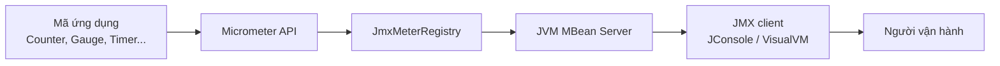

# JMX registry để quan sát phép đo trong môi trường JVM

Micrometer có thể xuất metrics trực tiếp vào Java Management Extensions (JMX) thông qua `JmxMeterRegistry`. Registry này biểu diễn các meter của ứng dụng thành các MBean trong MBean Server của JVM. Công cụ quản trị như JConsole, VisualVM hoặc một JMX client có thể kết nối đến MBean Server để xem các giá trị mà ứng dụng đang công bố.

JMX registry hữu ích khi cần kiểm tra metrics của một tiến trình Java ngay trong môi trường JVM, đặc biệt trong lúc phát triển, vận hành máy chủ ứng dụng hoặc điều tra sự cố. Nó cho phép quan sát Counter, Gauge, Timer và DistributionSummary mà không cần xây dựng endpoint HTTP riêng cho từng meter.

JMX có phạm vi quan sát theo từng JVM. Nó không tự tạo kho lưu trữ lịch sử hoặc dashboard tập trung cho nhiều máy. Nếu cần tổng hợp metrics trên toàn cluster, lưu dữ liệu dài hạn và tạo alert tập trung, hãy kết hợp với một backend như Prometheus hoặc hệ thống metrics khác.

## 1. JMX, MBean và MBean Server

JMX là cơ chế quản trị và giám sát các tài nguyên trong JVM. Một đối tượng được công bố để công cụ quản trị đọc hoặc thao tác thường được gọi là **MBean** (Managed Bean).

Ba thành phần chính:

- **MBean:** đối tượng quản lý công bố các thuộc tính và thao tác.
- **MBean Server:** registry trong JVM quản lý các MBean và cho phép client tra cứu chúng.
- **JMX client:** công cụ hoặc chương trình kết nối đến MBean Server để đọc thuộc tính hoặc gọi thao tác được công bố.

JVM cung cấp platform MBean Server có thể lấy bằng:

```java
MBeanServer server = ManagementFactory.getPlatformMBeanServer();
```

JVM và các thư viện thường đăng ký MBean cho thông tin runtime như memory pool, garbage collector, thread và class loading. Micrometer JMX registry sử dụng cơ chế tương tự để công bố các meter của ứng dụng.

Có thể hình dung luồng dữ liệu:



JMX client đọc MBean qua MBean Server. MBean Server không phải kho dữ liệu chuỗi thời gian; lịch sử chỉ tồn tại nếu một công cụ bên ngoài định kỳ đọc và lưu các giá trị đó.

## 2. JmxMeterRegistry chuyển meter thành MBean

Micrometer cung cấp module `micrometer-registry-jmx`. Khi sử dụng `JmxMeterRegistry`, mỗi meter được công bố theo cấu trúc JMX của registry. Tên metric và tag được dùng để định danh MBean hoặc các thuộc tính của nó trong một domain.

Ví dụ ứng dụng đăng ký:

```java
Counter.builder("orders.created")
    .tag("channel", "web")
    .register(registry)
    .increment();
```

Trong JMX client, có thể tìm MBean thuộc domain của metrics và xem các thuộc tính tương ứng. Tên ObjectName và tên attribute cụ thể phụ thuộc phiên bản Micrometer, cấu hình domain và cách registry ánh xạ meter. Vì vậy, hãy xem MBean thực tế thay vì giả định một tên attribute cố định.

Các meter có ý nghĩa khác nhau sẽ được biểu diễn bằng các thuộc tính tương ứng:

| Meter | Thông tin thường cần quan sát |
|---|---|
| Counter | Giá trị đếm theo semantics của registry |
| Gauge | Giá trị hiện tại được đọc từ đối tượng |
| Timer | Count, tổng thời lượng và thống kê phân phối nếu được cấu hình, hỗ trợ |
| DistributionSummary | Count, tổng các mẫu và thống kê phân phối nếu được cấu hình, hỗ trợ |

JMX registry công bố giá trị do meter cung cấp. Nó không biến một Gauge thành lịch sử mọi lần thay đổi và cũng không tự tạo trace cho từng request.

## 3. Thêm JMX registry vào dự án

Với ứng dụng Spring Boot, thêm Actuator và JMX registry vào build.

### Maven

```xml
<dependencies>
    <dependency>
        <groupId>org.springframework.boot</groupId>
        <artifactId>spring-boot-starter-actuator</artifactId>
    </dependency>

    <dependency>
        <groupId>io.micrometer</groupId>
        <artifactId>micrometer-registry-jmx</artifactId>
        <scope>runtime</scope>
    </dependency>
</dependencies>
```

Nếu dự án dùng Spring Boot dependency management, phiên bản Micrometer thường được Boot quản lý. Không cần tự chọn phiên bản riêng cho JMX registry trừ khi dự án có quyết định quản lý dependency đặc biệt.

### Gradle

```groovy
dependencies {
    implementation 'org.springframework.boot:spring-boot-starter-actuator'
    runtimeOnly 'io.micrometer:micrometer-registry-jmx'
}
```

Khi JMX registry có trên runtime classpath, Spring Boot có thể tự cấu hình registry tương ứng. Hãy kiểm tra log khởi động và MBean Server để xác nhận registry đã được tạo.

## 4. Cấu hình domain và chu kỳ step trong Spring Boot

Có thể cấu hình JMX export trong `application.yml`:

```yaml
management:
  metrics:
    export:
      jmx:
        enabled: true
        domain: com.example.orders.metrics
        step: 1m
```

Ý nghĩa:

- `enabled`: bật hoặc tắt JMX metrics export.
- `domain`: domain dùng để nhóm các MBean của registry.
- `step`: chu kỳ cập nhật của registry dạng step; giá trị mặc định phụ thuộc cấu hình Micrometer/Spring Boot đang sử dụng.

Chọn domain đủ riêng biệt để tránh va chạm với các MBean khác trong cùng JVM. Nếu nhiều ứng dụng hoặc nhiều ApplicationContext cùng chia sẻ một MBean Server, domain nên thể hiện rõ ứng dụng hoặc thành phần sở hữu metrics.

`step` cần được chọn dựa trên độ trễ cập nhật chấp nhận được và chi phí thu thập. Đừng diễn giải mọi giá trị Counter hoặc Timer trong JMX là tổng tích lũy từ lúc JVM khởi động nếu registry đang cung cấp số đo theo từng step. Hãy kiểm tra semantics của meter và phiên bản đang chạy.

## 5. Tạo meter tùy chỉnh và common tags

Sau khi registry được cấu hình, có thể đăng ký meter tùy chỉnh như với bất kỳ `MeterRegistry` nào:

```java
import io.micrometer.core.instrument.Counter;
import io.micrometer.core.instrument.MeterRegistry;
import io.micrometer.core.instrument.Timer;

import org.springframework.stereotype.Component;

@Component
public class OrderMetrics {

    private final Counter created;
    private final Timer processing;

    public OrderMetrics(MeterRegistry registry) {
        this.created = Counter.builder("orders.created")
            .description("Number of created orders")
            .tag("channel", "web")
            .register(registry);

        this.processing = Timer.builder("orders.processing")
            .description("Order processing duration")
            .tag("operation", "create")
            .register(registry);
    }

    public void recordCreated() {
        created.increment();
    }

    public void process(Runnable operation) {
        processing.record(operation);
    }
}
```

Các meter được đăng ký qua `MeterRegistry` mà Spring Boot cung cấp. Nếu ứng dụng có nhiều registry, chẳng hạn JMX và Prometheus, việc dùng registry chung được cấu hình theo mô hình composite cho phép meter được chuyển đến các registry phù hợp.

Có thể gắn tag chung để phân biệt service và môi trường:

```java
import io.micrometer.core.instrument.MeterRegistry;
import org.springframework.boot.actuate.autoconfigure.metrics.MeterRegistryCustomizer;
import org.springframework.context.annotation.Bean;
import org.springframework.context.annotation.Configuration;

@Configuration
class MetricsConfiguration {

    @Bean
    MeterRegistryCustomizer<MeterRegistry> commonTags() {
        return registry -> registry.config().commonTags(
            "service", "order-service",
            "environment", "production"
        );
    }
}
```

Tag chung giúp lọc và phân biệt MBean của các ứng dụng hoặc môi trường. Chỉ dùng các tag có tập giá trị hữu hạn. Tag chứa request ID, user ID hoặc mã giao dịch duy nhất có thể làm số lượng MBean tăng rất nhanh.

## 6. Dùng JConsole để quan sát metrics

JConsole là công cụ đi kèm JDK để kết nối đến MBean Server và duyệt các MBean.

Để kiểm tra ứng dụng đang chạy trên cùng máy:

1. Khởi động ứng dụng có JMX registry.
2. Chạy lệnh `jconsole` từ JDK tương thích.
3. Chọn tiến trình Java của ứng dụng trong danh sách Local Process.
4. Chọn tab **MBeans**.
5. Tìm domain đã cấu hình, ví dụ `com.example.orders.metrics`.
6. Mở MBean tương ứng với metric cần quan sát.
7. Đọc các attribute và kiểm tra giá trị thay đổi khi ứng dụng thực hiện thao tác.

Ví dụ, sau khi gọi API tạo đơn hàng, Counter `orders.created` cần phản ánh lần ghi nhận mới theo semantics của registry. Khi chạy thao tác xử lý đơn hàng, các thuộc tính Timer sẽ thay đổi theo chu kỳ cập nhật của registry.

JConsole cũng cho phép quan sát các domain JVM như `java.lang`, trong đó có memory, thread và garbage collector. Không nhầm các MBean runtime có sẵn của JVM với MBean metrics do Micrometer đăng ký.

## 7. Truy vấn MBean bằng Java

Có thể duyệt MBean trực tiếp từ platform MBean Server trong cùng JVM:

```java
import java.lang.management.ManagementFactory;
import java.util.Set;

import javax.management.MBeanAttributeInfo;
import javax.management.MBeanInfo;
import javax.management.MBeanServer;
import javax.management.ObjectName;

public class JmxInspector {

    public static void printMetricsMBeans() throws Exception {
        MBeanServer server =
            ManagementFactory.getPlatformMBeanServer();

        ObjectName pattern =
            new ObjectName("com.example.orders.metrics:*");

        Set<ObjectName> names = server.queryNames(pattern, null);

        for (ObjectName name : names) {
            System.out.println("MBean: " + name);

            MBeanInfo info = server.getMBeanInfo(name);

            for (MBeanAttributeInfo attribute : info.getAttributes()) {
                if (!attribute.isReadable()) {
                    continue;
                }

                Object value = server.getAttribute(
                    name,
                    attribute.getName()
                );

                System.out.printf(
                    "  %s = %s%n",
                    attribute.getName(),
                    value
                );
            }
        }
    }
}
```

Ví dụ dùng `MBeanInfo` để khám phá attribute thay vì hardcode tên thuộc tính. Điều này hữu ích vì cách ánh xạ meter sang ObjectName và attribute có thể khác theo phiên bản hoặc cấu hình registry.

Đoạn code dùng platform MBean Server của chính JVM đang chạy. Nếu muốn truy vấn một JVM từ tiến trình khác, cần tạo JMX connection từ xa bằng `JMXConnectorFactory` và một `JMXServiceURL` phù hợp.

## 8. Kết nối JMX từ xa

JMX remote thường dùng RMI để client kết nối đến MBean Server của tiến trình Java. JVM cần được khởi chạy với cấu hình remote management phù hợp. Ví dụ các tùy chọn cơ bản:

```text
-Dcom.sun.management.jmxremote
-Dcom.sun.management.jmxremote.port=9010
-Dcom.sun.management.jmxremote.rmi.port=9010
-Dcom.sun.management.jmxremote.authenticate=true
-Dcom.sun.management.jmxremote.ssl=true
-Djava.rmi.server.hostname=<private-reachable-hostname>
```

Các tùy chọn trên chỉ là phần khung cấu hình. Môi trường triển khai cần cấu hình tài khoản, password/access file hoặc cơ chế xác thực phù hợp, chứng chỉ TLS, truststore/keystore, firewall và hostname mà client có thể truy cập. RMI có thể cần cả registry port và RMI server port được mở đúng cách.

URL kết nối thường có dạng:

```text
service:jmx:rmi:///jndi/rmi://<host>:9010/jmxrmi
```

Có thể nhập URL này vào JConsole ở chế độ Remote Process. Với môi trường container hoặc Kubernetes, cần đặc biệt chú ý địa chỉ RMI mà JVM công bố và ánh xạ port từ bên ngoài vào container.

Không nên mở JMX remote trực tiếp ra Internet hoặc mạng người dùng. JMX cho phép truy cập thông tin nội bộ và có thể cho phép gọi thao tác quản trị tùy MBean được công bố. Chỉ cho phép truy cập từ mạng quản trị đáng tin cậy, bật xác thực và TLS, giới hạn nguồn kết nối bằng firewall hoặc network policy, và dùng tài khoản có quyền tối thiểu.

## 9. Phân biệt Micrometer JMX registry và Actuator JMX endpoints

Spring Boot có hai cơ chế liên quan đến JMX nhưng mục đích khác nhau:

| Cơ chế | Thành phần | Vai trò |
|---|---|---|
| Metrics qua JMX | `micrometer-registry-jmx` và `JmxMeterRegistry` | Công bố Counter, Gauge, Timer và các meter khác thành MBean |
| Actuator endpoint qua JMX | Spring Boot Actuator JMX exposure | Công bố endpoint quản trị như health hoặc info qua JMX |

Ví dụ cấu hình Actuator endpoint exposure:

```yaml
management:
  endpoints:
    jmx:
      exposure:
        include: health,info
```

Cấu hình này điều khiển endpoint Actuator nào được expose qua JMX. Nó không thay thế dependency `micrometer-registry-jmx` và cũng không tự bật metrics registry.

Ngược lại, thêm JMX registry không có nghĩa mọi endpoint Actuator đều được công bố. Hãy cấu hình hai cơ chế theo nhu cầu và chỉ expose những endpoint thực sự cần thiết.

## 10. Domain, ObjectName và nguy cơ va chạm

JMX định danh MBean bằng `ObjectName`, gồm domain và các key properties. Micrometer dùng tên meter và tag để tạo định danh tương ứng.

Nếu hai meter trong cùng MBean Server tạo ra ObjectName trùng nhau, chúng có thể va chạm khi đăng ký. Điều này dễ xảy ra khi:

- Nhiều registry hoặc ApplicationContext cùng dùng một domain mặc định.
- Hai ứng dụng cùng JVM có meter name và tag giống nhau.
- Tag bị bỏ hoặc chuẩn hóa làm các meter nhập thành cùng danh tính.
- Cấu hình domain không phân biệt các thành phần cùng chia sẻ MBean Server.

Để giảm rủi ro:

- Chọn domain riêng cho từng ứng dụng hoặc nhóm meter.
- Dùng tên metric có ngữ nghĩa rõ ràng.
- Giữ tag có tập giá trị giới hạn và có ích cho vận hành.
- Kiểm tra ObjectName thực tế trong JConsole hoặc bằng MBean Server.
- Tránh đăng ký nhiều meter khác loại dưới cùng danh tính.

Tag trong JMX cũng có thể làm tăng số lượng MBean. Kiểm soát cardinality vì vậy quan trọng ngay cả khi chỉ dùng JMX trong một JVM.

## 11. JMX registry có lưu lịch sử metrics không?

JMX registry công bố giá trị qua MBean Server để client đọc. Bản thân MBean Server không lưu chuỗi thời gian dài hạn và không cung cấp truy vấn lịch sử như Prometheus.

Nếu JConsole mở tại thời điểm hiện tại, công cụ hiển thị giá trị đang được công bố. Khi đóng công cụ, lịch sử không tự được lưu trong JVM. Muốn lưu lịch sử, cần một JMX collector hoặc agent định kỳ đọc MBean và gửi dữ liệu đến hệ thống lưu trữ.

Cũng cần phân biệt giá trị hiện tại của Gauge với thống kê step của Counter hoặc Timer. Gauge phản ánh giá trị tại thời điểm đọc. Các meter step-based có thể cung cấp số liệu theo cửa sổ cấu hình. Hãy xem tên attribute, đơn vị và chu kỳ step để diễn giải đúng.

Nếu mục tiêu là quan sát tập trung, lưu lịch sử, tính percentile trên nhiều replica và thiết lập alert, Prometheus hoặc OTLP registry thường phù hợp hơn. JMX vẫn có giá trị trong chẩn đoán trực tiếp một JVM và tích hợp với các công cụ quản trị Java truyền thống.

## 12. Vòng đời registry và MBean

Với Spring Boot, registry được quản lý theo vòng đời ApplicationContext. Khi ứng dụng dừng đúng cách, registry được đóng và các tài nguyên do nó quản lý được giải phóng.

Với ứng dụng Java độc lập, cần đóng registry khi kết thúc:

```java
import io.micrometer.core.instrument.Clock;
import io.micrometer.core.instrument.Counter;
import io.micrometer.jmx.JmxConfig;
import io.micrometer.jmx.JmxMeterRegistry;

public class StandaloneMetrics implements AutoCloseable {

    private final JmxMeterRegistry registry;
    private final Counter jobsCompleted;

    public StandaloneMetrics() {
        this.registry = new JmxMeterRegistry(
            JmxConfig.DEFAULT,
            Clock.SYSTEM
        );
        this.jobsCompleted = registry.counter("jobs.completed");
    }

    public void recordCompleted() {
        jobsCompleted.increment();
    }

    @Override
    public void close() {
        registry.close();
    }
}
```

Nếu ứng dụng tạo nhiều registry thủ công, cần quản lý vòng đời của từng registry. Không tạo registry mới mỗi request hoặc mỗi lần xử lý nghiệp vụ. Đăng ký meter một lần và tái sử dụng registry trong suốt vòng đời thành phần.

## 13. Những lỗi thường gặp

| Hiện tượng | Nguyên nhân có thể | Cách kiểm tra hoặc xử lý |
|---|---|---|
| Không thấy domain metrics trong JConsole | Chưa có JMX registry hoặc registry chưa đăng ký meter | Kiểm tra dependency runtime, cấu hình và MBean Server |
| Thấy JVM MBeans nhưng không thấy Micrometer MBeans | JVM JMX đang bật nhưng Micrometer JMX registry chưa được cấu hình | Thêm `micrometer-registry-jmx` và xác minh registry |
| MBean domain bị trùng | Nhiều thành phần dùng cùng domain và ObjectName | Đặt domain riêng và kiểm tra ObjectName |
| Giá trị Counter thay đổi theo từng khoảng | Registry đang dùng semantics step-based | Kiểm tra `step` và loại meter |
| Không kết nối được JMX remote | Sai hostname, port RMI, firewall hoặc cấu hình TLS/auth | Kiểm tra cả registry port và RMI server port |
| Kết nối được nhưng không đọc được MBean | Quyền truy cập hoặc MBean không có attribute cần đọc | Kiểm tra MBeanInfo và quyền tài khoản |
| Số MBean tăng bất thường | Tag cardinality cao hoặc meter được tạo liên tục | Chuẩn hóa tag và đăng ký meter ổn định |
| Không thấy lịch sử metrics | MBean Server không phải time-series database | Dùng collector hoặc backend lưu trữ |

## 14. Checklist triển khai JMX registry

- [ ] Thêm `micrometer-registry-jmx` vào runtime classpath.
- [ ] Xác nhận Spring Boot hoặc ứng dụng độc lập tạo `JmxMeterRegistry`.
- [ ] Chọn domain riêng, có ý nghĩa.
- [ ] Chọn `step` phù hợp với nhu cầu cập nhật.
- [ ] Đăng ký meter một lần và tái sử dụng registry.
- [ ] Dùng tag có tập giá trị hữu hạn để kiểm soát số lượng MBean.
- [ ] Kiểm tra MBean bằng JConsole hoặc một JMX client.
- [ ] Kiểm tra ObjectName, attribute, đơn vị và semantics của meter.
- [ ] Phân biệt metrics registry với Actuator JMX endpoint exposure.
- [ ] Nếu dùng JMX remote, bật xác thực, TLS và giới hạn mạng truy cập.
- [ ] Đóng registry đúng vòng đời ứng dụng.
- [ ] Dùng backend tập trung nếu cần lịch sử, dashboard và alert trên nhiều JVM.

Micrometer JMX registry đưa metrics của ứng dụng vào MBean Server để các công cụ quản trị JVM quan sát trực tiếp. Cấu hình đúng domain, step và tag giúp MBean dễ tìm, dễ diễn giải và tránh va chạm. JMX đặc biệt hữu ích khi điều tra một tiến trình Java; với nhu cầu tổng hợp nhiều instance và lưu lịch sử, hãy chuyển metrics đến một backend tập trung phù hợp.

## Tài liệu tham khảo

- [Micrometer JMX Registry](https://docs.micrometer.io/micrometer/reference/implementations/jmx.html) — cấu hình và sử dụng JMX registry.
- [Micrometer JmxMeterRegistry API](https://javadoc.io/doc/io.micrometer/micrometer-registry-jmx/latest/io/micrometer/jmx/JmxMeterRegistry.html) — API registry JMX.
- [Java Management Extensions (JMX) Technology](https://docs.oracle.com/javase/8/docs/technotes/guides/jmx/) — kiến trúc MBean, MBean Server và JMX client.
- [Java Monitoring and Management Using JMX](https://docs.oracle.com/en/java/javase/21/management/monitoring-and-management-using-jmx-technology.html) — quản trị và giám sát JVM bằng JMX.

