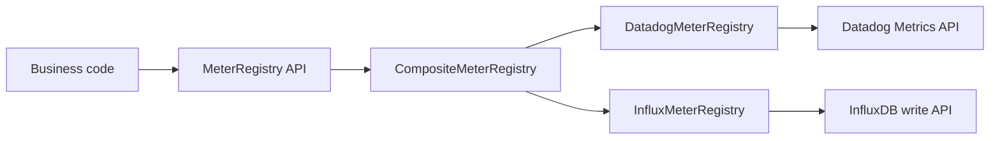

# Cấu hình registry cho hệ thống nhận như Datadog hoặc InfluxDB

Micrometer có thể xuất metrics đến nhiều hệ thống giám sát thông qua các registry adapter. Với Datadog và InfluxDB, registry chủ động gửi dữ liệu đến API nhận theo chu kỳ (push). Ứng dụng chỉ cần ghi nhận meter qua `MeterRegistry`; adapter đảm nhiệm việc gom số đo, chuyển đổi tên/đơn vị và gửi batch theo cấu hình.

Spring Boot Actuator tự động cấu hình registry khi adapter tương ứng có mặt trong runtime classpath. Phần cấu hình thường tập trung vào endpoint, thông tin xác thực, chu kỳ export và các tag định danh ứng dụng. Với InfluxDB, còn phải chọn API v1 hay v2 và cấu hình database hoặc organization/bucket phù hợp.

Trong module `OBSERVABILITY_INSTRUMENTATION_MICROMETER`, việc cấu hình registry là bước nối các phép đo counter, gauge, timer và distribution summary với nơi lưu trữ và truy vấn. Hãy xem registry là một phần của cấu hình triển khai, trong khi code nghiệp vụ chỉ làm việc với API Micrometer chung.

## 1. Phân biệt registry push và pull

Prometheus thường pull metrics bằng cách scrape endpoint của từng instance. Datadog registry và Influx registry của Micrometer dùng mô hình push: ứng dụng gom dữ liệu theo chu kỳ rồi gửi đến endpoint của hệ thống nhận.



Khi ứng dụng có nhiều registry trên classpath, Spring Boot có thể thêm chúng vào một `CompositeMeterRegistry`. Một meter được ghi nhận qua registry tổng hợp sẽ được chuyển đến các registry thành phần đang hoạt động. Vì vậy, nếu thêm cả Datadog và Influx dependency, hãy cấu hình có chủ đích để tránh gửi dữ liệu đến một backend chưa được chuẩn bị.

Registry push thường dùng `step` để xác định chu kỳ xuất. Giá trị tích lũy của một số meter được tổng hợp thành dữ liệu theo khoảng thời gian; vì vậy, dữ liệu phía backend có thể mang ý nghĩa rate hoặc thống kê theo step thay vì giữ nguyên mọi lần cập nhật trong bộ nhớ ứng dụng.

## 2. Thêm dependency registry

Với Spring Boot, Actuator cung cấp tích hợp Micrometer và auto-configuration. Thêm registry adapter mà ứng dụng cần sử dụng. Ví dụ Gradle Groovy DSL:

```groovy
dependencies {
    implementation 'org.springframework.boot:spring-boot-starter-actuator'
    runtimeOnly 'io.micrometer:micrometer-registry-datadog'
    runtimeOnly 'io.micrometer:micrometer-registry-influx'
}
```

Nếu dùng Maven:

```xml
<dependencies>
    <dependency>
        <groupId>org.springframework.boot</groupId>
        <artifactId>spring-boot-starter-actuator</artifactId>
    </dependency>

    <dependency>
        <groupId>io.micrometer</groupId>
        <artifactId>micrometer-registry-datadog</artifactId>
    </dependency>

    <dependency>
        <groupId>io.micrometer</groupId>
        <artifactId>micrometer-registry-influx</artifactId>
    </dependency>
</dependencies>
```

Khi dùng Spring Boot dependency management, không cần khai báo phiên bản riêng cho registry adapter. Để Spring Boot BOM quản lý phiên bản Micrometer tương thích với phiên bản framework. Nếu chỉ dùng một backend, chỉ thêm dependency của backend đó.

## 3. Cấu hình Datadog

Datadog registry gửi metrics định kỳ qua Datadog Metrics API. API key là thông tin bắt buộc để gửi metrics. Application key là tùy chọn; khi cung cấp, registry có thể gửi thêm metadata như description, type và base unit của meter.

Với Spring Boot 3.x trở lên, cấu hình trong `application.yml` có thể như sau:

```yaml
management:
  datadog:
    metrics:
      export:
        enabled: true
        api-key: ${DATADOG_API_KEY}
        # Tùy chọn: bỏ comment và cấp secret nếu cần gửi metadata meter.
        # application-key: ${DATADOG_APPLICATION_KEY}
        # Ví dụ site EU; chọn endpoint theo Datadog site của tài khoản.
        uri: https://api.datadoghq.eu
        step: 30s
  metrics:
    tags:
      application: order-service
      environment: ${APP_ENV:development}
```

Nếu tài khoản dùng Datadog US, có thể giữ endpoint mặc định `https://api.datadoghq.com`. Với các site khác như US3, US5 hoặc EU, hãy chọn đúng API endpoint theo site của tổ chức. Không sao chép endpoint của một site khác nếu tài khoản của bạn đặt ở khu vực khác.

Các thuộc tính quan trọng:

| Thuộc tính | Vai trò |
| --- | --- |
| `enabled` | Bật/tắt export Datadog |
| `api-key` | API key dùng để ingest metrics; bắt buộc |
| `application-key` | Tùy chọn; hỗ trợ gửi metadata meter |
| `uri` | Datadog site hoặc proxy endpoint |
| `step` | Chu kỳ gom và gửi metrics |
| `host-tag` | Tag key được ánh xạ vào trường host của Datadog; kiểm tra mặc định theo phiên bản Boot/Micrometer |

`step` mặc định thường là 1 phút. Ví dụ đặt `30s` sẽ gửi thường xuyên hơn và có thể làm tăng số request/batch. Chọn chu kỳ dựa trên yêu cầu độ trễ dữ liệu, giới hạn API và chi phí ingest.

Micrometer cũng có thể gửi dữ liệu đến DogStatsD bằng `micrometer-registry-statsd` với `StatsdFlavor.DATADOG`. Đây là một đường tích hợp khác, thường dùng khi tổ chức đã vận hành DogStatsD agent hoặc cần chuyển việc nhận dữ liệu qua agent. Với lựa chọn trực tiếp giữa hai cách, tài liệu Micrometer khuyến nghị Datadog HTTP API vì hiệu quả hơn; DogStatsD có thể là phương án khi gặp giới hạn tốc độ của Metrics API hoặc khi kiến trúc hạ tầng yêu cầu agent.

### Common tags và host

Nên thêm các tag định danh ổn định như application, environment, region và service. Có thể cấu hình common tags qua Spring Boot như ví dụ trên hoặc bằng `MeterRegistryCustomizer`:

```java
import io.micrometer.core.instrument.MeterRegistry;
import org.springframework.boot.actuate.autoconfigure.metrics.MeterRegistryCustomizer;
import org.springframework.context.annotation.Bean;
import org.springframework.context.annotation.Configuration;

@Configuration(proxyBeanMethods = false)
class MetricsCommonTagsConfiguration {
    @Bean
    MeterRegistryCustomizer<MeterRegistry> commonTags() {
        return registry -> registry.config().commonTags(
                "application", "order-service",
                "environment", "production");
    }
}
```

Datadog registry có thể ánh xạ một tag key thành trường host. Hãy xác nhận cấu hình `host-tag` và bảo đảm mỗi instance có host identity phù hợp. Không dùng request ID, order ID hoặc URL đầy đủ làm tag; mỗi giá trị riêng biệt có thể tạo thêm một time series và làm tăng chi phí.

## 4. Cấu hình InfluxDB

Micrometer hỗ trợ InfluxDB 1.x và 2.x thông qua `InfluxMeterRegistry`. Cần xác định API phiên bản nào đang được máy chủ InfluxDB cung cấp vì các thông tin xác thực và nơi ghi dữ liệu khác nhau.

### InfluxDB 2.x: org, bucket và token

InfluxDB 2.x sử dụng organization và bucket. Token phải có quyền ghi vào bucket đích. Ví dụ cấu hình Spring Boot:

```yaml
management:
  influx:
    metrics:
      export:
        enabled: true
        api-version: v2
        uri: ${INFLUX_URI:http://localhost:8086}
        org: ${INFLUX_ORG}
        bucket: ${INFLUX_BUCKET:application-metrics}
        token: ${INFLUX_TOKEN}
        step: 1m
        batch-size: 10000
        compressed: true
        connect-timeout: 1s
        read-timeout: 10s
```

Các thuộc tính chính:

| Thuộc tính | Vai trò |
| --- | --- |
| `api-version` | Chọn API `v1` hoặc `v2` |
| `uri` | Địa chỉ InfluxDB, mặc định thường là `http://localhost:8086` |
| `org` | Organization nhận dữ liệu, dùng với v2 |
| `bucket` | Bucket nhận dữ liệu, dùng với v2 |
| `token` | Token xác thực ghi dữ liệu |
| `step` | Chu kỳ xuất metrics |
| `batch-size` | Số measurement tối đa trong một request batch |
| `compressed` | Bật nén gzip cho batch |
| `connect-timeout`, `read-timeout` | Giới hạn thời gian kết nối và đọc phản hồi |

Micrometer hiện có thể mặc định chọn v1 nếu không cấu hình organization; khi có `org`, mặc định có thể chuyển sang v2. Dù vậy, nên đặt `api-version` tường minh để cấu hình dễ đọc và tránh thay đổi ngoài ý muốn khi chỉnh sửa org/bucket.

### InfluxDB 1.x: database và thông tin đăng nhập

InfluxDB 1.x sử dụng database và có thể dùng username/password, retention policy hoặc tùy chọn tự tạo database. Ví dụ:

```yaml
management:
  influx:
    metrics:
      export:
        enabled: true
        api-version: v1
        uri: ${INFLUX_URI:http://localhost:8086}
        db: application_metrics
        user-name: ${INFLUX_USERNAME:}
        password: ${INFLUX_PASSWORD:}
        retention-policy: metrics_30d
        auto-create-db: false
        step: 1m
```

Chỉ cấu hình những thuộc tính phù hợp với máy chủ đang dùng. `db`, `user-name`, `password`, `retention-policy` và `auto-create-db` thuộc luồng InfluxDB v1; `org`, `bucket` và token là cấu hình v2. Với production, thường nên tạo database/bucket và retention policy bằng quy trình quản trị hạ tầng, sau đó cấp credential chỉ có quyền ghi cần thiết cho ứng dụng.

## 5. Chọn step và hiểu rate aggregation

Datadog và Influx registry của Micrometer gom dữ liệu và push theo chu kỳ. Registry thực hiện rate aggregation cho các meter phù hợp, tạo dữ liệu theo step tương tự cách một agent thu thập metrics định kỳ.

`step` là khoảng thời gian tổng hợp/xuất, không phải khoảng thời gian giữa hai lần gọi `increment()` trong code nghiệp vụ. Ví dụ với `step: 1m`, registry gửi batch định kỳ mỗi phút. Một counter tăng 120 lần trong step sẽ được tổng hợp theo semantics mà registry/backend hỗ trợ; dữ liệu ở Datadog hoặc Influx có thể được biểu diễn như tốc độ hoặc thống kê theo khoảng, không nhất thiết là counter tích lũy thô giống endpoint Prometheus.

| Step | Tác động thường thấy | Phù hợp khi |
| --- | --- | --- |
| 10–15 giây | Dữ liệu đến backend nhanh hơn, nhiều batch/request hơn | Cần quan sát gần thời gian thực và backend cho phép |
| 30 giây | Cân bằng độ trễ và tần suất export | Dashboard vận hành cần cập nhật tương đối nhanh |
| 1 phút | Tần suất phổ biến, ít request hơn | Giám sát thông thường và dashboard theo phút |

Các con số trên là lựa chọn tham khảo, không phải giới hạn cứng. Cần xem giới hạn ingest, số meter, số instance và yêu cầu độ phân giải. Nếu step quá ngắn, tải mạng và số request tăng; nếu quá dài, dữ liệu đến dashboard chậm hơn và các biến động ngắn có thể khó quan sát.

Không so sánh trực tiếp một counter tích lũy từ Prometheus với chuỗi rate đã được registry push đến Datadog hoặc Influx mà không kiểm tra semantics và đơn vị. Khi đổi backend, hãy kiểm tra cách adapter ánh xạ counter, timer, distribution summary và percentile.

## 6. Có thể bật nhiều registry cùng lúc

Spring Boot phát hiện các registry adapter có trên runtime classpath và thêm chúng vào composite registry. Nếu cần gửi đồng thời đến Datadog và InfluxDB, có thể để cả hai dependency và cấu hình tương ứng. Cùng một meter sẽ được chuyển đến cả hai registry.

Nếu muốn tắt một registry dù dependency vẫn tồn tại:

```yaml
management:
  datadog:
    metrics:
      export:
        enabled: false
```

Có thể tắt mặc định tất cả registry rồi bật rõ backend cần dùng:

```yaml
management:
  defaults:
    metrics:
      export:
        enabled: false
  datadog:
    metrics:
      export:
        enabled: true
        api-key: ${DATADOG_API_KEY}
  influx:
    metrics:
      export:
        enabled: false
```

Khi cấu hình nhiều registry, hãy xác định backend nào là nguồn dữ liệu chính cho dashboard/alert, tránh gửi trùng dữ liệu ngoài dự kiến và theo dõi chi phí ingest ở từng nơi. Không tạo thủ công thêm một registry cùng loại nếu Spring Boot đã auto-configure registry đó, vì có thể dẫn đến gửi trùng metrics.

## 7. Cấu hình Java khi không dùng Spring Boot

Ứng dụng Java độc lập có thể tạo registry trực tiếp bằng config interface. Ví dụ với Datadog:

```java
import java.time.Duration;

import io.micrometer.core.instrument.Clock;
import io.micrometer.datadog.DatadogConfig;
import io.micrometer.datadog.DatadogMeterRegistry;

DatadogConfig config = new DatadogConfig() {
    @Override
    public String apiKey() {
        return System.getenv("DATADOG_API_KEY");
    }

    @Override
    public String uri() {
        return "https://api.datadoghq.eu";
    }

    @Override
    public Duration step() {
        return Duration.ofSeconds(30);
    }

    @Override
    public String get(String key) {
        return null;
    }
};

DatadogMeterRegistry registry = new DatadogMeterRegistry(config, Clock.SYSTEM);
```

Với InfluxDB 2.x:

```java
import java.time.Duration;

import io.micrometer.core.instrument.Clock;
import io.micrometer.influx.InfluxConfig;
import io.micrometer.influx.InfluxMeterRegistry;

InfluxConfig config = new InfluxConfig() {
    @Override
    public String uri() {
        return System.getenv().getOrDefault(
                "INFLUX_URI", "http://localhost:8086");
    }

    @Override
    public String org() {
        return System.getenv("INFLUX_ORG");
    }

    @Override
    public String bucket() {
        return System.getenv("INFLUX_BUCKET");
    }

    @Override
    public String token() {
        return System.getenv("INFLUX_TOKEN");
    }

    @Override
    public Duration step() {
        return Duration.ofMinutes(1);
    }

    @Override
    public String get(String key) {
        return null;
    }
};

InfluxMeterRegistry registry = new InfluxMeterRegistry(config, Clock.SYSTEM);
```

Đây là ví dụ cấu hình tối thiểu; ứng dụng thực tế cần quản lý vòng đời registry và đóng registry khi tiến trình kết thúc. Không hardcode API key hoặc token trong source code. Các config interface có nhiều thuộc tính mặc định; có thể đọc từ property source thay vì chỉ trả `null` trong `get(String key)`.

## 8. Bảo vệ credentials và đường truyền

API key Datadog, application key và token InfluxDB là thông tin nhạy cảm. Đưa chúng vào secret manager, biến môi trường hoặc cơ chế cấp phát secret của nền tảng triển khai. Không commit giá trị thật vào `application.yml`, file cấu hình mẫu hoặc log.

Một số nguyên tắc:

- Cấp API key/token chỉ có quyền ingest/write metrics cần thiết.
- Dùng HTTPS khi gửi dữ liệu qua mạng không tin cậy.
- Không in credential hoặc toàn bộ request header trong log khi xử lý lỗi export.
- Luân chuyển key/token theo quy trình của tổ chức và cập nhật secret ở runtime.
- Dùng `enabled: false` ở profile không cần export hoặc khi chạy unit test.
- Tách endpoint và credential theo môi trường dev, staging và production.

Application key Datadog không thay thế API key dùng để gửi metrics. Nó là thông tin tùy chọn phục vụ metadata; chỉ cấp khi có nhu cầu và đúng quyền.

## 9. Naming, tags và cardinality

Registry có thể chuyển tên canonical và đơn vị sang quy ước backend. Trước khi triển khai, hãy kiểm tra cách tên timer, counter và distribution summary được ánh xạ, đặc biệt khi dashboard phụ thuộc vào tên cụ thể.

Tag nên là các chiều ổn định, có tập giá trị hữu hạn:

- `application`, `environment`, `region`, `instance`.
- `operation`, `outcome`, `method` hoặc `status` với vocabulary giới hạn.
- `client` hoặc `pool` nếu số lượng client/pool được kiểm soát.

Tránh tag chứa user ID, order ID, request ID, URL đầy đủ, exception message hoặc dữ liệu do người dùng nhập. Mỗi tổ hợp tag có thể tạo thêm series hoặc point dimensions ở backend, làm tăng dung lượng lưu trữ và chi phí truy vấn.

Với Datadog, cần xem cardinality và giới hạn custom metrics theo gói/tổ chức. Với InfluxDB, tag được index và có thể làm tăng số series nếu tag có quá nhiều giá trị duy nhất. Đưa dữ liệu định danh chi tiết vào log hoặc trace; dùng metrics để quan sát xu hướng tổng hợp.

## 10. Kiểm tra registry đã export thành công

Vì Datadog và InfluxDB dùng push, endpoint Actuator `/actuator/metrics` chỉ cho biết meter đang được quản lý trong ứng dụng; nó không chứng minh backend đã nhận batch. Hãy kiểm tra cả phía ứng dụng và phía hệ thống nhận.

Quy trình kiểm tra:

1. Xác nhận dependency registry nằm trong runtime classpath.
2. Kiểm tra profile và properties để registry có `enabled: true`.
3. Xác nhận API key/token, URI, org/bucket hoặc database đúng môi trường.
4. Khởi động ứng dụng và kiểm tra log không có lỗi xác thực, DNS, TLS hoặc timeout khi publish.
5. Tạo một số thao tác nghiệp vụ để counter/timer thay đổi.
6. Chờ ít nhất một chu kỳ `step` để registry gửi batch đầu tiên.
7. Truy vấn Datadog Metrics Explorer hoặc InfluxDB UI/Flux để xác nhận metric xuất hiện.
8. Kiểm tra tag, unit, timestamp và giá trị có đúng semantics của registry không.

Với InfluxDB 2.x, xác nhận bucket và organization trong truy vấn. Với InfluxDB 1.x, xác nhận database và retention policy. Với Datadog, xác nhận tài khoản/site, host và tag filter đúng. Nếu chỉ nhìn thấy meter trong Actuator nhưng backend không có dữ liệu, hãy kiểm tra log của registry và cấu hình mạng/credential.

## 11. Xử lý lỗi thường gặp

| Biểu hiện | Nguyên nhân có thể | Hướng kiểm tra |
| --- | --- | --- |
| Không thấy metric ở Datadog | Thiếu API key, sai site URI, registry bị disable hoặc chưa đến chu kỳ gửi | Kiểm tra `api-key`, `uri`, `enabled`, `step` và log publish |
| Datadog báo unauthorized | API key không hợp lệ hoặc thuộc site khác | Kiểm tra key và site endpoint; application key không thay API key |
| InfluxDB v2 từ chối ghi | Sai org/bucket hoặc token thiếu quyền write | Kiểm tra `api-version`, `org`, `bucket`, token permission |
| InfluxDB v1 không có database | Database chưa tồn tại và auto-create bị tắt | Tạo database trước hoặc cấu hình `auto-create-db` theo chính sách |
| Backend có dữ liệu nhưng tên khác | Registry áp dụng naming convention hoặc đơn vị | Kiểm tra tên export và base unit thực tế |
| Giá trị counter không giống Prometheus | Datadog/Influx registry có rate aggregation theo step | Kiểm tra semantics của adapter và đơn vị theo thời gian |
| Dữ liệu đến chậm | Step dài hoặc batch chỉ được gửi theo chu kỳ | Kiểm tra step và thời điểm query |
| Có dữ liệu trùng | Tạo nhiều registry cùng loại hoặc gửi qua nhiều pipeline | Kiểm tra composite registry và cấu hình agent/Telegraf |
| Tăng chi phí ingest/series | Tag có cardinality cao hoặc quá nhiều meter | Giảm chiều tag, chuẩn hóa giá trị và áp dụng MeterFilter |

## 12. Quy trình cấu hình trong dự án

Khi tích hợp Datadog hoặc InfluxDB, thực hiện theo trình tự:

1. Xác định backend đích, phiên bản API, site/URI và mô hình xác thực.
2. Thêm đúng registry dependency và để BOM quản lý phiên bản.
3. Cấu hình registry bằng properties theo phiên bản Spring Boot đang dùng.
4. Đưa API key/token vào secret manager hoặc environment variables.
5. Chọn `step` theo yêu cầu độ mới của dữ liệu và giới hạn ingest.
6. Định nghĩa common tags ổn định và kiểm soát cardinality.
7. Xác nhận registry được auto-configure và không có registry trùng lặp.
8. Khởi động ứng dụng, chờ batch export và kiểm tra dữ liệu ở backend.
9. Kiểm thử lại khi đổi phiên bản Micrometer, endpoint, naming convention hoặc cấu hình step.

Lưu ý về phiên bản Spring Boot: các ví dụ thuộc nhóm `management.datadog.metrics.export` và `management.influx.metrics.export` áp dụng cho Spring Boot 3.x trở lên. Ở Spring Boot 2.x, prefix cấu hình registry cũ nằm dưới `management.metrics.export.datadog` và `management.metrics.export.influx`. Khi nâng cấp framework, cần cập nhật prefix theo tài liệu của đúng phiên bản thay vì sao chép nguyên file YAML cũ.

Datadog và InfluxDB đều có thể nhận metrics trực tiếp từ Micrometer qua registry push. Datadog yêu cầu API key và site endpoint phù hợp; InfluxDB yêu cầu cấu hình đúng API v1/v2 cùng database hoặc org/bucket và credential tương ứng. Khi dependency, cấu hình xác thực, chu kỳ export và schema tag được quản lý nhất quán, các meter của ứng dụng có thể được xuất và truy vấn ổn định ở hệ thống giám sát.

## Tài liệu tham khảo

- [Spring Boot 3.5: Metrics và registry auto-configuration](https://docs.spring.io/spring-boot/3.5/reference/actuator/metrics.html)
- [Micrometer Datadog Registry](https://docs.micrometer.io/micrometer/reference/implementations/datadog)
- [Micrometer Influx Registry](https://docs.micrometer.io/micrometer/reference/implementations/influx)
