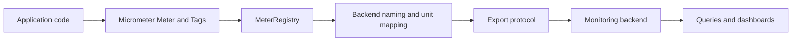

# Khác biệt tên, đơn vị, thời gian và tag giữa các hệ thống

Một meter Micrometer có thể được xuất đến Prometheus, OpenTelemetry Collector qua OTLP hoặc một backend giám sát khác. Dù cùng bắt nguồn từ một phép đo trong mã Java, dữ liệu nhìn thấy ở mỗi hệ thống có thể khác nhau về tên metric, đơn vị, cách biểu diễn thời gian và cách gắn nhãn.

Những khác biệt này đến từ quy ước của registry/exporter và mô hình dữ liệu của backend. Vì vậy, không nên giả định tên meter trong Java sẽ xuất hiện nguyên vẹn ở dashboard, hoặc một giá trị thời lượng luôn có cùng đơn vị và cùng semantics giữa các hệ thống. Muốn chuyển backend hoặc so sánh dữ liệu giữa nhiều nguồn, cần hiểu từng lớp chuyển đổi và kiểm tra dữ liệu thực tế sau export.

## 1. Tách biệt meter trong ứng dụng và chuỗi thời gian ở backend

Trong ứng dụng, Micrometer cung cấp API thống nhất:

- `Counter` ghi nhận tổng sự kiện tăng dần.
- `Gauge` cung cấp giá trị trạng thái tại thời điểm đọc.
- `Timer` ghi nhận số lần và thời lượng thao tác.
- `DistributionSummary` ghi nhận phân phối của một đại lượng số như byte hoặc số item.

Mã nghiệp vụ đăng ký meter qua `MeterRegistry`. Registry cụ thể chuyển meter thành định dạng và quy ước mà backend hiểu.



Nên phân biệt bốn lớp:

1. **Ý nghĩa nghiệp vụ**: đại lượng mà ứng dụng muốn đo, ví dụ thời gian xử lý đơn hàng.
2. **Danh tính Micrometer**: tên meter cùng tập tag; đây là cách registry nhận diện meter trong ứng dụng.
3. **Biểu diễn khi export**: tên, đơn vị, label/attribute, loại dữ liệu và temporality do registry chuyển đổi.
4. **Cách backend lưu và truy vấn**: quy tắc đặt tên, nhãn đích, timestamp, rate, histogram và cách hiển thị trên dashboard.

Khi một dashboard hiển thị tên khác với tên builder trong Java, chưa chắc ứng dụng đã đăng ký sai meter. Có thể registry đã chuẩn hóa tên hoặc thêm hậu tố đơn vị theo backend.

## 2. Khác biệt về tên metric

Tên meter trong Micrometer nên mô tả đại lượng một cách ổn định, không phụ thuộc backend. Ví dụ:

```java
Counter.builder("shop.orders.created")
        .description("Number of successfully created orders")
        .register(registry);
```

Tên `shop.orders.created` là tên ở lớp Micrometer. Khi export, registry có thể chuyển dấu chấm, đổi chữ hoa-thường, thay ký tự không hợp lệ hoặc thêm hậu tố theo loại metric và đơn vị.

### 2.1. Ví dụ tên theo backend

| Hệ thống/định dạng | Cách biểu diễn thường gặp | Điều cần chú ý |
| --- | --- | --- |
| Micrometer | `shop.orders.created` | Tên trong mã ứng dụng, trước khi áp dụng naming convention của registry. |
| Prometheus | `shop_orders_created_total` | Thường dùng dấu gạch dưới; counter có thể có hậu tố `_total`; timer có thể có hậu tố đơn vị. |
| OTLP | Tên metric trong OTLP cùng trường unit riêng | Tên có thể giữ dạng do exporter tạo; unit và resource/attributes được truyền riêng. |
| StatsD/Datadog | Thường là tên phân cấp như `shop.orders.created` cùng cú pháp tag của transport | Quy ước chính xác phụ thuộc registry, StatsD flavor và agent nhận dữ liệu. |
| Graphite | Thường là đường dẫn phân cấp như `shop.orders.created` | Tag có thể được chuyển thành thành phần path hoặc dùng tag support của backend. |

Các ví dụ là quy ước phổ biến, không phải cam kết rằng mọi phiên bản registry đều xuất chính xác chuỗi đó. Naming convention, loại registry và phiên bản thư viện quyết định kết quả cuối cùng.

### 2.2. Prometheus thường chuẩn hóa tên

Prometheus yêu cầu tên metric và label tuân theo quy tắc ký tự của nó. Micrometer Prometheus registry áp dụng naming convention để chuyển tên từ dạng Micrometer sang dạng phù hợp. Ví dụ, `shop.orders.created` thường trở thành dạng có dấu gạch dưới; counter có thể xuất với hậu tố `_total`.

Timer thường được biểu diễn bằng một nhóm chuỗi liên quan, chẳng hạn count, sum, max và có thể cả histogram bucket. Vì vậy, một meter Timer trong mã Java không nhất thiết tương ứng với chỉ một tên sample trong Prometheus.

Hãy đọc endpoint `/actuator/prometheus` để xác nhận tên thực tế trước khi viết PromQL. Không nên tự đoán tên bằng cách thay dấu chấm thành dấu gạch dưới rồi mặc định kết quả đã đúng.

### 2.3. OTLP tách tên và unit

OTLP Metrics có trường tên metric và trường unit riêng. Một metric thời lượng có thể được truyền cùng unit `s`, thay vì bắt buộc nhúng đơn vị vào tên theo cùng cách của Prometheus. Backend nhận OTLP có thể hiển thị hoặc chuyển đổi tên theo quy ước riêng.

Khi chuyển từ Prometheus sang OTLP, hãy kiểm tra cả tên và unit. Không nên chỉ thay dấu gạch dưới bằng dấu chấm trong dashboard vì exporter có thể đã chuẩn hóa theo cách khác.

### 2.4. Không mã hóa backend vào tên nghiệp vụ

Tránh đặt tên trong mã như `prometheus_shop_orders_created_total` hoặc `datadog_shop_orders_created`. Điều đó làm mã nghiệp vụ phụ thuộc vào một backend và khiến chuyển registry khó khăn.

Hãy dùng tên trung lập, có ý nghĩa nghiệp vụ, sau đó để registry xử lý quy ước export. Nếu một backend có giới hạn tên đặc biệt, cấu hình naming convention hoặc mapping ở lớp export khi registry hỗ trợ; không phân tán logic đổi tên vào từng service.

## 3. Khác biệt về đơn vị đo

Đơn vị là một phần của ý nghĩa metric. Hai giá trị số chỉ có thể so sánh hoặc cộng gộp khi chúng biểu diễn cùng đại lượng và cùng đơn vị.

Ví dụ:

- Thời lượng: giây, mili giây hoặc micro giây.
- Kích thước: byte, kilobyte hoặc mebibyte.
- Tốc độ: byte/giây hoặc request/giây.
- Số lượng: item, request, connection hoặc order.

Micrometer cho phép truyền đơn vị khi ghi Timer và có thể khai báo `baseUnit` cho meter phù hợp. Registry quyết định cách chuẩn hóa hoặc xuất đơn vị theo backend.

### 3.1. Timer chuẩn hóa thời lượng

Khi ghi Timer, hãy truyền đơn vị rõ ràng:

```java
import java.util.concurrent.TimeUnit;

timer.record(250, TimeUnit.MILLISECONDS);
```

Không cần tự chia 250 cho 1.000 trước khi ghi. Micrometer nhận đơn vị đầu vào và quy đổi theo base time unit mà registry sử dụng khi đọc hoặc export. Với Prometheus, timer thường được xuất theo giây; do đó 250 ms tương ứng 0,25 giây.

Khi đọc từ API, cũng cần yêu cầu đơn vị rõ ràng:

```java
double seconds = timer.totalTime(TimeUnit.SECONDS);
double millis = timer.max(TimeUnit.MILLISECONDS);
```

Hai biến trên mô tả cùng hệ thống nhưng có đơn vị khác nhau. Nếu dashboard hiển thị seconds trong khi alert threshold được nhập theo milliseconds, sai lệch hệ số 1.000 có thể dẫn đến cảnh báo sai.

### 3.2. Base unit của DistributionSummary

Với đại lượng không phải thời gian, hãy khai báo đơn vị cơ sở nhất quán:

```java
DistributionSummary payloadSize = DistributionSummary.builder("app.payload.size")
        .baseUnit("bytes")
        .description("Payload size in bytes")
        .register(registry);

payloadSize.record(4096);
```

Nếu một instance ghi byte còn instance khác ghi kilobyte vào cùng metric name và tag set, dữ liệu tổng hợp không còn ý nghĩa. Hãy chuẩn hóa đơn vị trước khi ghi, ví dụ mọi instance đều ghi byte.

### 3.3. Đơn vị trong tên và đơn vị metadata

Một số backend yêu cầu hoặc khuyến khích nhúng unit vào tên metric; một số hệ thống truyền unit riêng. Prometheus convention thường đưa đơn vị vào hậu tố tên như `_seconds` hoặc `_bytes`, trong khi OTLP có trường unit riêng.

Không nên tự thêm hậu tố đơn vị vào tên meter rồi lại để registry tự thêm lần nữa nếu điều đó tạo tên lặp như `duration_seconds_seconds`. Hãy chọn một quy ước nhất quán, khai báo unit đúng chỗ và kiểm tra output của registry.

## 4. Khác biệt về thời gian: duration, timestamp, step và temporality

Từ “thời gian” có thể nói đến nhiều khái niệm khác nhau. Cần tách chúng trước khi so sánh số liệu giữa backend.

| Khái niệm | Ý nghĩa | Ví dụ |
| --- | --- | --- |
| Duration | Thời lượng một thao tác kéo dài | Request mất 250 ms |
| Sample timestamp | Thời điểm mẫu được ghi hoặc thu thập | Prometheus scrape lúc 10:01:15 |
| Export step/interval | Chu kỳ registry gửi hoặc công bố số liệu | OTLP registry export mỗi 30 giây |
| Temporality | Cách điểm dữ liệu biểu diễn tích lũy theo thời gian | Cumulative hoặc delta |
| Statistical window | Khoảng mẫu dùng cho thống kê như max | Timer max với expiry × bufferLength |

Không thể suy ra một khái niệm từ khái niệm khác. Ví dụ, Timer ghi duration bằng giây không có nghĩa registry export mỗi giây; step 30 giây không có nghĩa request được đo trong cửa sổ 30 giây.

### 4.1. Pull và push ảnh hưởng thời điểm nhận dữ liệu

Với Prometheus, server scrape endpoint theo chu kỳ. Timestamp của sample thường gắn với thời điểm Prometheus thu thập. Nếu scrape interval là 15 giây, backend nhận snapshot theo nhịp scrape đó.

Với OTLP push, registry export theo step. Ứng dụng chủ động gửi batch metrics đến Collector; thời điểm export và cách dữ liệu được tích lũy phụ thuộc registry/exporter.

Do đó, cùng một counter có thể xuất hiện trong dashboard với độ phân giải và nhịp cập nhật khác nhau. Khi so sánh hai backend, cần đối chiếu scrape interval, export step, batch timeout và khoảng truy vấn.

### 4.2. Cumulative và delta temporality

Một số giao thức/backend phân biệt hai cách biểu diễn số liệu tích lũy:

- **Cumulative**: điểm dữ liệu chứa tổng từ mốc bắt đầu hoặc lần reset đến thời điểm hiện tại.
- **Delta**: điểm dữ liệu chứa phần tăng thêm trong một khoảng thời gian.

Ví dụ counter có tổng tích lũy lần lượt là 100, 135 và 160:

| Khoảng export | Cumulative | Delta |
| --- | ---: | ---: |
| Kỳ 1 | 100 | 100 |
| Kỳ 2 | 135 | 35 |
| Kỳ 3 | 160 | 25 |

Nếu backend hiểu sai temporality, nó có thể cộng lặp các giá trị cumulative hoặc bỏ sót dữ liệu delta. Khi chuyển backend hoặc thay cấu hình OTLP, cần xác minh exporter, Collector và backend thống nhất cách diễn giải.

### 4.3. Rate và increase không phải đơn vị gốc

Counter là tổng tích lũy; `rate()` hoặc `increase()` là phép tính ở lớp truy vấn. Ví dụ, `rate(counter[5m])` tạo tốc độ tăng trung bình trong 5 phút, thường có đơn vị sự kiện/giây.

Không lưu một giá trị counter raw vào dashboard rồi gắn nhãn “requests per second”. Hãy dùng phép tính rate tương ứng và kiểm tra cửa sổ truy vấn. Khi so sánh giữa backend, cần đảm bảo cùng khoảng thời gian, cùng cách xử lý reset và cùng đơn vị thời gian.

### 4.4. Time-window max không phải max trọn đời

Timer max trong Micrometer có thể được tính trên cửa sổ thời gian có giới hạn. Khi các mẫu cũ hết hạn và không có mẫu mới, max có thể giảm hoặc trở về 0. Backend khác có thể lưu max theo cách khác hoặc tính lại từ histogram trong cửa sổ truy vấn.

Vì vậy, không so sánh trực tiếp `Timer.max()` của Micrometer với một giá trị max được backend giữ lâu dài nếu chưa xác minh cửa sổ và semantics thống kê.

## 5. Khác biệt về tag, label và attributes

Micrometer dùng tag dạng cặp key-value để phân loại meter. Khi export, tag có thể trở thành label của Prometheus, attribute của OTLP hoặc tag theo quy ước của backend khác.

Ví dụ:

```java
Counter.builder("shop.orders.created")
        .tag("channel", "web")
        .tag("result", "success")
        .register(registry);
```

Metric có hai chiều phân loại: `channel=web` và `result=success`. Cùng metric name nhưng thay đổi một value tạo một meter identity khác trong registry.

### 5.1. Tag key có thể được chuẩn hóa

Backend có thể giới hạn ký tự hợp lệ hoặc chuẩn hóa tên label. Một tag key như `http.method` có thể được chuyển sang dạng khác khi export. Tránh đặt tag key chứa khoảng trắng, ký tự đặc biệt hoặc cách viết không nhất quán.

Hãy dùng tên ngắn, ổn định và có ý nghĩa như `method`, `route`, `status`, `result`, `region`. Khi backend có từ khóa dành riêng hoặc giới hạn label riêng, kiểm tra naming convention và quy tắc mapping của registry.

### 5.2. Tag và resource attributes không giống nhau

Trong OTLP, resource attributes mô tả service/process phát ra metrics, còn metric attributes mô tả từng nhóm dữ liệu. Ví dụ:

| Thông tin | Vị trí phù hợp |
| --- | --- |
| `service.name=order-service` | Resource attribute |
| `deployment.environment=production` | Resource attribute |
| `service.version=2.4.1` | Resource attribute |
| `channel=web` | Metric attribute |
| `result=success` | Metric attribute |
| `route=/orders/{id}` | Metric attribute |

Prometheus thường gắn `job` và `instance` từ cấu hình target/scrape. Không cần thêm `instance` thủ công vào từng meter nếu Prometheus đã cung cấp label đó. Với OTLP, resource attributes có thể được gắn ở cấp resource; không lặp chúng vào từng metric attribute nếu không có nhu cầu rõ ràng.

### 5.3. Missing tag, value rỗng và value dự phòng

Tag không có mặt, tag có value rỗng và tag có value `unknown` có thể được backend xem là các chuỗi dữ liệu khác nhau. Hãy thống nhất quy tắc xử lý `null`, chuỗi rỗng và giá trị ngoài danh sách.

Ví dụ chuẩn hóa kênh bán hàng về tập cố định:

```java
import java.util.Locale;

private String normalizeChannel(String raw) {
    if (raw == null) {
        return "other";
    }

    String normalized = raw.trim().toLowerCase(Locale.ROOT);
    switch (normalized) {
        case "web":
        case "mobile":
        case "partner":
            return normalized;
        default:
            return "other";
    }
}
```

Kết quả là tag chỉ có tối đa bốn giá trị: `web`, `mobile`, `partner` và `other`. Dùng cùng quy tắc ở mọi call site để các backend nhận cùng chiều phân loại.

### 5.4. Cardinality có thể bị nhân lên khi export

Mỗi tổ hợp tag có thể tạo một chuỗi thời gian riêng. Nếu metric có 4 giá trị `method`, 8 giá trị `route` và 4 giá trị `status`, giới hạn tối đa là 4 × 8 × 4 = 128 tổ hợp. Nếu thêm `user_id` có hàng trăm nghìn giá trị, số chuỗi có thể tăng rất lớn.

Không đưa các giá trị thay đổi theo từng request hoặc từng người dùng vào tag:

- user ID, order ID, session ID;
- request ID, trace ID;
- URL đầy đủ có path variable hoặc query string;
- email, exception message hoặc dữ liệu tự do.

Metrics dùng để tổng hợp xu hướng; log và trace phù hợp hơn khi cần điều tra một request hoặc thực thể cụ thể.

## 6. Bảng so sánh các khác biệt thường gặp

| Khía cạnh | Prometheus | OTLP/OpenTelemetry | StatsD/Datadog | Graphite |
| --- | --- | --- | --- | --- |
| Tên | Naming convention thường dùng snake_case; counter có thể có `_total` | Metric name và unit được truyền thành trường riêng | Thường là tên phân cấp; quy tắc phụ thuộc StatsD flavor và registry | Thường là đường dẫn phân cấp, các thành phần phân tách bằng dấu chấm |
| Đơn vị thời gian | Timer thường xuất theo giây và có thể thêm `_seconds` | Unit có thể được truyền riêng, ví dụ `s` | Registry/backend quyết định scale, hậu tố và cách diễn giải | Thường phải thống nhất quy ước unit trong path hoặc metadata bên ngoài |
| Thời điểm nhận | Pull qua scrape interval | Push theo export step hoặc pipeline | Thường push theo flush interval | Thường push theo chu kỳ của registry |
| Tích lũy | Counter thường được lưu như chuỗi tích lũy; query dùng `rate`/`increase` | Có cumulative hoặc delta temporality | Semantics phụ thuộc metric type, StatsD flavor và agent | Semantics phụ thuộc loại metric và cách roll-up/storage |
| Tag | Label | Metric attributes; resource attributes ở cấp resource | DogStatsD hỗ trợ key-value tags; StatsD flavor khác có thể có giới hạn khác | Có thể mã hóa vào path hoặc dùng tagged-series support tùy backend |
| Phân phối | Classic/native histogram tùy cấu hình và hỗ trợ | Histogram data point theo OTLP | Distribution/histogram phụ thuộc registry, protocol và backend | Thường cần quy ước series hoặc backend extension để biểu diễn phân phối |
| Rủi ro khi chuyển đổi | Tên, hậu tố, label và bucket | Unit, resource, temporality, attributes | Tag encoding, metric type và flush semantics | Path mapping, roll-up và giới hạn tagged-series |

Bảng này mô tả khác biệt phổ biến ở mức kiến trúc. Một registry cụ thể có thể hỗ trợ một tập tính năng khác nhau; hãy xem cấu hình và tài liệu đúng phiên bản trước khi cam kết hành vi.

## 7. Ví dụ giữ cùng ý nghĩa khi xuất nhiều backend

Hãy bắt đầu từ một định nghĩa nghiệp vụ rõ ràng:

- Metric: `shop.checkout.duration`.
- Ý nghĩa: thời gian xử lý checkout.
- Đơn vị logic: giây khi đọc/export.
- Tag: `channel` và `result`, mỗi tag có tập value hữu hạn.
- Điểm ghi: bao trùm toàn bộ thao tác checkout cần đo.

```java
import io.micrometer.core.instrument.MeterRegistry;
import io.micrometer.core.instrument.Timer;
import java.util.concurrent.TimeUnit;
import org.springframework.stereotype.Component;

@Component
public class CheckoutMetrics {
    private final Timer checkoutDuration;

    public CheckoutMetrics(MeterRegistry registry) {
        this.checkoutDuration = Timer.builder("shop.checkout.duration")
                .description("Time spent completing checkout")
                .tag("channel", "web")
                .tag("result", "success")
                .register(registry);
    }

    public void record(long duration, TimeUnit unit) {
        checkoutDuration.record(duration, unit);
    }
}
```

Khi dùng Prometheus registry, tên và đơn vị xuất có thể được chuẩn hóa theo convention Prometheus; khi dùng OTLP registry, unit và attributes được biểu diễn theo mô hình OTLP. Mã nghiệp vụ vẫn ghi cùng đại lượng và cùng đơn vị đầu vào.

Điều kiện để so sánh kết quả giữa hai backend:

1. Cùng một ranh giới nghiệp vụ được đo.
2. Cùng tag key và tập giá trị sau chuẩn hóa.
3. Cùng đơn vị logic và quy tắc chuyển đổi.
4. Cùng khoảng thời gian truy vấn hoặc khoảng export tương đương.
5. Cùng semantics histogram/percentile nếu so sánh phân phối.

Nếu một backend nhận p95 tính cục bộ còn backend khác tính p95 từ histogram tổng hợp toàn cụm, hai giá trị có thể khác nhau dù cùng tên metric. Phải so sánh cùng phạm vi dữ liệu và cùng phương pháp tính.

## 8. Quy trình kiểm chứng khi thêm hoặc đổi registry

Không nên chỉ dựa vào tên trong code hoặc dashboard. Hãy kiểm chứng qua từng lớp:

1. **Kiểm tra meter trong Micrometer**: xác nhận tên, type, description, base unit và tag bằng `Meter.Id`.
2. **Kiểm tra registry**: dùng endpoint exposition, `scrape()` hoặc test exporter phù hợp để xem tên và đơn vị thực tế.
3. **Kiểm tra transport**: xác nhận scrape target hoặc OTLP endpoint, chu kỳ, content type và authentication.
4. **Kiểm tra Collector/agent**: xem resource attributes, metric attributes, unit và temporality sau khi nhận.
5. **Kiểm tra backend**: truy vấn một metric mẫu và so sánh giá trị với dữ liệu đầu vào đã biết.
6. **Kiểm tra dashboard/alert**: xác nhận query dùng đúng tên, đơn vị, label và cửa sổ thời gian.

### 8.1. Kiểm tra Meter.Id trong Java

```java
import io.micrometer.core.instrument.Meter;

Meter.Id id = checkoutDuration.getId();

String name = id.getName();
String channel = id.getTag("channel");
String unit = id.getBaseUnit();
Meter.Type type = id.getType();
```

Đây là thông tin ở lớp Micrometer. Nó chưa cho biết toàn bộ tên cuối cùng mà Prometheus hoặc backend khác lưu. Cần kiểm tra thêm output của registry.

### 8.2. Kiểm tra Prometheus exposition

Với Spring Boot, đọc `/actuator/prometheus` và xác nhận:

- Tên metric và hậu tố.
- Đơn vị trong tên hoặc mô tả.
- Label key/value.
- Loại metric và bucket nếu bật histogram.
- Giá trị count, sum, max phù hợp với thao tác đã thực hiện.

### 8.3. Kiểm tra OTLP

Với OTLP, kiểm tra payload tại Collector hoặc dùng receiver thử nghiệm để xác nhận:

- Resource attributes như `service.name` và `deployment.environment`.
- Metric name, unit và metric attributes.
- Loại dữ liệu như Sum, Gauge hoặc Histogram.
- Temporality cumulative/delta.
- Timestamp và khoảng thời gian của data point.

### 8.4. Kiểm thử chuyển đổi đơn vị

Chọn một mẫu có giá trị dễ tính, ví dụ ghi 250 ms. Xác nhận output ở backend tương đương 0,25 giây nếu backend biểu diễn seconds. Với payload 4.096 byte, xác nhận mọi instance đều ghi byte trước khi backend quy đổi sang KiB/MiB để hiển thị.

Không nên chỉ đổi nhãn dashboard từ `ms` sang `s` mà không thực hiện phép chia tương ứng. Nhãn đơn vị không thay đổi giá trị dữ liệu.

## 9. Những lỗi thường gặp khi so sánh nhiều hệ thống

- **Tên metric khác nhau:** registry chuẩn hóa dấu chấm, chữ hoa-thường hoặc thêm hậu tố; truy vấn dùng tên ở lớp Micrometer nên không tìm thấy chuỗi backend.
- **Đơn vị không thống nhất:** một instance ghi ms, instance khác ghi s hoặc byte/kilobyte bị trộn trong cùng metric.
- **Nhầm duration với export interval:** request duration là thời lượng thao tác; step là chu kỳ gửi metrics.
- **Nhầm timestamp với thời điểm xảy ra sự kiện:** pull scrape thường gắn timestamp thu thập, không nhất thiết là timestamp nghiệp vụ.
- **Nhầm cumulative với delta:** backend cộng lặp cumulative hoặc xử lý delta như tổng lâu dài.
- **Tag key/value bị đổi:** naming convention hoặc chuẩn hóa tạo label khác với truy vấn/dashboard.
- **Resource attributes bị lặp thành metric tags:** làm tăng cardinality và tạo các chiều không cần thiết.
- **Missing tag không nhất quán:** tag thiếu, value rỗng và `unknown` tạo các nhóm khác nhau.
- **So sánh percentile khác phạm vi:** p95 từng instance không tương đương p95 toàn service.
- **Không tính histogram bucket:** một meter timer có thể tạo nhiều chuỗi thời gian ở backend.
- **Chỉ kiểm tra SimpleMeterRegistry:** test đó không xác minh naming convention, transport hoặc payload của registry production.

## 10. Checklist giữ semantics ổn định giữa backend

- [ ] Đặt tên meter trung lập, mô tả đại lượng nghiệp vụ.
- [ ] Ghi rõ đơn vị logic của mỗi metric.
- [ ] Dùng API Timer với `TimeUnit` rõ ràng và thống nhất base unit.
- [ ] Dùng `baseUnit` phù hợp cho DistributionSummary.
- [ ] Phân biệt duration, timestamp, scrape interval, export step và temporality.
- [ ] Xác minh tên metric sau khi registry áp dụng naming convention.
- [ ] Phân biệt resource attributes với metric tags/labels.
- [ ] Chuẩn hóa tag key/value và giới hạn cardinality.
- [ ] Không đưa ID hoặc dữ liệu tự do vào tag.
- [ ] So sánh cùng phạm vi dữ liệu, cửa sổ thời gian và phương pháp tính percentile.
- [ ] Kiểm tra payload thực tế ở endpoint, Collector hoặc agent.
- [ ] Cập nhật query, dashboard và alert khi tên/unit/label thay đổi.

Khi chuyển giữa các hệ thống, mục tiêu là giữ nguyên ý nghĩa của phép đo dù cách biểu diễn có thể khác. Hãy coi tên, đơn vị, thời gian và tag là một hợp đồng dữ liệu: định nghĩa rõ ở lớp instrumentation, hiểu cách registry ánh xạ sang backend, rồi xác minh payload thực tế trước khi sửa dashboard hoặc alert. Cách làm này giúp số liệu có thể so sánh và tránh những sai lệch âm thầm khi thay đổi hệ thống giám sát.
