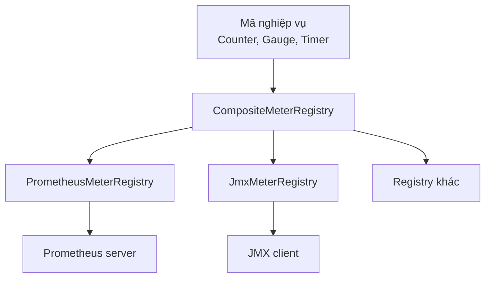

# Composite registry, global registry và nguy cơ đăng ký ngoài vòng đời Spring

Micrometer cho phép một ứng dụng gửi cùng một meter đến nhiều hệ thống metrics. `CompositeMeterRegistry` thực hiện việc này bằng cách nhận nhiều registry con và chuyển các meter được đăng ký vào từng registry. Bên cạnh đó, Micrometer cung cấp `Metrics.globalRegistry`, một composite registry tĩnh để mã Java có thể ghi metrics mà không cần giữ tham chiếu đến một `MeterRegistry` cụ thể.

Trong ứng dụng Spring Boot, registry thường được cấu hình và quản lý theo vòng đời ApplicationContext. Cách an toàn, dễ kiểm thử nhất là inject `MeterRegistry` vào bean và tạo meter trong vòng đời bean đó. Dùng global registry hoặc tự tạo registry ngoài Spring có thể làm số đo bị mất trong giai đoạn khởi tạo, bỏ qua cấu hình của Spring, rò rỉ trạng thái giữa test hoặc khiến registry không được đóng đúng lúc.

Bài học này giải thích cách composite và global registry hoạt động, cách Spring Boot kết nối chúng, và những nguyên tắc cần tuân thủ khi đăng ký meter.

## 1. Vì sao cần nhiều registry?

Một ứng dụng có thể cần xuất metrics đến nhiều đích:

- Prometheus để scrape và lưu chuỗi thời gian.
- JMX để công cụ quản trị JVM đọc MBean.
- Một backend khác để gửi metrics đến nền tảng giám sát tập trung.
- SimpleMeterRegistry trong test để xác minh instrumentation trong bộ nhớ.

Nếu mã nghiệp vụ phụ thuộc trực tiếp vào từng loại registry, việc thay đổi backend sẽ lan rộng qua nhiều lớp. Micrometer giải quyết vấn đề đó bằng API chung `MeterRegistry`. Mã nghiệp vụ đăng ký Counter, Gauge hoặc Timer một lần; registry chịu trách nhiệm chuyển số đo đến backend tương ứng.

Khi có nhiều registry, `CompositeMeterRegistry` đóng vai trò điều phối:



Mỗi registry con có thể áp dụng quy tắc xuất dữ liệu riêng. Một meter được đăng ký qua composite sẽ được chuyển đến các registry con đang được gắn vào composite đó.

## 2. CompositeMeterRegistry hoạt động như thế nào?

`CompositeMeterRegistry` là một `MeterRegistry` chứa các registry khác. Có thể thêm hoặc gỡ registry con trong thời gian chạy:

- `add(registry)`: gắn registry con vào composite.
- `remove(registry)`: gỡ registry con khỏi composite.
- Các meter đăng ký qua composite được chuyển đến những registry con đang được gắn.

Ví dụ dưới đây dùng hai `SimpleMeterRegistry` để minh họa cơ chế. Trong ứng dụng thật, có thể thay chúng bằng Prometheus, JMX hoặc registry phù hợp với backend:

```java
import io.micrometer.core.instrument.CompositeMeterRegistry;
import io.micrometer.core.instrument.Counter;
import io.micrometer.core.instrument.MeterRegistry;
import io.micrometer.core.instrument.simple.SimpleMeterRegistry;

public class CompositeRegistryExample {

    public static void main(String[] args) {
        MeterRegistry first = new SimpleMeterRegistry();
        MeterRegistry second = new SimpleMeterRegistry();

        CompositeMeterRegistry composite = new CompositeMeterRegistry();
        composite.add(first);
        composite.add(second);

        Counter orders = composite.counter(
            "orders.created",
            "channel", "web"
        );

        orders.increment(3);

        System.out.println(
            first.get("orders.created")
                .tag("channel", "web")
                .counter()
                .count()
        );

        System.out.println(
            second.get("orders.created")
                .tag("channel", "web")
                .counter()
                .count()
        );

        composite.remove(second);
        orders.increment();

        System.out.println(
            first.get("orders.created")
                .tag("channel", "web")
                .counter()
                .count()
        );
    }
}
```

Hai registry con đều nhận ba lần tăng ban đầu. Sau khi gỡ registry thứ hai, lần tăng tiếp theo chỉ được chuyển đến registry thứ nhất. Việc gỡ registry không có nghĩa là dữ liệu đã export ở backend bị xóa; nó chỉ ngừng chuyển các cập nhật tiếp theo đến registry đó.

Trong ví dụ độc lập, cần quản lý và đóng các registry đã tạo theo vòng đời của chương trình. Không tạo composite hoặc registry con mới trong mỗi request.

## 3. Đăng ký meter trước khi có registry con

Composite có thể được tạo trước khi các registry con sẵn sàng. Khi đó, meter vẫn có thể được đăng ký trên composite, nhưng chưa có backend nhận dữ liệu.

Ví dụ:

```java
CompositeMeterRegistry composite = new CompositeMeterRegistry();

Counter jobs = composite.counter("jobs.completed");

// Chưa có registry con nhận dữ liệu tại thời điểm này.
jobs.increment();

SimpleMeterRegistry child = new SimpleMeterRegistry();
composite.add(child);

// Các lần cập nhật sau khi child được gắn sẽ được chuyển đến child.
jobs.increment();
```

Lần tăng trước khi có registry con không được lưu thành lịch sử để phát lại cho backend. Khi registry con được gắn, các meter đang có trong composite được kết nối với registry đó; các lần cập nhật tiếp theo mới được ghi nhận ở registry con.

Điều này quan trọng khi dùng registry được gắn động. Nếu ứng dụng ghi metrics trước khi registry thật được thêm vào, dữ liệu của giai đoạn đó có thể bị mất. Hãy bảo đảm registry cần thiết đã sẵn sàng trước khi bắt đầu luồng nghiệp vụ cần đo, hoặc chấp nhận rõ ràng khoảng thời gian chưa có backend.

## 4. Global registry của Micrometer

Micrometer cung cấp một registry tĩnh:

```java
Metrics.globalRegistry
```

Đây là một `CompositeMeterRegistry`. Các registry cụ thể có thể được thêm vào global registry, sau đó mã Java dùng các phương thức tĩnh của `Metrics` để tạo hoặc lấy meter:

```java
import io.micrometer.core.instrument.Counter;
import io.micrometer.core.instrument.Metrics;

public class LegacyJobService {

    private static final Counter completed =
        Metrics.counter("jobs.completed", "type", "import");

    public void completeJob() {
        completed.increment();
    }
}
```

Lợi ích của global registry là mã không cần nhận `MeterRegistry` qua constructor. Điều này có thể tiện trong thư viện cũ, mã tích hợp khó thay đổi hoặc thành phần không được tạo bởi dependency injection container.

Tuy nhiên, global registry là trạng thái tĩnh dùng chung trong JVM. Nó không tự gắn với một ApplicationContext cụ thể và có thể tồn tại lâu hơn bean hoặc test đã tạo meter. Vì vậy, dùng global registry cần quản lý rõ thời điểm thêm registry con, loại bỏ registry và cô lập trạng thái.

## 5. Gắn registry vào global registry

Có thể thêm và gỡ registry bằng API tĩnh:

```java
import io.micrometer.core.instrument.MeterRegistry;
import io.micrometer.core.instrument.Metrics;
import io.micrometer.core.instrument.simple.SimpleMeterRegistry;

MeterRegistry registry = new SimpleMeterRegistry();

Metrics.addRegistry(registry);

try {
    Metrics.counter("jobs.completed").increment();
} finally {
    Metrics.removeRegistry(registry);
    registry.close();
}
```

Ví dụ này phù hợp để minh họa vòng đời của registry được gắn thủ công. Trong ứng dụng Spring Boot, không nên tự thêm một registry đã được Boot quản lý vào global registry nếu Boot đã tự động thực hiện việc đó. Tự gắn thủ công một registry đã được Boot quản lý hoặc thêm một registry khác cùng xuất đến backend tương tự có thể làm cấu hình khó hiểu và tạo dữ liệu trùng ở hệ thống nhận.

Khi tự quản lý registry thủ công, phải có điểm tháo gỡ tương ứng. Nếu ứng dụng khởi động và dừng nhiều lần trong cùng JVM, việc bỏ quên registry cũ có thể khiến global registry tiếp tục giữ tham chiếu đến registry hoặc thành phần của ApplicationContext cũ.

## 6. Spring Boot kết nối MeterRegistry với global registry

Spring Boot tự cấu hình các registry có mặt trên runtime classpath và cung cấp `MeterRegistry` để inject vào bean. Theo cấu hình mặc định, registry do Spring Boot quản lý thường được bind vào `Metrics.globalRegistry`. Thuộc tính sau điều khiển hành vi đó:

```yaml
management:
  metrics:
    use-global-registry: true
```

Khi bật, mã sử dụng `Metrics.counter(...)` có thể gửi số đo qua global registry đến registry được Boot gắn vào. Khi đặt thành `false`, registry tự động của Boot không được bind vào global registry; các bean inject `MeterRegistry` vẫn có thể ghi metrics bình thường.

```yaml
management:
  metrics:
    use-global-registry: false
```

Chọn `false` khi muốn tránh sử dụng static global registry và yêu cầu các thành phần nhận registry qua dependency injection. Đây thường là lựa chọn phù hợp với ứng dụng mới cần ranh giới rõ ràng, kiểm thử dễ dàng và nhiều ApplicationContext trong cùng JVM.

Không nên đồng thời dựa vào static API và injected registry mà không có chủ đích. Nếu global registry không được gắn vào registry của Boot, các lời gọi static có thể không xuất hiện trong backend dù các meter được tạo qua bean vẫn hoạt động.

## 7. Cách ưu tiên: inject MeterRegistry vào bean Spring

Trong ứng dụng Spring Boot, hãy để Spring quản lý registry và inject nó vào component cần instrument:

```java
import io.micrometer.core.instrument.Counter;
import io.micrometer.core.instrument.MeterRegistry;

import org.springframework.stereotype.Component;

@Component
public class JobMetrics {

    private final Counter completed;

    public JobMetrics(MeterRegistry registry) {
        this.completed = Counter.builder("jobs.completed")
            .description("Number of completed jobs")
            .tag("type", "import")
            .register(registry);
    }

    public void jobCompleted() {
        completed.increment();
    }
}
```

Spring tạo bean sau khi registry đã sẵn sàng để inject. Meter được đăng ký trong constructor và giữ bằng field, sau đó các phương thức nghiệp vụ chỉ cập nhật meter đã có.

Cách này có các lợi ích:

- Phụ thuộc registry được khai báo rõ qua constructor.
- Có thể thay registry trong test bằng `SimpleMeterRegistry`.
- Registry, filter, common tags và customizer do Spring Boot cấu hình được áp dụng nhất quán.
- Vòng đời bean và registry nằm trong cùng ApplicationContext.
- Không cần trạng thái static dùng chung giữa các test hoặc context.

Không nên gọi `new SimpleMeterRegistry()` bên trong service để ghi metrics production. Làm vậy sẽ tạo registry riêng không được Spring Boot export, trừ khi ứng dụng chủ động nối registry đó vào một composite hoặc backend khác.

## 8. Dùng MeterBinder cho instrumentation gắn với bean

Khi một thành phần muốn tự công bố một nhóm meter, có thể triển khai `MeterBinder`. Spring Boot phát hiện các bean `MeterBinder` và bind chúng vào registry được cấu hình.

Ví dụ:

```java
import io.micrometer.core.instrument.Gauge;
import io.micrometer.core.instrument.MeterRegistry;
import io.micrometer.core.instrument.binder.MeterBinder;

import java.util.concurrent.atomic.AtomicInteger;

import org.springframework.stereotype.Component;

@Component
public class QueueMetrics implements MeterBinder {

    private final AtomicInteger queueDepth = new AtomicInteger();

    @Override
    public void bindTo(MeterRegistry registry) {
        Gauge.builder(
                "worker.queue.depth",
                queueDepth,
                AtomicInteger::get
            )
            .description("Current number of jobs waiting")
            .register(registry);
    }

    public void jobEnqueued() {
        queueDepth.incrementAndGet();
    }

    public void jobDequeued() {
        queueDepth.updateAndGet(value -> Math.max(0, value - 1));
    }
}
```

`MeterBinder` tách việc đăng ký meter khỏi logic nghiệp vụ. Đối tượng `queueDepth` được giữ làm field để Gauge có thể đọc giá trị trong suốt vòng đời bean.

Cách này đặc biệt hữu ích khi instrumentation cần bind vào registry do Spring quản lý. Không tự tạo một registry mới bên trong `bindTo()`; hãy sử dụng tham số registry mà Spring truyền vào.

## 9. Nguy cơ đăng ký meter ngoài vòng đời Spring

Đăng ký meter ngoài vòng đời Spring thường xảy ra khi:

- Tạo meter trong static field hoặc static initializer.
- Dùng `Metrics.counter(...)` trong thư viện hoặc lớp tiện ích không nhận registry.
- Tự tạo `MeterRegistry` bằng `new` trong một service.
- Tạo registry hoặc meter trong callback chạy trước khi ApplicationContext hoàn tất khởi tạo.
- Giữ tham chiếu đến registry của ApplicationContext cũ sau khi context đã đóng.

Các trường hợp này có thể dẫn đến một số vấn đề.

### Đăng ký quá sớm

Static initializer có thể chạy khi class được nạp, trước khi Spring Boot tạo và gắn registry thật vào global registry. Meter vẫn được tạo trên composite tĩnh, nhưng các lần cập nhật trước khi registry con sẵn sàng có thể không được backend nhận.

### Bỏ qua cấu hình Spring

Một registry được tạo thủ công có thể không nhận `MeterRegistryCustomizer`, common tags, `MeterFilter`, binder tự động, cấu hình histogram hoặc export endpoint của Spring Boot. Mã vẫn ghi metrics nhưng dữ liệu không xuất hiện ở backend mà nhóm vận hành đang theo dõi.

### Rò rỉ trạng thái giữa ApplicationContext

Global registry sống ở cấp classloader/JVM, trong khi bean sống theo ApplicationContext. Nếu context bị đóng nhưng registry vẫn được gắn vào global registry, static state có thể giữ tham chiếu đến registry cũ. Điều này dễ gặp trong test context, ứng dụng plugin hoặc môi trường có nhiều lần khởi tạo context.

### Dữ liệu test ảnh hưởng lẫn nhau

Một test tăng static Counter có thể làm test khác đọc thấy giá trị đã tăng từ lần chạy trước. Test phụ thuộc vào thứ tự thực thi hoặc trạng thái toàn cục sẽ khó chạy song song và khó tái hiện lỗi.

### Registry không được đóng

Registry push hoặc registry có tài nguyên nền cần được đóng đúng vòng đời. Tạo registry thủ công mà không đóng có thể để lại scheduler, thread hoặc tài nguyên kết nối. Với Spring-managed registry, Spring Boot quản lý vòng đời; với registry tự tạo, ứng dụng phải chịu trách nhiệm.

## 10. Static initialization và thời điểm registry sẵn sàng

Ví dụ dưới đây tiện về cú pháp nhưng phụ thuộc global registry:

```java
public class PaymentMetrics {

    private static final Counter payments =
        Metrics.counter("payments.completed");

    public static void paymentCompleted() {
        payments.increment();
    }
}
```

Nếu class được nạp trước khi registry con được thêm vào global registry, các lần tăng xảy ra trong khoảng đó có thể không được ghi nhận ở backend. Ngoài ra, Counter tĩnh tồn tại suốt vòng đời classloader, khiến trạng thái dễ rò rỉ giữa các test hoặc ApplicationContext.

Cách viết rõ ràng hơn trong Spring:

```java
@Component
public class PaymentMetrics {

    private final Counter payments;

    public PaymentMetrics(MeterRegistry registry) {
        this.payments = registry.counter("payments.completed");
    }

    public void paymentCompleted() {
        payments.increment();
    }
}
```

Meter được tạo trong lúc Spring khởi tạo bean và gắn với registry mà context cung cấp. Không cần giả định thời điểm một static registry được khởi tạo hoặc được thêm backend.

## 11. Composite registry trong Spring Boot: để auto-configuration quản lý

Khi có nhiều registry implementation trên classpath, Spring Boot có thể cấu hình các registry và composite theo cơ chế auto-configuration. Trong trường hợp thông thường, chỉ cần thêm dependency registry cần dùng và inject `MeterRegistry` vào bean.

Ví dụ dependencies:

```xml
<dependencies>
    <dependency>
        <groupId>org.springframework.boot</groupId>
        <artifactId>spring-boot-starter-actuator</artifactId>
    </dependency>

    <dependency>
        <groupId>io.micrometer</groupId>
        <artifactId>micrometer-registry-prometheus</artifactId>
        <scope>runtime</scope>
    </dependency>

    <dependency>
        <groupId>io.micrometer</groupId>
        <artifactId>micrometer-registry-jmx</artifactId>
        <scope>runtime</scope>
    </dependency>
</dependencies>
```

Khi cả Prometheus và JMX registry được cấu hình, ứng dụng có thể xuất meter đến cả hai đích. Mã nghiệp vụ vẫn chỉ nhận một `MeterRegistry` được Spring cung cấp.

Trước khi tự khai báo một `CompositeMeterRegistry` bean, hãy xác định Boot đã tạo registry nào. Tạo thêm một composite tùy chỉnh mà không hiểu auto-configuration có thể làm xuất hiện hai nhánh registry hoặc khiến meter được đăng ký vào registry không được endpoint quản lý.

Chỉ tự cấu hình composite khi cần một chính sách điều phối đặc biệt. Khi đó, cần xác định rõ registry con nào được thêm, ai sở hữu vòng đời của từng registry và cách các customizer/filter được áp dụng.

## 12. Kiểm tra cấu hình registry trong ứng dụng

Có thể inject registry vào một component kiểm tra hoặc dùng test để xác nhận meter được đăng ký:

```java
import io.micrometer.core.instrument.MeterRegistry;

import org.springframework.boot.ApplicationRunner;
import org.springframework.context.annotation.Bean;
import org.springframework.context.annotation.Configuration;

@Configuration
class MetricsVerificationConfiguration {

    @Bean
    ApplicationRunner verifyMetrics(MeterRegistry registry) {
        return args -> {
            registry.getMeters().forEach(meter ->
                System.out.println(
                    meter.getId().getName() + " " + meter.getId().getTags()
                )
            );
        };
    }
}
```

Đây là ví dụ kiểm tra trong môi trường phát triển. Không nên duyệt và in toàn bộ registry trong mỗi request production vì số lượng meter có thể lớn.

Có thể kiểm tra thêm:

- Registry được inject có phải composite hay không.
- Các registry con cần thiết đã được gắn chưa.
- Meter có tên và tag như dự kiến không.
- Các common tags và filter có được áp dụng không.
- Endpoint hoặc backend thực tế có nhận metrics không.

Không nên chỉ kiểm tra rằng một bean `MeterRegistry` tồn tại. Điều quan trọng là meter cần thiết đã được đăng ký và registry đích đang nhận được số đo.

## 13. Kiểm thử: ưu tiên registry riêng thay vì global state

Trong unit test, tạo một registry mới và inject trực tiếp vào lớp cần kiểm tra:

```java
import io.micrometer.core.instrument.simple.SimpleMeterRegistry;

import org.junit.jupiter.api.Test;

import static org.assertj.core.api.Assertions.assertThat;

class JobMetricsTest {

    @Test
    void incrementsCompletedCounter() {
        SimpleMeterRegistry registry = new SimpleMeterRegistry();
        JobMetrics metrics = new JobMetrics(registry);

        metrics.jobCompleted();
        metrics.jobCompleted();

        assertThat(
            registry.get("jobs.completed")
                .tag("type", "import")
                .counter()
                .count()
        ).isEqualTo(2.0);

        registry.close();
    }
}
```

Mỗi test có registry riêng nên không chia sẻ số đếm với test khác. Nếu kiểm thử Spring context, có thể inject registry từ context và kiểm tra meter sau khi bean đã được khởi tạo.

Nếu buộc phải kiểm thử code legacy dùng `Metrics.globalRegistry`, cần quản lý việc thêm/gỡ registry và trạng thái meter tĩnh thật cẩn thận. Không nên để test dựa vào thứ tự chạy hoặc dùng chung một global counter có giá trị tích lũy qua nhiều test. Khi có thể, refactor thành constructor injection để test độc lập.

## 14. Quản lý vòng đời khi tự tạo registry

Nếu ứng dụng Java độc lập không dùng Spring, có thể tự tạo registry và composite. Khi đó, ứng dụng chịu trách nhiệm đóng các registry khi kết thúc.

Ví dụ quản lý một registry con và composite:

```java
import io.micrometer.core.instrument.CompositeMeterRegistry;
import io.micrometer.core.instrument.MeterRegistry;
import io.micrometer.core.instrument.simple.SimpleMeterRegistry;

public class StandaloneMetrics implements AutoCloseable {

    private final MeterRegistry child = new SimpleMeterRegistry();
    private final CompositeMeterRegistry composite =
        new CompositeMeterRegistry();

    public StandaloneMetrics() {
        composite.add(child);
    }

    public MeterRegistry registry() {
        return composite;
    }

    @Override
    public void close() {
        composite.close();
        child.close();
    }
}
```

Trong ứng dụng thực tế, cần tuân theo hợp đồng sở hữu tài nguyên của registry và tránh đóng cùng một registry nhiều lần nếu composite hoặc container đã quản lý việc đó. Ví dụ trên nhấn mạnh rằng nơi tạo registry phải có kế hoạch đóng nó.

Với Spring Boot, ưu tiên để auto-configuration tạo và đóng registry theo ApplicationContext. Không giữ static reference đến registry của context rồi tiếp tục dùng sau khi context đã đóng.

## 15. Checklist lựa chọn registry và vòng đời

- [ ] Xác định ứng dụng cần xuất metrics đến một hay nhiều backend.
- [ ] Dùng CompositeMeterRegistry khi cần phân phối cùng meter đến nhiều registry.
- [ ] Trong Spring Boot, ưu tiên auto-configuration thay vì tự tạo composite cạnh tranh.
- [ ] Inject MeterRegistry qua constructor của bean.
- [ ] Dùng MeterBinder cho nhóm instrumentation gắn với vòng đời Spring.
- [ ] Chỉ dùng Metrics.globalRegistry khi có lý do tương thích rõ ràng.
- [ ] Kiểm tra `management.metrics.use-global-registry` nếu dùng static Metrics API.
- [ ] Không tạo meter hoặc registry trong static initializer nếu không kiểm soát thời điểm backend sẵn sàng.
- [ ] Không tự thêm registry vào global registry nếu Boot đã tự động bind nó.
- [ ] Đảm bảo registry thủ công được gỡ và đóng đúng lúc.
- [ ] Dùng SimpleMeterRegistry riêng cho mỗi unit test.
- [ ] Kiểm tra meter thực tế trong registry và backend, không chỉ kiểm tra bean tồn tại.

CompositeMeterRegistry giúp Micrometer xuất cùng một meter đến nhiều hệ thống, còn Metrics.globalRegistry cung cấp điểm truy cập tĩnh dùng chung trong JVM. Trong Spring Boot, cách ổn định nhất là để framework quản lý registry và inject nó vào bean hoặc MeterBinder. Chỉ dùng global registry khi cần tích hợp với mã không được quản lý bởi Spring, đồng thời kiểm soát thời điểm gắn registry, trạng thái static và việc tháo gỡ tài nguyên. Điều đó giúp metrics không bị mất ở giai đoạn khởi tạo, không rò rỉ giữa test và luôn đi theo đúng vòng đời ứng dụng.

## Tài liệu tham khảo

- [Micrometer Registry Concepts](https://docs.micrometer.io/micrometer/reference/concepts/registry.html) — registry, composite registry và global registry.
- [Micrometer Metrics API](https://docs.micrometer.io/micrometer/reference/concepts/meters.html) — cách đăng ký và sử dụng meter.
- [Spring Boot Actuator Metrics](https://docs.spring.io/spring-boot/reference/actuator/metrics.html) — auto-configuration, MeterRegistry, MeterBinder và global registry.
- [Micrometer CompositeMeterRegistry API](https://javadoc.io/doc/io.micrometer/micrometer-core/latest/io/micrometer/core/instrument/CompositeMeterRegistry.html) — API thêm và gỡ registry con.

