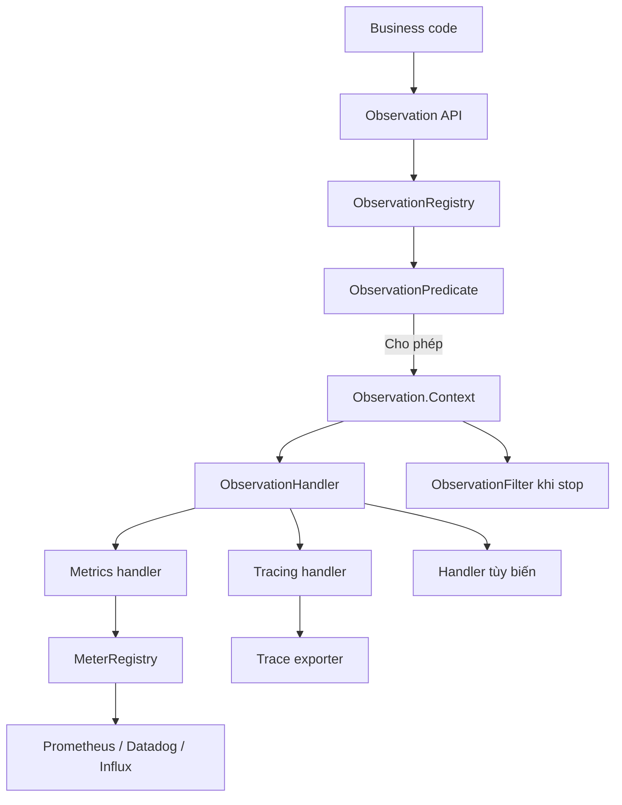

# Tự động cấu hình ObservationRegistry và cách bổ sung thành phần tùy biến

Spring Boot tích hợp Micrometer Observation để một đoạn code chỉ cần tạo một `Observation`, còn các thành phần đã đăng ký sẽ quyết định cách xử lý vòng đời của nó. Tùy cấu hình ứng dụng, cùng một observation có thể tạo timer và counter, tạo span cho distributed tracing hoặc kích hoạt xử lý tùy biến.

Khi Actuator auto-configuration hoạt động và Micrometer Observation có trên classpath, Spring Boot tự tạo bean `ObservationRegistry` nếu ứng dụng chưa cung cấp registry riêng. Spring Boot cũng tự đăng ký các bean `ObservationHandler`, `ObservationPredicate`, `GlobalObservationConvention` và `ObservationFilter` vào registry. Nếu cần cấu hình trực tiếp, có thể khai báo một hoặc nhiều bean `ObservationRegistryCustomizer`.

Trong module `OBSERVABILITY_INSTRUMENTATION_MICROMETER`, `ObservationRegistry` kết nối instrumentation với metrics và tracing. Nó khác `MeterRegistry`: registry thứ nhất điều phối observation và handler; registry thứ hai quản lý meter và xuất số liệu đến backend. Bài này trình bày cách Spring Boot lắp ráp hai lớp đó và cách mở rộng mà không phải tự xây dựng lại toàn bộ hạ tầng quan sát.

## 1. ObservationRegistry nằm ở đâu trong kiến trúc?

`ObservationRegistry` là điểm đăng ký và điều phối các observation. Mỗi observation có một `Observation.Context` để giữ dữ liệu trong suốt vòng đời. Các handler lắng nghe sự kiện như start, stop, error hoặc event để tạo ra tác dụng tương ứng.



Các thành phần có trách nhiệm khác nhau:

| Thành phần | Trách nhiệm |
| --- | --- |
| `ObservationRegistry` | Giữ cấu hình và cung cấp điểm tạo observation |
| `Observation.Context` | Mang dữ liệu giữa code instrumentation và các handler |
| `ObservationPredicate` | Quyết định có tạo observation hay dùng observation no-op |
| `ObservationConvention` | Quy định tên và key-value mặc định cho observation |
| `ObservationFilter` | Bổ sung hoặc biến đổi context trước khi observation dừng |
| `ObservationHandler` | Phản ứng với vòng đời observation để tạo metrics, spans, log hoặc tác dụng khác |
| `ObservationRegistryCustomizer` | Cấu hình trực tiếp registry trong Spring Boot |

`ObservationRegistry` không tự gửi metrics đến backend. Khi có `MeterRegistry` và metrics handler phù hợp, observation mới được chuyển thành meter; registry adapter như Prometheus, Datadog hoặc Influx đảm nhiệm bước export.

## 2. Spring Boot tự động cấu hình những gì?

Với Spring Boot 3.x trở lên, Micrometer Observation API được tích hợp trong Actuator. Khi các dependency phù hợp có mặt, Spring Boot thực hiện các việc chính sau:

Auto-configuration này được giới thiệu trong Spring Boot 3.0 cùng với Micrometer Observation API. Dự án Spring Boot 2.x không có cùng cơ chế auto-configuration chuẩn; hãy kiểm tra phiên bản Micrometer đang dùng và cấu hình registry/handler thủ công hoặc nâng cấp framework trước khi áp dụng các ví dụ bên dưới.

1. Tạo `ObservationRegistry` bean nếu chưa có bean tương ứng.
2. Đăng ký các bean `ObservationHandler` để xử lý lifecycle.
3. Đăng ký các bean `ObservationPredicate` để kiểm soát observation nào được tạo.
4. Đăng ký các bean `GlobalObservationConvention` để cung cấp quy ước mặc định theo loại context.
5. Đăng ký các bean `ObservationFilter` để bổ sung hoặc biến đổi context.
6. Áp dụng các bean `ObservationRegistryCustomizer` để tùy biến registry.

Khi có `MeterRegistry`, Spring Boot cấu hình handler metrics để observation có thể tạo timer và counter. Khi Micrometer Tracing được cấu hình cùng tracer/exporter phù hợp, handler tracing có thể tạo và kết thúc span từ cùng observation. Một observation vì thế có thể phục vụ nhiều mục tiêu mà code nghiệp vụ không phải gọi riêng API metrics và tracing.

Để sử dụng tích hợp này, ứng dụng Spring Boot thường thêm Actuator:

```groovy
dependencies {
    implementation 'org.springframework.boot:spring-boot-starter-actuator'
}
```

Sau đó thêm registry export hoặc Micrometer Tracing tùy hệ thống nhận. Để Spring Boot BOM quản lý phiên bản Micrometer tương thích; tránh tự nâng riêng `micrometer-observation` hoặc registry adapter vượt khỏi bộ phiên bản mà framework hỗ trợ.

### Inject registry vào component

Ứng dụng không cần tự tạo registry trong mỗi service. Hãy inject bean do Spring quản lý:

```java
import io.micrometer.observation.Observation;
import io.micrometer.observation.ObservationRegistry;
import org.springframework.stereotype.Service;

@Service
public class OrderService {
    private final ObservationRegistry observationRegistry;

    public OrderService(ObservationRegistry observationRegistry) {
        this.observationRegistry = observationRegistry;
    }

    public void processOrder(String channel, String orderId) {
        Observation.createNotStarted("orders.process", observationRegistry)
                .lowCardinalityKeyValue("channel", channel)
                .highCardinalityKeyValue("order.id", orderId)
                .observe(() -> {
                    // Thực hiện xử lý đơn hàng.
                });
    }
}
```

`observe(...)` quản lý start, scope, error và stop cho đoạn công việc được truyền vào. Nếu cần tự điều khiển lifecycle, có thể gọi `start()`, mở `Observation.Scope`, báo lỗi bằng `error(exception)` và kết thúc bằng `stop()` trong `finally`.

Low-cardinality key-value được đưa vào metrics và traces; high-cardinality key-value chỉ được đưa vào traces. Vì vậy, `order.id` phù hợp hơn với trace, còn `channel` cần có tập giá trị nhỏ và ổn định nếu muốn dùng làm metric tag.

## 3. Phân biệt ObservationRegistry với MeterRegistry

Hai registry thường cùng xuất hiện trong ứng dụng Micrometer nhưng không thay thế nhau:

| Registry | Quản lý | Ví dụ API |
| --- | --- | --- |
| `ObservationRegistry` | Vòng đời observation, context, handler, predicate, filter và convention | `Observation.createNotStarted(..., observationRegistry)` |
| `MeterRegistry` | Counter, gauge, timer, summary và việc xuất meter | `Counter.builder(...).register(meterRegistry)` |

`DefaultMeterObservationHandler` là cầu nối từ Observation sang metrics. Khi observation dừng, handler có thể tạo timer mang tên observation và các low-cardinality key-value. Khi observation phát event, handler có thể tăng counter tương ứng. Các high-cardinality key-value không trở thành tag của meter để tránh bùng nổ số time series.

Ví dụ một observation có tên `orders.process`, tag `channel=web` và hoàn tất một lần có thể tạo timer `orders.process` với tag `channel=web` cùng tag lỗi do handler quản lý. Khi code gửi event `created`, handler metrics có thể tạo counter `orders.process.created`.

Nếu chỉ có `ObservationRegistry` mà không có metrics handler hoặc `MeterRegistry`, không nên kỳ vọng sẽ có timer trong backend metrics. Tương tự, thêm Prometheus registry chỉ cung cấp đường export cho meter; code vẫn cần tạo meter trực tiếp hoặc tạo observation được handler metrics xử lý.

## 4. Bổ sung cấu hình bằng ObservationRegistryCustomizer

`ObservationRegistryCustomizer<T>` là callback Spring Boot dùng để tùy biến registry đã được auto-configure. Đây là nơi phù hợp khi cần đăng ký một thành phần trực tiếp vào `observationConfig()` hoặc áp dụng cấu hình riêng cho registry.

Ví dụ dưới đây thêm một filter để gắn chiều `component=checkout` vào mọi observation:

```java
import io.micrometer.common.KeyValue;
import io.micrometer.observation.ObservationRegistry;
import org.springframework.boot.actuate.autoconfigure.observation.ObservationRegistryCustomizer;
import org.springframework.context.annotation.Bean;
import org.springframework.context.annotation.Configuration;

@Configuration(proxyBeanMethods = false)
public class ObservationConfiguration {
    @Bean
    ObservationRegistryCustomizer<ObservationRegistry> checkoutObservationCustomizer() {
        return registry -> registry.observationConfig()
                .observationFilter(context -> context.addLowCardinalityKeyValue(
                        KeyValue.of("component", "checkout")));
    }
}
```

Filter được gọi trước khi observation dừng và handler xử lý `onStop`. Trong ví dụ, mọi observation đi qua registry đều nhận low-cardinality key `component=checkout`. Chỉ dùng cách này khi mọi observation trong ứng dụng thực sự thuộc cùng component. Nếu ứng dụng có nhiều miền nghiệp vụ, nên dùng filter hoặc convention có điều kiện theo context.

Có thể khai báo nhiều `ObservationRegistryCustomizer` bean. Spring Boot áp dụng chúng theo thứ tự được Spring sắp xếp; khi thứ tự có ý nghĩa, dùng `@Order` hoặc triển khai `Ordered` và kiểm thử kết quả cuối cùng.

Ví dụ import ở trên dành cho Spring Boot 3.x, nơi interface nằm trong package `org.springframework.boot.actuate.autoconfigure.observation`. Từ Spring Boot 4.0, package được chuyển thành `org.springframework.boot.micrometer.observation.autoconfigure`; hãy dùng package tương ứng với phiên bản framework đang chạy.

Không đăng ký cùng một handler hai lần, ví dụ vừa khai báo `ObservationHandler` bean để Spring tự phát hiện, vừa thêm chính instance đó trong customizer. Đăng ký trùng có thể khiến callback được gọi lặp và tạo log, span hoặc side effect trùng.

## 5. Bổ sung ObservationHandler bằng bean

`ObservationHandler` nhận các sự kiện lifecycle. Một handler cần khai báo context mà nó hỗ trợ qua `supportsContext(...)`; các method lifecycle chỉ được gọi cho context phù hợp.

Ví dụ ghi nhận thời điểm bắt đầu/kết thúc một loại observation thanh toán để phục vụ audit kỹ thuật:

```java
import io.micrometer.observation.Observation;
import io.micrometer.observation.ObservationHandler;
import org.slf4j.Logger;
import org.slf4j.LoggerFactory;
import org.springframework.stereotype.Component;

@Component
public class PaymentObservationHandler
        implements ObservationHandler<PaymentObservationContext> {

    private static final Logger log =
            LoggerFactory.getLogger(PaymentObservationHandler.class);

    @Override
    public boolean supportsContext(Observation.Context context) {
        return context instanceof PaymentObservationContext;
    }

    @Override
    public void onStart(PaymentObservationContext context) {
        log.debug("Payment observation started: method={}", context.paymentMethod());
    }

    @Override
    public void onError(PaymentObservationContext context) {
        log.warn("Payment observation failed: method={}, errorType={}",
                context.paymentMethod(),
                context.getError() == null ? "unknown" : context.getError().getClass().getSimpleName());
    }

    @Override
    public void onStop(PaymentObservationContext context) {
        log.debug("Payment observation stopped: method={}", context.paymentMethod());
    }
}
```

Context tùy biến có thể mang dữ liệu nghiệp vụ cần handler sử dụng:

```java
import io.micrometer.observation.Observation;

public class PaymentObservationContext extends Observation.Context {
    private final String paymentMethod;

    public PaymentObservationContext(String paymentMethod) {
        this.paymentMethod = paymentMethod;
    }

    public String paymentMethod() {
        return paymentMethod;
    }
}
```

Instrumentation có thể tạo observation với context này bằng supplier:

```java
Observation.createNotStarted(
        "payment.process",
        () -> new PaymentObservationContext("card"),
        observationRegistry)
    .observe(() -> paymentGateway.charge(command));
```

Spring Boot tự đăng ký handler bean vào `ObservationRegistry`; không cần gọi `registry.observationConfig().observationHandler(...)` lần nữa. Handler cần nhẹ, không chặn luồng nghiệp vụ và không ghi thông tin nhạy cảm như số thẻ, token hoặc dữ liệu định danh vào log.

## 6. Dùng ObservationPredicate để bỏ qua observation

`ObservationPredicate` quyết định có tạo observation hay không. Nếu predicate trả về `false`, Micrometer tạo một observation no-op; handler sẽ không ghi nhận lifecycle như với observation thông thường.

Ví dụ bỏ qua observation có tên bắt đầu bằng `internal.cache.debug`:

```java
import io.micrometer.observation.Observation;
import io.micrometer.observation.ObservationPredicate;
import org.springframework.stereotype.Component;

@Component
public class InternalObservationPredicate implements ObservationPredicate {
    @Override
    public boolean test(String name, Observation.Context context) {
        return name == null || !name.startsWith("internal.cache.debug");
    }
}
```

Spring Boot tự đăng ký predicate bean. Nếu có nhiều predicate, tất cả phải trả về `true` để observation được tạo. Một predicate trả `false` là đủ để loại observation.

Với các trường hợp đơn giản theo prefix tên, có thể dùng cấu hình properties:

```yaml
management:
  observations:
    enable:
      internal:
        cache:
          debug: false
```

Tên property phân cấp tương ứng với prefix observation cần tắt. Nếu cần điều kiện theo context, dùng `ObservationPredicate`. Không lạm dụng predicate để che giấu một instrumentation sai hoặc loại bỏ các metrics quan trọng mà dashboard/alert đang phụ thuộc.

## 7. Dùng GlobalObservationConvention để thống nhất tên và key-value

`ObservationConvention` tách phần mô tả observation khỏi lifecycle. Convention quyết định tên, contextual name và các key-value. Trong Spring Boot, bean `GlobalObservationConvention` được đăng ký toàn cục và chỉ áp dụng cho context mà `supportsContext(...)` chấp nhận.

Ví dụ convention toàn cục cho thanh toán:

```java
import io.micrometer.common.KeyValue;
import io.micrometer.common.KeyValues;
import io.micrometer.observation.GlobalObservationConvention;
import io.micrometer.observation.Observation;
import org.springframework.stereotype.Component;

@Component
public class PaymentObservationConvention
        implements GlobalObservationConvention<PaymentObservationContext> {

    @Override
    public boolean supportsContext(Observation.Context context) {
        return context instanceof PaymentObservationContext;
    }

    @Override
    public String getName() {
        return "payment.process";
    }

    @Override
    public KeyValues getLowCardinalityKeyValues(PaymentObservationContext context) {
        return KeyValues.of(KeyValue.of("payment.method", context.paymentMethod()));
    }
}
```

Instrumentation cần dùng overload `Observation.createNotStarted(customConvention, defaultConvention, contextSupplier, registry)` để registry chọn convention theo context. Khi `customConvention` là `null`, convention toàn cục phù hợp sẽ được chọn trước convention mặc định. Thứ tự ưu tiên là convention được truyền trực tiếp cho instrumentation, sau đó đến global convention khớp context, cuối cùng là convention mặc định.

Hãy giữ `supportsContext` đủ hẹp để convention chỉ áp dụng đúng loại observation. Nếu nhiều global convention cùng hỗ trợ một context, kết quả phụ thuộc thứ tự đăng ký; nên tránh thiết kế chồng lấn hoặc đặt thứ tự rõ ràng.

Convention quyết định metadata theo loại observation. Nếu cần thêm một key-value chung bất kể convention nào được chọn, hãy dùng `ObservationFilter` thay vì cố đưa logic đó vào mọi convention.

## 8. Dùng ObservationFilter để bổ sung hoặc chuẩn hóa context

`ObservationFilter` nhận context và trả về context đã được biến đổi. Filter chạy khi observation dừng, trước khi handler nhận callback `onStop`. Nó hữu ích để bổ sung metadata môi trường, chuẩn hóa outcome hoặc loại bỏ một key-value không được phép phát ra.

Ví dụ thêm region lấy từ cấu hình ứng dụng:

```java
import io.micrometer.common.KeyValue;
import io.micrometer.observation.Observation;
import io.micrometer.observation.ObservationFilter;
import org.springframework.beans.factory.annotation.Value;
import org.springframework.stereotype.Component;

@Component
public class RegionObservationFilter implements ObservationFilter {
    private final String region;

    public RegionObservationFilter(@Value("${app.region:unknown}") String region) {
        this.region = region;
    }

    @Override
    public Observation.Context map(Observation.Context context) {
        return context.addLowCardinalityKeyValue(KeyValue.of("region", region));
    }
}
```

Filter được tự động đăng ký vì là bean. Region là low-cardinality nếu số vùng được giới hạn. Không thêm hostname động, request ID hoặc user ID vào low-cardinality key-value. Nếu cần dữ liệu định danh cho trace, hãy cân nhắc high-cardinality key-value và chính sách bảo vệ dữ liệu.

## 9. Cấu hình common key-value bằng properties

Nếu cần thêm cùng một số chiều môi trường vào tất cả observation, Spring Boot hỗ trợ cấu hình `management.observations.key-values`:

```yaml
management:
  observations:
    key-values:
      application: order-service
      environment: production
      region: ap-southeast
```

Các giá trị này được thêm dưới dạng low-cardinality key-value vào mọi observation. Chỉ dùng những chiều có tập giá trị nhỏ, ổn định. Không đưa ID của request, người dùng hoặc đơn hàng vào common key-value.

Đây là cấu hình cho Observation. Nó khác `management.metrics.tags`, vốn cấu hình common tags trực tiếp trên meter registry. Khi một ứng dụng dùng cả meter được tạo trực tiếp và metrics từ Observation, cần hiểu hai lớp cấu hình để tránh thêm cùng tag hai lần hoặc tạo tên key không nhất quán.

## 10. Truyền observation qua thread và reactive pipeline

Observation có thể mở scope để các thành phần khác đọc observation hiện tại. Scope thường dựa trên context gắn với thread. Khi chuyển sang thread khác hoặc reactive operator, context cần được truyền đúng cách; nếu không, trace/span hoặc correlation context có thể bị mất.

Với Reactor, Spring Boot cung cấp thuộc tính:

```yaml
spring:
  reactor:
    context-propagation: auto
```

Giá trị `auto` bật tự động khôi phục ThreadLocal từ Reactor Context khi chạy operator. Với `@Async` hoặc `AsyncTaskExecutor`, đăng ký `ContextPropagatingTaskDecorator` cho executor:

```java
import org.springframework.context.annotation.Bean;
import org.springframework.context.annotation.Configuration;
import org.springframework.core.task.support.ContextPropagatingTaskDecorator;

@Configuration(proxyBeanMethods = false)
public class AsyncContextConfiguration {
    @Bean
    ContextPropagatingTaskDecorator contextPropagatingTaskDecorator() {
        return new ContextPropagatingTaskDecorator();
    }
}
```

Nếu tự tạo executor, bảo đảm decorator được gắn vào executor thực tế. Chỉ khai báo bean không có nghĩa mọi executor do ứng dụng tự tạo đều tự động sử dụng decorator. Khi tự quản lý scope, luôn đóng `Observation.Scope` bằng try-with-resources để tránh rò rỉ context sang tác vụ tiếp theo trên cùng thread.

## 11. Bật hỗ trợ annotation @Observed

Micrometer hỗ trợ tạo observation từ annotation như `@Observed`. Trong Spring Boot, bật tính năng này bằng:

```yaml
management:
  observations:
    annotations:
      enabled: true
```

Ứng dụng cần có `org.aspectj:aspectjweaver`, thường được cung cấp bởi `spring-boot-starter-aop`. Ví dụ:

```java
import io.micrometer.observation.annotation.Observed;
import org.springframework.stereotype.Service;

@Service
public class InventoryService {
    @Observed(name = "inventory.reserve", contextualName = "inventory reserve")
    public void reserve(String sku) {
        // Thực hiện giữ hàng.
    }
}
```

Không gắn `@Observed` lên method đã được Spring MVC, Spring Data hoặc instrumentation khác tự động quan sát nếu không có chủ đích. Điều đó có thể tạo observation trùng, timer trùng hoặc span lồng nhau không cần thiết. Có thể tắt instrumentation tự động bằng properties hoặc `ObservationPredicate`, hoặc bỏ annotation khỏi method đã được instrument.

## 12. Kiểm thử cấu hình ObservationRegistry

Nên kiểm tra cả việc registry được tạo và các thành phần tùy biến thực sự được áp dụng. Với Spring Boot test, inject registry và meter registry để xác nhận một observation tạo timer:

```java
import static org.assertj.core.api.Assertions.assertThat;

import io.micrometer.observation.Observation;
import io.micrometer.observation.ObservationRegistry;
import io.micrometer.core.instrument.MeterRegistry;
import org.junit.jupiter.api.Test;
import org.springframework.beans.factory.annotation.Autowired;
import org.springframework.boot.test.context.SpringBootTest;

@SpringBootTest
class ObservationRegistryIntegrationTest {
    @Autowired
    ObservationRegistry observationRegistry;

    @Autowired
    MeterRegistry meterRegistry;

    @Test
    void recordsTimerFromObservation() {
        Observation.createNotStarted("orders.process", observationRegistry)
                .lowCardinalityKeyValue("channel", "web")
                .observe(() -> { });

        assertThat(meterRegistry.get("orders.process")
                .tag("channel", "web")
                .timer()
                .count()).isEqualTo(1L);
    }
}
```

Test này cần ứng dụng test có `MeterRegistry` và metrics observation handler được cấu hình. Nếu dự án tắt metrics hoặc không có registry, hãy cấu hình test registry phù hợp thay vì giả định timer luôn tồn tại.

Để kiểm tra từng extension point:

- **Handler:** tạo observation với context được handler hỗ trợ và xác nhận callback start/stop/error được gọi đúng.
- **Predicate:** tạo observation khớp và không khớp điều kiện; xác nhận trường hợp bị từ chối là no-op.
- **Global convention:** dùng context đúng loại và xác nhận name/key-value được chọn; thử cả convention tùy biến truyền trực tiếp để kiểm tra thứ tự ưu tiên.
- **Filter:** dừng observation và xác nhận context có key-value đã được bổ sung hoặc chuẩn hóa.
- **Customizer:** kiểm tra registry trong Spring context đã nhận cấu hình được thêm.

Không chỉ kiểm tra bean tồn tại. Một bean handler có thể không được gọi nếu `supportsContext` trả về false; một predicate có thể vô tình loại tất cả observation; một filter có thể thêm tag trùng. Kiểm thử hành vi qua lifecycle giúp phát hiện các lỗi đó.

## 13. Các lỗi thường gặp

| Lỗi | Hệ quả | Cách xử lý |
| --- | --- | --- |
| Nhầm `ObservationRegistry` với `MeterRegistry` | Tạo observation nhưng không có metrics export | Kiểm tra metrics handler và MeterRegistry |
| Tự tạo registry mới trong mỗi service | Các observation không đi qua registry Spring Boot đã cấu hình | Inject một `ObservationRegistry` dùng chung |
| Đăng ký handler bean và đăng ký lại trong customizer | Callback handler chạy hai lần | Chọn một cơ chế đăng ký |
| Dùng `ObservationConvention` thay cho filter chung | Metadata chung bị lặp ở nhiều convention | Dùng `ObservationFilter` cho key-value áp dụng toàn cục |
| Global convention hỗ trợ quá nhiều context | Đổi tên hoặc tag của observation không liên quan | Giới hạn `supportsContext` theo loại context |
| Predicate trả false ngoài ý muốn | Observation biến thành no-op, không có timer/span | Kiểm thử mọi nhánh và nhớ tất cả predicate phải cho phép |
| Đưa ID vào low-cardinality key-value | Cardinality metrics tăng mạnh | Chuyển ID sang high-cardinality nếu phù hợp với trace |
| Mất context khi chạy async | Trace hoặc observation hiện tại không được truyền tiếp | Cấu hình context propagation cho Reactor/executor |
| Dùng `@Observed` trùng instrumentation tự động | Tạo observation hoặc timer trùng | Tắt một phía hoặc bỏ annotation trùng |

## 14. Quy trình tùy biến trong ứng dụng

Khi cần bổ sung thành phần cho ObservationRegistry, hãy thực hiện theo trình tự:

1. Thêm Spring Boot Actuator và các registry/tracing dependency cần thiết.
2. Inject `ObservationRegistry` do Spring Boot quản lý vào component instrumentation.
3. Xác định yêu cầu là xử lý lifecycle, chặn observation, chuẩn hóa tên/tag hay bổ sung metadata chung.
4. Chọn đúng extension point: `ObservationHandler`, `ObservationPredicate`, `GlobalObservationConvention`, `ObservationFilter` hoặc `ObservationRegistryCustomizer`.
5. Đăng ký component dưới dạng bean để Spring Boot tự lắp vào registry.
6. Dùng low-cardinality key-value cho metrics; chỉ dùng high-cardinality key-value cho trace khi thực sự cần.
7. Cấu hình context propagation nếu observation đi qua thread hoặc reactive pipeline.
8. Kiểm thử lifecycle và xác nhận timer/span xuất hiện đúng một lần.
9. Kiểm tra endpoint metrics hoặc trace backend để xác minh dữ liệu thực sự được export.

Spring Boot cung cấp sẵn `ObservationRegistry` và cơ chế tự đăng ký các thành phần Micrometer Observation. Hãy dùng `ObservationRegistryCustomizer` khi cần cấu hình trực tiếp, còn handler, predicate, global convention và filter có thể được khai báo như bean. Tách đúng trách nhiệm của từng extension point giúp instrumentation nhất quán, tránh trùng lặp và giữ cardinality ở mức kiểm soát trong toàn ứng dụng.

## Tài liệu tham khảo

- [Spring Boot 3.5: Observability](https://docs.spring.io/spring-boot/3.5/reference/actuator/observability.html)
- [Spring Boot 3.5: ObservationRegistryCustomizer Javadoc](https://docs.spring.io/spring-boot/3.5/api/java/org/springframework/boot/actuate/autoconfigure/observation/ObservationRegistryCustomizer.html)
- [Micrometer 1.18: Observation Components](https://docs.micrometer.io/micrometer/reference/observation/components.html)
- [Spring Boot 3.0 Release Notes: Auto-configuration for Micrometer Observation API](https://github.com/spring-projects/spring-boot/wiki/Spring-Boot-3.0-Release-Notes)
