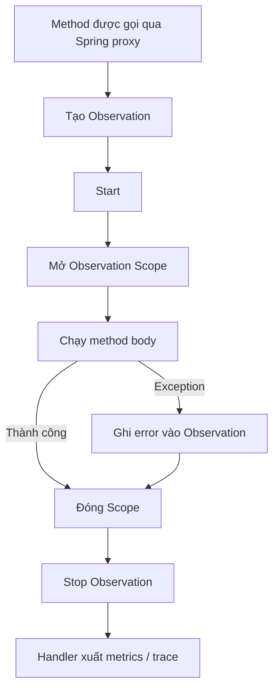

# `@Observed` và `ObservedAspect` cho vòng đời Observation

Trong module `OBSERVABILITY_INSTRUMENTATION_MICROMETER`, Micrometer Observation cung cấp một mô hình chung để bao quanh một thao tác và phát ra tín hiệu quan sát. Một Observation có thể được các handler chuyển thành metrics, trace hoặc tín hiệu khác tùy cấu hình. Với Spring, annotation `@Observed` kết hợp `ObservedAspect` giúp tạo Observation quanh lời gọi method mà không phải viết thủ công `start()` và `stop()` ở mọi nơi.

Để dùng đúng, cần hiểu vai trò của `ObservationRegistry`, cách aspect bao quanh method, thời điểm Observation bắt đầu và kết thúc, cách ghi nhận exception, cũng như giới hạn của Spring AOP proxy. Annotation chỉ tạo Observation khi lời gọi thực sự đi qua proxy được cấu hình; nó không tự động instrument mọi method trong JVM.

## 1. Observation là lớp trừu tượng của một lần thực thi

Micrometer có nhiều loại meter như `Counter`, `Timer`, `Gauge` và `DistributionSummary`. Observation nằm ở lớp cao hơn: nó mô tả một thao tác đang diễn ra, có context và vòng đời rõ ràng. Các handler đăng ký với `ObservationRegistry` quyết định Observation được chuyển thành tín hiệu nào.

Một Observation thường có các giai đoạn:

1. **Tạo:** xác định tên và context của thao tác.
2. **Bắt đầu:** ghi nhận thời điểm bắt đầu và thông báo cho các handler.
3. **Mở scope:** đặt Observation hiện tại vào context để các thao tác con có thể liên kết với nó.
4. **Thực thi:** chạy logic nghiệp vụ.
5. **Ghi lỗi nếu có:** chuyển exception vào Observation context.
6. **Dừng:** đóng scope, ghi nhận thời lượng và thông báo hoàn tất cho handler.



Observation cung cấp một vòng đời nhất quán. `MeterRegistry` là nơi quản lý meter và export metrics; `ObservationRegistry` quản lý Observation và các handler xử lý vòng đời đó. Hai registry có liên quan nhưng không thay thế nhau.

## 2. `@Observed` và `ObservedAspect` làm gì?

`@Observed` là annotation đánh dấu method hoặc class cần được quan sát. `ObservedAspect` là aspect của Micrometer tích hợp với Spring AOP: aspect nhận diện annotation, tạo Observation, mở scope quanh lời gọi method, ghi nhận exception và dừng Observation khi lời gọi kết thúc.

Ví dụ một method tạo đơn hàng:

```java
import io.micrometer.observation.annotation.Observed;
import org.springframework.stereotype.Service;

@Service
public class OrderService {
    private final OrderRepository repository;

    public OrderService(OrderRepository repository) {
        this.repository = repository;
    }

    @Observed(
        name = "orders.create",
        contextualName = "create-order",
        lowCardinalityKeyValues = {"operation", "create"}
    )
    public Order create(CreateOrderCommand command) {
        // Validate, persist và trả về đơn hàng.
        return repository.save(Order.from(command));
    }
}
```

`name` là tên ổn định của Observation và thường trở thành tên meter khi có meter observation handler. `contextualName` cung cấp tên ngữ cảnh dễ đọc hơn cho tracing hoặc handler có hỗ trợ. `lowCardinalityKeyValues` khai báo các cặp key/value có tập giá trị hữu hạn để có thể dùng trong metrics và trace.

Annotation không trực tiếp gửi dữ liệu đến Prometheus hay tracing backend. Nó yêu cầu aspect tạo Observation; các handler được cấu hình mới quyết định tín hiệu được xuất. Nếu chỉ có meter handler, ứng dụng có thể tạo metrics mà không tạo distributed trace. Nếu có tracing handler và bridge tương ứng, Observation có thể tạo span.

## 3. Cấu hình ObservedAspect trong Spring Boot

Với Spring Boot, cần có Observation infrastructure và hỗ trợ Spring AOP. Actuator cung cấp tích hợp Micrometer thường dùng; starter AOP cung cấp hạ tầng proxy/aspect.

Ví dụ dependency Gradle:

```groovy
dependencies {
    implementation("org.springframework.boot:spring-boot-starter-actuator")
    implementation("org.springframework.boot:spring-boot-starter-aop")
    runtimeOnly("io.micrometer:micrometer-registry-prometheus")
}
```

Đăng ký `ObservedAspect` thành bean:

```java
import io.micrometer.observation.ObservationRegistry;
import io.micrometer.observation.aop.ObservedAspect;
import org.springframework.context.annotation.Bean;
import org.springframework.context.annotation.Configuration;

@Configuration(proxyBeanMethods = false)
public class ObservationAopConfiguration {

    @Bean
    ObservedAspect observedAspect(ObservationRegistry observationRegistry) {
        return new ObservedAspect(observationRegistry);
    }
}
```

Trong cấu hình Spring Boot có Actuator, `ObservationRegistry` thường được auto-configure và inject vào constructor của aspect. Nếu ứng dụng Spring thuần không có auto-configuration, cần tự tạo `ObservationRegistry`, đăng ký các handler cần thiết và bật Spring AOP proxy bằng cấu hình phù hợp.

Không tạo `ObservationRegistry` mới trong mỗi service. Các Observation cần đi qua registry đã được cấu hình handler để metrics/tracing xuất hiện ở backend mong muốn.

## 4. Vòng đời khi method chạy thành công

Khi một bean khác gọi method `OrderService.create()` qua Spring proxy, `ObservedAspect` nhận lời gọi và bắt đầu Observation trước khi thực thi method body. Sau khi method trả về bình thường, aspect đóng scope và dừng Observation.

Nếu `DefaultMeterObservationHandler` được đăng ký, Observation có thể được ghi thành `Timer` với count và duration. Prometheus registry sau đó có thể xuất các series tương ứng như `_count` và `_sum` theo quy tắc đặt tên của registry. Nếu tracing handler được đăng ký, handler đó quản lý span theo cấu hình tracing.

Điểm bắt đầu và kết thúc do aspect quản lý nên bao phủ thời gian thực thi của method được intercept. Nếu method gọi database hoặc HTTP client đồng bộ, các lời gọi đó nằm trong khoảng đo của method. Nếu muốn tách thời gian từng dependency, cần instrumentation riêng cho các client hoặc Observation con.

## 5. Vòng đời khi method ném exception

Khi method ném exception, aspect cần ghi nhận lỗi vào Observation rồi hoàn tất vòng đời trước khi exception tiếp tục truyền về caller. Điều này cho phép handler ghi nhận kết quả thất bại và duration của lần thực thi.

```java
import io.micrometer.observation.annotation.Observed;
import org.springframework.stereotype.Service;

@Observed(name = "payments.authorize", contextualName = "authorize-payment")
public Authorization authorize(PaymentCommand command) {
    return paymentGateway.authorize(command); // Có thể ném exception.
}
```

Không cần tự bắt exception chỉ để dừng Observation khi dùng `ObservedAspect`. Aspect bao quanh method và chịu trách nhiệm cleanup. Ứng dụng vẫn cần xử lý exception theo quy tắc nghiệp vụ ở lớp phù hợp; instrumentation không thay đổi chính sách retry, rollback hoặc chuyển lỗi của ứng dụng.

Nếu method bắt exception rồi trả về một kết quả fallback, aspect nhìn thấy một lần thực thi hoàn tất bình thường. Khi muốn ghi nhận trạng thái nghiệp vụ như `fallback`, `rejected` hoặc `retry`, cần cung cấp key value phù hợp bằng Observation convention hoặc instrumentation thủ công. Không suy ra mọi lỗi nghiệp vụ chỉ từ việc method có ném exception ra ngoài hay không.

## 6. Gắn low-cardinality và high-cardinality key values

Observation phân biệt hai nhóm key value:

- **Low cardinality:** giá trị có tập hữu hạn, ổn định; có thể được dùng trong metrics và tracing.
- **High cardinality:** giá trị có thể thay đổi theo từng request hoặc thực thể; chỉ nên đưa vào tracing context, không xuất thành metric label.

Ví dụ, `operation=create` hoặc `payment.provider=bank-a` có thể là low-cardinality nếu số giá trị được kiểm soát. `order.id`, `user.id` hoặc `request.id` là high-cardinality vì mỗi request có thể tạo một giá trị riêng.

```java
@Observed(
    name = "orders.lookup",
    contextualName = "lookup-order",
    lowCardinalityKeyValues = {"operation", "lookup"},
    highCardinalityKeyValues = {"data.classification", "internal-reference"}
)
public Order findOrder(String orderId) {
    return repository.findById(orderId).orElseThrow();
}
```

Ví dụ trên chỉ minh họa cách khai báo cặp key/value tĩnh. `@Observed` nhận các giá trị hằng tại thời điểm biên dịch; không thể chèn trực tiếp biến `orderId` vào annotation. Nếu cần gắn giá trị động, dùng `ObservationConvention` hoặc tạo Observation bằng API. Không đưa ID động vào low-cardinality key value vì nó có thể làm số time series tăng không giới hạn.

High-cardinality key value có thể hữu ích khi tìm kiếm trace, nhưng vẫn cần tuân thủ chính sách dữ liệu nhạy cảm. Không đưa token, email, thông tin thanh toán hoặc dữ liệu cá nhân vào Observation context chỉ vì nó không trở thành metric label.

## 7. Dùng class-level và method-level annotation

Có thể đặt `@Observed` trên class để áp dụng cho các method phù hợp trong class:

```java
import io.micrometer.observation.annotation.Observed;
import org.springframework.stereotype.Service;

@Service
@Observed(name = "catalog.service", contextualName = "catalog-service")
public class CatalogService {

    public Product find(String productId) {
        return repository.find(productId);
    }

    public Product update(UpdateProductCommand command) {
        return repository.update(command);
    }
}
```

Class-level annotation hữu ích khi các method công khai trong thành phần có cùng ý nghĩa quan sát. Nếu từng method cần tên hoặc key value khác nhau, đặt annotation trực tiếp trên method để kiểm soát rõ hơn.

Tránh gắn annotation đồng thời trên class và method mà không chủ ý. Tùy pointcut và cách aspect xử lý annotation, có thể tạo các Observation lồng nhau hoặc hai lớp đo cho cùng một thao tác. Observation lồng nhau có thể hữu ích khi muốn đo cả tổng thời gian service và thời gian của một bước con, nhưng cần đặt tên rõ ràng để dashboard không đếm trùng cùng một ý nghĩa.

## 8. Giới hạn của Spring AOP proxy

`ObservedAspect` sử dụng Spring AOP, vì vậy lời gọi phải đi qua proxy của Spring. Đây là điểm thường gây nhầm lẫn khi annotation đã có trong code nhưng không thấy metric.

Các trường hợp cần lưu ý:

- **Self-invocation:** method trong cùng object gọi `this.otherMethod()`. Lời gọi nội bộ này không đi qua proxy nên annotation trên `otherMethod()` thường không được aspect áp dụng.
- **Tạo object bằng `new`:** object không do Spring quản lý nên không có AOP proxy.
- **Method private:** không phải điểm intercept thông thường của Spring proxy AOP.
- **Final method/class:** có thể ngăn CGLIB tạo proxy override; JDK proxy chỉ intercept lời gọi qua interface proxy.
- **Gọi trực tiếp implementation:** nếu caller giữ reference đến object đích thay vì Spring proxy, aspect không được chạy.

Ví dụ self-invocation:

```java
@Service
public class InvoiceService {

    public void processInvoice(String invoiceId) {
        validateInvoice(invoiceId); // Gọi nội bộ, không đi qua proxy.
    }

    @Observed(name = "invoice.validate")
    public void validateInvoice(String invoiceId) {
        // Validation logic.
    }
}
```

Nếu cần quan sát `validateInvoice`, hãy chuyển phần xử lý đó sang một Spring bean khác và inject vào `InvoiceService`, hoặc đặt annotation ở method bên ngoài được gọi qua proxy. Tránh tự inject bean vào chính nó chỉ để vượt qua self-invocation vì điều đó làm cấu trúc phụ thuộc khó hiểu.

## 9. Observation lồng nhau và scope hiện tại

Khi aspect mở Observation scope quanh method, Observation đó trở thành context hiện tại trong thời gian method thực thi. Các Observation con được tạo trong cùng luồng có thể liên kết với Observation cha, tùy cách registry và handler được cấu hình.

Ví dụ một service tạo đơn hàng gọi một thành phần gửi thông báo cũng được đánh dấu `@Observed`. Observation tổng thể bao quanh quy trình tạo đơn; Observation con đo thời gian gửi thông báo. Trong tracing, span con có thể nằm dưới span cha. Trong metrics, hai meter riêng phản ánh hai phạm vi khác nhau.

Không mở scope chỉ để tạo quan hệ cha-con cho một metric đơn giản nếu không cần context propagation. Scope cần được đóng đúng cách để tránh làm rò rỉ context sang thao tác tiếp theo. `ObservedAspect` quản lý scope của method được intercept; với Observation thủ công, hãy dùng `try`/`finally` hoặc try-with-resources để đóng scope.

## 10. Giá trị động cần ObservationConvention hoặc API thủ công

Annotation phù hợp với tên và key value tĩnh. Khi cần thêm tag phụ thuộc kết quả xử lý, tenant tier hoặc loại nghiệp vụ, có thể tạo Observation bằng API và thêm low-cardinality value trong lúc chạy.

```java
import io.micrometer.observation.Observation;
import io.micrometer.observation.ObservationRegistry;
import org.springframework.stereotype.Service;

@Service
public class DynamicOrderObservation {
    private final ObservationRegistry observationRegistry;
    private final OrderRepository repository;

    public DynamicOrderObservation(
            ObservationRegistry observationRegistry,
            OrderRepository repository) {
        this.observationRegistry = observationRegistry;
        this.repository = repository;
    }

    public Order create(CreateOrderCommand command) {
        Observation observation = Observation
            .createNotStarted("orders.create", observationRegistry)
            .lowCardinalityKeyValue("channel", normalizeChannel(command.channel()));

        return observation.observe(() -> repository.save(Order.from(command)));
    }

    private String normalizeChannel(String channel) {
        return switch (channel) {
            case "web", "mobile", "partner" -> channel;
            default -> "other";
        };
    }
}
```

`Observation.observe(...)` quản lý start, scope, error và stop cho khối code được truyền vào. Hàm `normalizeChannel` đưa đầu vào về tập giá trị hữu hạn trước khi gắn vào metrics. Nếu cần logic convention dùng lại cho nhiều nơi, triển khai `ObservationConvention` thay vì lặp lại quy tắc đặt tên và key value.

Khi dùng `@Observed` cùng `ObservationConvention`, convention có thể tùy chỉnh tên và các key value theo context. Hãy kiểm tra API convention của phiên bản Micrometer đang dùng và đảm bảo convention được đăng ký với `ObservationRegistry`.

## 11. Metrics và tracing phụ thuộc ObservationHandler

`ObservedAspect` chỉ tạo Observation. Việc xuất dữ liệu phụ thuộc các handler được gắn vào `ObservationRegistry`:

| Handler/bridge | Tác dụng |
| --- | --- |
| `DefaultMeterObservationHandler` | Chuyển Observation thành meter thời lượng/count trong Micrometer |
| Micrometer Tracing observation handler | Tạo và kết thúc span theo tracing bridge đã cấu hình |
| Handler tùy chỉnh | Gửi sự kiện tới hệ thống hoặc bộ xử lý riêng |

Trong Spring Boot Actuator, Observation infrastructure và meter handler thường được auto-configure. Muốn có distributed tracing, cần thêm bridge và exporter tracing phù hợp; chỉ thêm `@Observed` không tự tạo trace backend.

Không đăng ký nhiều handler ghi cùng một metric nếu không có chủ đích, vì có thể tạo meter trùng hoặc làm tăng dữ liệu. Cũng cần kiểm tra sampling của tracing: một số span có thể không được export dù Observation vẫn được tạo và metrics vẫn được ghi nhận.

## 12. Quan sát method đồng bộ và bất đồng bộ

Với method đồng bộ, vòng đời method và vòng đời công việc thường trùng nhau: aspect bắt đầu trước khi gọi method body và dừng khi method trả về hoặc ném exception.

Với method bất đồng bộ, method có thể trả về `Future`, `CompletableFuture` hoặc `Publisher` trước khi công việc thực sự hoàn tất. Khi đó cần hiểu semantics của aspect và reactive instrumentation trong phiên bản đang dùng. Một Observation bao quanh thời gian tạo Future có thể ngắn hơn thời gian công việc nền thực sự chạy.

Để đo toàn bộ công việc nền, hãy đặt Observation trong tác vụ thực thi hoặc dùng cơ chế instrumentation hỗ trợ reactive/context propagation phù hợp. Nếu công việc có thời lượng rất dài và cần xem trạng thái đang chạy, cân nhắc `LongTaskTimer` bên cạnh Observation/Timer hoàn tất.

Context không tự động truyền qua mọi ranh giới thread. Khi dùng executor hoặc scheduler, hãy cấu hình context propagation phù hợp nếu cần giữ quan hệ trace hoặc Observation hiện tại. Không giả định scope của thread gọi sẽ tự xuất hiện trong worker thread.

## 13. Kiểm thử ObservedAspect

Kiểm thử cần xác nhận method được gọi qua Spring proxy và Observation được ghi nhận. Chỉ tạo object bằng `new` rồi gọi method không kiểm tra được AOP interception.

Một integration test có thể dùng Spring context với `ObservedAspect`, `ObservationRegistry` và meter registry:

```java
import io.micrometer.core.instrument.MeterRegistry;
import org.junit.jupiter.api.Test;
import org.springframework.beans.factory.annotation.Autowired;
import org.springframework.boot.test.context.SpringBootTest;

import static org.assertj.core.api.Assertions.assertThat;

@SpringBootTest
class ObservedAspectIntegrationTest {
    @Autowired
    OrderService orderService;

    @Autowired
    MeterRegistry meterRegistry;

    @Test
    void recordsObservationForObservedMethod() {
        orderService.create(new CreateOrderCommand("web"));

        assertThat(meterRegistry.get("orders.create").timer().count())
            .isEqualTo(1);
    }
}
```

Ví dụ giả định ứng dụng đã cấu hình meter observation handler và `ObservedAspect` như các phần trước. Trong test thực tế, dùng repository test hoặc mock bean để method hoàn tất ổn định. Nếu assertion không tìm thấy timer, kiểm tra aspect có phải Spring bean, method có được gọi qua proxy và ObservationRegistry có meter handler hay không.

Nên có thêm test cho nhánh exception để xác nhận Observation vẫn kết thúc và lỗi được ghi nhận. Với self-invocation, viết một test riêng để thể hiện lời gọi nội bộ không được intercept; sau đó kiểm tra cấu trúc bean đã tách đúng ranh giới.

## 14. Những lỗi thường gặp

| Hiện tượng | Nguyên nhân nên kiểm tra |
| --- | --- |
| Có `@Observed` nhưng không có meter | Chưa đăng ký `ObservedAspect`, thiếu AOP dependency hoặc không có meter observation handler |
| Aspect không chạy | Method không được gọi qua Spring proxy, object được tạo bằng `new` hoặc self-invocation |
| Không có trace dù có metric | Chưa cấu hình Micrometer Tracing bridge/exporter hoặc span bị sampling |
| Metric label tăng không giới hạn | Đưa ID hoặc giá trị request vào low-cardinality key value |
| Method bất đồng bộ có duration quá ngắn | Observation kết thúc khi method trả Future thay vì khi tác vụ nền hoàn tất |
| Có nhiều Observation cho một thao tác | Annotation ở cả class và method hoặc lồng Observation trùng nghĩa |
| Exception không thể hiện như thất bại nghiệp vụ | Method đã bắt exception và trả fallback trước khi aspect nhìn thấy kết quả |
| Trace mất quan hệ cha-con ở worker thread | Context propagation chưa được cấu hình qua executor/scheduler |

Khi chẩn đoán, kiểm tra dependency AOP, bean `ObservedAspect`, `ObservationRegistry`, handler, proxy thực tế, rồi xác nhận tên meter và key value ở endpoint export. Với bất đồng bộ, kiểm tra thời điểm method trả về so với thời điểm công việc nền kết thúc.

## 15. Nguyên tắc áp dụng

Dùng `@Observed` để đánh dấu ranh giới method hoặc thành phần cần quan sát và `ObservedAspect` để quản lý vòng đời Observation qua Spring AOP. Đăng ký aspect thành bean, dùng `ObservationRegistry` đã được cấu hình handler và gọi method qua Spring proxy. Aspect quản lý start, scope, error và stop cho lời gọi được intercept.

Giữ tên Observation và low-cardinality key value ổn định; chỉ dùng high-cardinality value trong tracing khi cần và không chứa dữ liệu nhạy cảm. Dùng API hoặc `ObservationConvention` cho giá trị động, tách method sang bean khác khi gặp self-invocation và xử lý context propagation cho công việc bất đồng bộ. Cuối cùng, xác minh cả metrics lẫn tracing handler vì annotation tạo Observation, còn handler mới quyết định tín hiệu nào được xuất.
